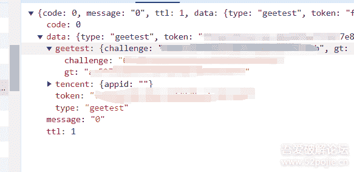
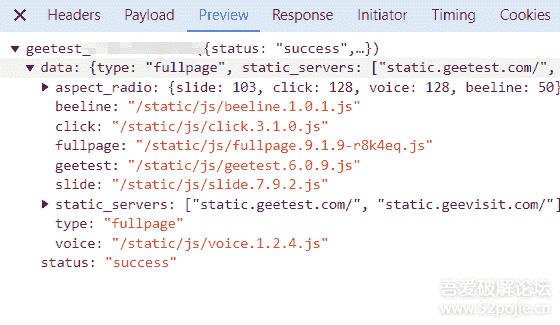
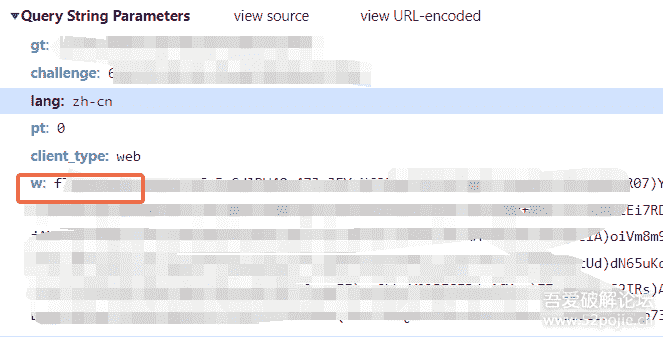
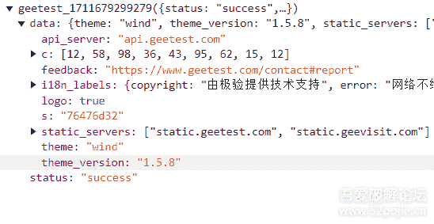
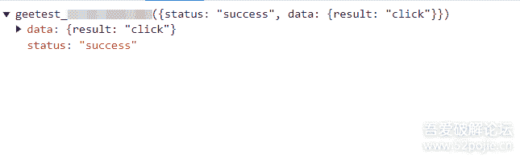
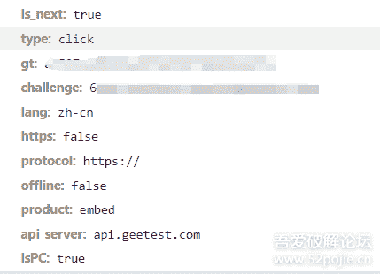

# [Web逆向] 某验点选验证码分析

- 原帖：<https://www.52pojie.cn/forum.php?mod=viewthread&tid=1909489>
- 抓取时间：2026-11-01T22:33:46

## 声明

本文章中所有内容仅供学习交流使用，不用于其他任何目的，不提供完整代码，抓包内容、敏感网址、数据接口等均已做脱敏处理，严禁用于商业用途和非法用途，否则由此产生的一切后果均与作者无关。本文章未经许可禁止转载，禁止任何修改后二次传播，擅自使用本文讲解的技术而导致的任何意外，作者均不负责，若有侵权，请联系作者立即删除。

链接：`aHR0cHM6Ly93d3cuYmlsaWJpbGkuY29tLw==`

## 流程分析

尝试点击页面的登录会触发点选验证码，随便点几下触发验证流程。

从 `devtools` 中可以分析得到整个验证码的验证流程如下：

1. 首先访问 [//passport.bilibili.com/x/passport-login/captcha](https://passport.bilibili.com/x/passport-login/captcha) 拿到极验的 `gt` 和 `challenge` 参数，用于后续的验证。

   

   `1712048977504-3d661aa5-60de-4ffc-be9e-70641b238ff7.png`（22.16 KB，下载次数：1）

   [附件下载](https://www.52pojie.cn/forum.php?mod=attachment&aid=MjY4NzI0MXw0MTZjMmQ0N3wxNzkzNTcyNDIzfDE2ODA4NnwxOTA5NDg5&nothumb=yes)

   2024-4-3 17:47 上传

2. 然后根据 `gt` 参数访问 [//api.geetest.com/gettype.php](https://api.geetest.com/gettype.php) 获取并加载当前版本的 `js` 代码。

   

   `1712048977504-3d661aa5-60de-4ffc-be9e-70641b238ff7.png`（36.4 KB，下载次数：0）

   [附件下载](https://www.52pojie.cn/forum.php?mod=attachment&aid=MjY4NzIzN3xjMGFmNGFhMXwxNzkzNTcyNDIzfDE2ODA4NnwxOTA5NDg5&nothumb=yes)

   2024-4-3 17:27 上传

3. 访问 [https://api.geetest.com/get.php](https://api.geetest.com/get.php) 获取一些基本信息，校验的服务器 `api` 地址、`c`、`s` 参数等，可以看到访问时带了一个 `w` 参数，暂时不知道生成逻辑。

   

   `1712048977504-3d661aa5-60de-4ffc-be9e-70641b238ff7.png`（25.78 KB，下载次数：1）

   [附件下载](https://www.52pojie.cn/forum.php?mod=attachment&aid=MjY4NzI0MnxhMTQ4N2FkZnwxNzkzNTcyNDIzfDE2ODA4NnwxOTA5NDg5&nothumb=yes)

   2024-4-3 17:48 上传

   

   `1712048977504-3d661aa5-60de-4ffc-be9e-70641b238ff7.png`（28.54 KB，下载次数：1）

   [附件下载](https://www.52pojie.cn/forum.php?mod=attachment&aid=MjY4NzI0M3xmMjdiZTM0OHwxNzkzNTcyNDIzfDE2ODA4NnwxOTA5NDg5&nothumb=yes)

   2024-4-3 17:48 上传

4. 访问 [//api.geetest.com/ajax.php](https://api.geetest.com/ajax.php) 接口拿到验证码校验类型，该接口同样有 `w` 参数。

   

   `1712048977504-3d661aa5-60de-4ffc-be9e-70641b238ff7.png`（11.57 KB，下载次数：0）

   [附件下载](https://www.52pojie.cn/forum.php?mod=attachment&aid=MjY4NzI0NHwxZmViMjRjOHwxNzkzNTcyNDIzfDE2ODA4NnwxOTA5NDg5&nothumb=yes)

   2024-4-3 17:54 上传

5. 再次访问 [//api.geetest.com/get.php](https://api.geetest.com/get.php)，这次请求带上了更多参数，包括 `w`、验证码类型、`api_server` 等，返回的数据也带上了验证码图片和新的 `c`、`s` 参数。

   

   `1712048977504-3d661aa5-60de-4ffc-be9e-70641b238ff7.png`（17.51 KB，下载次数：1）

   [附件下载](https://www.52pojie.cn/forum.php?mod=attachment&aid=MjY4NzI0Nnw0MTYyMTEzYXwxNzkzNTcyNDIzfDE2ODA4NnwxOTA5NDg5&nothumb=yes)

   2024-4-3 17:55 上传

   

6. 最后请求 [//api.geetest.com/ajax.php](https://api.geetest.com/ajax.php) 校验验证码，主要参数是 `gt`、`challenge` 和 `w`，得到验证结果。

通过对这个流程分析发现主要参数就是 `w`，因此要跟踪下三个 `w` 参数的请求，看下各自的 `w` 生成逻辑是什么。

## 第一次 `w` 生成逻辑分析

通过查看请求的调用栈可以知道第一个 `w` 是由 `fullpage.xxx.js` 生成的。


在请求调用栈上打个断点，找下 `w` 参数在哪里生成。


可以看到代码已经经过混淆，利用 `ast` 简单去掉字符串替换和 `unicode` 编码，`override content` 之后继续分析。


在代码中搜索 `"w"`，找到 5 处 `w` 的生成逻辑，5 处都打下断点后重新刷新。


打下断点再次刷新后停在了其中一处断点，可以知道第一个 `w` 由 `i+r` 组成。

### 1.1 `r` 参数分析

`r` 是由 `t["$_CCGw"]` 函数得到，往下跟这个函数的逻辑。


核心代码：

```
new X()["encrypt"](this["$_CCHU"](e))
```

其中 `this["$_CCHU"]` 函数如下图：


可以知道该函数作用是生成 `aes key`，如果已存在则使用已存在的 `key`，所以这个 `r` 参数应该是保存加密的 `aes key`。跟一下 `encrypt` 函数看下是什么加密算法。


从一些关键词判断应该是 RSA 算法，返回 16 进制字符串，从上下文代码中可以找到设置 RSA 公钥的函数 `SetPublic`，在该函数下断点跟一下即可知道公钥 `e` 和 `t`。


### 1.2 `i` 参数分析

根据上文的代码截图可以知道 `i` 的来源。

关键代码：


```js
o = $_BFo()["encrypt1"](de["stringify"](t["$_EJV"]), t["$_CCHU"]()),
i = p["$_HEt"](o)
```

# `o` 参数生成

`t["$_EJV"]` 是一个 `Object`，保存了一些验证码的信息。


`t["$_CCHU"]()` 从上面的 `i` 参数知道是一个 aes key。


然后分析下 `encrypt1` 函数的逻辑，简单查看代码逻辑后基本断定是 aes 加密算法，而且从各种函数关键词来看基本不会是魔改 aes。

主动调用该函数确认是标准的 aes，并且采用 cbc 模式/pkcs7 填充，`iv` 默认是 `0000000000000000`。


完成 aes 加密之后对每个 32 位的数字做如下转换。


其作用是将 32 位的数字转为四个 8 位的数字。

# `i` 参数生成


`i` 由 `p["$_HEt"]` 函数输入 `o` 经过一系列操作之后由 `res+end` 组成，其中 `$_HCK` 函数有多处将三个 8bit 数字换算成 24bit 数字然后转换为四个字符的逻辑，似乎是 base64 算法变体。

`t` 函数是取指定 `t` 二进制位上对应的值组合成新的数字。


`$_GJI` 函数作用是取对应数字的字符，取不到则用 `.` 代替。`$_GAp="ABCDEFGHIJKLMNOPQRSTUVWXYZabcdefghijklmnopqrstuvwxyz0123456789()"`，与标准 base64 需要的字符串差异在最后两个字符由 `+/` 变为了 `()`。


`$_GCK=7274496`（二进制：`11011110000000000000000`），`$_GDu=9483264`（`100100001011010000000000`）

`$_GEk=19220`（`100101100010100`），`$_GFY=235`（`11101011`）

实现标准 base64 需要的四个数字应该是：

`0xfc0000(111111000000000000000000)`，

`0x3f000(111111000000000000)`，

`0xfc0(111111000000)`，

`0x3f(111111)`，

跟标准 base64 实现有点不同。

## 1.3 总结分析

`r` 参数保存 aes 密钥，采用 RSA 加密后取 16 进制，`i` 是 aes 加密数据后采用 base64 编码的字符串。

# 第二次 `w` 生成逻辑分析

第二个 `w` 同样是由 `fullpage.xxx.js` 生成的。


`n["w"] = t["$_CEAN"]`


跟踪下 `t["$_CEAN"]` 的生成，可以发现同样是采用 aes 加密，不过加密的数据不同，这个 `r` 参数当中有很多未知的参数，似乎是一些环境检测的参数。

```json
{"lang":"zh-cn","type":"fullpage","tt":"M6(*((1Sj((sM((","light":-1,"s":"c7c3e21112fe4f741921cb3e4ff9f7cb","h":"321f9af1e098233dbd03f250fd2b5e21","hh":"39bd9cad9e425c3a8f51610fd506e3b3","hi":"09eb21b3ae9542a9bc1e8b63b3d9a467","vip_order":-1,"ct":-1,"ep":{"v":"9.1.9-r8k4eq","te":false,"$_BBp":false,"ven":"Google Inc. (NVIDIA)","ren":"ANGLE (NVIDIA, NVIDIA GeForce RTX 3070 (0x00002488) Direct3D11 vs_5_0 ps_5_0, D3D11)","fp":null,"lp":null,"em":{"ph":0,"cp":0,"ek":"11","wd":1,"nt":0,"si":0,"sc":0},"tm":{"a":1711849377534,"b":1711849377617,"c":1711849377617,"d":0,"e":0,"f":1711849377539,"g":1711849377539,"h":1711849377539,"i":1711849377539,"j":1711849377539,"k":0,"l":1711849377547,"m":1711849377614,"n":1711849377615,"o":1711849377620,"p":1711849377751,"q":1711849377751,"r":1711849377752,"s":1711849378121,"t":1711849378121,"u":1711849378121},"dnf":"dnf","by":2},"passtime":8258,"rp":"d2d182b3ce6cf55f590e9ec11c9b1635","captcha_token":"549902629","otpj":"jm4jwcx7"}
```

搜一下其中关键词例如 `"hh"` 找到代码逻辑位置。


## 2.1 `s` 参数分析


关键代码 `H(p["$_HD_"](t))`，其中 `p["$HD"]` 根据上文分析已知是 base64 变体算法，`t` 是一个字符串，`H` 函数是标准 md5 算法。


`t` 这个字符串来自 `$_BICT` 函数生成，`$_BICT` 函数用于收集鼠标操作事件并采用 base64 编码，base64 字符映射为 `"()*,-./0123456789:?@ABCDEFGHIJKLMNOPQRSTUVWXYZ_abcdefghijklmnopqrstuvwxyz~"`。

收集到的鼠标事件信息会进行一系列转换成二进制字符串后进行 base64 编码，核心代码如下：

```js
for (var t = [], n = [], r = [], o = [], i = 0, s = e["length"]; i 
```

其中 `t` 是鼠标事件数组，例如：`["move", "move", "down", "move", "up"]`，鼠标事件包括：move/down/up/scroll/focus/blur/unload。

`n` 是鼠标事件发生的毫秒级时间戳数组（例如：`[1711952404794, 1711952404794, 1711952404798, 1711952404798, 1711952404798]`）。

如果传入该函数的 `e` 参数每个元素是一个长度 3 的数组，即每个元素只记录了 `[事件类型, [x 坐标, y 坐标], 毫秒级时间戳]` 信息，例如：`["move", [123, 456], 1711952404794]`、`["down", [123, 456], 1711952404798]`，则 `r` 和 `o` 参数分别是记录 x 和 y 坐标的数组。

## 2.2 `h` 参数分析

```js
n = i["$_BJDB"]["$_BICT"]();

["h", H(p["$_HD_"](n))];
```


`i["$_BJDB"]["$_BICT"]` 函数作用是检测一个 `Object` 对象（该对象为空 `Object`）指定的属性是否存在，存在则返回该属性的值，不存在则返回 `-1`，由此组成一个数组并用 `"magic data"` 字符串 `joi` 拼接这个数组得到。检测的属性列表如下：

```js
["textLength","HTMLLength","documentMode","A","ARTICLE","ASIDE","AUDIO","BASE","BUTTON","CANVAS","CODE","IFRAME","IMG","INPUT","LABEL","LINK","NAV","OBJECT","OL","PICTURE","PRE","SECTION","SELECT","SOURCE","SPAN","STYLE","TABLE","TEXTAREA","VIDEO","screenLeft","screenTop","screenAvailLeft","screenAvailTop","innerWidth","innerHeight","outerWidth","outerHeight","browserLanguage","browserLanguages","systemLanguage","devicePixelRatio","colorDepth","userAgent","cookieEnabled","netEnabled","screenWidth","screenHeight","screenAvailWidth","screenAvailHeight","localStorageEnabled","sessionStorageEnabled","indexedDBEnabled","CPUClass","platform","doNotTrack","timezone","canvas2DFP","canvas3DFP","plugins","maxTouchPoints","flashEnabled","javaEnabled","hardwareConcurrency","jsFonts","timestamp","performanceTiming","internalip","mediaDevices","DIV","P","UL","LI","SCRIPT","touchEvent"]
```

## 2.3 `tt` 参数分析

```js
e = i["$_CAAG"]["$_BIBg"]();
```


`tt` 参数作用是根据服务器返回的 `c` 和 `s` 参数截取鼠标事件 base64 编码后的字符串，可能是用于校验。

`c` 是一个纯数字字符串，每两个字符代表一个 16 进制数字；`s` 是一个数组，取其中下标 `0`、`2`、`4` 三个数字。

## 2.4 `hh` 参数分析

```js
["hh", H(n)]
```

`hh` 参数是 `n` 的 md5 值，跟 `h` 参数区别是 `h` 参数是 base64 编码 `n` 之后取 md5 值。

## 2.5 `hi` 参数分析

```js
var e = t["$_BJDB"]["$_BIBg"]();

t["$_CCFY"] = e;

["hi", H(i["$_CCFY"])]
```


`t["$_BJDB"]["$_BIBg"]` 函数的作用与 2.2 `h` 参数分析中的 `n` 变量的生成相似，只是组成的数组用 `"!!"` 字符串 `join` 拼接得到。

## 2.6 `ep` 参数分析

```js
["ep", i["$_CEDy"]() || -1]
```


`ep` 参数应该是一些环境检测的汇总数据，各属性可以在代码中看出来，汇总如下：

| 属性名 | 作用 |
| --- | --- |
| `v` |  |
