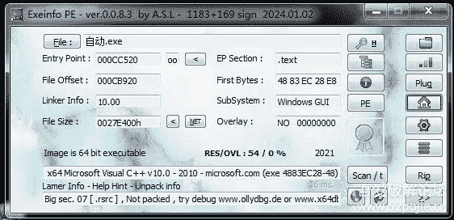
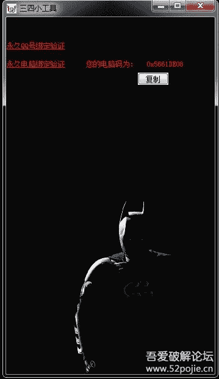
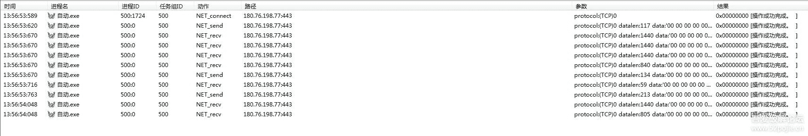
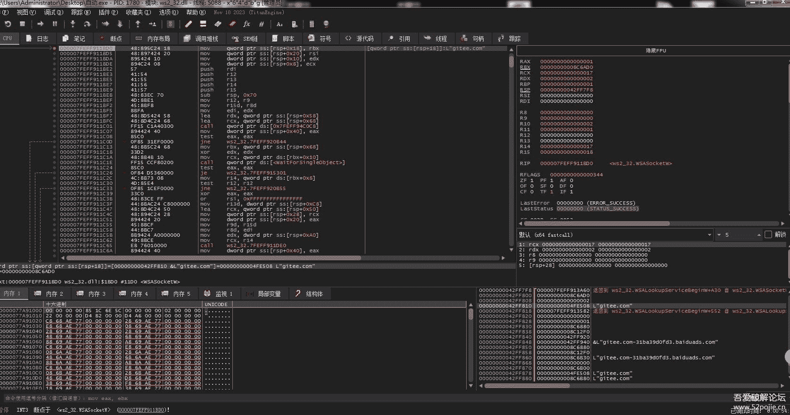
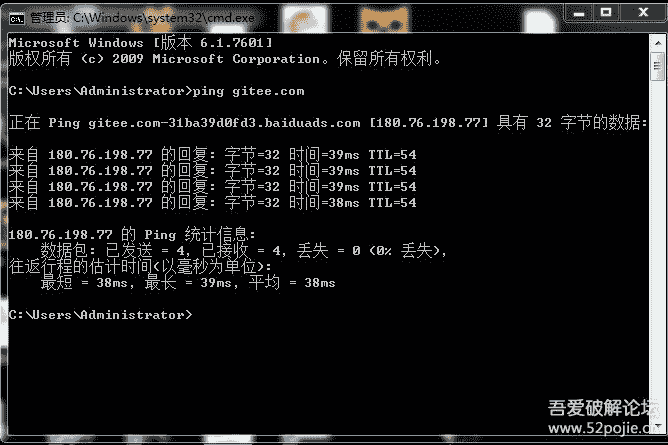
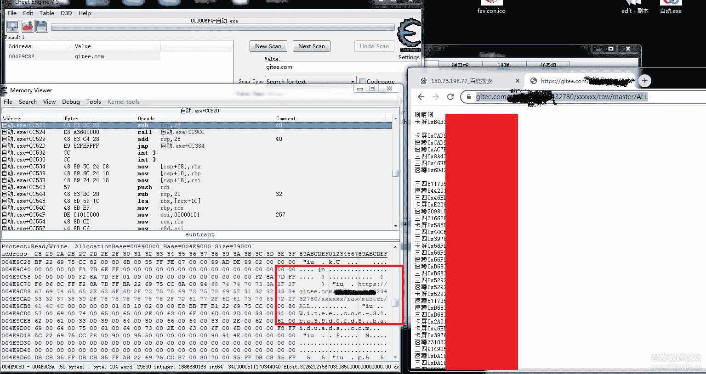
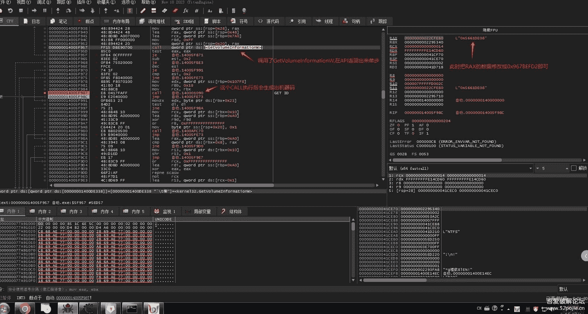
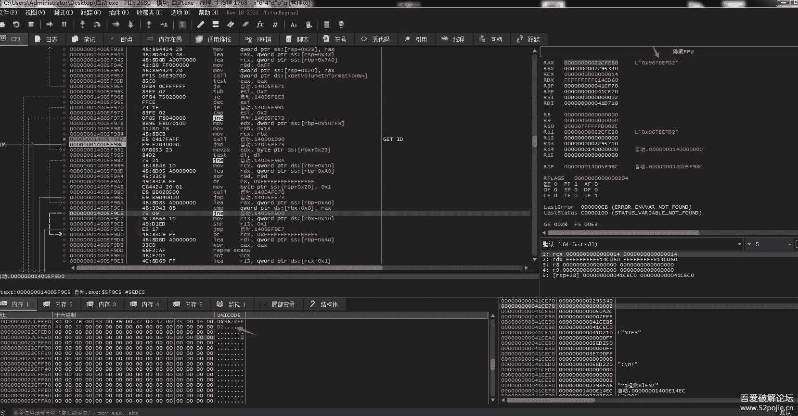
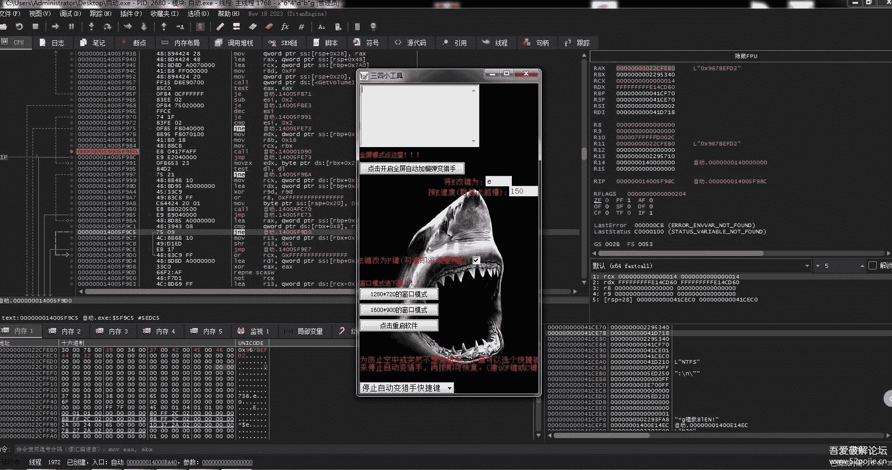

# [原创] [入门级]一个64位软件的验证分析及逆向过程

- 原帖: https://www.52pojie.cn/forum.php?mod=viewthread&tid=1909495
- 抓取时间: 2026-11-01T22:33:43

## 前言
本来是一个小单子，被逃单的恶心到了，那么就做成教程分享给大家
软件64位无壳，有多种逆向方法及思路，本文概述了整个逆向过程，适合初阶入门
软件来源于逃单者，练手请在[//www.52pojie.cn/thread-661779-1-1.html" target="_blank" class="relatedlink"](https://www.52pojie.cn/thread-661779-1-1.html:href="https)内进行！！！
样本:https://www.lanzoul.com/iBM3H1tr4dwh

## 初步分析
首先是查壳，可以看到查壳结果是64位无壳的`C++`软件



1.png (51.27 KB, 下载次数: 2)

[href="forum.php?mod=attachment&aid=MjY4NzIxOHxiNjNjMGY2YnwxNzkzNTcyNDIxfDE2ODA4NnwxOTA5NDk1&nothumb=yes" target="_blank"](https://www.52pojie.cn/forum.php?mod=attachment&aid=MjY4NzIxOHxiNjNjMGY2YnwxNzkzNTcyNDIxfDE2ODA4NnwxOTA5NDk1&nothumb=yes)

2024-4-3 17:12 上传

打开软件可以看到两种验证方式，一种是机器码验证，一种是QQ号验证，未见有卡密验证



2.png (22.03 KB, 下载次数: 1)

[href="forum.php?mod=attachment&aid=MjY4NzIxOXxkMWVlYTQ1NXwxNzkzNTcyNDIxfDE2ODA4NnwxOTA5NDk1&nothumb=yes" target="_blank"](https://www.52pojie.cn/forum.php?mod=attachment&aid=MjY4NzIxOXxkMWVlYTQ1NXwxNzkzNTcyNDIxfDE2ODA4NnwxOTA5NDk1&nothumb=yes)

2024-4-3 17:12 上传

按惯例丢进火绒剑分析下网络情况，发现是443端口的`Https`交互



3.png (109.67 KB, 下载次数: 2)

[href="forum.php?mod=attachment&aid=MjY4NzIyMHw3MTllYTc2YXwxNzkzNTcyNDIxfDE2ODA4NnwxOTA5NDk1&nothumb=yes" target="_blank"](https://www.52pojie.cn/forum.php?mod=attachment&aid=MjY4NzIyMHw3MTllYTc2YXwxNzkzNTcyNDIxfDE2ODA4NnwxOTA5NDk1&nothumb=yes)

2024-4-3 17:12 上传

综合软件的结构及网络情况，机器码验证/QQ号验证+`Https`交互
那么软件很可能属于弱逻辑的验证，访问了一些接口或页面就能判断是否授权的机器
此时应有[//www.52pojie.cn" target="_blank" class="relatedlink"](https://www.52pojie.cn:href="https)思路：
1. 山寨接口
2. 山寨封包
3. 硬改机器码
4. 修改跳转

## 网络分析
先从网络分析入手，软件拖进`x64dbg`后，分别在`socket`、`send`、`recv`等常用的网络函数下断点，然后运行
会发现一个都没断下来，那么就应该是用了`WSAsocket`、`WSAsend`、`WSArecv`，我们在这些`WSA`网络函数也分别下断点
如期，断点被触发，一边`F9`执行一边观察堆栈信息，可以看到大量`Gitee`的字眼



4.png (311.34 KB, 下载次数: 2)

[href="forum.php?mod=attachment&aid=MjY4NzIyMXwzZmE5YmI1ZXwxNzkzNTcyNDIxfDE2ODA4NnwxOTA5NDk1&nothumb=yes" target="_blank"](https://www.52pojie.cn/forum.php?mod=attachment&aid=MjY4NzIyMXwzZmE5YmI1ZXwxNzkzNTcyNDIxfDE2ODA4NnwxOTA5NDk1&nothumb=yes)

2024-4-3 17:13 上传

此时应该猜测`Https`交互的是否就是`Gitee`？用`cmd` `Ping`一下`Gitee.com`进行实验



5.png (59.27 KB, 下载次数: 1)

[href="forum.php?mod=attachment&aid=MjY4NzIyMnwzNGQxYmY1NHwxNzkzNTcyNDIxfDE2ODA4NnwxOTA5NDk1&nothumb=yes" target="_blank"](https://www.52pojie.cn/forum.php?mod=attachment&aid=MjY4NzIyMnwzNGQxYmY1NHwxNzkzNTcyNDIxfDE2ODA4NnwxOTA5NDk1&nothumb=yes)

2024-4-3 17:13 上传

域名跟`IP`确实对上了，当然还有更快捷的方法，就是开局直接把`IP`丢进百度搜一下有没有相关信息，或者直接抓包。
既然软件所有网络交互都是与`Gitee`有关，那么就知道验证的数据就是放在`Gitee`里了

## 思路整理
此时应该重新调整思路，将目标转移`Gitee`的网站上，分析软件使用了`Gitee`什么页面的数据来交互验证
如果你不知道`Gitee`是干什么用的，那你应该知道`Github`吧，一个存放源码或者文件的地方
至于软件访问了`Gitee`什么内容或者执行了什么操作，就要继续进行分析

## 软件分析
接着上面的分析思路，这里就可以掏出`CE`来搜索软件有没有相关`Gitee`的信息，为啥不直接用`dbg`的搜索？因为用过的都知道不好使
`CE`直接搜索`gitee.com`，发现有一条相关信息，跳转到该地址内存区域查看，可以看到一个重要信息
打开这个网站后，竟然就直接明文看到所有授权数据



6.png (295.22 KB, 下载次数: 1)

[href="forum.php?mod=attachment&aid=MjY4NzIyN3w0YzBjZWFlYXwxNzkzNTcyNDIxfDE2ODA4NnwxOTA5NDk1&nothumb=yes" target="_blank"](https://www.52pojie.cn/forum.php?mod=attachment&aid=MjY4NzIyN3w0YzBjZWFlYXwxNzkzNTcyNDIxfDE2ODA4NnwxOTA5NDk1&nothumb=yes)

2024-4-3 17:13 上传

因此可以大致的猜测到软件的验证思路：
打开软件-->访问授权数据页面-->校验本机机器码/QQ是否登记-->授权成功/失败
按照软件的验证思路，那么拿下授权就有多种方法：
- 授权页面替换
- 替换机器码
- 修改跳转逻辑 (就是我们说的爆破了，教程很多，这里就不分析了)

### 方法１：授权页面替换
页面替换方法最为简单，在`Gitee`建立相同的页面，替换掉软件的原地址即可。
需要注意的是：与原地址保持相同的地址长度
比如原地址为：`www.baidu.com/helloword/test`
你的地址应为: `www.baidu.com/123456789/1234`
避免了长度溢出或不足，可以省下不少功夫

### 方法２：机器码替换
要生成机器码，那么软件必须要先读取机器的信息在获取电脑硬件信息的常用`API`都下个断看看，注意软件是64位程序，64位大多采用`utf8`编码，`API`应优先使用带`W`结尾的。

`GetAdaptersInfo`

`GetVolumeInformation`

`GetComputerName`

获取机器码时，在`GetVolumeInformation`被断下来，直接返回上一层继续单步
可以看到在`000000014005F987`处的`call`，根据`GetVolumeInformation`数据生成了一个机器码

```
000000014005F987 | E8 0417FAFF | call 自动.140001090
```



7.png (321.07 KB, 下载次数: 1)

[href="forum.php?mod=attachment&aid=MjY4NzIyNnxjZjE3N2QzMnwxNzkzNTcyNDIxfDE2ODA4NnwxOTA5NDk1&nothumb=yes" target="_blank"](https://www.52pojie.cn/forum.php?mod=attachment&aid=MjY4NzIyNnxjZjE3N2QzMnwxNzkzNTcyNDIxfDE2ODA4NnwxOTA5NDk1&nothumb=yes)

2024-4-3 17:13 上传

由于逃单者提供了一台授权的机器，`0x967BEFD2`


8.png (5.05 KB, 下载次数: 1)

[href="forum.php?mod=attachment&aid=MjY4NzIyNXw2NWM4NmI3Y3wxNzkzNTcyNDIxfDE2ODA4NnwxOTA5NDk1&nothumb=yes" target="_blank"](https://www.52pojie.cn/forum.php?mod=attachment&aid=MjY4NzIyNXw2NWM4NmI3Y3wxNzkzNTcyNDIxfDE2ODA4NnwxOTA5NDk1&nothumb=yes)

2024-4-3 17:13 上传

这里直接将该授权作为机器码返回值。



9.png (302.82 KB, 下载次数: 1)

[href="forum.php?mod=attachment&aid=MjY4NzIyNHxiYjkyNjg3OHwxNzkzNTcyNDIxfDE2ODA4NnwxOTA5NDk1&nothumb=yes" target="_blank"](https://www.52pojie.cn/forum.php?mod=attachment&aid=MjY4NzIyNHxiYjkyNjg3OHwxNzkzNTcyNDIxfDE2ODA4NnwxOTA5NDk1&nothumb=yes)

2024-4-3 17:13 上传

替换后，直接进入软件。



10.png (359.59 KB, 下载次数: 2)

[href="forum.php?mod=attachment&aid=MjY4NzIyM3xkMWQzZGMyOHwxNzkzNTcyNDIxfDE2ODA4NnwxOTA5NDk1&nothumb=yes" target="_blank"](https://www.52pojie.cn/forum.php?mod=attachment&aid=MjY4NzIyM3xkMWQzZGMyOHwxNzkzNTcyNDIxfDE2ODA4NnwxOTA5NDk1&nothumb=yes)

2024-4-3 17:13 上传

## 最后
至此教程已经结束，由于此教程仅作交流学习及思路分享，所以教程不会提供成品，而且我也不知道软件的具体作用，只是鼓励大家多动手。
软件漏洞及相关洩漏的机器码已经提交给作者进行修复。
