# [MacOS逆向] utools V5 分析学习

- 原帖: https://www.52pojie.cn/forum.php?mod=viewthread&tid=1910115
- 抓取时间: 2026-11-01T22:33:40

准备一颗灵活的大脑 &#128516;

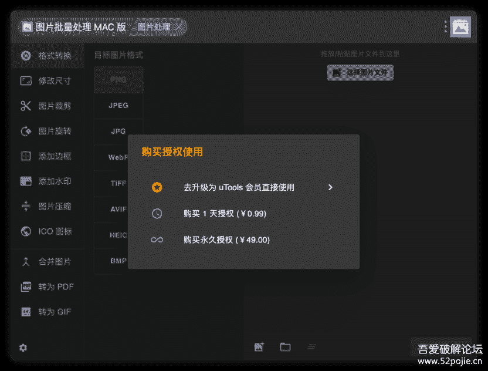
图片 1.png (97.58 KB, 下载次数: 3)
[href="forum.php?mod=attachment&aid=MjY4NzU0MHxmMmIyMTk2MnwxNzkzNTcyNDE3fDE2ODA4NnwxOTEwMTE1&nothumb=yes" target="_blank"](https://www.52pojie.cn/forum.php?mod=attachment&aid=MjY4NzU0MHxmMmIyMTk2MnwxNzkzNTcyNDE3fDE2ODA4NnwxOTEwMTE1&nothumb=yes)
2024-4-5 22:41 上传

- IDA 或者 Hopper 都可以
- `asar`(解包)
- VS Code + Prettier (格式化)

本次学习 分析的是 x86 的二进制文件，其他平台 原理相同

致敬 utools V4版本最新、最简单会员插件[//www.52pojie.cn" target="_blank" class="relatedlink"](https://www.52pojie.cn:href="https)流程分享

流程都是一样的 我比较懒 直接梭哈了 这里都正常

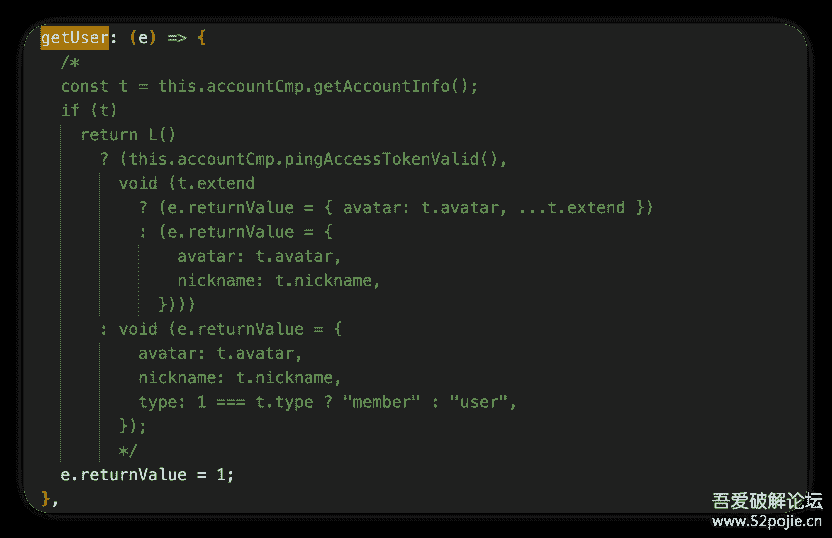
图片 2.png (90.29 KB, 下载次数: 0)
[href="forum.php?mod=attachment&aid=MjY4NzU1OHw1N2E1Y2ViNHwxNzkzNTcyNDE3fDE2ODA4NnwxOTEwMTE1&nothumb=yes" target="_blank"](https://www.52pojie.cn/forum.php?mod=attachment&aid=MjY4NzU1OHw1N2E1Y2ViNHwxNzkzNTcyNDE3fDE2ODA4NnwxOTEwMTE1&nothumb=yes)
2024-4-5 22:51 上传

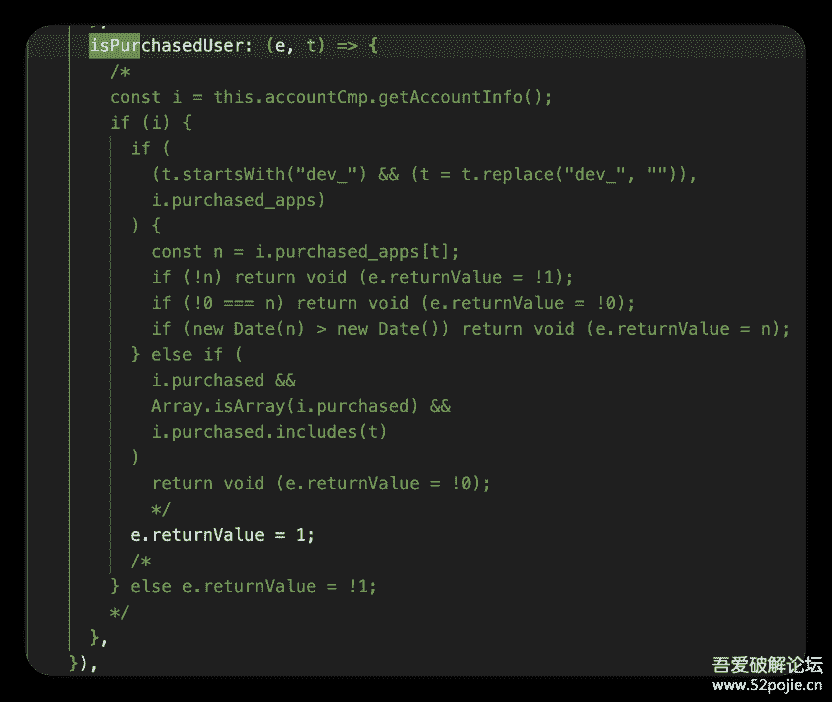
图片 3.png (126.39 KB, 下载次数: 2)
[href="forum.php?mod=attachment&aid=MjY4NzU1OXxkODMzZWVmMHwxNzkzNTcyNDE3fDE2ODA4NnwxOTEwMTE1&nothumb=yes" target="_blank"](https://www.52pojie.cn/forum.php?mod=attachment&aid=MjY4NzU1OXxkODMzZWVmMHwxNzkzNTcyNDE3fDE2ODA4NnwxOTEwMTE1&nothumb=yes)
2024-4-5 22:51 上传

图片 4.png (119.12 KB, 下载次数: 3)
[href="forum.php?mod=attachment&aid=MjY4NzU2MHxjZTRjYzQ4OXwxNzkzNTcyNDE3fDE2ODA4NnwxOTEwMTE1&nothumb=yes" target="_blank"](https://www.52pojie.cn/forum.php?mod=attachment&aid=MjY4NzU2MHxjZTRjYzQ4OXwxNzkzNTcyNDE3fDE2ODA4NnwxOTEwMTE1&nothumb=yes)
2024-4-5 22:53 上传

打包一下 运行

图片 5.png (58.64 KB, 下载次数: 3)
[href="forum.php?mod=attachment&aid=MjY4NzU2MXw5MDE3MjJjZHwxNzkzNTcyNDE3fDE2ODA4NnwxOTEwMTE1&nothumb=yes" target="_blank"](https://www.52pojie.cn/forum.php?mod=attachment&aid=MjY4NzU2MXw5MDE3MjJjZHwxNzkzNTcyNDE3fDE2ODA4NnwxOTEwMTE1&nothumb=yes)
2024-4-5 22:54 上传

问题出现了 莫慌

图片 6.png (33.46 KB, 下载次数: 1)
[href="forum.php?mod=attachment&aid=MjY4NzU2Mnw4NDE4MDIyNXwxNzkzNTcyNDE3fDE2ODA4NnwxOTEwMTE1&nothumb=yes" target="_blank"](https://www.52pojie.cn/forum.php?mod=attachment&aid=MjY4NzU2Mnw4NDE4MDIyNXwxNzkzNTcyNDE3fDE2ODA4NnwxOTEwMTE1&nothumb=yes)
2024-4-5 22:54 上传

`find` 大法搜索一下

在 `/Applications/uTools.app/Contents/Resources/app/node_modules/addon` 中有个 `darwin-x64.node`

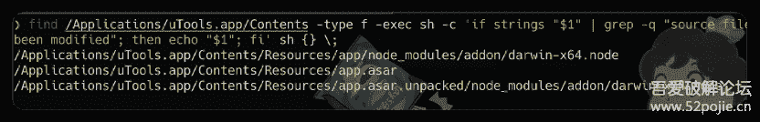
图片 7.png (108.16 KB, 下载次数: 3)
[href="forum.php?mod=attachment&aid=MjY4NzU2M3w1YmI2NjMxOHwxNzkzNTcyNDE3fDE2ODA4NnwxOTEwMTE1&nothumb=yes" target="_blank"](https://www.52pojie.cn/forum.php?mod=attachment&aid=MjY4NzU2M3w1YmI2NjMxOHwxNzkzNTcyNDE3fDE2ODA4NnwxOTEwMTE1&nothumb=yes)
2024-4-5 22:54 上传

hopper看一下 X 引用

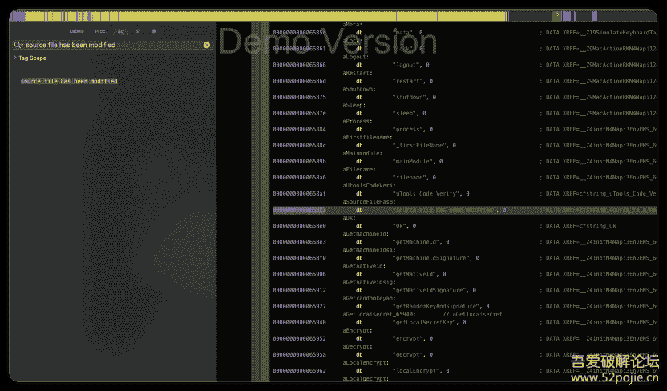
图片 9.png (295.88 KB, 下载次数: 2)
[href="forum.php?mod=attachment&aid=MjY4NzU3N3wwNWU3NDEwYnwxNzkzNTcyNDE3fDE2ODA4NnwxOTEwMTE1&nothumb=yes" target="_blank"](https://www.52pojie.cn/forum.php?mod=attachment&aid=MjY4NzU3N3wwNWU3NDEwYnwxNzkzNTcyNDE3fDE2ODA4NnwxOTEwMTE1&nothumb=yes)
2024-4-5 22:59 上传

点击起点 引用

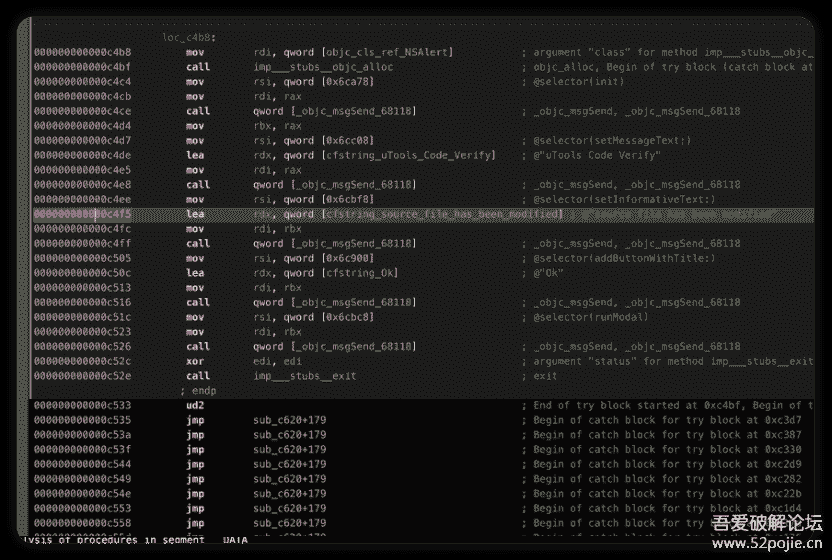
图片 7.png (381.49 KB, 下载次数: 2)
[href="forum.php?mod=attachment&aid=MjY4NzU4NHw4YWUyZGRiMnwxNzkzNTcyNDE3fDE2ODA4NnwxOTEwMTE1&nothumb=yes" target="_blank"](https://www.52pojie.cn/forum.php?mod=attachment&aid=MjY4NzU4NHw4YWUyZGRiMnwxNzkzNTcyNDE3fDE2ODA4NnwxOTEwMTE1&nothumb=yes)
2024-4-5 23:07 上传

跳到了这个位置 我们用ida看一下 流程图 可以更直接看出来 复制一下 地址 快捷键 `G` 跳到 `0b381`

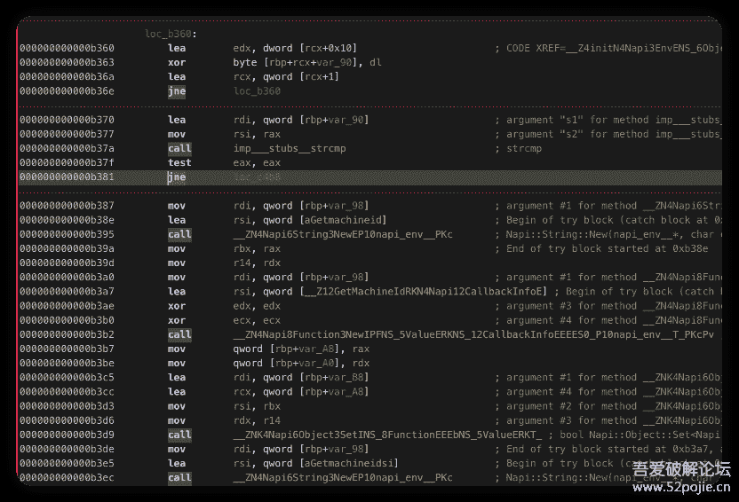
图片 10.png (459.05 KB, 下载次数: 1)
[href="forum.php?mod=attachment&aid=MjY4NzU3OHw5MGY2OTdhM3wxNzkzNTcyNDE3fDE2ODA4NnwxOTEwMTE1&nothumb=yes" target="_blank"](https://www.52pojie.cn/forum.php?mod=attachment&aid=MjY4NzU3OHw5MGY2OTdhM3wxNzkzNTcyNDE3fDE2ODA4NnwxOTEwMTE1&nothumb=yes)
2024-4-5 22:59 上传

看到了流程图应该一幕了然了

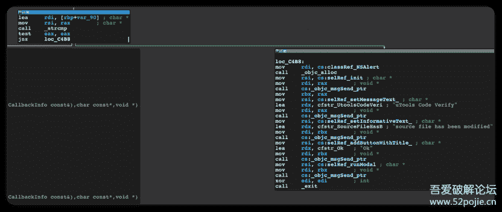
图片 11.png (121.29 KB, 下载次数: 2)
[href="forum.php?mod=attachment&aid=MjY4NzU3OXw3ZWRmNjFmMXwxNzkzNTcyNDE3fDE2ODA4NnwxOTEwMTE1&nothumb=yes" target="_blank"](https://www.52pojie.cn/forum.php?mod=attachment&aid=MjY4NzU3OXw3ZWRmNjFmMXwxNzkzNTcyNDE3fDE2ODA4NnwxOTEwMTE1&nothumb=yes)
2024-4-5 22:59 上传

这里看一下 `JZ`和`JNZ`的区别

图片 0.png (51.15 KB, 下载次数: 2)
[href="forum.php?mod=attachment&aid=MjY4NzYwMHw0ZTVjZTc5NnwxNzkzNTcyNDE3fDE2ODA4NnwxOTEwMTE1&nothumb=yes" target="_blank"](https://www.52pojie.cn/forum.php?mod=attachment&aid=MjY4NzYwMHw0ZTVjZTc5NnwxNzkzNTcyNDE3fDE2ODA4NnwxOTEwMTE1&nothumb=yes)
2024-4-5 23:18 上传

很简单我们把他改为`jz` 就可以了

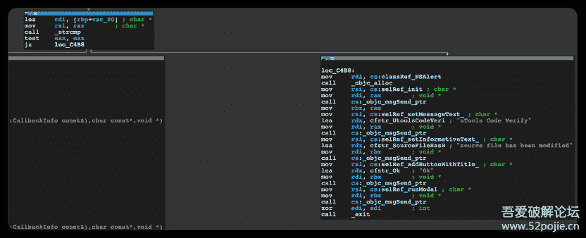
图片 12.png (118.04 KB, 下载次数: 4)
[href="forum.php?mod=attachment&aid=MjY4NzU4MHxlZWQ3Y2E5ZHwxNzkzNTcyNDE3fDE2ODA4NnwxOTEwMTE1&nothumb=yes" target="_blank"](https://www.52pojie.cn/forum.php?mod=attachment&aid=MjY4NzU4MHxlZWQ3Y2E5ZHwxNzkzNTcyNDE3fDE2ODA4NnwxOTEwMTE1&nothumb=yes)
2024-4-5 22:59 上传

我们来测试一下看看功能是否正常了 打包测试

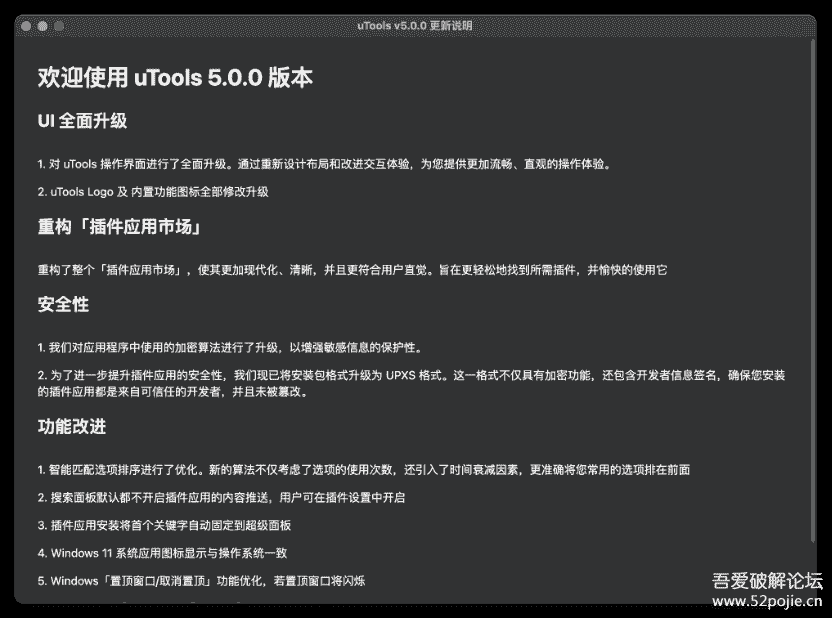
图片 13.png (184.6 KB, 下载次数: 2)
[href="forum.php?mod=attachment&aid=MjY4NzU4MXw1ODU2YjA3MXwxNzkzNTcyNDE3fDE2ODA4NnwxOTEwMTE1&nothumb=yes" target="_blank"](https://www.52pojie.cn/forum.php?mod=attachment&aid=MjY4NzU4MXw1ODU2YjA3MXwxNzkzNTcyNDE3fDE2ODA4NnwxOTEwMTE1&nothumb=yes)
2024-4-5 23:02 上传

一切正常

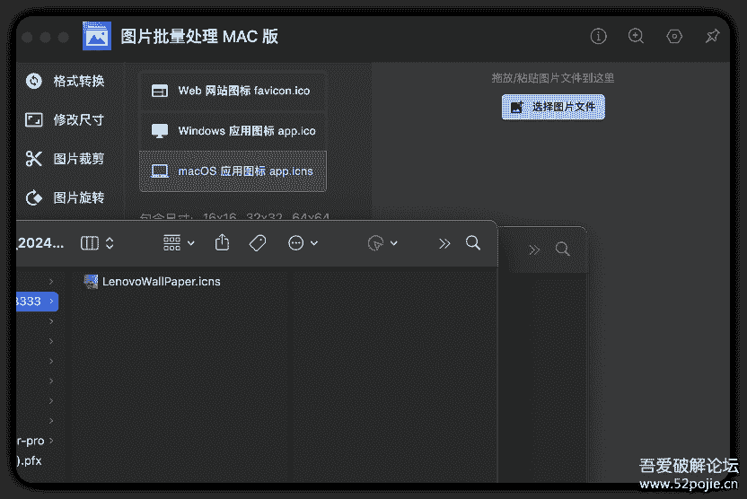
图片 14.png (93.12 KB, 下载次数: 3)
[href="forum.php?mod=attachment&aid=MjY4NzU4Mnw1ZWJhNjk0NXwxNzkzNTcyNDE3fDE2ODA4NnwxOTEwMTE1&nothumb=yes" target="_blank"](https://www.52pojie.cn/forum.php?mod=attachment&aid=MjY4NzU4Mnw1ZWJhNjk0NXwxNzkzNTcyNDE3fDE2ODA4NnwxOTEwMTE1&nothumb=yes)
2024-4-5 23:02 上传

完
