# [Web逆向] 某音乐站混淆加密分析

- 原帖: https://www.52pojie.cn/forum.php?mod=viewthread&tid=1910709
- 抓取时间: 2026-11-01T22:33:37

## 目标网站

> aHR0cHM6Ly90b29sLmxpdW1pbmd5ZS5jbi9tdXNpYw==

## 前言

去年搞了一个网站。一直没写。最近没事干。把去年写的这个网站重新梳理一下 顺便重新记录一下。

## 网站分析

如下图所示。`token`是本文目标

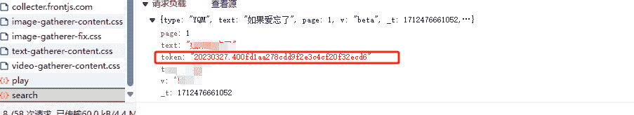

直接下文打上条件断点

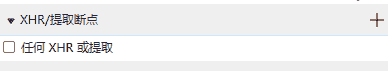

然后往上去找栈。重新打断点 发现在这个地方。

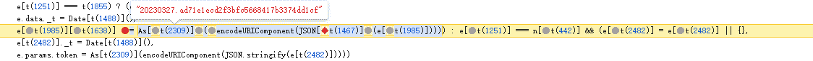

下文是转换代码

```
As[t(2309)](encodeURIComponent(JSON[t(1467)](e[t(1985)])))
// ================转换后=====================
As['encode'](encodeURIComponent(JSON['stringify'](e['data'])))
```

这一步很好理解。就是调用`encode`方法。然后传参。 这个`e['data']` 就是传值的参数。

本文为 `'{"type":"YQM","text":"x你的搜索关键词x","page":1,"v":"beta","_t":1712478799346}'`

然后我们进去这个`encode`看看。

然后发现最终加密点在倒数第二个`return`中

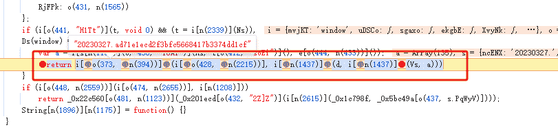

这里我们再转换一波 一堆的OB混淆看着头疼。

### 扣代码

先来看一下这个上文这个字典`i`

如下图所示。

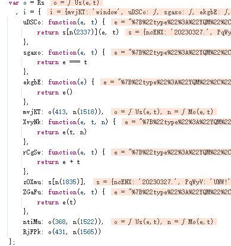

然后我们去转换代码

可以看到这里面转混淆到后面就是很简单了

```
i[o(373, n(394))](i[o(428, n(2215))], i[n(1437)](d, i[n(1437)](Vs, a)))

>>>> i['rCgSw'] // function(e, t) { return e + t }

>>>> i[o(428, n(2215))] + i[n(1437)](d, i['ZGaFu'](Vs, a))

>>>> i['zOXmu'] + i['ZGaFu'](d,i['ZGaFu'](Vs, a)) // i['ZGaFu'] === function(e, t) {return e(t)}

>>>> '20230327.' + d(vs(a))
```

这里发现就是一个定值 然后调用了 `d(vs(a))`

然后这个`d`呢 有点像md5 但是测试下来却不是。估计是魔改了一些东西吧。`vs`是扣的方法

这个`a`我们再来看看。

文中也有`a`的赋值处。

```
var a = i[s[n(1158)](o, 430, "Y8AT")](Hs, t[o(412, "soEi")](), e[o(444, n(433))]());
```

这里又是一堆ob啊。没关系 再次手动转换。

```
>>>> i[s['VMbIn']](o, 430, "Y8AT")](Hs, t['toString'](), e['toString']())

s['VMbIn'] ===  (e,t,n){return e(t,n)}

>>>> i[o(430,"Y8AT")](Hs, t['toString'](), e['toString']())

>>>> i['XvyNk'](Hs, t['toString'](), e['toString']()) //  i['XvyNk']===(e,t,n){return e(t,n)}

>>>> Hs(t['toString'](),e['toString']())
```

然后就是 重新梳理规整一下了。

这里`e`呢 是经过`decodeURIComponent`编码的。

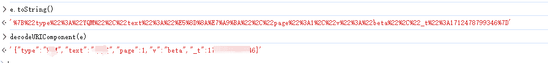

`t`的代码如下

```
t = i['ekgbE'](Ns) // (e){return e()}
```

`t`就是`Ns`函数生成的。经过分析可知。这是个定值

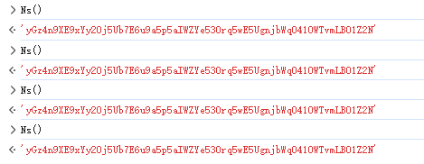

最终的代码很简单了

```
'20230327.' + d(vs(Hs(t['toString'](),e['toString']())))
```

然后就是把 三个函数全扣下来。 分别是`Hs` 和 `Vs` 以及`d`

这里简单讲一下`Vs`代码。首先还是固定的`i`模版。

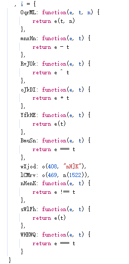

这里经过断点。发现生成处 `Vs` 最终生成了一组数组。

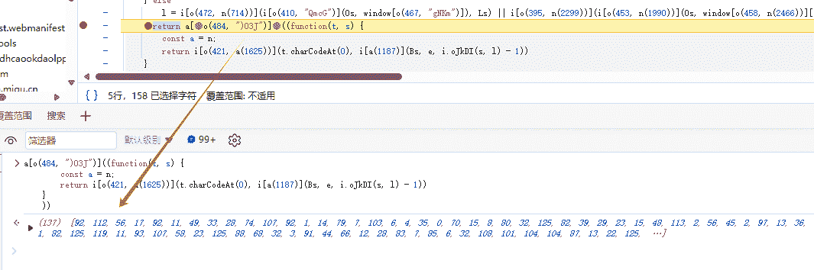

这里我们再次经过代码转换一波

```
a[o(484, ")O3J")]((function(t, s) {
        const a = n;
        return i[o(421, a(1625))](t.charCodeAt(0), i[a(1187)](Bs, e, i.oJkDI(s, l) - 1))
}
>>>>>
a["map"]((function(t, s) {
    const a = n;
    return i['RvJOk'](t.charCodeAt(0), i['OqrML'](Bs, e, i.oJkDI(s, l) - 1))
}
===================================================
i['RvJOk'] === function(e, t) { return e ^ t }
i['OqrML'] === function(e, t, n) {return e(t, n)}
===================================================
>>>
i['RvJOk'](t.charCodeAt(0), i['OqrML'](Bs, e, i.oJkDI(s, l) - 1))
>>>
t.charCodeAt(0) ^ Bs(e,i.oJkDI(s, l) - 1))
/// ==== 这里还有要转换的别忘记了 i.oJkDI(s, l) ===function(e, t) { return e + t }
>>>
t.charCodeAt(0) ^ Bs(e,s + l - 1))
```

`l`呢 测试下来等于 1

`a` 如下图所示

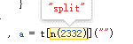

这里最终代码如下

```
function Us(e, t) {

    let a = t["split"]("")

    return a['map']((function (t, s) {

            return t.charCodeAt(0) ^ Bs(e, s + 1 - 1)

        }

    ))

}
```

剩下的`Vs`和`d`我这里不扣了 其实流程都是一样的。有耐心慢慢扣。结果都能出来。

### 最终结果

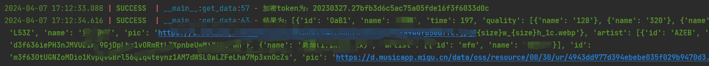
