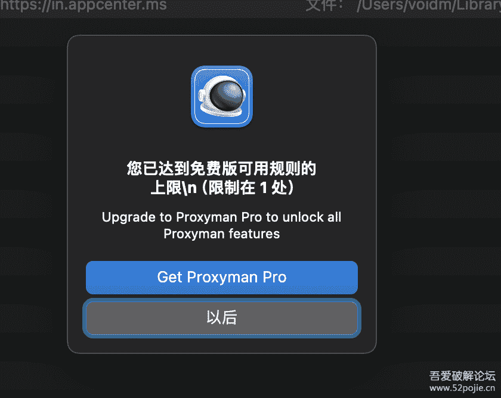
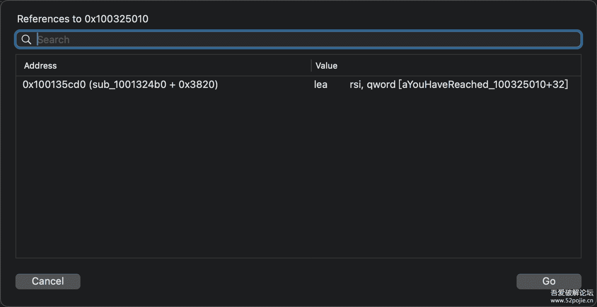
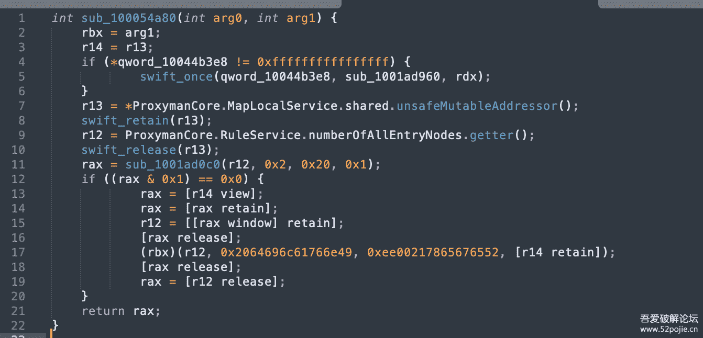
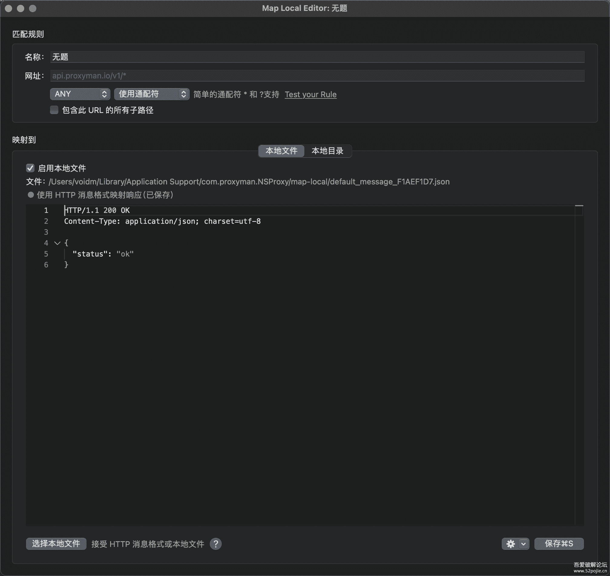
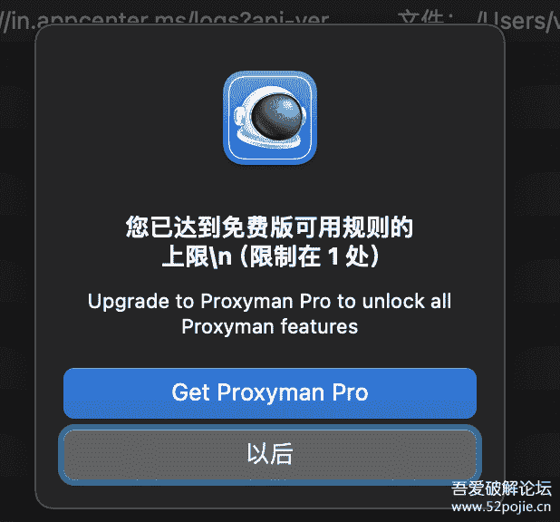
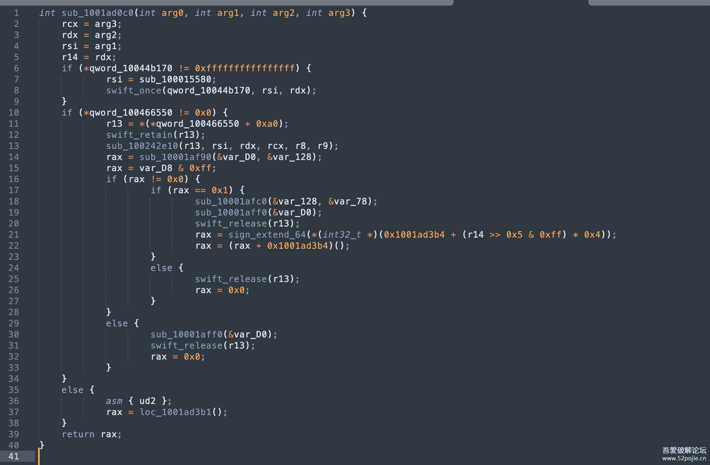
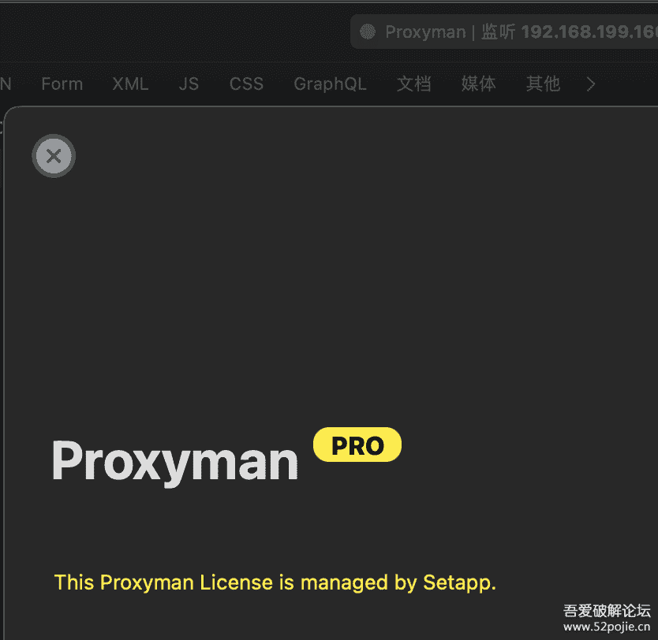

# [MacOS逆向] Proxyman for mac `lldb` 调试 dylib 注入

- 原帖：https://www.52pojie.cn/forum.php?mod=viewthread&tid=1911891
- 抓取时间：2026-11-01T22:33:31

## 关于

Proxyman (Version 5.1.1 (50101)) ([proxyman.io](https://proxyman.io/))

Proxyman 是一款专为 macOS 设计的现代本地 Web 调试代{过}{滤}理工具，它不仅支持 macOS 平台，还能无缝地与 iOS 和 Android 设备进行集成。作为一个网络调试工具，Proxyman 的设计旨在提供高性能、直观且功能丰富的解决方案，使开发者能够深入网络层进行调试和问题解决。

## 环境/软件

- MacOS
- IDA/Hopper
- xcode
- 注入工具：[insert_dylib](https://github.com/tyilo/insert_dylib)

## 分析

免费版有诸多限制；比如 maping 映射规则只能有一个；



1.png (184.77 KB, 下载次数: 2)

[附件下载](https://www.52pojie.cn/forum.php?mod=attachment&aid=MjY4ODQ4OHxjNjkzNjA5NnwxNzkzNTcyNDA4fDE2ODA4NnwxOTExODkx&nothumb=yes)

2024-4-10 11:24 上传

从关键字入手“您已达到免费版可用规则的上”；

全局定位到主程序下（`/Applications/Proxyman.app/Contents/Resources/zh-Hans.lproj/Localizable.strings`）：

```
/* No comment provided by engineer. */
"You have reached the limit of free rules\n(Limit at %d)" = "您已达到免费版可用规则的上限\\n（限制在 %d 处）";
```

主程序 bin 拖入 Hopper 中搜索：

```
aYouHaveReached_100325010:        // aYouHaveReached

0000000100325010         db         "You have reached the limit of free rules\n(Limit at %d)", 0
```

`x` 查看引用链



2.png (60.21 KB, 下载次数: 1)

[附件下载](https://www.52pojie.cn/forum.php?mod=attachment&aid=MjY4ODQ4OXxmZTM3NzJhNXwxNzkzNTcyNDA4fDE2ODA4NnwxOTExODkx&nothumb=yes)

2024-4-10 11:24 上传

只要一个引用，进入函数：

```
0000000100135cd0         lea        rsi, qword [aYouHaveReached_100325010+32]   ; 0x100325030
```

然后 `F5`，查看假码，看不出来啥……

在 Hopper 中往上看看，找到函数首：

```
sub_100135551:

0000000100135551         cmp        qword [rbp-0x38], 0x2                       ; CODE XREF=sub_100134540+685, sub_100134540+694

0000000100135556         jne        loc_1001358a2

000000010013555c         test       rax, rax

000000010013555f         jne        loc_1001358a2
```

用 `lldb` 调试看看：

```
lldb "/Applications/Proxyman.app"
```

载入后，`r` 运行；程序启动后 `ctrl + c` 暂停，之后下断点 `br s -a 0x100135551`。

然后反复复现创建 rule 规则，发现断不下来……有点奇怪；

我们我们在 `lldb` 中 `dis -a 0x100135551`，`lldb` 的查看汇编代码似乎比 Hopper 的高级呢，找到了真实的函数首：

```
(lldb) dis -a 0x100135551
Proxyman`___lldb_unnamed_symbol9700:
Proxyman[0x1001324b0] :     pushq  %rbp
Proxyman[0x1001324b1] :     movq   %rsp, %rbp
Proxyman[0x1001324b4] :     pushq  %r15
Proxyman[0x1001324b6] :     pushq  %r14
Proxyman[0x1001324b8] :     pushq  %r13
Proxyman[0x1001324ba] :     pushq  %r12
Proxyman[0x1001324bc] :     pushq  %rbx
```

接着下一个断点 `br s -a 0x1001324b0`：

```
(lldb) br s -a 0x1001324b0

Breakpoint 1: address = 0x00000001001324b0
```

然后继续创建 rule 规则，成功断下来了；

`bt` 查看堆栈：

```
(lldb) bt
* thread #1, queue = 'com.apple.main-thread', stop reason = breakpoint 3.1
  * frame #0: 0x00000001001324b0 Proxyman`___lldb_unnamed_symbol9700 // sub_1001324b0 弹框 alert 需要充值
    frame #1: 0x00000001001adefb Proxyman`___lldb_unnamed_symbol12544 + 171 //  call sub_1001324b0
    frame #2: 0x00000001001ad9ef Proxyman`___lldb_unnamed_symbol12534 + 79 // call sub_1001ade50    
    frame #3: 0x0000000102fb0e6c ProxymanCore`ProxymanCore.runOnMainThread(() -> ()) -> () + 140
    frame #4: 0x00000001001ad313 Proxyman`___lldb_unnamed_symbol12530 + 595 // thread 
    frame #5: 0x0000000100054ae3 Proxyman`___lldb_unnamed_symbol4628 + 99 // call       sub_1001ad0c0 cmp 01 , // 需要 ret 0
    frame #6: 0x00000001000534ea Proxyman`___lldb_unnamed_symbol4620 + 74 
    frame #7: 0x00007ff80aaff2b6 AppKit`-[NSApplication(NSResponder) sendAction:to:from:] + 337
    frame #8: 0x00007ff80aaff12b AppKit`-[NSControl sendAction:to:] + 86
    frame #9: 0x00007ff80aaff05d AppKit`__26-[NSCell _sendActionFrom:]_block_invoke + 131
    frame #10: 0x00007ff80aafef66 AppKit`-[NSCell _sendActionFrom:] + 171
    frame #11: 0x00007ff80aafeeae AppKit`-[NSButtonCell _sendActionFrom:] + 96
    frame #12: 0x00007ff80aafbdd2 AppKit`NSControlTrackMouse + 1823
    frame #13: 0x00007ff80aafb68f AppKit`-[NSCell trackMouse:inRect:ofView:untilMouseUp:] + 125
    frame #14: 0x00007ff80aafb556 AppKit`-[NSButtonCell trackMouse:inRect:ofView:untilMouseUp:] + 666
    frame #15: 0x00007ff80aafa94b AppKit`-[NSControl mouseDown:] + 666
    frame #16: 0x00007ff80aaf92f3 AppKit`-[NSWindow(NSEventRouting) _handleMouseDownEvent:isDelayedEvent:] + 4582
    frame #17: 0x00007ff80aa720ce AppKit`-[NSWindow(NSEventRouting) _reallySendEvent:isDelayedEvent:] + 404
    frame #18: 0x00007ff80aa71d1f AppKit`-[NSWindow(NSEventRouting) sendEvent:] + 345
    frame #19: 0x00007ff80b2212b6 AppKit`-[NSApplication(NSEventRouting) sendEvent:] + 346
    frame #20: 0x00007ff80addc5c2 AppKit`-[NSApplication _handleEvent:] + 65
    frame #21: 0x00007ff80a90402a AppKit`-[NSApplication run] + 640
    frame #22: 0x00007ff80a8d7ff1 AppKit`NSApplicationMain + 816
    frame #23: 0x0000000100067e79 Proxyman`___lldb_unnamed_symbol5090 + 9
    frame #24: 0x00007ff806e44366 dyld`start + 1942
```

前面几个堆栈没看出啥；

看 `#5: 0x0000000100054ae3`



4.png (131.14 KB, 下载次数: 3)

[附件下载](https://www.52pojie.cn/forum.php?mod=attachment&aid=MjY4ODQ5MXw5ODljOWEzNHwxNzkzNTcyNDA4fDE2ODA4NnwxOTExODkx&nothumb=yes)

2024-4-10 11:24 上传

简单分析一下；第 11 行调用 `sub_1001ad0c0` 函数，`rax == 0` 的话会 show 一个 windoow；盲猜是配置 rule 详情的 window：

```
0000000100054ade         call       sub_1001ad0c0                               ; sub_1001ad0c0

0000000100054ae3         test       al, 0x1

0000000100054ae5         je         loc_100054af6
```

我们在 `0x100054ae3` 下一个断点看看；`br s -a 0x100054ae3`；然后回到程序，创建规则；这个时候弹框了，先不要管；按确定；然后断下来了；

`lldb` 查看当前寄存器 `al` 为 1，我们修改为 0 看看，然后 `c` 继续；


```
(lldb) register read al
      al = 0x01
(lldb) register write al 0
(lldb) register read al
      al = 0x00
(lldb)
```

发现已经成功出现了创建 rule 的页面了; 但是此刻弹框依然存在;



5.png (237.45 KB, 下载次数: 2)

[href="forum.php?mod=attachment&aid=MjY4ODQ5Mnw0ZjIyNjNhZnwxNzkzNTcyNDA4fDE2ODA4NnwxOTExODkx&nothumb=yes" target="_blank"](https://www.52pojie.cn/forum.php?mod=attachment&aid=MjY4ODQ5Mnw0ZjIyNjNhZnwxNzkzNTcyNDA4fDE2ODA4NnwxOTExODkx&nothumb=yes)

2024-4-10 11:24 上传



6.png (127.49 KB, 下载次数: 1)

[href="forum.php?mod=attachment&aid=MjY4ODQ5M3w3NzU0MmQxNXwxNzkzNTcyNDA4fDE2ODA4NnwxOTExODkx&nothumb=yes" target="_blank"](https://www.52pojie.cn/forum.php?mod=attachment&aid=MjY4ODQ5M3w3NzU0MmQxNXwxNzkzNTcyNDA4fDE2ODA4NnwxOTExODkx&nothumb=yes)

2024-4-10 11:24 上传

至此,我们可以得出结论 `sub_1001ad0c0` 有俩个作用

- 函数里会判断是否弹框 (具体逻辑逻辑)
- 函数返回值会判断是否创建 rule (根据返回值 ==0 触发)

接着 我们进入函数 `sub_1001ad0c0` 里看看



7.png (203.13 KB, 下载次数: 3)

[href="forum.php?mod=attachment&aid=MjY4ODQ5NHw4YTZiZTRkY3wxNzkzNTcyNDA4fDE2ODA4NnwxOTExODkx&nothumb=yes" target="_blank"](https://www.52pojie.cn/forum.php?mod=attachment&aid=MjY4ODQ5NHw4YTZiZTRkY3wxNzkzNTcyNDA4fDE2ODA4NnwxOTExODkx&nothumb=yes)

2024-4-10 11:24 上传

`qword_10044b170`, `qword_100466550` 这俩个地址 是程序的常量,逻辑判断始终成立;不用管;

函数的返回值取决于 第 14 行

`rax = sub_10001af90(&var_D0, &var_128);`

```c
int sub_10001af90(int arg0, int arg1) {
    ((0x1003bc2d8 + 0x20))(arg1, arg0, 0x1003bc2e0);
    rax = arg1;
    return rax;
}
```

`sub_10001af90` 这个函数的代码看着有点抽象, 就不继续看了,盲猜他是搞弹框 `alert` 的;

我们直接 `hook` `ret 0` 看看;

这里采用 `dylib` 注入来 `hook`;

注意不要注入主程序, 可能会导致主程序 签名与 `heler` 不一致; 而启动不了;

我们去 FrameWoork 下挑一个来注入 `/Applications/Proxyman.app/Contents/Frameworks/HexFiend.framework/Versions/A/HexFiend`

```
DobbyHook((void *)_sub_0x10001af90, ret0, nil);
```

注入后 启动程序,成功注册 (居然 `license` 给了 `Setapp`..)



8.png (55.96 KB, 下载次数: 2)

[href="forum.php?mod=attachment&aid=MjY4ODQ5NXw2NzVhYjlmMHwxNzkzNTcyNDA4fDE2ODA4NnwxOTExODkx&nothumb=yes" target="_blank"](https://www.52pojie.cn/forum.php?mod=attachment&aid=MjY4ODQ5NXw2NzVhYjlmMHwxNzkzNTcyNDA4fDE2ODA4NnwxOTExODkx&nothumb=yes)

2024-4-10 11:24 上传

运行了一段时间; 发现还需要处理下 `remainingDays` 这个 函数,有概率程序会报错, 我们把调用的地方写入 `mov rax 1` 即可;

因为 `mov rax 1` 比 原生的 `call xxx` 的机器码长, 所以改成 `push 1,pop rax`;

`call imp_stubs$s12ProxymanCore7LicenseV13remainingDaysSiSgvg` >>>>> `push 1,pop rax`

```
function $s12ProxymanCore7LicenseV13remainingDaysSiSgvg {
    rax = (*pointer to ProxymanCore.License.remainingDays.getter : Swift.Int?)();
    return rax;
}

//push 1,pop rax

uint8_t ret1Day[5] = {0x6A, 0x01, 0x58, 0x90, 0x90  };

DobbyCodePatch((void *)_remainingDaysCode, ret1Day,5);
```

至此,结束, x64/arm 通杀特征码如下:

```c
#if defined(__arm64__) || defined(__aarch64__)

    NSString *sub_0x10001af90Code = @"F4 4F BE A9 FD 7B 01 A9 FD 43 00 91 F3 03 01 AA E1 03 00 AA .. .. 00 90 42 C0 20 91 48 80 5F F8 08 11 40 F9 E0 03 13 AA 00 01 3F D6 E0 03 13 AA FD 7B 41 A9 F4 4F C2 A8 C0 03 5F D6";

    NSString *remainingDaysCode = @".. .. .. 94 F4 03 00 AA F5 03 01 AA E0 83 01 91 .. .. .. 94 28 00 80 52 89 FE 7F D3 BF 02 00 72 34 01 88 1A";

#elif defined(__x86_64__)

    NSString *sub_0x10001af90Code = @"55 48 89 E5 53 50 48 89 F3 48 89 FE 48 8D .. .. .. .. .. 48 8B 42 F8 48 89 DF FF 50 20 48 89 D8 48 83 C4 08 5B 5D C3";

    NSString *remainingDaysCode =@"E8 .. .. .. .. 49 89 C6 41 89 D7 48 8D BD C8 FE FF FF E8 .. .. .. .. 41 B4 01 41 F6 C7 01 75 ..";

    DobbyHook((void *)_sub_0x10001af90, ret0, nil);

   NSLog(@">>>>>> Before %s",[MemoryUtils readMachineCodeStringAtAddress:_remainingDaysCode length:8].UTF8String);

#if defined(__arm64__) || defined(__aarch64__)

    // nop:0x1F, 0x20, 0x03, 0xD5
    // mov x0,#1
    uint8_t ret1Day[4] = {0x20, 0x00, 0x80, 0xD2  };
    DobbyCodePatch((void *)_remainingDaysCode, ret1Day,4);

#elif defined(__x86_64__)

    //push 1,pop rax
    uint8_t ret1Day[5] = {0x6A, 0x01, 0x58, 0x90, 0x90  };
    DobbyCodePatch((void *)_remainingDaysCode, ret1Day,5);

#endif

    NSLog(@">>>>>> After %s",[MemoryUtils readMachineCodeStringAtAddress:_remainingDaysCode length:8].UTF8String);

#endif
```

## Quick Start

项目已经打包 github,可以直接用 xcode 打开 :

[//github.com/marlkiller/dylib_dobby_hook" target="_blank" rel="noopener noreferrer nofollow"](https://github.com/marlkiller/dylib_dobby_hook:rel="nofollow noopener" href="https)

```
git clone [//github.com/marlkiller/dylib_dobby_hook.git" target="_blank"](https://github.com/marlkiller/dylib_dobby_hook.git:rel="nofollow noopener" href="https)
cd script
sudo sh auto_hack.sh
```

## About ME

找个 JAVA 的工作好难呀 , 加上逆向 Surge 搞的我头大, 搞不明白;

我还是找个软柿子捏捏把...
