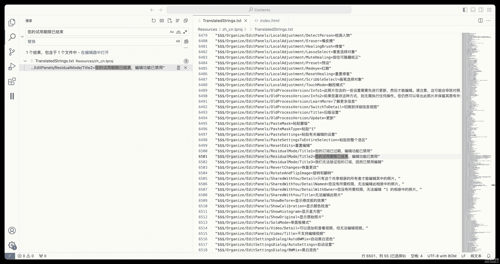
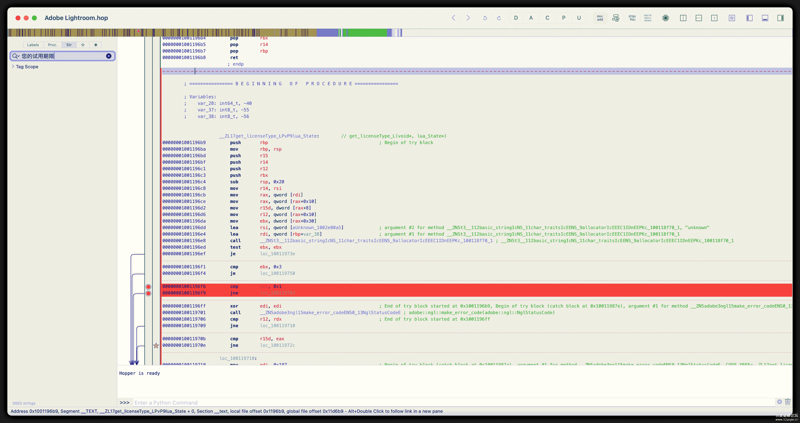
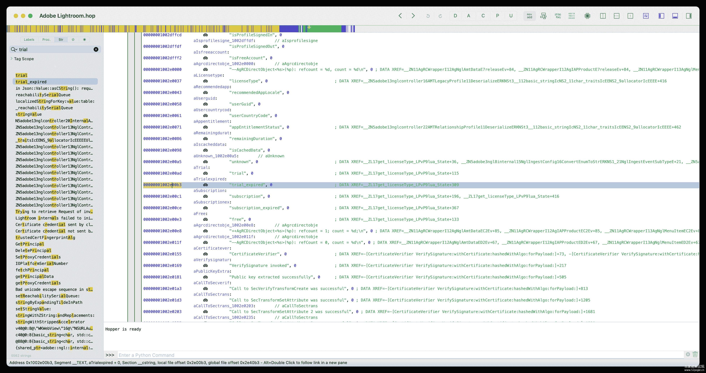
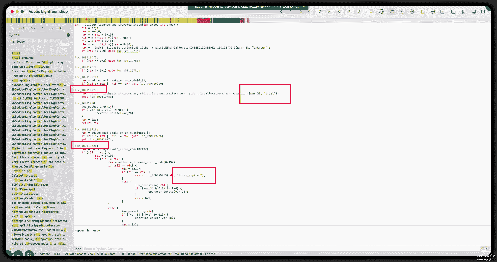
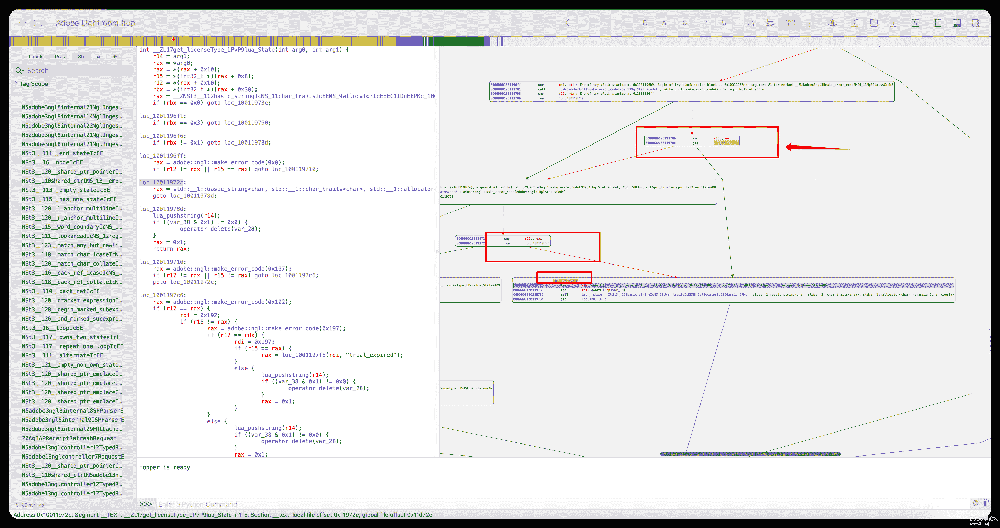

# [MacOS逆向] lightroom分析学习

- 原帖: https://www.52pojie.cn/forum.php?mod=viewthread&tid=1911906
- 抓取时间: 2026-11-01T22:33:29

## 起因

本来用`qiuchenly`大佬的注入库，注入后应用程序崩溃，应该是代码没有适配最新的`lightroom 7.2`，又不想降级应用，所以就自己研究看看怎么实现的。

新人贴，还请各位大佬指正错误。

本帖子仅用于学习逆向知识，不可违法利用，他人以此牟利与本人无关。若有侵权，请联系我立即删除！

## 准备工作

- `vscode`
- `Hopper Disassemble`
- `ida free 8.4`

`iShot_2024-04-10_13.21.28.png` (1.22 MB, 下载次数: 3)

[href="forum.php?mod=attachment&aid=MjY4ODUyMXxiNDgwNDYyY3wxNzkzNTcyNDA2fDE2ODA4NnwxOTExOTA2&nothumb=yes" target="_blank"](https://www.52pojie.cn/forum.php?mod=attachment&aid=MjY4ODUyMXxiNDgwNDYyY3wxNzkzNTcyNDA2fDE2ODA4NnwxOTExOTA2&nothumb=yes)

2024-4-10 13:21 上传

## 开始分析

先在`vscode`搜索关键字：您的试用期限已结束，编辑功能已禁用 现在购买

`17127209008369.png` (1.53 MB, 下载次数: 2)

[href="forum.php?mod=attachment&aid=MjY4ODUyMHw2NmZhMzk3YnwxNzkzNTcyNDA2fDE2ODA4NnwxOTExOTA2&nothumb=yes" target="_blank"](https://www.52pojie.cn/forum.php?mod=attachment&aid=MjY4ODUyMHw2NmZhMzk3YnwxNzkzNTcyNDA2fDE2ODA4NnwxOTExOTA2&nothumb=yes)

2024-4-10 13:19 上传

发现没有什么实际有用的`String`。

尝试在`hopper`中直接搜索中文也无果。

`17127209008501.png` (1.13 MB, 下载次数: 3)

[href="forum.php?mod=attachment&aid=MjY4ODUxOXwyMjliMzg4OHwxNzkzNTcyNDA2fDE2ODA4NnwxOTExOTA2&nothumb=yes" target="_blank"](https://www.52pojie.cn/forum.php?mod=attachment&aid=MjY4ODUxOXwyMjliMzg4OHwxNzkzNTcyNDA2fDE2ODA4NnwxOTExOTA2&nothumb=yes)

2024-4-10 13:19 上传

尝试搜索试用的英文：`Trial`

`17127209008668.png` (2 MB, 下载次数: 3)

[href="forum.php?mod=attachment&aid=MjY4ODUxOHwzYTBjZWZlM3wxNzkzNTcyNDA2fDE2ODA4NnwxOTExOTA2&nothumb=yes" target="_blank"](https://www.52pojie.cn/forum.php?mod=attachment&aid=MjY4ODUxOHwzYTBjZWZlM3wxNzkzNTcyNDA2fDE2ODA4NnwxOTExOTA2&nothumb=yes)

2024-4-10 13:19 上传

发现有用的字符串，按`x`查看引用，找到关键函数：`get_licenseType`

`17127209008839.png` (1.25 MB, 下载次数: 4)

[href="forum.php?mod=attachment&aid=MjY4ODUxN3wxMzIzNzI4MXwxNzkzNTcyNDA2fDE2ODA4NnwxOTExOTA2&nothumb=yes" target="_blank"](https://www.52pojie.cn/forum.php?mod=attachment&aid=MjY4ODUxN3wxMzIzNzI4MXwxNzkzNTcyNDA2fDE2ODA4NnwxOTExOTA2&nothumb=yes)

2024-4-10 13:19 上传

可以看到如果走到`loc_1001197c6`是`trial_expired`，如果走到`loc_10011972c`，就是`trial`模式，所以思路就是让程序默认走到`trial`的函数。

`cfg`模式可以看到，`trial`函数有两条路可以跳转，当然优先在上一级就直接跳转过来，我们直接修改`000000010011970e je loc_10011972c ----->> jne loc_10011972c`

`17127209009020.png` (1.25 MB, 下载次数: 1)

[href="forum.php?mod=attachment&aid=MjY4ODUxNnw0OGZjZTcxZnwxNzkzNTcyNDA2fDE2ODA4NnwxOTExOTA2&nothumb=yes" target="_blank"](https://www.52pojie.cn/forum.php?mod=attachment&aid=MjY4ODUxNnw0OGZjZTcxZnwxNzkzNTcyNDA2fDE2ODA4NnwxOTExOTA2&nothumb=yes)

2024-4-10 13:18 上传

然后直接保存打包替换启动！编辑功能已经可用。

`17127209009477.png` (1.55 MB, 下载次数: 1)

[href="forum.php?mod=attachment&aid=MjY4ODUxNHw3N2E3NDllZXwxNzkzNTcyNDA2fDE2ODA4NnwxOTExOTA2&nothumb=yes" target="_blank"](https://www.52pojie.cn/forum.php?mod=attachment&aid=MjY4ODUxNHw3N2E3NDllZXwxNzkzNTcyNDA2fDE2ODA4NnwxOTExOTA2&nothumb=yes)

2024-4-10 13:18 上传

破解流程比较简单，可以使用`qiuchenly`大佬的注入库，搞成优雅的注入破解。
