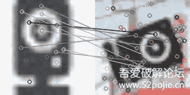
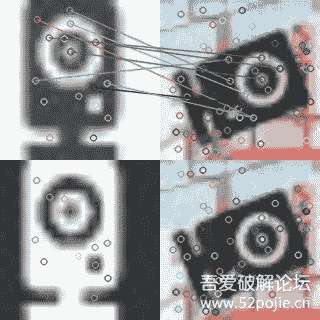
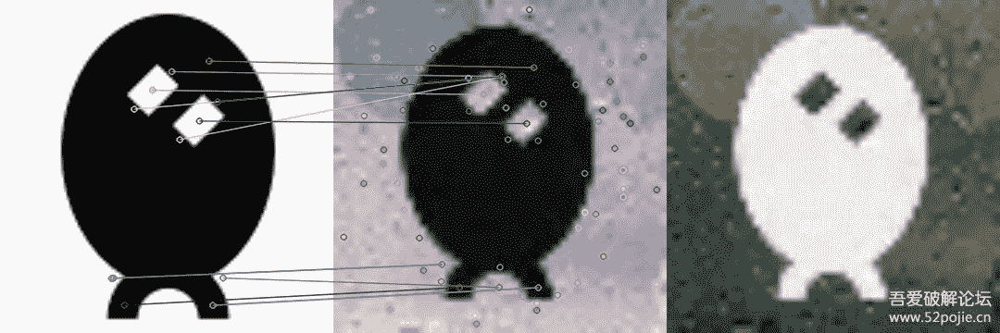
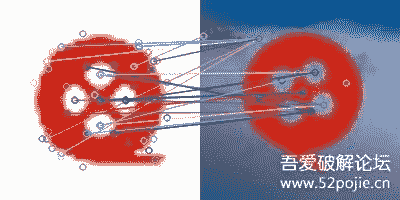
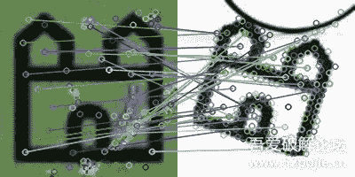
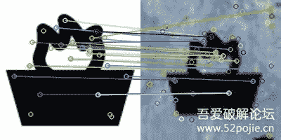
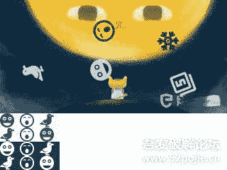
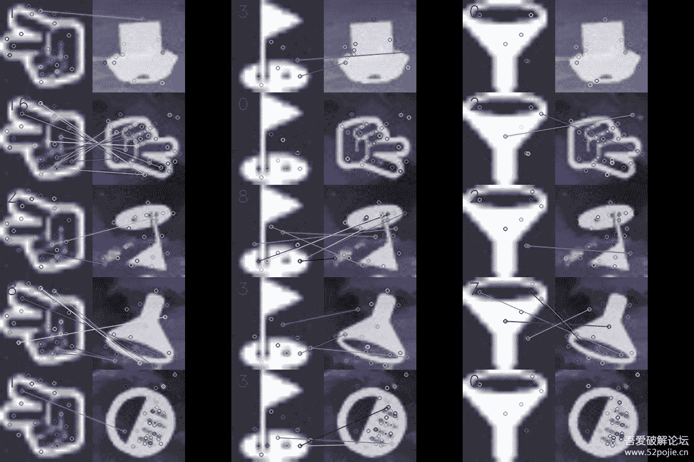
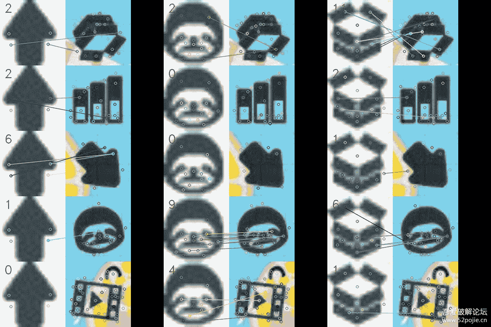

# [Web逆向] [验证码识别]相似度模型匹配的替代方案-特征匹配

- 原帖：<https://www.52pojie.cn/forum.php?mod=viewthread&tid=1912306>
- 抓取时间：2026-11-01T22:33:20

## [验证码识别]相似度模型匹配的替代方案-特征匹配

> 本文章所有内容仅供学习和研究使用，本人不提供具体模型和源码。若有侵权，请联系我立即删除！维护网络安全，人人有责。

### 前言

在我之前图标点选验证码的识别中，参考图标和目标图标匹配一般使用的是相似度模型，但是如果遇上多个目标图标，消耗时间会成倍增加。

在我的计算机上，推理一对图片的相似度平均需要35ms（与CPU性能有关），如果有5个目标图标和3个参考图标就需要大约500ms的时间，即使使用批处理模型也只能稍微加快推理速度。

当然优化孪生神经网络主干或许可以增加速度，但是有没有其他方法能进行相似度匹配呢？

孪生神经网络的一个重要步骤是特征提取，那么有没有其他的特征匹配算法呢？

通过搜索，特征匹配算法有ORB、SIFT、SURF等，本文以SIFT为主。

本文主要讲述特征匹配的实现和相似度模型匹配的对比，不重点讲述特征匹配的原理。

### SIFT特征匹配实现

由于OpenCV编译较为麻烦，本文使用python的`opencv-python`库实现，而且SIFT是非自由算法，在一些版本的`cv`中是不存在的。

我的OpenCV版本如下，仅用于参考：

```
opencv-python==4.5.5.64
opencv-contrib-python==4.5.5.64
```

匹配代码如下：

```
import cv2

icon = cv2.imread("icon.jpg")  # 参考图标
target = cv2.imread("target.jpg")  # 目标图标
icon = cv2.resize(icon, (160, 160))  # 两张图片的长宽建议要一样
target = cv2.resize(target, (160, 160))

# 实例化SIFT
sift = cv2.SIFT_create()

# 找出关键点并计算描述符
kp1, des1 = sift.detectAndCompute(icon, None)
kp2, des2 = sift.detectAndCompute(target, None)

# 匹配对象
bf = cv2.BFMatcher()
matches = bf.knnMatch(des1, des2, k=2)  # kNN匹配

good = []
for m, n in matches:
    if m.distance
```

运行结果如下：



`1.jpg`（13.63 KB，下载次数：3，2024-4-11 11:34 上传）

<https://www.52pojie.cn/forum.php?mod=attachment&aid=MjY4ODc0OHw2ZGUxMmQ3N3wxNzkzNTcyMzk4fDE2ODA4NnwxOTEyMzA2&nothumb=yes>

可以看到，SIFT在两张图片中提取了许多特征点，但是这些特征点如何关联起来呢？这就要用到kNN匹配。

kNN算法的核心思想（抄网上的）：

如果一个样本在特征空间中的`k`个最相邻的样本中的大多数属于某一个类别，则该样本也属于这个类别，并具有这个类别上样本的特性。该方法在确定分类决策上只依据最邻近的一个或者几个样本的类别来决定待分样本所属的类别。

我们可以过滤错误的匹配点，再计算匹配点的数量，就可以视为这两张图的相似度了。

#### 提取两张图片的匹配度

通过上面代码已经可以计算两张图片的匹配度了，然后就可以将需要比较的图片进行匹配，过程和相似度模型是一样的。

值得注意的是，颜色会影响匹配结果。



`2.jpg`（23.64 KB，下载次数：1，2024-4-11 11:34 上传）

<https://www.52pojie.cn/forum.php?mod=attachment&aid=MjY4ODc0OXxlN2JlNjk2NHwxNzkzNTcyMzk4fDE2ODA4NnwxOTEyMzA2&nothumb=yes>

不仅仅是颜色，参考图标和目标图标的形状也要基本相同，如果有形变也会影响匹配结果。

如果颜色相反可以使用以下函数转换：

```
def inverted(img):
    """cv2进行反色操作"""
    if len(img.shape) == 3:
        h, w, c = img.shape
        img2 = np.zeros((h, w, c), dtype='uint8')
    else:
        # 单通道图片
        h, w = img.shape
        img2 = np.zeros((h, w), dtype='uint8')
    invert_image = cv2.addWeighted(img, -1, img2, 0, 255, 0)
    return invert_image
```



`3.jpg`（42.77 KB，下载次数：2，2024-4-11 11:34 上传）

<https://www.52pojie.cn/forum.php?mod=attachment&aid=MjY4ODc1MHxiOTZhNjYyZnwxNzkzNTcyMzk4fDE2ODA4NnwxOTEyMzA2&nothumb=yes>

中间图片是右边图片反色操作后的结果。

以下是一些不同厂商图标验证码的匹配结果：



`4.jpg`（16.48 KB，下载次数：1，2024-4-11 11:34 上传）

<https://www.52pojie.cn/forum.php?mod=attachment&aid=MjY4ODc1MXw4ODAxZWMxZXwxNzkzNTcyMzk4fDE2ODA4NnwxOTEyMzA2&nothumb=yes>



`5.jpg`（25.85 KB，下载次数：3，2024-4-11 11:34 上传）

<https://www.52pojie.cn/forum.php?mod=attachment&aid=MjY4ODc1Mnw4NjI2OTQzMXwxNzkzNTcyMzk4fDE2ODA4NnwxOTEyMzA2&nothumb=yes>



`6.jpg`（18.29 KB，下载次数：1，2024-4-11 11:34 上传）

<https://www.52pojie.cn/forum.php?mod=attachment&aid=MjY4ODc1M3xjMGQzNzRhOXwxNzkzNTcyMzk4fDE2ODA4NnwxOTEyMzA2&nothumb=yes>

> 实际上这些特征点还和图片大小有关。

#### 验证码识别

与孪生一样，我们可以把所有图标两两匹配，得到一个匹配度的矩阵，然后依次获取最大匹配值即可（在我之前的文章有提到过）。

本文我以某盾的图标点选为例。



`7.jpg`（15.59 KB，下载次数：1，2024-4-11 11:34 上传）

<https://www.52pojie.cn/forum.php?mod=attachment&aid=MjY4ODc1NHwxMmU0MDA2NnwxNzkzNTcyMzk4fDE2ODA4NnwxOTEyMzA2&nothumb=yes>

可以看到，图片上的图标有黑色和白色，并且参考图标也提供了两张颜色，位置也是固定的。

我们可以先通过目标检测获取所有目标图标，用算法判断是黑色还是白色图标，再用对应颜色的参考图标和其进行特征匹配即可。

为了方便起见，我在目标检测模型中就区分了黑色和白色。


`8.jpg`（348.14 KB，下载次数：2，2024-4-11 11:34 上传）

<https://www.52pojie.cn/forum.php?mod=attachment&aid=MjY4ODc1NXwyYjczZTgzZHwxNzkzNTcyMzk4fDE2ODA4NnwxOTEyMzA2&nothumb=yes>

我们有了目标的图标颜色后，可以将对应颜色的图标裁剪下来进行比较。



`9.jpg`（134.09 KB，下载次数：0，2024-4-11 11:34 上传）

<https://www.52pojie.cn/forum.php?mod=attachment&aid=MjY4ODc1NnwwYTc4NDNhOHwxNzkzNTcyMzk4fDE2ODA4NnwxOTEyMzA2&nothumb=yes>



`10.jpg`（143.73 KB，下载次数：2，2024-4-11 11:34 上传）

<https://www.52pojie.cn/forum.php?mod=attachment&aid=MjY4ODc1N3xmMGUyNTE3MnwxNzkzNTcyMzk4fDE2ODA4NnwxOTEyMzA2&nothumb=yes>

并且通过计时可以发现，SIFT算法计算两张图片匹配度耗时在5-10ms之间，效率远大于相似度模型匹配。

#### 与相似度模型匹配的比较

| 相似度模型匹配 | 特征提取匹配 |
| --- | --- |
| 优点 |  |
