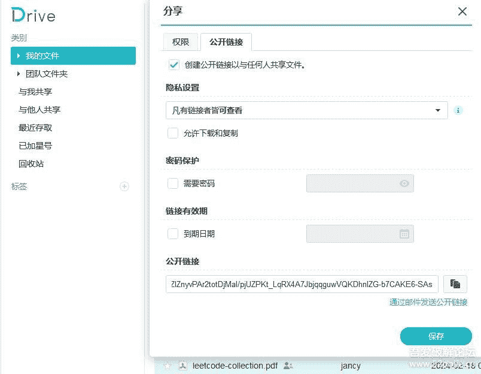
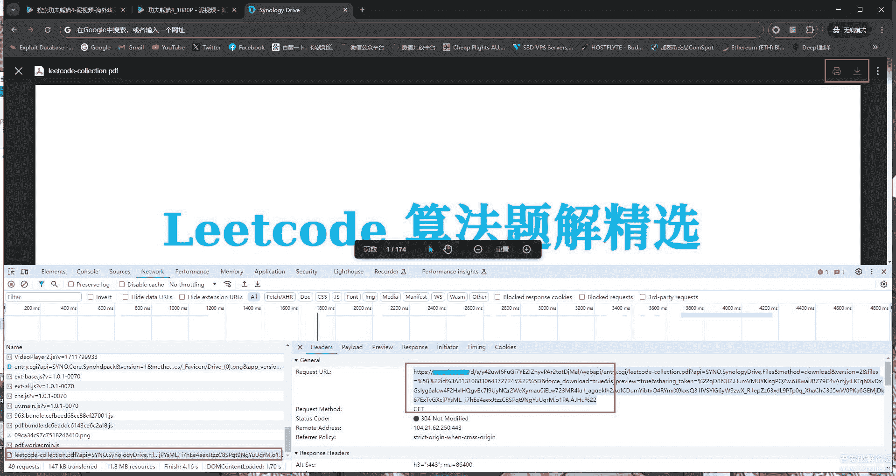
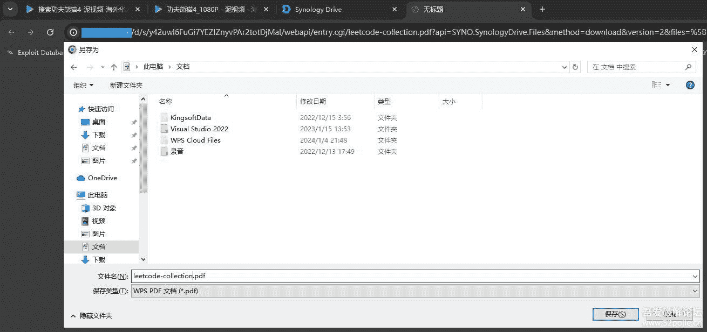

# [分享] 群晖“禁止下载”功能绕过

- 原帖: https://www.52pojie.cn/forum.php?mod=viewthread&tid=1913537
- 抓取时间: 2026-11-01T22:33:14

无意间想研究一下群晖的禁止下载功能是如何实现的，还以为有加密之类的能够分析一下，最后发现原来什么也不是

首先搞来一个不要钱的黑群晖，分享一个pdf文档，取消“允许下载和复制”

`1.jpg` (51.03 KB, 下载次数: 0)

[href="forum.php?mod=attachment&aid=MjY4OTQxOXxlMTk0MjFhY3wxNzkzNTcyMzkyfDE2ODA4NnwxOTEzNTM3&nothumb=yes" target="_blank"](https://www.52pojie.cn/forum.php?mod=attachment&aid=MjY4OTQxOXxlMTk0MjFhY3wxNzkzNTcyMzkyfDE2ODA4NnwxOTEzNTM3&nothumb=yes)

2024-4-14 20:40 上传

退出登录后，查看一下分享的链接

的确能看到有右上角的打印和下载都成了灰色

但是，打开控制台的一下，我惊呆了

`2.jpg` (259 KB, 下载次数: 0)

[href="forum.php?mod=attachment&aid=MjY4OTQyMHw1ZGQ4NTNlNnwxNzkzNTcyMzkyfDE2ODA4NnwxOTEzNTM3&nothumb=yes" target="_blank"](https://www.52pojie.cn/forum.php?mod=attachment&aid=MjY4OTQyMHw1ZGQ4NTNlNnwxNzkzNTcyMzkyfDE2ODA4NnwxOTEzNTM3&nothumb=yes)

2024-4-14 20:41 上传

复制粘贴访问之，直接弹出下载，成功绕过

`3.jpg` (87.67 KB, 下载次数: 1)

[href="forum.php?mod=attachment&aid=MjY4OTQyMXwxMmM0YzZkM3wxNzkzNTcyMzkyfDE2ODA4NnwxOTEzNTM3&nothumb=yes" target="_blank"](https://www.52pojie.cn/forum.php?mod=attachment&aid=MjY4OTQyMXwxMmM0YzZkM3wxNzkzNTcyMzkyfDE2ODA4NnwxOTEzNTM3&nothumb=yes)

2024-4-14 20:43 上传
