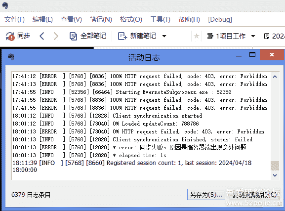
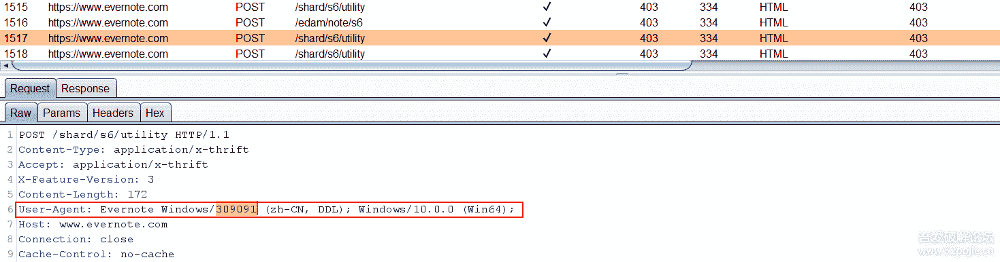
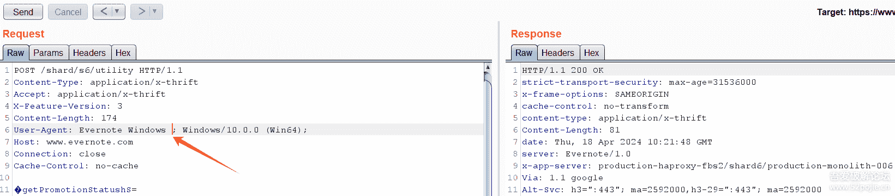
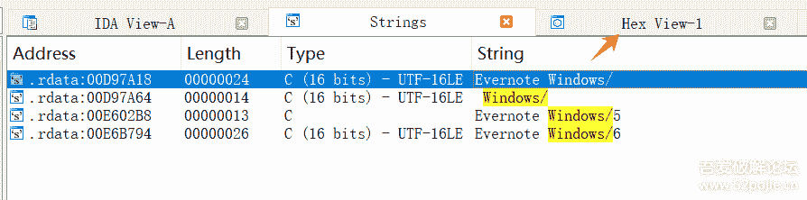
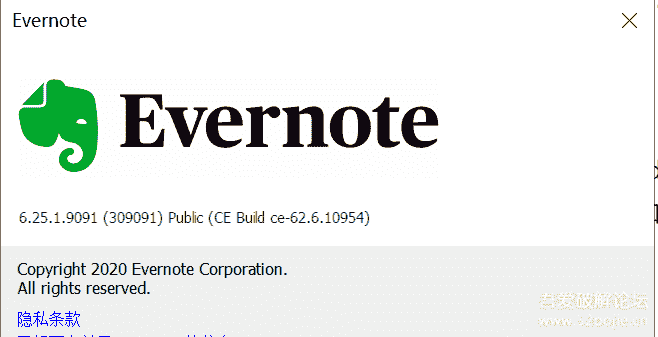

# [原创] 解决Evernote印象笔记6.x版本同步失败的问题

- 原帖: https://www.52pojie.cn/forum.php?mod=viewthread&tid=1915174
- 抓取时间: 2026-11-01T22:33:02

最近发现Evernote（印象笔记 国际版本）6.X 版本无法同步笔记数据，从活动日志中可以看到错误信息“error：同步失败，原因是服务器端出现意外问题”

image.png (33.93 KB, 下载次数: 2)

[href="forum.php?mod=attachment&aid=MjY5MDE5MXwxNDE0MGNkMXwxNzkzNTcyMzgwfDE2ODA4NnwxOTE1MTc0&nothumb=yes" target="_blank"](https://www.52pojie.cn/forum.php?mod=attachment&aid=MjY5MDE5MXwxNDE0MGNkMXwxNzkzNTcyMzgwfDE2ODA4NnwxOTE1MTc0&nothumb=yes)

同步失败

2024-4-18 18:12 上传

通过工具抓取同步过程中的数据研究之后发现，Evernote的同步接口返回了 403 错误，进一步分析发现修改请求包中的 `User-Agent` 之后能够成功

image.png (54 KB, 下载次数: 2)

[href="forum.php?mod=attachment&aid=MjY5MDE5M3xjNDVlNzYzNHwxNzkzNTcyMzgwfDE2ODA4NnwxOTE1MTc0&nothumb=yes" target="_blank"](https://www.52pojie.cn/forum.php?mod=attachment&aid=MjY5MDE5M3xjNDVlNzYzNHwxNzkzNTcyMzgwfDE2ODA4NnwxOTE1MTc0&nothumb=yes)

403错误

2024-4-18 18:14 上传

将请求包中 `User-agent` 任意修改一下就恢复正常

image.png (70.24 KB, 下载次数: 1)

[href="forum.php?mod=attachment&aid=MjY5MDE5N3wwYjUwZTg3OXwxNzkzNTcyMzgwfDE2ODA4NnwxOTE1MTc0&nothumb=yes" target="_blank"](https://www.52pojie.cn/forum.php?mod=attachment&aid=MjY5MDE5N3wwYjUwZTg3OXwxNzkzNTcyMzgwfDE2ODA4NnwxOTE1MTc0&nothumb=yes)

2024-4-18 18:22 上传

因此可以通过修改`evernote.exe`在同步数据的 `User-Agent` 值从而恢复该软件的同步的能力。

将 `Evernote.exe` 拉到 `ida` 中分析之后，通过字符串窗口搜索了一些关键词之后成功定位到用于生成 `User-Agent` 的字符串常量

image.png (33.3 KB, 下载次数: 2)

[href="forum.php?mod=attachment&aid=MjY5MDE5NXw0YjRjODJiOHwxNzkzNTcyMzgwfDE2ODA4NnwxOTE1MTc0&nothumb=yes" target="_blank"](https://www.52pojie.cn/forum.php?mod=attachment&aid=MjY5MDE5NXw0YjRjODJiOHwxNzkzNTcyMzgwfDE2ODA4NnwxOTE1MTc0&nothumb=yes)

ida分析

2024-4-18 18:17 上传

切换到`Hex`窗口，找到此字符串 把其中的斜杠替换为空字符串，再 `Patch` 一下程序

再次运行，发现同步功能得到正常恢复！！

上述分析所匹配的Evernote版本为 6.25.1 ，理论上对于其他版本以及印象笔记可以采用同步的分析策略

image.png (25.3 KB, 下载次数: 2)

[href="forum.php?mod=attachment&aid=MjY5MDE5Nnw0Y2RhYjI4YXwxNzkzNTcyMzgwfDE2ODA4NnwxOTE1MTc0&nothumb=yes" target="_blank"](https://www.52pojie.cn/forum.php?mod=attachment&aid=MjY5MDE5Nnw0Y2RhYjI4YXwxNzkzNTcyMzgwfDE2ODA4NnwxOTE1MTc0&nothumb=yes)

evernote版本信息

2024-4-18 18:19 上传
