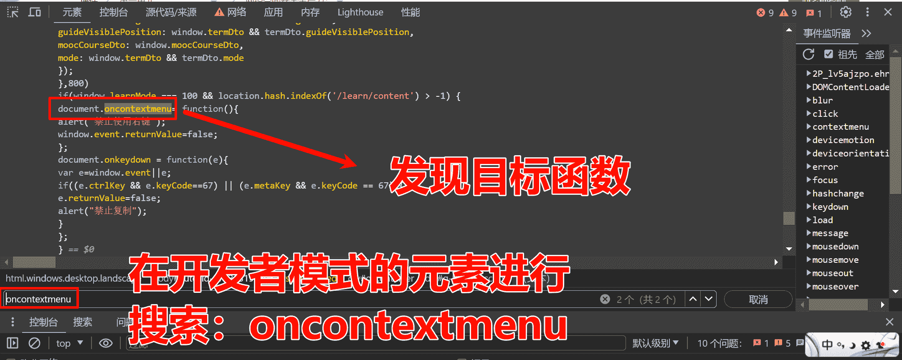
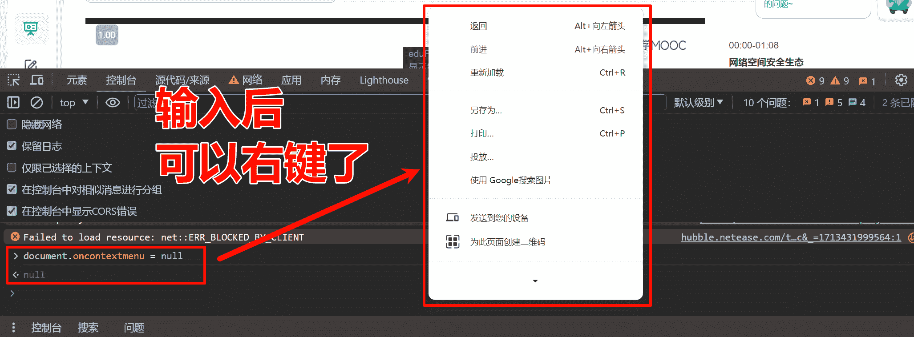
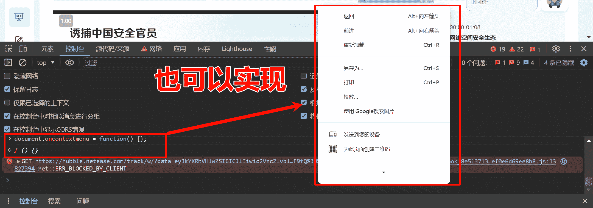
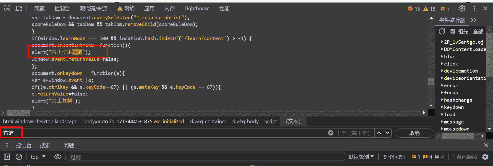

# [Web逆向] 【Web逆向】关于我是如何解决mooc禁止右键、复制

- 原帖: https://www.52pojie.cn/forum.php?mod=viewthread&tid=1915231
- 抓取时间: 2026-11-01T22:33:00


查找资料[https://www.jianshu.com/p/a7be27c7d56d](https://www.jianshu.com/p/a7be27c7d56d)，说是当用户点击鼠标右键的时候`oncontextmenu`事件被触发



又开始查资料：

[https://blog.csdn.net/qq_37363320/article/details/117155859](https://blog.csdn.net/qq_37363320/article/details/117155859)

[https://weilining.github.io/231.html](https://weilining.github.io/231.html)

[https://www.cnblogs.com/qingsong/articles/12235629.html](https://www.cnblogs.com/qingsong/articles/12235629.html)

[https://springboot.io/t/topic/4830](https://springboot.io/t/topic/4830)

上面这些网页的资料感觉是有点用，但我觉得有点复杂，就想着还有没有更加方便的办法去破解，于是就试着去问问chatgpt，果然，有一下挺方便的办法，经过测试并且简单有效的，如下：

1. 取消函数的引用

如果你希望从某个对象中删除一个方法，或者将一个变量引用的函数置为`null`或`undefined`，可以使用以下方式：

```js
var myFunction = function() {
  console.log("Hello, world!");
};

// 调用函数
myFunction();

// 取消引用
myFunction = null;

// 此时调用 myFunction 将会出错，因为它已经不再是一个函数
// myFunction(); // TypeError: myFunction is not a function
```

所以，可以在控制台输入：

`document.oncontextmenu = null`



但是此方法一刷新，就失效了

2. 将函数替换为空函数

有时，为了避免错误或其他原因，你可能只想简单地使一个函数“失效”，而不是完全删除引用：

```js
function doSomething() {
  console.log("Doing something...");
}

// 替换为不执行任何操作的空函数
doSomething = function() {};

// 此时调用 doSomething 将不会有任何输出
doSomething();
```

`document.oncontextmenu = function() {};`



此方法也是一刷新，就失效了

所以有什么好办法呢？

再问一下chatgpt，说是使用`localStorage`控制函数触发，但我觉得这样子有点复杂了，万一一不小心清除缓存，还不是得再来一遍，倒不如就直接油猴吧！

来都来了，看着源代码下面的禁止复制，也搞一下好咯

```js
// ==UserScript==
// @name mooc接触禁止右键、复制
// @namespace www.icourse163.org
// @version 0.1
// @description 允许mooc右键、复制
// @author hualy
// @match ://www.icourse163.org/
// @grant none
// @run-at document-start
// ==/UserScript==

(function() {
'use strict';

// 设置 document.oncontextmenu 为 null 来启用右键菜单、复制
document.addEventListener('DOMContentLoaded', function() {
document.oncontextmenu = null;
document.onkeydown = null;
});
})();
```

复盘：仔细想了一下，有值得改进的地方：

1、可以直接搜索弹出的字符串



2、刚开始我想着让油猴脚本代码更具有拓展性，使得在各个网站都可以解除限制，但后来想了一下，好像没多大必要，倒不如直接专精一点，减少代码量，用得到再处理，那样子代码写起来简单一点，又容易理解

3、求好评

受三滑稽甲苯的启发，优化了一下核心代码:

```js
(function() {

'use strict';

a = ["oncontextmenu", "onkeydown"] //在此添加监听类型

a.forEach((type) => {

document.addEventListener(type, (e) => {

e.stopImmediatePropagation();

}, {capture: true});

});

})();
```
