# [Web逆向] 微信小程序逆向之牛仔城游戏厅签到接口

- 原帖: https://www.52pojie.cn/forum.php?mod=viewthread&tid=1915411
- 抓取时间: 2026-11-01T22:32:59

智谱清言说：

大家好，今天我将为大家带来一篇关于微信小程序逆向之牛仔城签到接口逆向的技术分享。在这篇文章中，我们将一起探讨如何逆向牛仔城微信小程序的签到接口，并分析其背后的原理。

由于已经逆向成功了，现在只是重新复现。

参考贴：

[//cloud.tencent.com/developer/article/2311047" target="_blank" rel="noopener noreferrer nofollow"](https://cloud.tencent.com/developer/article/2311047:rel="nofollow noopener" href="https)

使用工具：

[//github.com/ezshine/wxapkg-convertor/releases/tag/1.0.1" target="_blank" rel="noopener noreferrer nofollow"](https://github.com/ezshine/wxapkg-convertor/releases/tag/1.0.1:rel="nofollow noopener" href="https)

[//rainkill.lanzouj.com/iwmjL1vmre2d" target="_blank" rel="noopener noreferrer nofollow"](https://rainkill.lanzouj.com/iwmjL1vmre2d:rel="nofollow noopener" href="https)


[href="forum.php?mod=attachment&aid=MjY5MDM0NnxjYjlmMjg0MnwxNzkzNTcyMzc2fDE2ODA4NnwxOTE1NDEx" target="_blank"](https://www.52pojie.cn/forum.php?mod=attachment&aid=MjY5MDM0NnxjYjlmMjg0MnwxNzkzNTcyMzc2fDE2ODA4NnwxOTE1NDEx)

(9.65 KB, 下载次数: 366)

2024-4-19 12:17 上传

点击文件名下载附件

下载积分: 吾爱币 -1 CB

这边推荐再下一个`everything`，方便你找到`.wxapkg`结尾的文件，除非你能准确知道小程序的存放路径就可以不用。打开我们的微信PC，然后登录🤣搜索【疯狂牛仔城】微信小程序

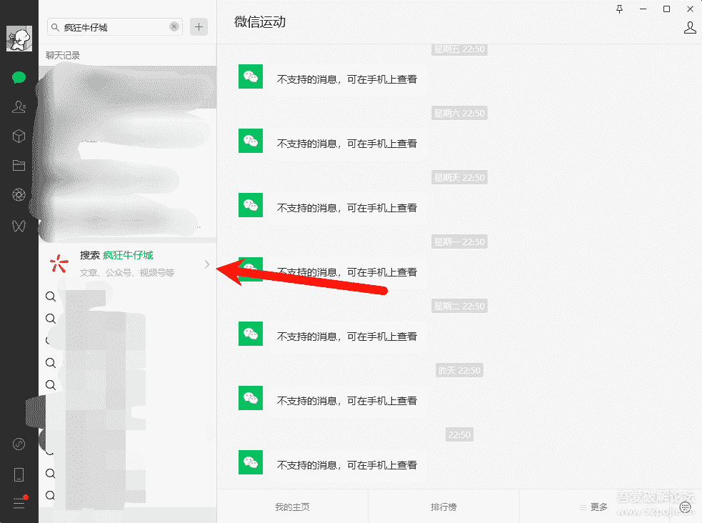

1.png (89.52 KB, 下载次数: 1)

[href="forum.php?mod=attachment&aid=MjcyODg5MHxkZmQxN2VmOHwxNzkzNTcyMzc2fDE2ODA4NnwxOTE1NDEx&nothumb=yes" target="_blank"](https://www.52pojie.cn/forum.php?mod=attachment&aid=MjcyODg5MHxkZmQxN2VmOHwxNzkzNTcyMzc2fDE2ODA4NnwxOTE1NDEx&nothumb=yes)

2024-10-14 14:19 上传


2.png (405.44 KB, 下载次数: 2)

[href="forum.php?mod=attachment&aid=MjcyODg5MXw4MWNjZmJjN3wxNzkzNTcyMzc2fDE2ODA4NnwxOTE1NDEx&nothumb=yes" target="_blank"](https://www.52pojie.cn/forum.php?mod=attachment&aid=MjcyODg5MXw4MWNjZmJjN3wxNzkzNTcyMzc2fDE2ODA4NnwxOTE1NDEx&nothumb=yes)

2024-10-14 14:19 上传

然后点开小程序，这时候进入小程序后，多点击几个功能，比如什么登录啊，我的，主页，活动和二维码都点击一下，方便让小程序把需要的文件都下载完成。

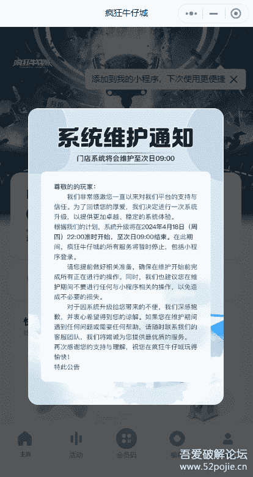

3.png (249.82 KB, 下载次数: 1)

[href="forum.php?mod=attachment&aid=MjcyODg5Mnw1ZDA4Y2M1YnwxNzkzNTcyMzc2fDE2ODA4NnwxOTE1NDEx&nothumb=yes" target="_blank"](https://www.52pojie.cn/forum.php?mod=attachment&aid=MjcyODg5Mnw1ZDA4Y2M1YnwxNzkzNTcyMzc2fDE2ODA4NnwxOTE1NDEx&nothumb=yes)

2024-10-14 14:19 上传

打开`everything`，开始我们的搜索！直接搜`.wxapkg`，选择修改时间-倒序，然后打开`_APP_.wxapkg`所在的文件夹


4.png (52.95 KB, 下载次数: 1)

[href="forum.php?mod=attachment&aid=MjcyODg5M3xiNDg4ZTRjYXwxNzkzNTcyMzc2fDE2ODA4NnwxOTE1NDEx&nothumb=yes" target="_blank"](https://www.52pojie.cn/forum.php?mod=attachment&aid=MjcyODg5M3xiNDg4ZTRjYXwxNzkzNTcyMzc2fDE2ODA4NnwxOTE1NDEx&nothumb=yes)

2024-10-14 14:19 上传

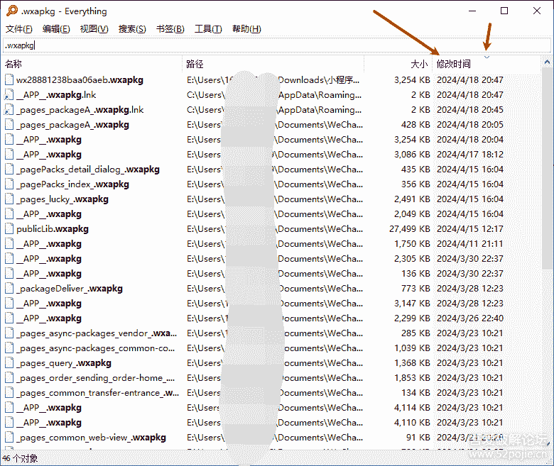

5.png (109.6 KB, 下载次数: 1)

[href="forum.php?mod=attachment&aid=MjcyODg5NHwxOThkNjA1OXwxNzkzNTcyMzc2fDE2ODA4NnwxOTE1NDEx&nothumb=yes" target="_blank"](https://www.52pojie.cn/forum.php?mod=attachment&aid=MjcyODg5NHwxOThkNjA1OXwxNzkzNTcyMzc2fDE2ODA4NnwxOTE1NDEx&nothumb=yes)

2024-10-14 14:19 上传

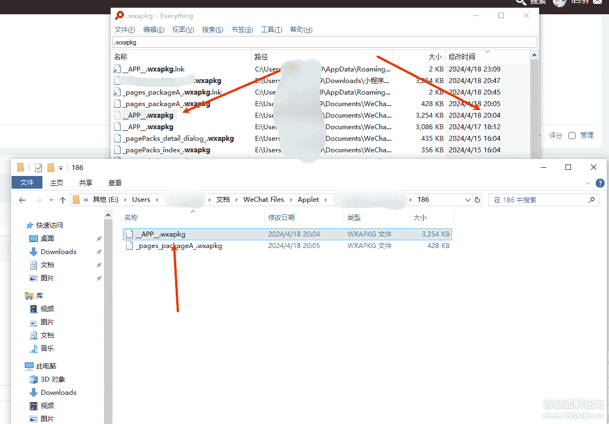

6.png (103.74 KB, 下载次数: 1)

[href="forum.php?mod=attachment&aid=MjcyODg5NXwyZDU3ZDJmYXwxNzkzNTcyMzc2fDE2ODA4NnwxOTE1NDEx&nothumb=yes" target="_blank"](https://www.52pojie.cn/forum.php?mod=attachment&aid=MjcyODg5NXwyZDU3ZDJmYXwxNzkzNTcyMzc2fDE2ODA4NnwxOTE1NDEx&nothumb=yes)

2024-10-14 14:19 上传

当然，到这一步，你可能想问，你都没和我说怎么抓签到接口啊！🤣

我想说，不好意思我忘了😂

这边你再下载一个抓包工具，叫`HTTP Debugger Pro`，或者你有可以抓到微信小程序的抓包工具都可以用

然后，打开`HTTP Debugger Pro`，这是他的页面。

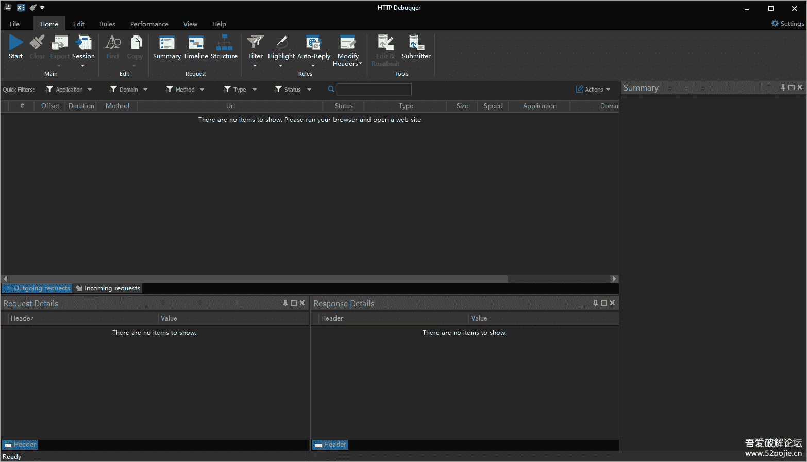

7.png (51.69 KB, 下载次数: 1)

[href="forum.php?mod=attachment&aid=MjcyODg5NnxjNzNlZjZmOXwxNzkzNTcyMzc2fDE2ODA4NnwxOTE1NDEx&nothumb=yes" target="_blank"](https://www.52pojie.cn/forum.php?mod=attachment&aid=MjcyODg5NnxjNzNlZjZmOXwxNzkzNTcyMzc2fDE2ODA4NnwxOTE1NDEx&nothumb=yes)

2024-10-14 14:19 上传

开始抓包，点击一下签到，然后抓到该请求。

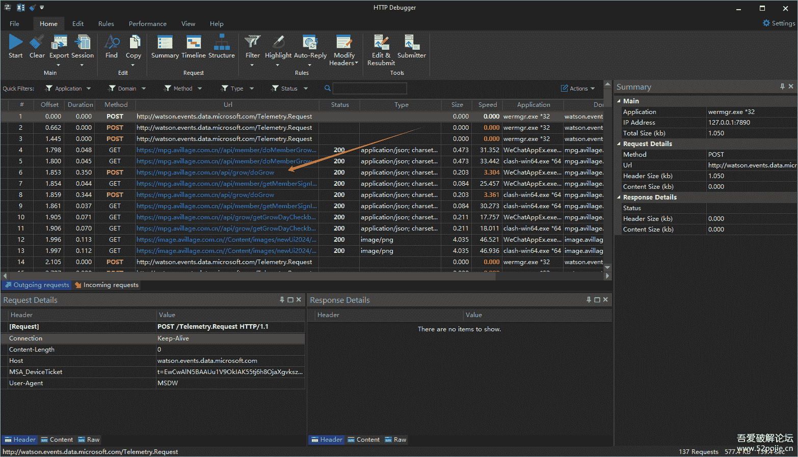

8.png (145.38 KB, 下载次数: 1)

[href="forum.php?mod=attachment&aid=MjcyODg5OHw4OTdlMDExZXwxNzkzNTcyMzc2fDE2ODA4NnwxOTE1NDEx&nothumb=yes" target="_blank"](https://www.52pojie.cn/forum.php?mod=attachment&aid=MjcyODg5OHw4OTdlMDExZXwxNzkzNTcyMzc2fDE2ODA4NnwxOTE1NDEx&nothumb=yes)

2024-10-14 14:19 上传


9.png (103.1 KB, 下载次数: 1)

[href="forum.php?mod=attachment&aid=MjcyODkwMHwxOGUyYzczOHwxNzkzNTcyMzc2fDE2ODA4NnwxOTE1NDEx&nothumb=yes" target="_blank"](https://www.52pojie.cn/forum.php?mod=attachment&aid=MjcyODkwMHwxOGUyYzczOHwxNzkzNTcyMzc2fDE2ODA4NnwxOTE1NDEx&nothumb=yes)

2024-10-14 14:19 上传

我们可以发现，通过抓包，发现有个`doGrow`，经过翻译，可以大致推断他就是签到接口


10.png (91.69 KB, 下载次数: 1)

[href="forum.php?mod=attachment&aid=MjcyODkwMXwwYTNjZTUyMHwxNzkzNTcyMzc2fDE2ODA4NnwxOTE1NDEx&nothumb=yes" target="_blank"](https://www.52pojie.cn/forum.php?mod=attachment&aid=MjcyODkwMXwwYTNjZTUyMHwxNzkzNTcyMzc2fDE2ODA4NnwxOTE1NDEx&nothumb=yes)

2024-10-14 14:20 上传

通过接口response返回，可以看到request发送了如下json

```
{
   "member_no" : 9999,
   "sign" : "2675c58926fe37d01a39874b6e210486",
   "store_no" : 12,
   "time" : "20240418200528",
   "type" : 12
}
```

通过询问GPT，可以得知：

`member_no`：表示会员编号，这里的值为44246，可能是指一个特定会员的唯一识别码。

`sign`：通常表示一个签名或者校验码，用于验证数据的完整性和真实性。这里的值“2675c58926fe37d01a39874b6e210486”可能是一个通过特定算法生成的签名。

`store_no`：表示商店编号，这里的值为12，可能指的是特定商店的编号。

`time`：表示时间，这里的值“20240418200528”看起来是一个时间戳，格式可能是YYYYMMDDHHMMSS，即2024年4月18日20点05分28秒。

`type`：表示类型，这里的值为12，具体指什么类型需要根据上下文来判断，比如可能是指交易类型、消息类型等。

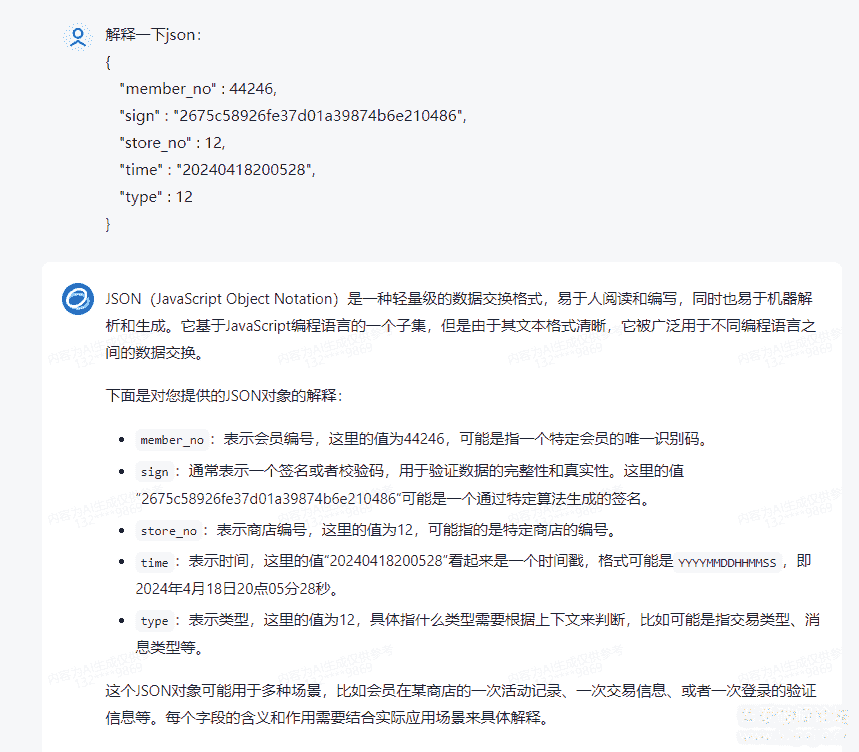

11.png (107.01 KB, 下载次数: 1)

[href="forum.php?mod=attachment&aid=MjcyODkwMnwxZTllNzRjY3wxNzkzNTcyMzc2fDE2ODA4NnwxOTE1NDEx&nothumb=yes" target="_blank"](https://www.52pojie.cn/forum.php?mod=attachment&aid=MjcyODkwMnwxZTllNzRjY3wxNzkzNTcyMzc2fDE2ODA4NnwxOTE1NDEx&nothumb=yes)

2024-10-14 14:20 上传

并且可以看到，返回了如下json:

```
{
   "data" : null,
   "errorCode" : 0,
   "errorMessage" : "领取成功",
   "filename" : null,
   "success" : true,
   "url" : null
}
```

尝试重发请求，修改`time`值为20240419200528 原`time`值为：20240418200528

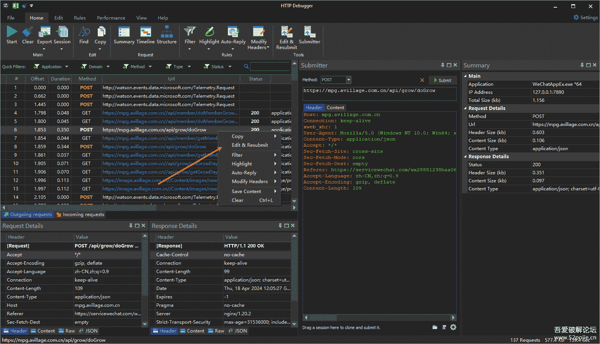

12.png (170.55 KB, 下载次数: 1)

[href="forum.php?mod=attachment&aid=MjcyODkwM3xkMTlkNDJkY3wxNzkzNTcyMzc2fDE2ODA4NnwxOTE1NDEx&nothumb=yes" target="_blank"](https://www.52pojie.cn/forum.php?mod=attachment&aid=MjcyODkwM3xkMTlkNDJkY3wxNzkzNTcyMzc2fDE2ODA4NnwxOTE1NDEx&nothumb=yes)

2024-10-14 14:20 上传

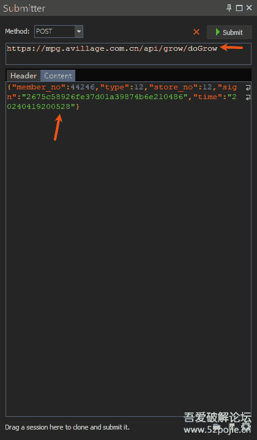

13.png (22.88 KB, 下载次数: 1)

[href="forum.php?mod=attachment&aid=MjcyODkwNHwwMzA2NzdhMnwxNzkzNTcyMzc2fDE2ODA4NnwxOTE1NDEx&nothumb=yes" target="_blank"](https://www.52pojie.cn/forum.php?mod=attachment&aid=MjcyODkwNHwwMzA2NzdhMnwxNzkzNTcyMzc2fDE2ODA4NnwxOTE1NDEx&nothumb=yes)

2024-10-14 14:20 上传

使用`APIFOX`发送请求可以发现，只修改`time`会出现416错误返回：


```
{
    "Message": "出现错误。"
}
```


`14.png` (105.01 KB, 下载次数: 1)

[href="forum.php?mod=attachment&aid=MjcyODkwNXxjODhiNGRhYXwxNzkzNTcyMzc2fDE2ODA4NnwxOTE1NDEx&nothumb=yes" target="_blank"](https://www.52pojie.cn/forum.php?mod=attachment&aid=MjcyODkwNXxjODhiNGRhYXwxNzkzNTcyMzc2fDE2ODA4NnwxOTE1NDEx&nothumb=yes)

2024-10-14 14:20 上传

由此可以判断，只修改`time`是没法进行签到的，需要一同把`sign`修改了，可是我们该如何得到`sign`值呢？

通过长度判断，可以发现`sign`是`md5`的32位长度，猜测是`md5`加盐了

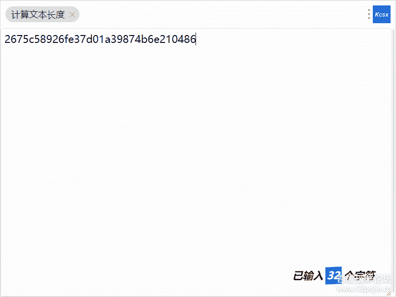

`15.png` (44.45 KB, 下载次数: 0)

[href="forum.php?mod=attachment&aid=MjcyODkwNnxhYWEwY2E5YXwxNzkzNTcyMzc2fDE2ODA4NnwxOTE1NDEx&nothumb=yes" target="_blank"](https://www.52pojie.cn/forum.php?mod=attachment&aid=MjcyODkwNnxhYWEwY2E5YXwxNzkzNTcyMzc2fDE2ODA4NnwxOTE1NDEx&nothumb=yes)

2024-10-14 14:20 上传

接下来开始解密`__APP__.wxapkg`

打开`UnpackMiniApp.exe`

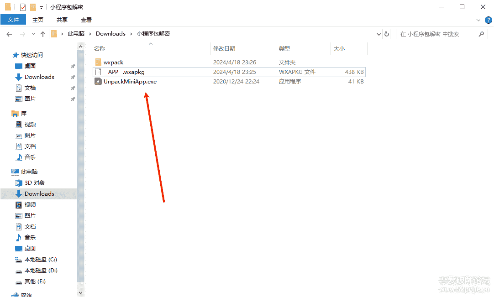

`1.png` (55.42 KB, 下载次数: 3)

[href="forum.php?mod=attachment&aid=MjY5MjYzMHw1MDliZjVkNXwxNzkzNTcyMzc2fDE2ODA4NnwxOTE1NDEx&nothumb=yes" target="_blank"](https://www.52pojie.cn/forum.php?mod=attachment&aid=MjY5MjYzMHw1MDliZjVkNXwxNzkzNTcyMzc2fDE2ODA4NnwxOTE1NDEx&nothumb=yes)

2024-4-28 16:06 上传

打开之前找到的`_APP_.wxapkg`的所在的文件路径

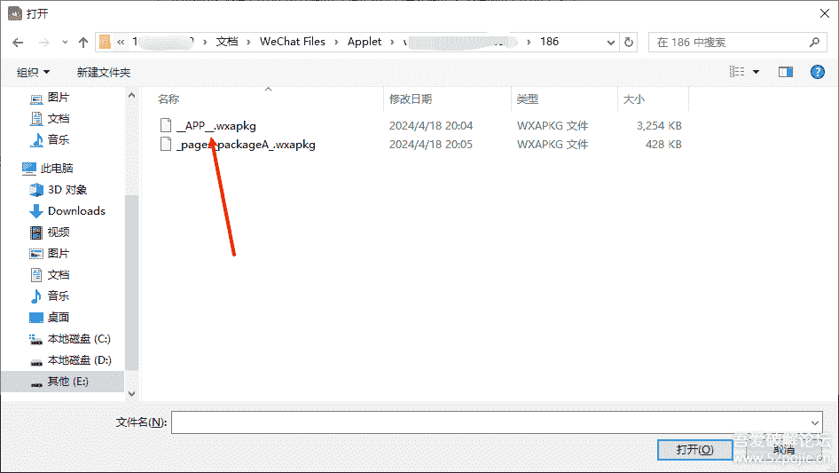

`16.png` (47.13 KB, 下载次数: 1)

[href="forum.php?mod=attachment&aid=MjcyODkwN3xjNzNkMmU1YnwxNzkzNTcyMzc2fDE2ODA4NnwxOTE1NDEx&nothumb=yes" target="_blank"](https://www.52pojie.cn/forum.php?mod=attachment&aid=MjcyODkwN3xjNzNkMmU1YnwxNzkzNTcyMzc2fDE2ODA4NnwxOTE1NDEx&nothumb=yes)

2024-10-14 14:20 上传

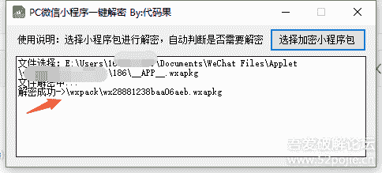

`17.png` (15.51 KB, 下载次数: 1)

[href="forum.php?mod=attachment&aid=MjcyODkwOHwwNmQ5NTllMHwxNzkzNTcyMzc2fDE2ODA4NnwxOTE1NDEx&nothumb=yes" target="_blank"](https://www.52pojie.cn/forum.php?mod=attachment&aid=MjcyODkwOHwwNmQ5NTllMHwxNzkzNTcyMzc2fDE2ODA4NnwxOTE1NDEx&nothumb=yes)

2024-10-14 14:20 上传

然后打开`\wxpack\`目录

找到如下文件`wx28881238baa06aeb.wxapkg`

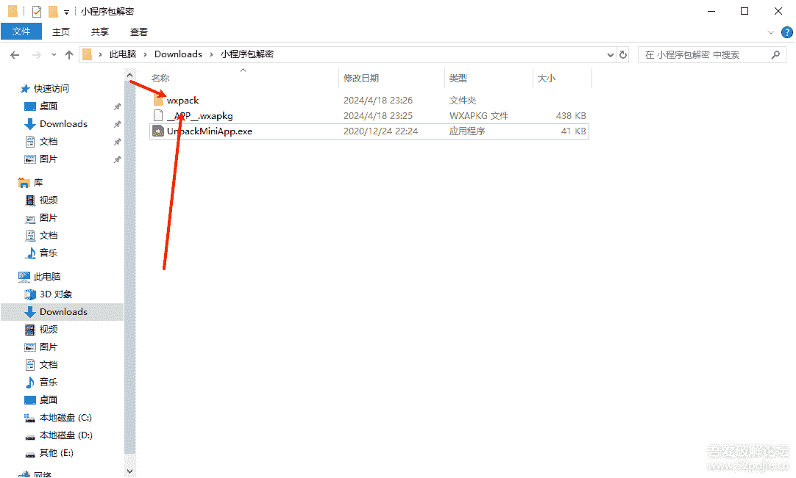

`18.png` (55.94 KB, 下载次数: 1)

[href="forum.php?mod=attachment&aid=MjcyODkwOXxiYTY5YThjN3wxNzkzNTcyMzc2fDE2ODA4NnwxOTE1NDEx&nothumb=yes" target="_blank"](https://www.52pojie.cn/forum.php?mod=attachment&aid=MjcyODkwOXxiYTY5YThjN3wxNzkzNTcyMzc2fDE2ODA4NnwxOTE1NDEx&nothumb=yes)

2024-10-14 14:20 上传

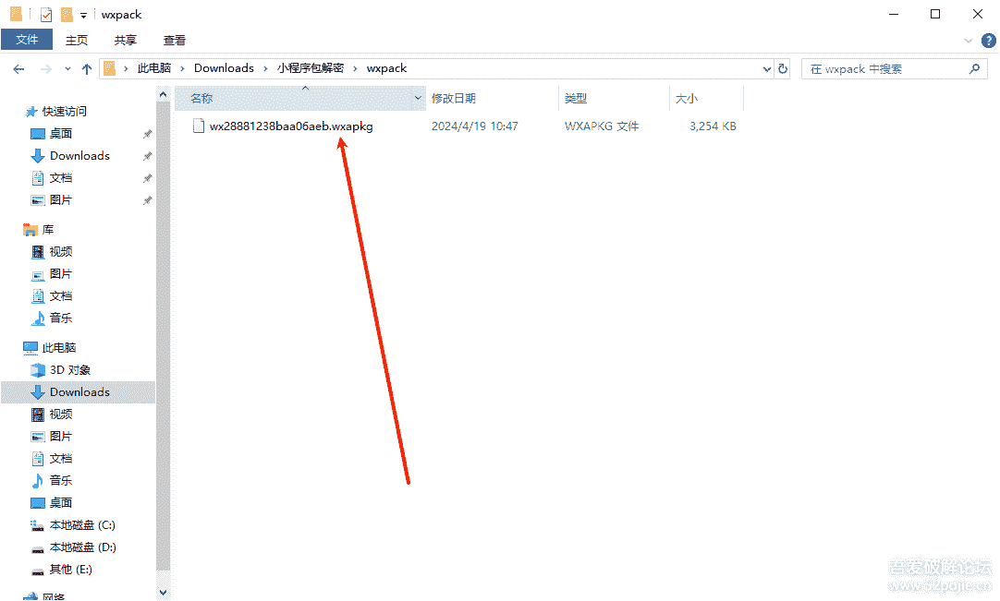

`19.png` (52.28 KB, 下载次数: 0)

[href="forum.php?mod=attachment&aid=MjcyODkxMHwwYjI4YjcxNXwxNzkzNTcyMzc2fDE2ODA4NnwxOTE1NDEx&nothumb=yes" target="_blank"](https://www.52pojie.cn/forum.php?mod=attachment&aid=MjcyODkxMHwwYjI4YjcxNXwxNzkzNTcyMzc2fDE2ODA4NnwxOTE1NDEx&nothumb=yes)

2024-10-14 14:20 上传

然后打开`wxapkgconvertor.exe`，把`wx28881238baa06aeb.wxapkg`拖进去

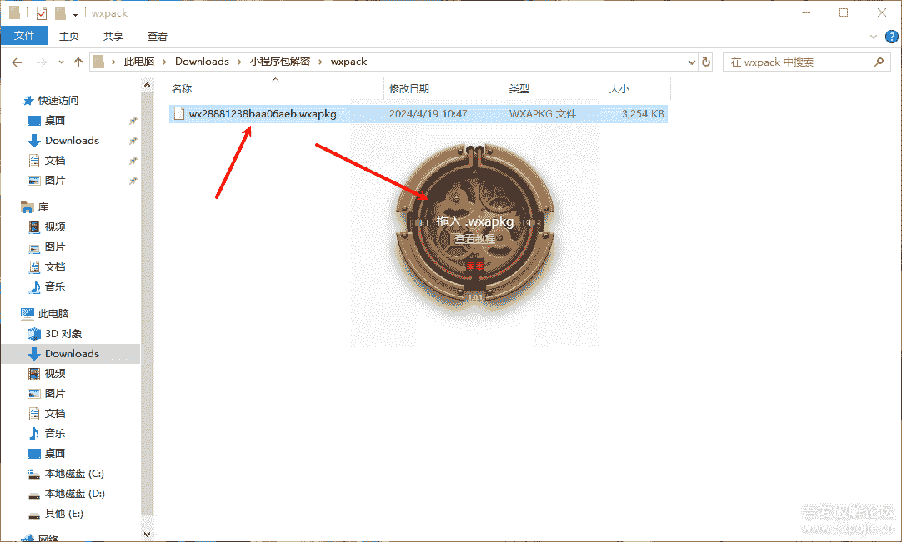

`20.png` (140.29 KB, 下载次数: 1)

[href="forum.php?mod=attachment&aid=MjcyODkxMXxiODdjMTg3N3wxNzkzNTcyMzc2fDE2ODA4NnwxOTE1NDEx&nothumb=yes" target="_blank"](https://www.52pojie.cn/forum.php?mod=attachment&aid=MjcyODkxMXxiODdjMTg3N3wxNzkzNTcyMzc2fDE2ODA4NnwxOTE1NDEx&nothumb=yes)

2024-10-14 14:20 上传

反编译成功，生成了`wx28881238baa06aeb`目录

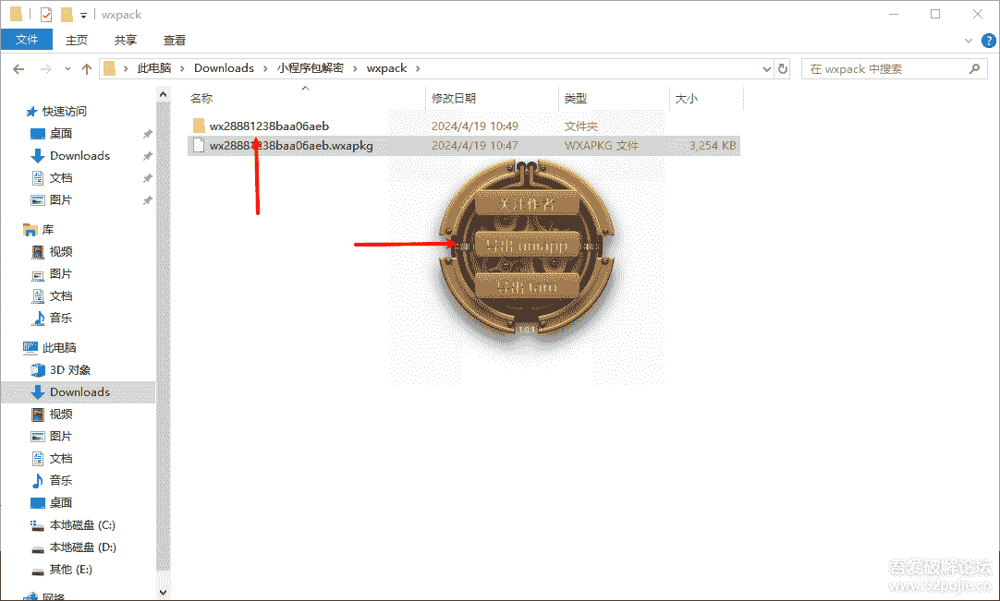

`21.png` (128.16 KB, 下载次数: 1)

[href="forum.php?mod=attachment&aid=MjcyODkxMnw4NTlmOTBiNHwxNzkzNTcyMzc2fDE2ODA4NnwxOTE1NDEx&nothumb=yes" target="_blank"](https://www.52pojie.cn/forum.php?mod=attachment&aid=MjcyODkxMnw4NTlmOTBiNHwxNzkzNTcyMzc2fDE2ODA4NnwxOTE1NDEx&nothumb=yes)

2024-10-14 14:20 上传

`vscode`打开该目录，注意！由于性能问题和混淆问题，建议将目录中的`app-service.js`复制内容，然后找个JS格式化网站格式化一下

这里可以用Javascript格式化在线工具：[//coding.tools/cn/javascript-beautifier" target="_blank" rel="noopener noreferrer nofollow"](https://coding.tools/cn/javascript-beautifier:rel="nofollow noopener" href="https)

格式化打开后如下：

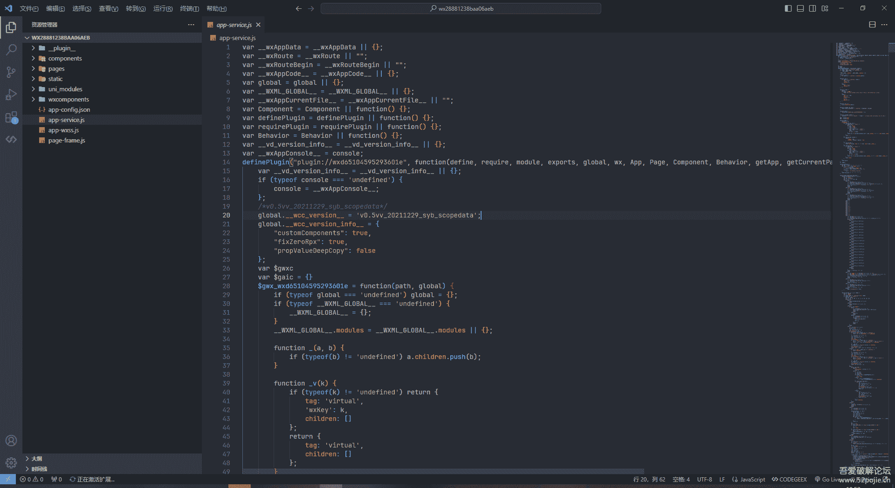

`22.png` (287.65 KB, 下载次数: 1)

[href="forum.php?mod=attachment&aid=MjcyODkxM3w2MzI3NWZmYXwxNzkzNTcyMzc2fDE2ODA4NnwxOTE1NDEx&nothumb=yes" target="_blank"](https://www.52pojie.cn/forum.php?mod=attachment&aid=MjcyODkxM3w2MzI3NWZmYXwxNzkzNTcyMzc2fDE2ODA4NnwxOTE1NDEx&nothumb=yes)

2024-10-14 14:20 上传

尝试搜索关键词`doGrow`，现有个函数定义了`doGrow`

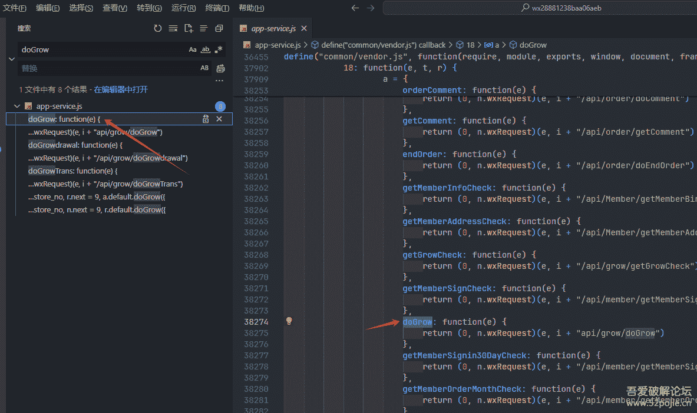

`24.png` (197.18 KB, 下载次数: 1)

[href="forum.php?mod=attachment&aid=MjcyODkxNHw2NzQ2OTM1ZnwxNzkzNTcyMzc2fDE2ODA4NnwxOTE1NDEx&nothumb=yes" target="_blank"](https://www.52pojie.cn/forum.php?mod=attachment&aid=MjcyODkxNHw2NzQ2OTM1ZnwxNzkzNTcyMzc2fDE2ODA4NnwxOTE1NDEx&nothumb=yes)

2024-10-14 14:20 上传

通过分析，可以发现，上面的`a`变量，对照了下图中的`a.default.doGrow`，可以发现，`query`对象和我们抓接口出来请求时的对象一致

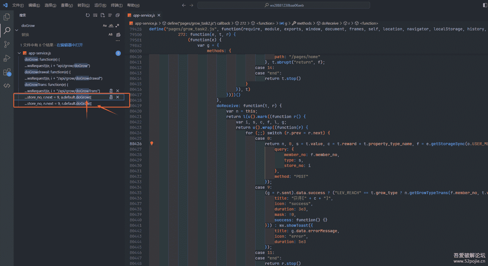

`25.png` (208.78 KB, 下载次数: 1)

[href="forum.php?mod=attachment&aid=MjcyODkxNXw1NzgxNGExYnwxNzkzNTcyMzc2fDE2ODA4NnwxOTE1NDEx&nothumb=yes" target="_blank"](https://www.52pojie.cn/forum.php?mod=attachment&aid=MjcyODkxNXw1NzgxNGExYnwxNzkzNTcyMzc2fDE2ODA4NnwxOTE1NDEx&nothumb=yes)

2024-10-14 14:20 上传

猜想一下，既然可能是`MD5`加盐加密，很有可能方法名就叫`MD5`，或者尝试搜索`sign`看看能不能搜出结果。

下图可以发现，第一条包含有`sign`，还包含有`hexMD5`，看样子是`MD5`加密函数，并且下面第三条也有定义`hexMD5`方法

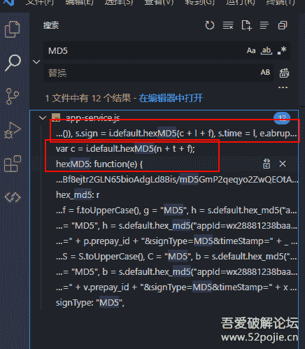

`{864D6C43-19AA-4543-A5CF-F268326943A0}.png` (52.3 KB, 下载次数: 3)

[href="forum.php?mod=attachment&aid=MjY5MDM1MnwxZGEzZTI0NHwxNzkzNTcyMzc2fDE2ODA4NnwxOTE1NDEx&nothumb=yes" target="_blank"](https://www.52pojie.cn/forum.php?mod=attachment&aid=MjY5MDM1MnwxZGEzZTI0NHwxNzkzNTcyMzc2fDE2ODA4NnwxOTE1NDEx&nothumb=yes)

2024-4-19 12:56 上传

点击第一条搜索结果，可以看到有一段[JavaScript] 纯文本查看 复制代码

```
var f = "911e529a9bcf081551797284f095f061acun"
```

可以粗略判断它是加盐的密钥，把这部分代码贴到GPT，问问它

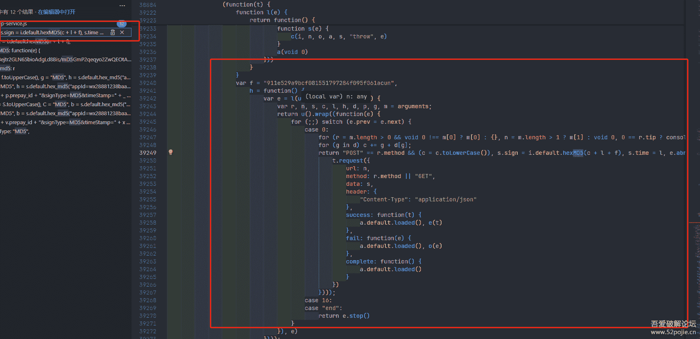

`{441DE93B-182B-46d5-AC7B-709DA9126E96}.png` (186.81 KB, 下载次数: 3)

[href="forum.php?mod=attachment&aid=MjY5MDM1M3wxMjUwNmFjM3wxNzkzNTcyMzc2fDE2ODA4NnwxOTE1NDEx&nothumb=yes" target="_blank"](https://www.52pojie.cn/forum.php?mod=attachment&aid=MjY5MDM1M3wxMjUwNmFjM3wxNzkzNTcyMzc2fDE2ODA4NnwxOTE1NDEx&nothumb=yes)

2024-4-19 12:59 上传

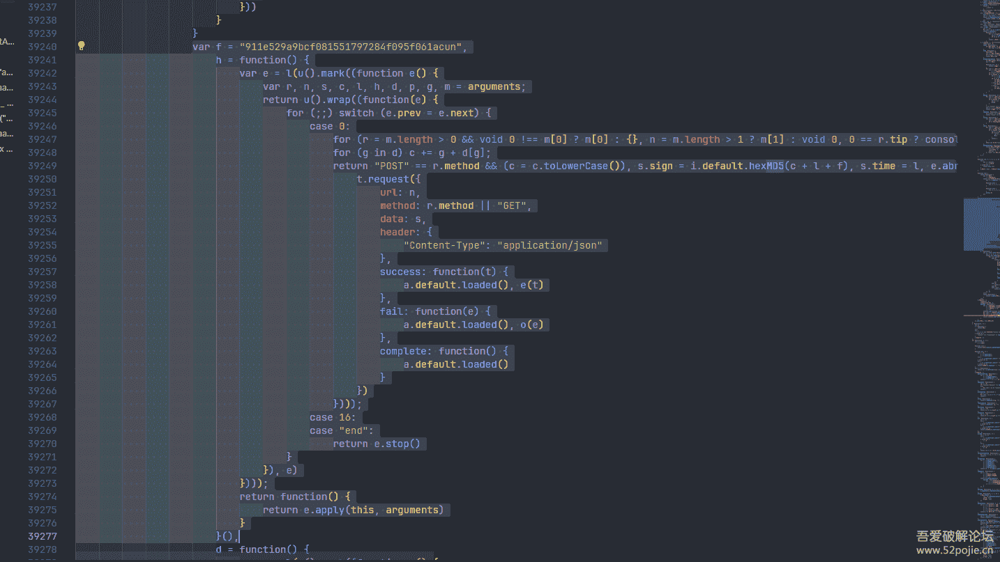

`PixPin_2024-04-19_13-01-29.png` (196.28 KB, 下载次数: 4)

[href="forum.php?mod=attachment&aid=MjY5MDM1NHw5NWZkODExN3wxNzkzNTcyMzc2fDE2ODA4NnwxOTE1NDEx&nothumb=yes" target="_blank"](https://www.52pojie.cn/forum.php?mod=attachment&aid=MjY5MDM1NHw5NWZkODExN3wxNzkzNTcyMzc2fDE2ODA4NnwxOTE1NDEx&nothumb=yes)

2024-4-19 13:01 上传

GPT已经帮我们分析好了，它说`f`可能是一个签名或密钥，那就先扣下这段代码，新建一个`test.js`文件，然后粘贴

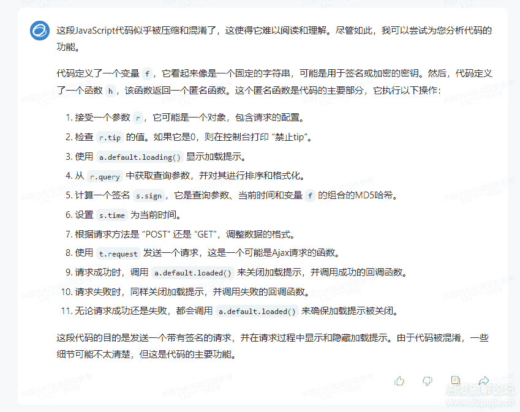

`PixPin_2024-04-19_13-02-49.png` (107.85 KB, 下载次数: 2)

[href="forum.php?mod=attachment&aid=MjY5MDM1NXxhYzVhNjhiOXwxNzkzNTcyMzc2fDE2ODA4NnwxOTE1NDEx&nothumb=yes" target="_blank"](https://www.52pojie.cn/forum.php?mod=attachment&aid=MjY5MDM1NXxhYzVhNjhiOXwxNzkzNTcyMzc2fDE2ODA4NnwxOTE1NDEx&nothumb=yes)

2024-4-19 13:02 上传

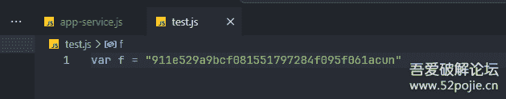

`PixPin_2024-04-19_13-04-55.png` (16.67 KB, 下载次数: 4)

[href="forum.php?mod=attachment&aid=MjY5MDM1NnwyNTFjMjNhYXwxNzkzNTcyMzc2fDE2ODA4NnwxOTE1NDEx&nothumb=yes" target="_blank"](https://www.52pojie.cn/forum.php?mod=attachment&aid=MjY5MDM1NnwyNTFjMjNhYXwxNzkzNTcyMzc2fDE2ODA4NnwxOTE1NDEx&nothumb=yes)

2024-4-19 13:04 上传

继续分析代码

发现有段代码进行了解构，`i.default.hexMD5(c + l + f)`中的`c`和`l`都是通过解构了`arguments`获得的


```
var r, n, s, c, l, h, d, p, g, m = arguments;
```

暂时没法判断出用途，那就换个思路，直接搜`hexMD5`，可以发现有两个地方调用了`hexMD5`，第一个是咱们刚刚看过的位置。

第二个咱没看过，点进去一看，发现,诶这不是我想要的`getSign`吗？

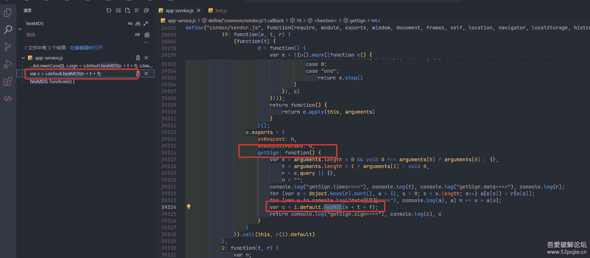

{C1726DC8-511C-4454-896B-7F6066F07C8E}.png (171.91 KB, 下载次数: 2)

[href="forum.php?mod=attachment&aid=MjY5MDM1N3xmN2FmMmRkZnwxNzkzNTcyMzc2fDE2ODA4NnwxOTE1NDEx&nothumb=yes" target="_blank"](https://www.52pojie.cn/forum.php?mod=attachment&aid=MjY5MDM1N3xmN2FmMmRkZnwxNzkzNTcyMzc2fDE2ODA4NnwxOTE1NDEx&nothumb=yes)

2024-4-19 13:10 上传

同样的，在这里也发现了`e`、`t`、`r`、`n`解构了`arguments`变量

先别管他干嘛的，扣下来扣下来。这时候是没法运行的，因为会报错，`hexMD5`未被定义。点击搜索的第三个，把`hexMD5`也扣下来

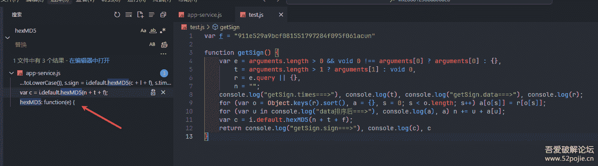

PixPin_2024-04-19_13-12-26.png (90.19 KB, 下载次数: 3)

[href="forum.php?mod=attachment&aid=MjY5MDM1OXw4NTA4M2I0OHwxNzkzNTcyMzc2fDE2ODA4NnwxOTE1NDEx&nothumb=yes" target="_blank"](https://www.52pojie.cn/forum.php?mod=attachment&aid=MjY5MDM1OXw4NTA4M2I0OHwxNzkzNTcyMzc2fDE2ODA4NnwxOTE1NDEx&nothumb=yes)

2024-4-19 13:12 上传

咱可以发现，`hexMD5`调用了`c`、`u`、`l`这三个方法，刚好这三个方法肯定就在这附近，所以上面的代码可以判断，上面的方法就是被调用的`c`、`u`、`l`。

也要一并扣下来，这时候还没法运行，因为`u`方法会报错，会提示`o`未被定义

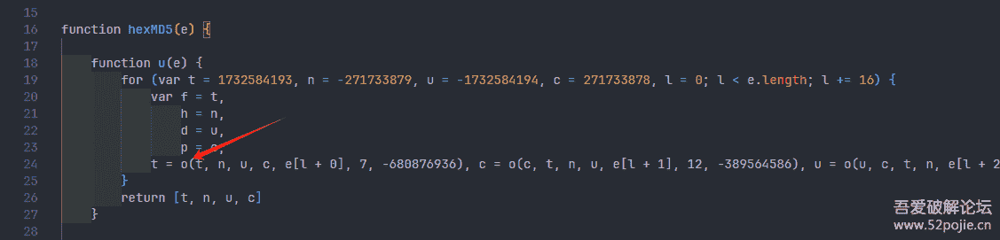

{62068629-F6AC-48c5-9096-554EEFC0E346}.png (39.7 KB, 下载次数: 4)

[href="forum.php?mod=attachment&aid=MjY5MDM2NXwyNmNmNTQ4NXwxNzkzNTcyMzc2fDE2ODA4NnwxOTE1NDEx&nothumb=yes" target="_blank"](https://www.52pojie.cn/forum.php?mod=attachment&aid=MjY5MDM2NXwyNmNmNTQ4NXwxNzkzNTcyMzc2fDE2ODA4NnwxOTE1NDEx&nothumb=yes)

2024-4-19 13:16 上传

通过`hexMD5`方法的上下文，可以看到有`o`、`r`、`n`、`i`、`a`、`s`方法被定义，一起扣下来

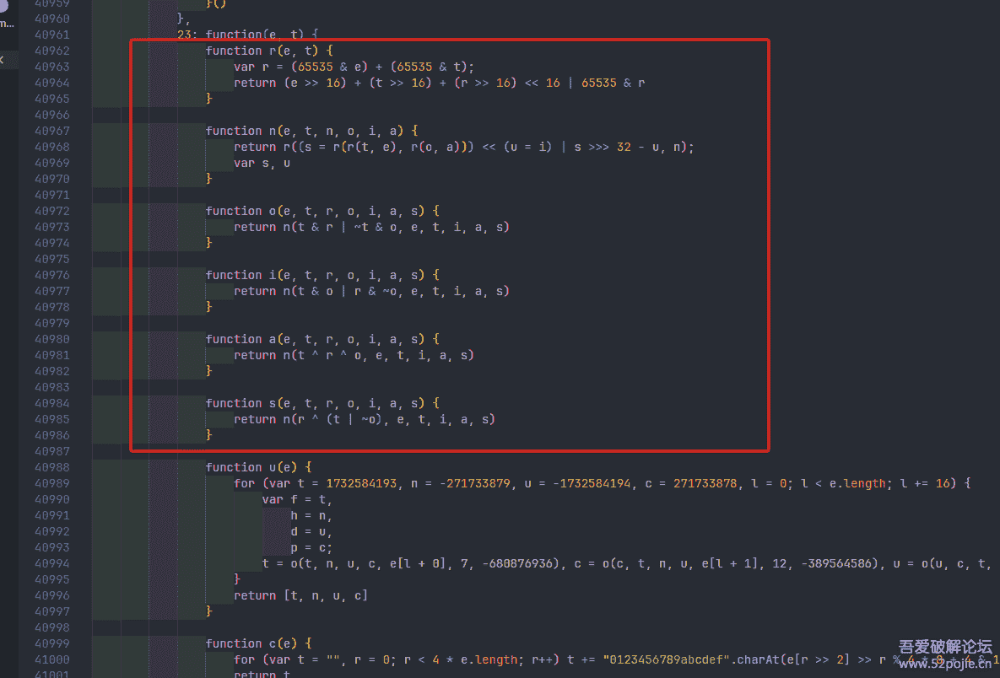

1713503942352.jpg (135.18 KB, 下载次数: 4)

[href="forum.php?mod=attachment&aid=MjY5MDM2Nnw2M2Q2MWQ5MnwxNzkzNTcyMzc2fDE2ODA4NnwxOTE1NDEx&nothumb=yes" target="_blank"](https://www.52pojie.cn/forum.php?mod=attachment&aid=MjY5MDM2Nnw2M2Q2MWQ5MnwxNzkzNTcyMzc2fDE2ODA4NnwxOTE1NDEx&nothumb=yes)

2024-4-19 13:19 上传

这是最终扣下来的代码：

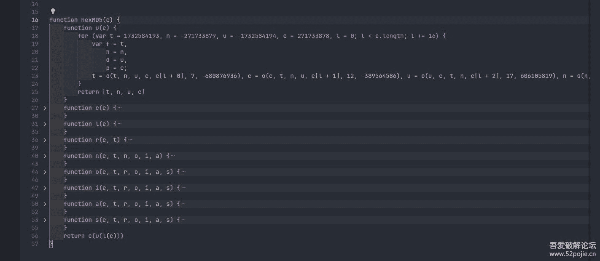

微信截图_20240419131957.png (66.95 KB, 下载次数: 3)

[href="forum.php?mod=attachment&aid=MjY5MDM2N3w1YjgzNjA1NnwxNzkzNTcyMzc2fDE2ODA4NnwxOTE1NDEx&nothumb=yes" target="_blank"](https://www.52pojie.cn/forum.php?mod=attachment&aid=MjY5MDM2N3w1YjgzNjA1NnwxNzkzNTcyMzc2fDE2ODA4NnwxOTE1NDEx&nothumb=yes)

2024-4-19 13:19 上传

尝试运行看看，可以发现成功了，并且`md5`和现成的库加密出来的也是一样的：

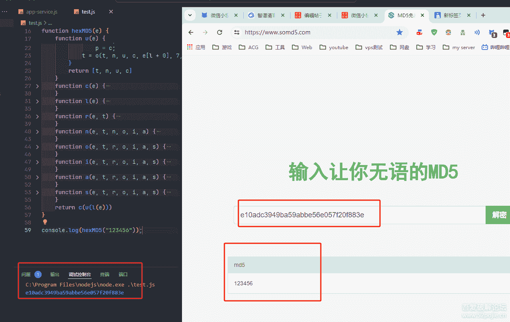

1713504134020.jpg (124.19 KB, 下载次数: 4)

[href="forum.php?mod=attachment&aid=MjY5MDM2OXwzOTA2NmYyOXwxNzkzNTcyMzc2fDE2ODA4NnwxOTE1NDEx&nothumb=yes" target="_blank"](https://www.52pojie.cn/forum.php?mod=attachment&aid=MjY5MDM2OXwzOTA2NmYyOXwxNzkzNTcyMzc2fDE2ODA4NnwxOTE1NDEx&nothumb=yes)

2024-4-19 13:22 上传

回到`getSign`方法，将`i.default.hexMD5`改成`hexMD5`。

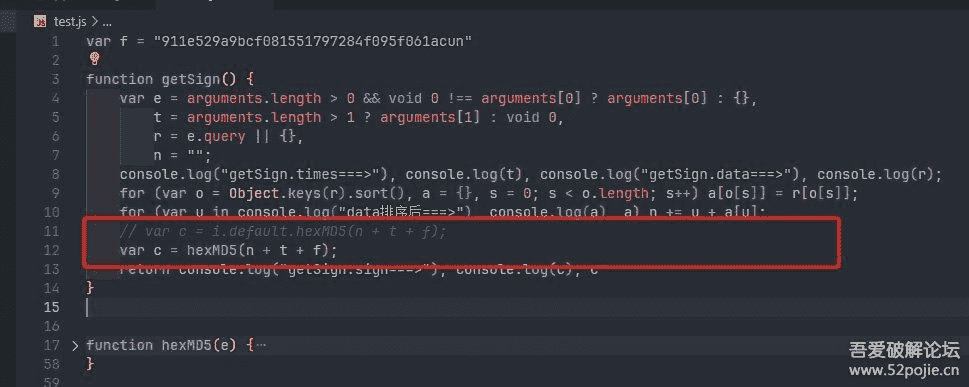

微信截图_20240419134329.png (53.68 KB, 下载次数: 3)

[href="forum.php?mod=attachment&aid=MjY5MDM3OHw5YmFmZTQ5ZHwxNzkzNTcyMzc2fDE2ODA4NnwxOTE1NDEx&nothumb=yes" target="_blank"](https://www.52pojie.cn/forum.php?mod=attachment&aid=MjY5MDM3OHw5YmFmZTQ5ZHwxNzkzNTcyMzc2fDE2ODA4NnwxOTE1NDEx&nothumb=yes)

2024-4-19 13:43 上传

尝试运行看看，你会发现加密出来的`sign`并不一致。

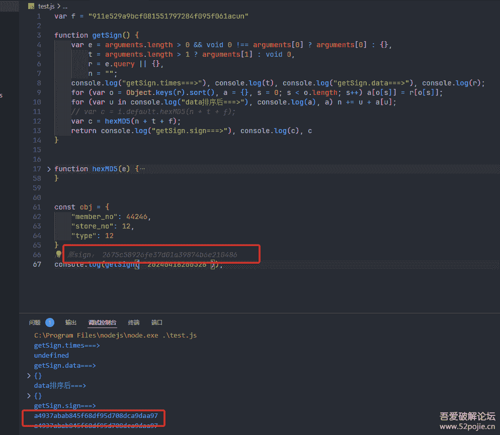

dc541dad4863fca81981d4ba10e9041f.png (111.77 KB, 下载次数: 4)

[href="forum.php?mod=attachment&aid=MjY5MDM3OXwxODNkNjVmNXwxNzkzNTcyMzc2fDE2ODA4NnwxOTE1NDEx&nothumb=yes" target="_blank"](https://www.52pojie.cn/forum.php?mod=attachment&aid=MjY5MDM3OXwxODNkNjVmNXwxNzkzNTcyMzc2fDE2ODA4NnwxOTE1NDEx&nothumb=yes)

2024-4-19 13:45 上传

关键点就在于`getSIgn`的`arguments`，当你看不懂的时候，可以问问AI，咱问问它到底是什么意思：

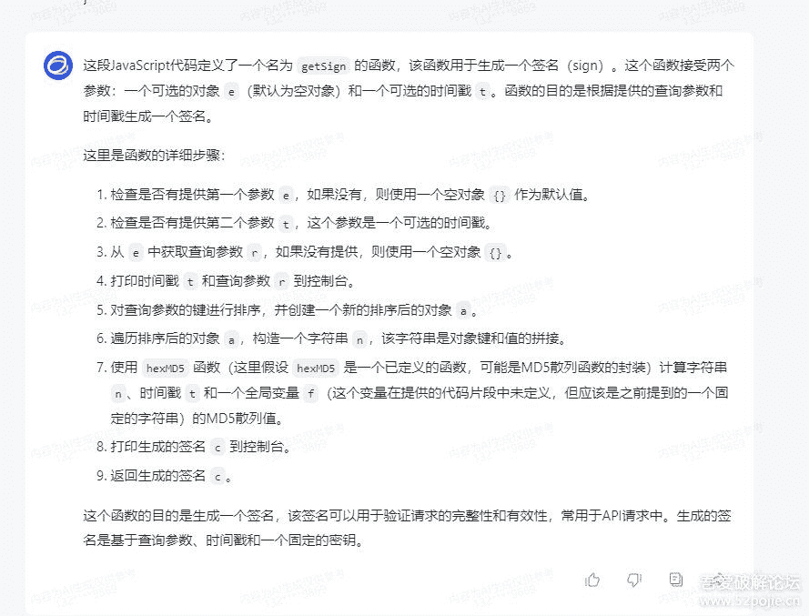

微信截图_20240419134609.png (95.58 KB, 下载次数: 4)

[href="forum.php?mod=attachment&aid=MjY5MDM4MHwzMjAyZGJjNHwxNzkzNTcyMzc2fDE2ODA4NnwxOTE1NDEx&nothumb=yes" target="_blank"](https://www.52pojie.cn/forum.php?mod=attachment&aid=MjY5MDM4MHwzMjAyZGJjNHwxNzkzNTcyMzc2fDE2ODA4NnwxOTE1NDEx&nothumb=yes)

2024-4-19 13:46 上传

这下知道`getSign`接受什么参数了，参数一: `object`，参数二: `time`值，也就是20240418200528

并且通过 `r = e.query || {}` 可以知道，`e`是参数1的`query`值，也就是我们发送请求时的`object`对象，这时候的`query`可不存在`time`和`sign`字段，可不要搞混了：

```
{
   "member_no" : 44246,
   "store_no" : 12,
   "type" : 12
}
```

所以咱可以知道，`e`本质上是传一个`query`，然后通过`time`值还有密钥`key`进行混淆，尝试一下：

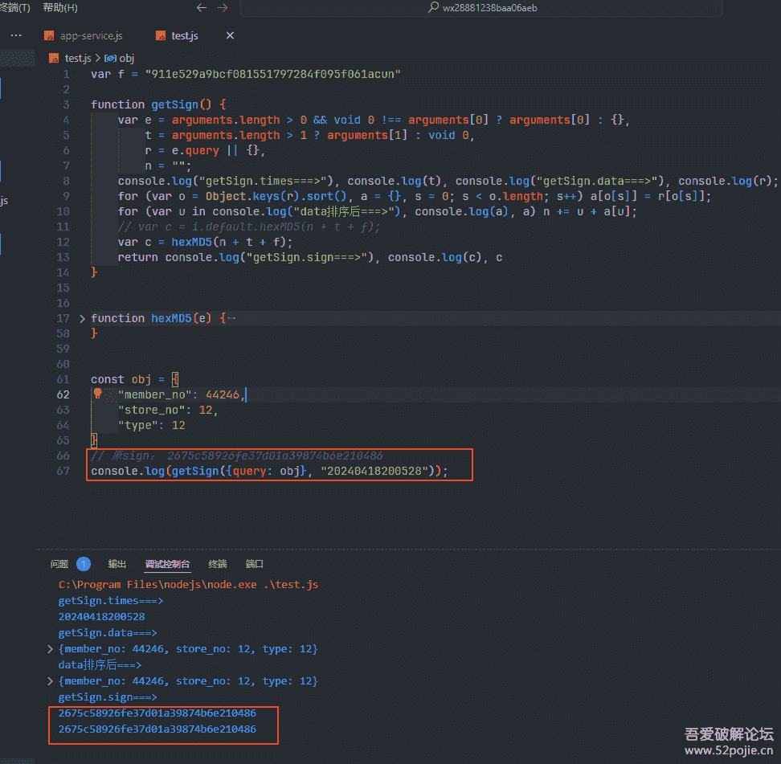

1713504785426.jpg (124.56 KB, 下载次数: 3)

[href="forum.php?mod=attachment&aid=MjY5MDM3M3wzOGQ0M2RhZXwxNzkzNTcyMzc2fDE2ODA4NnwxOTE1NDEx&nothumb=yes" target="_blank"](https://www.52pojie.cn/forum.php?mod=attachment&aid=MjY5MDM3M3wzOGQ0M2RhZXwxNzkzNTcyMzc2fDE2ODA4NnwxOTE1NDEx&nothumb=yes)

2024-4-19 13:33 上传

成功！！让AI重写一下`getSign`方便阅读：

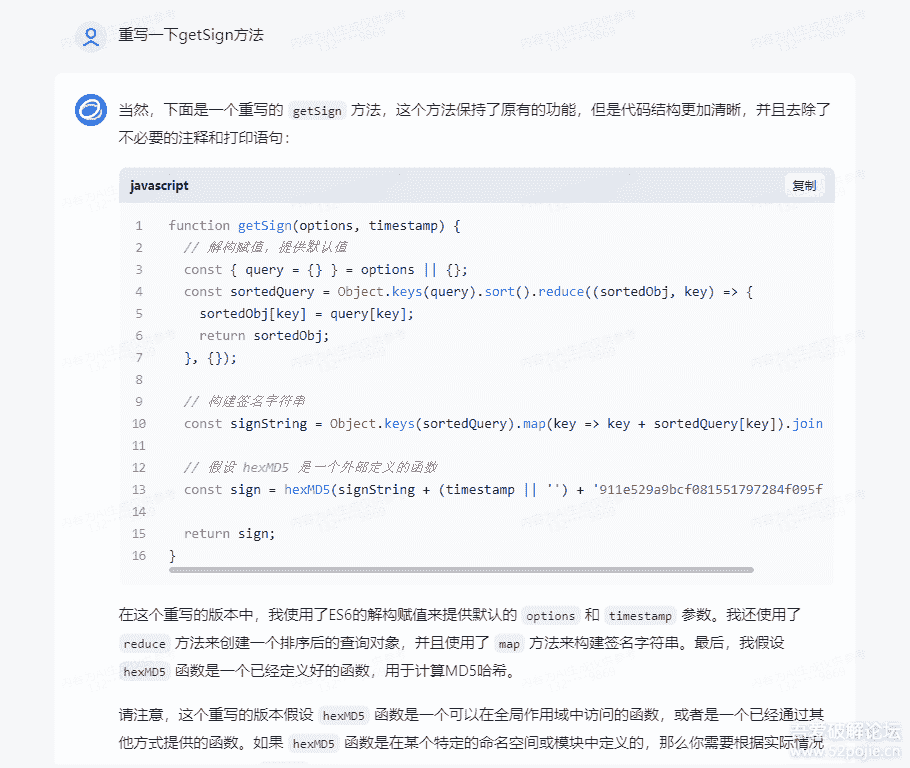

PixPin_2024-04-19_13-34-41.png (115.06 KB, 下载次数: 2)

[href="forum.php?mod=attachment&aid=MjY5MDM3NHxkZjIyYmY4MHwxNzkzNTcyMzc2fDE2ODA4NnwxOTE1NDEx&nothumb=yes" target="_blank"](https://www.52pojie.cn/forum.php?mod=attachment&aid=MjY5MDM3NHxkZjIyYmY4MHwxNzkzNTcyMzc2fDE2ODA4NnwxOTE1NDEx&nothumb=yes)

2024-4-19 13:34 上传

尝试运行一下，会发现结果一致。

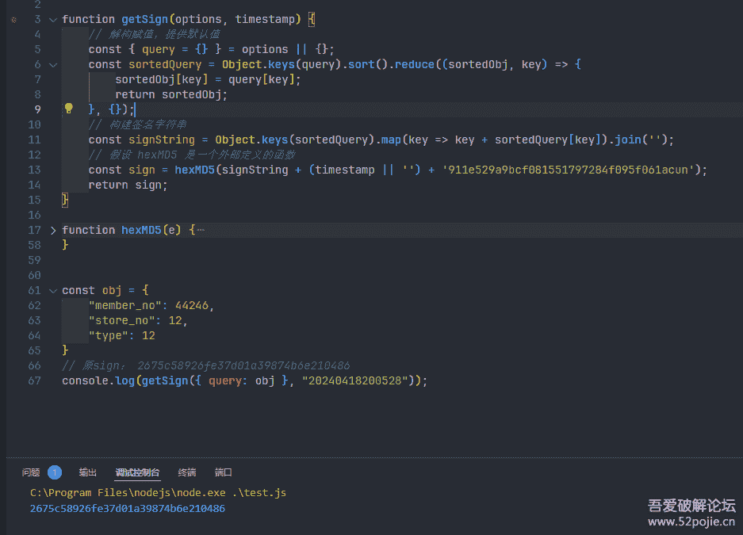

1713504932369.jpg (96.47 KB, 下载次数: 3)

[href="forum.php?mod=attachment&aid=MjY5MDM3NXwxNGZlMzJkMXwxNzkzNTcyMzc2fDE2ODA4NnwxOTE1NDEx&nothumb=yes" target="_blank"](https://www.52pojie.cn/forum.php?mod=attachment&aid=MjY5MDM3NXwxNGZlMzJkMXwxNzkzNTcyMzc2fDE2ODA4NnwxOTE1NDEx&nothumb=yes)

2024-4-19 13:35 上传

回到`apifox`，尝试发送新的请求：

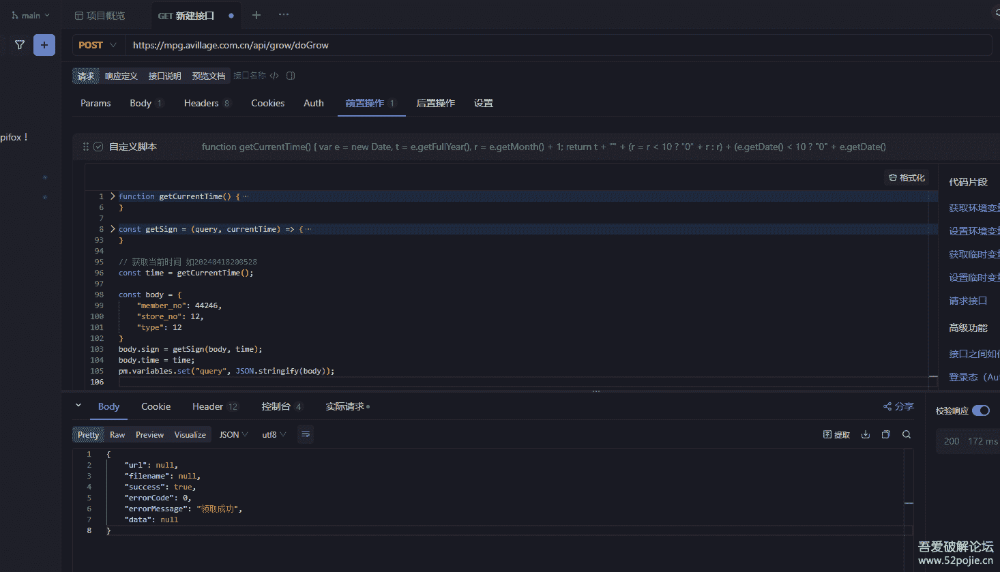

1713505207542.jpg (93.32 KB, 下载次数: 4)

[href="forum.php?mod=attachment&aid=MjY5MDM3N3w2OTcxM2ViM3wxNzkzNTcyMzc2fDE2ODA4NnwxOTE1NDEx&nothumb=yes" target="_blank"](https://www.52pojie.cn/forum.php?mod=attachment&aid=MjY5MDM3N3w2OTcxM2ViM3wxNzkzNTcyMzc2fDE2ODA4NnwxOTE1NDEx&nothumb=yes)

2024-4-19 13:42 上传

成功！逆向完成。
