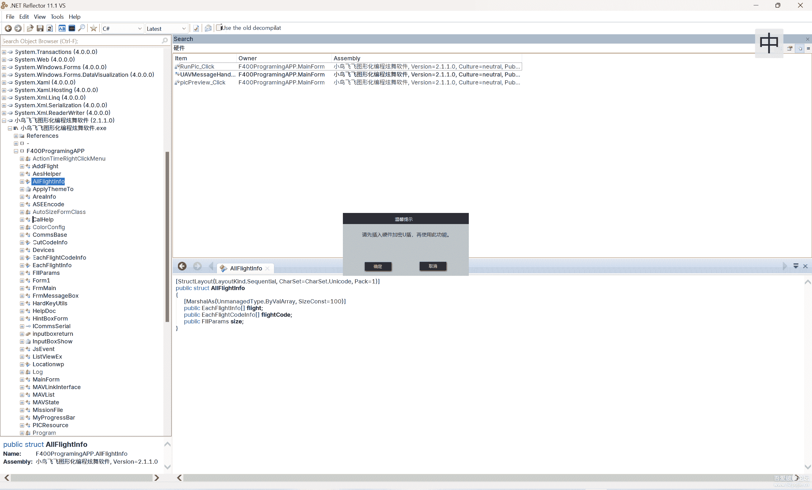
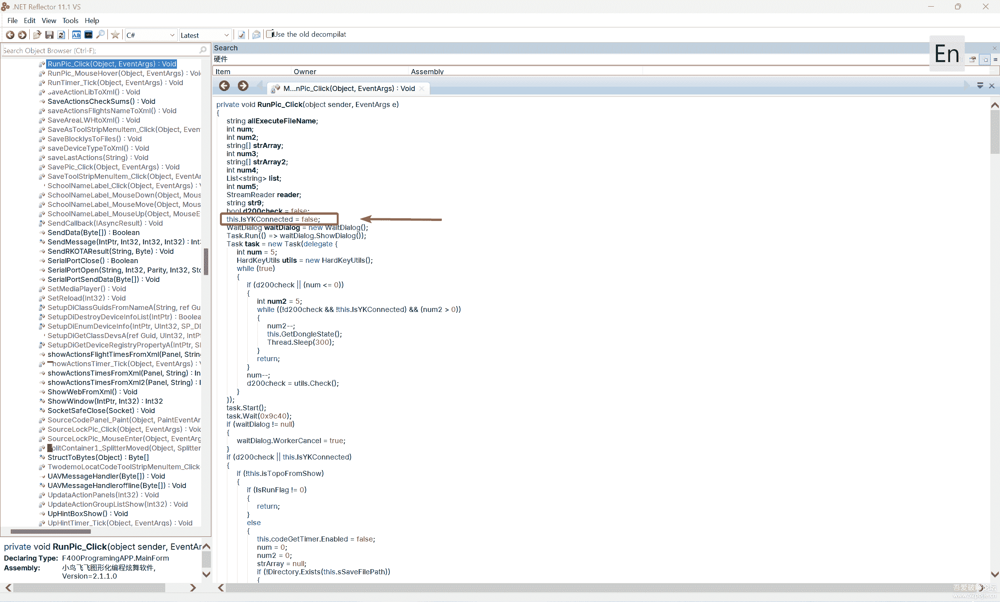
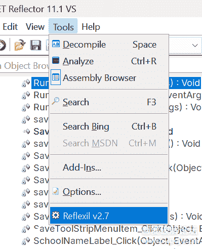
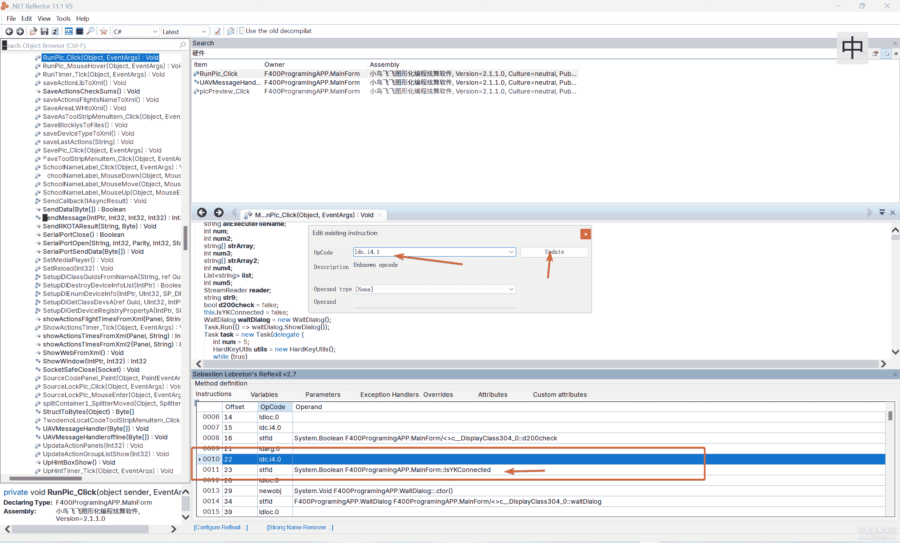
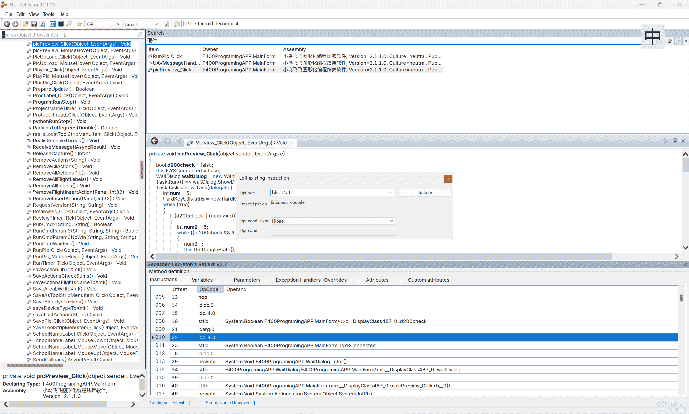
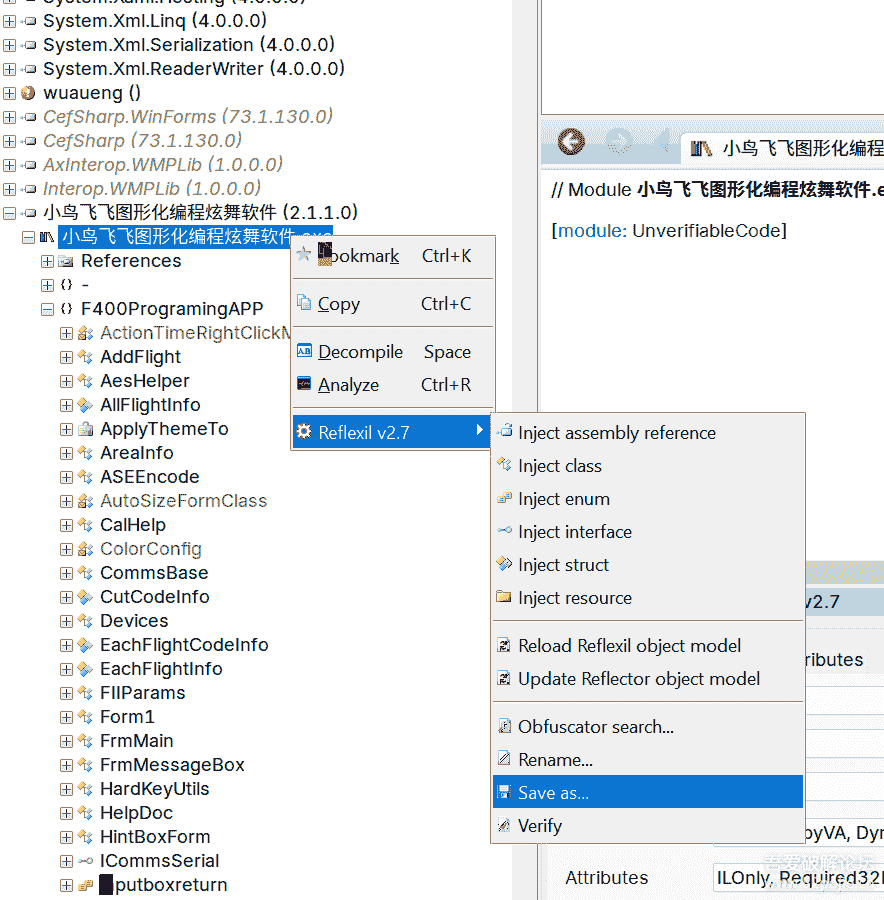

# [.NET逆向] 记一次ConfuserEx的脱壳和.net的逆向---莫编程炫舞软件tk

- 原帖: https://www.52pojie.cn/forum.php?mod=viewthread&tid=1915961
- 抓取时间: 2026-11-01T22:32:57

## 2.2.0已添加ConfuserEx 以下教程无效

由于论坛不让发成品软件，因此提供整体过程。

（新人）

根据壳检测，此软件使用`.NET`编写。具体并不难，参考[此教程](https://www.52pojie.cn/thread-248348-1-1.html)即可满足一切。

---

`2024_April_21_07_46_31 Reflector.png`（237.05 KB, 下载次数: 0）

[下载原图](https://www.52pojie.cn/forum.php?mod=attachment&aid=MjY5MDc4M3wyMWI1MjMwNnwxNzkzNTcyMzc1fDE2ODA4NnwxOTE1OTYx&nothumb=yes)

2024-4-21 07:46 上传

首先通过字符串定位位置。

`2024_April_21_07_50_21 Reflector.png`（334.54 KB, 下载次数: 1）

[下载原图](https://www.52pojie.cn/forum.php?mod=attachment&aid=MjY5MDc4NXxjZWZjMTdlMHwxNzkzNTcyMzc1fDE2ODA4NnwxOTE1OTYx&nothumb=yes)

2024-4-21 07:50 上传

在此处我们可以明显地看到这个变量的初始化定义，不看代码仅根据变量名也可得出这应该就是我们所想要的变量。

`2024_April_21_07_55_06 Reflector.png`（53.9 KB, 下载次数: 1）

[下载原图](https://www.52pojie.cn/forum.php?mod=attachment&aid=MjY5MDc4NnxiMjkzYTBkZHwxNzkzNTcyMzc1fDE2ODA4NnwxOTE1OTYx&nothumb=yes)

2024-4-21 07:55 上传

因此我们开始修改（插件）。

`2024_April_21_07_58_15 Reflector.png`（373.94 KB, 下载次数: 0）

[下载原图](https://www.52pojie.cn/forum.php?mod=attachment&aid=MjY5MDc4OHw3NGNjNGJhYXwxNzkzNTcyMzc1fDE2ODA4NnwxOTE1OTYx&nothumb=yes)

2024-4-21 07:58 上传

寻找到这个变量，并将`ldc.i4.0`修改为`ldc.i4.1`（`true`）即可。

接着我们找到下一个位置。

`2024_April_21_07_59_37 Reflector.png`（377.92 KB, 下载次数: 0）

[下载原图](https://www.52pojie.cn/forum.php?mod=attachment&aid=MjY5MDc4OXw1YTU5OWVkZXwxNzkzNTcyMzc1fDE2ODA4NnwxOTE1OTYx&nothumb=yes)

2024-4-21 07:59 上传

一模一样的方法即可。

`2024_April_21_08_00_40 Reflector.png`（132.04 KB, 下载次数: 1）

[下载原图](https://www.52pojie.cn/forum.php?mod=attachment&aid=MjY5MDc5MHwwOGRkMzY3YnwxNzkzNTcyMzc1fDE2ODA4NnwxOTE1OTYx&nothumb=yes)

2024-4-21 08:01 上传

最后我们再将其保存到根目录下，之后都用保存的文件打开即可。

## 3/1 更新 ConfuserEx

参考博客：<https://blog.oxiilo.com/posts/%E8%8E%AB%E5%9B%BE%E5%BD%A2%E5%8C%96%E7%BC%96%E7%A8%8B%E7%82%AB%E8%88%9E%E8%BD%AF%E4%BB%B6%E7%9A%84%E8%84%B1%E5%A3%B3%E5%AE%9E%E8%B7%B5/>

首先直接使用 Exeinfo PE 查壳（[ExeinfoASL/ASL](https://github.com/ExeinfoASL/ASL)）。安装后将主 exe 拖入 Exeinfo PE 后查到 .NET ConfuserEx，搜了一下找到是一个开源的壳 [Desolath/ConfuserEx2](https://github.com/Desolath/ConfuserEx2)，然后看到有一份 [Unpacker](https://www.52pojie.cn/thread-1304627-1-1.html)。之后再下载 help 里面提到的 `de4dot`（[kant2002/de4dot](https://github.com/kant2002/de4dot)）结束。

把主文件拖到`ConfuserEx-Unpacker.exe`文件，然后将生成的`-cleaned`文件拖给`de4dot.exe`，最后将生成的`-cleaned-cleaned`文件重命名，然后替换在安装目录的原 exe，继续使用 Reflector 修改程序即可。
