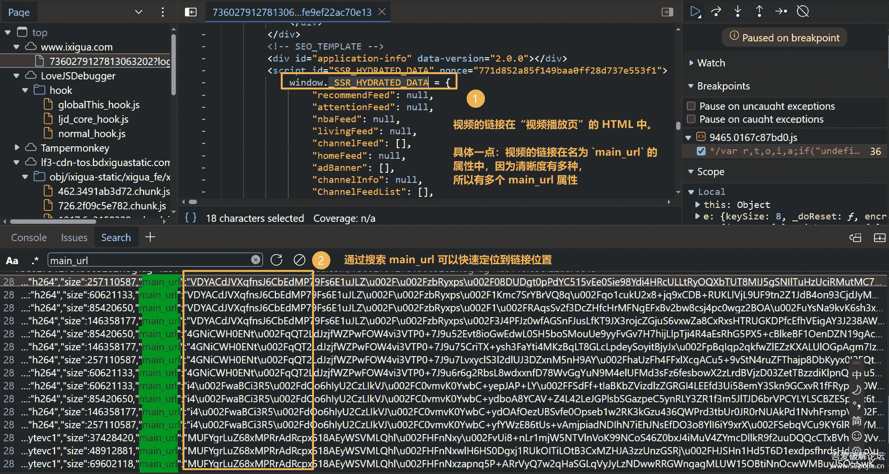
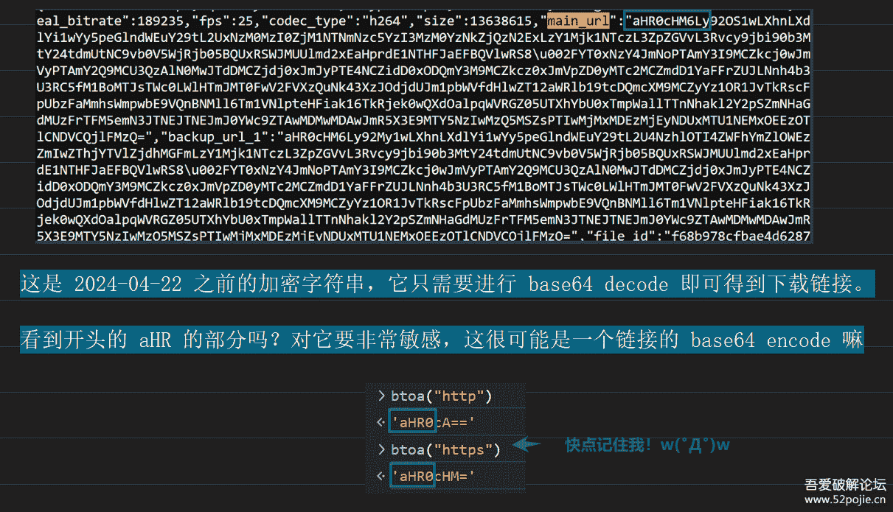
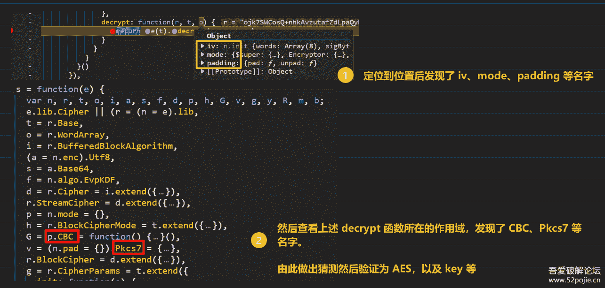
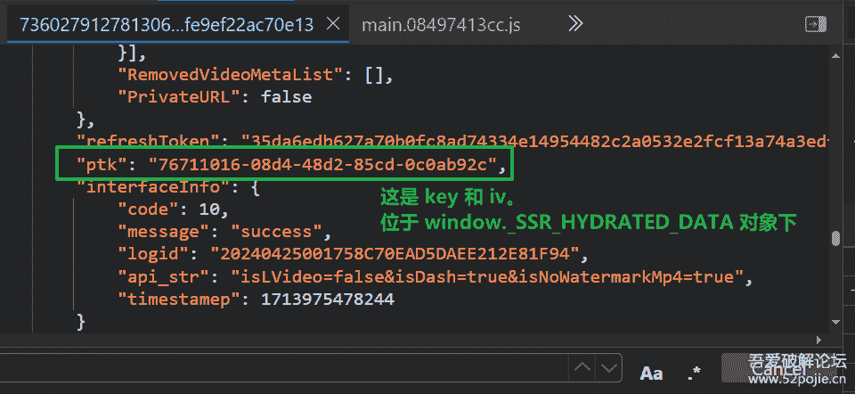
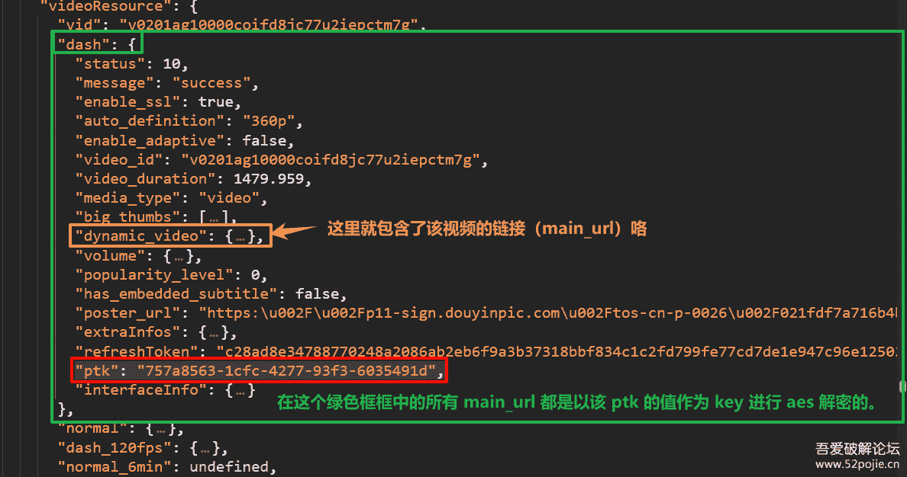
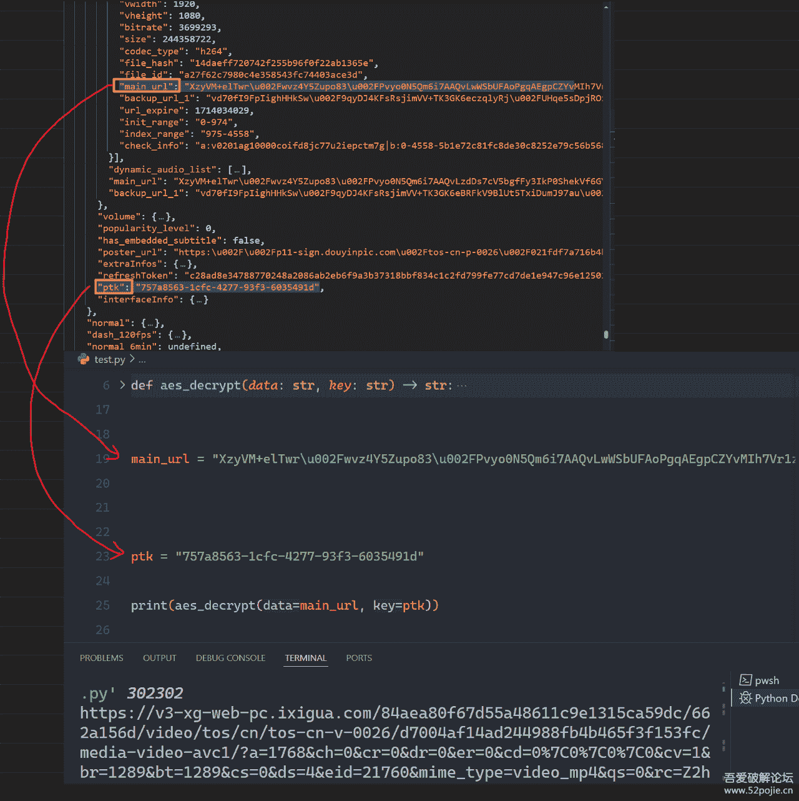
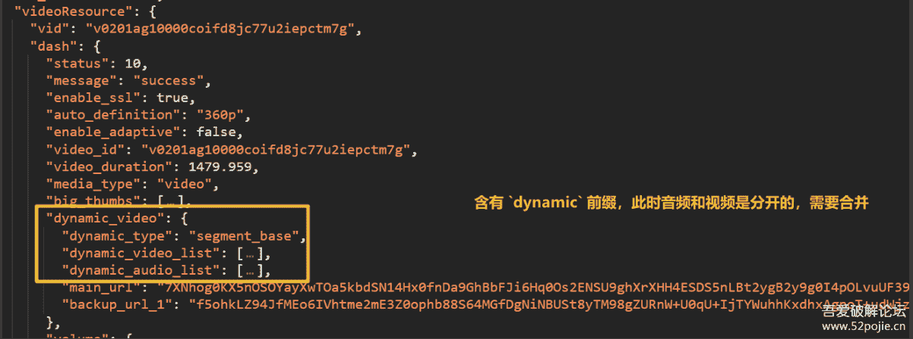
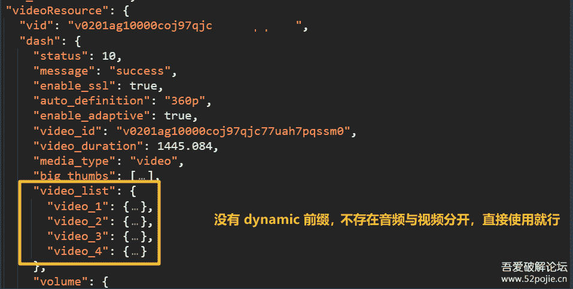

# [Web逆向] [2024-04-22] 西瓜视频的视频下载链接变动

- 原帖: https://www.52pojie.cn/forum.php?mod=viewthread&tid=1917707
- 抓取时间: 2026-11-01T22:32:45

本次就不修仙了，也没什么好分析的（大都是运气）。另外，本文只给出思路，不提供程序。

## 前言

在 2024-04-22 西瓜视频的视频下载链接变化了。

- 比如访问西瓜视频的视频播放页 https://www.ixigua.com/7360279127813063202。
- 该视频的下载链接在 `window._SSR_HYDRATED_DATA` 对象中，它位于该播放页的 HTML 文档中。

    

    `image-20240423233455697.png` (585.77 KB, 下载次数: 4)

    <https://www.52pojie.cn/forum.php?mod=attachment&aid=MjY5MjAxOHwxZjBjY2Q2NHwxNzkzNTcyMzYzfDE2ODA4NnwxOTE3NzA3&nothumb=yes>

    2024-4-25 16:38 上传

经过分析其表现为：

- 在此之前，只需要进行 `base64 decode` 即可获取视频的下载链接。

    

    `image-20240424235101213.png` (582.12 KB, 下载次数: 3)

    <https://www.52pojie.cn/forum.php?mod=attachment&aid=MjY5MjAxOXw1ZTY0ZDY1M3wxNzkzNTcyMzYzfDE2ODA4NnwxOTE3NzA3&nothumb=yes>

    2024-4-25 16:38 上传

- 现在多了一层 `AES` 解密，再进行 `base64 decode` 即可。

## 迅猛

整个分析过程我觉得运气占了 90%。



`image-20240425161704776.png` (222.13 KB, 下载次数: 4)

<https://www.52pojie.cn/forum.php?mod=attachment&aid=MjY5MjAyNXw4MTE2YTQzZnwxNzkzNTcyMzYzfDE2ODA4NnwxOTE3NzA3&nothumb=yes>

2024-4-25 16:38 上传

直接给结论：新增加的算法是 `AES`，其 `key`、`iv` 如下图所示，其 `mode` 为 `CBC`，`pad` 为 `Pkcs7`



`image-20240425003057989.png` (84.21 KB, 下载次数: 3)

<https://www.52pojie.cn/forum.php?mod=attachment&aid=MjY5MjAyMHxhNDk1OGNiZnwxNzkzNTcyMzYzfDE2ODA4NnwxOTE3NzA3&nothumb=yes>

2024-4-25 16:38 上传



`image-20240425152619715.png` (149.38 KB, 下载次数: 2)

<https://www.52pojie.cn/forum.php?mod=attachment&aid=MjY5MjAyMXxjOTU3YzhkYnwxNzkzNTcyMzYzfDE2ODA4NnwxOTE3NzA3&nothumb=yes>

2024-4-25 16:38 上传

Python 代码如下，只专注于解密的部分！

- 需要安装 `pycryptodome` 库。

```python
from Crypto.Cipher import AES
from Crypto.Util.Padding import unpad
import base64

def aes_decrypt(data: str, key: str) -> str:
    data = base64.b64decode(data)
    key = key.encode()
    iv = key[:16]

    # mode 为 CBC、pad 为 PKcs7
    cipher = AES.new(key, AES.MODE_CBC, iv)
    res = cipher.decrypt(data)
    res = unpad(res, AES.block_size)
    res = base64.b64decode(res).decode()
    return res
```

如下例子：



`image-20240425153025374.png` (524.13 KB, 下载次数: 5)

<https://www.52pojie.cn/forum.php?mod=attachment&aid=MjY5MjAyMnwxYWZjNmU1OHwxNzkzNTcyMzYzfDE2ODA4NnwxOTE3NzA3&nothumb=yes>

2024-4-25 16:52 上传

测试时发现有两种情况，其它的我也不深究了。



`image-20240425160815041.png` (166.72 KB, 下载次数: 3)

<https://www.52pojie.cn/forum.php?mod=attachment&aid=MjY5MjAyM3w4MmM2ZDJkN3wxNzkzNTcyMzYzfDE2ODA4NnwxOTE3NzA3&nothumb=yes>

2024-4-25 16:38 上传



`image-20240425161013942.png` (85.13 KB, 下载次数: 4)

<https://www.52pojie.cn/forum.php?mod=attachment&aid=MjY5MjAyNHwwNGIxNDhhOHwxNzkzNTcyMzYzfDE2ODA4NnwxOTE3NzA3&nothumb=yes>

2024-4-25 16:38 上传
