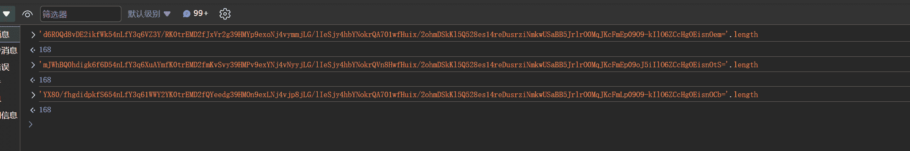
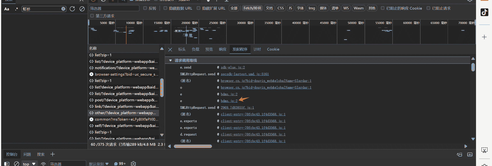
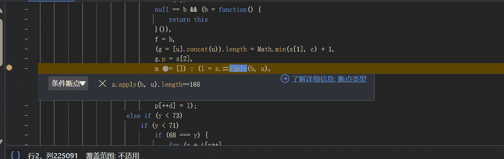
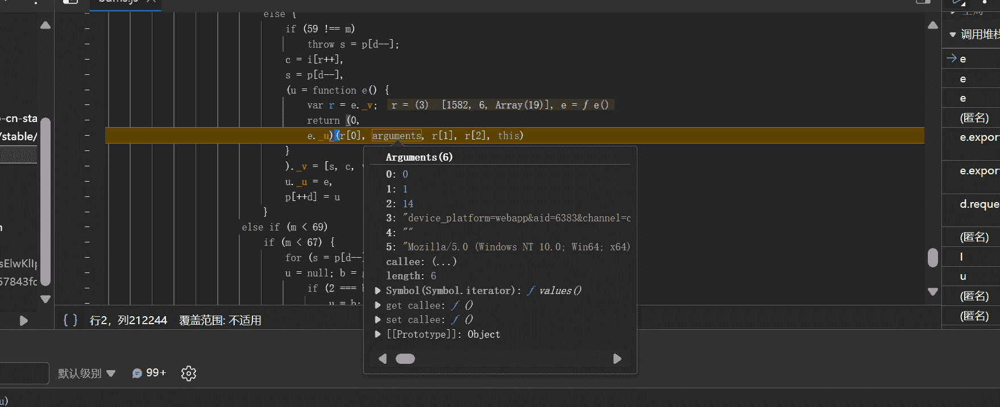
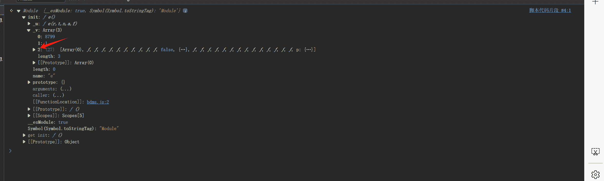
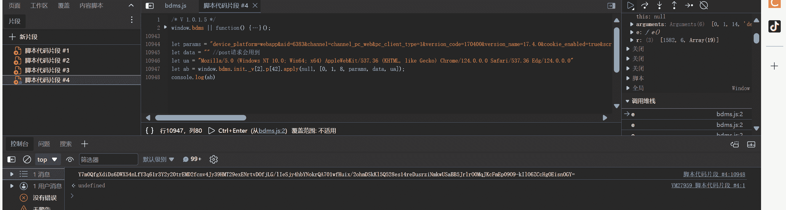
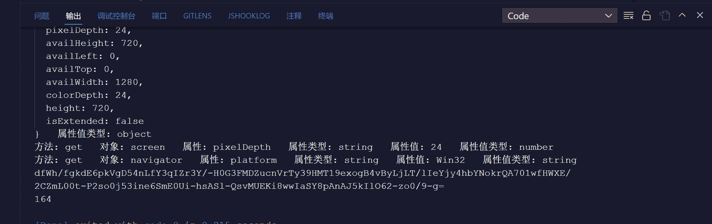

# [Web逆向] 某音长`ab`补环境分析

- 原帖：https://www.52pojie.cn/forum.php?mod=viewthread&tid=1917988
- 抓取时间：2026-11-01T22:32:39

## 前言

某音更新了长`ab`参数，以前的`xb`现在已彻底不复存在，再次分享一下`abougs`补环境的大概流程吧。这里就简单纪录一下。（补环境算是解决速度最快的方法了。纯算真的搞得太累了。）

## 目标网站

> `aHR0cHM6Ly93d3cuZG91eWluLmNvbS91c2VyL01TNHdMakFCQUFBQUNWNUVtMTEwU2l1c0Vsd0tsSXBVZC1NUlNpOHJCWXlnME5mcFBycVpteWtIWTh3TFBROE80cHYzd1BMNkEtb3o=`

## 流程分析

我们先观察下这个`ab`的大体详细啊



发现恒定长是168啊（但具体还是看个人电脑，我朋友有的是172长度，不过问题都不大）。

直接断点进栈。



然后再这个地方打上条件断点，然后`f5`刷新网页

```
s.apply(b, u).length==168
```



进栈。看看`ab`能否正常输出。顺便记住这个两个关键的数值：1582，6



接下来复制整个`vmp`代码到浏览器片段中。

现在难点就是我们如何去寻找`bdms`怎么初始化加载并调用的函数生成`ab`的

可以确定的是这个索引是`_v`的第3个



我们上文提到两个值1582，6，现在我们用这两个去当作索引寻找调用函数，

一个一个去找。找`_v`与`_u`只调用一次的地方。

（如果这里嫌麻烦可以全部点开然后搜搜1582就可以快速定位，虽然繁琐，但总比算法还原简单的多）

索引位置如下

```
window.bdms.init._v[2].p[42]
```


接下来根据网页上的参数模拟调用

```
let params = "device_platform=webapp&aid=6383&channel=channel_pc_web&pc_client_type=1&version_code=170400&version_name=17.4.0&cookie_enabled=true&screen_width=1280&screen_height=720&browser_language=zh-CN&browser_platform=Win32&browser_name=Edge&browser_version=124.0.0.0&browser_online=true&engine_name=Blink&engine_version=124.0.0.0&os_name=Windows&os_version=10&cpu_core_num=16&device_memory=8&platform=PC&downlink=10&effective_type=4g&round_trip_time=200&webid=7327255299207153161&msToken=eLFy8IXfaPXl0RX17EDYOFE83xe2jTNnxXgWSxFGIoTVREepKXoJDUx4HFdS2sN4YADw3NyjbroN9vaGCdZ0tGCGrrIM33B6As6ocN4mrYbZBkVUptoGOAUPk6T_iS8%3D&msToken=eLFy8IXfaPXl0RX17EDYOFE83xe2jTNnxXgWSxFGIoTVREepKXoJDUx4HFdS2sN4YADw3NyjbroN9vaGCdZ0tGCGrrIM33B6As6ocN4mrYbZBkVUptoGOAUPk6T_iS8%3D"
let data = "" //post请求会用到
let ua = "Mozilla/5.0 (Windows NT 10.0; Win64; x64) AppleWebKit/537.36 (KHTML, like Gecko) Chrome/124.0.0.0 Safari/537.36 Edg/124.0.0.0"
let ab = window.bdms.init._v[2].p[42].apply(null, [0, 1, 8, params, data, ua]);
```

在片段中运行一下，发现正常出结果，接下来就复制到编辑器中去补环境调用了。



### 2> 补环境

补完`window`立马会出一个`Cannot read properties of undefined (reading '_u')`


```
window.requestAnimationFrame = function () {}
```


```
window.XMLHttpRequest = function () { }
```

接下来挂上`proxy`代{过}{滤}理，缺了什么慢慢补


总的来说就是老生常谈的`navigator`、`document`和`location`，一些关键的点`localStorage`的`xmst`和`navigator`的`ink`，和多了一些`screen`的屏幕检测，总体还是很简单的，最终也是补出了结果。



### 2> 验证


### 2> 闲言碎语

现在能看的付费文章越来越少了，包括当时在研究`ab`的时候，所以特此分享这篇文章，如有疑问可以和我联系，如果侵权，联系删除。文章只做技术交流。

### 2> 参考链接

- [https://mp.weixin.qq.com/s/WX_POEA-meCMo8bZ5QL94A](https://mp.weixin.qq.com/s/WX_POEA-meCMo8bZ5QL94A)
- [https://mp.weixin.qq.com/s/8bZNyRhDHejTJ21r1GwpsQ](https://mp.weixin.qq.com/s/8bZNyRhDHejTJ21r1GwpsQ)
