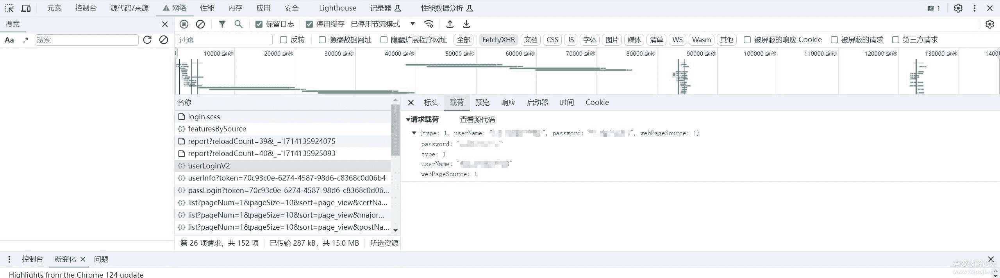
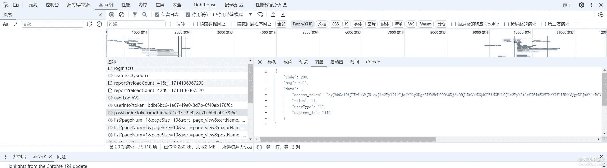
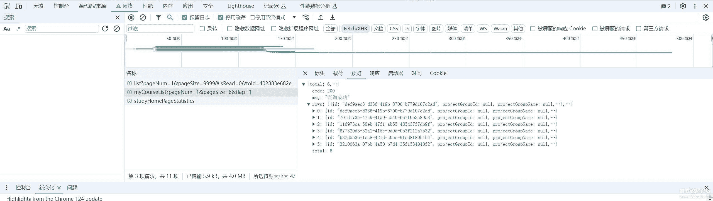
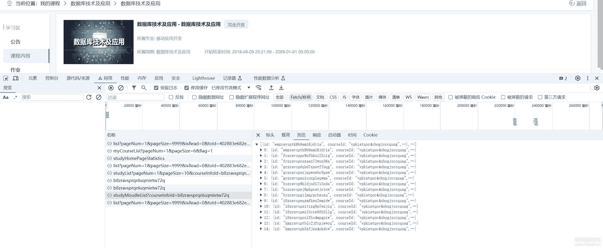
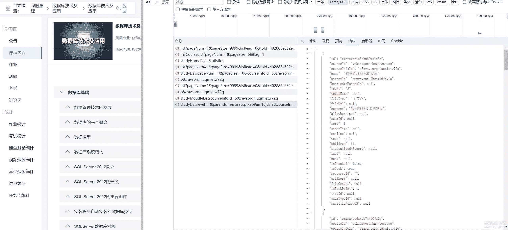
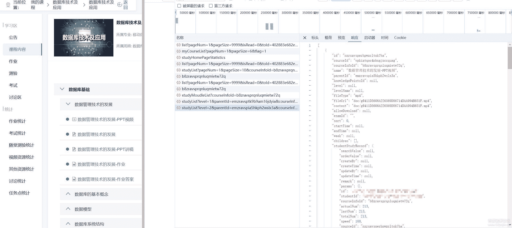
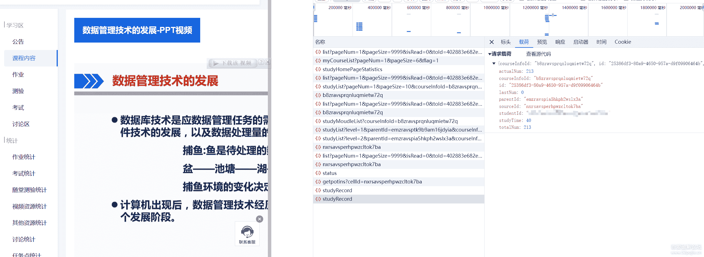
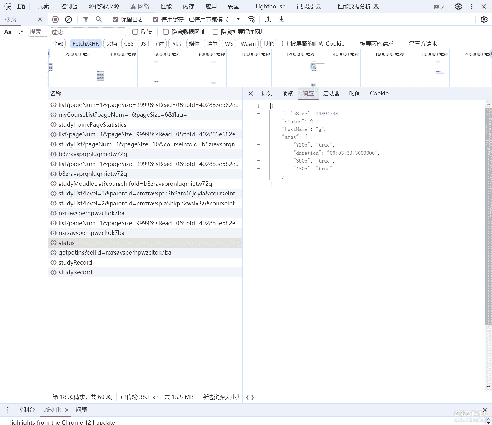
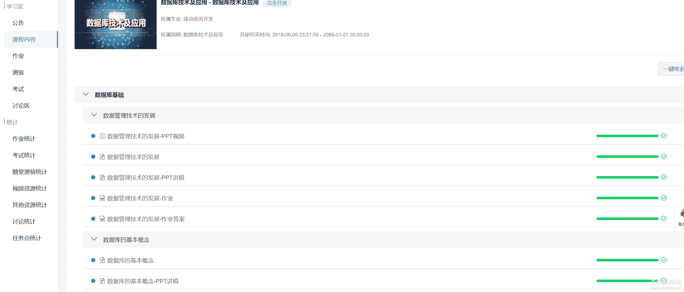
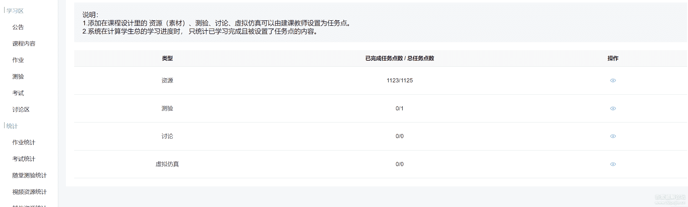

# [Web逆向] 智慧职教资源库-刷课分析

- 原帖: [https://www.52pojie.cn/forum.php?mod=viewthread&tid=1918167](https://www.52pojie.cn/forum.php?mod=viewthread&tid=1918167)
- 抓取时间: 2026-11-01T22:32:37

## 适用范围

- 只适用于 `https://zyk.icve.com.cn/`
- 已更新至 GitHub: `https://github.com/wuye4/zyk.icve.com.cn`

## 当前限制

- 目前暂时不支持讨论、作业、测验、考试。
- 该网站的新课与旧课会有参数的值有多种形式，需要一定时间适配。

## 一、找接口

### 1. 登录接口

接口: `https://sso.icve.com.cn/prod-api/data/userLoginV2`

会响应一个 `token`。



`Snipaste_2024-04-26_20-54-37.jpg` (202.96 KB, 下载次数: 2) | [下载附件](https://www.52pojie.cn/forum.php?mod=attachment&aid=MjY5MjI0NXwxZmViNDZlMHwxNzkzNTcyMzU1fDE2ODA4NnwxOTE4MTY3&nothumb=yes) | 2024-4-26 22:00 上传

### 2. access_token接口

接口: `https://zyk.icve.com.cn/prod-api/auth/passLogin?token={}`

传入 1. 登录接口响应的 `token`。



`Snipaste_2024-04-26_21-02-10.jpg` (216.98 KB, 下载次数: 3) | [下载附件](https://www.52pojie.cn/forum.php?mod=attachment&aid=MjY5MjI0NnxmMzQyNWZjOHwxNzkzNTcyMzU1fDE2ODA4NnwxOTE4MTY3&nothumb=yes) | 2024-4-26 22:00 上传

### 3. myCourseList接口

接口: `https://zyk.icve.com.cn/prod-api/teacher/courseList/myCourseList?pageNum=1&pageSize=6&flag=1`

获取所选课程 `courseId`、`courseInfoId`、`id`。



`Snipaste_2024-04-26_21-06-05.jpg` (214.84 KB, 下载次数: 3) | [下载附件](https://www.52pojie.cn/forum.php?mod=attachment&aid=MjY5MjI0N3wxZTBmODRiMXwxNzkzNTcyMzU1fDE2ODA4NnwxOTE4MTY3&nothumb=yes) | 2024-4-26 22:00 上传

### 4. studyMoudleList接口

接口: `https://zyk.icve.com.cn/prod-api/teacher/courseContent/studyMoudleList?courseInfoId={}`

传入 3. `myCourseList` 接口获取的 `courseId`，拿到一级标题与 `courseId`、`courseInfoId`、`id`、`level`。



`Snipaste_2024-04-26_21-08-42.jpg` (326.78 KB, 下载次数: 4) | [下载附件](https://www.52pojie.cn/forum.php?mod=attachment&aid=MjY5MjI0OHxlMjQ5ZDU1ZXwxNzkzNTcyMzU1fDE2ODA4NnwxOTE4MTY3&nothumb=yes) | 2024-4-26 22:00 上传

### 5. studyList接口

接口: `https://zyk.icve.com.cn/prod-api/teacher/courseContent/studyList?level={}&parentId={}&courseInfoId={}`

传入 4. `studyMoudleList` 接口获取的 `courseInfoId`、`id`，拿到二级标题与 `courseId`、`courseInfoId`、`id`、`level`。



`Snipaste_2024-04-26_21-16-10.jpg` (304.97 KB, 下载次数: 2) | [下载附件](https://www.52pojie.cn/forum.php?mod=attachment&aid=MjY5MjI0OXw1MTFkNzgxMXwxNzkzNTcyMzU1fDE2ODA4NnwxOTE4MTY3&nothumb=yes) | 2024-4-26 22:01 上传

继续往下点后发现还是请求 `studyList` 接口，拿到最终课程的参数。



`Snipaste_2024-04-26_21-19-02.jpg` (319.29 KB, 下载次数: 2) | [下载附件](https://www.52pojie.cn/forum.php?mod=attachment&aid=MjY5MjI1MHw3Y2IxNGQyNnwxNzkzNTcyMzU1fDE2ODA4NnwxOTE4MTY3&nothumb=yes) | 2024-4-26 22:01 上传

### 6. studyRecord接口

接口: `https://zyk.icve.com.cn/prod-api/teacher/studyRecord`

随便点击一个课程，过一会就会请求 `studyRecord` 接口，也就是完成该课程的接口。以下以视频举例：`totalNum` 代表视频总时长，`actualNum` 代表实际时长，`studyTime` 代表学习时长。每个视频的时长是不固定的，我们如何动态获取呢？



`image-20240426213357989.png` (525.91 KB, 下载次数: 1) | [下载附件](https://www.52pojie.cn/forum.php?mod=attachment&aid=MjY5MjI0MXwxMDliNzVkZXwxNzkzNTcyMzU1fDE2ODA4NnwxOTE4MTY3&nothumb=yes) | 2024-4-26 22:00 上传

### 7. status接口

接口: `https://upload.icve.com.cn/doc/{fileUrl}/status`

`studyList` 接口中有一个 `fileUrl` 参数，将其传入就可以获取视频时长参数 `duration`，最后将其转化为秒数，再请求 `studyRecord` 接口就可以完成刷视频。



`image-20240426214133320.png` (173.61 KB, 下载次数: 2) | [下载附件](https://www.52pojie.cn/forum.php?mod=attachment&aid=MjY5MjI0Mnw3ZmRhZDkwY3wxNzkzNTcyMzU1fDE2ODA4NnwxOTE4MTY3&nothumb=yes) | 2024-4-26 22:00 上传

## 二、效果图



`image-20240426215015774.png` (227.06 KB, 下载次数: 3) | [下载附件](https://www.52pojie.cn/forum.php?mod=attachment&aid=MjY5MjI0M3w1NjUxZGZlYXwxNzkzNTcyMzU1fDE2ODA4NnwxOTE4MTY3&nothumb=yes) | 2024-4-26 22:00 上传



`image-20240426215025025.png` (97.33 KB, 下载次数: 3) | [下载附件](https://www.52pojie.cn/forum.php?mod=attachment&aid=MjY5MjI0NHw0OWQxODY2MnwxNzkzNTcyMzU1fDE2ODA4NnwxOTE4MTY3&nothumb=yes) | 2024-4-26 22:00 上传

## 三、python代码实现


```
import requests
from datetime import datetime

requests = requests.session()

def getcookie():
    headers = {
        'Accept': 'text/html,application/xhtml+xml,application/xml;q=0.9,image/avif,image/webp,image/apng,*/*;q=0.8,application/signed-exchange;v=b3;q=0.7',
        'Accept-Language': 'zh-CN,zh;q=0.9',
        'Connection': 'keep-alive',
        'Referer': 'https://zyk.icve.com.cn/',
        'Sec-Fetch-Dest': 'document',
        'Sec-Fetch-Mode': 'navigate',
        'Sec-Fetch-Site': 'same-site',
        'Sec-Fetch-User': '?1',
        'Upgrade-Insecure-Requests': '1',
        'User-Agent': 'Mozilla/5.0 (Windows NT 10.0; Win64; x64) AppleWebKit/537.36 (KHTML, like Gecko) Chrome/124.0.0.0 Safari/537.36',
        'sec-ch-ua': '"Chromium";v="124", "Google Chrome";v="124", "Not-A.Brand";v="99"',
        'sec-ch-ua-mobile': '?0',
        'sec-ch-ua-platform': '"Windows"',
    }

    response = requests.get('https://sso.icve.com.cn/sso/auth?mode=simple&source=14&redirect=https://zyk.icve.com.cn/',
                            headers=headers)

# 登录
def userLoginV2(userName, password):
    headers = {
        'Accept': 'application/json, text/plain, */*',
        'Accept-Language': 'zh-CN,zh;q=0.9',
        'Connection': 'keep-alive',
        'Content-Type': 'application/json;charset=UTF-8',
        'Language': 'cn',
        'Origin': 'https://sso.icve.com.cn',
        'Referer': 'https://sso.icve.com.cn/sso/auth?mode=simple&source=14&redirect=https%3A%2F%2Fzyk.icve.com.cn%2F',
        'Sec-Fetch-Dest': 'empty',
        'Sec-Fetch-Mode': 'cors',
        'Sec-Fetch-Site': 'same-origin',
        'User-Agent': 'Mozilla/5.0 (Windows NT 10.0; Win64; x64) AppleWebKit/537.36 (KHTML, like Gecko) Chrome/124.0.0.0 Safari/537.36',
        'sec-ch-ua': '"Chromium";v="124", "Google Chrome";v="124", "Not-A.Brand";v="99"',
        'sec-ch-ua-mobile': '?0',
        'sec-ch-ua-platform': '"Windows"',
    }

    json_data = {
        'type': 1,
        'userName': userName,
        'password': password,
        'webPageSource': 1,
    }

    response = requests.post('https://sso.icve.com.cn/prod-api/data/userLoginV2', headers=headers,
                             json=json_data)

    if len(response.json()["data"]["displayName"]) > 0:
        print(response.json()["data"]["displayName"] + "登录成功")
    return response.cookies.get("token")

# 获取access_token
def access_token(token):
    headers = {
        'Accept': 'application/json, text/plain, */*',
        'Accept-Language': 'zh-CN,zh;q=0.9',
        'Cache-Control': 'no-cache',
        'Connection': 'keep-alive',
        'Pragma': 'no-cache',
        'Referer': 'https://zyk.icve.com.cn/',
        'Sec-Fetch-Dest': 'empty',
        'Sec-Fetch-Mode': 'cors',
        'Sec-Fetch-Site': 'same-origin',
        'User-Agent': 'Mozilla/5.0 (Windows NT 10.0; Win64; x64) AppleWebKit/537.36 (KHTML, like Gecko) Chrome/124.0.0.0 Safari/537.36',
        'isToken': 'false',
        'sec-ch-ua': '"Chromium";v="124", "Google Chrome";v="124", "Not-A.Brand";v="99"',
        'sec-ch-ua-mobile': '?0',
        'sec-ch-ua-platform': '"Windows"',
    }

    params = {
        'token': token,
    }

    response = requests.get('https://zyk.icve.com.cn/prod-api/auth/passLogin', params=params,
                            headers=headers)

    return response.json()["data"]["access_token"]

# 课程
def courseList():
    headers = {
        'Accept': 'application/json, text/plain, */*',
        'Accept-Language': 'zh-CN,zh;q=0.9',
        'Authorization': f'Bearer {accesstoken}',
        'Connection': 'keep-alive',
        'Sec-Fetch-Dest': 'empty',
        'Sec-Fetch-Mode': 'cors',
        'Sec-Fetch-Site': 'same-origin',
        'User-Agent': 'Mozilla/5.0 (Windows NT 10.0; Win64; x64) AppleWebKit/537.36 (KHTML, like Gecko) Chrome/124.0.0.0 Safari/537.36',
        'sec-ch-ua': '"Chromium";v="124", "Google Chrome";v="124", "Not-A.Brand";v="99"',
        'sec-ch-ua-mobile': '?0',
        'sec-ch-ua-platform': '"Windows"',
    }

    params = {
        'pageNum': '1',
        'pageSize': '6',
        'flag': '1',
    }

    response = requests.get('https://zyk.icve.com.cn/prod-api/teacher/courseList/myCourseList', params=params,
                            headers=headers)
    info = []
    for i in response.json()["rows"]:
        info.append((i["id"], i["courseId"], i["courseInfoId"], i["studentId"], i["courseName"]))
    return info

# 一级标题
def studyMoudleList(courseInfoId):
    headers = {
        'Accept': 'application/json, text/plain, */*',
        'Accept-Language': 'zh-CN,zh;q=0.9',
        'Authorization': f'Bearer {accesstoken}',
        'Connection': 'keep-alive',
        'Sec-Fetch-Dest': 'empty',
        'Sec-Fetch-Mode': 'cors',
        'Sec-Fetch-Site': 'same-origin',
        'User-Agent': 'Mozilla/5.0 (Windows NT 10.0; Win64; x64) AppleWebKit/537.36 (KHTML, like Gecko) Chrome/124.0.0.0 Safari/537.36',
        'sec-ch-ua': '"Chromium";v="124", "Google Chrome";v="124", "Not-A.Brand";v="99"',
        'sec-ch-ua-mobile': '?0',
        'sec-ch-ua-platform': '"Windows"',
    }

    params = {
        'courseInfoId': courseInfoId,
    }

    response = requests.get('https://zyk.icve.com.cn/prod-api/teacher/courseContent/studyMoudleList', params=params,
                            headers=headers)
    studymoudlelist = []
    for i in response.json():
        studymoudlelist.append((i["id"], i["courseId"], i["courseInfoId"], i["name"]))

    return studymoudlelist

# 二级标题
def studyList1(level, parentId, courseInfoId):
    headers = {
        'Accept': 'application/json, text/plain, */*',
        'Accept-Language': 'zh-CN,zh;q=0.9',
        'Authorization': f'Bearer {accesstoken}',
        'Connection': 'keep-alive',
        'Sec-Fetch-Dest': 'empty',
        'Sec-Fetch-Mode': 'cors',
        'Sec-Fetch-Site': 'same-origin',
        'User-Agent': 'Mozilla/5.0 (Windows NT 10.0; Win64; x64) AppleWebKit/537.36 (KHTML, like Gecko) Chrome/124.0.0.0 Safari/537.36',
        'sec-ch-ua': '"Chromium";v="124", "Google Chrome";v="124", "Not-A.Brand";v="99"',
        'sec-ch-ua-mobile': '?0',
        'sec-ch-ua-platform': '"Windows"',
    }

    params = {
        'level': level,
        'parentId': parentId,
        'courseInfoId': courseInfoId,
    }

    response = requests.get('https://zyk.icve.com.cn/prod-api/teacher/courseContent/studyList', params=params,
                            headers=headers)

    for i in response.json():

        if i["level"] is not None:
            studyList1(i["level"], i["id"], i["courseInfoId"])

        else:
            geturl(i)

# 获取最总课程网址
def geturl(i):
    if i["fileType"] == 'docx' or i["fileType"] == 'doc':
        if i["studentStudyRecord"] is None:
            docx.append((i["id"], i["courseId"], i["courseInfoId"], i["name"], i["parentId"], i["fileUrl"]))
    elif i["fileType"] == 'pdf' or i["fileType"] == 'pptx':
        if i["studentStudyRecord"] is None:
            pdf.append((i["id"], i["courseId"], i["courseInfoId"], i["name"], i["parentId"], i["fileUrl"]))
    elif i["fileType"] == 'mp4':
        if i["studentStudyRecord"] is None:
            mp4.append((i["id"], i["courseId"], i["courseInfoId"], i["name"], i["parentId"], i["fileUrl"]))
    elif i["fileType"] == 'jpg':
        if i["studentStudyRecord"] is None:
            jpg.append((i["id"], i["courseId"], i["courseInfoId"], i["name"], i["parentId"]))

def getdocorpdfxnum(courseInfoId, parentId, sourceId, studentId, fileUrl):
    headers = {
        'Accept': 'application/json, text/plain, */*',
        'Accept-Language': 'zh-CN,zh;q=0.9',
        'Authorization': f'Bearer {accesstoken}',
        'Cache-Control': 'no-cache',
        'Connection': 'keep-alive',
        'Pragma': 'no-cache',
        'Sec-Fetch-Dest': 'empty',
        'Sec-Fetch-Mode': 'cors',
        'Sec-Fetch-Site': 'same-origin',
        'User-Agent': 'Mozilla/5.0 (Windows NT 10.0; Win64; x64) AppleWebKit/537.36 (KHTML, like Gecko) Chrome/123.0.0.0 Safari/537.36',
        'sec-ch-ua': '"Google Chrome";v="123", "Not:A-Brand";v="8", "Chromium";v="123"',
        'sec-ch-ua-mobile': '?0',
        'sec-ch-ua-platform': '"Windows"',
    }

    params = {
        'fileUrl': fileUrl,
    }

    response = requests.get(
        'https://zyk.icve.com.cn/prod-api/teacher/oss/getUrlPngs',
        params=params,
        headers=headers,
    )
    totalNum = len(response.json()["data"])
    tapjpganddocxandpdf(courseInfoId, parentId, sourceId, studentId, totalNum)

# 刷课
def tapjpganddocxandpdf(courseInfoId, parentId, sourceId, studentId, totalNum):
    headers = {
        'Accept': 'application/json, text/plain, */*',
        'Accept-Language': 'zh-CN,zh;q=0.9',
        'Authorization': f'Bearer {accesstoken}',
        'Cache-Control': 'no-cache',
        'Connection': 'keep-alive',
        'Content-Type': 'application/json;charset=UTF-8',
        'Origin': 'https://zyk.icve.com.cn',
        'Pragma': 'no-cache',
        'Sec-Fetch-Dest': 'empty',
        'Sec-Fetch-Mode': 'cors',
        'Sec-Fetch-Site': 'same-origin',
        'User-Agent': 'Mozilla/5.0 (Windows NT 10.0; Win64; x64) AppleWebKit/537.36 (KHTML, like Gecko) Chrome/123.0.0.0 Safari/537.36',
        'sec-ch-ua': '"Google Chrome";v="123", "Not:A-Brand";v="8", "Chromium";v="123"',
        'sec-ch-ua-mobile': '?0',
        'sec-ch-ua-platform': '"Windows"',
    }

    json_data = {
        'courseInfoId': courseInfoId,
        'id': '',
        'parentId': parentId,
        'studyTime': 60,
        'sourceId': sourceId,
        'studentId': studentId,
        'actualNum': totalNum,
        'lastNum': totalNum,
        'totalNum': totalNum,
    }

    response = requests.put('https://zyk.icve.com.cn/prod-api/teacher/studyRecord', headers=headers,
                            json=json_data)

# 视频状态
def videostatus(courseInfoId, parentId, sourceId, studentId, fileUrl):
    headers = {
        'accept': 'application/json, text/plain, */*',
        'accept-language': 'zh-CN,zh;q=0.9',
        'cache-control': 'no-cache',
        'origin': 'https://zyk.icve.com.cn',
        'pragma': 'no-cache',
        'sec-ch-ua': '"Google Chrome";v="123", "Not:A-Brand";v="8", "Chromium";v="123"',
        'sec-ch-ua-mobile': '?0',
        'sec-ch-ua-platform': '"Windows"',
        'sec-fetch-dest': 'empty',
        'sec-fetch-mode': 'cors',
        'sec-fetch-site': 'same-site',
        'user-agent': 'Mozilla/5.0 (Windows NT 10.0; Win64; x64) AppleWebKit/537.36 (KHTML, like Gecko) Chrome/123.0.0.0 Safari/537.36',
    }

    response = requests.post(f'https://upload.icve.com.cn/{fileUrl}/status',
                             headers=headers)
    time = str(response.json()["args"]["duration"])
    duration_str_no_micro = time.split('.')[0]
    duration_obj = datetime.strptime(duration_str_no_micro, "%H:%M:%S")
    total_seconds = duration_obj.hour * 3600 + duration_obj.minute * 60 + duration_obj.second
    tapjpganddocxandpdf(courseInfoId, parentId, sourceId, studentId, total_seconds)

if __name__ == '__main__':
    username = input("账号")
    pwd = input("密码")
    getcookie()

    token = userLoginV2(username, pwd)
    accesstoken = access_token(token)
    # 所有课程信息
    info = courseList()
    # print(info)
    for i in info:
        print(i[4] + "开始刷课")
        studymoudlelist = studyMoudleList(i[2])
        # print(studymoudlelist)
        docx = []
        pdf = []
        mp4 = []
        jpg = []
        # id courseInfoId
        for k in studymoudlelist:
            studyList1(1, k[0], k[2])
            # print(len(docx))
            # print(len(pdf))
            # print(len(mp4))
            # print(len(jpg))
            for i in docx:
                print(i[3] + "观看完毕")
                getdocorpdfxnum(i[2], i[4], i[0], info[0][4], i[5])
            for i in jpg:
                print(i[3] + "观看完毕")
                tapjpganddocxandpdf(i[2], i[4], i[0], info[0][4], 1)
            for i in pdf:
                print(i[3] + "观看完毕")
                getdocorpdfxnum(i[2], i[4], i[0], info[0][4], i[5])
            for i in mp4:
                print(i[3] + "观看完毕")
                videostatus(i[2], i[4], i[0], info[0][4], i[5])

```
