# [Web逆向] 尝试提取某飞的AI对话体验页面

- 原帖：https://www.52pojie.cn/forum.php?mod=viewthread&tid=1918203
- 抓取时间：2026-11-01T22:32:35

## 前言

最近发现了一个小程序，可以用英语和AI对话，最重要的是能够口语评分，这套口语评分系统就是中高考我们的听说系统！！

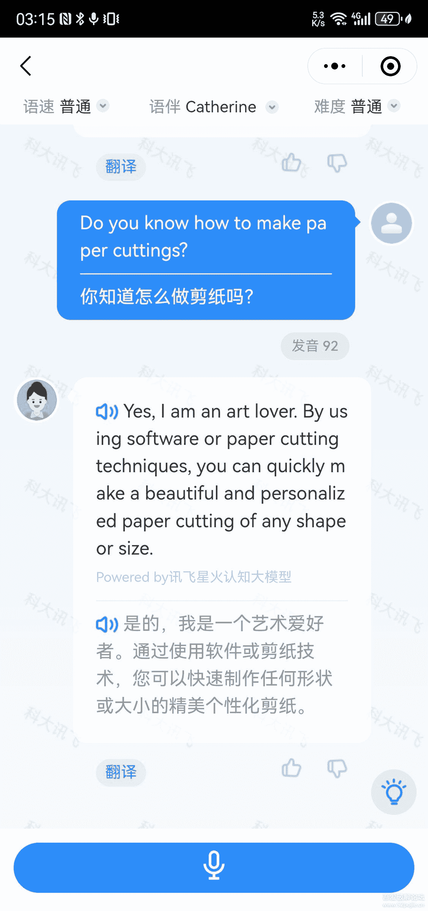

`软件截图.jpg`（209.01 KB，下载次数：2）；[下载附件](https://www.52pojie.cn/forum.php?mod=attachment&aid=MjY5MjI3MXwxYTllOTlhMHwxNzkzNTcyMzUzfDE2ODA4NnwxOTE4MjAz&nothumb=yes)；2024-4-27 03:07 上传

于是开干。

## 反编译小程序

欢天喜地的打开电脑

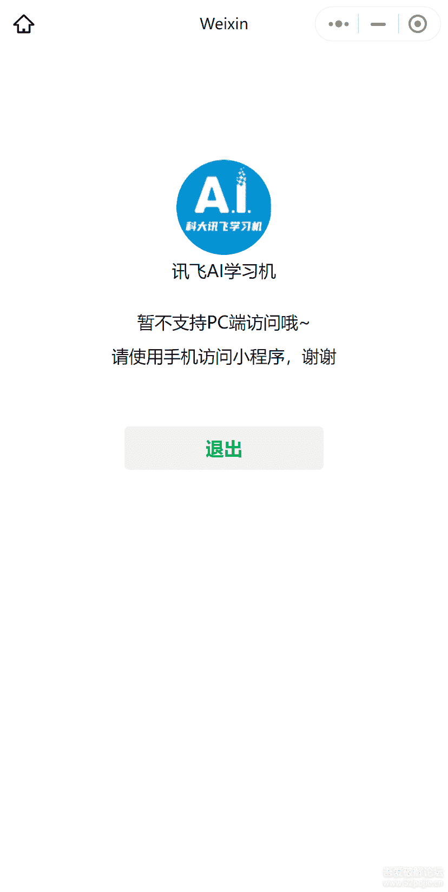

`image-20240426230426406.png`（69.68 KB，下载次数：4）；[下载附件](https://www.52pojie.cn/forum.php?mod=attachment&aid=MjY5MjI3MnxhWViYTdhN3wxNzkzNTcyMzUzfDE2ODA4NnwxOTE4MjAz&nothumb=yes)；2024-4-27 03:07 上传

悲。。。

无论怎么讲，运行起来了，是有`wxapkg`产生的，拿来反编译一下。

在`……\WeChat Files\Applet`找到小程序的`wxid`和PC版加密的`wxapkg`，扔到`pc_wxapkg_decrypt`里面解密

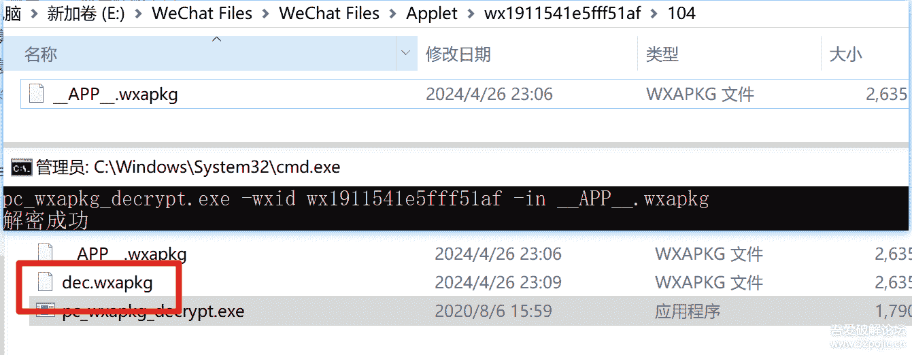

`image-20240426231013322.png`（75.63 KB，下载次数：2）；[下载附件](https://www.52pojie.cn/forum.php?mod=attachment&aid=MjY5MjI3M3wxYTJkMmMyMnwxNzkzNTcyMzUzfDE2ODA4NnwxOTE4MjAz&nothumb=yes)；2024-4-27 03:07 上传

然后`wxappUnpacker`解包

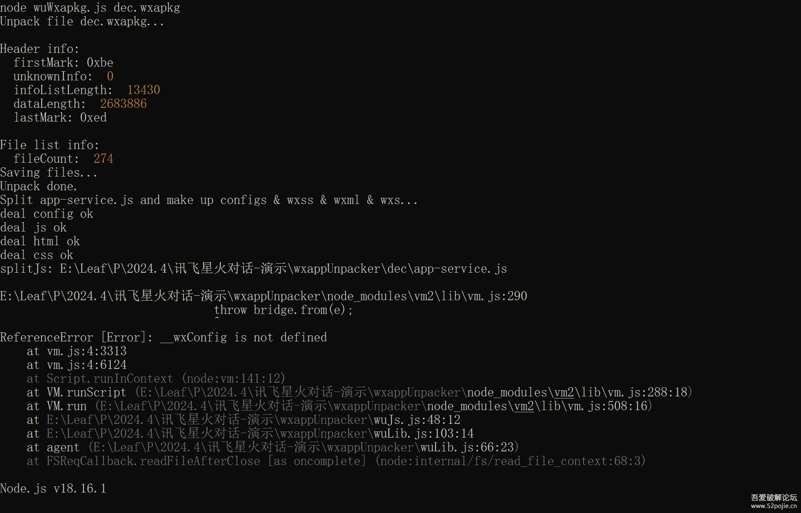

`image-20240426231430373.png`（191.88 KB，下载次数：2）；[下载附件](https://www.52pojie.cn/forum.php?mod=attachment&aid=MjY5MjI3NHxmZTZkNjI0ZnwxNzkzNTcyMzUzfDE2ODA4NnwxOTE4MjAz&nothumb=yes)；2024-4-27 03:07 上传

很好报错了。缺了个`__wxConfig`。反编译到哪一步了呢？哦原来`js`提起出来了，但还没有分割，然后`wxss`和`wxml`都没搞。

补一下吧

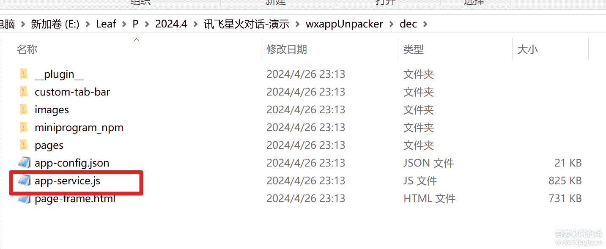

`image-20240426231902170.png`（81.85 KB，下载次数：2）；[下载附件](https://www.52pojie.cn/forum.php?mod=attachment&aid=MjY5MjI3NXxkMGZkNjYxZnwxNzkzNTcyMzUzfDE2ODA4NnwxOTE4MjAz&nothumb=yes)；2024-4-27 03:08 上传

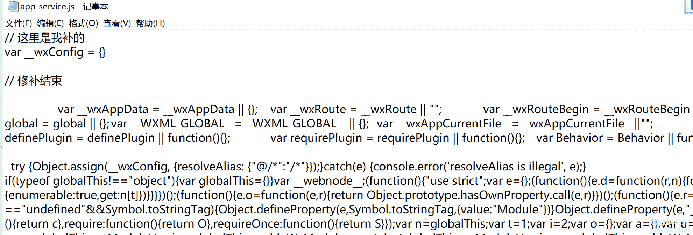

`image-20240426232012220.png`（107.26 KB，下载次数：3）；[下载附件](https://www.52pojie.cn/forum.php?mod=attachment&aid=MjY5MjI3Nnw1YjFmZjEyNHwxNzkzNTcyMzUzfDE2ODA4NnwxOTE4MjAz&nothumb=yes)；2024-4-27 03:08 上传

## 修复解包过程

然后单独运行这个`wuJs.js`来分割`js`。又缺了。。

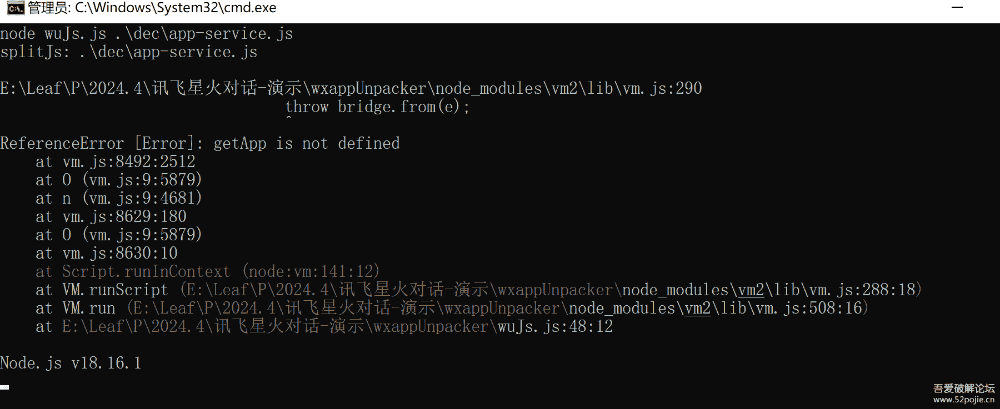

`image-20240426232122777.png`（119.65 KB，下载次数：4）；[下载附件](https://www.52pojie.cn/forum.php?mod=attachment&aid=MjY5MjI3N3w0ODg1YTQ5MXwxNzkzNTcyMzUzfDE2ODA4NnwxOTE4MjAz&nothumb=yes)；2024-4-27 03:08 上传

报错就补报错就补，补完为止。

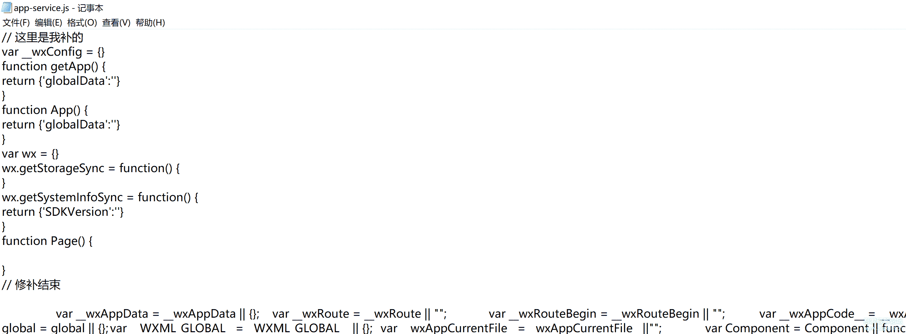

`image-20240426232916691.png`（93.55 KB，下载次数：4）；[下载附件](https://www.52pojie.cn/forum.php?mod=attachment&aid=MjY5MjI3OHw0OTA2MDU2ZXwxNzkzNTcyMzUzfDE2ODA4NnwxOTE4MjAz&nothumb=yes)；2024-4-27 03:08 上传

看起来不报错了，但是为什么这个`split`不对呢

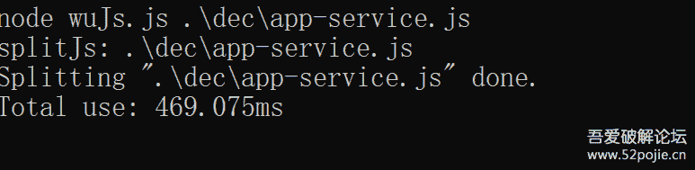

`image-20240426232949920.png`（21.61 KB，下载次数：3）；[下载附件](https://www.52pojie.cn/forum.php?mod=attachment&aid=MjY5MjI3OXxiOTZiMjg1ZHwxNzkzNTcyMzUzfDE2ODA4NnwxOTE4MjAz&nothumb=yes)；2024-4-27 03:08 上传

## 排查 `define` 与 `require`

`wuJs`分隔`js`的方法其实就是`hook`掉`define`函数，观察`app-service.js`，的确是有执行`define`的

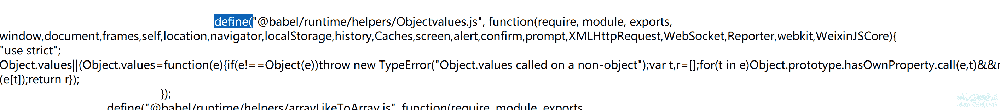

`image-20240426233110358.png`（53.73 KB，下载次数：3）；[下载附件](https://www.52pojie.cn/forum.php?mod=attachment&aid=MjY5MjI4MHxhMzZlYjkxM3wxNzkzNTcyMzUzfDE2ODA4NnwxOTE4MjAz&nothumb=yes)；2024-4-27 03:08 上传

那是哪里出现问题了呢？很有可能是`define`在执行过程中被重新定义了。于是查找

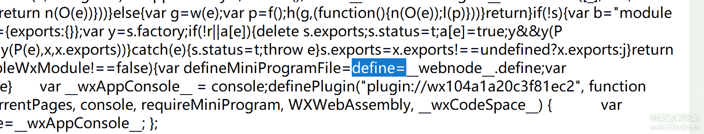

`image-20240426233218978.png`（60.48 KB，下载次数：3）；[下载附件](https://www.52pojie.cn/forum.php?mod=attachment&aid=MjY5MjI4MnwwYzM1MGMxN3wxNzkzNTcyMzUzfDE2ODA4NnwxOTE4MjAz&nothumb=yes)；2024-4-27 03:08 上传

确实。删掉它。

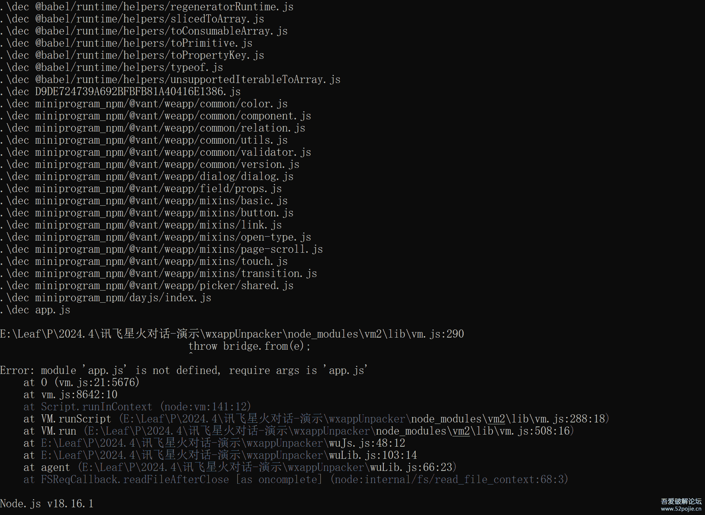

`image-20240426233807493.png`（279.72 KB，下载次数：4）；[下载附件](https://www.52pojie.cn/forum.php?mod=attachment&aid=MjY5MjI4M3wyMzRjMjBhZnwxNzkzNTcyMzUzfDE2ODA4NnwxOTE4MjAz&nothumb=yes)；2024-4-27 03:08 上传

运行起来了，但不多。这里好像是`require('app.js')`的时候出错了。但这也是不对的，因为`require`这个函数应该也是被`hook`掉的，不会报错。于是查找

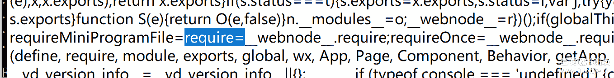

`image-20240426234119354.png`（40.08 KB，下载次数：2）；[下载附件](https://www.52pojie.cn/forum.php?mod=attachment&aid=MjY5MjI4NHw3OTM3M2E2MnwxNzkzNTcyMzUzfDE2ODA4NnwxOTE4MjAz&nothumb=yes)；2024-4-27 03:08 上传

嗯，也是被重新定义了，删掉。

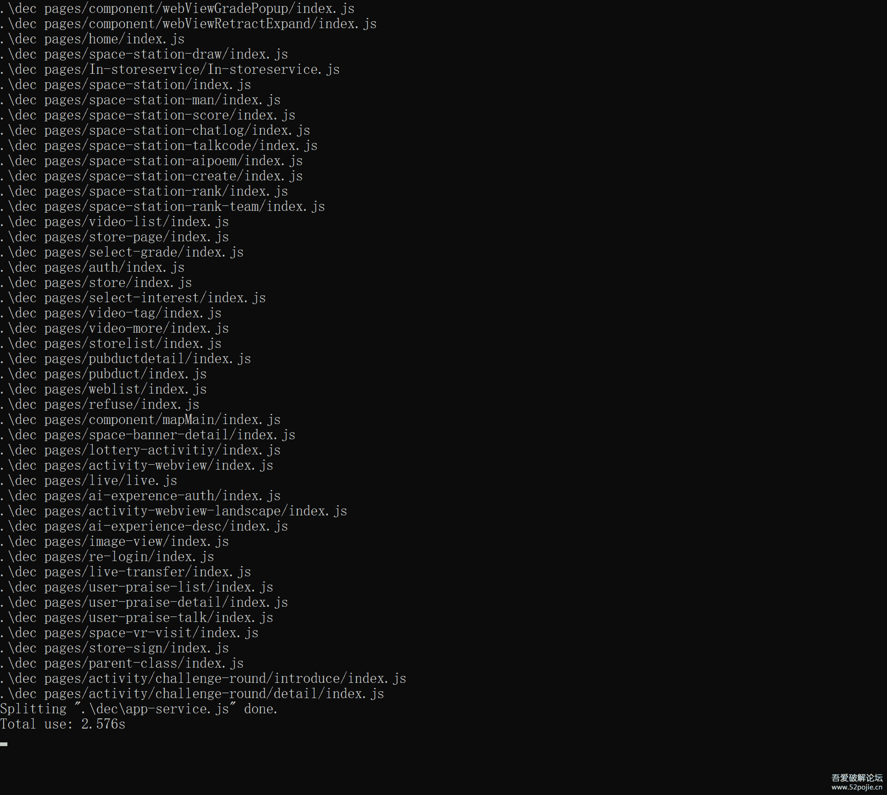

`image-20240426234216050.png`（242.5 KB，下载次数：3）；[下载附件](https://www.52pojie.cn/forum.php?mod=attachment&aid=MjY5MjI4NXw0NGVlNzIyNXwxNzkzNTcyMzUzfDE2ODA4NnwxOTE4MjAz&nothumb=yes)；2024-4-27 03:08 上传

## 收尾

ok成功跑完，然后就是

[Plain Text] 纯文本查看 复制代码


```bash
node wuConfig.js .\dec\app-config.json
node wuWxml.js .\dec\page-frame.html
node wuWxss.js .\dec
```

把这些也处理完。OK反编译完毕。可以看“源码”了。


image-20240426235100931.png (1.48 MB, 下载次数: 2) 2024-4-27 03:08 上传

在手机上看看这个页面有什么字。这个AI对话的功能是在这个功能体验按钮里面的。先搜搜

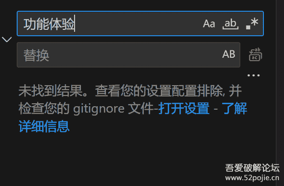

image-20240426235148197.png (40.56 KB, 下载次数: 4) 2024-4-27 03:08 上传

纳里，没有？？搜个别的

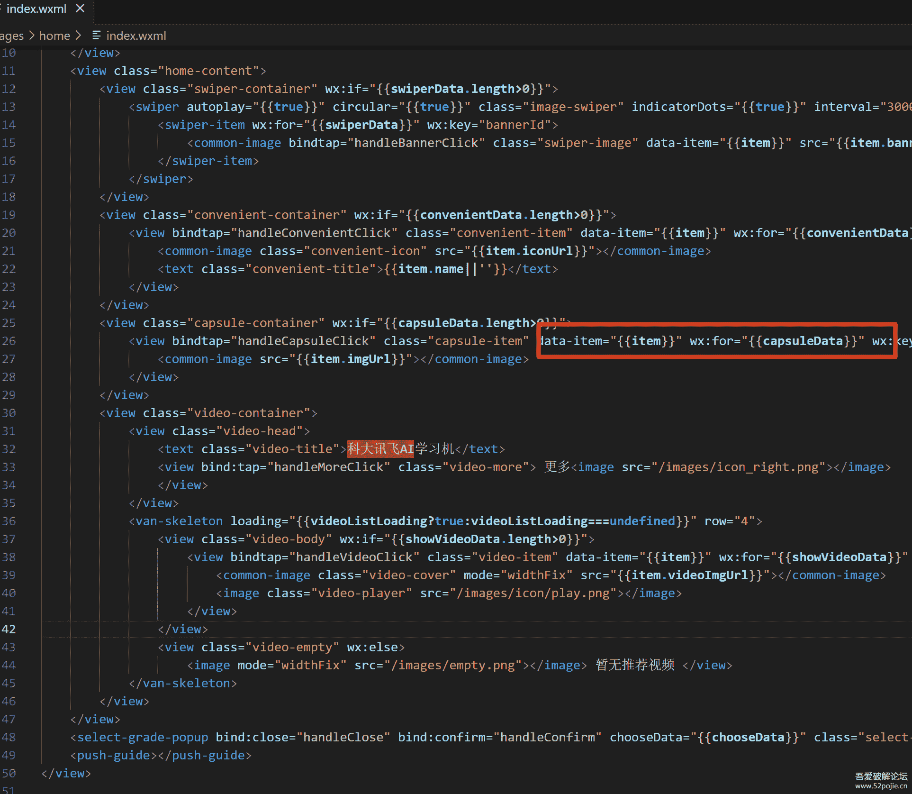

image-20240426235355417.png (477.83 KB, 下载次数: 1) 2024-4-27 03:08 上传

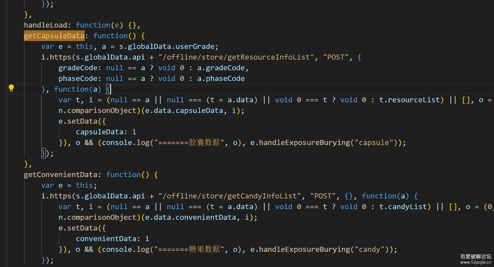

image-20240426235707321.png (203.02 KB, 下载次数: 2) 2024-4-27 03:08 上传

好的搜到了，上面的那些是从服务器获取的。看一下这个`i.https`函数

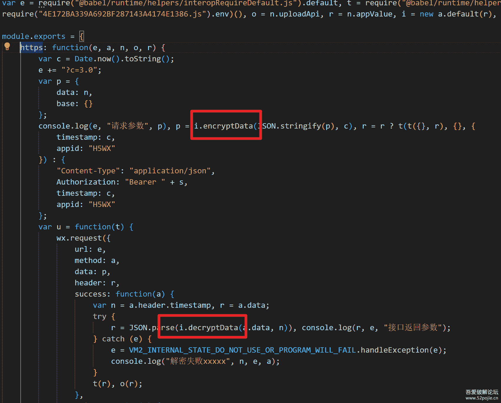

image-20240426235823258.png (218.47 KB, 下载次数: 3) 2024-4-27 03:08 上传

呵呵真好又可以破加密了。

找到两个函数，开干。

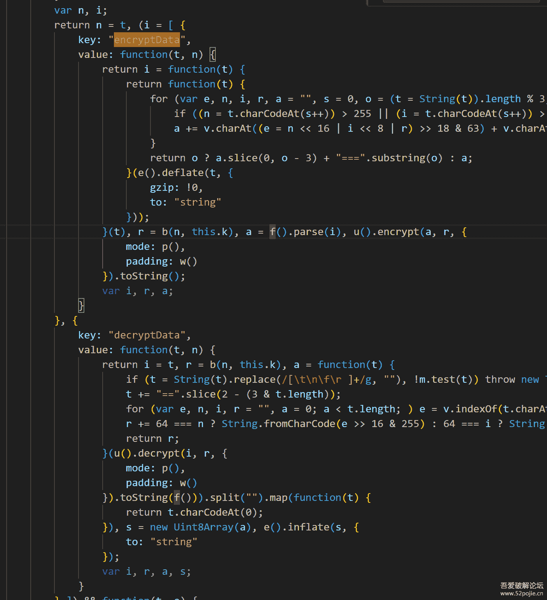

image-20240427000004852.png (234.02 KB, 下载次数: 2) 2024-4-27 03:08 上传

接着就是对着写abcdefg一个个摁进去看看返回什么，我试了一下，其实这个不是很复杂，所以就懒的搞调试了。过程省略，摁完标记出来，然后提取。

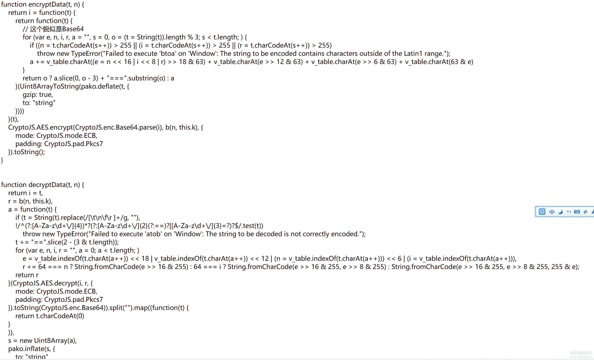

image-20240427000335319.png (219.48 KB, 下载次数: 2) 2024-4-27 03:08 上传

`https`函数也搞出来。

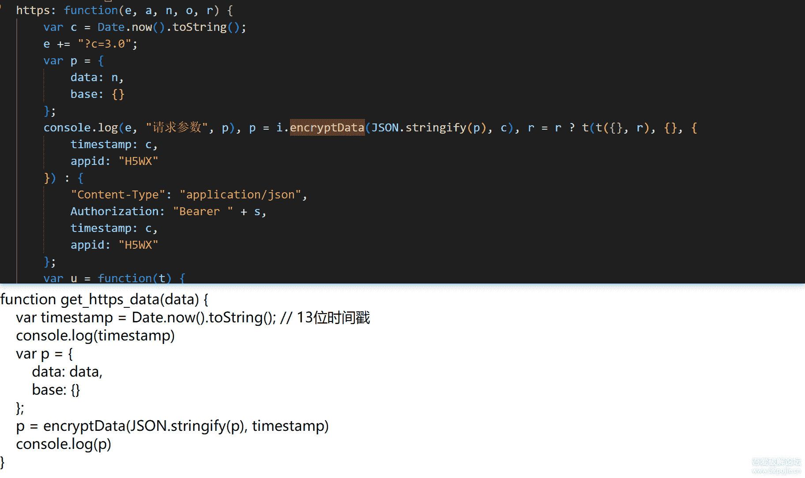

image-20240427000559807.png (123.57 KB, 下载次数: 2) 2024-4-27 03:08 上传

然后问题来了，这个`Authorization`是什么呢，我本来想蒙混过关，试了一下，不带这个返回401，所以必须有这个鬼。。。

向上找

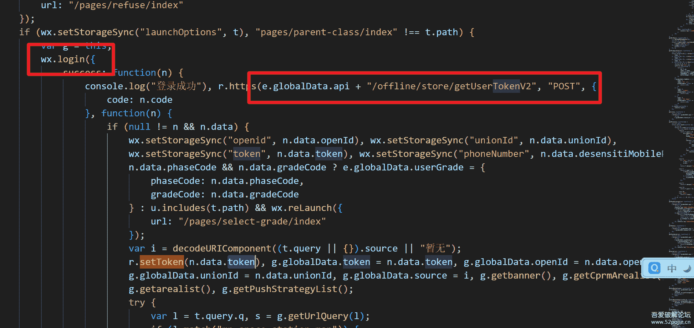

image-20240427001014728.png (296.41 KB, 下载次数: 3) 2024-4-27 03:08 上传

悬着的心终于死了，合着还是要`wx.login`的code

这个东西我只会用PC端抓。。

没事没事，你不是不让我用电脑端打开吗，这段代码我是能找到的

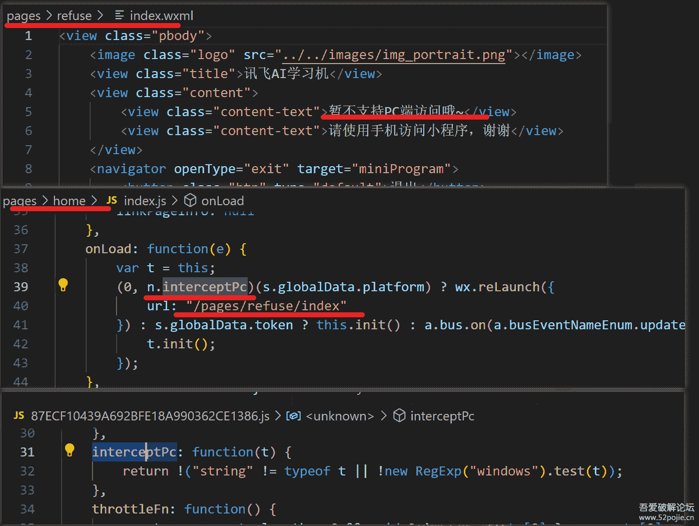

image-20240427001458312.png (215.22 KB, 下载次数: 2) 2024-4-27 03:08 上传

我刚好又会改内存，加载这段代码的时候改掉它就好。

首先你的微信是一个能够被抓包的版本，然后打开Fiddler。

打开小程序，打开CE附加进程，查看内存，搜索PC端，附近下个写入的断点（其实加载了的代码是不用再从这个位置读取的，但是再下一次读代码的时候会写到差不多的位置，然后就可以在这个时候断下改掉）

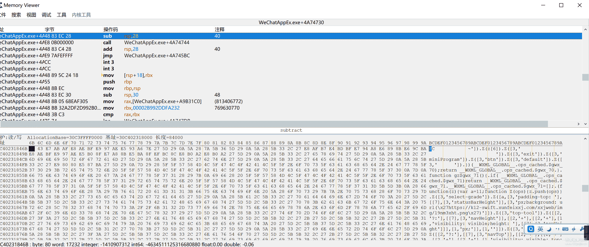

image-20240427001917139.png (302.86 KB, 下载次数: 1) 2024-4-27 03:08 上传

重启小程序，断的时候搜索刚刚那个判断PC的函数`interceptPc`

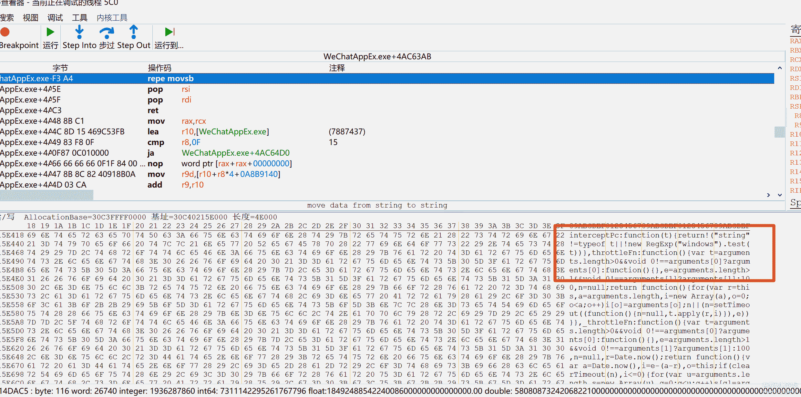

image-20240427002205271.png (265.66 KB, 下载次数: 3) 2024-4-27 03:08 上传

改掉它

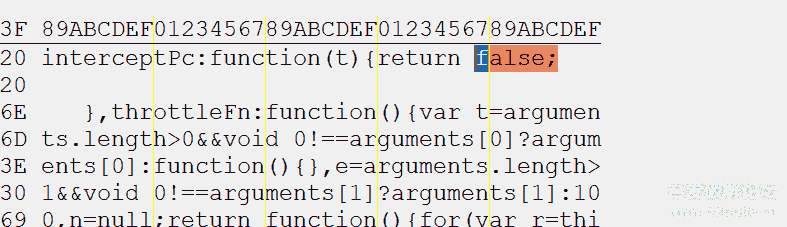

image-20240427002305182.png (29.45 KB, 下载次数: 1) 2024-4-27 03:08 上传

运行，

中间这个过程不能太久，不然就会

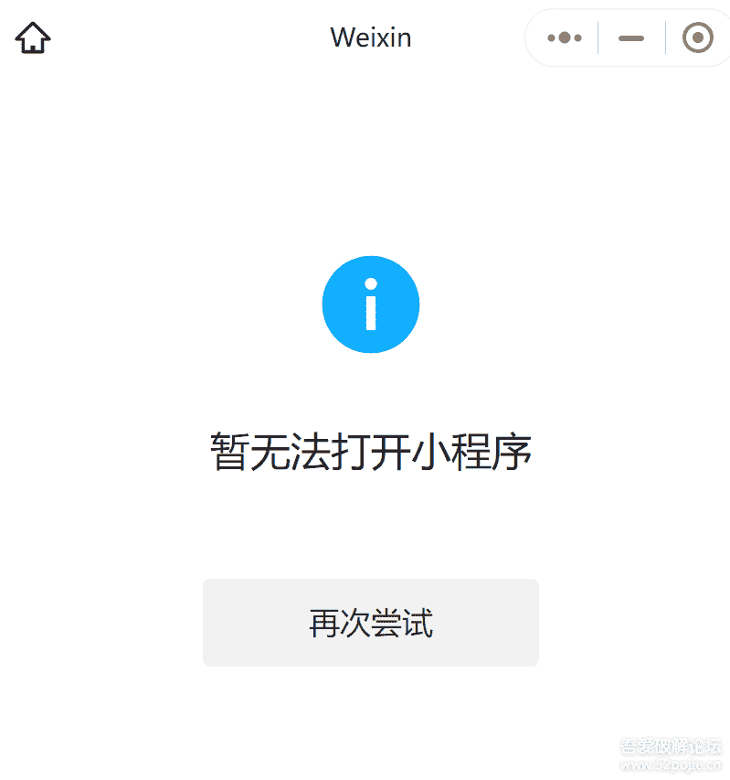

image-20240427002435267.png (32.2 KB, 下载次数: 3) 2024-4-27 03:08 上传

反正大抵就是你先准备好这个改完之后的字符串

```python
' false;                                              '
```

然后一断就搜，搜完就改，改完就运行，基本上问题不大。

【我这个菜鸟会的东西少，我也不懂原理，我也不会别的方法，我也不知道行内的东西，我就估摸着掰扯，见笑了 ^ - ^ 】

OK绕过了PC判断了

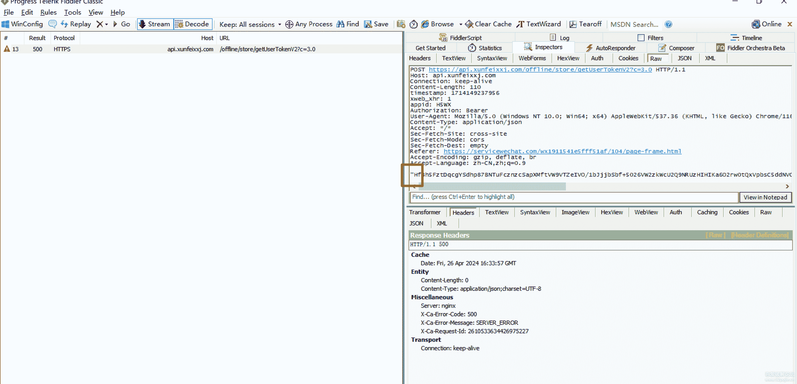

image-20240427003457206.png (134.4 KB, 下载次数: 2) 2024-4-27 03:08 上传

Fiddler抓到一个包，就是登录完获取token的那个。好家伙，我说为什么PC版不行呢，因为PC版会自动给这个`Content-type`是`json`的body加双引号。估计开发者是服务器的代码也不能动，双眼一黑被迫禁pc版的。

拿我们刚刚反编译出来的代码解一下这个发送出去的内容。（我这个人，习惯是很不好的，通常提取出来js直接扔html里，拿edge打开F12来调用。）

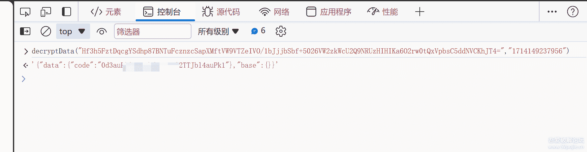

image-20240427011739744.png (73.11 KB, 下载次数: 2) 2024-4-27 03:08 上传

呐呐呐这个就是`wx.login`的code的了

但是这距离我们的目标还很远，我也懒得一个个函数去看，所以，我选择，抓包。

至于这个双引号，我就委屈一点拿fiddler给他手动删掉就好。

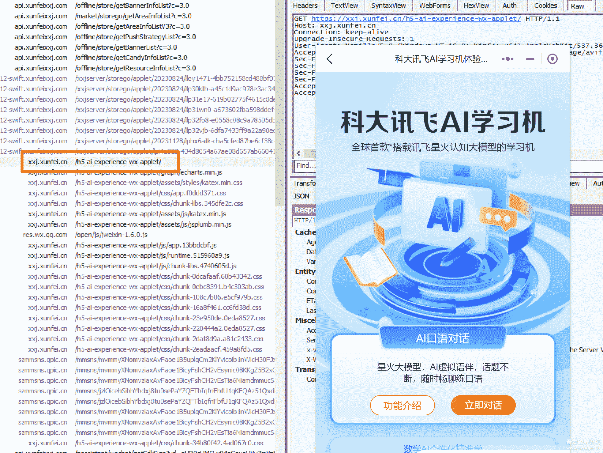

image-20240427012639787.png (992.57 KB, 下载次数: 2) 2024-4-27 03:08 上传

访问了这个网址。

拿浏览器访问一下，发现会报重新登录

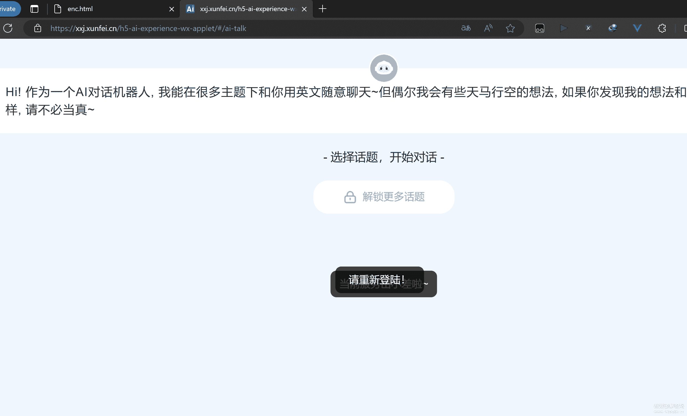


image-20240427012756063.png (163.21 KB, 下载次数: 2)

[href="forum.php?mod=attachment&aid=MjY5MjMwNXxhZjc1MTg3ZXwxNzkzNTcyMzUzfDE2ODA4NnwxOTE4MjAz&nothumb=yes" target="_blank"](https://www.52pojie.cn/forum.php?mod=attachment&aid=MjY5MjMwNXxhZjc1MTg3ZXwxNzkzNTcyMzUzfDE2ODA4NnwxOTE4MjAz&nothumb=yes)

2024-4-27 03:09 上传

发现浏览器是因为其中一个请求返回了个`401`

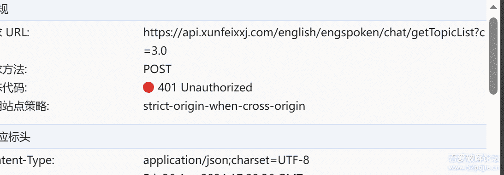

image-20240427012931123.png (59.99 KB, 下载次数: 2)

[href="forum.php?mod=attachment&aid=MjY5MjMwNnw1Y2Q3NDgxNnwxNzkzNTcyMzUzfDE2ODA4NnwxOTE4MjAz&nothumb=yes" target="_blank"](https://www.52pojie.cn/forum.php?mod=attachment&aid=MjY5MjMwNnw1Y2Q3NDgxNnwxNzkzNTcyMzUzfDE2ODA4NnwxOTE4MjAz&nothumb=yes)

2024-4-27 03:09 上传

回到小程序去抓这个请求

对比一下，发现多了这个

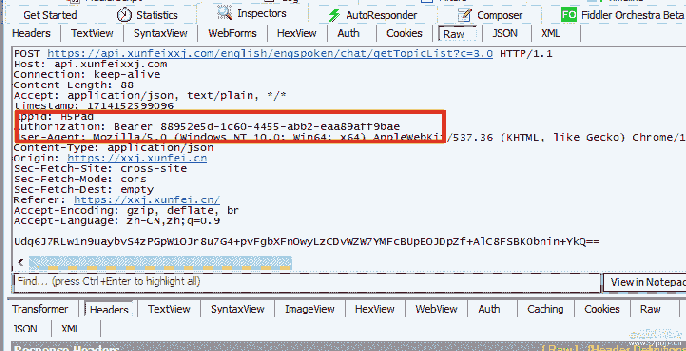

image-20240427013028572.png (68.67 KB, 下载次数: 4)

[href="forum.php?mod=attachment&aid=MjY5MjMwN3w2N2M1ZDU5MHwxNzkzNTcyMzUzfDE2ODA4NnwxOTE4MjAz&nothumb=yes" target="_blank"](https://www.52pojie.cn/forum.php?mod=attachment&aid=MjY5MjMwN3w2N2M1ZDU5MHwxNzkzNTcyMzUzfDE2ODA4NnwxOTE4MjAz&nothumb=yes)

2024-4-27 03:09 上传

看一下这个东西怎么来的

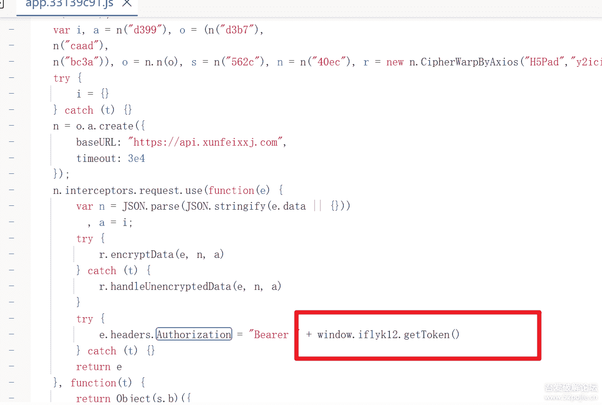

image-20240427013132579.png (99.41 KB, 下载次数: 1)

[href="forum.php?mod=attachment&aid=MjY5MjMwOHw3NzU1ZDMxZXwxNzkzNTcyMzUzfDE2ODA4NnwxOTE4MjAz&nothumb=yes" target="_blank"](https://www.52pojie.cn/forum.php?mod=attachment&aid=MjY5MjMwOHw3NzU1ZDMxZXwxNzkzNTcyMzUzfDE2ODA4NnwxOTE4MjAz&nothumb=yes)

2024-4-27 03:09 上传

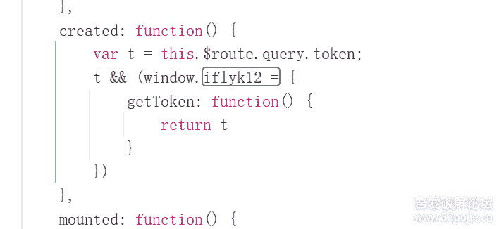

image-20240427013255601.png (31.79 KB, 下载次数: 2)

[href="forum.php?mod=attachment&aid=MjY5MjMwOXxkMWZlYmVlZnwxNzkzNTcyMzUzfDE2ODA4NnwxOTE4MjAz&nothumb=yes" target="_blank"](https://www.52pojie.cn/forum.php?mod=attachment&aid=MjY5MjMwOXxkMWZlYmVlZnwxNzkzNTcyMzUzfDE2ODA4NnwxOTE4MjAz&nothumb=yes)

2024-4-27 03:09 上传

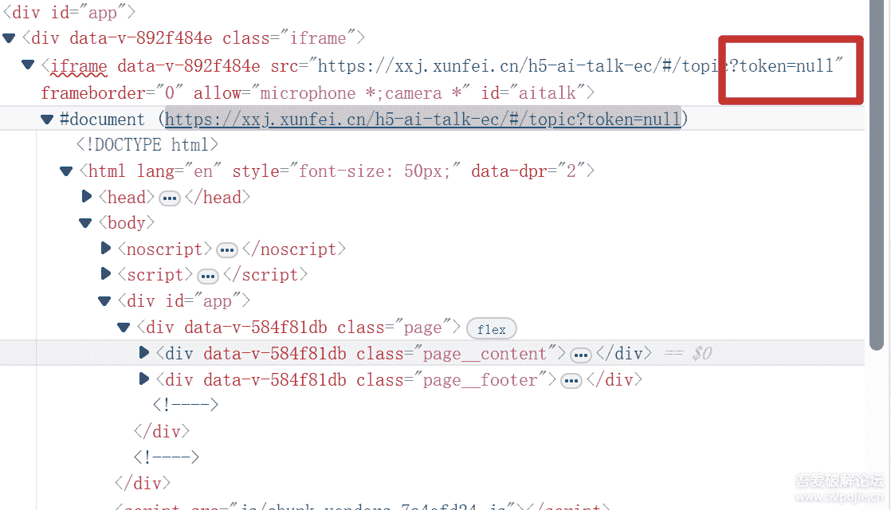

image-20240427013324369.png (110.6 KB, 下载次数: 2)

[href="forum.php?mod=attachment&aid=MjY5MjMxMHxkNGMwM2JlMnwxNzkzNTcyMzUzfDE2ODA4NnwxOTE4MjAz&nothumb=yes" target="_blank"](https://www.52pojie.cn/forum.php?mod=attachment&aid=MjY5MjMxMHxkNGMwM2JlMnwxNzkzNTcyMzUzfDE2ODA4NnwxOTE4MjAz&nothumb=yes)

2024-4-27 03:09 上传

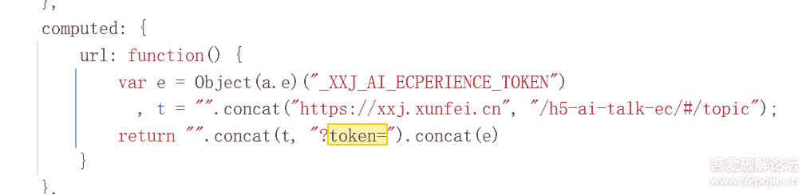

image-20240427013350819.png (35.36 KB, 下载次数: 3)

[href="forum.php?mod=attachment&aid=MjY5MjMxMXwyYjg0Y2ZjZHwxNzkzNTcyMzUzfDE2ODA4NnwxOTE4MjAz&nothumb=yes" target="_blank"](https://www.52pojie.cn/forum.php?mod=attachment&aid=MjY5MjMxMXwyYjg0Y2ZjZHwxNzkzNTcyMzUzfDE2ODA4NnwxOTE4MjAz&nothumb=yes)

2024-4-27 03:09 上传

然后就再也搜不到对于`_XXJ_AI_ECPERIENCE_TOKEN`这个本地存储的赋值了，那就盲猜一下。还记得我们一开始有一个`getToken`的接口吗

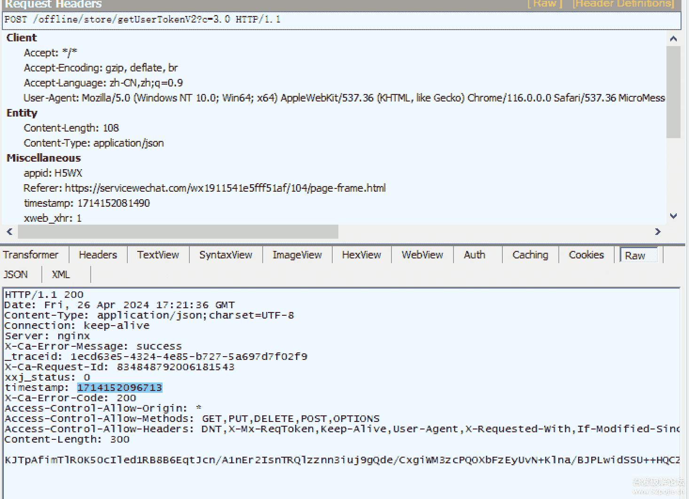

image-20240427025120703.png (77.87 KB, 下载次数: 4)

[href="forum.php?mod=attachment&aid=MjY5MjMxNHw2ZmU4MjJkOHwxNzkzNTcyMzUzfDE2ODA4NnwxOTE4MjAz&nothumb=yes" target="_blank"](https://www.52pojie.cn/forum.php?mod=attachment&aid=MjY5MjMxNHw2ZmU4MjJkOHwxNzkzNTcyMzUzfDE2ODA4NnwxOTE4MjAz&nothumb=yes)

2024-4-27 03:09 上传

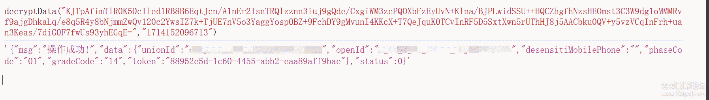

image-20240427025104649.png (68.97 KB, 下载次数: 2)

[href="forum.php?mod=attachment&aid=MjY5MjMxM3w2MmVkMzc0MXwxNzkzNTcyMzUzfDE2ODA4NnwxOTE4MjAz&nothumb=yes" target="_blank"](https://www.52pojie.cn/forum.php?mod=attachment&aid=MjY5MjMxM3w2MmVkMzc0MXwxNzkzNTcyMzUzfDE2ODA4NnwxOTE4MjAz&nothumb=yes)

2024-4-27 03:09 上传

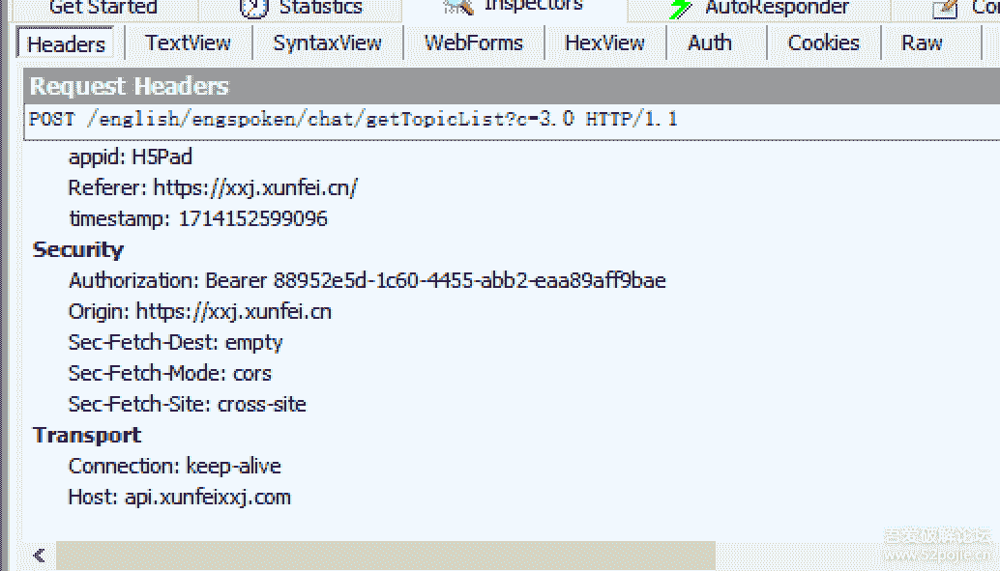

image-20240427025008137.png (35.68 KB, 下载次数: 2)

[href="forum.php?mod=attachment&aid=MjY5MjMxMnw0NTk1YjAzMXwxNzkzNTcyMzUzfDE2ODA4NnwxOTE4MjAz&nothumb=yes" target="_blank"](https://www.52pojie.cn/forum.php?mod=attachment&aid=MjY5MjMxMnw0NTk1YjAzMXwxNzkzNTcyMzUzfDE2ODA4NnwxOTE4MjAz&nothumb=yes)

2024-4-27 03:09 上传

数据一解，刚好是一样的。

OK了最后把这个东西扔浏览器里，就可以用了


image-20240427025250658.png (1.06 MB, 下载次数: 1)

[href="forum.php?mod=attachment&aid=MjY5MjMxNXxlZGNhNmU2OXwxNzkzNTcyMzUzfDE2ODA4NnwxOTE4MjAz&nothumb=yes" target="_blank"](https://www.52pojie.cn/forum.php?mod=attachment&aid=MjY5MjMxNXxlZGNhNmU2OXwxNzkzNTcyMzUzfDE2ODA4NnwxOTE4MjAz&nothumb=yes)

2024-4-27 03:09 上传

但是这个鬼玩意大概2个小时不到就过期了。所以我之前其实成功过一次，这次bb叨叨的写一大堆东西，等我截图的时候就没了（悲）

而且这个token是有次数限制的，每个人只有10次对话机会。。。

写这篇文章真的不容易啊折腾了好久，作为一个菜鸟其实什么都不懂，摸着石头过河。本宫乏了，我去睡觉了。。

我的这个token提取过程很复杂，跪求大佬指点。
