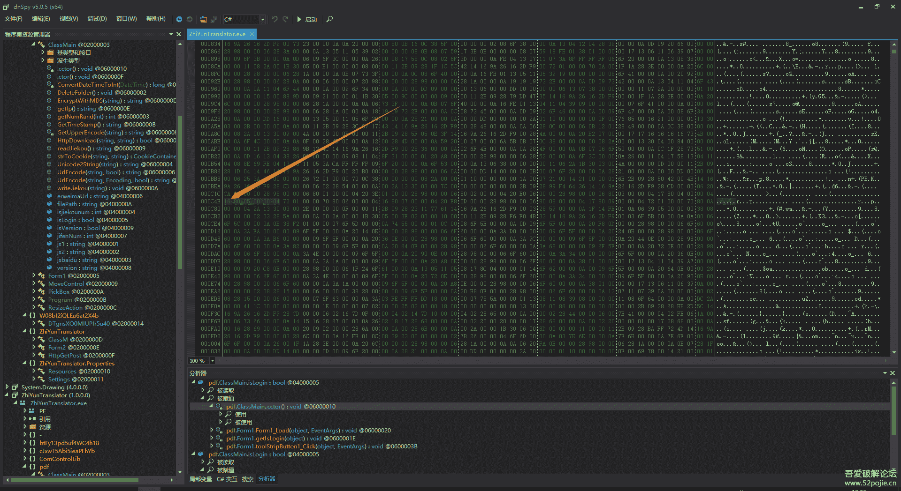

# [分享] 通过修改操作码实现软件破解

- 原帖：https://www.52pojie.cn/forum.php?mod=viewthread&tid=1919365
- 抓取时间：2026-11-01T22:31:06

## 通过修改编译操作码实现软件破解和勘误

### 前置知识

#### 什么是种别码？

种别码（`token`）是编译原理中词法分析阶段的一个关键概念。具体来说，词法分析是编译的第一个阶段，其主要任务是扫描输入字符流，产生用于语法分析的词法记号序列。这个词法记号就是一个二元组，由记号名（又称种别码）和属性值构成，其中属性值不是必须项。

在词法分析中，种别码用于对每个词进行定位，可以视为词的类型或标识。例如，我们可以把“数字”这个词的种别码定义为 `10`，把“标识符”的种别码定义为 `11` 等。在词法单元（`token`）形式中，种别码作为 `key`，与属性值（`value`）一起构成键值对，类似于 `Map` 中的 `key`、`value` 的形式。

种别码的分类包括一词一码、一型一码、多词一码等。一词一码表示每个词都有一个唯一的种别码，例如 `if` 这个词就可以从已经写好的种别内容中找到并确定它的类型。一型一码则表示虽然不能直接从种别内容中找到某个具体的值，但可以找到该值的类型。

#### 什么是操作码？

操作码（`Opcode`）是计算机指令中的一个字段，它规定了计算机要执行的操作。具体来说，操作码是计算机程序中所规定的要执行操作的那一部分指令或字段（通常用代码表示），用于告诉 CPU 需要执行哪一条指令。每个操作码通常由一个固定数量的二进制数字组成，用于编码计算机指令的不同操作。

操作码的格式因不同的指令集架构而异，但常见的操作码通常可以分为以下几类：

```text
数据传输操作码：用于在寄存器、内存或输入输出设备之间传输数据。这些操作码控制数据的读取、存储和移动，使得计算机可以进行各种复杂的数据操作和数据处理。
运算操作码：用于执行算术和逻辑运算。这些操作码包括加法、减法、乘法、除法等基本运算以及位运算、逻辑运算等高级运算，能够满足计算机处理各种类型和规模的数据需求。
分支和跳转操作码：用于控制程序的流程和执行顺序。这些操作码使得程序可以在特定条件下进行分支和跳转，实现条件判断、循环控制和子程序调用等功能，从而实现复杂的程序逻辑。
I/O操作码：用于控制计算机与输入输出设备的交互。这些操作码负责处理设备的读写、中断处理、异常处理等，使得计算机可以与外部环境进行信息交换。
```

在编程中，我们使用特定的语言来编写指令，这些语言通常会被编译器或解释器转换为计算机可执行的指令。操作码是这些指令中最重要的部分，它表示计算机要执行的操作类型。不同的指令集架构可能有不同的操作码格式和操作类型。

##### `CIL` 操作码

`CIL` 操作码是通用中间语言（`Common Intermediate Language`，简称 `CIL`）中用于描述和操作类或者方法的内部逻辑的代码。`CIL`，也被称为微软中间语言（`MSIL`），是 `.NET` 框架的一部分，用于作为不同高级编程语言之间的桥梁，使它们能够共享同一套运行时环境。

`CIL` 操作码可以执行各种操作，例如将参数加载到计算堆栈上（如 `LDARG_0`、`LDARG_1` 等）、将局部变量加载到计算堆栈上（如 `LDLOC_0`、`LDLOC_1` 等），以及进行数值计算（如 `Add` 操作码将两个值相加并将结果推送到计算堆栈）。这些操作码提供了一种低级但人类可读的方式来描述程序的行为。

在编译过程中，高级编程语言源代码首先被编译成 `CIL` 代码，然后由 `.NET` 运行时环境（如 `CLR`，`Common Language Runtime`）将其转换为机器代码并执行。因此，`CIL` 操作码在 `.NET` 框架中扮演着重要的角色，使得不同编程语言之间的互操作性成为可能。

##### 种别码和操作码的区别？

种别码一般是指在词法分析阶段，将关键字、标识符、字面量等分类编码后得到的结果。而 `CIL` 操作码可以看作是编译后的产物，它已经较为接近机器指令了。但从宏观的角度来看，操作码的作用和种别码类似，都起到了对程序的词汇进行归类编码的作用，使得计算机可以对这些词汇进行识别和处理。

### 修改操作码破解原理和上一讲勘误

在上一讲中并未给出修改某一区段的十六进制数值为 `17`，后可修改代码由 `false` 变为 `true` 的原理，同时对字段的解释存在错误。

上一讲链接：

逆向反编译之十六进制编辑器修改汇编指令破解软件登录和积分功能

[https://www.52pojie.cn/thread-1117836-1-1.html](https://www.52pojie.cn/thread-1117836-1-1.html)

（出处：吾爱破解论坛）

回顾：



上图所选阴影十六进制字符则对应其修改区域的同行代码，由于十六进制代码实则为二进制机器码，且程序编译平台为 `X86`，所以箭头所指十六进制数 `16` 则为要给变量所附的值。我们将其改为 `17`，十六进制数 `17` 对应其 `true` 编译种别码，不要问我为什么，下图是我的分析。

#### 勘误

所选阴影十六进制对应的并非为二进制的机器码，而是编译中间阶段的二进制 `CIL` 操作码。

数值 `17` 对应的也不是 `true` 的种别码？而是 `CIL` 操作码数值 `1`。

#### 原理

感谢大佬 wtujoxk 提供额 `CIL` 操作码表格。

[https://blog.csdn.net/yuhijk2055/article/details/102532702](https://blog.csdn.net/yuhijk2055/article/details/102532702)

在表格中可以看到，`CIL` 操作码中并没有对 `false` 和 `true` 的定义。

在 `CIL` 中，布尔值（如 `false` 和 `true`）通常作为数据类型的一部分来处理，而不是作为操作码。在 `CIL` 中，布尔值通常被表示为一个整数类型（如 `int32`），其中 `0` 可能表示 `false`，而非零值表示 `true`。然而，这种表示方式取决于具体的编程语言和编译器如何将高级语言中的布尔值映射到 `CIL` 中。虽然 `CIL` 操作码没有直接定义 `false` 和 `true`，但可以通过使用适当的整数类型和操作码来处理这些布尔值。因此可以 `false` 可能被表示为 `0`（或某个等效的值），而 `true` 可能被表示为 `1`（或某个非零的值）。
