# [Web逆向] 【web逆向】南京某学院登录接口分析

- 原帖: https://www.52pojie.cn/forum.php?mod=viewthread&tid=1919638
- 抓取时间: 2026-11-01T22:31:04

## 声明

本文章中所有内容仅供学习交流使用，不用于其他任何目的，不提供完整代码，抓包内容、敏感网址、数据接口等均已做脱敏处理，严禁用于商业用途和非法用途，否则由此产生的一切后果均与作者无关。本文章未经许可禁止转载，禁止任何修改后二次传播，擅自使用本文讲解的技术而导致的任何意外，作者均不负责，若有侵权，请联系作者立即删除。

目标地址: `aHR0cHM6Ly9pLm5qY2l0LmNuL0VJUC91c2VyL2luZGV4Lmh0bQ==`

## 一、找接口

### 1. tickets接口

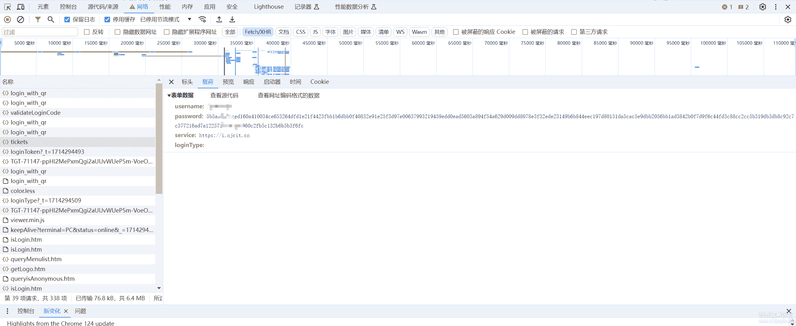

image-20240428165810963.png (170.84 KB, 下载次数: 1)

[href="forum.php?mod=attachment&aid=MjY5MzIzOHw0ZjgzZDYxN3wxNzkzNTcyMjYyfDE2ODA4NnwxOTE5NjM4&nothumb=yes" target="_blank"](https://www.52pojie.cn/forum.php?mod=attachment&aid=MjY5MzIzOHw0ZjgzZDYxN3wxNzkzNTcyMjYyfDE2ODA4NnwxOTE5NjM4&nothumb=yes)

2024-5-1 13:44 上传

登录之后发现密码被加密了，打一个XHR断点并包含`v1/tickets`，重新登录后发现密码已经是被加密的状态了，我们需要找到未被加密的状态。

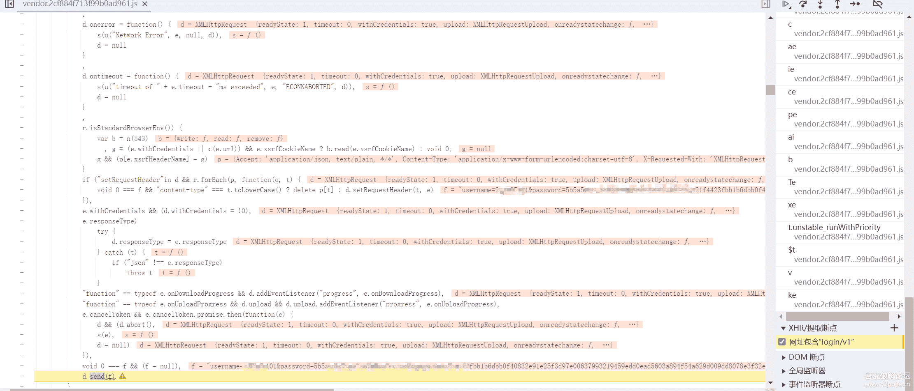

image-20240428171108959.png (276.82 KB, 下载次数: 1)

[href="forum.php?mod=attachment&aid=MjY5MzI0MXxiNWE5MzNhYnwxNzkzNTcyMjYyfDE2ODA4NnwxOTE5NjM4&nothumb=yes" target="_blank"](https://www.52pojie.cn/forum.php?mod=attachment&aid=MjY5MzI0MXxiNWE5MzNhYnwxNzkzNTcyMjYyfDE2ODA4NnwxOTE5NjM4&nothumb=yes)

2024-5-1 13:44 上传

然后我们根据调用栈堆找一下，发现下面这个函数有点意思，有个`v1/tickets`还有下面的参数与我们要请求的参数一致，初步怀疑是这个，打个断点试试。

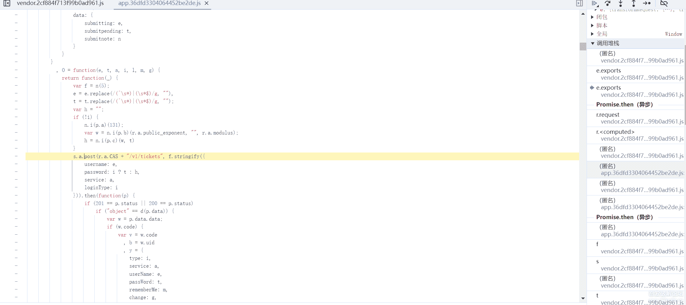

image-20240428171749167.png (172.38 KB, 下载次数: 2)

[href="forum.php?mod=attachment&aid=MjY5MzI0Mnw3ZjA1Yzk1OHwxNzkzNTcyMjYyfDE2ODA4NnwxOTE5NjM4&nothumb=yes" target="_blank"](https://www.52pojie.cn/forum.php?mod=attachment&aid=MjY5MzI0Mnw3ZjA1Yzk1OHwxNzkzNTcyMjYyfDE2ODA4NnwxOTE5NjM4&nothumb=yes)

2024-5-1 13:44 上传

断点之后，证实下面这个函数就是对原密码进行加密的，现在可以开始扣js代码了。

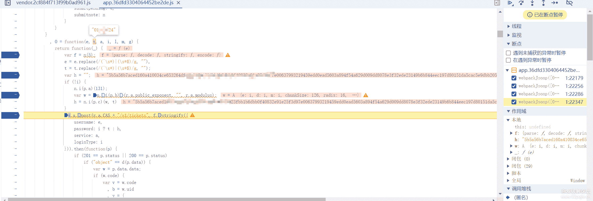

image-20240428172350465.png (178.2 KB, 下载次数: 1)

[href="forum.php?mod=attachment&aid=MjY5MzI0M3wxYmNhNTlmZHwxNzkzNTcyMjYyfDE2ODA4NnwxOTE5NjM4&nothumb=yes" target="_blank"](https://www.52pojie.cn/forum.php?mod=attachment&aid=MjY5MzI0M3wxYmNhNTlmZHwxNzkzNTcyMjYyfDE2ODA4NnwxOTE5NjM4&nothumb=yes)

2024-5-1 13:44 上传

先把`O`函数扣下来，删掉多余的部分，然后依次补齐未知参数。（`h`是我们需要的值）

```
O = function (e, t, a, i) {
    var f = n(5);
    e = e.replace(/(^\s*)|(\s*$)/g, ""),
        t = t.replace(/(^\s*)|(\s*$)/g, "");
    var h = "";
    if (!i) {
        n.i(p.a)(131);
        var w = n.i(p.b)(r.a.public_exponent, "", r.a.modulus);
        h = n.i(p.c)(w, t)
    }
    return h
}
```

5> 接下来看`n(5)`，由于是webpack打包，扣出来，导出加载器。把`n(5)`替换成`wuye4(5)`，运行后就会打印加载`5`这个模块，然后扣模块`5`。

```
var window = global;

var wuye4;

!function (e) {

    function t(n) {

        if (r[n])

            return r[n].exports;

        var o = r[n] = {

            i: n,

            l: !1,

            exports: {}

        };

        # 这里输出缺少啥模块

        console.log("加载" + n)

        return e[n].call(o.exports, o, o.exports, t),

            o.l = !0,

            o.exports

    }

        #全局变量导出加载器

    wuye4 = t;

    var n = window.webpackJsonp;

    window.webpackJsonp = function (r, i, a) {

        for (var c, u, l, s = 0, f = []; s 
```

5> 找到这个数组里面的5把函数扣出来。一共要加载`5`、`1212`、`1213`、`34`四个模块，剩下的自己扣。不想扣的话，可以把整个js文件都复制出来。

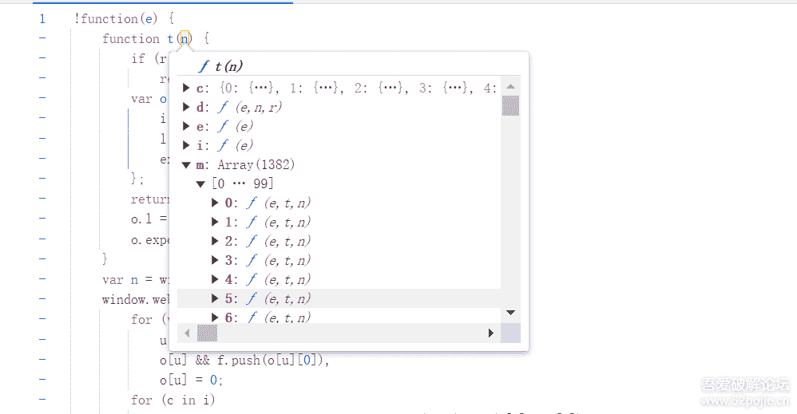

image-20240428174959272.png (56.24 KB, 下载次数: 1)

[href="forum.php?mod=attachment&aid=MjY5MzI0NHw4MTI5MjU1OHwxNzkzNTcyMjYyfDE2ODA4NnwxOTE5NjM4&nothumb=yes" target="_blank"](https://www.52pojie.cn/forum.php?mod=attachment&aid=MjY5MzI0NHw4MTI5MjU1OHwxNzkzNTcyMjYyfDE2ODA4NnwxOTE5NjM4&nothumb=yes)

2024-5-1 13:44 上传

5> 接着看`p`参数，搜索一下发现就是`n(34)`替换过去。

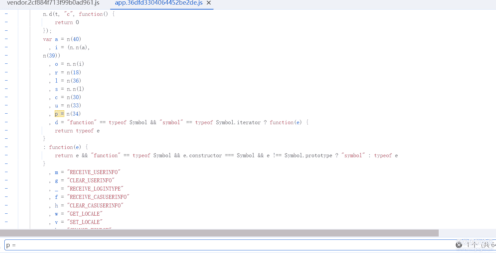

image-20240428175840740.png (80.76 KB, 下载次数: 1)

[href="forum.php?mod=attachment&aid=MjY5MzI0NXxhMjk5NDYzZnwxNzkzNTcyMjYyfDE2ODA4NnwxOTE5NjM4&nothumb=yes" target="_blank"](https://www.52pojie.cn/forum.php?mod=attachment&aid=MjY5MzI0NXxhMjk5NDYzZnwxNzkzNTcyMjYyfDE2ODA4NnwxOTE5NjM4&nothumb=yes)

2024-5-1 13:44 上传

5> `r.a.public_exponent`加密参数固定值

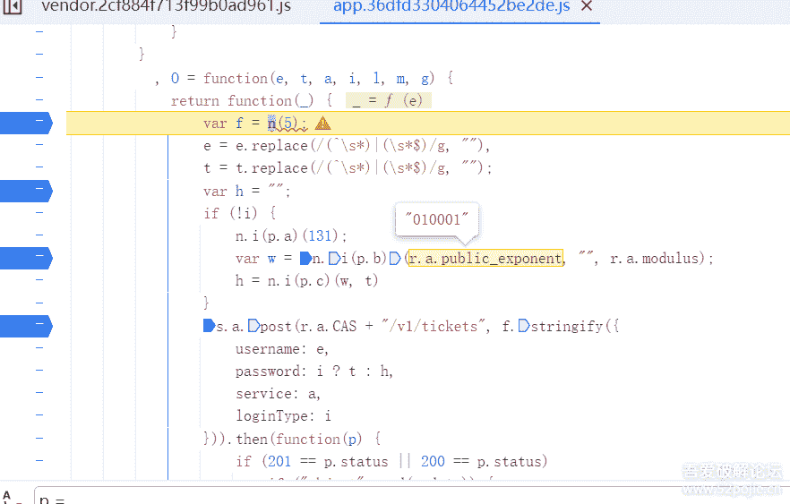

image-20240428180122205.png (69.95 KB, 下载次数: 1)

[href="forum.php?mod=attachment&aid=MjY5MzI0Nnw1Y2E5YjZiNnwxNzkzNTcyMjYyfDE2ODA4NnwxOTE5NjM4&nothumb=yes" target="_blank"](https://www.52pojie.cn/forum.php?mod=attachment&aid=MjY5MzI0Nnw1Y2E5YjZiNnwxNzkzNTcyMjYyfDE2ODA4NnwxOTE5NjM4&nothumb=yes)

2024-5-1 13:44 上传

5> `r.a.modulus`加密参数固定值

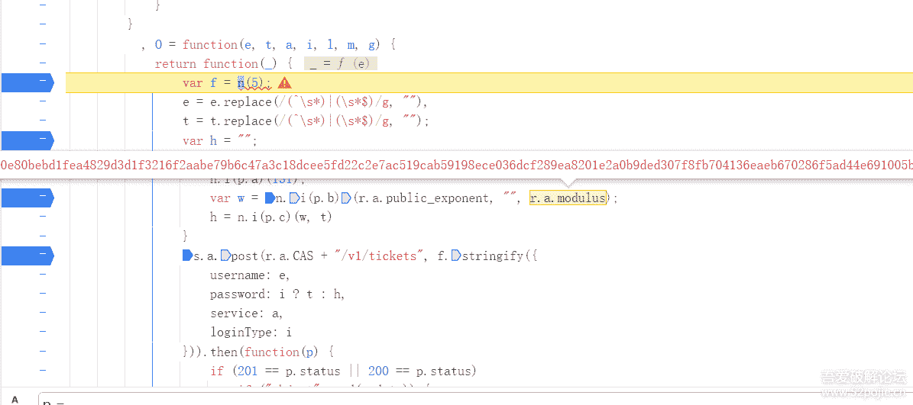

image-20240428180149446.png (69.32 KB, 下载次数: 0)

[href="forum.php?mod=attachment&aid=MjY5MzI0N3wwMDkxNDVhMnwxNzkzNTcyMjYyfDE2ODA4NnwxOTE5NjM4&nothumb=yes" target="_blank"](https://www.52pojie.cn/forum.php?mod=attachment&aid=MjY5MzI0N3wwMDkxNDVhMnwxNzkzNTcyMjYyfDE2ODA4NnwxOTE5NjM4&nothumb=yes)

2024-5-1 13:44 上传

5> 替换函数最终如下，就可以输出加密密码。


```javascript
O = function (e, t, a, i) {
    var f = wuye4(5);
    e = e.replace(/(^\s*)|(\s*$)/g, ""),
        t = t.replace(/(^\s*)|(\s*$)/g, "");
    var h = "";
    if (!i) {
        wuye4.i(wuye4(34).a)(131);
        var w = wuye4.i(wuye4(34).b)("010001", "", '00b5eeb166e069920e80bebd1fea4829d3d1f3216f2aabe79b6c47a3c18dcee5fd22c2e7ac519cab59198ece036dcf289ea8201e2a0b9ded307f8fb704136eaeb670286f5ad44e691005ba9ea5af04ada5367cd724b5a26fdb5120cc95b6431604bd219c6b7d83a6f8f24b43918ea988a76f93c333aa5a20991493d4eb1117e7b1');
        h = wuye4.i(wuye4(34).c)(w, t)
    }
    return h
}
```

### 2.`TGT`接口

请求`1.tickets`接口后会响应`TGT-`开头的值，接着请求`2.TGT`接口会响应一个`ST-`开头的值

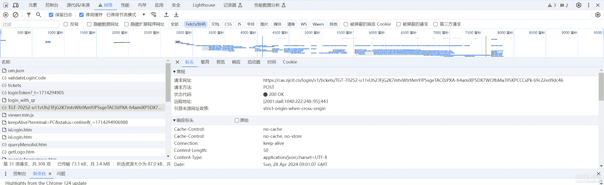

image-20240428170250195.png (177.43 KB, 下载次数: 0)

[href="forum.php?mod=attachment&aid=MjY5MzIzOXwzMTc2YzQ2ZXwxNzkzNTcyMjYyfDE2ODA4NnwxOTE5NjM4&nothumb=yes" target="_blank"](https://www.52pojie.cn/forum.php?mod=attachment&aid=MjY5MzIzOXwzMTc2YzQ2ZXwxNzkzNTcyMjYyfDE2ODA4NnwxOTE5NjM4&nothumb=yes)

2024-5-1 13:44 上传

### 3.`ST`接口

把上面`ST-`开头的值传到这里，请求成功后，就算登陆成功了。

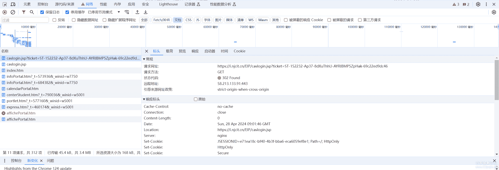

image-20240428170359035.png (162.87 KB, 下载次数: 0)

[href="forum.php?mod=attachment&aid=MjY5MzI0MHw3MzkyZGI0ZnwxNzkzNTcyMjYyfDE2ODA4NnwxOTE5NjM4&nothumb=yes" target="_blank"](https://www.52pojie.cn/forum.php?mod=attachment&aid=MjY5MzI0MHw3MzkyZGI0ZnwxNzkzNTcyMjYyfDE2ODA4NnwxOTE5NjM4&nothumb=yes)

2024-5-1 13:44 上传

## 二、效果图

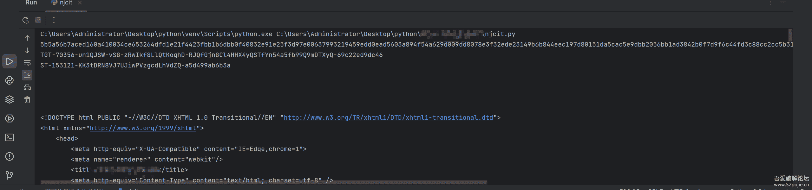

image-20240428181150988.png (120.79 KB, 下载次数: 1)

[href="forum.php?mod=attachment&aid=MjY5MzI0OHxlYWRkYThlZHwxNzkzNTcyMjYyfDE2ODA4NnwxOTE5NjM4&nothumb=yes" target="_blank"](https://www.52pojie.cn/forum.php?mod=attachment&aid=MjY5MzI0OHxlYWRkYThlZHwxNzkzNTcyMjYyfDE2ODA4NnwxOTE5NjM4&nothumb=yes)

2024-5-1 13:44 上传

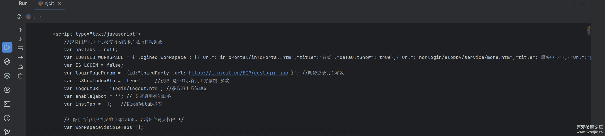

image-20240428181214545.png (120.58 KB, 下载次数: 1)

[href="forum.php?mod=attachment&aid=MjY5MzI0OXwxNWJiZWU3ZnwxNzkzNTcyMjYyfDE2ODA4NnwxOTE5NjM4&nothumb=yes" target="_blank"](https://www.52pojie.cn/forum.php?mod=attachment&aid=MjY5MzI0OXwxNWJiZWU3ZnwxNzkzNTcyMjYyfDE2ODA4NnwxOTE5NjM4&nothumb=yes)

2024-5-1 13:44 上传

## 三、扩展（实现查询个人成绩）

点查询个人成绩,进入到教务系统。

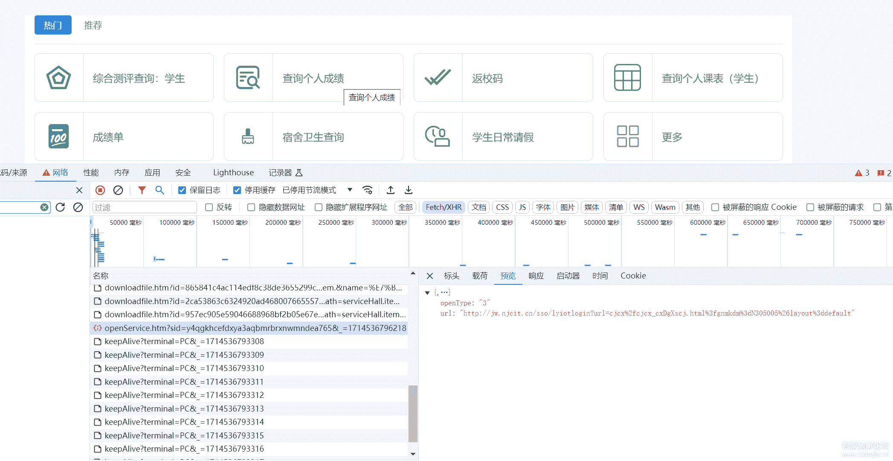

image-20240501122449805.png (188.17 KB, 下载次数: 1)

[href="forum.php?mod=attachment&aid=MjY5MzI1MHxjNmY3NzgxNnwxNzkzNTcyMjYyfDE2ODA4NnwxOTE5NjM4&nothumb=yes" target="_blank"](https://www.52pojie.cn/forum.php?mod=attachment&aid=MjY5MzI1MHxjNmY3NzgxNnwxNzkzNTcyMjYyfDE2ODA4NnwxOTE5NjM4&nothumb=yes)

2024-5-1 13:44 上传

登录教务系统，把下面的`service`替换成上面的`url`，然后拿到`ST`开头的值。

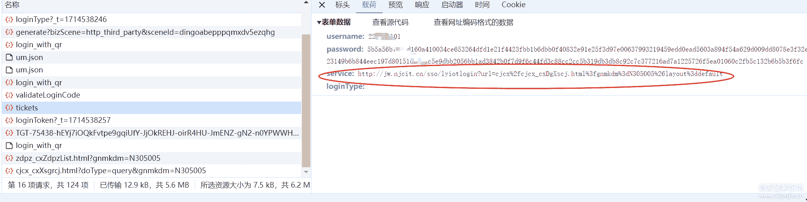

image-20240501123817731.png (103.55 KB, 下载次数: 1)

[href="forum.php?mod=attachment&aid=MjY5MzI1MXw1ZTdiYzU0Y3wxNzkzNTcyMjYyfDE2ODA4NnwxOTE5NjM4&nothumb=yes" target="_blank"](https://www.52pojie.cn/forum.php?mod=attachment&aid=MjY5MzI1MXw1ZTdiYzU0Y3wxNzkzNTcyMjYyfDE2ODA4NnwxOTE5NjM4&nothumb=yes)

2024-5-1 13:44 上传

然后请求这个接口，最后会重定向到学生成绩查询页面。

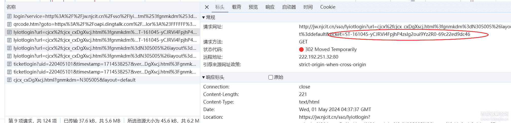

image-20240501124113186.png (115.24 KB, 下载次数: 1)

[href="forum.php?mod=attachment&aid=MjY5MzI1MnwwZGFkMTc2MXwxNzkzNTcyMjYyfDE2ODA4NnwxOTE5NjM4&nothumb=yes" target="_blank"](https://www.52pojie.cn/forum.php?mod=attachment&aid=MjY5MzI1MnwwZGFkMTc2MXwxNzkzNTcyMjYyfDE2ODA4NnwxOTE5NjM4&nothumb=yes)

2024-5-1 13:44 上传

最后调用查询成绩接口。

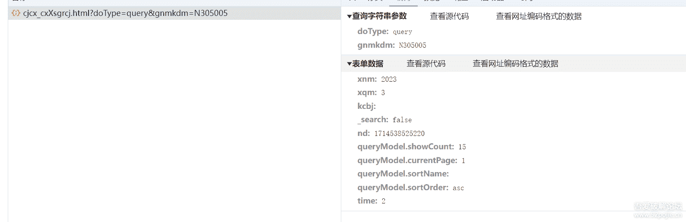

image-20240501124320922.png (62.3 KB, 下载次数: 2)

[href="forum.php?mod=attachment&aid=MjY5MzI1M3w1NDUyMzg1MXwxNzkzNTcyMjYyfDE2ODA4NnwxOTE5NjM4&nothumb=yes" target="_blank"](https://www.52pojie.cn/forum.php?mod=attachment&aid=MjY5MzI1M3w1NDUyMzg1MXwxNzkzNTcyMjYyfDE2ODA4NnwxOTE5NjM4&nothumb=yes)

2024-5-1 13:44 上传

效果如下

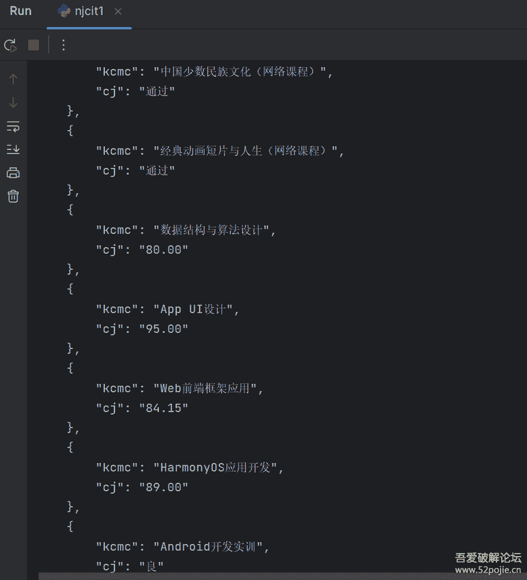

image-20240501132328218.png (71.87 KB, 下载次数: 1)

[href="forum.php?mod=attachment&aid=MjY5MzI1NXxjYzI0MWI1N3wxNzkzNTcyMjYyfDE2ODA4NnwxOTE5NjM4&nothumb=yes" target="_blank"](https://www.52pojie.cn/forum.php?mod=attachment&aid=MjY5MzI1NXxjYzI0MWI1N3wxNzkzNTcyMjYyfDE2ODA4NnwxOTE5NjM4&nothumb=yes)

2024-5-1 13:45 上传

## 四、把成绩推送到微信

使用 [//www.pushplus.plus/](https://www.pushplus.plus/)

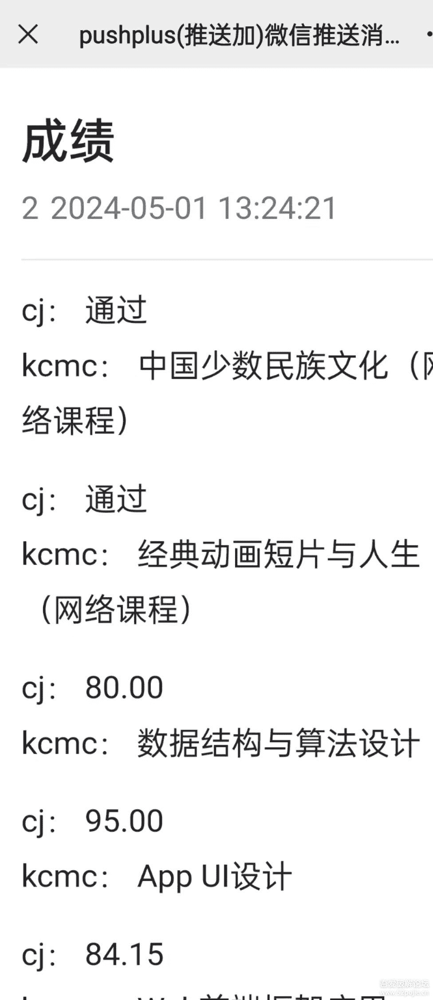

628df2a54c8f4afa82f70ac8bdfbb29.jpg (145.17 KB, 下载次数: 0)

[href="forum.php?mod=attachment&aid=MjY5MzIzN3w2ZmE1NjVjZXwxNzkzNTcyMjYyfDE2ODA4NnwxOTE5NjM4&nothumb=yes" target="_blank"](https://www.52pojie.cn/forum.php?mod=attachment&aid=MjY5MzIzN3w2ZmE1NjVjZXwxNzkzNTcyMjYyfDE2ODA4NnwxOTE5NjM4&nothumb=yes)

2024-5-1 13:44 上传

## 五、代码实现


[href="forum.php?mod=attachment&aid=MjY5MzIzMnw0YWU4YjJkZnwxNzkzNTcyMjYyfDE2ODA4NnwxOTE5NjM4" target="_blank"](https://www.52pojie.cn/forum.php?mod=attachment&aid=MjY5MzIzMnw0YWU4YjJkZnwxNzkzNTcyMjYyfDE2ODA4NnwxOTE5NjM4)

(6.74 KB, 下载次数: 25)

2024-5-1 13:39 上传

点击文件名下载附件
下载积分: 吾爱币 -1 CB
