# [Web逆向] 小程序泡泡玛特小程序解包

- 原帖: https://www.52pojie.cn/forum.php?mod=viewthread&tid=1924937
- 抓取时间: 2026-11-01T22:29:34

## 前言

最近看到泡泡玛特很火啊，于是就跟风研究一下。在逆向的时候发现很有意思啊，回到了过去小程序解包反编译的时候，于是心血来潮，写一篇文章来记录一下。

## 目标网站


我们用pc版打开，它会提示如下:

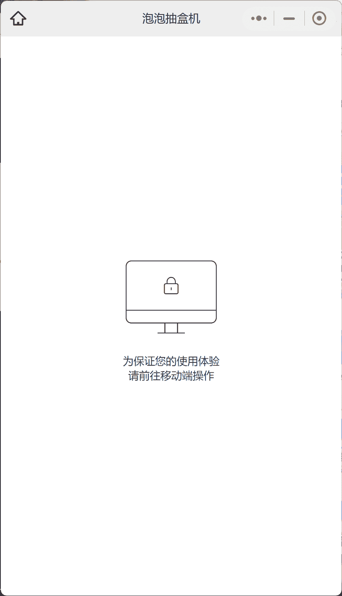

现在我们用手机加载小程序，小程序的路径在`/data/data/com.tencent.mm/MicroMsg/appbrand/pkg/general/`

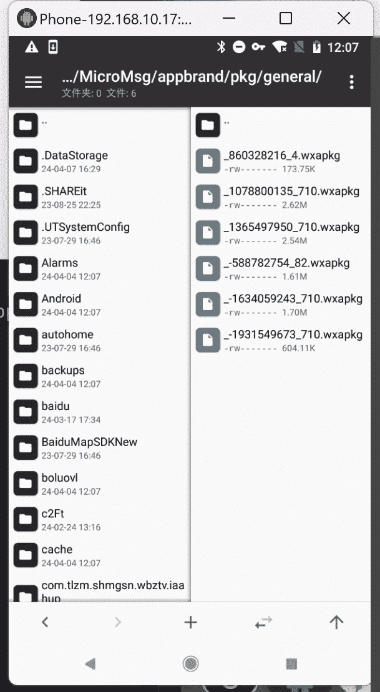

接下来我们使用`adb`的`pull`命令把文件全部拉取过来

由于手机上的`wxapkg`的包是不需要进行解密的，所以我们可以直接用`unveilr.exe`进行解包

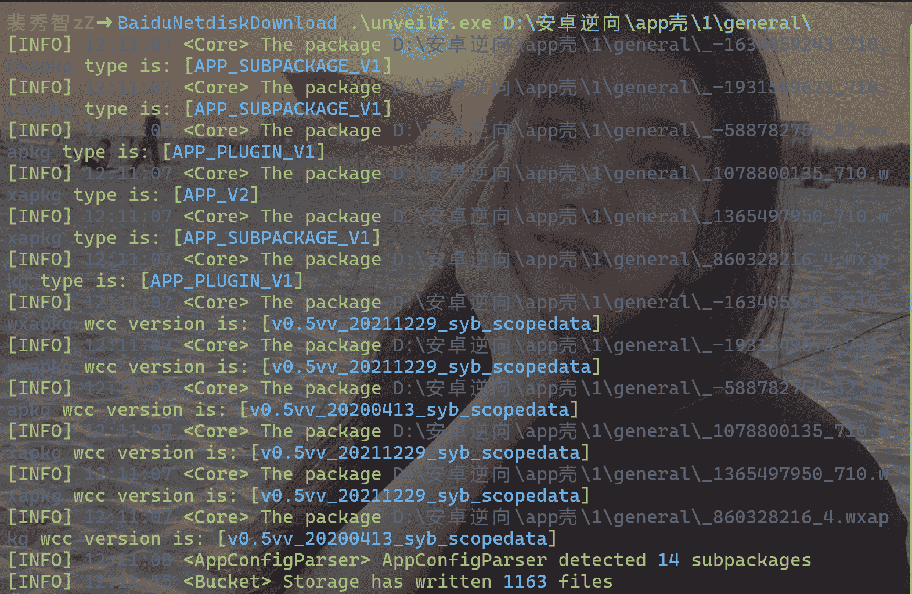

接下来我们手动把他复制到同一个文件夹中，之后我们就可以把他弄到微信开发者工具进行反编译了调试代码了。

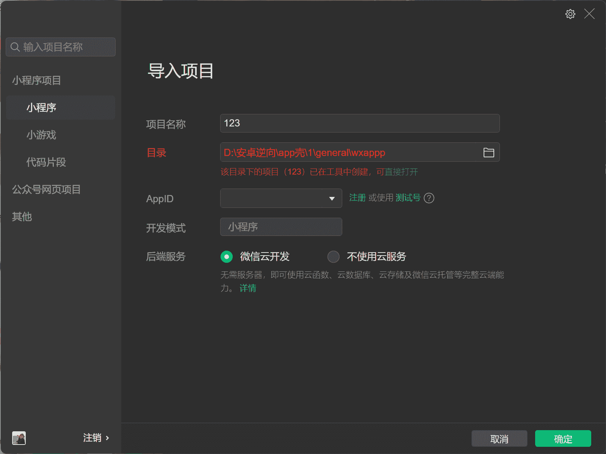

## 修复小程序

我这里已经导入过了，所以直接打开就可以，接下来进行一些简单的修复和补充，简单来说就是什么报错就把什么给删掉。

像这种`plugins`下的我们可以全部删除就好，因为我们是没权限去调用他的插件应用的。

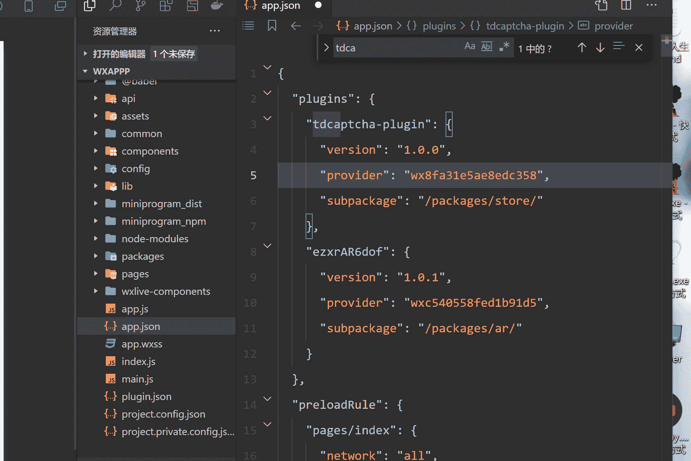

修复完之后，发现出现很多关于渲染层网络的错误啊，这个我们没办法解决，因为我们不是开发者，没有具备配置`request`合法域名的权限。我们就只能碰运气，不停的去更换加载页面，哪怕是请求无法发出，因为他的参数是在本地生成的，只要碰到能生成的`sign`和`x-sign`的接口，我们就可以逆向了。

经过不懈的努力，我们找到了这个页面

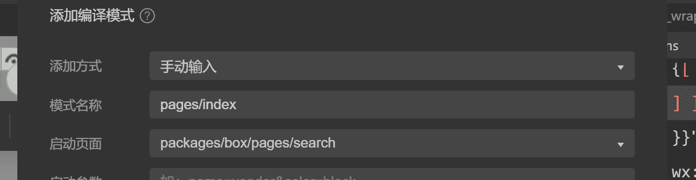

触发的条件就是搜索的接口

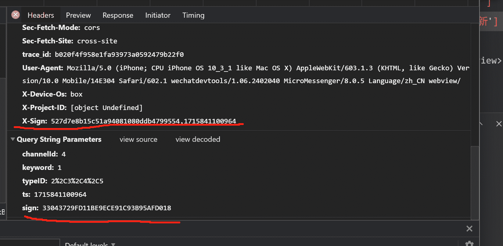

## 参数分析

### `X-Sign`

全局搜索只有一处，我们点进去，然后下好断点，重新搜索触发

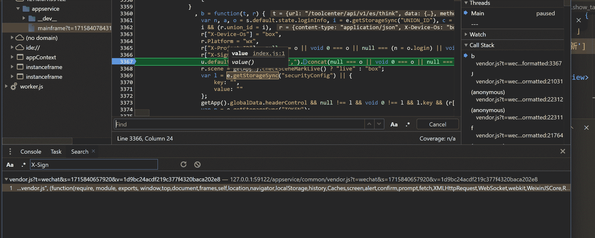

发现成功断住，接着我们来分析怎么生成的

```
r["X-Sign"] = "".concat((0,
                    u.default)("".concat(c, ",").concat(null === o || void 0 === o || null === (a = o.login) || void 0 === a ? void 0 : a.client_key)), ",").concat(c)
```

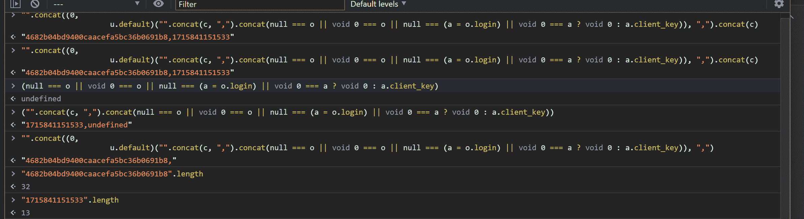

由图上，我们知道的信息是可能是一个32的`md5`，应该是13位时间戳拼接一个`client_key`然后在`md5`，不知道哪里得到原因导致我们的`client_key`是`undefined`，所以我们只能找来源了

我这里不卖关子了，直接说明了，他不是本地生成的，他是调用的函数，返回的`client_key`，我们直接重新进入网络，在查尔斯或者其他抓包工具中去搜索`client_key`

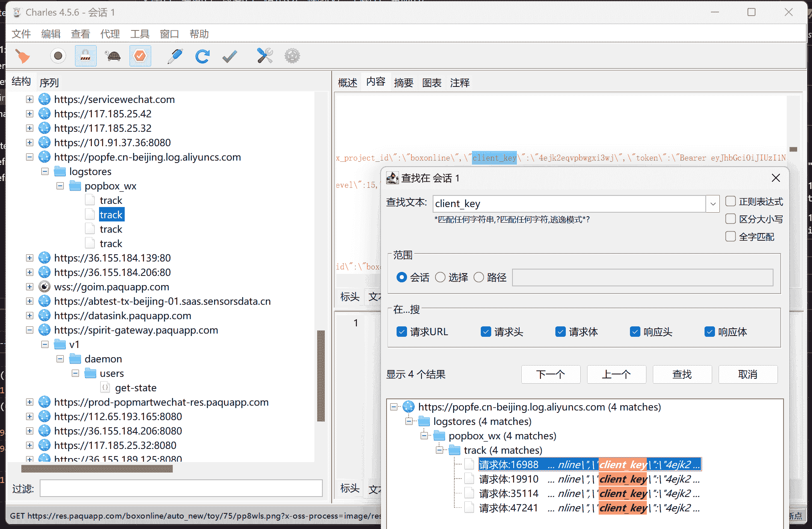

我这里的值`4ejk2eqvpbwgxi3wj`，每个人肯定是不同的，我们去验证一下我们的猜想是否正确

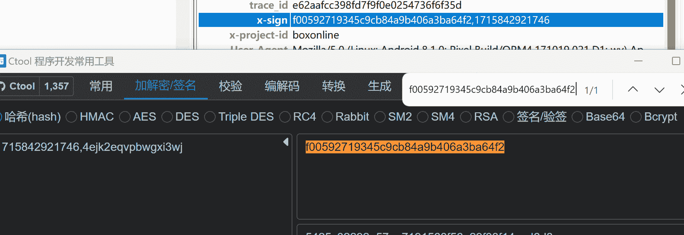

完全正确，所以我们知道了，`x-sign`的算法就是13位时间戳拼接，在拼接函数的`client_key`在拼接，拼接13位时间戳

代码格式写一下就是

```
def md5(enc_str):

    m = hashlib.md5()

    m.update(enc_str.encode("utf-8"))

    return m.hexdigest()

time_now = str(int(time.time()*1000))

x-sign = md5(time_now+","+"4ejk2eqvpbwgxi3wj")+","+time_now
```

### `sign`

很明显`sign`加密就在下面，我们断点然后进去然后刷新

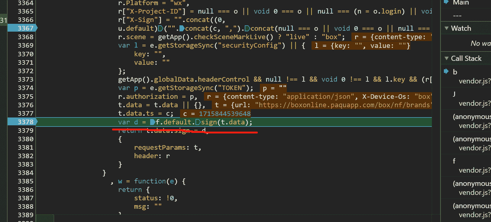

点进去`sign`方法 映入眼帘的就是`md5`然后拼接，我们断点后逐步分析。

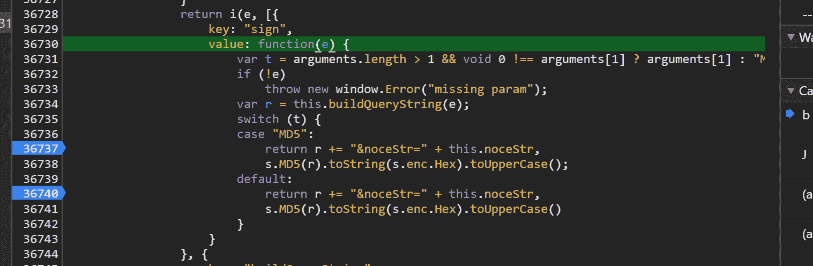

其他的都能读懂，难点主要在`buildQueryString`的作用，我们点进去看一下

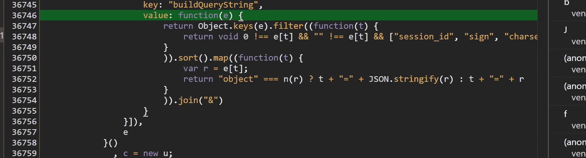

其实也很直白，就是键值对大小写排序，然后把键值用`=`连接，各个键值对末尾拼接一个`&`

其实看下图也能明白他的作用

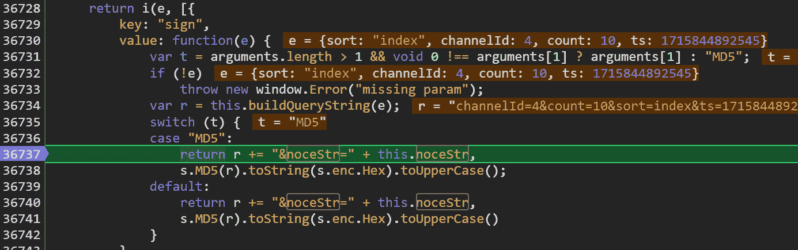

所以我们就懂了，整体加密就是把请求的`url`中的参数经过`buildQueryString`之后，最后末尾在拼接一个`&noceStr=boxonline`进行大写的`md5`即可，我们验证一下

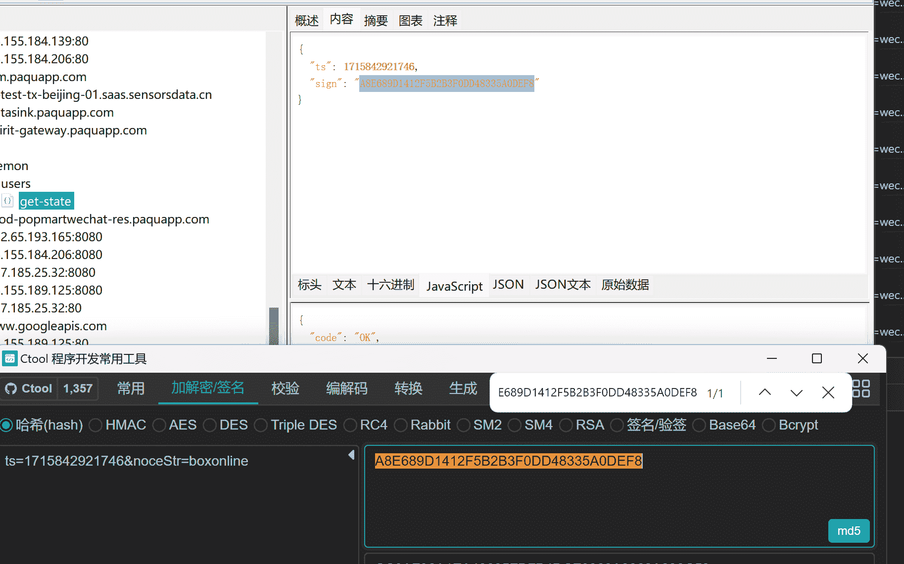

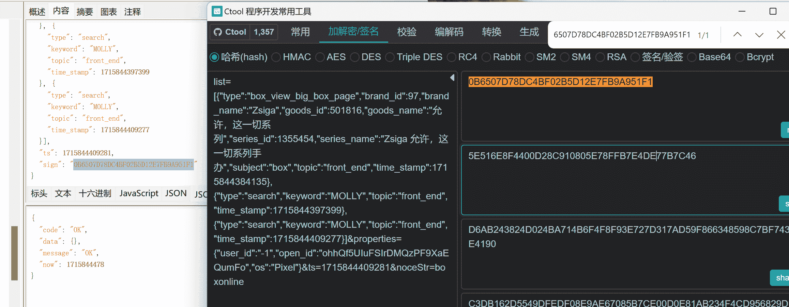

转化一下代码就是

```
def process_event(e):

    # 过滤掉特定的键和空值或未定义的值
    filtered_keys = [t for t in e if e[t] is not None and str(e[t]) != "" and t not in ["session_id", "sign", "charset", "signType", "v"]]
    # 对键进行排序
    sorted_keys = sorted(filtered_keys)

    # 将键值对转换为字符串，如果是对象则JSON序列化
    def serialize_value(t):
        r = e[t]
        if isinstance(r, (dict, list)):  # 假设'object'对应于Python中的字典或列表
            return f"{t}={json.dumps(r,ensure_ascii=False,separators=(',', ':'))}"
        else:
            return f"{t}={r}"

    # 使用map将处理函数应用于排序后的键，然后使用join连接结果
    result = "&".join(map(serialize_value, sorted_keys))
    return result

data = {"ts":1715842921746}
sign =  md5(process_event(data)+"&noceStr=boxonline").upper()
print(sign)
data['sign'] = sign
```

结果也是没问题的，至此关于泡泡玛特的两个参数都分析完毕。

## 结尾

由于我没需求，就不写一些代码进行验证了，自己梳理一下，其实也是很简单的东西，整体过程并不是很难，重在耐心。
