# [Web逆向] 某音`a_bogus`纯算分析

- 原帖: `https://www.52pojie.cn/forum.php?mod=viewthread&tid=1928860`
- 抓取时间: 2026-11-01T22:29:19

## 某音`a_bogus`纯算分析

由于不会补环境，所以只能去搞纯算了

本篇文章可能不是很适合纯新手来看，倒是很适合正在搞纯算的你

jsvmp插桩：


```
"位置 1", "索引m", m, "索引r", r, "值p: ", JSON.stringify(p, function(key, value) {if (value == window) {return undefined} return value})

"位置 2", "索引m", m, "索引r", r, "值p: ", JSON.stringify(p, function(key, value) {if (value == window) {return undefined} return value})
```

在哪定位加密位置就不多说了，网上一大堆呢

直接步入正题

## 5> 参数加密

打开我们的日志，映入眼帘的就是下面这个场景

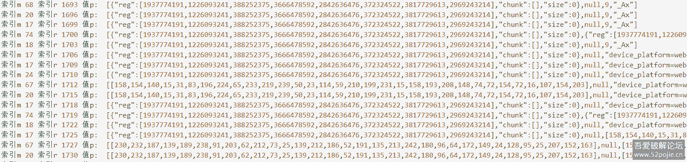

1.png (61.95 KB, 下载次数: 0)

[href="forum.php?mod=attachment&aid=MjcyODMyOXw0Yjk1N2E5Y3wxNzkzNTcyMTU3fDE2ODA4NnwxOTI4ODYw&nothumb=yes" target="_blank"](https://www.52pojie.cn/forum.php?mod=attachment&aid=MjcyODMyOXw0Yjk1N2E5Y3wxNzkzNTcyMTU3fDE2ODA4NnwxOTI4ODYw&nothumb=yes)

2024-10-12 15:13 上传

可以看到`reg`里面有一串数组，最开始后面还没有参数，等到第五行的时候，我们的请求参数出现了

经过了2次不为人知的操作，我们的参数变成了一行数组。

从此处我们就可以得知，这个数组，是参数转化过去的。

所以我们在下面这个索引位置设置条件断点，就可以进入到加密的过程了

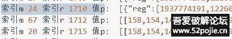

2.png (6.75 KB, 下载次数: 0)

[href="forum.php?mod=attachment&aid=MjcyODMzMHwwNzkyMDE3OHwxNzkzNTcyMTU3fDE2ODA4NnwxOTI4ODYw&nothumb=yes" target="_blank"](https://www.52pojie.cn/forum.php?mod=attachment&aid=MjcyODMzMHwwNzkyMDE3OHwxNzkzNTcyMTU3fDE2ODA4NnwxOTI4ODYw&nothumb=yes)

2024-10-12 15:13 上传

找到加密过程之后自己抠出来或者手动实现都是可以的。

再继续往下看，会发现又经过了`reg`这个数组，然后嗖的一下，出现了一个新的数组

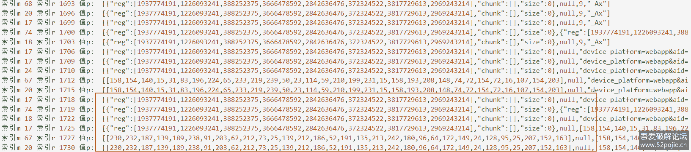

3.png (64.21 KB, 下载次数: 0)

[href="forum.php?mod=attachment&aid=MjcyODMzMXw1OWJkYWJkNXwxNzkzNTcyMTU3fDE2ODA4NnwxOTI4ODYw&nothumb=yes" target="_blank"](https://www.52pojie.cn/forum.php?mod=attachment&aid=MjcyODMzMXw1OWJkYWJkNXwxNzkzNTcyMTU3fDE2ODA4NnwxOTI4ODYw&nothumb=yes)

2024-10-12 15:13 上传

而且这个新数组的上一个地方的末尾，嘿，出现了上面的数组。这就说明下面这个数组是上面数组生成出来的，我这么猜测没有问题吧。

测试一下，果然一样

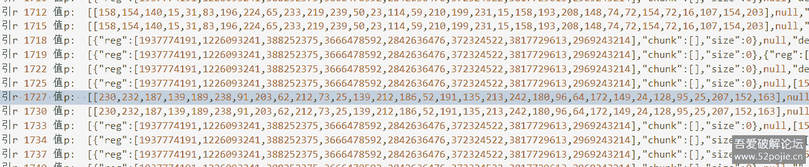

4.png (22.79 KB, 下载次数: 0)

[href="forum.php?mod=attachment&aid=MjcyODMzMnxkZGFhNDE5OXwxNzkzNTcyMTU3fDE2ODA4NnwxOTI4ODYw&nothumb=yes" target="_blank"](https://www.52pojie.cn/forum.php?mod=attachment&aid=MjcyODMzMnxkZGFhNDE5OXwxNzkzNTcyMTU3fDE2ODA4NnwxOTI4ODYw&nothumb=yes)

2024-10-12 15:13 上传

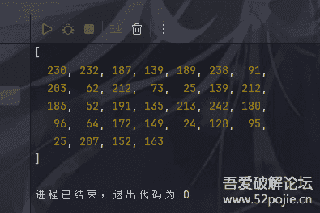

5.png (93.97 KB, 下载次数: 0)

[href="forum.php?mod=attachment&aid=MjcyODMzM3w4ZTE0NTcxY3wxNzkzNTcyMTU3fDE2ODA4NnwxOTI4ODYw&nothumb=yes" target="_blank"](https://www.52pojie.cn/forum.php?mod=attachment&aid=MjcyODMzM3w4ZTE0NTcxY3wxNzkzNTcyMTU3fDE2ODA4NnwxOTI4ODYw&nothumb=yes)

2024-10-12 15:13 上传

至此我们迈出了历史性的一小步

突然有一位靓仔就很奇怪，明明我的操作一样，怎么出来的结果不一样啊？

因为看东西要自己看全面，这个参数的最后还加上了`cus`这三个字符

千万不要全听全信，写教程的也不一定的是对

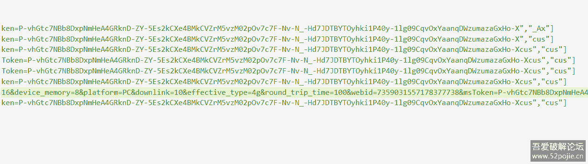

6.png (19.92 KB, 下载次数: 0)

[href="forum.php?mod=attachment&aid=MjcyODMzNHw3Nzc0MDI3N3wxNzkzNTcyMTU3fDE2ODA4NnwxOTI4ODYw&nothumb=yes" target="_blank"](https://www.52pojie.cn/forum.php?mod=attachment&aid=MjcyODMzNHw3Nzc0MDI3N3wxNzkzNTcyMTU3fDE2ODA4NnwxOTI4ODYw&nothumb=yes)

2024-10-12 15:13 上传

有了上面的经验之后，我相信看这篇文章的帅哥美女，已经能下面这个是加密什么的了

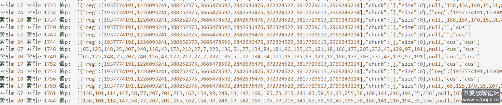

7.png (53.01 KB, 下载次数: 1)

[href="forum.php?mod=attachment&aid=MjcyODMzNXxmZjZkZTJjNXwxNzkzNTcyMTU3fDE2ODA4NnwxOTI4ODYw&nothumb=yes" target="_blank"](https://www.52pojie.cn/forum.php?mod=attachment&aid=MjcyODMzNXxmZjZkZTJjNXwxNzkzNTcyMTU3fDE2ODA4NnwxOTI4ODYw&nothumb=yes)

2024-10-12 15:13 上传

没错，就是加密了`cus`，把`cus`的字符串经过了两次数组转换。

如果没有`post`就只加`cus`，如果有的话就在`post`参数的末尾加上`cus`

这两个参数的加密到这里就完成了

我们得到了两个数组

先放在这里，后面要用。

## 5> UA加密

之前研究过某音的小伙伴一定知道，如果请求的`ua`改变的话，生成的这个加密参数就会失效。

所以呢，`ua`也肯定是校验的一部分。

我们该怎么知道这个`jsvmp`是如何操作`ua`的呢

当然是继续看日志了！

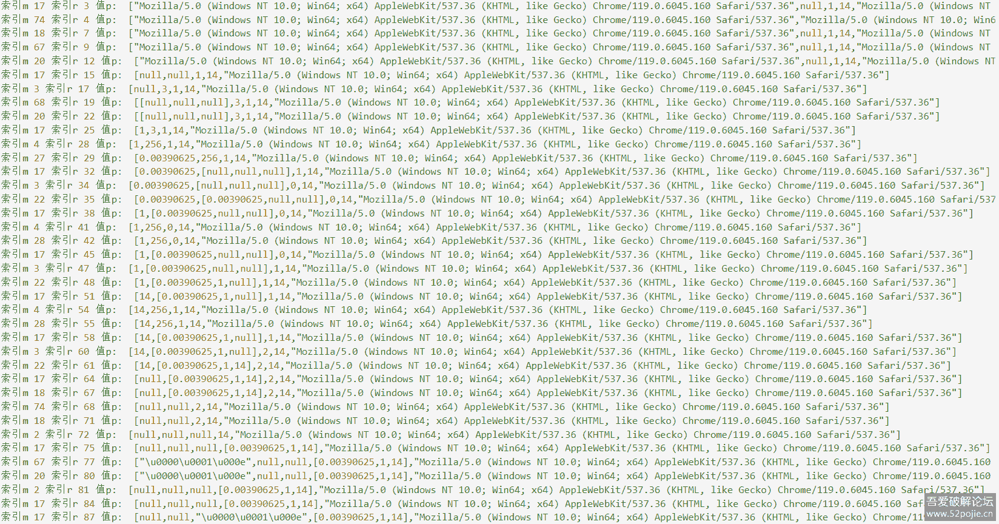

8.png (156.69 KB, 下载次数: 1)

[href="forum.php?mod=attachment&aid=MjcyODMzNnwwOTVkNTMzNXwxNzkzNTcyMTU3fDE2ODA4NnwxOTI4ODYw&nothumb=yes" target="_blank"](https://www.52pojie.cn/forum.php?mod=attachment&aid=MjcyODMzNnwwOTVkNTMzNXwxNzkzNTcyMTU3fDE2ODA4NnwxOTI4ODYw&nothumb=yes)

2024-10-12 15:13 上传

没往下滑几行，就看见了我们亲切的`ua`。

但是好像没对我们的`ua`操作什么，倒是出现了一个奇怪的`unicode`

我们亲切的把它称为小乱码，那这个小乱码是怎么来的呢

看到这个神奇的小数组没有`[0.00390625,1,14]`

我们把他扔到控制台里，然后获取对应字符

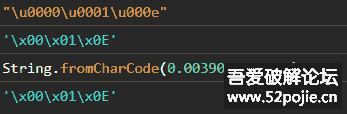

9.png (5.8 KB, 下载次数: 0)

[href="forum.php?mod=attachment&aid=MjcyODMzN3wxMDVmYzhhMnwxNzkzNTcyMTU3fDE2ODA4NnwxOTI4ODYw&nothumb=yes" target="_blank"](https://www.52pojie.cn/forum.php?mod=attachment&aid=MjcyODMzN3wxMDVmYzhhMnwxNzkzNTcyMTU3fDE2ODA4NnwxOTI4ODYw&nothumb=yes)

2024-10-12 15:13 上传

嗯，一模一样啊

什么？你想知道`0.00390625`是怎么来的？

那我就满足你的好奇心

其实是这么得到的

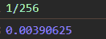

10.png (845 Bytes, 下载次数: 0)

[href="forum.php?mod=attachment&aid=MjcyODMzOHxkYWVlMmFlOHwxNzkzNTcyMTU3fDE2ODA4NnwxOTI4ODYw&nothumb=yes" target="_blank"](https://www.52pojie.cn/forum.php?mod=attachment&aid=MjcyODMzOHxkYWVlMmFlOHwxNzkzNTcyMTU3fDE2ODA4NnwxOTI4ODYw&nothumb=yes)

2024-10-12 15:13 上传

不过这个乱码是有好几个类型的

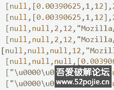

11.png (6.73 KB, 下载次数: 0)

[href="forum.php?mod=attachment&aid=MjcyODMzOXxhZjhiZjg3M3wxNzkzNTcyMTU3fDE2ODA4NnwxOTI4ODYw&nothumb=yes" target="_blank"](https://www.52pojie.cn/forum.php?mod=attachment&aid=MjcyODMzOXxhZjhiZjg3M3wxNzkzNTcyMTU3fDE2ODA4NnwxOTI4ODYw&nothumb=yes)

2024-10-12 15:13 上传

这个倒是无所谓，我就根据第一个来

还没走几步呢，我们的日志又出现新东西了

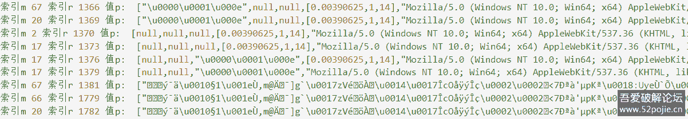

12.png (20.89 KB, 下载次数: 0)

[href="forum.php?mod=attachment&aid=MjcyODM0MHxmNmM0OTRiOHwxNzkzNTcyMTU3fDE2ODA4NnwxOTI4ODYw&nothumb=yes" target="_blank"](https://www.52pojie.cn/forum.php?mod=attachment&aid=MjcyODM0MHxmNmM0OTRiOHwxNzkzNTcyMTU3fDE2ODA4NnwxOTI4ODYw&nothumb=yes)

2024-10-12 15:13 上传

从这日志上来看，我可以大胆地推测，后三行那一堆乱七八糟葫芦蛋糕的东西，是从这里进入生成的

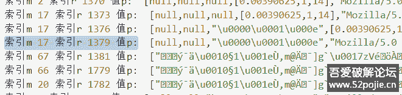

13.png (11.14 KB, 下载次数: 0)

[href="forum.php?mod=attachment&aid=MjcyODM0MXwwMTQ4YTlhZnwxNzkzNTcyMTU3fDE2ODA4NnwxOTI4ODYw&nothumb=yes" target="_blank"](https://www.52pojie.cn/forum.php?mod=attachment&aid=MjcyODM0MXwwMTQ4YTlhZnwxNzkzNTcyMTU3fDE2ODA4NnwxOTI4ODYw&nothumb=yes)

2024-10-12 15:13 上传

为了确定我们的推测，肯定不能光靠眼睛看了

我们去插日志点的位置打上条件断点

`m==17&&r==1379`

重放后一步一步的跟栈，我们会进入一个新的`jsvmp`

进入之后不要慌，我们直接在老地方插上日志点

继续分析

### 6> UA乱码生成

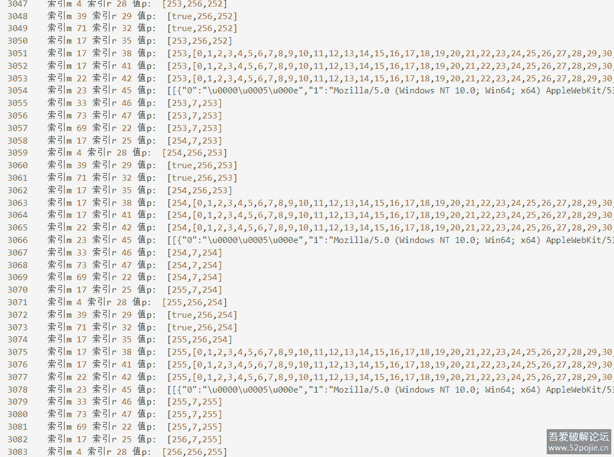

14.png (38.03 KB, 下载次数: 0)

[href="forum.php?mod=attachment&aid=MjcyODM0MnwxMmM3ZjMxNnwxNzkzNTcyMTU3fDE2ODA4NnwxOTI4ODYw&nothumb=yes" target="_blank"](https://www.52pojie.cn/forum.php?mod=attachment&aid=MjcyODM0MnwxMmM3ZjMxNnwxNzkzNTcyMTU3fDE2ODA4NnwxOTI4ODYw&nothumb=yes)

2024-10-12 15:14 上传

我们刚进入这个`jsvmp`，就发现这个日志跑了好多东西

慢慢往下滑，滑到`256`这里

可以发现是生成了长度为`256`的空数组

搞纯算，不能光看，还得写

我们直接实现一下

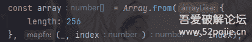

15.png (34.65 KB, 下载次数: 0)

[href="forum.php?mod=attachment&aid=MjcyODM0M3xiYTgwMTFkNnwxNzkzNTcyMTU3fDE2ODA4NnwxOTI4ODYw&nothumb=yes" target="_blank"](https://www.52pojie.cn/forum.php?mod=attachment&aid=MjcyODM0M3xiYTgwMTFkNnwxNzkzNTcyMTU3fDE2ODA4NnwxOTI4ODYw&nothumb=yes)

2024-10-12 15:14 上传

然后继续看

这里我就直接把我当时的记录放上来吧

然后给大家演示几个

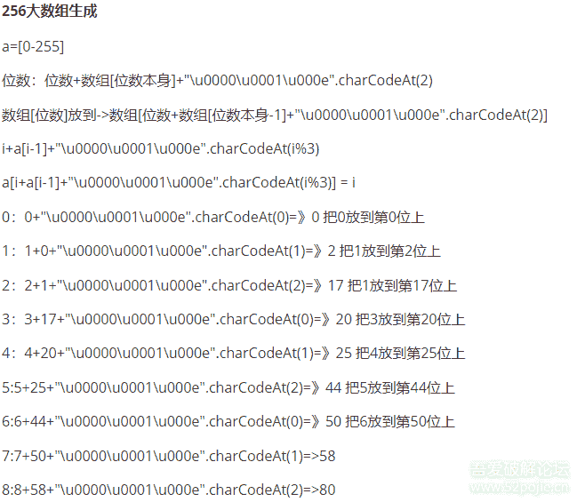

16.png (87 KB, 下载次数: 0)

[href="forum.php?mod=attachment&aid=MjcyODM0NHxhOTc1NmRjMnwxNzkzNTcyMTU3fDE2ODA4NnwxOTI4ODYw&nothumb=yes" target="_blank"](https://www.52pojie.cn/forum.php?mod=attachment&aid=MjcyODM0NHxhOTc1NmRjMnwxNzkzNTcyMTU3fDE2ODA4NnwxOTI4ODYw&nothumb=yes)

2024-10-12 15:14 上传

大家看不懂很正常，因为我现在都有点看不懂了

我就演示一个给大家看看，你们多加油

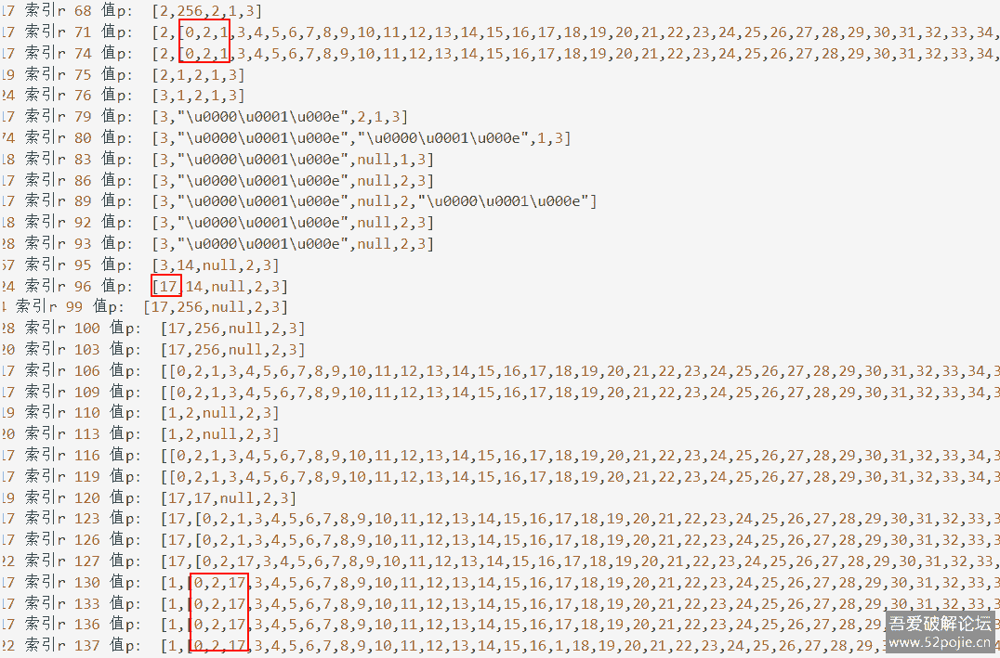

17.png (30 KB, 下载次数: 0)

[href="forum.php?mod=attachment&aid=MjcyODM0NXxiYjcyMjliY3wxNzkzNTcyMTU3fDE2ODA4NnwxOTI4ODYw&nothumb=yes" target="_blank"](https://www.52pojie.cn/forum.php?mod=attachment&aid=MjcyODM0NXxiYjcyMjliY3wxNzkzNTcyMTU3fDE2ODA4NnwxOTI4ODYw&nothumb=yes)

2024-10-12 15:14 上传

因为我们生成了`256`位的数组，肯定不是白生成的

要往里面填充东西的

我截图的是演示的第三位

为什么第一个红框的第三位是`1`呢

正常来说应该是`0,1,2,3`，应该是`2`才对

实际上就是因为前面在计算数值的时候，会把算之前的位数，放到算出来的地方

比如，从日志可以看出

`2+1=3`

`"\u0000\u0001\u000e".charCodeAt(2)=14`

`3+14=17`

算出来`17`之后，把第三位替换成`17`，然后把`1`放到第`17`位上

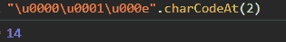

18.png (1.41 KB, 下载次数: 0)

[href="forum.php?mod=attachment&aid=MjcyODM0NnxlYTA0ZGQxN3wxNzkzNTcyMTU3fDE2ODA4NnwxOTI4ODYw&nothumb=yes" target="_blank"](https://www.52pojie.cn/forum.php?mod=attachment&aid=MjcyODM0NnxlYTA0ZGQxN3wxNzkzNTcyMTU3fDE2ODA4NnwxOTI4ODYw&nothumb=yes)

2024-10-12 15:14 上传

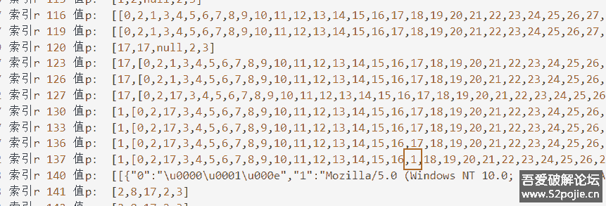

19.png (16.03 KB, 下载次数: 0)

[href="forum.php?mod=attachment&aid=MjcyODM0N3wyNGFmYWYyN3wxNzkzNTcyMTU3fDE2ODA4NnwxOTI4ODYw&nothumb=yes" target="_blank"](https://www.52pojie.cn/forum.php?mod=attachment&aid=MjcyODM0N3wyNGFmYWYyN3wxNzkzNTcyMTU3fDE2ODA4NnwxOTI4ODYw&nothumb=yes)

2024-10-12 15:20 上传

就是这样循环的，直到最后一位

然后我们得到了一个新数组

接着，就是新的一部分

新部分就是我们的上面的数组，跟我们亲爱的`UA`，进行一些不为人知的交易

这里我就用文字描述一下吧

把新数组设为`a`


`a[0]+a[1]`
`0+218 => 218`
`a[1]=a[218]`
`"Mozilla/5.0 (Windows NT 10.0; Win64; x64) AppleWebKit/537.36 (KHTML, like Gecko) Chrome/119.0.6045.160 Safari/537.36".charCodeAt(0)`
`77 a[220]=>216 2+218=>220`
`77^216=>149`
`String.fromCharCode(149)`
`218+a[2]=>235`
`a[235]=>127`
分割线
`a[2]=127`
`"Mozilla/5.0 (Windows NT 10.0; Win64; x64) AppleWebKit/537.36 (KHTML, like Gecko) Chrome/119.0.6045.160 Safari/537.36".charCodeAt(1)`
`127+17=>144`
`111 ^a[144]233=>134`
`String.fromCharCode(134)`
`235+a[3]=>255`
`a[255]=>149`
`a[3]=149`
`255+a[4]=>280 280-256=24`
我上面的记录，都是可以从日志里看出来的
因为这个数组太长了不好截图演示，就这样看吧
UA经过这一系列的加密，最后生成了一个超级大的乱码
5> UA长字符串
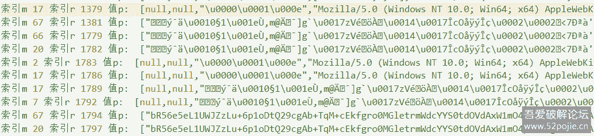
20.png (22.19 KB, 下载次数: 1)
[href="forum.php?mod=attachment&aid=MjcyODM0OHwxNTc0MWM3N3wxNzkzNTcyMTU3fDE2ODA4NnwxOTI4ODYw&nothumb=yes" target="_blank"](https://www.52pojie.cn/forum.php?mod=attachment&aid=MjcyODM0OHwxNTc0MWM3N3wxNzkzNTcyMTU3fDE2ODA4NnwxOTI4ODYw&nothumb=yes)
2024-10-12 15:20 上传
这次又没走几步，就变成了一大串字符串了
好家伙，这下聪明的你肯定知道怎么搞了
我们去定位生成位置的上面，然后单步调试进入一个新的`jsvmp`
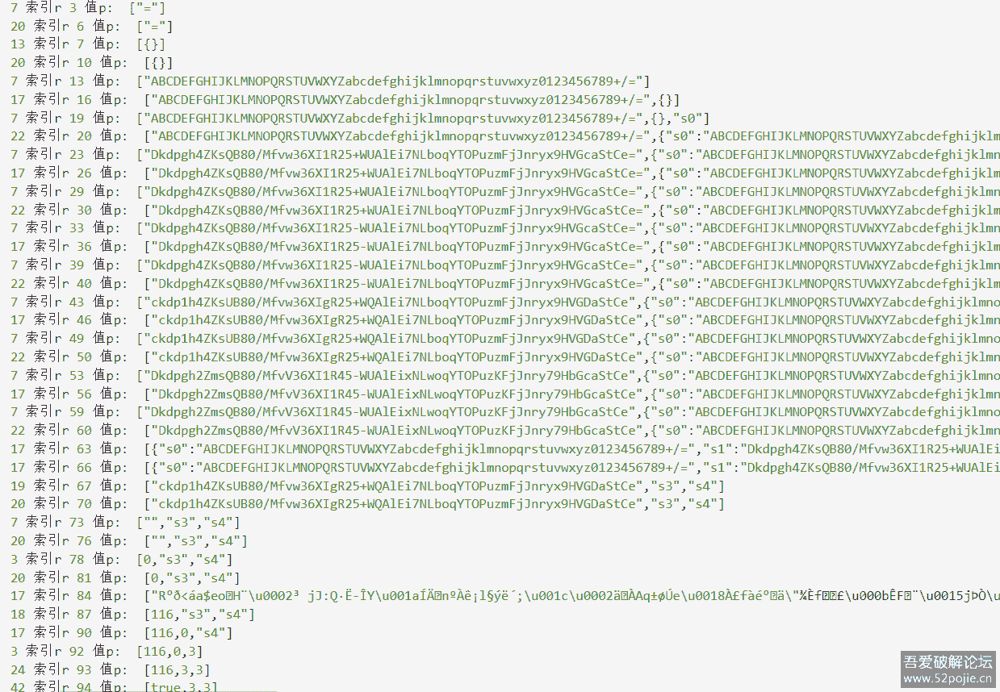
21.png (87.62 KB, 下载次数: 0)
[href="forum.php?mod=attachment&aid=MjcyODM0OXw5N2MzNmNjN3wxNzkzNTcyMTU3fDE2ODA4NnwxOTI4ODYw&nothumb=yes" target="_blank"](https://www.52pojie.cn/forum.php?mod=attachment&aid=MjcyODM0OXw5N2MzNmNjN3wxNzkzNTcyMTU3fDE2ODA4NnwxOTI4ODYw&nothumb=yes)
2024-10-12 15:20 上传
我们又要开始新的日志观察了，写到这里我已经有点疲惫了
但我还是得继续写！
这里的部分其实还是之前`xb`那样，4位一组，如此遍历


```
s.chatAt(0) > 18

8

2315783&258048

217088 >> 12

53

2315783&4032

1536 >> 6

24

2315783&63

7 >> 0

7
```

下面我来解释一下

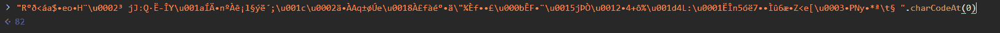

这个大乱码取第一位的ascii码=82

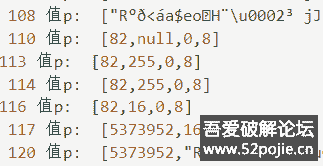

然后82第二位取ascii码 = 176

`5373952^45056 = 5419008`

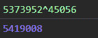

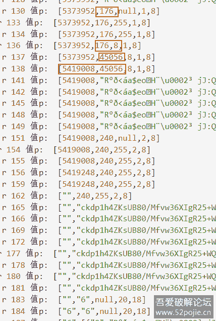

然后取ascii第三位 得 240

`5419008^240=5419248`

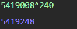

`5419248&16515072 = 5242880`

`5242880 >>18=20`

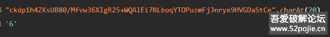

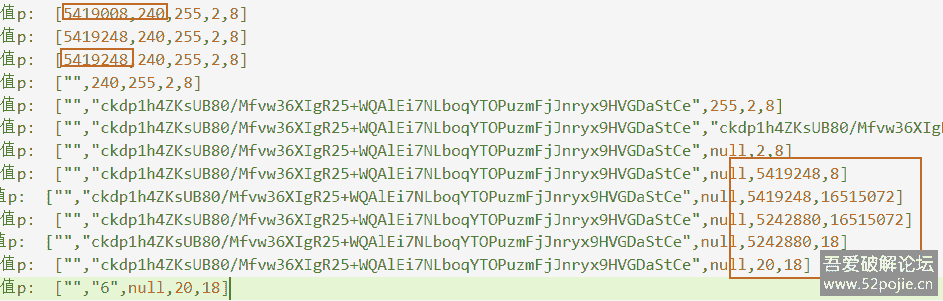

第一位就这样推出来了，剩下的就靠宝贝你自己了

搞纯算没有耐心是不行的哦

静下心来慢慢看日志，总有一天能搞出来

然后我们长字符串就生成出来了！神奇吧

简直是一模一样

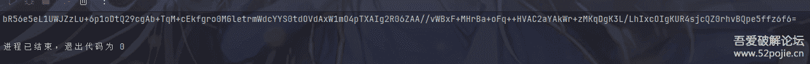

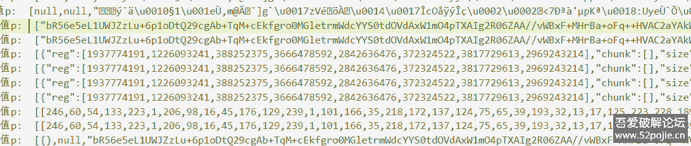

然后又对我们的长字符串进行了一个数组的生成，这里直接用我们上面写好的代码就可以

下面就到了我们的环境监测点了

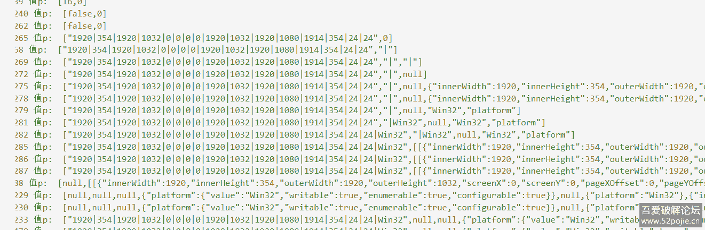

### 环境检测点生成

这里倒是没什么难的，其实就是把每一位字符串的ascii码放到了数组里

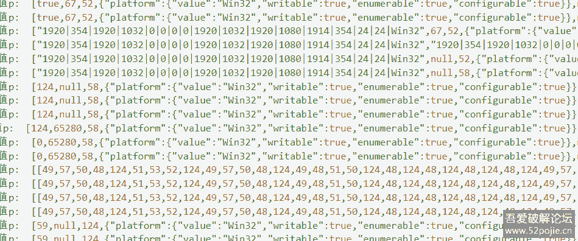

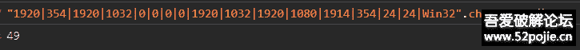

自己写一下就可以

### 炒鸡大数组生成

再往下走，映入眼帘的就是一个炒鸡大的数组了

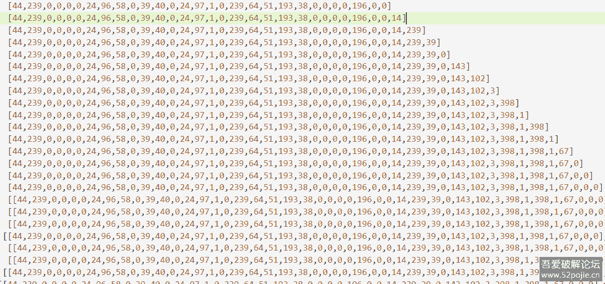

这个大数组可谓是集百家之长，东边偷一点，西边偷一点。

不过我们从日志上来分析，还是有迹可循的

就比如96,58这两个数字

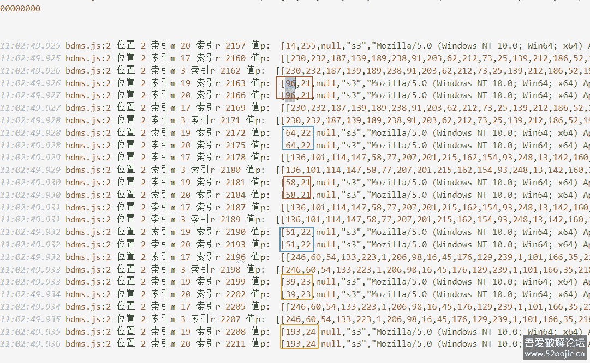

从这个图上是不是就能看出来

是第一个数组的21位，第二个数组的21位

后面的64，51 就是第二个数组的22位，第二个数组的22位

剩下的就麻烦您多费心了，静下心来看日志，一会就搞出来了

里面有固定的也有不固定的，可以抓两次日志对比着来

加油！

接着我们把写好的数组和之前的环境ascii码数组组合起来

在我们组合起来之前呢，我们要把大数组的每一位进行异或，得到的一个结果，放到我们环境数组的末尾

然后再把这俩数组合起来

得到了最终的超级无敌宇宙爆炸大数组

### 最终之战

这篇文章马上就要步入尾声了，虽然写的不是很详细，但是我觉得一定对你有帮助

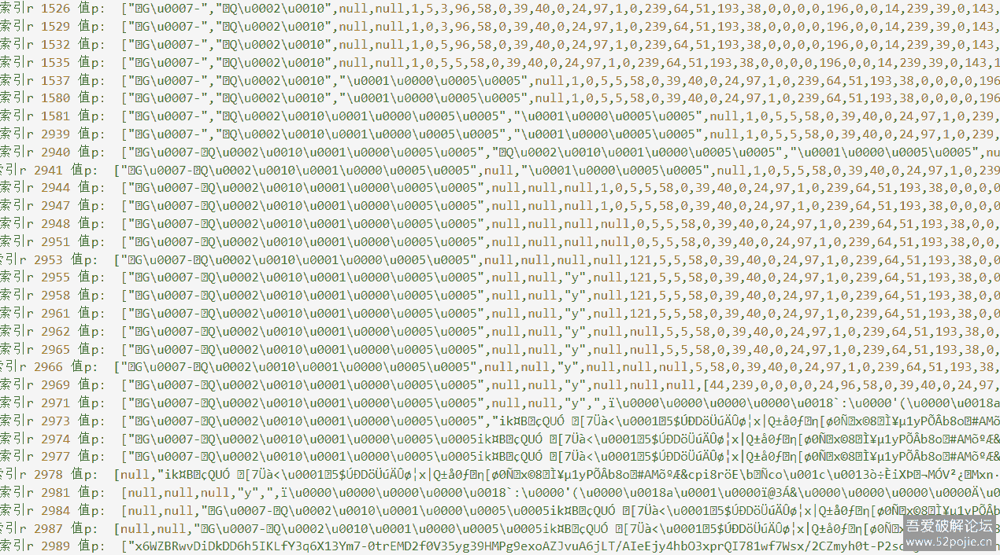

从上面的日志来看，我们前面生成了3次乱码，然后合并

接着又把三次合并的乱码跟一个乱码合并

再合并之前呢，这个乱码是先由我们的超级无敌宇宙爆炸大数组，`String.fromCharCode`生成

然后经过上述提到的UA乱码生成写的代码，最终加密得到一个乱码

最后，我们把这一个乱码经过上文提到的UA长字符串生成

就得到了我们的`a_bogus`！！！！

### 成果展示！

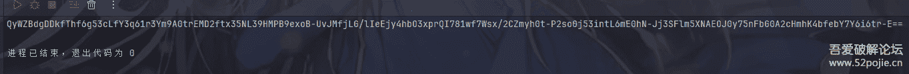

### 不重要的话

在搞纯算的时候，网上也不乏有各种教程，但是有的教程还不如不发出来，因为太误导人了

不过大部分大佬写的教程还都是很棒很详细的

如果你在我这里看到的芝士还不够你搞出来纯算

你还可以利用搜索引擎去寻找一下别人的教程

集百家之长，这样一定可以完成ab纯算
