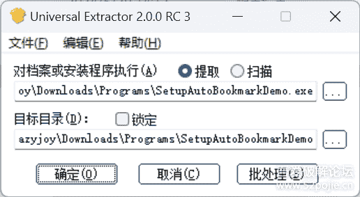
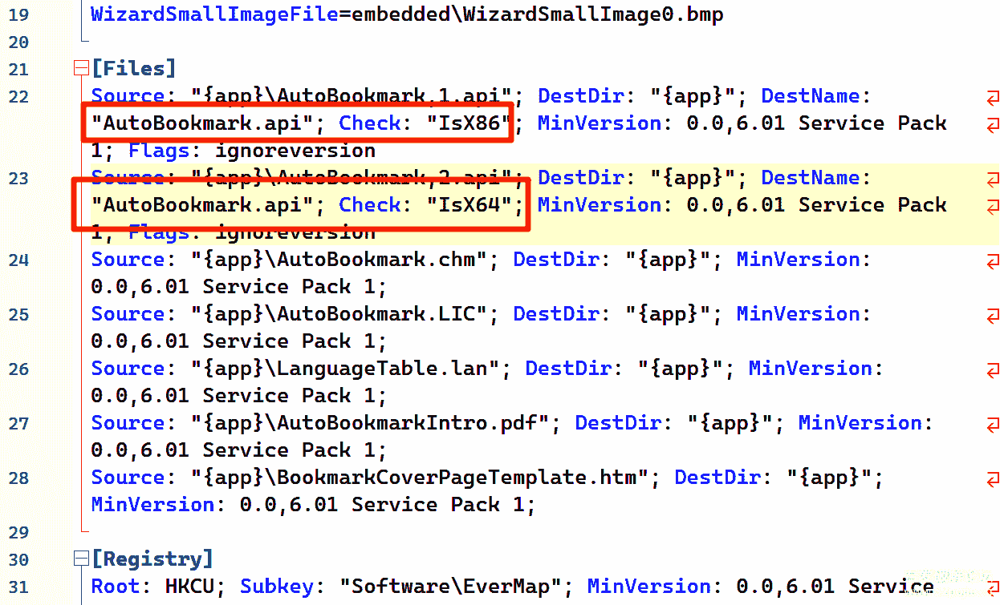
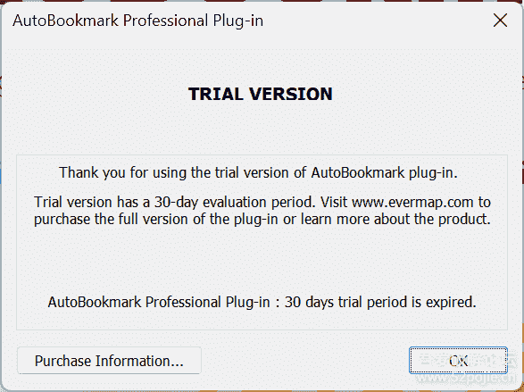
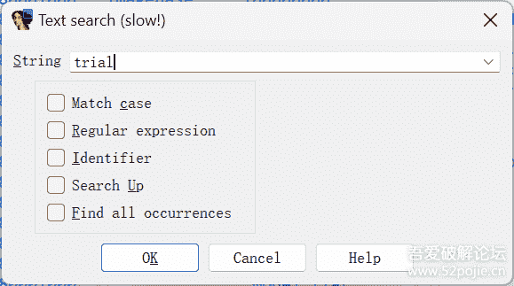
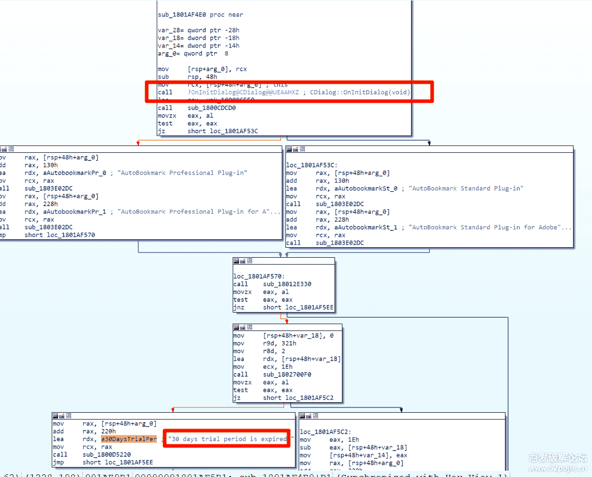
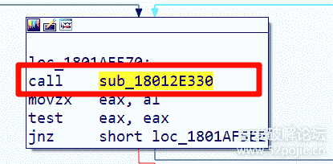
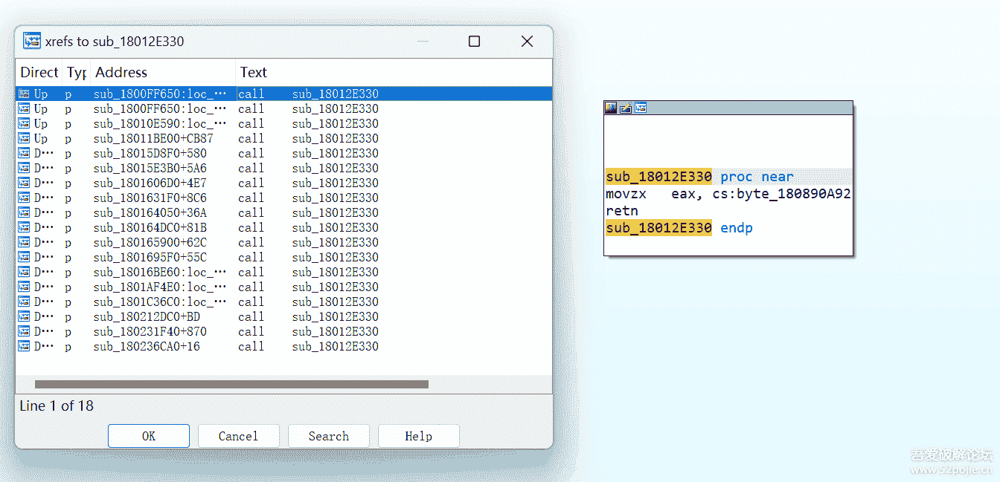
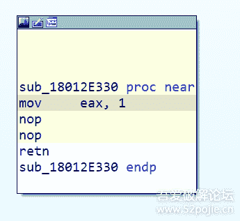

# [原创] 某PDF插件AutoBookmark跳过试用提示

- 原帖: https://www.52pojie.cn/forum.php?mod=viewthread&tid=1929391
- 抓取时间: 2026-11-01T22:29:18

## 提取文件

使用`UniExtract`分析安装包，提取文件。

1.png (45.49 KB, 下载次数: 6)

[href="forum.php?mod=attachment&aid=MjY5ODM3MXw2ZTVlZWMyY3wxNzkzNTcyMTU1fDE2ODA4NnwxOTI5Mzkx&nothumb=yes" target="_blank"](https://www.52pojie.cn/forum.php?mod=attachment&aid=MjY5ODM3MXw2ZTVlZWMyY3wxNzkzNTcyMTU1fDE2ODA4NnwxOTI5Mzkx&nothumb=yes)

2024-5-29 14:47 上传

2.png (42.62 KB, 下载次数: 2)

[href="forum.php?mod=attachment&aid=MjY5ODM2M3wyYzM1ZDc2ZnwxNzkzNTcyMTU1fDE2ODA4NnwxOTI5Mzkx&nothumb=yes" target="_blank"](https://www.52pojie.cn/forum.php?mod=attachment&aid=MjY5ODM2M3wyYzM1ZDc2ZnwxNzkzNTcyMTU1fDE2ODA4NnwxOTI5Mzkx&nothumb=yes)

2024-5-29 14:47 上传

也可以安装后直接在安装路径中提取，默认在`{AcrobatFolder}\plug_ins\AutoBookmark`下。

根据安装脚本，可知插件分32位和64位两个版本。

3.png (202.45 KB, 下载次数: 4)

[href="forum.php?mod=attachment&aid=MjY5ODM2NHwxNTJkNjBmYXwxNzkzNTcyMTU1fDE2ODA4NnwxOTI5Mzkx&nothumb=yes" target="_blank"](https://www.52pojie.cn/forum.php?mod=attachment&aid=MjY5ODM2NHwxNTJkNjBmYXwxNzkzNTcyMTU1fDE2ODA4NnwxOTI5Mzkx&nothumb=yes)

2024-5-29 14:47 上传

## 使用IDA进行分析

首先安装插件并使用，可以发现试用版弹窗如下。

0.png (26.38 KB, 下载次数: 3)

[href="forum.php?mod=attachment&aid=MjY5ODM3MHxlOTIyZjZkYnwxNzkzNTcyMTU1fDE2ODA4NnwxOTI5Mzkx&nothumb=yes" target="_blank"](https://www.52pojie.cn/forum.php?mod=attachment&aid=MjY5ODM3MHxlOTIyZjZkYnwxNzkzNTcyMTU1fDE2ODA4NnwxOTI5Mzkx&nothumb=yes)

2024-5-29 14:47 上传

搜索字符串trial，并不断用`ctrl+T`寻找下一个，找到可能的弹窗流程代码。

4.png (25.06 KB, 下载次数: 3)

[href="forum.php?mod=attachment&aid=MjY5ODM2NXw1ZGMxZGEyNnwxNzkzNTcyMTU1fDE2ODA4NnwxOTI5Mzkx&nothumb=yes" target="_blank"](https://www.52pojie.cn/forum.php?mod=attachment&aid=MjY5ODM2NXw1ZGMxZGEyNnwxNzkzNTcyMTU1fDE2ODA4NnwxOTI5Mzkx&nothumb=yes)

2024-5-29 14:47 上传

5.png (211.84 KB, 下载次数: 3)

[href="forum.php?mod=attachment&aid=MjY5ODM2NnxkYTk4YjYyZXwxNzkzNTcyMTU1fDE2ODA4NnwxOTI5Mzkx&nothumb=yes" target="_blank"](https://www.52pojie.cn/forum.php?mod=attachment&aid=MjY5ODM2NnxkYTk4YjYyZXwxNzkzNTcyMTU1fDE2ODA4NnwxOTI5Mzkx&nothumb=yes)

2024-5-29 14:47 上传

可以发现`loc_1801AF570`代码段中调用`sub_18012E330`代码段进行操作，使用了`jnz`指令进行了跳转。进入`sub_18012E330`代码段。

6.png (18.23 KB, 下载次数: 4)

[href="forum.php?mod=attachment&aid=MjY5ODM2N3wzYWRiMTNlZXwxNzkzNTcyMTU1fDE2ODA4NnwxOTI5Mzkx&nothumb=yes" target="_blank"](https://www.52pojie.cn/forum.php?mod=attachment&aid=MjY5ODM2N3wzYWRiMTNlZXwxNzkzNTcyMTU1fDE2ODA4NnwxOTI5Mzkx&nothumb=yes)

2024-5-29 14:47 上传

可以发现`sub_18012E330`代码段有多处调用。

7.png (101.12 KB, 下载次数: 4)

[href="forum.php?mod=attachment&aid=MjY5ODM2OHw2ZDg4ZTA0NnwxNzkzNTcyMTU1fDE2ODA4NnwxOTI5Mzkx&nothumb=yes" target="_blank"](https://www.52pojie.cn/forum.php?mod=attachment&aid=MjY5ODM2OHw2ZDg4ZTA0NnwxNzkzNTcyMTU1fDE2ODA4NnwxOTI5Mzkx&nothumb=yes)

2024-5-29 14:47 上传

这里将`exa`的值置为1，使`loc_1801AF570`代码段中的`jnz`指令能始终跳转。

8.png (16.9 KB, 下载次数: 4)

[href="forum.php?mod=attachment&aid=MjY5ODM2OXw0YTAyZjFmM3wxNzkzNTcyMTU1fDE2ODA4NnwxOTI5Mzkx&nothumb=yes" target="_blank"](https://www.52pojie.cn/forum.php?mod=attachment&aid=MjY5ODM2OXw0YTAyZjFmM3wxNzkzNTcyMTU1fDE2ODA4NnwxOTI5Mzkx&nothumb=yes)

2024-5-29 14:47 上传

导出修改后文件。

## 测试运行

将修改后文件替换到安装目录下，发现插件使用时不再跳出试用提示了。

## 成品测试

32位修改思路类似，在此不再赘述。成品文件仅在证明本文真实性，仅做逆向学习使用，请勿用作其他目的，验证完毕后请主动删除相关文件。

[href="forum.php?mod=attachment&aid=MjY5ODM3M3wzOTJiM2I1MXwxNzkzNTcyMTU1fDE2ODA4NnwxOTI5Mzkx" target="_blank"](https://www.52pojie.cn/forum.php?mod=attachment&aid=MjY5ODM3M3wzOTJiM2I1MXwxNzkzNTcyMTU1fDE2ODA4NnwxOTI5Mzkx)

(108 Bytes, 下载次数: 274)

2024-5-29 14:59 上传

点击文件名下载附件

下载积分: 吾爱币 -1 CB
