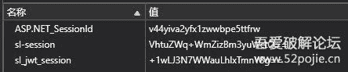

# [Web逆向] 雷池WAF逆向思路

- 原帖: https://www.52pojie.cn/forum.php?mod=viewthread&tid=1930242
- 抓取时间: 2026-11-01T22:29:15

> 
url : aHR0cHM6Ly93d3cubWNjMTcuY24vRHluYW1pY3MvbGlzdC5hc3B4

## 起因
前两天我朋友给我发了一个网站，说访问的时候提示443的SSL问题,我点进去一看这不正常的吗，看见左上角的五矿,我心想这网上全是教程了，就没必要搞了吧，但是我换到浏览器打开一看，有一个校验环境的过程


image.png (31.54 KB, 下载次数: 6)

[href="forum.php?mod=attachment&aid=MjY5OTE0MXw2NDIwODdjMnwxNzkzNTcyMTUyfDE2ODA4NnwxOTMwMjQy&nothumb=yes" target="_blank"](https://www.52pojie.cn/forum.php?mod=attachment&aid=MjY5OTE0MXw2NDIwODdjMnwxNzkzNTcyMTUyfDE2ODA4NnwxOTMwMjQy&nothumb=yes)

2024-5-31 16:52 上传

## DevTool检测
尝试F12打开控制台，抓包看一下,结果提示请关闭 `Devtools`，然后刷新页面

看来是有控制台检测，根据抓到的包来看，是卡在了`sdk.js`的位置，那就直接本地替换这个文件,把检测点去掉，这里尝试直接在`sdk.js`中搜索`DevTool`直接搜索到了一个方法

```
isDevToolOpened: function() {
    return {
        opened: d,
        opening: g
    }
}
```

看起来这个`d`和`g`是控制台开启的状态，在下面不远的地方看到了定义了这两个变量，默认值是`false`，代表的应该是关闭状态。

```
let d = !1
  , g = !1;
u[l(376)]((e=>{
    // e && (d = !0),
    // g = e 
}
```

代码走到`u[l(367)]`的位置，可以看到是添加了一个事件监听器，开启了控制台之后会把这两个变量修改成`true`也就是被检测出来了

直接把代码注释掉，成功的过了检测

在校验完成过后会出现三个`cookie`



微信截图_20240531142620.png (12.19 KB, 下载次数: 4)

[href="forum.php?mod=attachment&aid=MjY5OTE0MnwxZWMzMGE4NXwxNzkzNTcyMTUyfDE2ODA4NnwxOTMwMjQy&nothumb=yes" target="_blank"](https://www.52pojie.cn/forum.php?mod=attachment&aid=MjY5OTE0MnwxZWMzMGE4NXwxNzkzNTcyMTUyfDE2ODA4NnwxOTMwMjQy&nothumb=yes)

2024-5-31 16:52 上传

### cookie的生成逻辑

### 猜想
过完检测后，完整的跑完一次`cookie`生成，根据抓到的包来看，初步的流程猜想：

- 请求`list`接口 -> 获取第一个`cookie` : `sl-session`
- 获取`sdk.js`文件， 在这里面一定做了一些操作
- 请求`seed`接口 -> 获取`seed`
- 请求`inspect`接口 -> 获取`jwt`
- 请求`list`接口 -> 获取第二个`cookie` : `sl_jwt_session`

需要补充的是，在第3步获取`seed`的请求中，携带了三个参数

```
once_id: cfc561a57ff747b49fc230bc1983c1da_5
v: 1.0.0
hints: webdriver,webDriverValue,vendor,headless,languages,permHook,globalThis
```

经过多次验证，`v`和`hints`都是写死的内容，只有`once_id`是变化的，那么这个`once_id`就只能是在前面的`sdk.js`中生成的或者是`list`返回的，全局搜索之后果然在第一次`list`返回的内容中找到了`once_id`

而第四步中携带的参数`seed`就是第三步请求返回的，获得`jwt`之后，将`jwt`设置为名称为`sl_waf_recap`的`cookie`，请求第五步即可

到这里就是`cookie`的大概逻辑了

### inspact的body加密
分析了上面的逻辑可以发现，前三步都是没有任何难度的请求，而第四步中有一个加密的请求体。

通过看`seed`和`inspact`的调用栈，可以看出都是`oe`结尾的，可以猜测这个`oe`应该是和发送请求有一些关系，往前面则是同名的`inspact`方法

`xhr`断点找到请求`inspact`的位置，跟调用栈回到`inspact`方法中，可以看到`body`实际上就是`n.ciphertext["toString"]()`，这个语法很容易想到`AES`加密。

而且在上面也看到了一段代码

```
return q[n(467)](JSON[n(481)](e), i, {
    iv: o,
    padding: Q
})
```

不说一定，大概率是熟悉的`AES`的`CBC`模式了。

走一遍`inspect`方法的逻辑，实际上是将`seed`后面补0填充到16位，并使用`Utf8.parse`处理后作为`key`

而`iv`则是`Utf8.parse`处理`1234567890123456`固定值

`padding`的`Q`向上看可以看到这样一段代码

```
!function(e, t) {
    var n;
    e.exports = (n = D(),
        X(),
        n.pad.Pkcs7
    )
}(K);
var Q = a(K.exports)
```

很明显，`Q`就是`Pkcs7`

经过验证，这个`AES`就是原生的，而加密的字典中也只有`salt`是会改变的，其他的全部写死都是没有问题的

### salt
解决了加密的逻辑，回来看一下`salt`是怎么出来的

在`inspect`中可以看到，当前`salt`的值是`20702`，`seed`是`7NzPy5ID`，向上跟栈，发现在调用`inspect`之前出现了`20702`的数字，

```
let a = function(e, t=20) {
  const n = te;
    for (var r = 0; r 
```

手动解混淆,这就是生产`salt`的逻辑了。

到这里为止，所有的加密都已经解决了，按照顺序请求接口即可获得`cookie`，另外通过纯`py`协程来请求，同时请求20个用时不到6秒钟，速度上还是可以的

## 结束
技术无罪，请勿用于任何非法用途，文章内不提供任何成品代码，思路仅供学习。原创不易。转载请注明出处
