# [Web逆向] 【汉化教程】谷歌拓展汉化

- 原帖：<https://www.52pojie.cn/forum.php?mod=viewthread&tid=1930991>
- 抓取时间：2026-11-01T22:29:11

PS：其实不单单是谷歌扩展、其他扩展也是可以的，比如 edge、火狐、油猴也差不多。

## 思路

找到文字展示的位置 --> 翻译替换

## 找位置

### 1、找拓展存储位置

`image.png`（106.22 KB，下载次数：5） [附件下载](https://www.52pojie.cn/forum.php?mod=attachment&aid=MjY5OTY1M3xmNTVmNWE5YXwxNzkzNTcyMTQ4fDE2ODA4NnwxOTMwOTkx&nothumb=yes)（2024-6-3 14:29 上传）

`image (1).png`（158.06 KB，下载次数：4） [附件下载](https://www.52pojie.cn/forum.php?mod=attachment&aid=MjY5OTY1Mnw1YzMzODllM3wxNzkzNTcyMTQ4fDE2ODA4NnwxOTMwOTkx&nothumb=yes)（2024-6-3 14:29 上传）

打包，放到适合自己修改的区域

`image (2).png`（35.88 KB，下载次数：1） [附件下载](https://www.52pojie.cn/forum.php?mod=attachment&aid=MjY5OTY1MXw1YTE0NWQzY3wxNzkzNTcyMTQ4fDE2ODA4NnwxOTMwOTkx&nothumb=yes)（2024-6-3 14:29 上传）

有些拓展没有上传到谷歌扩展商店，大家可以自己去寻找，比如在 github 上去寻找

### 2、找相关文件

找标识，这里以 `SPLIT` 为例。

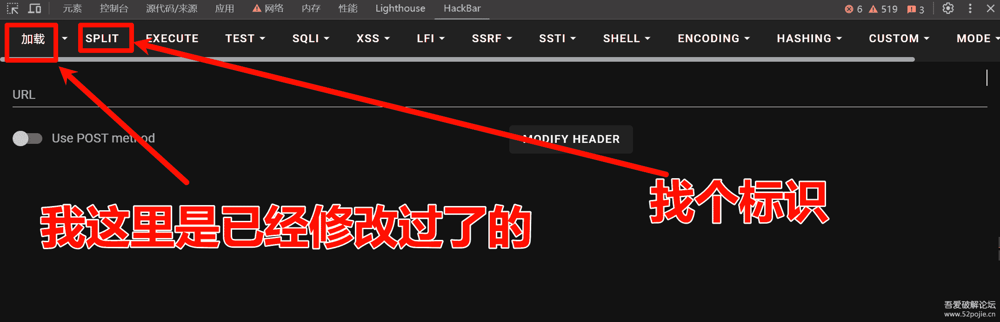

`image (3).png`（136.02 KB，下载次数：3） [附件下载](https://www.52pojie.cn/forum.php?mod=attachment&aid=MjY5OTY1MHw4NmQ5ZWVlZXwxNzkzNTcyMTQ4fDE2ODA4NnwxOTMwOTkx&nothumb=yes)（2024-6-3 14:29 上传）

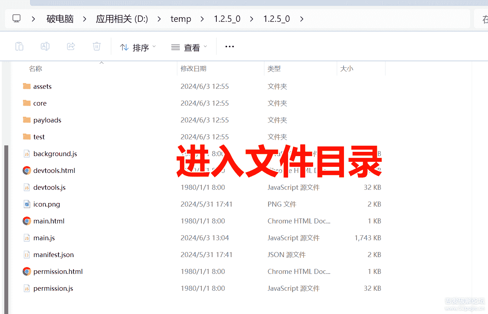

`image (4).png`（95.29 KB，下载次数：2） [附件下载](https://www.52pojie.cn/forum.php?mod=attachment&aid=MjY5OTY0OXwxNjA2OTczNnwxNzkzNTcyMTQ4fDE2ODA4NnwxOTMwOTkx&nothumb=yes)（2024-6-3 14:29 上传）

猜一下哪个文件可能是展示文字的文件。首先排除太小的文件，比如一二 KB 的；接着进入寻找，没有找到则换一个文件寻找。

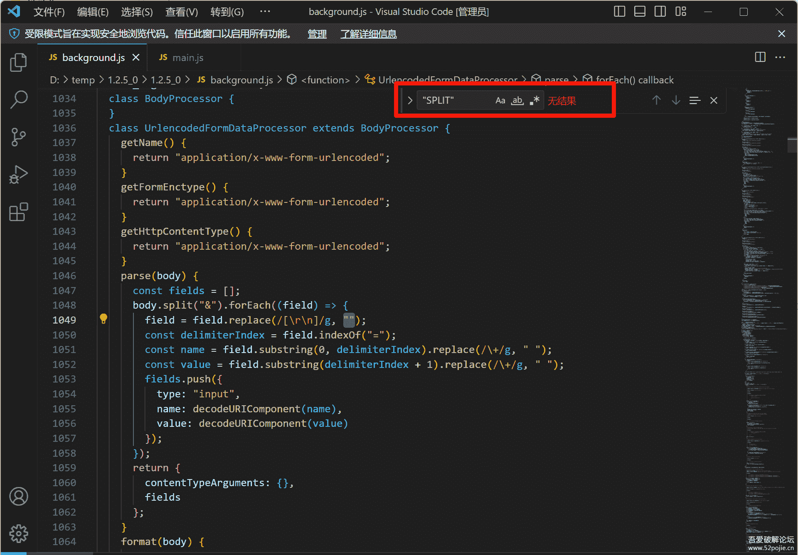

`image (5).png`（378.95 KB，下载次数：2） [附件下载](https://www.52pojie.cn/forum.php?mod=attachment&aid=MjY5OTY0OHw2NDllMDYwZnwxNzkzNTcyMTQ4fDE2ODA4NnwxOTMwOTkx&nothumb=yes)（2024-6-3 14:29 上传）

看着相关代码，可以猜测是这里了

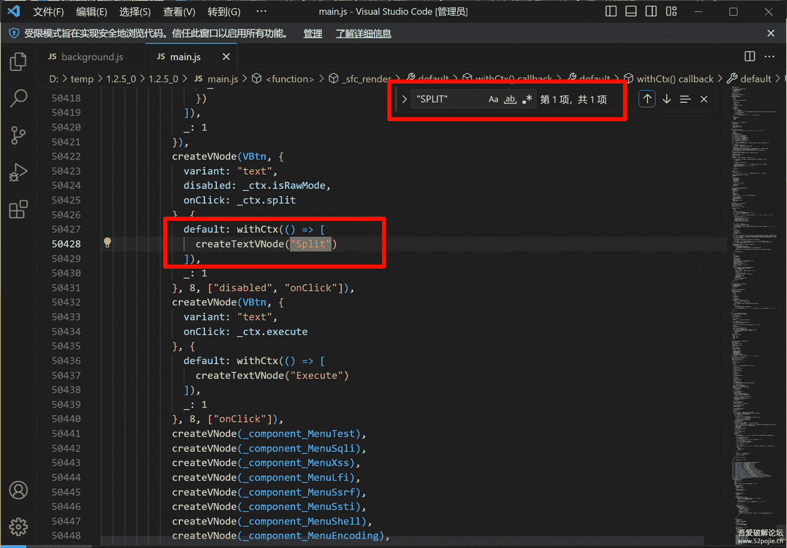

`image (6).png`（377.75 KB，下载次数：2） [附件下载](https://www.52pojie.cn/forum.php?mod=attachment&aid=MjY5OTY0N3xkOTg4MDM2YnwxNzkzNTcyMTQ4fDE2ODA4NnwxOTMwOTkx&nothumb=yes)（2024-6-3 14:29 上传）

## 翻译汉化

### 翻译

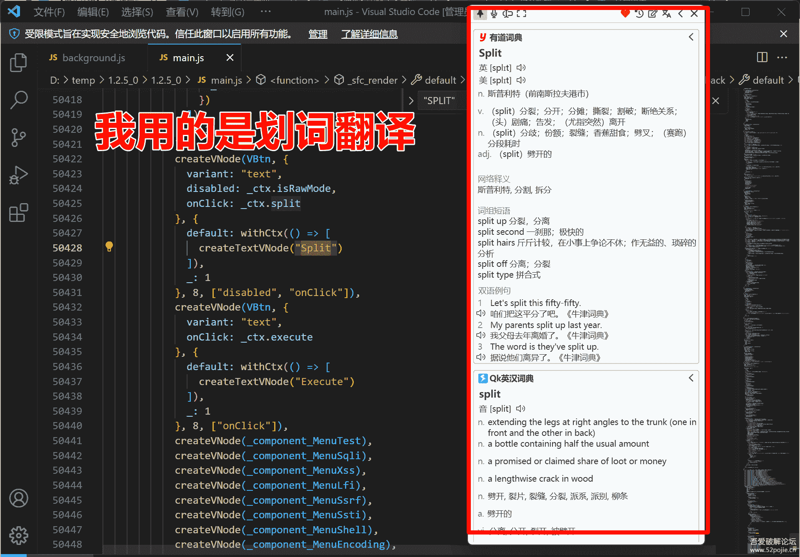

`image (7).png`（520.63 KB，下载次数：2） [附件下载](https://www.52pojie.cn/forum.php?mod=attachment&aid=MjY5OTY0Nnw1MzA4YmUyMnwxNzkzNTcyMTQ4fDE2ODA4NnwxOTMwOTkx&nothumb=yes)（2024-6-3 14:29 上传）

### 汉化

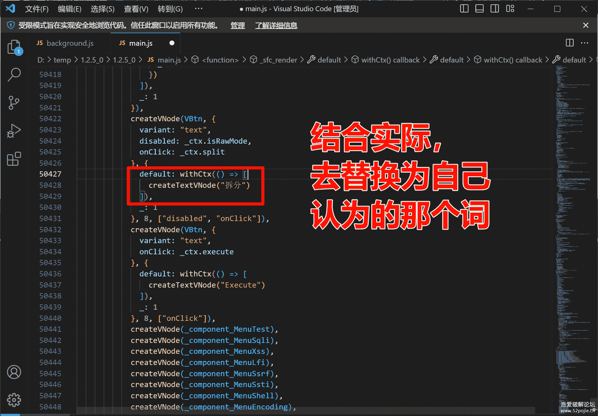

`image (8).png`（445.05 KB，下载次数：4） [附件下载](https://www.52pojie.cn/forum.php?mod=attachment&aid=MjY5OTY0NXxjZmVhNjJhYXwxNzkzNTcyMTQ4fDE2ODA4NnwxOTMwOTkx&nothumb=yes)（2024-6-3 14:29 上传）

## 保存重载

### 加载已解压的扩展程序

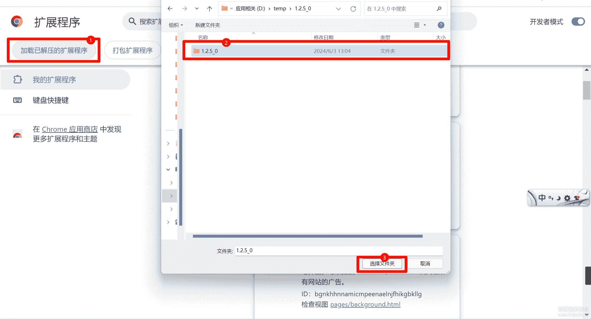

`image (9).png`（209.95 KB，下载次数：4） [附件下载](https://www.52pojie.cn/forum.php?mod=attachment&aid=MjY5OTY0MHw1ZjU0MTY1MHwxNzkzNTcyMTQ4fDE2ODA4NnwxOTMwOTkx&nothumb=yes)（2024-6-3 14:29 上传）

保存后谷歌浏览器自动重载渲染，后续只需要在文件保存，然后拓展扩展再重新运行扩展即可

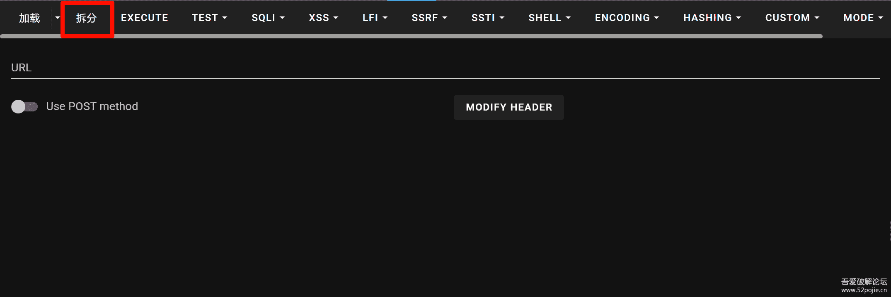

`image (10).png`（40.18 KB，下载次数：2） [附件下载](https://www.52pojie.cn/forum.php?mod=attachment&aid=MjY5OTY0NHw2YmU3Yjk0OHwxNzkzNTcyMTQ4fDE2ODA4NnwxOTMwOTkx&nothumb=yes)（2024-6-3 14:29 上传）

## 后续修改

结合代码特点进行搜索

比如我这里，是根据 `createTextVNode` 来寻找相对应的代码，可以提高效率

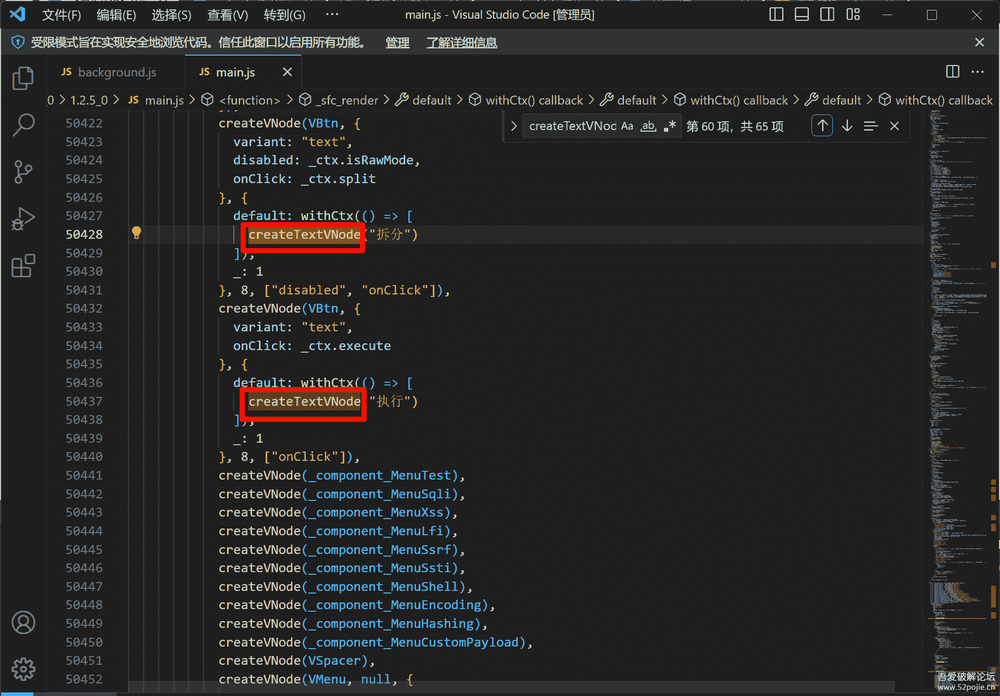

`image (11).png`（410.92 KB，下载次数：2） [附件下载](https://www.52pojie.cn/forum.php?mod=attachment&aid=MjY5OTY0M3xhYzJhZTcwY3wxNzkzNTcyMTQ4fDE2ODA4NnwxOTMwOTkx&nothumb=yes)（2024-6-3 14:29 上传）

结合显示文字进行搜索

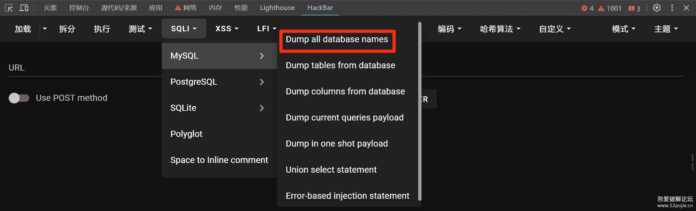

`image (12).png`（111.67 KB，下载次数：3） [附件下载](https://www.52pojie.cn/forum.php?mod=attachment&aid=MjY5OTY0MnwxZmNhNzNmYnwxNzkzNTcyMTQ4fDE2ODA4NnwxOTMwOTkx&nothumb=yes)（2024-6-3 14:29 上传）

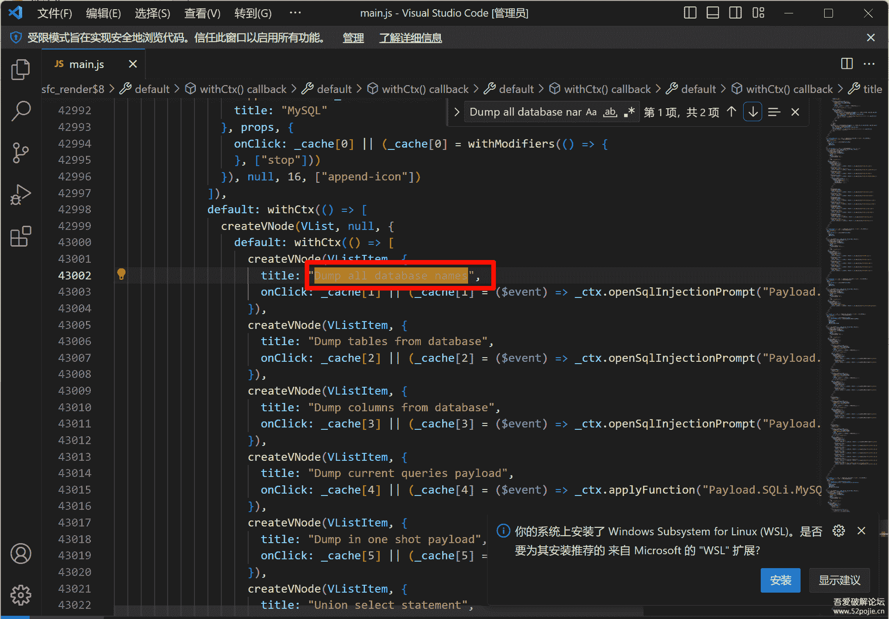

`image (13).png`（458.71 KB，下载次数：2） [附件下载](https://www.52pojie.cn/forum.php?mod=attachment&aid=MjY5OTY0MXxjMTE2NDczYXwxNzkzNTcyMTQ4fDE2ODA4NnwxOTMwOTkx&nothumb=yes)（2024-6-3 14:29 上传）

## 结尾

授人以鱼不如授人以渔，所以渔夫们，一起去捕鱼吧！
