# [Web逆向] 某家请求头X-TJH参数逆向流程分析

- 原帖: https://www.52pojie.cn/forum.php?mod=viewthread&tid=1934526
- 抓取时间: 2026-11-01T22:28:52

## 目标网站

> 
aHR0cHM6Ly9tLnR1amlhLmNvbS8=

## 网站分析

看下需要逆向的参数是哪些。
ok headers里的一些参数
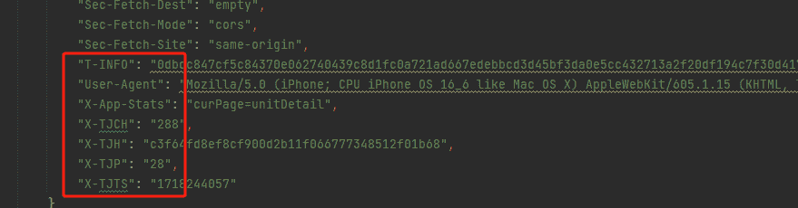
话不多B，直接进这个栈
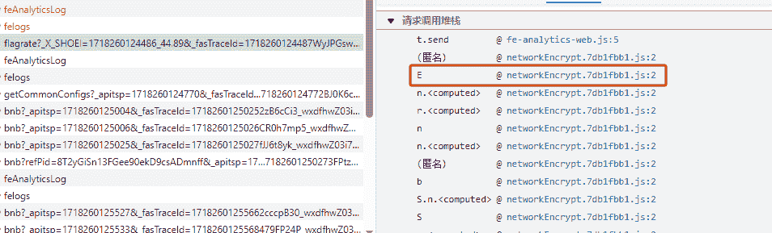
追栈 断点走到如下位置
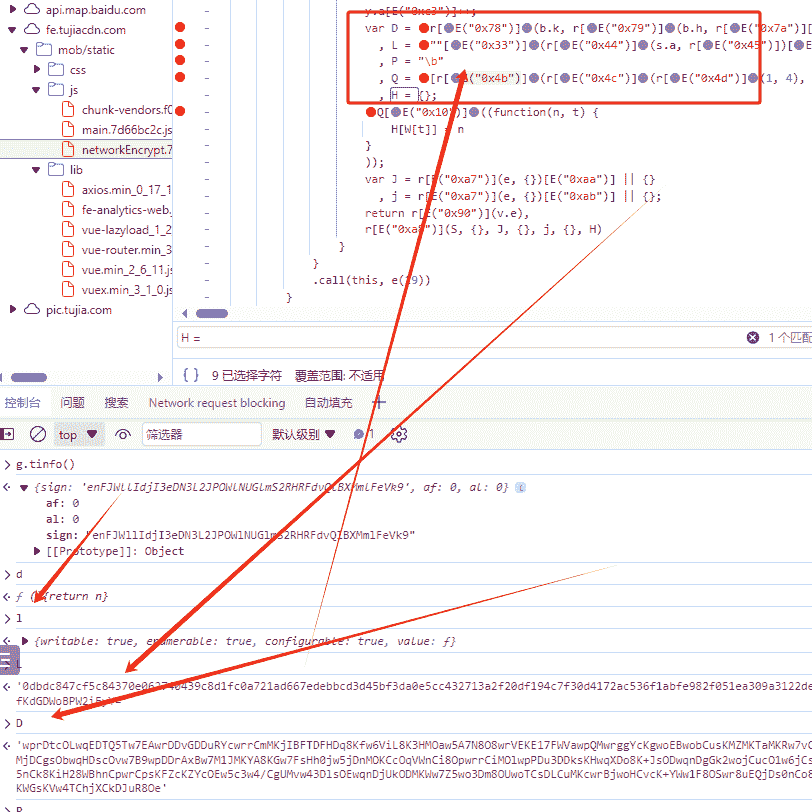

## 扣代码分析

### TT_info

我们通过ast给他转换一下。 可以看到 还嵌套了一层。
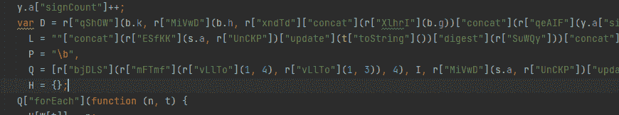
继续解混淆
把一些方法混淆还原后是这个样子
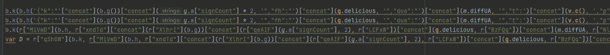
然后我们来看下以下几个方法分别是
`b.g()`
这里就是通过时间戳做的计算
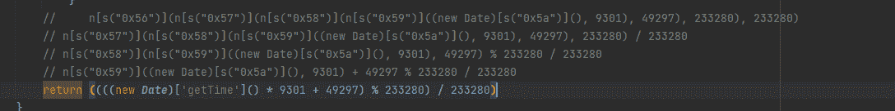
`b.h`
进栈走控制流。
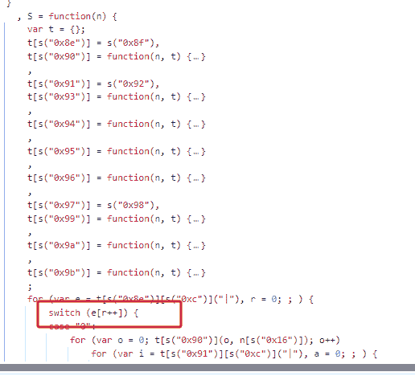
往上找堆栈 就能发现了传参的地方。
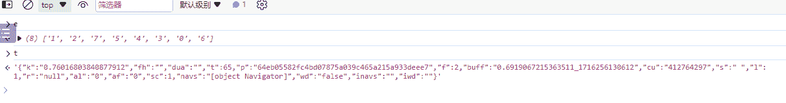
然后找一下控制流的顺序
```
['1', '2', '7', '5', '4', '3', '0', '6']
```
然后还原出来。
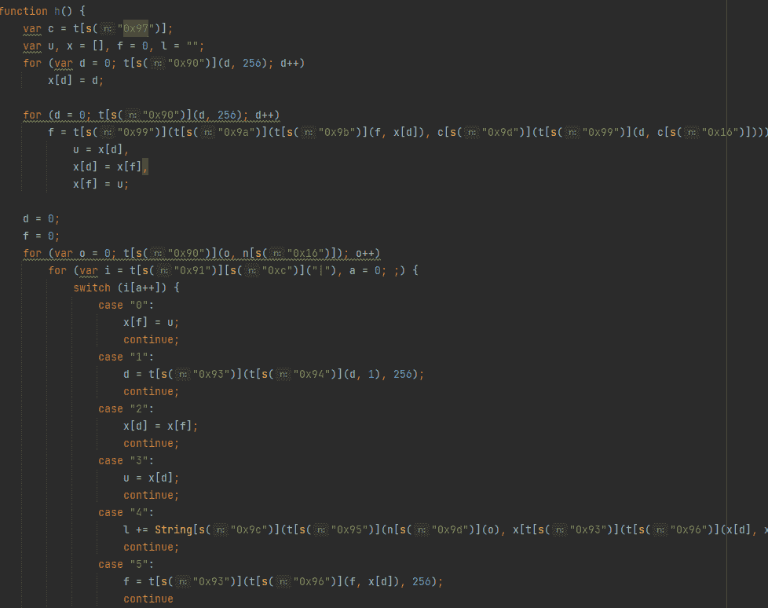
自此`b.h`得到了
然后运行一下
最终得到一个乱码
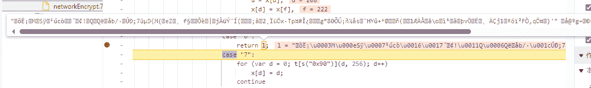
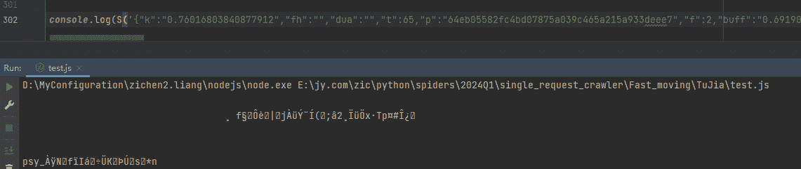
`b.k`
报错 未定义。往下追
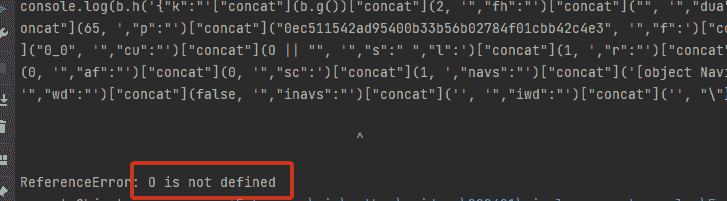
`A（）` 函数最终返回的是一个登录返回的cookie中的`userID`
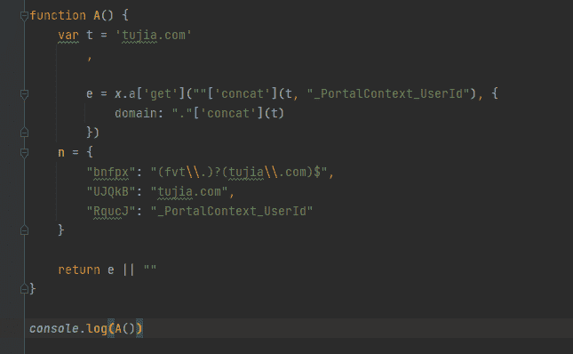
然后继续扣`b.k`
找到堆栈。
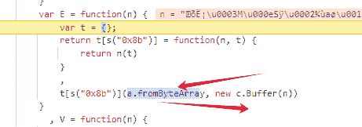
然后发现是个`base64`
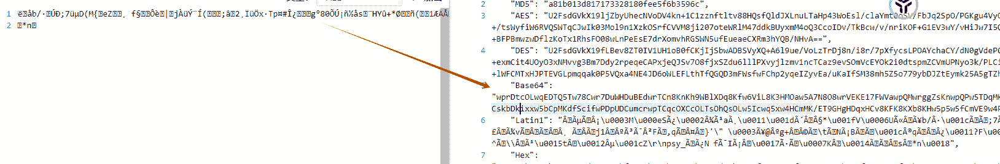
`LL_info` 参数解密完成

### T-INFO

这个参数就同理了。
一点一点的对应。
这里可以看到 这个`L`参数也就是`T-INFO` 是`sha1`加密
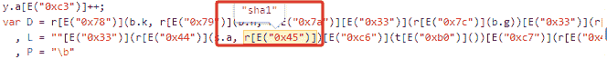
调用一下 看看有没有魔改
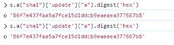
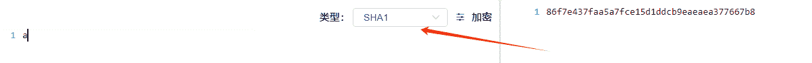
验证出来就是普通的`sha1`，那把这个混淆拼接 ，把值都搞出来加密即可。
最后整出来是这个样子
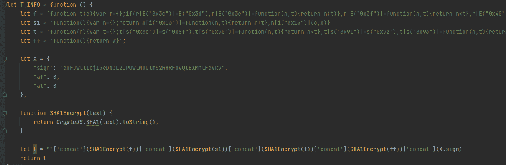

### X_TJH

这是个`sha1`加密算法
这里不多说了。按照上面的流程一一对应。
最后整理出来是这样的。
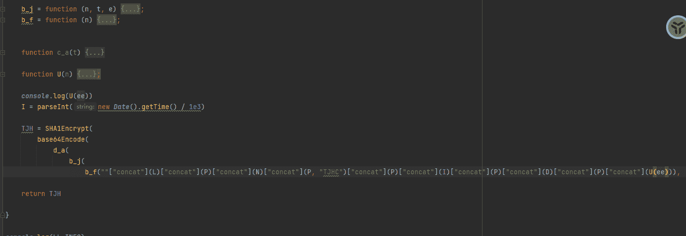
这里注意一个点。这个`U(ee)` 原文中为`U(e)`
这里是`switch`指令集顺序为 `['1', '2', '5', '6', '3', '4', '0']`
`t[E("0x16")](x, s);`还原出来是 >>>> `x(s)`
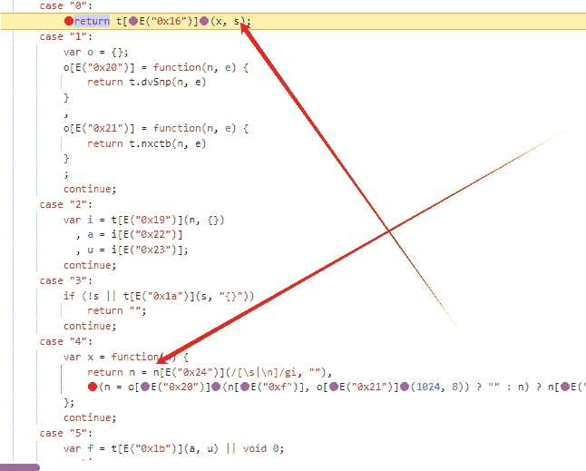
而`s`就是请求传过来的`data`，而`n`就是整体传参 如下图。
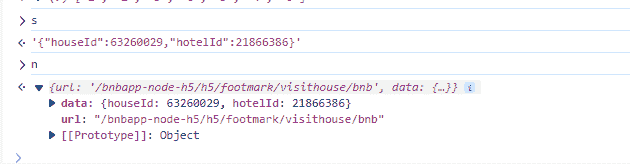
简单修改一下即可。
这里还需要拼接一下。其它的关系。几个函数互相调用一下值。
如下图修改完毕即可。
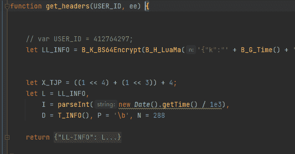

### 结果

这里感觉`ast`学的还是不咋地 有点地方还是不知道咱们去解，还是手撸，这样就太蠢了。
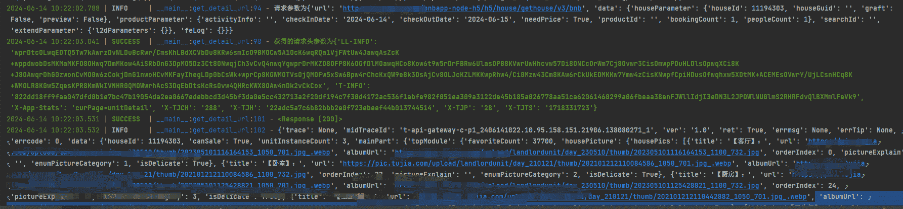
