# [原创] AutoCAD 2023的破解方法，追加AutoCAD、中望CA2025的破解方法

- 原帖: https://www.52pojie.cn/forum.php?mod=viewthread&tid=1934791
- 抓取时间: 2026-11-01T22:28:46

你没看错，我又来了，还是那个小白，开场白“故事的开始是，我电脑被分析pubg的辅助，把电脑干废了，重装了系统，什么软件也没有，然后呢又要处理工作上的事情，就下载了AutoCAD 2023安装一下，安装包是官网下载的，安装时候还会提示错误，要把电脑时间修改为2022年4月1日安装，就没有错误了，具体的安装过程就省略了，本来网上的注册机很多的，搜索了好几个网站，不是要关注公众号就是只说教程，没有下载地址。于是乎就开始想着自己破解一下，没想到居然成了，我就把过程给大家分享下。说真的，自从破解成功了几个小软件，遇到软件满脑子都是想破解，我觉得破解会上瘾。”

接下来就开始进入主题吧！老样子，查壳，虽然大公司的软件都不会加壳，但是还是看一看吧。随便下载了一个Detect-It-Easy-3.09版本，丢入看看：

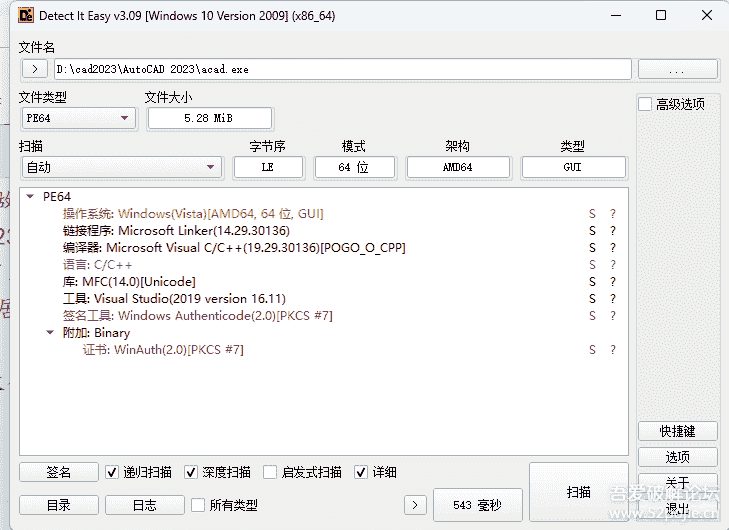

[`image.png` (45.66 KB, 下载次数: 2)](https://www.52pojie.cn/forum.php?mod=attachment&aid=MjcwMjAwNXw1ZTNjNmYxMnwxNzkzNTcyMTI0fDE2ODA4NnwxOTM0Nzkx&nothumb=yes)

2024-6-14 23:04 上传

不出所料，看一下软件未注册提示什么吧，我们运行软件，运行后就提示用ID登录，或者输入系列号，还有使用网络许可。

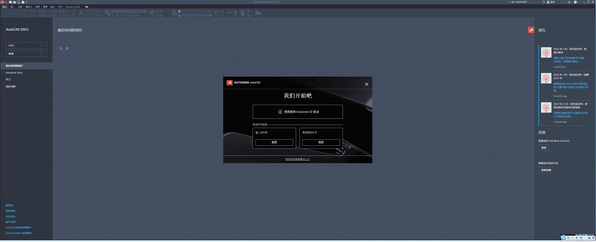

[`image.png` (316.84 KB, 下载次数: 2)](https://www.52pojie.cn/forum.php?mod=attachment&aid=MjcwMjAwNnw5ODFhYjVhNnwxNzkzNTcyMTI0fDE2ODA4NnwxOTM0Nzkx&nothumb=yes)

2024-6-14 23:07 上传

直接关掉这个窗口，提示许可管理器不起作用或未正确安装，现在将关闭AutoCAD。


[`image.png` (33.59 KB, 下载次数: 3)](https://www.52pojie.cn/forum.php?mod=attachment&aid=MjcwMjAwN3wwNzkwNzI5ZHwxNzkzNTcyMTI0fDE2ODA4NnwxOTM0Nzkx&nothumb=yes)

2024-6-14 23:09 上传

既然如此，直接丢进X64DBG，看一看，直到程序完全运行后，按`alt+e`，找到`ACAD.EXE`双击进入该模块，搜索当前模块下有用字符，然后我找呀早呀找，都是洋文，老样子，全部复制利用网络翻译，最后在`00007FF7974B4D41`处找到了一个`initStartup`，翻译结果是“初始化启动”，那么我就更进去看看。

```
00007FF7974B4D41 | 4C:8D05 505B3000 | lea r8,qword ptr ds:[7FF7977BA898] | 00007FF7977BA898:L"initStartup"
```

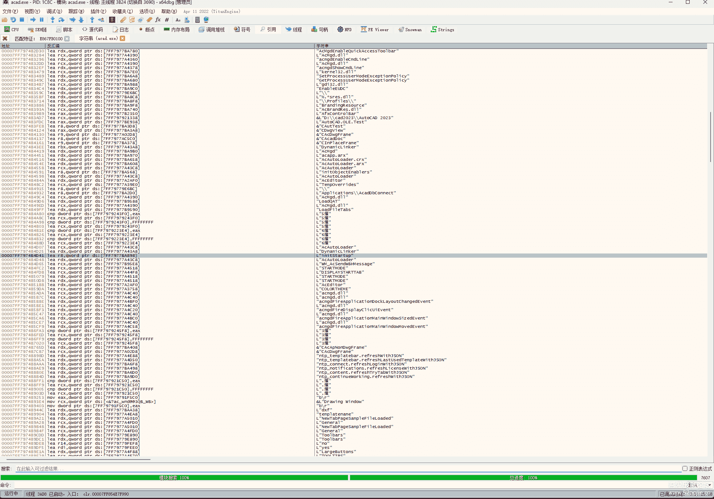

[`image.png` (337.72 KB, 下载次数: 2)](https://www.52pojie.cn/forum.php?mod=attachment&aid=MjcwMjAwOHxhNzhmNTVjMXwxNzkzNTcyMTI0fDE2ODA4NnwxOTM0Nzkx&nothumb=yes)

2024-6-14 23:19 上传

跟过去看了一下，发现这里了有很多个跳转，进过我的尝试，发现前面有一堆计算都跳转到了下面的一个CALL中，具体代码见下面：

```
00007FF7974B4CC9     | 75 23                    | jne acad.7FF7974B4CEE                                    |
00007FF7974B4CCB     | 40:387424 50             | cmp byte ptr ss:[rsp+50],sil                             |
00007FF7974B4CD0     | 75 1C                    | jne acad.7FF7974B4CEE                                    |
00007FF7974B4CD2     | FF15 18D12D00            | call qword ptr ds:[]    |
00007FF7974B4CD8     | 48:8BC8                  | mov rcx,rax                                              |
00007FF7974B4CDB     | FF15 EFCB2D00            | call qword ptr ds:[]                   |
00007FF7974B4D1E     | 48:8B08                  | mov rcx,qword ptr ds:[rax]                               |
00007FF7974B4D21     | 4C:8B41 40               | mov r8,qword ptr ds:[rcx+40]                             |
00007FF7974B4D25     | 48:8D15 7CF62E00         | lea rdx,qword ptr ds:[7FF7977A43A8]                      | 00007FF7977A43A8:L"DynamicLinker"
00007FF7974B4D2C     | 48:8BC8                  | mov rcx,rax                                              |
00007FF7974B4D2F     | 41:FFD0                  | call r8                                                  |
00007FF7974B4D32     | 48:8BC8                  | mov rcx,rax                                              |
00007FF7974B4D35     | E8 C2010000              | call acad.7FF7974B4EFC                                   |
00007FF7974B4D3A     | 48:8B08                  | mov rcx,qword ptr ds:[rax]                               |
00007FF7974B4D3D     | 4C:8B49 38               | mov r9,qword ptr ds:[rcx+38]                             |
00007FF7974B4D41     | 4C:8D05 505B3000         | lea r8,qword ptr ds:[7FF7977BA898]                       | 00007FF7977BA898:L"initStartup"这里时候我们搜索到的初始化启动位置
00007FF7974B4D48     | 48:8D15 79F62E00         | lea rdx,qword ptr ds:[7FF7977A43C8]                      | 00007FF7977A43C8:L"AcAutoLoader"
00007FF7974B4D4F     | 48:8BC8                  | mov rcx,rax                                              |
00007FF7974B4D52     | 41:FFD1                  | call r9                                                  |
00007FF7974B4D55     | 48:85C0                  | test rax,rax                                             |
00007FF7974B4D58     | 74 02                    | je acad.7FF7974B4D5C                                     |
00007FF7974B4D5A     | FFD0                     | call rax                                                 |
00007FF7974B4D5C     | 40:3835 79A84600         | cmp byte ptr ds:[7FF79791F5DC],sil                       |
00007FF7974B4D63     | 75 27                    | jne acad.7FF7974B4D8C                                    |
00007FF7974B4D65     | 48:8D0D 7C483000         | lea rcx,qword ptr ds:[7FF7977B95E8]                      | 00007FF7977B95E8:L"WM_AcSendWBHMessage"
00007FF7974B4D6C     | FF15 5E8C2D00            | call qword ptr ds:[]          |
00007FF7974B4D72     | 8905 60A84600            | mov dword ptr ds:[7FF79791F5D8],eax                      |
00007FF7974B4D78     | 48:8D0D 61150200         | lea rcx,qword ptr ds:[7FF7974D62E0]                      |
00007FF7974B4D7F     | FF15 B3B82D00            | call qword ptr ds:[]                      |
00007FF7974B4DAB     | 84C0                     | test al,al                                               |
00007FF7974B4DAD     | 74 05                    | je acad.7FF7974B4DB4                                     |
00007FF7974B4DAF     | E8 B0C80300              | call acad.7FF7974F1664                                   |
00007FF7974B4DB4     | FF15 7ECF2D00            | call qword ptr ds:[
```

感觉代码不好看的，就看截图，有跳转的逻辑要好看一点，

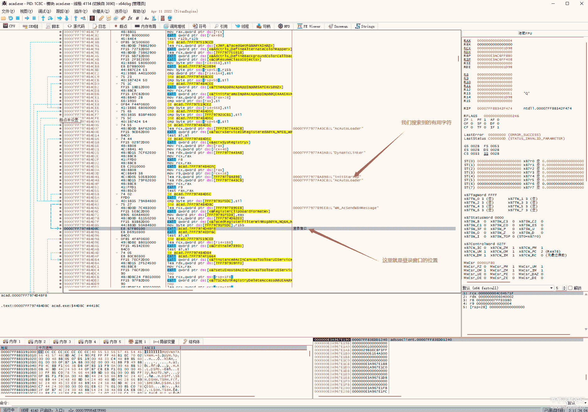

[`image.png` (409.25 KB, 下载次数: 1)](https://www.52pojie.cn/forum.php?mod=attachment&aid=MjcwMjAxMXxhZmU2YzRjOXwxNzkzNTcyMTI0fDE2ODA4NnwxOTM0Nzkx&nothumb=yes)

2024-6-14 23:29 上传

我想着如果不要我输入系列号，不就可以了吗？我就直接把这个`CALL`给`nop`掉试试，然后修补文件后运行试试，结果决然可以使用了，没有弹出需要注册的窗口，接下来，我都把工作做完了，也没有什么异常的地方，功能完全正常。我觉得现在大公司的软件注册就是意思意思，不像那些搞辅助的，六亲不认呀。

好了，谢谢大家耐心观看，补丁制作很简单，我就不演示了。

---

今天早上一看，评论区说都有2025了，要破解2025了，还有的说没有运行成功的截图，我也是醉了，今天到了公司，立马安装了CAD2025，同样的方法试一下，前面有CAD2023的破解基础，重复的我就不说了，我直接按照上次搜索到的特征字符串`initStartup`这里去看一看。

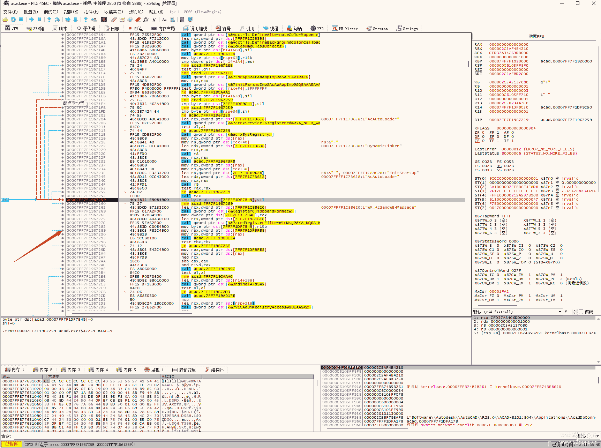

[`image.png` (402.3 KB, 下载次数: 1)](https://www.52pojie.cn/forum.php?mod=attachment&aid=MjcwMjA0N3xjNWM5MTk5Y3wxNzkzNTcyMTI0fDE2ODA4NnwxOTM0Nzkx&nothumb=yes)

2024-6-15 09:31 上传

在上图可以看到，在2025跳转的这里不再是`call`了，变成了下面的代码：

```
00007FF7F1967260     | 75 27                    | jne acad.7FF7F1967289                                    |
00007FF7F1967262     | 48:8D0D B7133200         | lea rcx,qword ptr ds:[7FF7F1C88620]                      | 00007FF7F1C88620:L"WM_AcSendWBHMessage"
00007FF7F1967269     | FF15 017A2F00            | call qword ptr ds:[]          |
00007FF7F196726F     | 8905 D7084900            | mov dword ptr ds:[7FF7F1DF7B4C],eax                      |
00007FF7F1967275     | 48:8D0D A0A30100         | lea rcx,qword ptr ds:[7FF7F198161C]                      |
```


# AutoCAD 许可 UI 破解

```
00007FF7F196727C     | FF15 5EA62F00            | call qword ptr ds:[...]
```

这段代码首先从固定地址读取一个 64 位的值到 `RAX` 寄存器，然后通过这个值（作为地址）从内存中读取另一个 64 位的值到 `RBX` 寄存器，最后调用 `call acad.7FF7F1983E34` 这个函数，没事，我们跟进去这个 `CALL` 中一看究竟。

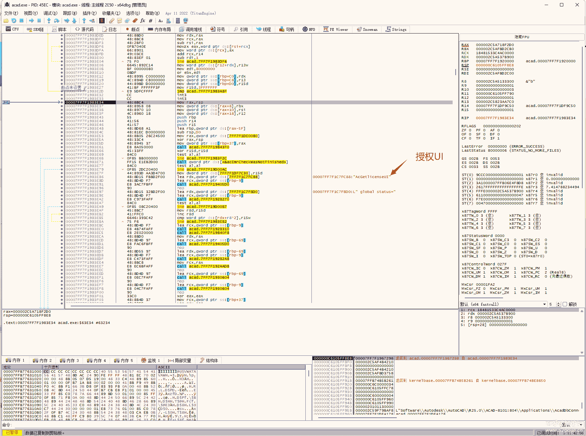

`image.png` (378.64 KB, 下载次数: 3)

[href="forum.php?mod=attachment&aid=MjcwMjA0OXw2N2ZlYTRkM3wxNzkzNTcyMTI0fDE2ODA4NnwxOTM0Nzkx&nothumb=yes" target="_blank"](https://www.52pojie.cn/forum.php?mod=attachment&aid=MjcwMjA0OXw2N2ZlYTRkM3wxNzkzNTcyMTI0fDE2ODA4NnwxOTM0Nzkx&nothumb=yes)

2024-6-15 09:38 上传

## 定位 `AcGetlicenseUI`

进来后我们看到，这里有一个 `AcGetlicenseUI`，这里就是安装了许可 UI，在段首运行 `call acad.7FF7F19843F0` 后，接下来有 `test al, al`，这个汇编语句是主要用于测试和设置标志位，但是不改变 `al` 的值。既然这样，我们直接把 `test al, al` 修改为 `xor al, al`。

## 修改 `test al, al`

这样一来，我们就把寄存器清零了，接下来的 `jne acad.7FF7F19D00AC` 跳转就不会实现，这样就完成了破解，当然，把 `JNE` 修改成 `JMP` 也同样能达到效果。当然我是选择修改较少的方案，`84→32`，下面看运行截图吧，不然又有人说没有成功使用的截图。要做补丁的，直接上数据：`>acad.exe  0000000000063E69:84->32`。

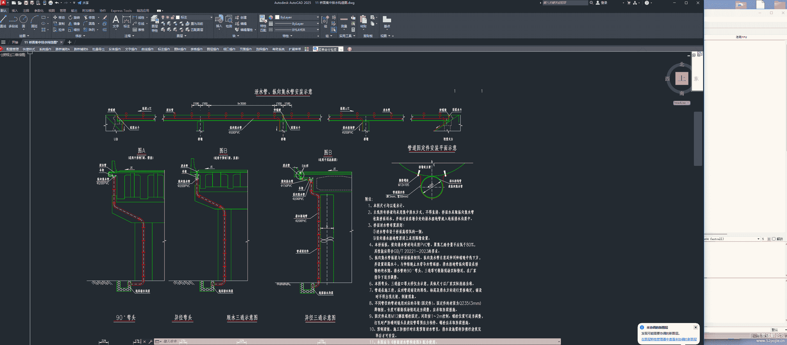

`image.png` (600.31 KB, 下载次数: 2)

[href="forum.php?mod=attachment&aid=MjcwMjA1MHw3ZmI1N2JlNnwxNzkzNTcyMTI0fDE2ODA4NnwxOTM0Nzkx&nothumb=yes" target="_blank"](https://www.52pojie.cn/forum.php?mod=attachment&aid=MjcwMjA1MHw3ZmI1N2JlNnwxNzkzNTcyMTI0fDE2ODA4NnwxOTM0Nzkx&nothumb=yes)

2024-6-15 09:53 上传

其实方法都差不多，大家也可以试一试。好了，开始搬砖了。谢谢大家观看！！

## 调整日期验证

哎哟喂，评论区又来了，说调整日期以后就不可以用了，我把日期调整到 2030 年给你们看看，其实我只是分享破解方法，学习一下，如果有问题，我们大家一起探讨。

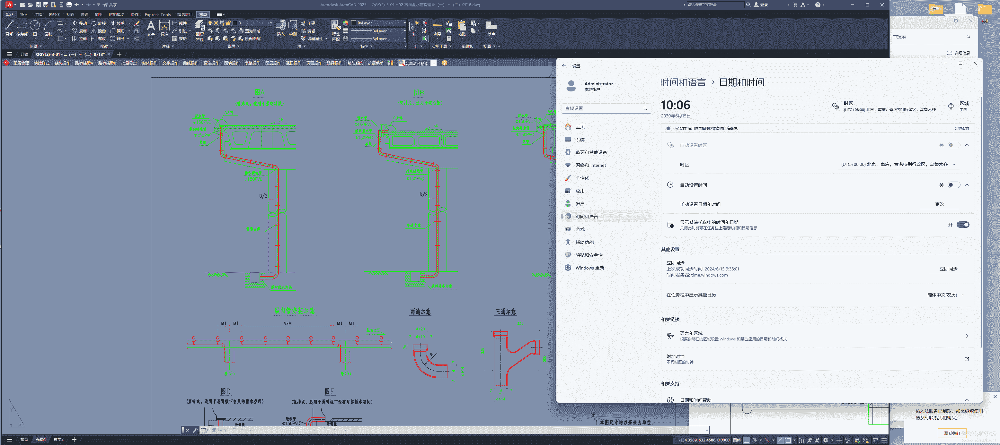

`image.png` (485.41 KB, 下载次数: 4)

[href="forum.php?mod=attachment&aid=MjcwMjA1MXxlMmJiNzc4M3wxNzkzNTcyMTI0fDE2ODA4NnwxOTM0Nzkx&nothumb=yes" target="_blank"](https://www.52pojie.cn/forum.php?mod=attachment&aid=MjcwMjA1MXxlMmJiNzc4M3wxNzkzNTcyMTI0fDE2ODA4NnwxOTM0Nzkx&nothumb=yes)

2030

2024-6-15 10:09 上传

看到了吧，同样正常。我要搬砖了，有什么晚上又来给大家解答。

---

# 中望CAD 许可分析

有朋友说需要中望CAD的，今天 2024 年 11 月 28 日，我下载安装了中望CAD，经过分析，已经可以使用，希望和大家分享下过程，开始吧！

老样子，我安装中望CAD，先使用 `X64dbg` 运行后提示试用版，首先搜索字符串看看，然后检索 `License`，

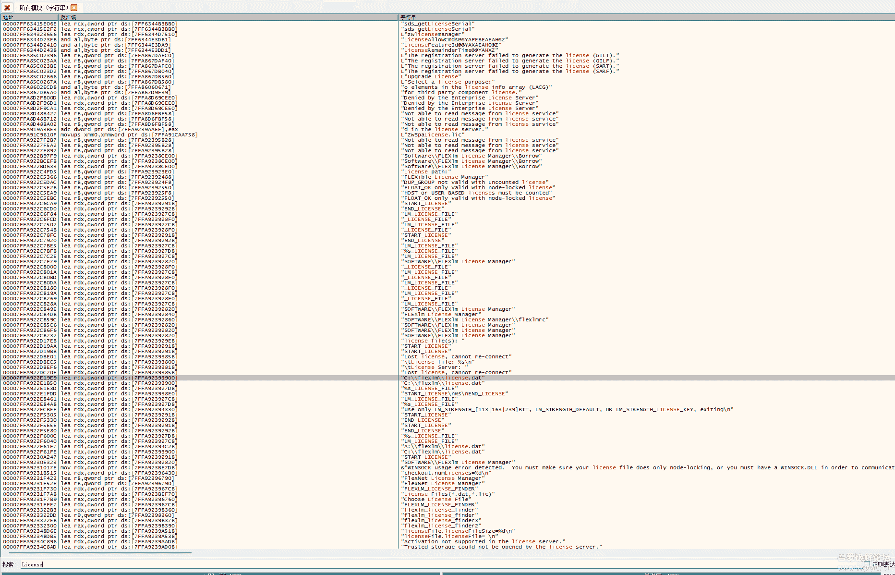

`image.png` (301.03 KB, 下载次数: 2)

[href="forum.php?mod=attachment&aid=Mjc0MDAwM3xmZTczNDI0YnwxNzkzNTcyMTI0fDE2ODA4NnwxOTM0Nzkx&nothumb=yes" target="_blank"](https://www.52pojie.cn/forum.php?mod=attachment&aid=Mjc0MDAwM3xmZTczNDI0YnwxNzkzNTcyMTI0fDE2ODA4NnwxOTM0Nzkx&nothumb=yes)

检索字符串

2024-11-28 11:55 上传

## 检索 `license` 字符串

看上图，出来很多相关内容，然后发现有读取 `license.dat` 这个文件，所以这个必定和注册有关，然后跟进去看看，发现是来到了 `flxNetCommon.dll`，由于所有模块字符串内容太多，然后我们单独在这个模块中搜索字符串找找线索，然后还是检索 `license` 的相关内容，经过不断地摸索，发现里面还有检查许可的内容，那么我重新检索字符 `check` 的内容，结果如下：

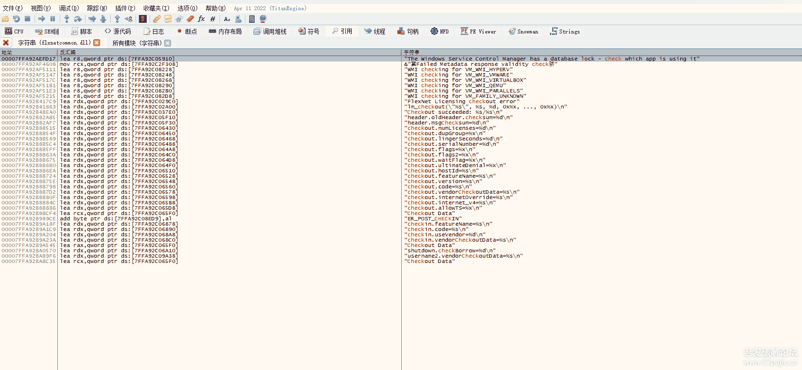

`image.png` (177.48 KB, 下载次数: 3)

[href="forum.php?mod=attachment&aid=Mjc0MDAwNnwyNjlhYmE5NHwxNzkzNTcyMTI0fDE2ODA4NnwxOTM0Nzkx&nothumb=yes" target="_blank"](https://www.52pojie.cn/forum.php?mod=attachment&aid=Mjc0MDAwNnwyNjlhYmE5NHwxNzkzNTcyMTI0fDE2ODA4NnwxOTM0Nzkx&nothumb=yes)

`check`

2024-11-28 12:05 上传

## 跟踪 `lm_checkout` 调用

我们看到。字符串内容：`lm_checkout(\"%s\", %s, %d, 0x%x, ..., 0x%x)\n`，这些，应该就是年月日等等的，所以双击更进去看看：

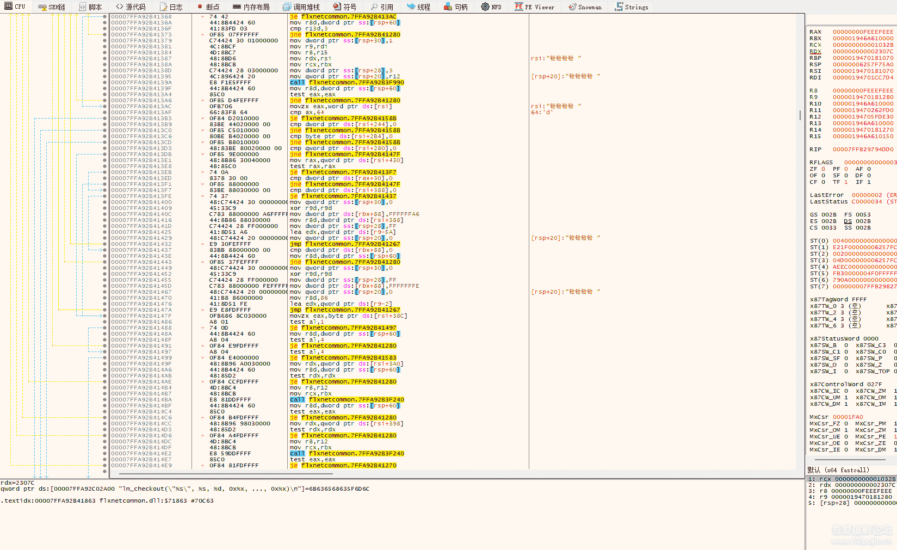

`image.png` (312.69 KB, 下载次数: 1)

[href="forum.php?mod=attachment&aid=Mjc0MDAwN3w4ODc1YjRmN3wxNzkzNTcyMTI0fDE2ODA4NnwxOTM0Nzkx&nothumb=yes" target="_blank"](https://www.52pojie.cn/forum.php?mod=attachment&aid=Mjc0MDAwN3w4ODc1YjRmN3wxNzkzNTcyMTI0fDE2ODA4NnwxOTM0Nzkx&nothumb=yes)

模块计算

2024-11-28 12:07 上传

## 断点与返回分析

从上图可以看到，这是大量进行了运算，太复杂了，我就在段首的位置下断点，然后重新运行程序，来到断点后，直接运行到返回，回去看看：


## 汇编代码片段
```
00007FFA92B3DDEE     | 4C:8B4424 40             | mov r8,qword ptr ss:[rsp+40]                                   | [rsp+40]:"25.0"
00007FFA92B3DDF3     | 44:896C24 30             | mov dword ptr ss:[rsp+30],r13d                                 |
00007FFA92B3DDF8     | 45:8BCF                  | mov r9d,r15d                                                   |
00007FFA92B3DDFB     | 48:8BD6                  | mov rdx,rsi                                                    | rsi:"ZW2D_PRO"
00007FFA92B3DDFE     | 48:8BCB                  | mov rcx,rbx                                                    | rbx:L"f"
00007FFA92B3DE01     | 4C:896424 28             | mov qword ptr ss:[rsp+28],r12                                  |
00007FFA92B3DE06     | 897C24 20                | mov dword ptr ss:[rsp+20],edi                                  |
00007FFA92B3DE0A     | FF15 A07E0F00            | call qword ptr ds:[7FFA92C35CB0]                               |
00007FFA92B3DE10     | 44:8BF0                  | mov r14d,eax                                                   |
00007FFA92B3DE13     | 3D 48FFFFFF              | cmp eax,FFFFFF48                                               |
00007FFA92B3DE18     | 75 37                    | jne flxnetcommon.7FFA92B3DE51                                  |
00007FFA92B3DE1A     | 8B83 88000000            | mov eax,dword ptr ds:[rbx+88]                                  |
00007FFA92B3DE20     | 48:8BBC24 E0010000       | mov rdi,qword ptr ss:[rsp+1E0]                                 |
00007FFA92B3DE28     | 4C:8BAC24 D8010000       | mov r13,qword ptr ss:[rsp+1D8]                                 |
00007FFA92B3DE30     | 48:8B8C24 C0010000       | mov rcx,qword ptr ss:[rsp+1C0]                                 |
00007FFA92B3DE38     | 48:33CC                  | xor rcx,rsp                                                    |
00007FFA92B3DE3B     | E8 7042FCFF              | call flxnetcommon.7FFA92B020B0                                 |
00007FFA92B3DE40     | 48:81C4 E8010000         | add rsp,1E8                                                    |
00007FFA92B3DE47     | 41:5F                    | pop r15                                                        |
00007FFA92B3DE49     | 41:5E                    | pop r14                                                        |
00007FFA92B3DE4B     | 41:5C                    | pop r12                                                        |
00007FFA92B3DE4D     | 5E                       | pop rsi                                                        | rsi:"ZW2D_PRO"
00007FFA92B3DE4E     | 5D                       | pop rbp                                                        |
00007FFA92B3DE4F     | 5B                       | pop rbx                                                        | rbx:L"f"
00007FFA92B3DE50     | C3                       | ret                                                            |
```

## 分析与修改
经过运行，后面有很多地方调用了这个`cll`，内容都大致差不多，出来以后都是`mov r14d, eax`，然后比较`cmp eax`，然后在跳转，那么我们直接在刚才那个段首直接清空`eax`，在段首修改为`xor eax, eax`，然后`ret`试试：

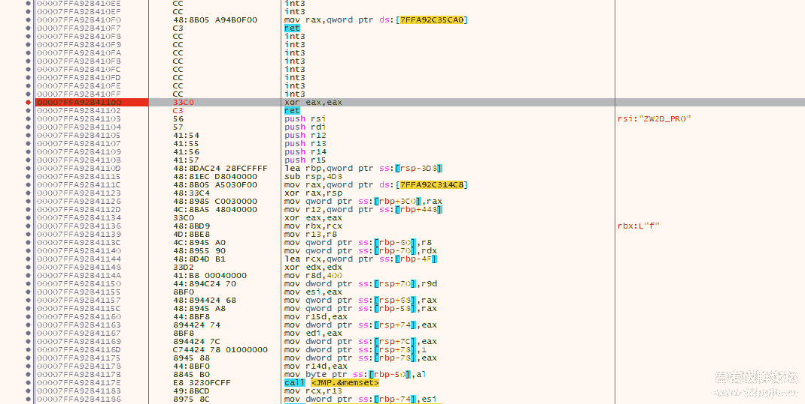

image.png (126.05 KB, 下载次数: 1)

[href="forum.php?mod=attachment&aid=Mjc0MDAwOHwwYzRhYWUyM3wxNzkzNTcyMTI0fDE2ODA4NnwxOTM0Nzkx&nothumb=yes" target="_blank"](https://www.52pojie.cn/forum.php?mod=attachment&aid=Mjc0MDAwOHwwYzRhYWUyM3wxNzkzNTcyMTI0fDE2ODA4NnwxOTM0Nzkx&nothumb=yes)

2024-11-28 12:14 上传

然后取消断点，运行，不出所料，已经成了专业版了，简单测试，功能正常。现在是可以用了，大家试试有什么问题，在反馈，一起研究。

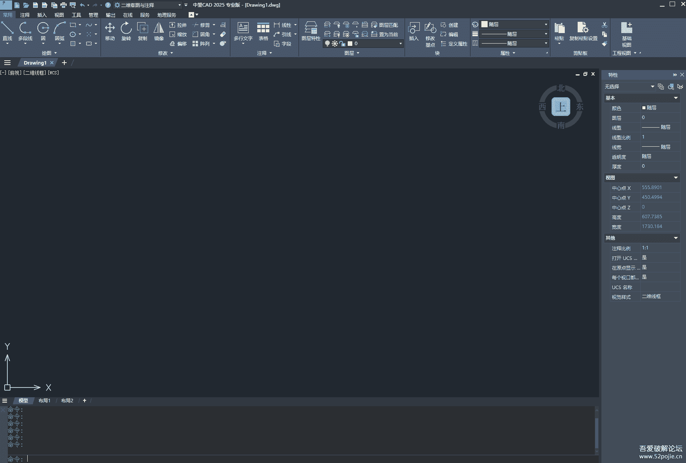

image.png (104.41 KB, 下载次数: 1)

[href="forum.php?mod=attachment&aid=Mjc0MDAwOXxhYmEzYmI4NnwxNzkzNTcyMTI0fDE2ODA4NnwxOTM0Nzkx&nothumb=yes" target="_blank"](https://www.52pojie.cn/forum.php?mod=attachment&aid=Mjc0MDAwOXxhYmEzYmI4NnwxNzkzNTcyMTI0fDE2ODA4NnwxOTM0Nzkx&nothumb=yes)

2024-11-28 12:17 上传

## 补丁内容
附上补丁内容：`flxnetcommon.dll`

```
0000000000071100:40->33
0000000000071101:55->C0
0000000000071102:53->C3
```

## 中望CAD -15 错误修复
补充一下中望CAD，在使用过程中会出现-15错误，提示授权丢失，软件会检测权限，错误窗口如下：

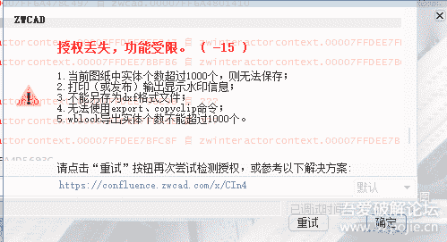

image.png (48.15 KB, 下载次数: 2)

[href="forum.php?mod=attachment&aid=Mjc0OTIxMHw5OTMzMDNhZXwxNzkzNTcyMTI0fDE2ODA4NnwxOTM0Nzkx&nothumb=yes" target="_blank"](https://www.52pojie.cn/forum.php?mod=attachment&aid=Mjc0OTIxMHw5OTMzMDNhZXwxNzkzNTcyMTI0fDE2ODA4NnwxOTM0Nzkx&nothumb=yes)

2025-1-11 09:58 上传

经过分析，`00007FF6A4805654`处`74 2F`修改`90 90`就好了。

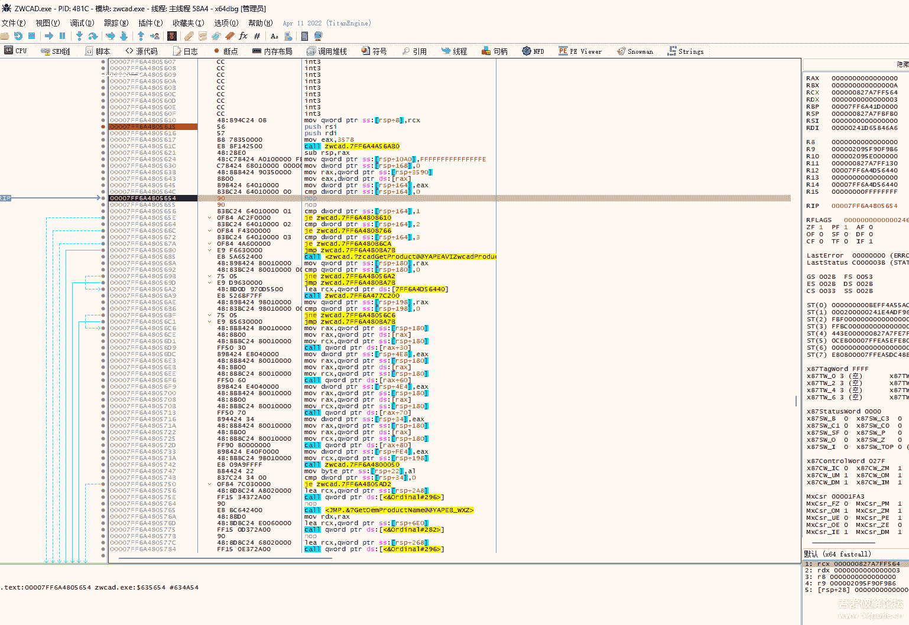

image.png (314.86 KB, 下载次数: 2)

[href="forum.php?mod=attachment&aid=Mjc0OTIxMnw0MTY4Yzk5NnwxNzkzNTcyMTI0fDE2ODA4NnwxOTM0Nzkx&nothumb=yes" target="_blank"](https://www.52pojie.cn/forum.php?mod=attachment&aid=Mjc0OTIxMnw0MTY4Yzk5NnwxNzkzNTcyMTI0fDE2ODA4NnwxOTM0Nzkx&nothumb=yes)

2025-1-11 10:03 上传
