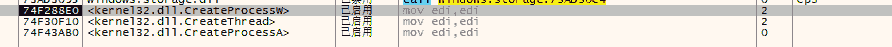
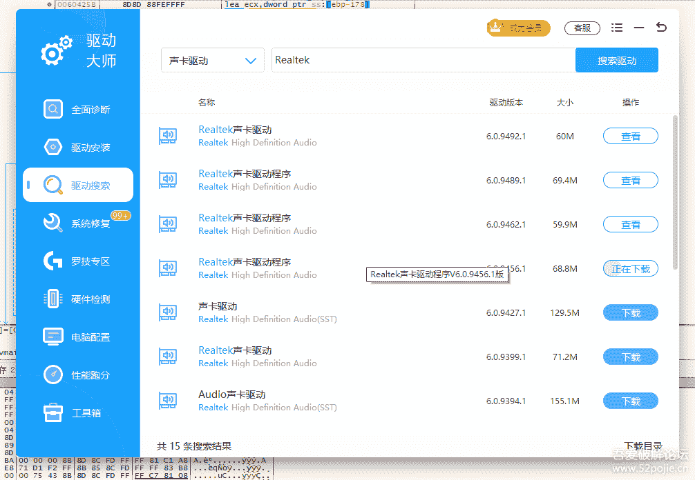

# [原创] 驱动大师-VIP验证系统绕过版本

- 原帖: https://www.52pojie.cn/forum.php?mod=viewthread&tid=1935952
- 抓取时间: 2026-11-01T22:28:40

原软件官方：驱动大师官网（[https://imeitools.com/driverpro/index.html](https://imeitools.com/driverpro/index.html)）

PS: 写的挺棒的Windows环境依赖解决方案的软件，包括DLL修复，驱动下载，驱动检测，一些适用的工具。

以下是包含VIP验证函数的exe和DLL：

- `drvmain.exe`
- `drvtoolbox.exe`
- `driversearch.dll`
- `sysrepair.dll`

## 如何定位VIP验证 `call` 函数？

1. 分析这个程序是如何提示开通VIP消息的。
2. 我分析得到需要开通VIP它会弹出一个类似 `MessageBox` 的窗体。
3. 并且在弹出 `MessageBox` 之后主进程依然是可响应的，那他一定是非阻塞，在弹出窗体前一定是有创建进程及线程操作。
4. 所以我在 `createthread`、`createprocess(A&W)` 函数

    

    `image.png` (7.2 KB, 下载次数: 9)

    [href="forum.php?mod=attachment&aid=MjcwMjgzMnw0MTc0MzJjNHwxNzkzNTcyMTE4fDE2ODA4NnwxOTM1OTUy&nothumb=yes" target="_blank"](https://www.52pojie.cn/forum.php?mod=attachment&aid=MjcwMjgzMnw0MTc0MzJjNHwxNzkzNTcyMTE4fDE2ODA4NnwxOTM1OTUy&nothumb=yes)

    2024-6-19 02:56 上传

    下断。

5. 触发VIP开通提示之后，触发 `CreateProcessW` 函数，然后追踪堆栈调用(这就是一个比较有耐心的活了，如果大佬们有更好的实现思路可以分享一下。)

    

    `image.png` (161.45 KB, 下载次数: 9)

    [href="forum.php?mod=attachment&aid=MjcwMjgzMXw0OTU3NDRjNnwxNzkzNTcyMTE4fDE2ODA4NnwxOTM1OTUy&nothumb=yes" target="_blank"](https://www.52pojie.cn/forum.php?mod=attachment&aid=MjcwMjgzMXw0OTU3NDRjNnwxNzkzNTcyMTE4fDE2ODA4NnwxOTM1OTUy&nothumb=yes)

    2024-6-19 02:50 上传

## 如何绕过的？

修改代码判断逻辑。

检测是否开启VIP函数 -> `drvmain.exe+0x0204237`

```
00604230 | 8B8D ACFEFFFF | mov ecx,dword ptr ss:[ebp-154] | [ebp-154]:GetClassLongW+7AA
00604236 | 51 | push ecx |
00604237 | E8 A46A0400 | call drvmain.64ACE0 | VIP验证call函数
0060423C | 83C4 04 | add esp,4 |
0060423F | F7D8 | neg eax |
00604241 | 1BC0 | sbb eax,eax |
```

VIP验证 `Call` 内部：

```
0064ACE0 | 55 | push ebp |
0064ACE1 | 8BEC | mov ebp,esp |
0064ACE3 | 6A 01 | push 1 |
0064ACE5 | E8 C6E6FFFF | call drvmain.6493B0 |
0064ACEA | 83C4 04 | add esp,4 |
0064ACED | 0FB6C0 | movzx eax,al |
0064ACF0 | 85C0 | test eax,eax |
0064ACF2 | 75 07 | jne drvmain.64ACFB | JZ 相等跳转改为JNE不同跳转
0064ACF4 | B8 01000000 | mov eax,1 |
0064ACF9 | EB 25 | jmp drvmain.64AD20 |
0064ACFB | E8 10DA0000 | call drvmain.658710 |
0064AD00 | 8BC8 | mov ecx,eax |
```



`image.png` (123.92 KB, 下载次数: 8)

[href="forum.php?mod=attachment&aid=MjcwMjgzMHw3Mzg2YmZjN3wxNzkzNTcyMTE4fDE2ODA4NnwxOTM1OTUy&nothumb=yes" target="_blank"](https://www.52pojie.cn/forum.php?mod=attachment&aid=MjcwMjgzMHw3Mzg2YmZjN3wxNzkzNTcyMTE4fDE2ODA4NnwxOTM1OTUy&nothumb=yes)

2024-6-19 02:45 上传

本人技术小白，有在吾爱 [www.52pojie.cn](https://www.52pojie.cn) 学习过一些逆向基础和Windows API调用。大佬勿喷，如果有更好的实现方式及思路可以分享探讨。

已生成补丁，直接替换原文件即可。


[href="forum.php?mod=attachment&aid=MjcwMjgzM3xhZGI2ZTk4OHwxNzkzNTcyMTE4fDE2ODA4NnwxOTM1OTUy" target="_blank"](https://www.52pojie.cn/forum.php?mod=attachment&aid=MjcwMjgzM3xhZGI2ZTk4OHwxNzkzNTcyMTE4fDE2ODA4NnwxOTM1OTUy)

(2.52 MB, 下载次数: 10173)

2024-6-19 03:01 上传

点击文件名下载附件

下载积分: 吾爱币 -1 CB
