# [Web逆向] 浅谈逆向Unity导出的vx小游戏的思路

- 原帖: https://www.52pojie.cn/forum.php?mod=viewthread&tid=1936819
- 抓取时间: 2026-11-01T22:28:32

## 本文章仅用于学习交流，请勿用于非法用途


## 浅谈逆向Unity导出的vx小游戏的思路

背景：

刷抖音时突然蹦出个广告，还不小心点进去了

就试玩了一下，发现还挺有趣的，嗯

可是玩了一小会后发现打不过了，还得充钱才能变得更强？？？

于是直接忍不了了 直接开机，上号!!!

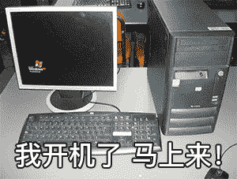


### 初步分析小游戏

- 打开对应的`wxapkg`目录

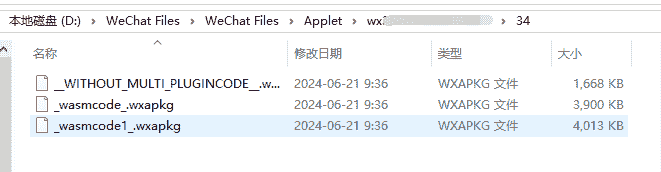

- 解包

```bash
unveilr wx -f "D:\WeChat Files\WeChat Files\Applet\wxxxxxxx\34"
```

- 到这一步可以确定是unity项目转成的小游戏了

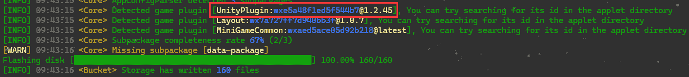

- 当然你通过解包出来的目录也是可以看出来的

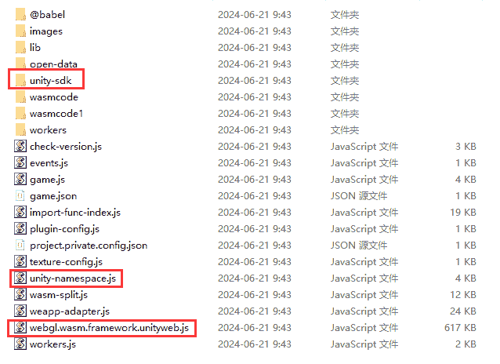

- 稍微翻了下代码，可以确定小游戏逻辑都在`wasmcode`和`wasmcode1`

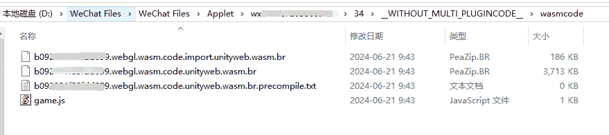

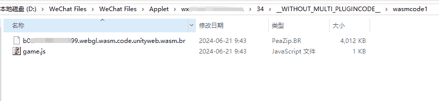

### 初步分析unity相关文件

- 可以看到这里都是`br`为后缀，这是使用brotli压缩的文件
- 使用`brotli.exe`解压缩

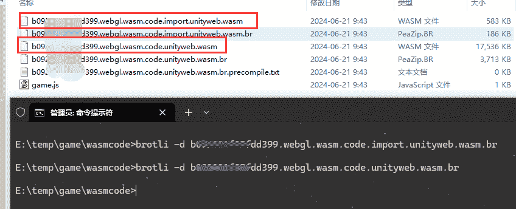

- 另一个文件夹同理
- 这样我们就得到了wasm文件了
- 这里可以直接拖进`ida`或`Ghidra`
- 我这里使用`Ghidra`，因为`ida`的wasm插件好像有点问题
- 怎么安装wasm插件这里我就不赘述了
- 这里我把解包得到的wasm改个名：

```
xxx.code.import.unityweb.wasm -> import.wasm
xxx.code.unityweb.wasm -> main.wasm
wasmcode1/xxx.code.unityweb.wasm -> sub.wasm
```

- 然后一并拖入`Ghidra`

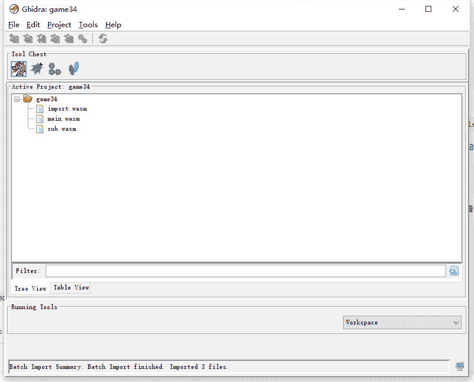

- 等他分析好（这里可能要一些时间），出现一堆`jxxx`的函数，这根本没法看啊

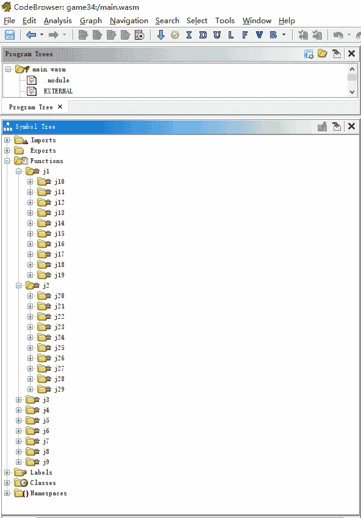

- 接下来尝试恢复wasm的符号信息

### 尝试恢复wasm的符号信息

- 一般现在的unity都是用`IL2cpp`导出了，`Mono`估计很少用了吧
- `Il2CppDumper`能将使用`IL2cpp`打包的文件还原出`script.json`，这里面存着符号信息
- 所以我们直接使用`Il2CppDumper`尝试导出

```bash
Il2CppDumper.exe
```

- `Il2CppDumper`需要`global-metadata.dat`文件
- 那这个文件哪里找呢？小游戏的wxapkg包内没有
- 那应该是远程下载的，只能是找缓存路径了
- 经过研究，发现可疑文件

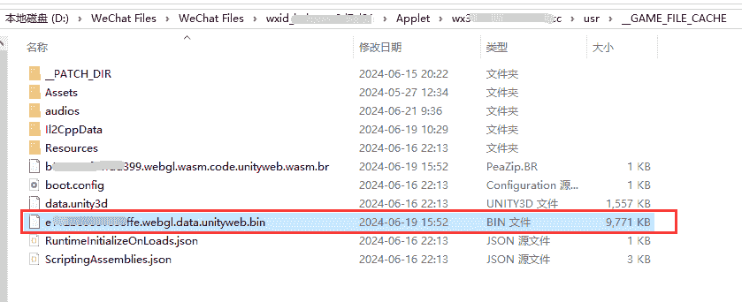

- 这又是个二进制文件，需要解析出来
- 这里使用`unityweb`将他导出来

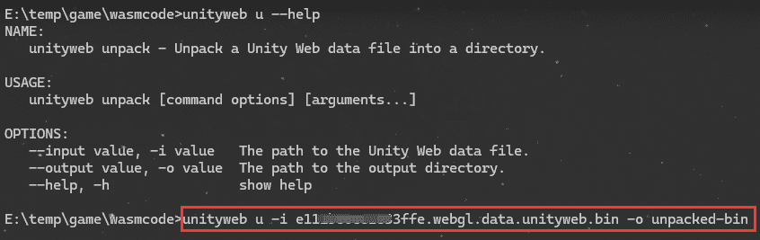

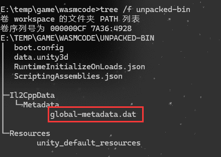

- 有了`global-metadata.dat`就能导出`script.json`等文件了

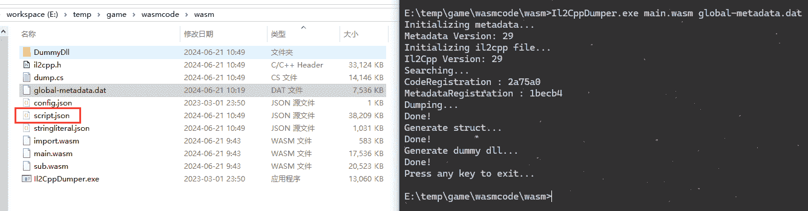

- 然后怎么恢复到`Ghidra`可以看下面这篇文章，讲的很好
- [//www.cnblogs.com/algonote/p/15596459.html](https://www.cnblogs.com/algonote/p/15596459.html)

但是


- 这里并不太适合导出成vx小游戏的项目
- 这里需要魔改`ghidra_wasm.py`
- 经过分析，问题出在，他的动态调用的偏移是存在`import.wasm`里面的
- 所以我们先把它的偏移转换出来
- 这里我直接贴我的脚本

```js
// restore.js
const fs = require('fs')
const http = require('http')
const Scripts = JSON.parse(fs.readFileSync('./script.json', 'utf8'))
const splitWasmBytes = fs.readFileSync('./import.wasm')

async function main() {
  const {instance} = await WebAssembly.instantiate(splitWasmBytes);
  const getRedirIndex = a => instance.exports['wasm_split.__wasm_split_getRedirIndex'](a) & 268435455
  Scripts.ScriptMethod.forEach(item => {
    item.FuntionName = `j${getRedirIndex(item.Address)}`
  })
  fs.writeFileSync('./script2.json', JSON.stringify(Scripts), 'utf8')
}
main()
```

- 我先把对应的偏移函数名写到`script2.json`
- 然后魔改`ghidra_wasm.py`


``` 
# -*- coding: utf-8 -*-

import json
import re

currentProgram = getCurrentProgram()
symbolTable = currentProgram.getSymbolTable()
functionManager = currentProgram.getFunctionManager()
USER_DEFINED = ghidra.program.model.symbol.SourceType.USER_DEFINED
progspace = currentProgram.addressFactory.getAddressSpace("ram")
scripts_json_path = askFile("script2.json from Il2cppdumper", "Open").absolutePath
fd = open(scripts_json_path, 'rb')
Scripts = json.loads(fd.read().decode('utf8'))
fd.close()

processFields = [
    "ScriptMethod",
    "ScriptString",
    "ScriptMetadata",
    "ScriptMetadataMethod",
    "Addresses",
]

def extract_parameters(signature):
    # 匹配函数签名中的参数部分
    params_match = re.search(r'\((.*?)\)', signature)
    if not params_match:
        return {"types": [], "labels": [], "len": 0}
    # 提取参数部分的内容
    params_str = params_match.group(1)
    # 分割参数部分的内容
    params = params_str.split(',')
    # 分离参数类型和参数名
    types = []
    labels = []
    name_counter = {}
    for param in params:
        param = param.strip()
        # 查找最后一个空格以分隔类型和名称
        last_space_index = param.rfind(' ')
        if last_space_index != -1:
            types.append(param[:last_space_index].strip())
            label = param[last_space_index + 1:].strip()
            if label in name_counter:
                name_counter[label] += 1
                new_label = label + str(name_counter[label])
                labels.append(new_label)
            else:
                name_counter[label] = 1
                labels.append(label)

    return {"types": types, "labels": labels, "len": len(labels)}

def get_addr(addr):
    return progspace.getAddress(addr)

def set_name(addr, name):
    name = name.replace(' ', '-')
    createLabel(addr, name, True, USER_DEFINED)

def restore_params(func, signature):
    params = extract_parameters(signature)
    length = params['len']
    if length != func.getParameterCount():
        # print 'Warning: Mismatch function signature: ' + signature
        return
    parameters = func.getParameters()
    for index in xrange(length):
        p = parameters[index]
        # print length, params['labels']
        label = params['labels'][index]
        p.setName(label, USER_DEFINED)

if "ScriptMethod" in Scripts and "ScriptMethod" in processFields:
    scriptMethods = Scripts["ScriptMethod"]
    monitor.initialize(len(scriptMethods))
    monitor.setMessage("Methods")
    for scriptMethod in scriptMethods:
        monitor.incrementProgress(1)
        addr = scriptMethod["Address"]
        name = scriptMethod["Name"]
        fn_name = scriptMethod['FuntionName']
        signature = scriptMethod['Signature']
        for symbol in symbolTable.getSymbols(fn_name):
            addr = symbol.getAddress()
            # 表示已经改过了
            if getPlateComment(addr): continue
            set_name(addr, name)
            setPlateComment(addr, '\n'.join([str(addr), fn_name, name, signature]))
            restore_params(functionManager.getFunctionAt(addr), signature)

if "ScriptString" in Scripts and "ScriptString" in processFields:
    index = 1
    scriptStrings = Scripts["ScriptString"]
    monitor.initialize(len(scriptStrings))
    monitor.setMessage("Strings")
    for scriptString in scriptStrings:
        addr = get_addr(scriptString["Address"])
        value = scriptString["Value"].encode("utf-8")
        name = "StringLiteral_" + str(index)
        createLabel(addr, name, True, USER_DEFINED)
        setEOLComment(addr, value)
        index += 1
        monitor.incrementProgress(1)

if "ScriptMetadata" in Scripts and "ScriptMetadata" in processFields:
    scriptMetadatas = Scripts["ScriptMetadata"]
    monitor.initialize(len(scriptMetadatas))
    monitor.setMessage("Metadata")
    for scriptMetadata in scriptMetadatas:
        addr = get_addr(scriptMetadata["Address"])
        name = scriptMetadata["Name"].encode("utf-8")
        set_name(addr, name)
        setEOLComment(addr, name)
        monitor.incrementProgress(1)

if "ScriptMetadataMethod" in Scripts and "ScriptMetadataMethod" in processFields:
    scriptMetadataMethods = Scripts["ScriptMetadataMethod"]
    monitor.initialize(len(scriptMetadataMethods))
    monitor.setMessage("Metadata Methods")
    for scriptMetadataMethod in scriptMetadataMethods:
        addr = get_addr(scriptMetadataMethod["Address"])
        name = scriptMetadataMethod["Name"].encode("utf-8")
        methodAddr = get_addr(scriptMetadataMethod["MethodAddress"])
        set_name(addr, name)
        setEOLComment(addr, name)
        monitor.incrementProgress(1)
```
- 当然这么搞也不能完全正确，但是大致是没问题的，大大提升我们分析效率
- 这是脚本执行之后的效果
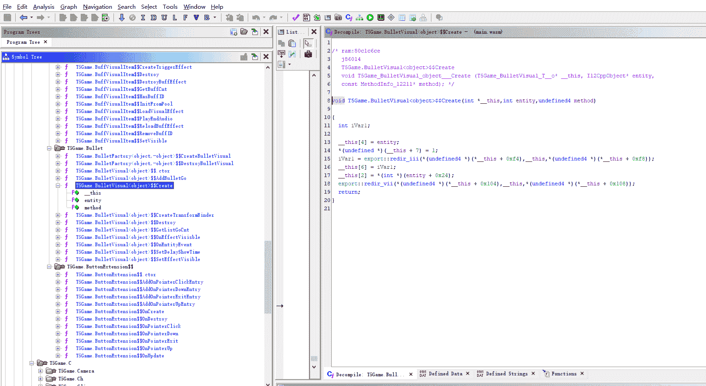
- 是不是清晰多了
- 还没完

- 我们还可以通过`Il2CppDumper`导出得到的 `dll` 来获取它对应的数据结果，这在调试`wasm`时很有帮助
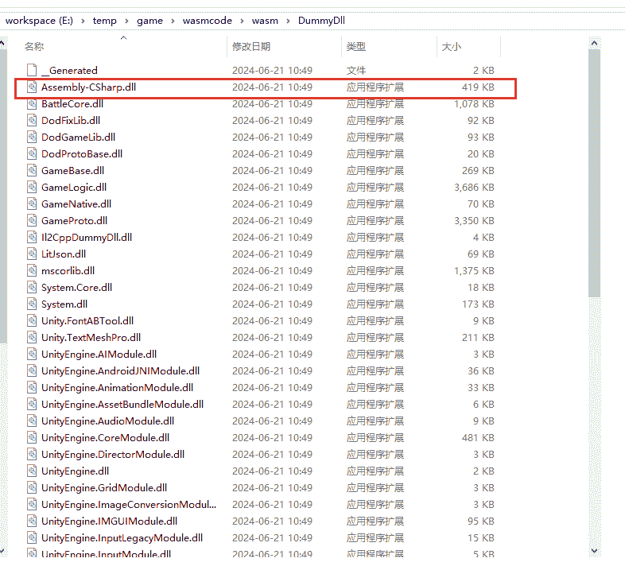
- 直接拖进`ILSpy`
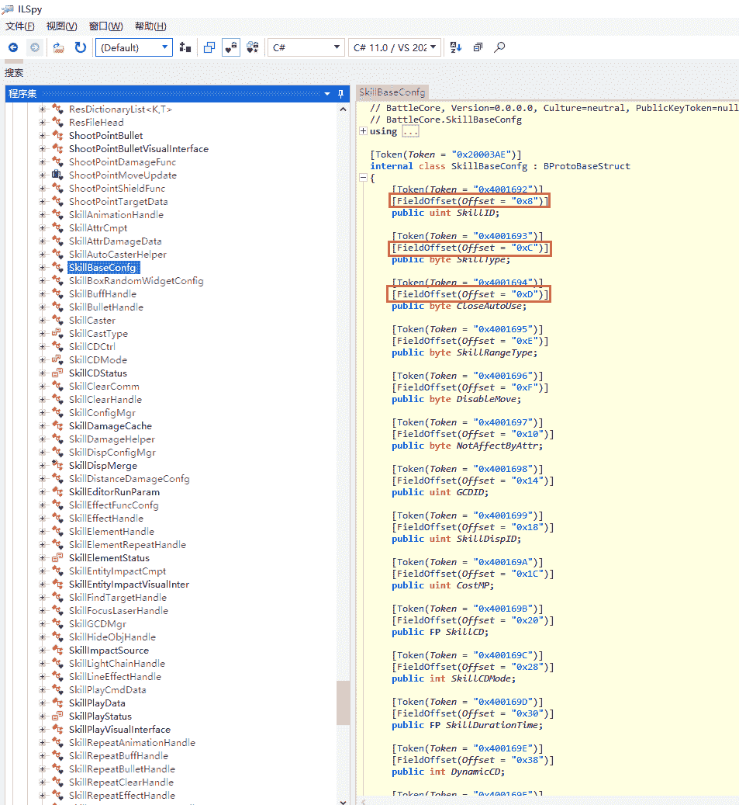
- 这些结构信息和字段偏移很有用的

## 开始调试wasm
- 假设我现在要找个释放技能的函数 `PlaySkill`
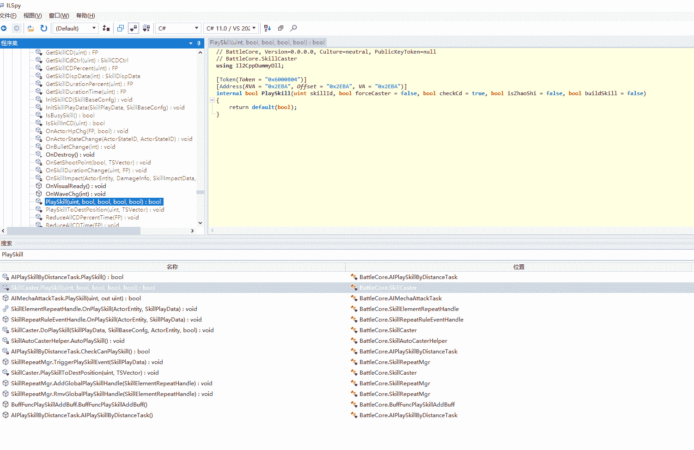
找到了对应的函数，然后我们到 `Ghidra` 搜索 `SkillCaster$$PlaySkill` （类名$$方法)
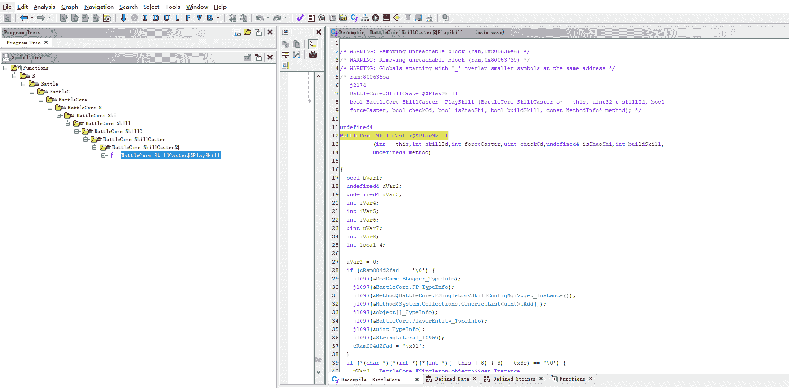
- 然后通过上面注释中的 `j2174` 直接在 `wasm`中搜索即可 (这里需要开启小程序的`devtools`)
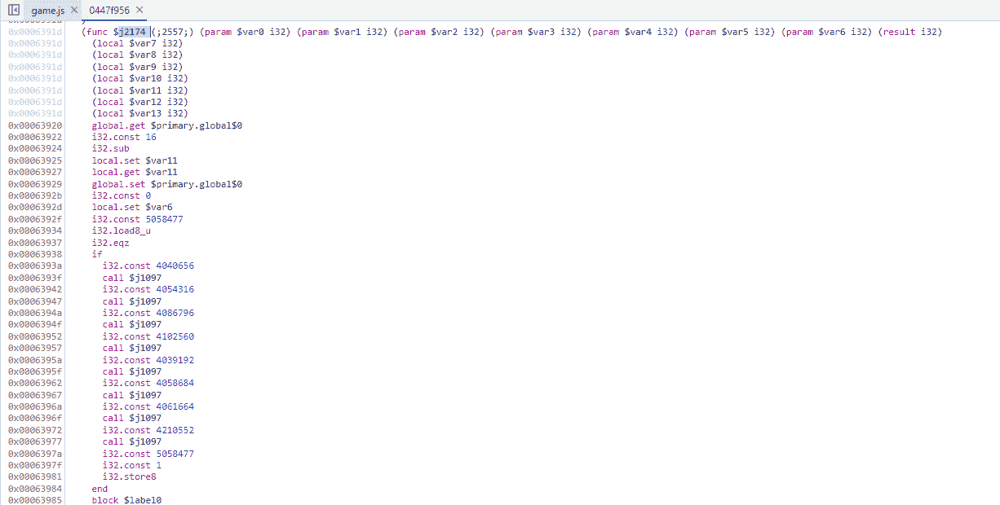
- 我这里截图的时候，游戏更新了... 定位变掉了， 这里只做个示例
- 怎么破解游戏这个就只是时间问题了
- 随便下个日志断点，实时修改响应的内存数就行了，当然又能会有内存检查，小心封号哦


## 如何持久化改动呢 (我还没测试，但是我感觉可行)
- 这里我们可以用 `wasm2wat` 先转成 `wat` 再修改，改完再 `wat2wasm`

- 写个示例：

```
(module

(func (export "isAdmin") (result i32)

    i32.const 0 ;;  永远返回 0

)

)
```
- 编译成 `wasm` `wat2wasm test.wat -o test.wasm`
- 写个JS跑一下
```
const fs = require('fs')
;(async () => {
  const {instance} = await WebAssembly.instantiate(fs.readFileSync('./aa.wasm'))
  // console.log(instance.exports)
  console.log(instance.exports['isAdmin']())
})()
```
- 打印 0
- 然后 `wasm2wat test.wam -o test2.wat`

```
(module

  (type (;0;) (func (result i32)))

  (func (;0;) (type 0) (result i32)

    i32.const 0) ;;  把这里 const 0  改成 1

  (export "isAdmin" (func 0)))
```
- 重新编译成 `wasm` `wat2wasm test.wat -o test.wasm`
- 再跑一下上面的测试代码
- 打印1了
但是

- 这里要注意，他里面可能有 `md5` 校验
- 好了我写完了，下面贴出相关工具的链接

## 相关工具
- [//github.com/r3x5ur/unveilr" target="_blank" rel="noopener noreferrer nofollow"](https://github.com/r3x5ur/unveilr:rel="nofollow noopener" href="https)
- [//github.com/google/brotli/releases/tag/v1.1.0" target="_blank" rel="noopener noreferrer nofollow"](https://github.com/google/brotli/releases/tag/v1.1.0:rel="nofollow noopener" href="https)
- [//github.com/NationalSecurityAgency/ghidra" target="_blank" rel="noopener noreferrer nofollow"](https://github.com/NationalSecurityAgency/ghidra:rel="nofollow noopener" href="https)
- [//github.com/nneonneo/ghidra-wasm-plugin" target="_blank" rel="noopener noreferrer nofollow"](https://github.com/nneonneo/ghidra-wasm-plugin:rel="nofollow noopener" href="https)
- [//github.com/Perfare/Il2CppDumper/releases/tag/v6.7.40" target="_blank" rel="noopener noreferrer nofollow"](https://github.com/Perfare/Il2CppDumper/releases/tag/v6.7.40:rel="nofollow noopener" href="https)
- [//github.com/icsharpcode/ILSpy" target="_blank" rel="noopener noreferrer nofollow"](https://github.com/icsharpcode/ILSpy:rel="nofollow noopener" href="https)
- [//github.com/WebAssembly/wabt" target="_blank" rel="noopener noreferrer nofollow"](https://github.com/WebAssembly/wabt:rel="nofollow noopener" href="https)
- [//github.com/jozsefsallai/unityweb/releases/tag/v1.0.2" target="_blank" rel="noopener noreferrer nofollow"](https://github.com/jozsefsallai/unityweb/releases/tag/v1.0.2:rel="nofollow noopener" href="https)

