# [Web逆向] 武海笔院书籍的 PDF 下载

- 原帖: https://www.52pojie.cn/forum.php?mod=viewthread&tid=1938457
- 抓取时间: 2026-11-01T22:28:25

文武双全天灵根。

泉海碧波映佳人。

书笔怎写羞羞事。

局院深处躺平时。

== 欸~道友留步呀，这么着急走作甚？你还没说这 武海笔院 是何处呢？还有，这什么打油诗？

=> 这，＞︿＜ 哎呀，真是的 ，每次都要这样吗？……（四顾无人，施展好不容易修到大圆满境界的隔音术，再悄悄说道）你把每行诗句的开头，对，就开头第一个字连起来看看。

== 啊？哦~~哦！原来如此！(≧∇≦)ﾉ 道友着实有心了，不过下次可以不要取奇怪的标题吗？别人看不懂也搜索不到这里呀。

=> 咳咳，我也是没办法，所以只能看谁有缘了。

== 好吧，那这 “文……

=> 住口！不要说下去了，千万不要说出那四个字！！！

== ？？(＃°Д°)

=> （待到平复心中的惊慌，再运起大圆满境界的传音术）唉……我也不想如此呀，此四字为一灵兽的真名，传闻此灵兽道法通天，在此间（注：此间指逆向星域的web 大陆）不可直呼其名，否则冥冥之中感应到我的存在，仅投下一道视线，我必灰飞烟灭、不得入轮回！

此次也不过是远远瞧见了它的一道分身飞过天边，借用留影石保存画面罢了。

==（⊙ｏ⊙） ……嘶~（倒吸一口凉气）原来如此！多谢道友告知，那我一睹其英姿就走！

=> 别急，给，这是本文结构。
- 简述下载书籍的方案（留影之术）
- 源代码的获取、程序在本地运行的环境配置
- 程序的使用方法
- 具体的分析流程（断因果）。此部分现在可以忽略，等到将来网站变动时可供参考

## 缘起

由于一些不可言说的理由（不能说，就算一直盯着我也不能说），我凑齐五十下品灵石前往 武海笔院 购买书籍。

武海笔院 的书籍有两种阅读方式：在网页端看、下载电子书用它的软件看，都不能带出去，所以我想要将书籍下载下来，选择的方式自然也是：分析网页端，爬取它的图片并生成 PDF。所以此种方式下载的 PDF 是无法复制文字的。

> 

想要下载完整的书籍需要先用灵石购买它，也就是获得该书籍的阅读权限。

我先去散修城的藏经阁寻找方案（指搜索文章、github），前人几乎都是基于 web端爬取图片、合并成 PDF。仔细分析了他们的实现方案、并结合现在灵兽分身的踪迹（指网站的工作方式），发现这些方案容易和该灵兽分身（浏览器）有牵连，会吸引其本体的注意从而被灭（如封 IP、封账号），就像这样：


image-20240625213526732.png (68.28 KB, 下载次数: 1)

[href="forum.php?mod=attachment&aid=MjcwNDAxNHxmMDE4MmE1MXwxNzkzNTcyMTAyfDE2ODA4NnwxOTM4NDU3&nothumb=yes" target="_blank"](https://www.52pojie.cn/forum.php?mod=attachment&aid=MjcwNDAxNHxmMDE4MmE1MXwxNzkzNTcyMTAyfDE2ODA4NnwxOTM4NDU3&nothumb=yes)

2024-6-26 17:44 上传

最后，我于高山之上闭关 1 天另寻他法，且看后文分析。

## 留影之术

下面让我们先探讨现有的、下载图书的方式，最后说明我的解决方案 —— 留影之术。

```
# ======= 回忆长廊 =======
        启动
```

# 当前进度：查看书籍的每一页是怎样的结构

查看网站 HTML 结构，发现每一页的内容由 6 张小图片构成，如下：

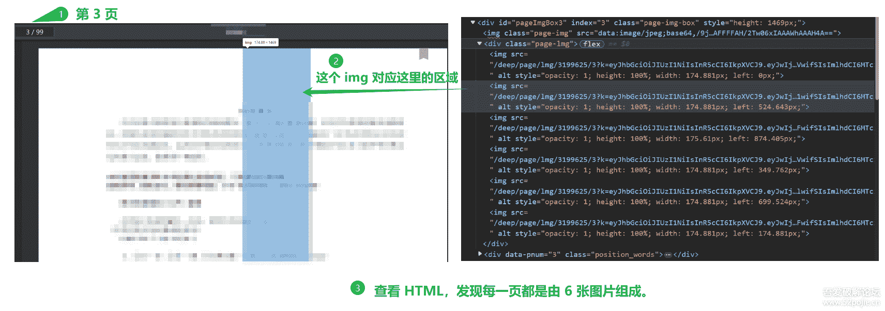

image-20240623121839423.png (270.78 KB, 下载次数: 2)

[href="forum.php?mod=attachment&aid=MjcwMzk5MXw3ZWRjY2RjZHwxNzkzNTcyMTAyfDE2ODA4NnwxOTM4NDU3&nothumb=yes" target="_blank"](https://www.52pojie.cn/forum.php?mod=attachment&aid=MjcwMzk5MXw3ZWRjY2RjZHwxNzkzNTcyMTAyfDE2ODA4NnwxOTM4NDU3&nothumb=yes)

2024-6-26 17:43 上传

通过浏览器的抓包分析，找到这 6 张小图片的请求。

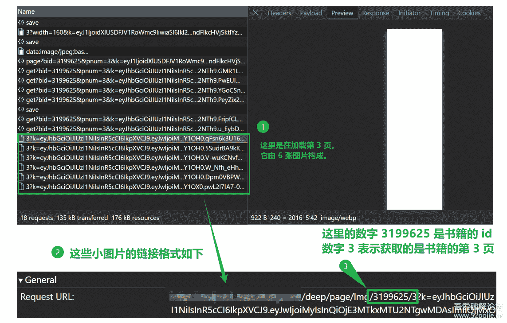

image-20240623121422143.png (278.16 KB, 下载次数: 1)

[href="forum.php?mod=attachment&aid=MjcwMzk5MHwwNDMxYzE4YnwxNzkzNTcyMTAyfDE2ODA4NnwxOTM4NDU3&nothumb=yes" target="_blank"](https://www.52pojie.cn/forum.php?mod=attachment&aid=MjcwMzk5MHwwNDMxYzE4YnwxNzkzNTcyMTAyfDE2ODA4NnwxOTM4NDU3&nothumb=yes)

2024-6-26 17:43 上传

显而易见地：我们需要爬取这些小图片、合成每一页的图片，最后合并所有的页，得到一个 PDF 文件。

现在让我们仔细探讨现有的爬取方式。

### 模拟请求

不推荐此方式。

经过测试，发现在鼠标滚轮滚动时会触发一个 `save` 请求（滚动一次就触发一次）。

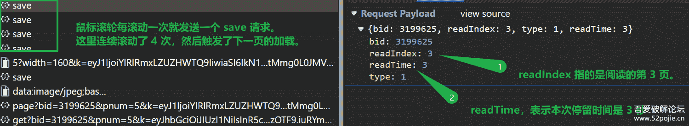

image-20240623220649132.png (118.42 KB, 下载次数: 1)

[href="forum.php?mod=attachment&aid=MjcwMzk5NXxmMzMzMTQyMHwxNzkzNTcyMTAyfDE2ODA4NnwxOTM4NDU3&nothumb=yes" target="_blank"](https://www.52pojie.cn/forum.php?mod=attachment&aid=MjcwMzk5NXxmMzMzMTQyMHwxNzkzNTcyMTAyfDE2ODA4NnwxOTM4NDU3&nothumb=yes)

2024-6-26 17:43 上传

这是在做什么呢？这是在记录我的阅读时长，或者说阅读习惯，具体说明如下：

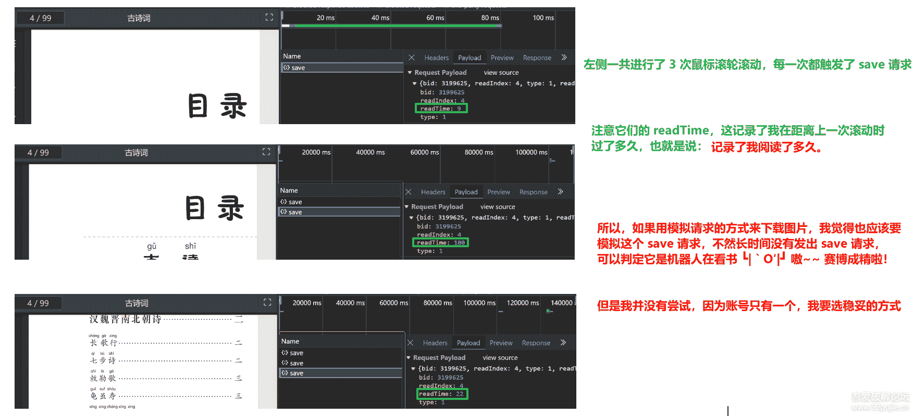

image-20240623221416276.png (279.62 KB, 下载次数: 1)

[href="forum.php?mod=attachment&aid=MjcwMzk5NnxmMjZmNzE4Y3wxNzkzNTcyMTAyfDE2ODA4NnwxOTM4NDU3&nothumb=yes" target="_blank"](https://www.52pojie.cn/forum.php?mod=attachment&aid=MjcwMzk5NnxmMjZmNzE4Y3wxNzkzNTcyMTAyfDE2ODA4NnwxOTM4NDU3&nothumb=yes)

2024-6-26 17:43 上传

模拟请求的方式有以下缺点：

- 虽然可以模拟上述的 `save` 请求，但这需要大量测试是否可行，我的帐号只有一个，所以不能轻易尝试。
- 考虑账号的安全性，模拟请求所耗费的时间、精力（分析请求、分析参数）以及可能承担的后果都使得我不推荐此方式。

### 自动化工具

不推荐此方式。

在部分解决方案中（注：此处原本想放一个链接，却发现其牵扯到灵兽的另一分身，不得不用我大圆满境界的打码术去除了）使用的是自动化工具 `selenium`，并且提到了“那 6 张小图片不能二次访问”，其中一个解决方案是用代码控制鼠标右键点击图片来保存。

自动化方案有以下缺点：

- 自动化工具是可以被检测的，账号只有一个，我要选稳妥的方式。
- 保存图片的时候用 `pyautogui` 控制鼠标、键盘，这样就不能在电脑上做其它的事情了。

### 我的方案：代{过}{滤}理捕获，留影之术

既然小图片只能访问一次，我的想法是通过拦截响应来获取图片。这可以写成浏览器插件的形式，不过考虑到要捕获请求了，最好和浏览器分离开来，所以使用代{过}{滤}理的形式！

没错！完全和浏览器隔开，不沾染因果，此乃留影之术的本质。

整个流程如下：

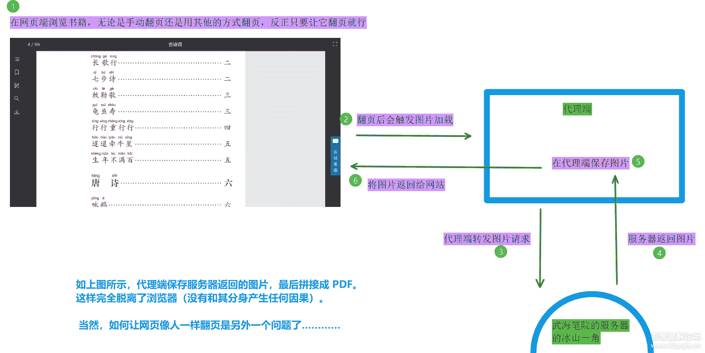

image-20240623223921856.png (198.8 KB, 下载次数: 1)

[href="forum.php?mod=attachment&aid=MjcwMzk5N3w0YTU3YWFkZnwxNzkzNTcyMTAyfDE2ODA4NnwxOTM4NDU3&nothumb=yes" target="_blank"](https://www.52pojie.cn/forum.php?mod=attachment&aid=MjcwMzk5N3w0YTU3YWFkZnwxNzkzNTcyMTAyfDE2ODA4NnwxOTM4NDU3&nothumb=yes)

2024-6-26 17:43 上传

当然它的缺点很明显：非常占用资源，因为浏览器会一直发出图片请求、并解析、渲染图片啦。

== 可是，(。・・)ノ 要怎么自动翻页呢？？！

=> 经过前文的分析，我们要稳妥一点，所以不要自动翻页。

== 啊？？那我该怎么办？w(ﾟДﾟ)w

=> 手动翻页呗，难不成自己翻页太快也要封账号？！大家可是都会量子波动速读法的！—— 此法术只有在发动的时候才能记住文字，一旦停止施法，读过的内容就全部忘记了，这也许就是该法术的代价吧。

== 什么鸡肋术法，我就是想自动翻页、自动下载！(○´･д･)ﾉ

=> ……这样，你给我 100 下品灵石，我帮你翻页，这样对你来说也算是自动的。

== 啊！突然记起来传法殿中是有这么个量子什么阅读法的 ╥﹏╥... 可是我宗门贡献分不够兑换呀

=> 真拿你没办法，既然有缘，再多说道一二。现在你可以用任何方式、只要能让浏览器翻页就行 —— 前端就是这样的，只需要好好翻页就行了，可代{过}{滤}理端要考虑的事情就多了。

== 嗯？这个句式好像有点眼熟 (´･ω･`)?

=> 咳咳……我认为比较稳妥的是：编写 `JS` 脚本实现滚动翻页（是让页面慢慢滚动从而翻页，而不是一页一页地、跳跃式翻页），不使用自动化工具来操作浏览器（不要和分身有任何牵连）。如此，自动翻页既安全、也可以做其他的事情嘛。

== 嗯嗯，然后呢？然后呢？

=> 放心，项目里有自动翻页的脚本啦。不过在我的测试中，自动翻页超过一定次数，会弹出错误信息（把我吓出一身冷汗，我甚至感觉到其本体的视线已经跨越时间与空间，将我钉在了此处，它似乎正看我的过去、我的来历，毕竟在他的眼中，小小练气修士是不敢招惹它的，如果它知道我没有强悍的背景，恐怕……额，好像可以无视警告继续翻页欸，咳咳，稳妥起见，可以暂停一会）。


image-20240625231840243.png (12.62 KB, 下载次数: 0)

[href="forum.php?mod=attachment&aid=MjcwNDAxNnw4Y2MwM2IzY3wxNzkzNTcyMTAyfDE2ODA4NnwxOTM4NDU3&nothumb=yes" target="_blank"](https://www.52pojie.cn/forum.php?mod=attachment&aid=MjcwNDAxNnw4Y2MwM2IzY3wxNzkzNTcyMTAyfDE2ODA4NnwxOTM4NDU3&nothumb=yes)

2024-6-26 17:44 上传

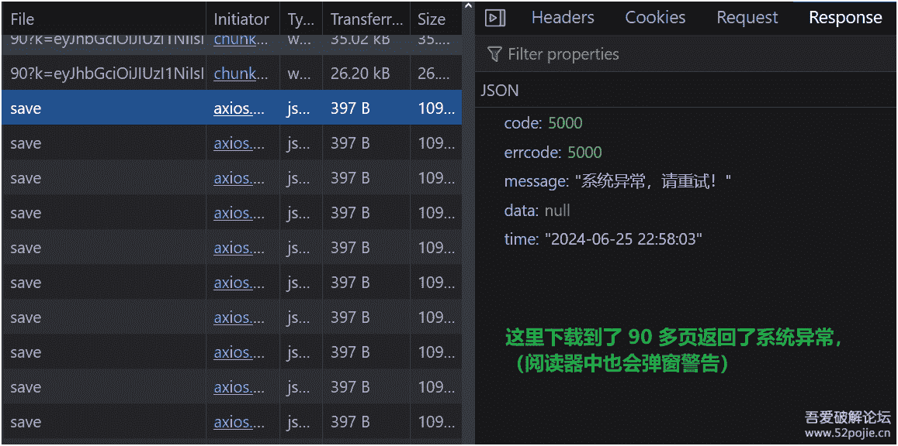

image-20240625231945960.png (117.76 KB, 下载次数: 1)

[href="forum.php?mod=attachment&aid=MjcwNDAxN3w0NDExZTczNXwxNzkzNTcyMTAyfDE2ODA4NnwxOTM4NDU3&nothumb=yes" target="_blank"](https://www.52pojie.cn/forum.php?mod=attachment&aid=MjcwNDAxN3w0NDExZTczNXwxNzkzNTcyMTAyfDE2ODA4NnwxOTM4NDU3&nothumb=yes)

2024-6-26 17:44 上传

### 重要声明

我并没有测试 “一个账号一天翻完了多本书会不会封账号”（这还要花钱买书测试呢！我也不推荐大家尝试），不过仔细想想，怎么说也是手动翻页的，不应该封号才对呀，除非它强烈抗议用户使用量子波动速读法。

== 可是，它都明确说了禁止下载……

=> 咳！这个嘛，尽管放心，我也只是自己用啦，我也不推荐道友将这个拿出去乱搞哈。

最后，重要事情说三遍。

建议一天下载一本书，账号只有一个，要用最稳妥的方式！

建议一天下载一本书，账号只有一个，要用最稳妥的方式！

建议一天下载一本书，账号只有一个，要用最稳妥的方式！

## 环境配置

此部分是大家拿到源代码、在本地运行之前的配置。

从 `https://github.com/Hosinoharu/WuHaiBiYuan_downloader` 获取源代码。

### 配置 Python 环境

首先需要有 Python 3.11 及以上版本（因为我写代码时用的这个版本，我也没有用低版本的 Python 进行测试）。

```
# 首先进入到项目所在的目录 WuHaiBiYuan_downloader
# 这里使用的是内置的 venv 模块来创建虚拟环境
# 该虚拟环境保存在当前目录（项目所在目录）下的 .venv 目录中
python -m venv .venv
# 然后启动虚拟环境
.\.venv\Scripts\activate
# 修改该虚拟环境 pip 的下载源，大家也可以用自己常用的那个
pip config set global.index-url https://mirrors.aliyun.com/pypi/simple/ --site
# 执行以下命令安装依赖包
pip install -r requirements.txt
# 测试核心的代{过}{滤}理软件是否安装正常
mitmdump.exe --version
# 执行上行命令之后会输出以下类似的信息
'''
PS > mitmdump.exe --version
Mitmproxy: 10.3.1
Python:    3.11.4
OpenSSL:   OpenSSL 3.2.2 4 Jun 2024
Platform:  Windows-10-10.0.19045-SP0
'''
# 然后启动代{过}{滤}理程序，开始配置证书
mitmdump.exe
```

### 配置浏览器的代{过}{滤}理

不同浏览器的代{过}{滤}理配置方式不同（有些浏览器无法单独配置代{过}{滤}理，只有配置到操作系统上），这个大家自己搜索吧。这里以 Firefox 为例，设置方式如下：


image-20240625161214176.png (133.24 KB, 下载次数: 0)

[href="forum.php?mod=attachment&aid=MjcwNDAwM3xiNmJjYWFjNnwxNzkzNTcyMTAyfDE2ODA4NnwxOTM4NDU3&nothumb=yes" target="_blank"](https://www.52pojie.cn/forum.php?mod=attachment&aid=MjcwNDAwM3xiNmJjYWFjNnwxNzkzNTcyMTAyfDE2ODA4NnwxOTM4NDU3&nothumb=yes)

2024-6-26 17:44 上传

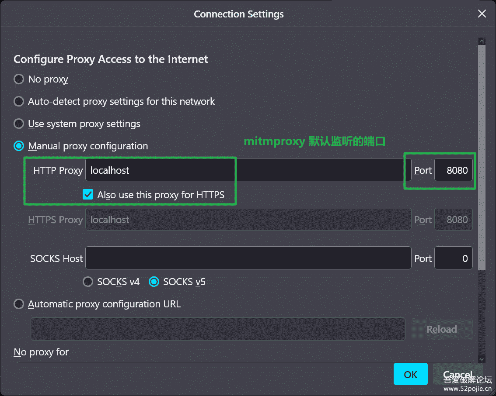

image-20240621141131373.png (93.86 KB, 下载次数: 1)

[href="forum.php?mod=attachment&aid=MjcwMzk4NXwwZWRjOWE0ZHwxNzkzNTcyMTAyfDE2ODA4NnwxOTM4NDU3&nothumb=yes" target="_blank"](https://www.52pojie.cn/forum.php?mod=attachment&aid=MjcwMzk4NXwwZWRjOWE0ZHwxNzkzNTcyMTAyfDE2ODA4NnwxOTM4NDU3&nothumb=yes)

2024-6-26 17:42 上传

然后点击 OK 完整代{过}{滤}理设置。

### 配置代{过}{滤}理证书


访问 http://mitm.it 下载证书。我选择证书只用于浏览器本身。

上述的网址来自于官方文档，具体见 https://docs.mitmproxy.org/stable/overview-getting-started/#configure-your-browser-or-device 的说明

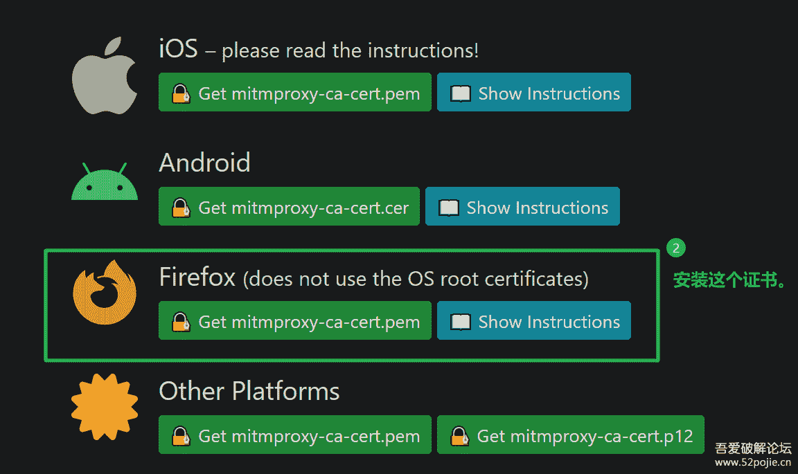

`image-20240621141448184.png` (97.21 KB, 下载次数: 0)
2024-6-26 17:43 上传

然后给浏览器安装下载的证书，具体步骤也可以点击上图中的 `Show Instructions`，下面是截图。


`image-20240621141715164.png` (101.92 KB, 下载次数: 0)
2024-6-26 17:43 上传

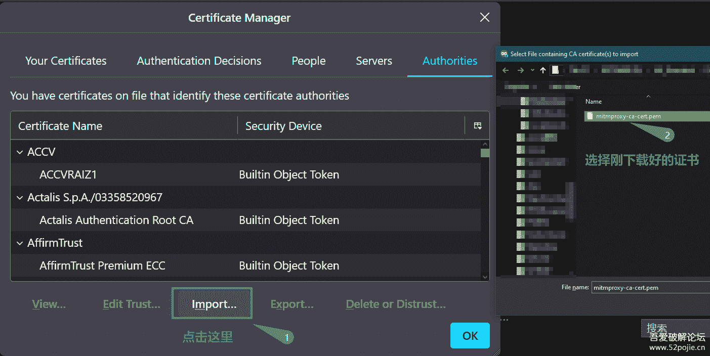

`image-20240621142642849.png` (99.23 KB, 下载次数: 0)
2024-6-26 17:43 上传

按下图进行选择，最后点击 `OK` 完成证书配置。

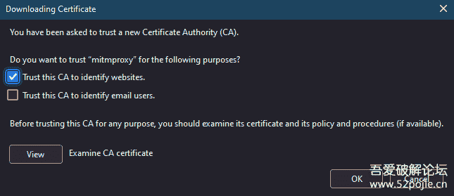

`image-20240621142543088.png` (22.55 KB, 下载次数: 0)
2024-6-26 17:43 上传

### 3. 测试整个环境

至此环境配置结束，重新运行以下命令看看是否工作正常。


```
# -s 指定 py 脚本
# -q 表示 quiet，不输出冗余的信息
mitmdump.exe -s .\test\test_env.py -q

# 然后浏览器访问任意网站查看是否有输出结果
```

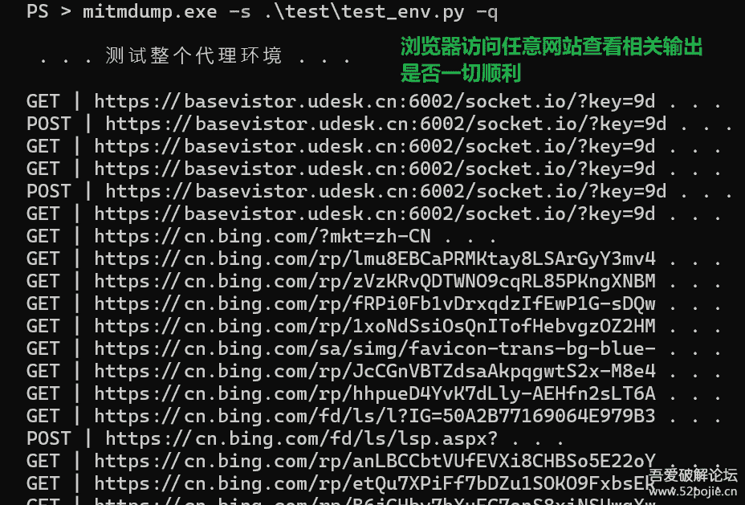

### 结束程序之后记得取消代{过}{滤}理

当结束`mitmdump`代{过}{滤}理之后，记得取消浏览器的代{过}{滤}理设置，不然浏览器无法访问任何网站啦。

## 使用方法

后文的截图可能和实际所示不同，因为现在（写下这段文字的时刻）修复了几个 bug，或者增加了另外一些功能，由于时间原因（才……才不是偷懒 (～￣▽￣)～），并没有重新截图与说明，但不影响使用。

### 测试翻页脚本

将项目中`web_script\web_scroll.js`复制出来，添加到油猴脚本（油猴脚本的安装、使用均省略）。

然后测试翻页脚本功能是否正常（注意，此时浏览器没有上代{过}{滤}理呢），此步骤是检测网站的 HTML 结构是否已经变化。

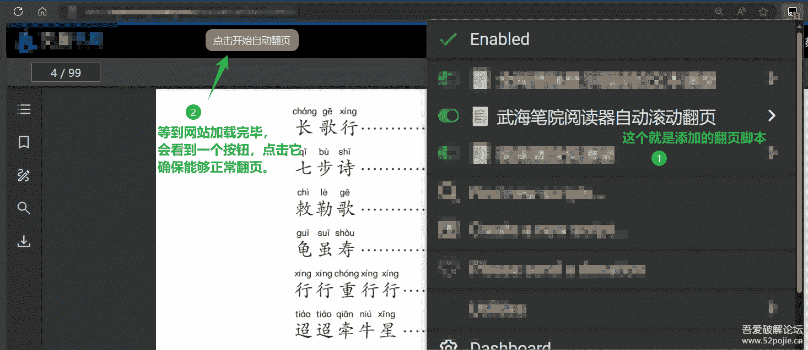

默认情况下 3s 向下滚动一次（移动 300px），如果当前页面的 6 张小图片没有加载出来则不进行翻页。

- 如果网络慢，网页端都没有加载到图片就继续往下翻，那就不会再发出图片请求，会缺页。

- 翻得太快网页端也不会发出图片请求，造成缺页。

> 不要觉得翻页慢，因为翻页的过程中完全可以用浏览器做其他的事情。“快速下载” 和 “账号” 哪一个重要大家自行判断。
>
> 强烈建议翻慢一点，真要是用了量子波动速度法……出了什么事我可不负责哈！
>
> 啊？？还好我没有用宗门贡献分兑换这鸡肋术法！
>
> 总之，现在只需要考虑怎么翻页翻得像人在看书就行。

### 确认要下载的书籍

确认要下载哪本书籍，将其`id`添加到设置文件`proxy_server\settings.jsonc`中。

这是因为使用代{过}{滤}理的方案进行下载时，我们依然可以使用浏览器，为了避免下载其它无关紧要的书籍，需要提前指定要下载哪本书。

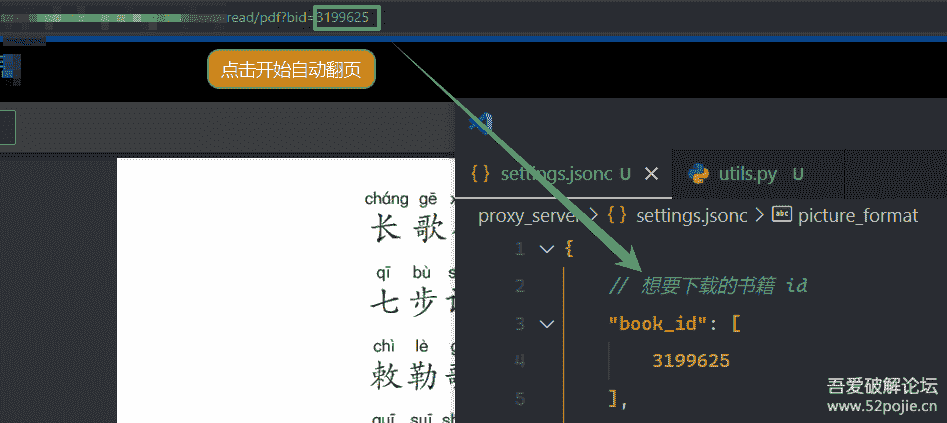

> 如果指定了多本书，自然可以开两个标签页同时下载，因为它们都会经过代{过}{滤}理端。
>
> 但是为了账号的安全性，不建议这样做。

### 下载书籍

在命令行中执行`mitmdump.exe -s .\proxy_server\main.py -q`启动代{过}{滤}理。

- 访问书本的阅读页，如 https://武海笔院网址/deep/read/pdf?bid=3199625，程序会自动识别书籍信息、目录信息

- 然后点击自动翻页按钮就行了。

- 之后可以干其他的事情，只需要让该浏览器标签页运行（但不要最小化）即可。

#### 处理单页下载失败

如果下载过程中某一页没有下载也无妨，可以手动滚动页面再访问一次即可。

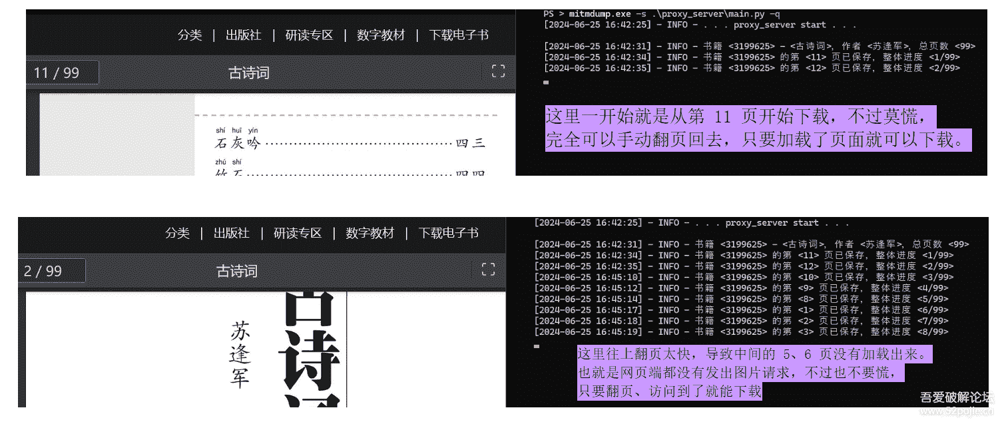

多次刷新网页、或者不小心关闭了标签页都无妨，代{过}{滤}理端不会重复下载已保存的图片。

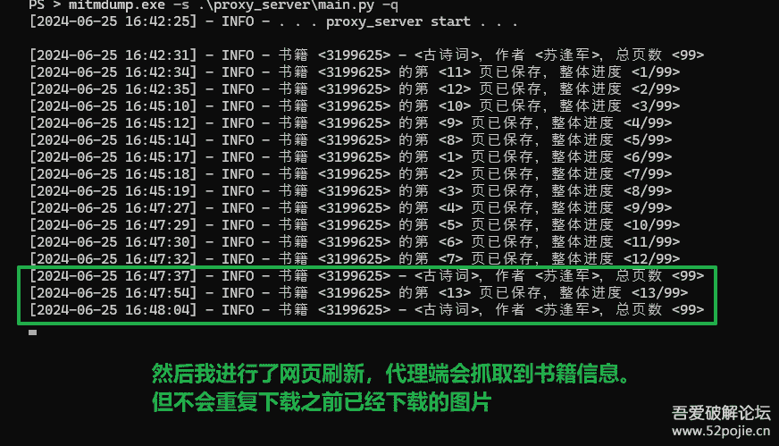

#### 处理代{过}{滤}理端重启

代{过}{滤}理端中途停掉也无妨，可以重启代{过}{滤}理、然后按照之前步骤翻页即可。

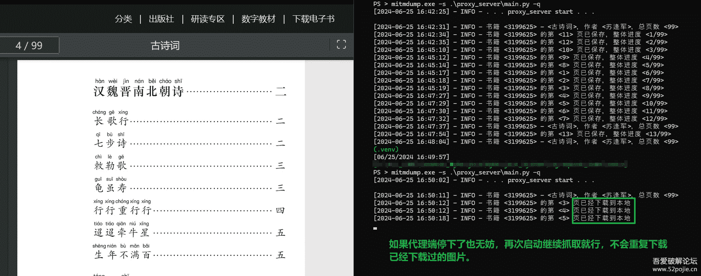

注意，当代{过}{滤}理端重新启动时，需要刷新阅读页，因为需要重新获取书籍信息、书签，这两个数据会用于判断书籍是否下载完毕、以及后续生成 PDF。同时重启代{过}{滤}理后，会提示有哪些页数还没有下载。

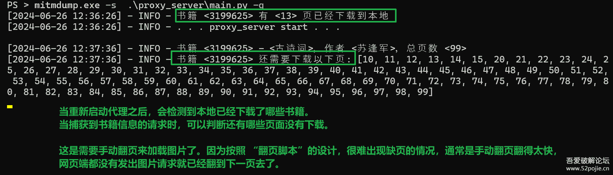

#### 保存为 PDF 文件

首先是书籍所有图片、书签信息保存的目录。

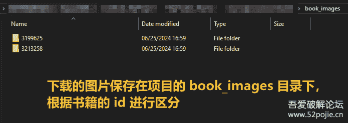

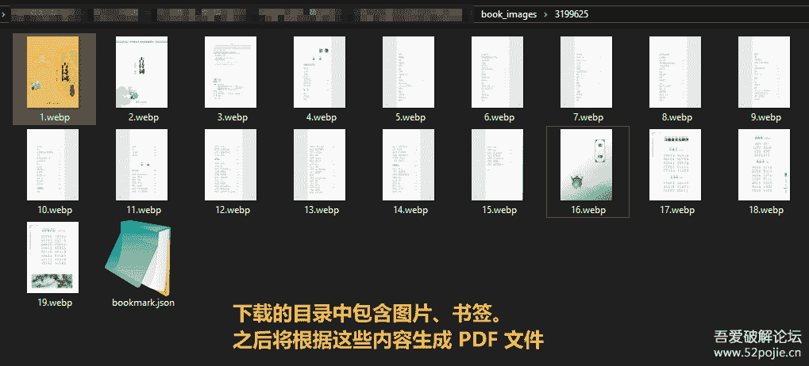

等到下载完毕，就会自动合成 PDF 保存到`download_book`目录下。

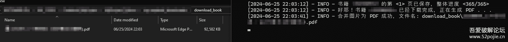

如果某些原因导致：在下载完所有图片之后，并没有合并成 PDF ，那么可以执行`utils.py`来手动合并 PDF。

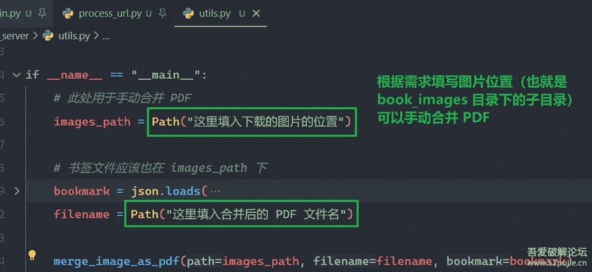

#### 运行情况说明

运行过程中资源占用率较大，因为浏览器一直翻页、解析、渲染图片。这也是该方式的缺点了，但是账号安全（前提是不能翻页太快）。

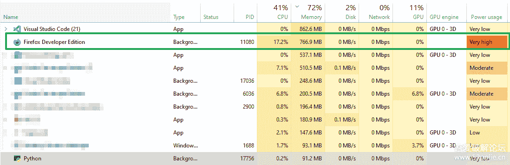

最后，我下载的那本书共有 365 页，所有下载的图片共 43.4 MB，生成的 PDF 为 90.4 MB。如果大家想继续压缩大小，可以在设置文件中修改保存的图片质量。

### 同时下载多本书

为了账号的安全性，不建议多本下载，不过这里还是提一下。

首先要停止当前运行的代{过}{滤}理端，然后添加新的书籍`id`。

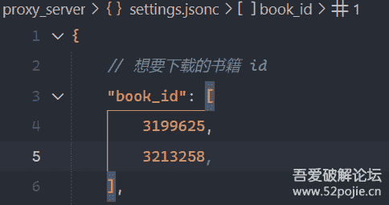

然后重新启动代{过}{滤}理，按照之前的步骤就可以下载了。

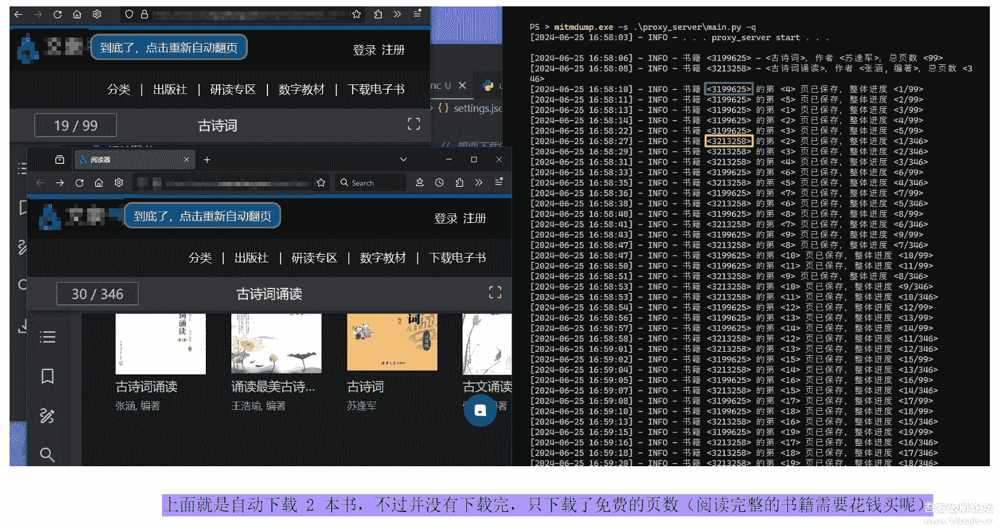

## 留影分身断因果

此部分记录整个分析过程、相关代码的逻辑解释，将来网站变动大家也能自己解决吧。

- 着重记录核心的思路，不包括如何获取书签、生成 PDF 等（已经有很多文章讲解过了）

> 也就是说现在可以忽略这部分内容。

等到下载失败、程序运行异常（这可能是因为网站发生了变动），就可以看此部分的内容，了解大致的分析过程，再自己进行处理。

> 欸~下次变动再找你不就行了？
>
> 不可，我一直在探索一个名为二次元的小世界，其内天然困阵居多，常常被困数十年，所以还是靠大家自己。而且经常更新也会无形间沾染该灵兽分身的因果。

根据之前的留影之术 —— 代{过}{滤}理方案，我们可以直接在代{过}{滤}理端保存那些小图片啦，但是问题来了：不知道这 6 张小图片的排列顺序，怎么拼接成完整的一页？？

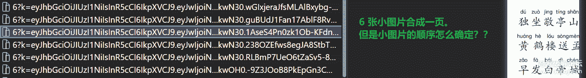

### 确定小图片的顺序

现在让我们进入 回忆长廊 整理思路。


# 回忆长廊

## 查看书籍的每一页是怎样的结构

每一页是由 6 个小图片组成的，并且在代{过}{滤}理端可以直接下载它们，但是代{过}{滤}理端不清楚这些小图片的顺序。只要确定了顺序就可以合成书籍的一页啦。

## 当前进度：如何确定 6 个小图片的顺序

在代{过}{滤}理端只能看到请求的参数、响应等等，猜测小图片的顺序极大可能藏在这个小图片的请求链接中（不然服务器怎么知道请求的是哪个小图片呢）。

根据文章（此处内容已被大圆满层次的打码术进行删除，可通过必应搜索 武海笔院 `jwt` 来找到相关文章）确定参数 `k` 是 `jwt` 加密方式（此处不做解释，请自行必应搜索。它类似 `base64`，是一种固定的加密/编码方式），在 [https://www.json.cn/jwt](https://www.json.cn/jwt) 可以进行解密，却没有发现特别明显的特征。

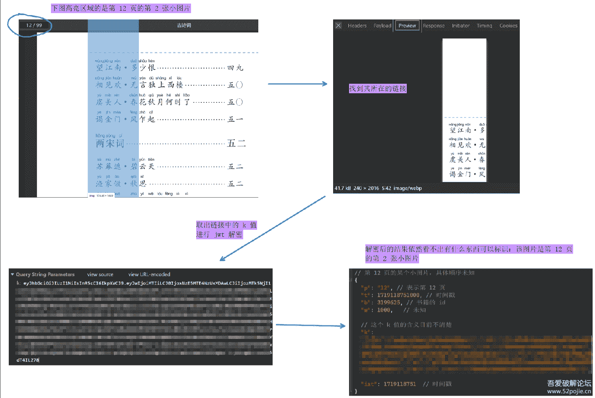

初次展示 k 值.png (266.87 KB, 下载次数: 0)

[附件下载](https://www.52pojie.cn/forum.php?mod=attachment&aid=MjcwMzk5MnwwYmZjMmU2M3wxNzkzNTcyMTAyfDE2ODA4NnwxOTM4NDU3&nothumb=yes)

2024-7-2 12:07 上传

好啦！现在无法通过小图片的链接来判断它们的顺序，该怎么办？？

哼哼，还好我精神力强大，仔细一扫，发现每次请求 6 张小图片时，会先发送 6 个请求并返回奇怪的数据，没错！就是这个！分析流程如下：

WARNING！请注意！我要起名字了，这都是为了后文便于讨论。

我将这 6 个请求称之为 `req_before_split_page`。表示的是：在小图片（也就是分割的图片）之前的请求。

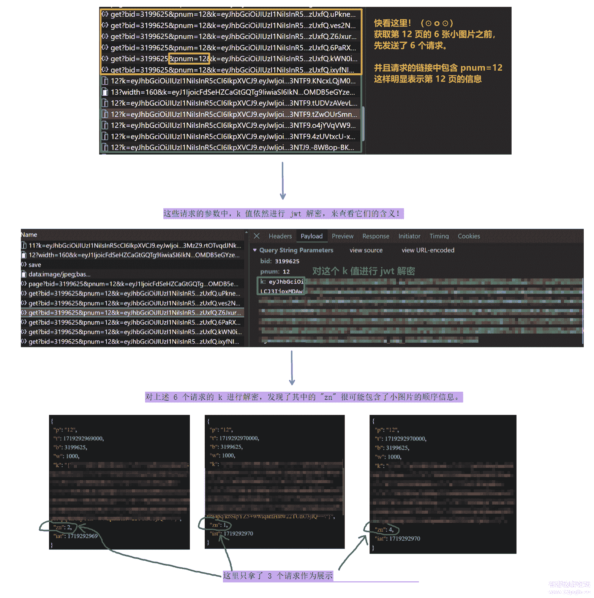

2次展示 k 值.png (981.69 KB, 下载次数: 0)

[附件下载](https://www.52pojie.cn/forum.php?mod=attachment&aid=MjcwMzk5OXwwNTY2NjMzOXwxNzkzNTcyMTAyfDE2ODA4NnwxOTM4NDU3&nothumb=yes)

2024-7-2 12:07 上传

这些 `req_before_split_page`（还记得这个名字不）的返回值也是奇奇怪怪的。

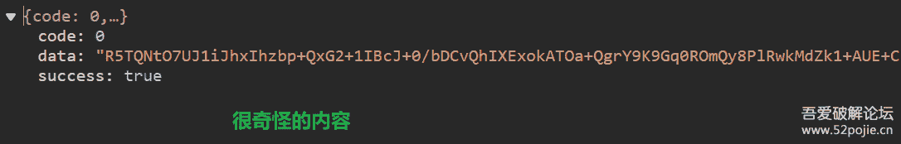

image-20240623134230523.png (31.97 KB, 下载次数: 0)

[附件下载](https://www.52pojie.cn/forum.php?mod=attachment&aid=MjcwMzk5M3xmMWFhM2VjZnwxNzkzNTcyMTAyfDE2ODA4NnwxOTM4NDU3&nothumb=yes)

2024-6-26 17:43 上传

好的，现在让我们进入回忆长廊整理思路。

```text
# ======= 回忆长廊 =======
# 查看书籍的每一页是怎样的结构
        每一页是由 6 个小图片组成的，并且在代{过}{滤}理端可以直接下载它们，但是代{过}{滤}理端不清楚这些小图片的顺序。
    只要确定了顺序就可以合成书籍的一页啦。

# 当前进度：如何确定 6 个小图片的顺序
        发现在获取 6 个小图片之前有 6 个请求，它们的请求参数中似乎包含了小图片的顺序信息。
    而这些请求的返回值似乎还需要进一步处理才行…………

很好，现在需要确定上述 req_before_split_page 请求的响应值是如何处理的，这就需要通过 hook JSON.parse 来发现细节了。
```

```javascript
(function () {

    const deep = 5;

    // 输出堆栈信息，至多向上输出 deep 层堆栈

    // 因为有些网站会封装 JSON.parse 的调用

    function get_caller_location() {

        // stack[0] - Error 字符串

        // stack[1] - 调用 new Error 的位置

        // stack[2] - 调用本函数的位置

        // stack[3] - 上一层的位置，后续应该从此处开始

        const stack = (new Error).stack.split('\n');

        if (stack.length >= 4) {

            return "\t" + stack.slice(3, 3 + deep).join("\n\t");

        }

        return "\t" + stack.join("\n\t");

    }

    // 并未没有处理 .toString() 检测，先这样，够用了

    const parse_proxy = new Proxy(JSON.parse, {

        apply: function (target, thisArg, argumentsList) {

            const result = Reflect.apply(target, thisArg, argumentsList);

            console.log("===> Call JSON.parse\n", get_caller_location(), "\n", JSON.stringify(result));

            return result;

        }

    });

    Object.defineProperty(JSON, "parse", {

        value: parse_proxy,

    });

})();
```

好啦！现在让我们先刷新网页，等待页面加载完毕之后（排除掉干扰数据），注入上述代码，然后滑动鼠标滚轮，触发后续页面的加载！这样 hook `JSON.parse` 的结果都是有关于这些图片请求的。如下确实发现了线索！

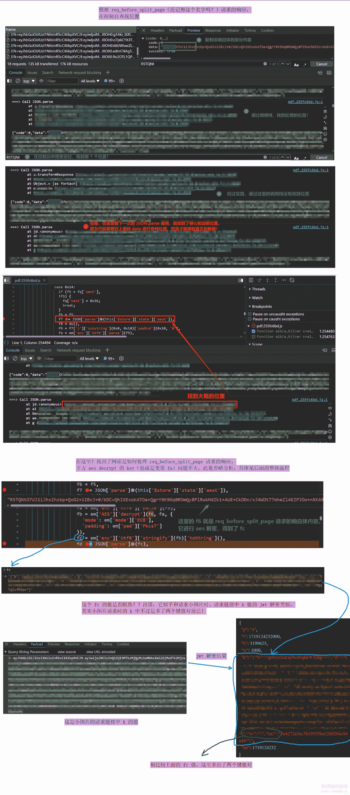

3次展示 k 值.png (1.27 MB, 下载次数: 0)

[附件下载](https://www.52pojie.cn/forum.php?mod=attachment&aid=MjcwNDAwMHw2NTU0YjgyMnwxNzkzNTcyMTAyfDE2ODA4NnwxOTM4NDU3&nothumb=yes)

2024-7-2 12:07 上传

### 完整的回忆长廊

现在让我们最后一次进入回忆长廊。

```text
# ======= 回忆长廊 =======
# 查看书籍的每一页是怎样的结构
        每一页是由 6 个小图片组成的，并且在代{过}{滤}理端可以直接下载它们，但是代{过}{滤}理端不清楚这些小图片的顺序。
    只要确定了顺序就可以合成书籍的一页啦。

# 如何确定 6 个小图片的顺序
        发现在获取 6 个小图片之前有 6 个请求，它们的请求参数中包含了小图片的顺序信息。
    而这些请求的响应值进行处理之后会用于对应的小图片请求！
    通过建立这 6 个请求与 6 个小图片请求的关系，可以确定小图片的顺序！

# 当前进度：梳理流程

现在，让我们看图吧！
```

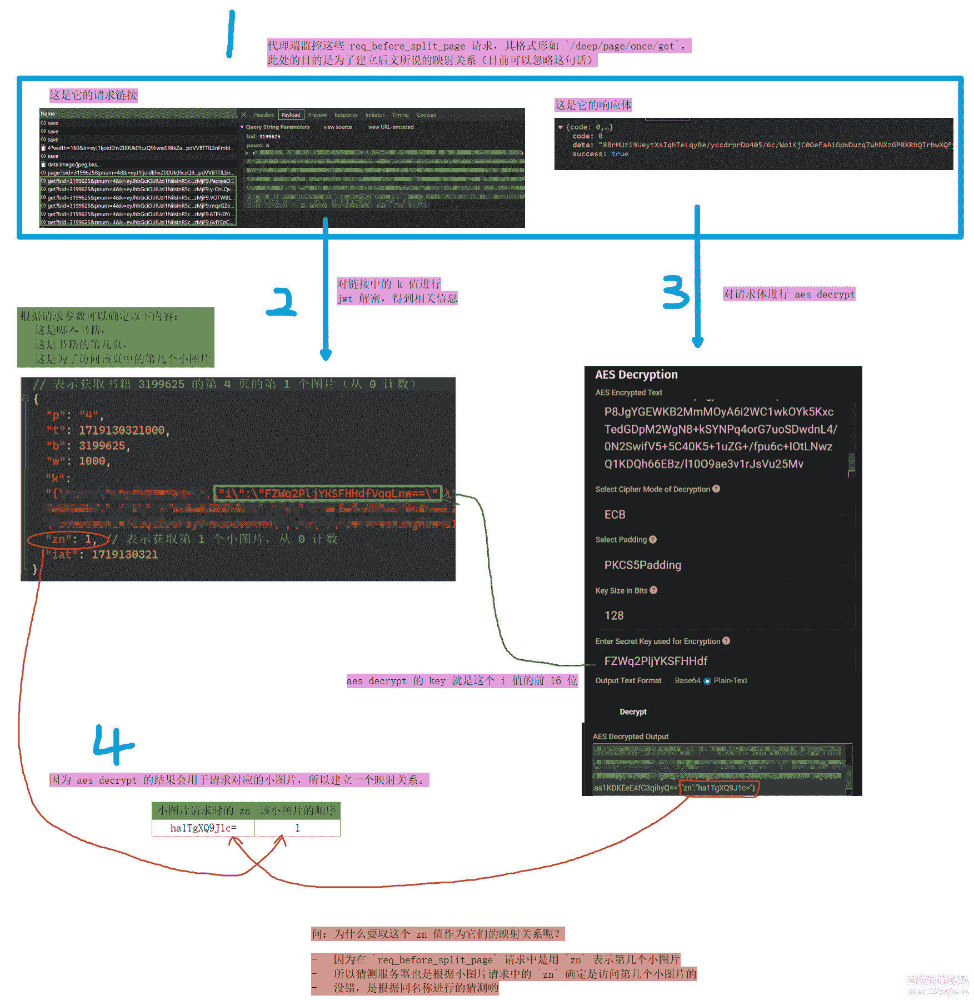

4次展示 k 值.png (588.67 KB, 下载次数: 0)

[附件下载](https://www.52pojie.cn/forum.php?mod=attachment&aid=MjcwNDAwMXwzMTY3ODYyYXwxNzkzNTcyMTAyfDE2ODA4NnwxOTM4NDU3&nothumb=yes)

2024-7-2 12:07 上传

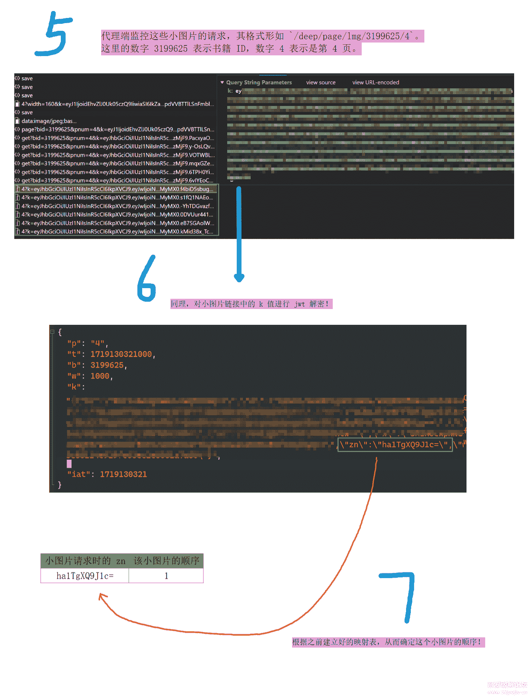

5次展示 k 值.png (462.15 KB, 下载次数: 0)

[附件下载](https://www.52pojie.cn/forum.php?mod=attachment&aid=MjcwMzk5NHw1NTlhNjczYnwxNzkzNTcyMTAyfDE2ODA4NnwxOTM4NDU3&nothumb=yes)

2024-7-2 12:07 上传

好啦！只要在代{过}{滤}理端确认了小图片的顺序，就可以拼接成完整的一页，然后保存每一页，最后拼接成 PDF 啦！

### 未来的变化

网站的反爬必定会变化，只要掌握了这留影之术、寻找小图片顺序的思路，以后大家也能以不变应万变啦。

不过，如果哪一天它的图书图片改成了这种处理方式（看到这种我转头就走）……嗯……所以万万不能让它的本体注意到我。


image-20240625235730852.png (1.08 MB, 下载次数: 0)

[附件下载](https://www.52pojie.cn/forum.php?mod=attachment&aid=MjcwNDAxOHw5OWI5Y2NmNHwxNzkzNTcyMTAyfDE2ODA4NnwxOTM4NDU3&nothumb=yes)

2024-6-26 17:44 上传

## 番外：根据时间戳定位

很多网站在加密时会用到时间戳，那么找到特定时间戳的生成位置，也就非常接近核心加密的位置。

在控制台执行如下脚本，它可以记录生成时间戳的位置！

```javascript
(function () {

    //#region 准备存储相关信息

    function get_caller_location() {

        const stack = (new Error).stack.split('\n');

        if (stack.length >= 4) {

            return "\t" + stack.slice(3, 5).join("\n\t");

        }

        return "\t" + stack.join("\n\t");

    }

    // 封装一个简单的 Map，存储时间戳和生成它的位置

    class TimeStorage {

        constructor() {

            /** [//www.52pojie.cn/home.php?mod=space&uid=2218059" target="_blank"](https://www.52pojie.cn/home.php?mod=space&uid=2218059:href="https) Map */

            this.storage = new Map();

        }

        /**

         * [//www.52pojie.cn/home.php?mod=space&uid=952169" target="_blank"](https://www.52pojie.cn/home.php?mod=space&uid=952169:href="https) {string} key key

         * @param {string} value value

         */

        set(key, value) {

            this.storage.set(key, value);

        }

        /** @param {string} key key */

        get(key) {

            if (key.length === 13) {

                const s = this.storage.get(key);

                if (s) {

                    console.log("找到时间戳:\n", s);

                } else {

                    console.log("没有找到时间戳");

                }

                return;

            }

            // 传入的时间戳长度可能不足 13 位，因为部分网站会只保留 10 位 

            // 只好一个一个查找了

            const times = this.storage.keys();

            const location = new Set();

            let is_found = false;

            for (const t of times) {

                if (t.includes(key)) {

                    location.add(this.storage.get(t));

                    is_found = true;

                }

            }

            if (is_found) {

                console.log("匹配到时间戳:\n", [...location].join("\n=====\n"));

            } else {

                console.log("没有找到时间戳");

            }

        }

    }

    const time_storage = new TimeStorage();

    window['time_storage'] = time_storage;

    //#endregion

    //#region hook Date 以及 Date.now

    const date_now = new Proxy(Date.now, {

        apply(target, this_arg, args) {

            let result = Reflect.apply(target, this_arg, args);

            time_storage.set(result.toString(), get_caller_location());

            return result;

        }

    });

    Object.defineProperty(Date, 'now', {

        value: date_now

    });

    const date_proxy = new Proxy(Date, {

        construct(target, argumentsList, newTarget) {

            let result = Reflect.construct(target, argumentsList, newTarget);
```


```
time_storage.set(result.valueOf().toString(), get_caller_location());

return result;

}

});

Object.defineProperty(window, 'Date', {

value: date_proxy

});

//#endregion

})();
```
然后使用方式如图：

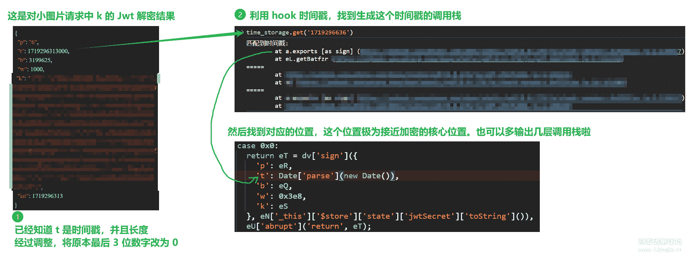

6次展示 k 值.png (178.94 KB, 下载次数: 0)

[href="forum.php?mod=attachment&aid=MjcwNDAwMnw5ZGU1NjM0NXwxNzkzNTcyMTAyfDE2ODA4NnwxOTM4NDU3&nothumb=yes" target="_blank"](https://www.52pojie.cn/forum.php?mod=attachment&aid=MjcwNDAwMnw5ZGU1NjM0NXwxNzkzNTcyMTAyfDE2ODA4NnwxOTM4NDU3&nothumb=yes)

2024-7-2 12:07 上传

== 不对呀，道友既惧因果之累，避而不宣其真名，却又将分身之迹公诸于众，此举已无形间扰动了因果。或许此刻这丝联系尚显微弱，然岁月流转，看过此文的众人其因果皆与尔等牵连，因果循环，假以时日必然织成无法斩断的因果线。

若该灵兽本尊察觉这莫名其妙的因果之线，定追根溯源，寻得道友踪迹。届时，只怕……{{{(>_=> 不早说，我都已经发出去了！！！(っ °Д °;)っ

== 嘿嘿，莫慌，早年偶得一件先天灵物，虽无断因果之能，却能遮掩因果之迹 —— 毕竟那等存在除非被因果线缠身，否则是不会出手的。

=> 哦？这世间竟有如此玄妙之物，听闻只有深谙命运法则的修士能做到这一点。

== 是的，不过此物一直荒废在储物戒指中，于我无用，如今道友急需，百枚灵石即可转让于道友啦。

=> 如此，便有劳了（嗯？此情此景，怎么感觉是很熟悉的操作）

2> end
