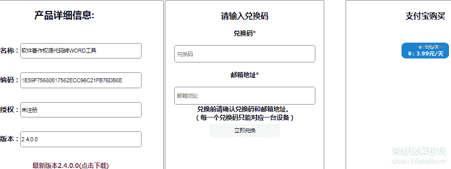
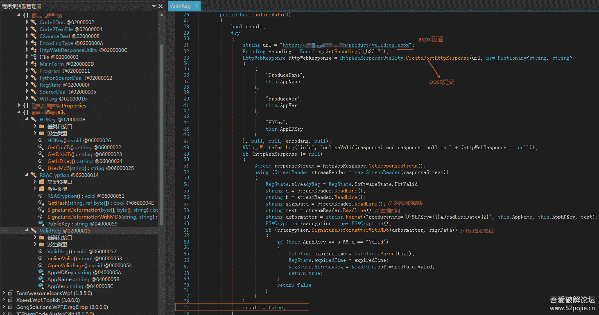
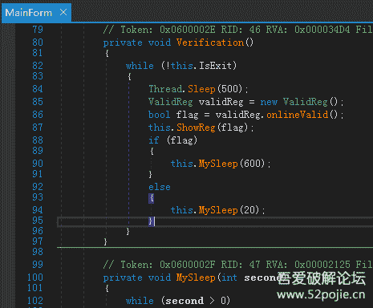
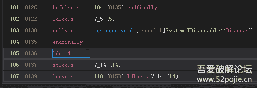
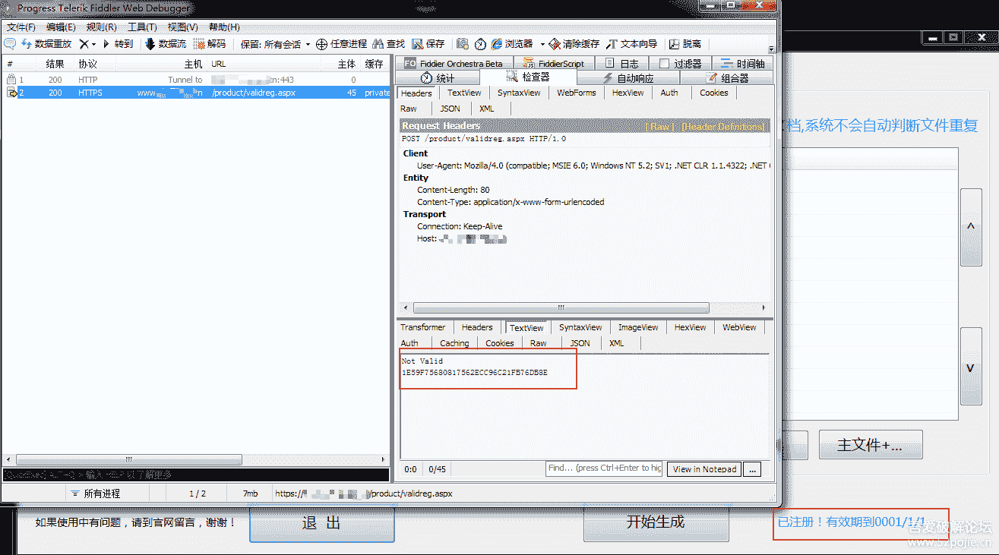
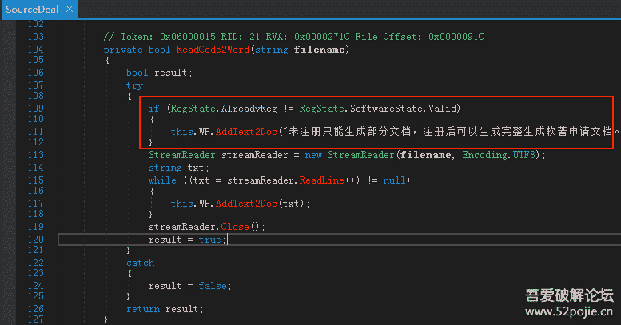
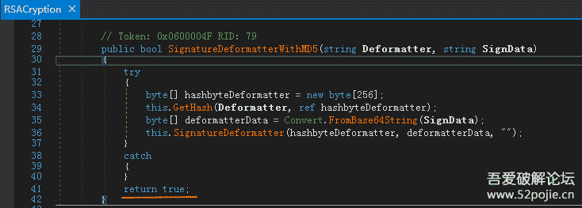
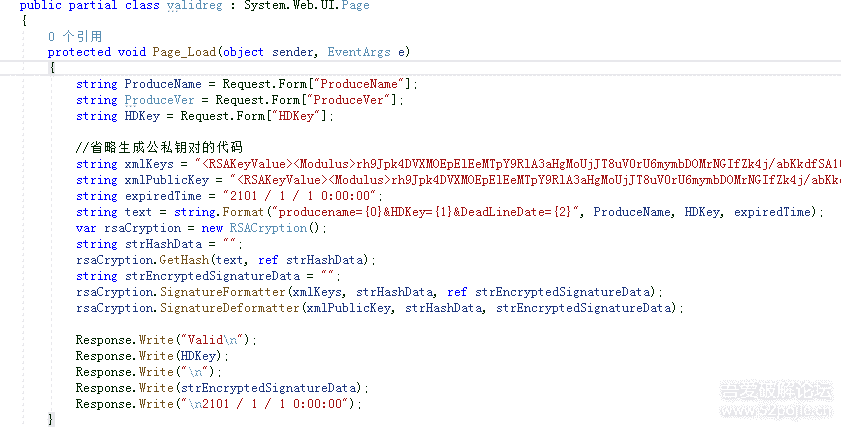
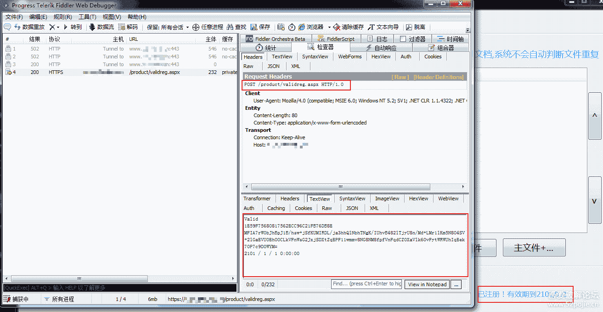

# [.NET逆向] 某源代码转WORD工具破解免注册分析

- 原帖: https://www.52pojie.cn/forum.php?mod=viewthread&tid=1938766
- 抓取时间: 2026-11-01T22:28:23

## 前言

申请软著时，需要按一定word格式提交源代码文档，手动复制粘贴然后再调格式比较繁琐，就在网上搜索类似用途的工具，通过一篇介绍申请注意事项的帖子发现一款软件，遂下载使用。大小只有300多K，只要能生成规范的文档，满足功能即可。但是未注册软件只能生成部分文档，且含有多余文字信息，必须购买才能使用。该软件为一家医疗科技公司所开发（医疗科技公司开发软件？我认为这很跨界），并且就这一个小工具竟要3.99/天，当真有人买？软件很小，所以尝试练手破解。适合新手。



Snipaste_2024-06-26_14-51-45.png (34.72 KB, 下载次数: 0)

[href="forum.php?mod=attachment&aid=MjcwNDIxOXxkN2JjYzk2NXwxNzkzNTcyMTAwfDE2ODA4NnwxOTM4NzY2&nothumb=yes" target="_blank"](https://www.52pojie.cn/forum.php?mod=attachment&aid=MjcwNDIxOXxkN2JjYzk2NXwxNzkzNTcyMTAwfDE2ODA4NnwxOTM4NzY2&nothumb=yes)

2024-6-27 16:56 上传

## 某源代码转WORD工具

混淆：ConfuserEx

版本：2.4.0

## 去混淆

首先拖入DIE分析，显示其为.NET程序，保护器: Confuser(1.X)，拖入dnSpy中查看确为混淆代码。借助工具脱壳去混淆，最终使用ConfuserEx-Unpacker-v2.0能完全去混淆，然后通过dnSpy反编译出代码。

## 分析

与注册有关的功能在`XXXUtils`命名空间的`HDKey`、`RSACryption`、`ValidReg`这3个类中。`HDKey`获取机器的编码（类似于硬盘序列号），代码为

```
return HDKey.UserMd5(cpuID + diskID + versionInfo.ProductName);
```

该编码为CPU的ID号、硬盘ID号、软件名称3个字段拼接字符串的MD5。`RSACryption`是RSA的签名验证算法，其中包含公钥。`ValidReg`与服务器验证页面通信，结果经RSA签名验证，返回注册状态。



Snipaste_2024-06-26_16-32-44.png (141.2 KB, 下载次数: 1)

[href="forum.php?mod=attachment&aid=MjcwNDIyMHwzOGIyNGQ3ZnwxNzkzNTcyMTAwfDE2ODA4NnwxOTM4NzY2&nothumb=yes" target="_blank"](https://www.52pojie.cn/forum.php?mod=attachment&aid=MjcwNDIyMHwzOGIyNGQ3ZnwxNzkzNTcyMTAwfDE2ODA4NnwxOTM4NzY2&nothumb=yes)

2024-6-27 16:57 上传

### 破解方式一

此方式最直接简单粗暴。修改上图第74行使`onlineValid()`函数返回true即可。软件只在`MainForm`类中的`Verification()`处进行联网注册验证，从代码中可以看出，只要程序不退出，若未注册，则每20S进行一次验证通信；若注册，则每10分钟进行一次验证通信。可以修改此处数值，延长注册验证的间隔时间。



Snipaste_2024-06-27_10-15-47.png (17 KB, 下载次数: 0)

[href="forum.php?mod=attachment&aid=MjcwNDIyMXw2MzVjZGZjMXwxNzkzNTcyMTAwfDE2ODA4NnwxOTM4NzY2&nothumb=yes" target="_blank"](https://www.52pojie.cn/forum.php?mod=attachment&aid=MjcwNDIyMXw2MzVjZGZjMXwxNzkzNTcyMTAwfDE2ODA4NnwxOTM4NzY2&nothumb=yes)

2024-6-27 16:57 上传

代码能运行到`onlineValid()`函数内74行的逻辑有两种：1. 收不到服务器响应。2.收到的响应数据经过61行处的函数`SignatureDeformatterWithMD5()`验证后返回false。在运行前断网或者修改`hosts`文件使域名指向localhost，该方法可满足逻辑1。正常联网状态则满足逻辑2。这两种逻辑的程序执行路径不同，但都会运行到74行代码处，将此处结果修改为true可通过注册。点击第74行，点击右键，选择“编辑IL指令”，将序号105处的操作码`ldc.i4.0`更改为`ldc.i4.1`。记得保存文件。



Snipaste_2024-06-26_19-17-26.png (11.92 KB, 下载次数: 0)

[href="forum.php?mod=attachment&aid=MjcwNDIyMnw4MWFmNmE5ZHwxNzkzNTcyMTAwfDE2ODA4NnwxOTM4NzY2&nothumb=yes" target="_blank"](https://www.52pojie.cn/forum.php?mod=attachment&aid=MjcwNDIyMnw4MWFmNmE5ZHwxNzkzNTcyMTAwfDE2ODA4NnwxOTM4NzY2&nothumb=yes)

2024-6-27 16:58 上传

运行软件，显示为“已注册”状态。



Snipaste_2024-06-27_14-48-25.png (116.85 KB, 下载次数: 1)

[href="forum.php?mod=attachment&aid=MjcwNDIyM3xhNTAxYTM3MXwxNzkzNTcyMTAwfDE2ODA4NnwxOTM4NzY2&nothumb=yes" target="_blank"](https://www.52pojie.cn/forum.php?mod=attachment&aid=MjcwNDIyM3xhNTAxYTM3MXwxNzkzNTcyMTAwfDE2ODA4NnwxOTM4NzY2&nothumb=yes)

2024-6-27 16:58 上传

由于之前分析不完整，16楼小伙伴提出使用该方法后，生成文档仍然会有未注册的提示。可以字符串搜索，找到添加提示的代码如下图。



Snipaste_2024-07-01_10-56-58.png (21.23 KB, 下载次数: 1)

[href="forum.php?mod=attachment&aid=MjcwNDgwMXw4MzY3ZmRmNHwxNzkzNTcyMTAwfDE2ODA4NnwxOTM4NzY2&nothumb=yes" target="_blank"](https://www.52pojie.cn/forum.php?mod=attachment&aid=MjcwNDgwMXw4MzY3ZmRmNHwxNzkzNTcyMTAwfDE2ODA4NnwxOTM4NzY2&nothumb=yes)

2024-7-1 11:48 上传

软件中将注册状态分3种：已注册、未注册、未联网。图中代码判断当`RegState.AlreadyReg`字段不是`Valid`（数值1，表示已注册），则向生成文档中添加未注册提示。因对dnSpy不熟练，不知道有没有类似IDA中查找字段引用的功能，除了使用简单的搜索外不知道有什么办法能快速定位`AlreadyReg`字段引用，有熟练的大牛可以评论告知。

若使用逻辑1，不接收响应，则要修改`ReadCode2Word()`中的if判断条件，或使用dnSpy中编辑方法的功能注释掉图中`AddText2Doc("未注册XXX")`的语句（未测试注释掉语句是否能生效）。若使用逻辑2，可以修改`ReadCode2Word()`中的内容，也可以按照19楼的方法将“48行操作码`ldc.i4.2`更改为`ldc.i4.1`”，其对应于代码将

```
RegState.AlreadyReg = RegState.SoftwareState.NotValid;
```

修改为

```
RegState.AlreadyReg = RegState.SoftwareState.Valid;
```

在此感谢评论区指出的问题。

### 破解方式二

软件与服务器中的`validreg.aspx`页面通信，进行注册验证。可以修改第61行处的函数`SignatureDeformatterWithMD5()`，使其返回true，即可通过验证。



Snipaste_2024-06-26_19-32-30.png (16.7 KB, 下载次数: 0)

[href="forum.php?mod=attachment&aid=MjcwNDIyNHw3OGY0ZGNjYnwxNzkzNTcyMTAwfDE2ODA4NnwxOTM4NzY2&nothumb=yes" target="_blank"](https://www.52pojie.cn/forum.php?mod=attachment&aid=MjcwNDIyNHw3OGY0ZGNjYnwxNzkzNTcyMTAwfDE2ODA4NnwxOTM4NzY2&nothumb=yes)

2024-6-27 16:59 上传

此方式需要搭建伪造服务器站点，同时修改`hosts`文件，使服务器指向本机。搭建相同路径下的网页站点，`validreg.aspx.cs`代码如下：

```
protected void Page_Load(object sender, EventArgs e)
 {
        string HDKey = Request.Form["HDKey"];

        Response.Write("Valid\n");
        Response.Write(HDKey);
        Response.Write("\nsigndata\n"); //实际应为签名后的数据
        Response.Write("2101 / 1 / 1 0:00:00\n"); //过期时间
}
```

`validreg.aspx`收到软件post提交的数据后，返回4行信息。第1行固定为"Valid"；第2行为机器编码；第3行为服务器使用私钥进行的签名，因为修改`SignatureDeformatterWithMD5()`使其返回true，跳过签名验证，所以第3行数据可任意写；第4行为软件过期时间。使用VS搭建站点时需取消掉默认使用的MVC路由机制，否则页面会重定向到无aspx后缀的页面。

### 破解方式三

不修改方式二中的`SignatureDeformatterWithMD5()`函数，使其进行正常的RSA签名验证，但需要在`validreg.aspx.cs`实现代码中添加数据签名的处理过程。首先生成一个公私钥对，网页代码对软件post的字符串使用私钥进行签名，将结果返回给软件。软件用公钥进行签名验证，通过后则注册成功。使用生成的公钥替换掉软件中的公钥即可。



Snipaste_2024-06-27_10-53-22.png (26.47 KB, 下载次数: 1)

[href="forum.php?mod=attachment&aid=MjcwNDIyNXw2OTE3MTk1MnwxNzkzNTcyMTAwfDE2ODA4NnwxOTM4NzY2&nothumb=yes" target="_blank"](https://www.52pojie.cn/forum.php?mod=attachment&aid=MjcwNDIyNXw2OTE3MTk1MnwxNzkzNTcyMTAwfDE2ODA4NnwxOTM4NzY2&nothumb=yes)

2024-6-27 16:59 上传



Snipaste_2024-06-27_09-29-08.png (125.28 KB, 下载次数: 1)

[href="forum.php?mod=attachment&aid=MjcwNDIyNnxlN2Q4MmE3MnwxNzkzNTcyMTAwfDE2ODA4NnwxOTM4NzY2&nothumb=yes" target="_blank"](https://www.52pojie.cn/forum.php?mod=attachment&aid=MjcwNDIyNnxlN2Q4MmE3MnwxNzkzNTcyMTAwfDE2ODA4NnwxOTM4NzY2&nothumb=yes)

2024-6-27 17:00 上传

### 总结

软件的注册验证机制简单，代码逻辑清晰。方式一最简单直接，修改函数`onlineValid()`返回值为true，不管联网与否（还需修改`RegState.AlreadyReg`字段值，详看破解方式一末尾部分）。方式二、三都需要搭建伪造服务器，修改`hosts`文件，使服务器指向本地。方式三引入RSA签名验证，不用修改函数返回值，但需额外替换公钥。

文中仅简单讨论了破解方式，但对于软件的实际功能并没有实测，评论中也有伙伴给出了开源的类似工具。同时感谢大家的评论，包括指出未完全注册的问题，相应解决办法，类似工具的开源方案，使用`hook`的方式等等。`Hook`又是一片新天地，也让我学习了，大家共同进步！

附件：


[href="forum.php?mod=attachment&aid=MjcwNDIyN3wxMDFlYTM5NHwxNzkzNTcyMTAwfDE2ODA4NnwxOTM4NzY2" target="_blank"](https://www.52pojie.cn/forum.php?mod=attachment&aid=MjcwNDIyN3wxMDFlYTM5NHwxNzkzNTcyMTAwfDE2ODA4NnwxOTM4NzY2)

(336.97 KB, 下载次数: 156)

2024-6-27 17:10 上传

点击文件名下载附件

下载积分: 吾爱币 -1 CB
