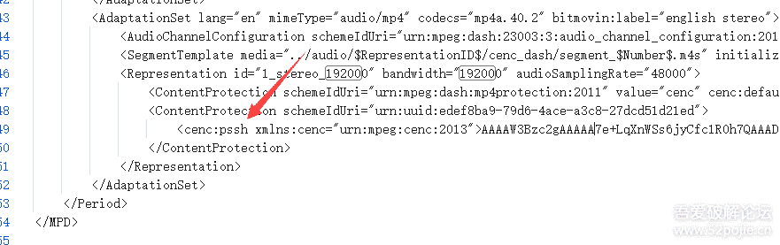
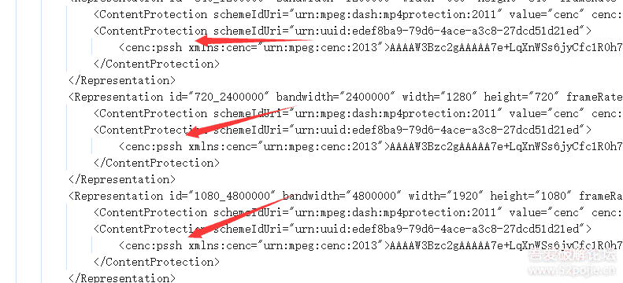
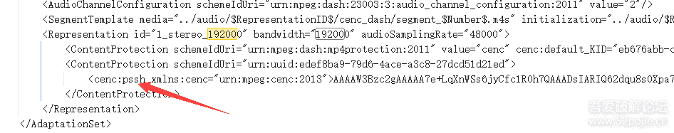
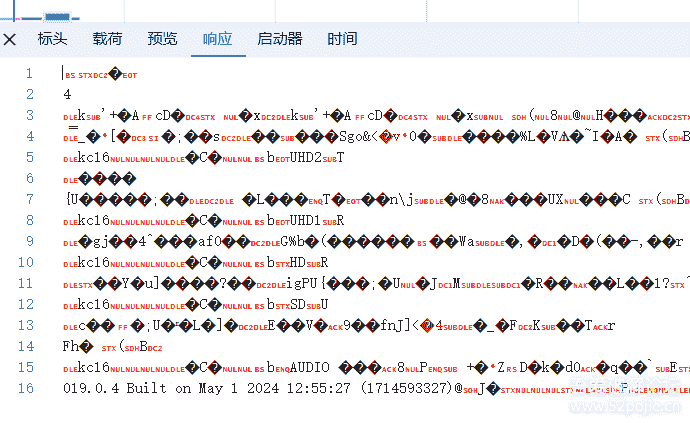
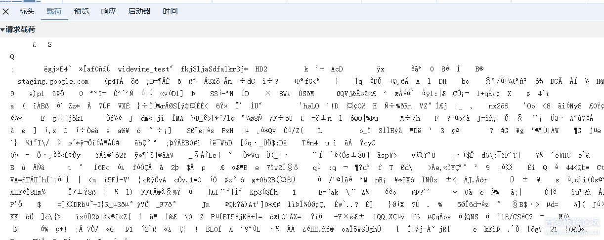
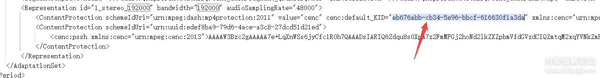
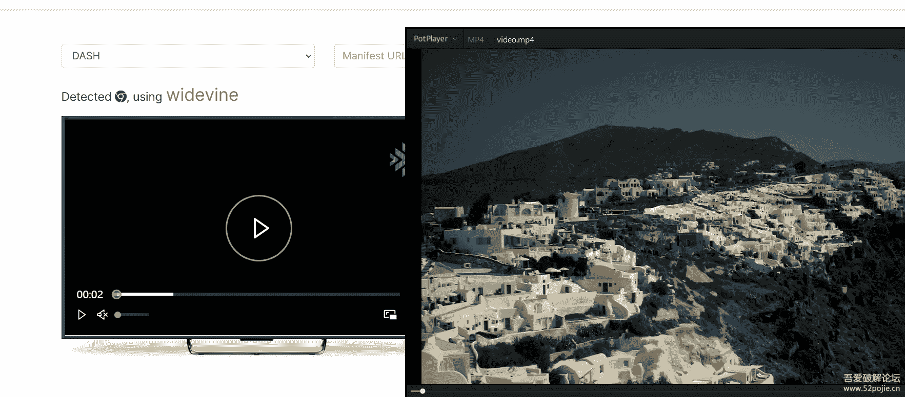
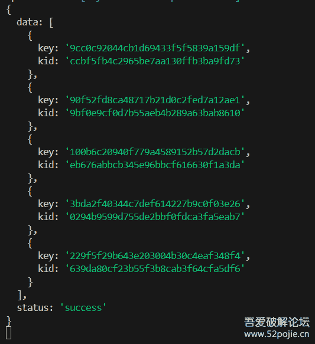

# [Web逆向] 某OF网站的OB解密及DRM过校验思路(下)

- 原帖: https://www.52pojie.cn/forum.php?mod=viewthread&tid=1939939
- 抓取时间: 2026-11-01T22:28:04

## 前言

虽然之前已经感谢过一次了，但是

再次感谢videohelp论坛larley大神的解答！

再次感谢吾爱破解论坛@涛之雨大神的帮助！

## 正文

之前我们已经成功拿到了`wvd`
现在可以直接写代码了
根据网络上的资料
大致是首先拿到`pssh`，这个一般在`mpd`文件里



1.png (20.71 KB, 下载次数: 1)

[href="forum.php?mod=attachment&aid=MjcwNTg5OXw4ZGQzMzZiY3wxNzkzNTcyMDgyfDE2ODA4NnwxOTM5OTM5&nothumb=yes" target="_blank"](https://www.52pojie.cn/forum.php?mod=attachment&aid=MjcwNTg5OXw4ZGQzMzZiY3wxNzkzNTcyMDgyfDE2ODA4NnwxOTM5OTM5&nothumb=yes)

2024-7-4 18:27 上传

然后用`cdm`加载`wvd`
`cdm`会根据`wvd`和`ppsh`请求证书服务器
证书服务器会下发解密的密钥，然后用`ffmpeg`解密就可以了

为了方便大家动手实践我先以`https://bitmovin.com/demos/drm`为例
因为`m3u8`的`ppsh`不直观，就干脆后续下载`mpd`了

代码如下

```
const path = require('path');

const YTDlpWrap = require('yt-dlp-wrap').default;

const ytDlpWrap = new YTDlpWrap(path.join('./yt-dlp_x86.exe'));
let ytDlpEventEmitter = ytDlpWrap
    .exec([
        'https://cdn.bitmovin.com/content/assets/art-of-motion_drm/mpds/11331.mpd',
        "-f",
        "bestvideo[ext=mp4]+bestaudio[ext=m4a]/best[ext=mp4]/best[ext=m4a]",
        "--allow-u",
        "--no-part",
        "--restrict-filenames",
        "-N 4",
        '-o',
        'F:/vmware/output3.mp4',
    ])
    .on('progress', (progress) =>
        console.log(
            progress.percent,
            progress.totalSize,
            progress.currentSpeed,
            progress.eta
        )
    )
    .on('ytDlpEvent', (eventType, eventData) =>
        console.log(eventType, eventData)
    )
    .on('error', (error) => console.error(error))
    .on('close', () => console.log('all done'));

console.log(ytDlpEventEmitter.ytDlpProcess.pid);
```

下载到的mp4无法正常播放


2.png (1.02 MB, 下载次数: 2)

[href="forum.php?mod=attachment&aid=MjcwNTkwMnw3MjYwMGEwYnwxNzkzNTcyMDgyfDE2ODA4NnwxOTM5OTM5&nothumb=yes" target="_blank"](https://www.52pojie.cn/forum.php?mod=attachment&aid=MjcwNTkwMnw3MjYwMGEwYnwxNzkzNTcyMDgyfDE2ODA4NnwxOTM5OTM5&nothumb=yes)

2024-7-4 18:45 上传

接下来抓包看`pssh`，文件有多个`ppsh`



3.png (26.62 KB, 下载次数: 1)

[href="forum.php?mod=attachment&aid=MjcwNTkwM3wxNWIxOTQ4ZnwxNzkzNTcyMDgyfDE2ODA4NnwxOTM5OTM5&nothumb=yes" target="_blank"](https://www.52pojie.cn/forum.php?mod=attachment&aid=MjcwNTkwM3wxNWIxOTQ4ZnwxNzkzNTcyMDgyfDE2ODA4NnwxOTM5OTM5&nothumb=yes)

2024-7-4 18:45 上传

我们下载的目标文件名是`output3.f1_stereo_192000.m4a`
所以搜索192000



4.png (18.26 KB, 下载次数: 1)

[href="forum.php?mod=attachment&aid=MjcwNTkwNHw3YjM1NGRhOHwxNzkzNTcyMDgyfDE2ODA4NnwxOTM5OTM5&nothumb=yes" target="_blank"](https://www.52pojie.cn/forum.php?mod=attachment&aid=MjcwNTkwNHw3YjM1NGRhOHwxNzkzNTcyMDgyfDE2ODA4NnwxOTM5OTM5&nothumb=yes)

2024-7-4 18:45 上传

密钥为`AAAAW3Bzc2gAAAAA7e+LqXnWSs6jyCfc1R0h7QAAADsIARIQ62dqu8s0Xpa7z2FmMPGj2hoNd2lkZXZpbmVfdGVzdCIQZmtqM2xqYVNkZmFsa3IzaioCSEQyAA==`

然后在网页抓包找到证书服务器，这个还是比较直观的
提交和返回都是乱码的就是证书服务器



5.png (41.01 KB, 下载次数: 1)

[href="forum.php?mod=attachment&aid=MjcwNTkwNXw3NjM1ZjI5MnwxNzkzNTcyMDgyfDE2ODA4NnwxOTM5OTM5&nothumb=yes" target="_blank"](https://www.52pojie.cn/forum.php?mod=attachment&aid=MjcwNTkwNXw3NjM1ZjI5MnwxNzkzNTcyMDgyfDE2ODA4NnwxOTM5OTM5&nothumb=yes)

2024-7-4 18:45 上传



6.png (40.66 KB, 下载次数: 2)

[href="forum.php?mod=attachment&aid=MjcwNTkwNnxmMWM3MGJmYXwxNzkzNTcyMDgyfDE2ODA4NnwxOTM5OTM5&nothumb=yes" target="_blank"](https://www.52pojie.cn/forum.php?mod=attachment&aid=MjcwNTkwNnxmMWM3MGJmYXwxNzkzNTcyMDgyfDE2ODA4NnwxOTM5OTM5&nothumb=yes)

2024-7-4 18:45 上传

这里我们得到了`https://cwip-shaka-proxy.appspot.com/no_auth`

所以可以写出代码

```
import json

import re

import requests

from pywidevine.cdm import Cdm

from pywidevine.device import Device

from pywidevine.pssh import PSSH

def get_keys(pssh_value, license_url):

    if pssh_value is None:

        return []

    try:

        device = Device.load("aosp.wvd")

    except:

        return []

    pssh_value = PSSH(pssh_value)

    cdm = Cdm.from_device(device)

    cdm_session_id = cdm.open()

    challenge = cdm.get_license_challenge(cdm_session_id, pssh_value)

    licence = requests.post(

        license_url, data=challenge

    )

    licence.raise_for_status()

    cdm.parse_license(cdm_session_id, licence.content)

    keys = []

    for key in cdm.get_keys(cdm_session_id):

        if "CONTENT" in key.type:

            keys += [f"{key.kid.hex}:{key.key.hex()}"]

    cdm.close(cdm_session_id)

    return keys

print(get_keys("AAAAW3Bzc2gAAAAA7e+LqXnWSs6jyCfc1R0h7QAAADsIARIQ62dqu8s0Xpa7z2FmMPGj2hoNd2lkZXZpbmVfdGVzdCIQZmtqM2xqYVNkZmFsa3IzaioCSEQyAA==","https://cwip-shaka-proxy.appspot.com/no_auth"))
```

请求可以看到返回了许多密钥

```
['ccbf5fb4c2965be7aa130ffb3ba9fd73:9cc0c92044cb1d69433f5f5839a159df', '9bf0e9cf0d7b55aeb4b289a63bab8610:90f52fd8ca48717b21d0c2fed7a12ae1', 'eb676abbcb345e96bbcf616630f1a3da:100b6c20940f779a4589152b57d2dacb', '0294b9599d755de2bbf0fdca3fa5eab7:3bda2f40344c7def614227b9c0f03e26', '639da80cf23b55f3b8cab3f64cfa5df6:229f5f29b643e203004b30c4eaf348f4']
```

前边是`kid`，后边是解密的密钥

我们返回之前看我们`kid`是`eb676abb-cb34-5e96-bbcf-616630f1a3da`



7.png (17.68 KB, 下载次数: 1)

[href="forum.php?mod=attachment&aid=MjcwNTkwN3xiMzM5MWY1Y3wxNzkzNTcyMDgyfDE2ODA4NnwxOTM5OTM5&nothumb=yes" target="_blank"](https://www.52pojie.cn/forum.php?mod=attachment&aid=MjcwNTkwN3xiMzM5MWY1Y3wxNzkzNTcyMDgyfDE2ODA4NnwxOTM5OTM5&nothumb=yes)

2024-7-4 18:45 上传

刚好对应了`eb676abbcb345e96bbcf616630f1a3da:100b6c20940f779a4589152b57d2dacb`
可以知道我们的密钥是`100b6c20940f779a4589152b57d2dacb`

一个小小的冷知识，其实全怼进去，`ffmpeg`自己也能识别出来正确的

所以输入

`ffmpeg -decryption_key 100b6c20940f779a4589152b57d2dacb -i output3.f1080_4800000.mp4 -codec copy decrypted_media.mp4`解密视频

使用同样的密钥

`ffmpeg -decryption_key 100b6c20940f779a4589152b57d2dacb -i output3.f1_stereo_192000.m4a -codec copy decrypted_media.m4a`解密音频

输入`ffmpeg -i decrypted_media.mp4 -i decrypted_media.m4a -vcodec copy -acodec copy video.mp4`合并视频音频

我们就得到了一个DRM视频，当然因为版权保护问题无法截图~



8.png (952.23 KB, 下载次数: 1)

[href="forum.php?mod=attachment&aid=MjcwNTkwOHw3ZWViNmM1YnwxNzkzNTcyMDgyfDE2ODA4NnwxOTM5OTM5&nothumb=yes" target="_blank"](https://www.52pojie.cn/forum.php?mod=attachment&aid=MjcwNTkwOHw3ZWViNmM1YnwxNzkzNTcyMDgyfDE2ODA4NnwxOTM5OTM5&nothumb=yes)

2024-7-4 18:45 上传

### 2> Node库简易封装

之前我们已经实现了`python`的DRM视频解密
但是我是`nodejs`，因为之前已经写了大量的爬虫代码
并且由于`js`目前没找到`cdm`的解密库
所以干脆考虑自己封一下
我决定把之前`cdm`解密的`python`代码抽象一下
并且引入`flask`，通过`pyinstaller`打包成`exe`
然后封装一个`nodejs`的库唤起，本地服务器如果一定时间没有心跳就自动销毁

首先封装一下`python`的`flask`代码

```
from flask import Flask

from flask import request

from flask import jsonify

from threading import Timer

from inspect import signature

import threading

from pywidevine.cdm import Cdm

from pywidevine.device import Device

from pywidevine.pssh import PSSH

import argparse

import time

import os

import socket

import signal

import requests

parser = argparse.ArgumentParser(description='command', formatter_class=argparse.RawTextHelpFormatter)

parser.add_argument('--autoClose', '-c', help='是否自动关闭，默认为300s，设置为0则不自动关闭',default='300')

parser.add_argument('--port', '-p', help='设置端口号')

args = parser.parse_args()

args.autoClose=int(args.autoClose)

cdmInstance=None

app = Flask(__name__)

PID = os.getpid()

@app.route("/ping",methods=["GET"])

def ping():

    print('run ping')

    closeServer()

    return jsonify(status="success")

@app.route("/close",methods=["GET"])

def close():

    shutdown()

    return jsonify(status="success")

def debounce(wait):

    def decorator(fn):

        sig = signature(fn)

        caller = {}
```


# 服务端实现

## Python 服务端

```python
            nonlocal caller

            try:
                bound_args = sig.bind(*args, **kwargs)
                bound_args.apply_defaults()
                called_args = fn.__name__ + str(dict(bound_args.arguments))
            except:
                called_args = ''

            t_ = time.time()

            def call_it(key):
                try:
                    # always remove on call
                    caller.pop(key)
                except:
                    pass

                fn(*args, **kwargs)

            try:
                # Always try to cancel timer
                caller[called_args].cancel()
            except:
                pass

            caller[called_args] = Timer(wait, call_it, [called_args])
            caller[called_args].start()

        return debounced

    return decorator

@app.route("/loadDevice",methods=["POST"])
def loadDevice():
    global cdmInstance
    form = request.form
    device=None
    print(form.get("path"))
    try:
        device = Device.load(form.get("path"))
    except:
        return jsonify(status="error")
    cdmInstance = Cdm.from_device(device)
    return jsonify(status="success")

@app.route("/getKeys",methods=["POST"])
def getKeys():
    form = request.form
    license_url = form.get("url")
    headers= form.get("headers")
    pssh= form.get("pssh")
    pssh_value = PSSH(pssh)
    cdm_session_id = cdmInstance.open()
    challenge = cdmInstance.get_license_challenge(cdm_session_id, pssh_value)
    licence = requests.post(
        license_url, data=challenge
    )
    licence.raise_for_status()
    cdmInstance.parse_license(cdm_session_id, licence.content)
    keys = []
    for key in cdmInstance.get_keys(cdm_session_id):
        if "CONTENT" in key.type:
            keys.append({
                "kid":key.kid.hex,
                "key":key.key.hex()
            })
    cdmInstance.close(cdm_session_id)
    return jsonify(status="success",data=keys)

def shutdown():
    if args.autoClose==0:
        return
    print('自动销毁')
    os._exit(1)

@debounce(args.autoClose)
def closeServer():
    shutdown()

@app.errorhandler(Exception)
def framework_error(e):
    print(e)
    return jsonify(status="error")

if __name__ == '__main__':
    if args.port==None:
        sock = socket.socket(socket.AF_INET, socket.SOCK_STREAM)
        sock.bind(('localhost', 0))
        args.port = sock.getsockname()[1]
        sock.close()
    closeServer()
    app.run(host='0.0.0.0',port= args.port)
```

## Node.js 库代码

很简单，然后我们打包成exe，再写一下nodejs的库代码。

```javascript
const { default: axios } = require("axios");
const { spawn } = require("child_process");
const net = require("net");
const path = require('path')
const { exec } = require('child_process');
const querystring = require('querystring');

function sleep(time) {
    return new Promise((resolve) => {
        setTimeout(() => {
            resolve()
        }, time)
    })
}
exports.openCDMServer = async function openCDMServer(option) {
    let port = option.port
    const wvdPath = option.wvdFullPath

    if (port === undefined) {
        port = await getPortFree()
    }

    const portOccupyStatus = await checkPortOccupy(port)
    if (!portOccupyStatus) {
        //no use！
        exec(path.join(__filename, '../cdmServer.exe')+' --port '+port, (error, stdout, stderr) => {
            if (error) {
                console.error(`exec error: ${error}`);
                return;
            }
            console.log(`stdout: ${stdout}`);
            console.error(`stderr: ${stderr}`);
        });
    }
    let serverOpen = false
    const serverAddr = 'http://127.0.0.1:' + port
    for (let index = 0; index  {
        try {
            const { data } = await axios.get(serverAddr + '/ping')
            if (data?.status === 'success') {
                serverOpen = true;
            }
        } catch (error) {
            console.log('heart:the cdm server is loss')
        }
    }, 60 * 1000)

    const closeFunc = () => {
        clearInterval(timer)
        axios.get(serverAddr + '/close')
    }

    let loadWvdStatus = false

    try {
        const { data } = await axios.post(serverAddr + '/loadDevice', querystring.stringify({
            path: wvdPath
        }))
        if (data?.status === 'success') {
            loadWvdStatus = true;
        }
    } catch (error) {
        console.log('loadWvd Post Error')
    }
    if (!loadWvdStatus) {
        closeFunc()
        return {
            content: "wvd load Error",
            status: "error"
        }
    }
    async function getKeys(url, pssh, headers) {
        return axios.post(serverAddr + '/getKeys', querystring.stringify({
            url,
            pssh,
            headers
        }))
    }
    return {
        close: closeFunc,
        port: port,
        status: "success",
        getKeys: getKeys
    }
}

function checkPortOccupy(port) {
    return new Promise((resolve, reject) => {
        const server = net.createConnection({ port });
        server.on('connect', () => {
            server.end();
            resolve(true);
        });
        server.on('error', () => {
            resolve(false);
        });
    });
}

async function getPortFree() {
    return new Promise(res => {
        const srv = net.createServer();
        srv.listen(0, () => {
            const port = srv.address().port
            srv.close((err) => res(port))
        });
    })
}
```

## 本地测试

由于我们还没上传到`npm`，这个时候需要通过本地软连接测试，修改`package.json`中的`name`属性。然后在库项目输入`npm link`，紧接着在测试的项目中输入`npm link 项目名`即可实现本地导入。接下来我们写一下测试代码，其中`node-widevine-decrypt`就是我软连接库的名字。

```javascript
const { openCDMServer } = require('node-widevine-decrypt')
const path = require('path')

async function main() {
    const { getKeys, port, status } = await openCDMServer({
        wvdFullPath: path.join(__filename, '../aosp.wvd')
    })

    if (status === 'success') {
        const {data} =await getKeys("URL地址","pssh数据")
        console.log(data)
    } else {
        console.log('server error')
    }
}

main()
```

跑一下看看，发现成功解密~



9.png (35.33 KB, 下载次数: 1)

[href="forum.php?mod=attachment&aid=MjcwNTkwOXw4MTU2OGIyNXwxNzkzNTcyMDgyfDE2ODA4NnwxOTM5OTM5&nothumb=yes" target="_blank"](https://www.52pojie.cn/forum.php?mod=attachment&aid=MjcwNTkwOXw4MTU2OGIyNXwxNzkzNTcyMDgyfDE2ODA4NnwxOTM5OTM5&nothumb=yes)

2024-7-4 18:45 上传

那接下来的问题就是我们该怎么读取OF网站的密钥了。

# 2. OF 网站的 DRM 解密

首先需要解密头

直接逐步定位打到了

```javascript
              , Pe = e=>{
                try {
                    const t = {
                        ...(0,
                        F.A)(e)
                    };
                    t["app-token"] = te;
                    const s = V.A.getters["auth/authUserId"];
                    s && (t["user-id"] = s),
                    t["x-bc"] = fe(),
                    t["x-of-rev"] = "202406261341-9a802bb7ea";
                    const {hash: r} = V.A.state.hash;
                    return r && (t["x-hash"] = r),
                    t
                } catch (t) {
                    console.error(t)
                }
                return {}
            }
```

`t`初始化是`sign`和`time`，然后设置`app-token`，这里跟其他一致。`user-id`，设置用户id，等价于cookie的`auth_id`，也基本一致。`t["x-bc"] = fe()`提取`bcToken`，老生常谈。`t["x-of-rev"] = "202406261341-9a802bb7ea";`固定值。`const {hash: r} = V.A.state.hash;`从`https://cdn2.OF网站.com/hash/`中读取。没难度啊我靠。

`x-hash: "mkVyQlWEXk/Vb0n/4iia1HdR+AeHJrzzR27MA+8="`

`x-of-rev:"202406261341-9a802bb7ea"`

这两个参数要保持最新，如果旧版本的请求没补这两个或者`hash`过期，会导致请求正常但是DRM的`Cookies`是假的。好心机，但是直接往认证服务器发送包依然失败，这部分卡了我很久，只能去参考`od-drm`项目，找到了。


# Widevine DRM 解密流程分析

## 初步代码示例与观察

```
                var resp1 = PostData(licenceURL, drmHeaders, new byte[] { 0x08, 0x04 });
                var certDataB64 = Convert.ToBase64String(resp1);
                var cdm = new CDMApi();
                var challenge = cdm.GetChallenge(pssh, certDataB64, false, false);
                var resp2 = PostData(licenceURL, drmHeaders, challenge);
                var licenseB64 = Convert.ToBase64String(resp2);
                cdm.ProvideLicense(licenseB64);
                List keys = cdm.GetKeys();
```

可以看到先提交了一个`0804`，然后设置证书再处理解密部分

观察`OF`网站的抓包也确实存在两次提交

因为我一直在搞解密部分大意了，没有闪！

关于设置服务器证书`pywidevine`也有函数，我们查看源码可以找到`set_service_certificate`函数

```
        Set a Service Privacy Certificate for Privacy Mode. (optional but recommended)

        The Service Certificate is used to encrypt Client IDs in Licenses. This is also

        known as Privacy Mode and may be required for some services or for some devices.

        Chrome CDM requires it as of the enforcement of VMP (Verified Media Path).

        We reject direct DrmCertificates as they do not have signature verification and

        cannot be verified. You must provide a SignedDrmCertificate or a SignedMessage

        containing a SignedDrmCertificate.

        Parameters:

            session_id: Session identifier.

            certificate: SignedDrmCertificate (or SignedMessage containing one) in Base64

                or Bytes form obtained from the Service. Some services have their own,

                but most use the common privacy cert, (common_privacy_cert). If None, it

                will remove the current certificate.

        Raises:

            InvalidSession: If the Session identifier is invalid.

            DecodeError: If the certificate could not be parsed as a SignedDrmCertificate

                nor a SignedMessage containing a SignedDrmCertificate.

            SignatureMismatch: If the Signature of the SignedDrmCertificate does not

                match the underlying DrmCertificate.

        Returns the Service Provider ID of the verified DrmCertificate if successful.

        If certificate is None, it will return the now-unset certificate's Provider ID,

        or None if no certificate was set yet.
```

## 网页代码分析

那我们就继续研究一下原网页的代码，看看`0801`哪里来的

之前我们分析`getLicense`我们知道了接受消息的在

```
                u.addEventListener("message", (e=>{
                    c.trigger({
                        type: "keymessage",
                        messageEvent: e
                    }),
                    "license-request" !== e.messageType && "license-renewal" !== e.messageType || a(o, e.message, d).then((e=>{
                        r(u.update(e).then((()=>{
                            c.trigger({
                                type: "keysessionupdated",
                                keySession: u
                            })
                        }
                        )).catch((e=>{
                            const t = {
                                errorType: s.default.Error.EMEFailedToUpdateSessionWithReceivedLicenseKeys,
                                keySystem: m
                            };
                            l(e, t)
                        }
                        )))
                    }
                    )).catch((e=>{
                        p(e)
                    }
                    ))
                }
```

查找文档`https://www.w3.org/TR/encrypted-media/`

### `generateRequest` 说明

`generateRequest`

Generates a license request based on the initData. A message of type "license-request" or "individualization-request" will always be queued if the algorithm succeeds and the promise is resolved.

Parameter        Type        Nullable        Optional        Description

`initDataType`        `DOMString`        ✘        ✘        The Initialization Data Type of the initData.

`initData`        `BufferSource`        ✘        ✘        Initialization Data

根据文档的提示，生成我们可以定位到

```
                    u.generateRequest(n, i).catch((e=>{
                        const t = {
                            errorType: s.default.Error.EMEFailedToGenerateLicenseRequest,
                            keySystem: m
                        };
                        l(e, t),
                        p("Unable to create or initialize key session")
                    }
```

关于到底这两个是否有关联可以下断在`u.generateRequest`调用时将函数置为空函数`()=>{}`，可以发现接收消息没有触发，证明了这两个函数没有关联

其中`n`是`cenc`，`i`是字节，我们一路往上堆栈回溯可以找到

```
            if (i) {

                e[i] = {

                    attributes: n

                };

                const r = Te(t, "cenc:pssh")[0];

                if (r) {

                    const t = Ie(r);

                    e[i].pssh = t && p(t)

                }

            }
```

其中`p`是将字符串转为字节数组

```
        function p(e) {
            for (var t = m(e), n = new Uint8Array(t.length), i = 0; i 
```

## 调试发现

根据调试首先传入的是`wpd`中较短的`pssh`，然后得到`0804`提交再获取证书

但是问题来了

`0804`到底怎么生成的？

我研究了几天还是没有得到答案

于是到处找人寻味

直到在`forum.videohelp.com`论坛得到了`larley`大神的解答！

`https://forum.videohelp.com/threads/415095-How-to-simulate-the-generateRequest-function-through-python`

```
The long PSSH is used for Microsoft's PlayReady and then short one is for Google's Widevine (that's what you're going to want to use).

The '08 04' (or CAQ= is base64) (or '\x08\x04' in python) is a fixed data value that can be sent to the same server (even same URL and 99% of the time even the same headers) from which you will receive your license.
```

`0804`竟然是`generateRequest`返回的固定值！

我在`https://integration.widevine.com/diagnostics`的生成`widevine` `pssh`试了几组

都返回了`0804`！

那么一切就通顺了

首先根据较短的`pssh`获得`0804`

然后将`0804`上传得到`certData`证书

再设置`certData`证书

然后上传`pssh`得到正确`key`

理论建立完毕

## 实践实现

实践开始！

我们接下来给`cdmServer`拓展一下设置证书，在`node`部分拿到证书就可以了

剩下的不算很难了，我就只罗列一些关键的代码

### 获取 PSSH

```
function getPSSH(url, Cookie) {
  return new Promise(async (resolve, reject) => {
    try {
      const { data } = await axios.request({
        method: 'get',
        url: url,
        headers: {
          'Cookie': Cookie
        },
      })
      const reg = /(.*)/g
      const psshArray = sortArray([...data.matchAll(reg)].map(item => item[1]))[0]
      resolve(psshArray)
    } catch (error) {
      console.log(error)
      reject()
    }

  })
}
```

### 获取证书

```
                  const buf = new ArrayBuffer(2)

                  let view = new Int8Array(buf);

                  view[0] = 8

                  view[1] = 4

                  const certificate = await new Promise((resolve) => {

                    axios.post(cdmServer, buf, {

                      headers: cdmHeader,

                      responseType: "arraybuffer"

                    }).then((response) => {

                      resolve(response.data.toString('hex'))

                    }).catch((err) => {

                      console.log('err', err)

                    })

                  })
```

### 服务器端设置证书

```
    certificate= form.get("certificate")
    if not certificate is None:
         certificate=bytes.fromhex(certificate)
         cdmInstance.set_service_certificate(cdm_session_id,certificate)
```

那么我们就可以拿到密钥了，先在`js`创建一个密钥数组

```
    const keyList = data.data.map((item) => item.key).map((key) => {

      return '-decryption_key ' + key

    })
```

### 解密与合并

分别解密`mp4`和`m4a`

```
    const fileList = await downloadDRMViedeo(mpd, baseDir, mediaItem.id, Cookie)
    const mergeFile = []
    for (let index = 0; index  {
        ffmpeg().input(baseDir + '/' + filePath).inputOptions([
          ...keyList,
        ]).audioCodec('copy').videoCodec('copy').output(baseDir + '/drm_' + filePath).on("end", () => {
          mergeFile.push(baseDir + '/drm_' + filePath)
          resolve();
        }).run()
      })
    }
```

然后将两个视频合并到一起就可以了

```
    await new Promise((resolve) => {

      ffmpeg().input(mergeFile[0]).input(mergeFile[1]).audioCodec('copy').videoCodec('copy').output(baseDir + '/decrypt_drm_' + mediaItem.id + '.mp4')
```


```
        .on('error', function (err) {

          console.log('An error occurred: ' + err.message);

        })

        .on('end', function () {

          resolve();

        })

        .run();

    })
```
最后调用`deleteVideoFiles`分别删除残余文件

```
  await deleteVideoFiles(baseDir, mediaItem.id + '')
  await deleteVideoFiles(baseDir, 'drm_' + mediaItem.id)
```

这里的删除是我组合的功能函数，也抄了网上的

传入路径和文件前缀就可以自动删除

```
function deleteFiles(files, callback) {

  if (files.length == 0) {

    callback()

  }

  var i = files.length;

  files.forEach(function (filepath) {

    fs.unlink(filepath, function (err) {

      i--;

      if (err) {

        callback(err);

        return;

      } else if (i  {

    const files = await getVideoFiles(path, id)

    deleteFiles(files, resolve)

  })

}
```

那么就实现了OF网站的drm解密啦！

因为没法贴图，所以在这里晒一下我的猫猫狗狗吧


10.jpg (205.72 KB, 下载次数: 1)

[href="forum.php?mod=attachment&aid=MjcwNTkxMHxjZDUyZjMyMXwxNzkzNTcyMDgyfDE2ODA4NnwxOTM5OTM5&nothumb=yes" target="_blank"](https://www.52pojie.cn/forum.php?mod=attachment&aid=MjcwNTkxMHxjZDUyZjMyMXwxNzkzNTcyMDgyfDE2ODA4NnwxOTM5OTM5&nothumb=yes)

2024-7-4 18:45 上传

完结撒花~

## 结语

严肃的来讲，这次的解密之旅陆陆续续花了我半个月

从动态ob的解密到分析到videojs，再到发现drm，drm的尝试解密，wvd的提取，再到证书的设置，0804的起源

得到了许多人的帮助

并不是我一个人的成果

十分感激大家

在此就不一一列举名字了

所以在此感谢依然相信爱与正义的人！
