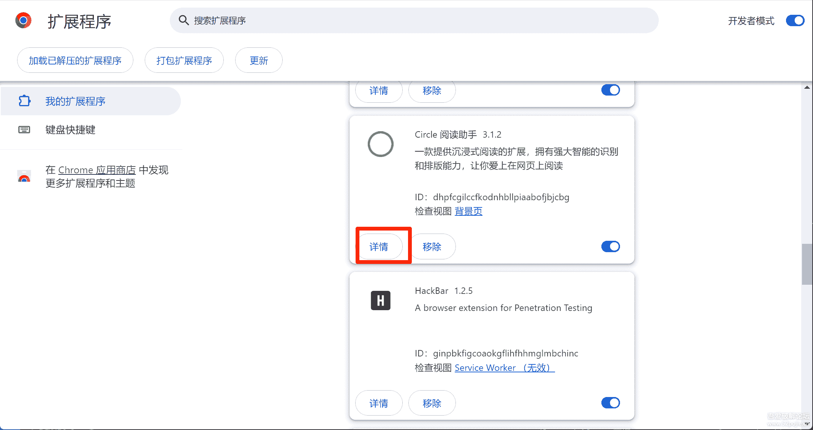
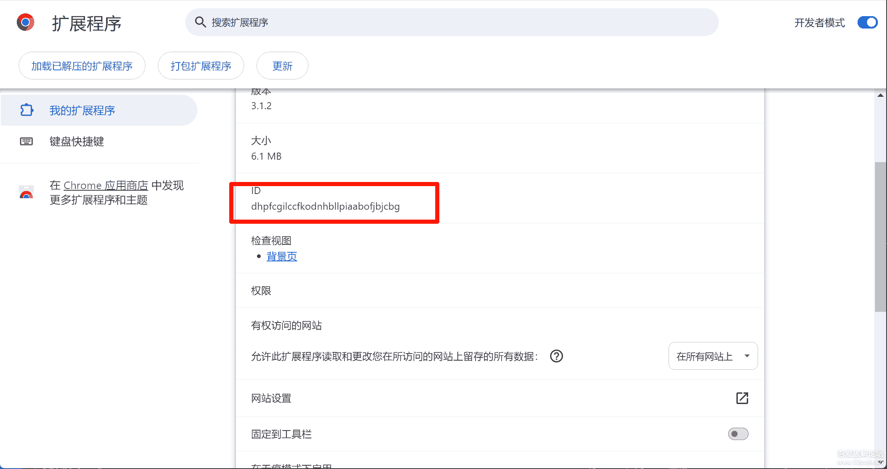
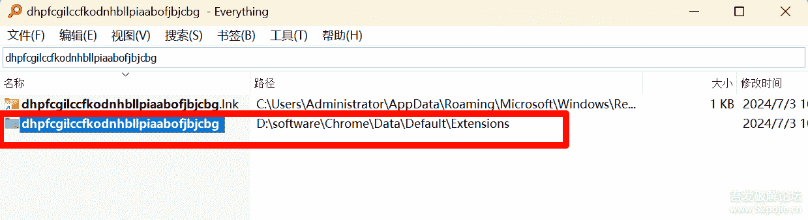
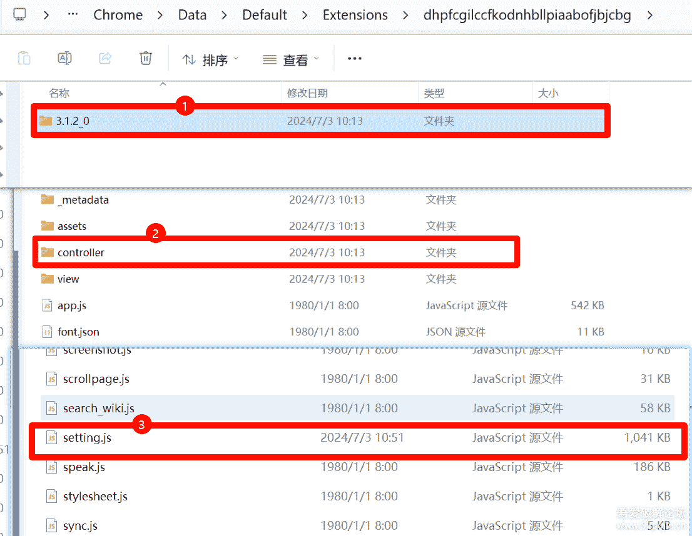
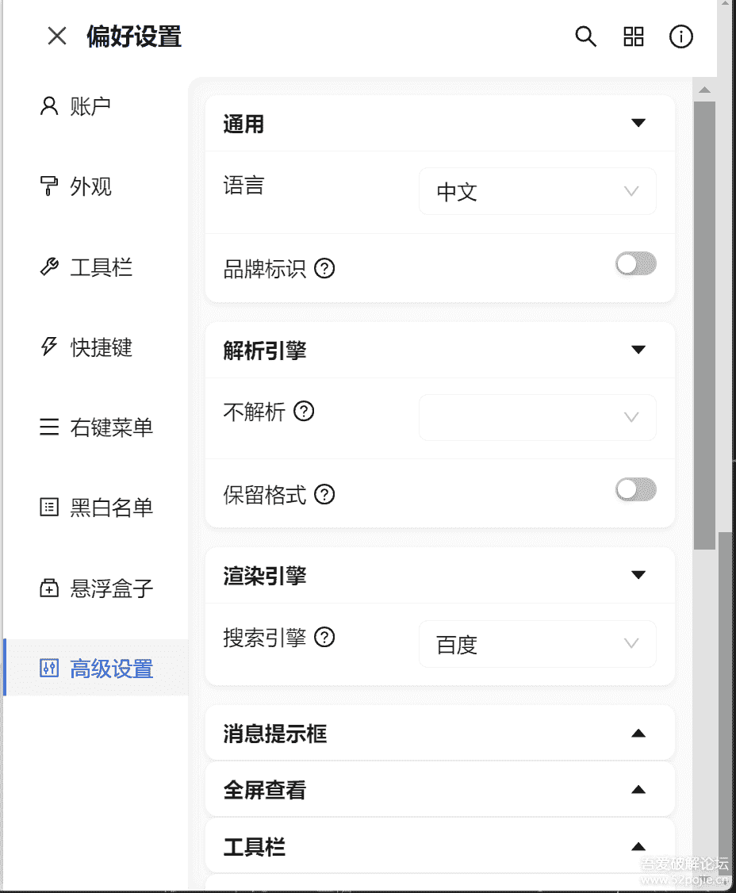

# [Web逆向] 【教程】Circle 阅读助手付费功能解锁

- 原帖：https://www.52pojie.cn/forum.php?mod=viewthread&tid=1940437
- 抓取时间：2026-11-01T22:28:00

基于[该用户](https://www.52pojie.cn/home.php?mod=space&uid=1377893)发布的`[javascript][chrome插件]Circle 阅读助手 v3.1.2 逆向笔记`：https://www.52pojie.cn/thread-1940297-1-1.html

具体思路可看上面那位大佬的文章。

本文章教你如何在本地解锁付费功能。

## 打开扩展页面

找到 Circle 阅读助手插件，点击详情。



`image.png`（190.39 KB，下载次数：1）

[查看附件](https://www.52pojie.cn/forum.php?mod=attachment&aid=MjcwNTE1OHxhMjk5YmI0MnwxNzkzNTcyMDc4fDE2ODA4NnwxOTQwNDM3&nothumb=yes)

2024-7-3 11:16 上传

复制 ID：`dhpfcgilccfkodnhbllpiaabofjbjcbg`



`image (1).png`（147.32 KB，下载次数：0）

[查看附件](https://www.52pojie.cn/forum.php?mod=attachment&aid=MjcwNTE1OXw4ZDdlMmYwNXwxNzkzNTcyMDc4fDE2ODA4NnwxOTQwNDM3&nothumb=yes)

2024-7-3 11:16 上传

## 查找文件

找到文件存储位置，我这里用`Everything`查找。



`image (2).png`（34.72 KB，下载次数：1）

[查看附件](https://www.52pojie.cn/forum.php?mod=attachment&aid=MjcwNTE2MHw4NWE0YmEwN3wxNzkzNTcyMDc4fDE2ODA4NnwxOTQwNDM3&nothumb=yes)

2024-7-3 11:16 上传

找到`controller`下的`setting.js`文件。



`image (3).png`（137.8 KB，下载次数：1）

[查看附件](https://www.52pojie.cn/forum.php?mod=attachment&aid=MjcwNTE2MXwxZmEzZTFkNHwxNzkzNTcyMDc4fDE2ODA4NnwxOTQwNDM3&nothumb=yes)

2024-7-3 11:16 上传

## 修改文件

打开文件，然后使用`Ctrl+H`替换内容，内容如下。

```javascript
return (0, t.useContext)(i);
```

替换为：

```javascript
let temp = (0, t.useContext)(i);

temp.app.user = {
  roles: ["premium", "member"],
};

return temp;
```


`image (4).png`（62.68 KB，下载次数：0）

[查看附件](https://www.52pojie.cn/forum.php?mod=attachment&aid=MjcwNTE2Mnw2NGE3YWExOXwxNzkzNTcyMDc4fDE2ODA4NnwxOTQwNDM3&nothumb=yes)

2024-7-3 11:16 上传

保存后，即可成功解锁付费功能，效果如下。



`image (5).png`（101.49 KB，下载次数：1）

[查看附件](https://www.52pojie.cn/forum.php?mod=attachment&aid=MjcwNTE2M3wwNjliNTYyOXwxNzkzNTcyMDc4fDE2ODA4NnwxOTQwNDM3&nothumb=yes)

2024-7-3 11:16 上传

如果已经缓存页面了的，重新刷新页面即可。
