# [Web逆向] 某验反爬滑块逆向分析

- 原帖: https://www.52pojie.cn/forum.php?mod=viewthread&tid=1940566
- 抓取时间: 2026-11-01T22:27:56
url:[//www.geetest.com/demo/slide-float.html" target="_blank" rel="noopener noreferrer nofollow"](https://www.geetest.com/demo/gt/register-slide?t=1718596177195:rel="nofollow noopener" href="https)

## 一些废话

最近在论坛看来很多大佬的文章，不愧是精华，非常详细，当然自己在这期间也遇到很多问题，不过好在成功了。

写篇文章看看能否骗个精华，混点CB。如果分享的内容已经有人写过，或者没啥技术含量，还望各位坛友多多包涵{:301_974:}

免责声明：本文章中所有内容仅供学习交流使用，不用于其他任何目的，不提供完整代码，严禁用于商业用途和非法用途，否则由此产生的一切后果均与作者无关. 本文章未经许可禁止转载，禁止任何修改后二次传播，擅自使用本文讲解的技术而导致的任何意外，作者均不负责，若有侵权，请联系作者立即删除.

链接: aHR0cHM6Ly93d3cuZ2VldGVzdC5jb20vZGVtby9zbGlkZS1mbG9hdC5odG1s

## 一、抓包分析

### 1.1 验证流程分析

#### 1.1.1 `register-slide-official`：（有用）

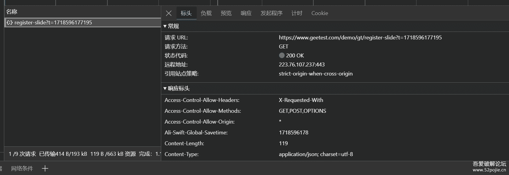
image-20240617114958912.png (127.31 KB, 下载次数: 8)
[href="forum.php?mod=attachment&aid=MjcwNjMyNXwwZDU2NWI5YnwxNzkzNTcyMDczfDE2ODA4NnwxOTQwNTY2&nothumb=yes" target="_blank"](https://www.52pojie.cn/forum.php?mod=attachment&aid=MjcwNjMyNXwwZDU2NWI5YnwxNzkzNTcyMDczfDE2ODA4NnwxOTQwNTY2&nothumb=yes)
2024-7-5 14:53 上传

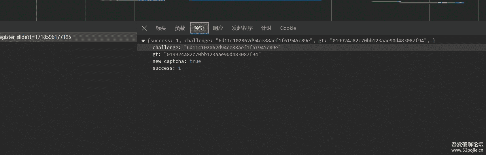
image-20240617115216999.png (105.97 KB, 下载次数: 7)
[href="forum.php?mod=attachment&aid=MjcwNjMyNnwzNDA0OTRkNXwxNzkzNTcyMDczfDE2ODA4NnwxOTQwNTY2&nothumb=yes" target="_blank"](https://www.52pojie.cn/forum.php?mod=attachment&aid=MjcwNjMyNnwzNDA0OTRkNXwxNzkzNTcyMDczfDE2ODA4NnwxOTQwNTY2&nothumb=yes)
2024-7-5 14:54 上传

第一次刷新页面，发现就有这个包，`register-slide-official`:
- 表示向极验平台进行请求发送，注册/申请一个验证码
- url:[//www.geetest.com/demo/gt/register-slide?t=1718596177195" target="_blank" rel="noopener noreferrer nofollow"](https://www.geetest.com/demo/gt/register-slide?t=1718596177195:rel="nofollow noopener" href="https)
- 参数：`t`，表示的是一个实时的时间戳
- 响应数据：
- `challenge`和`gt`，表示向极验注册/申请到的验证码的唯一标识。并且这两个参数会在后期经常被用到。

#### 1.1.2 `gettype`：（有用）

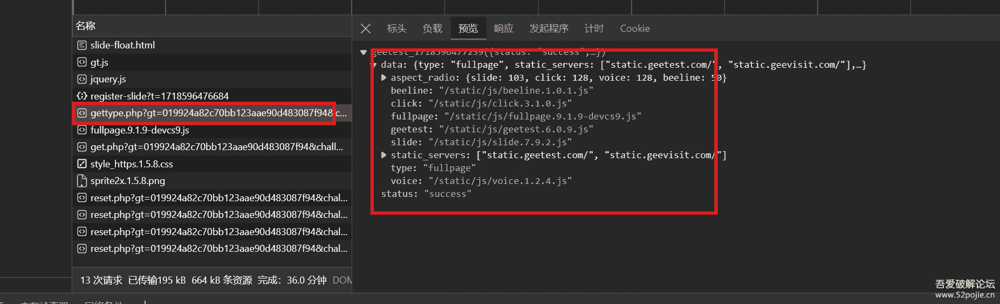
image-20240617123353309.png (388.16 KB, 下载次数: 6)
[href="forum.php?mod=attachment&aid=MjcwNjMyN3w3YWQwYWE4YnwxNzkzNTcyMDczfDE2ODA4NnwxOTQwNTY2&nothumb=yes" target="_blank"](https://www.52pojie.cn/forum.php?mod=attachment&aid=MjcwNjMyN3w3YWQwYWE4YnwxNzkzNTcyMDczfDE2ODA4NnwxOTQwNTY2&nothumb=yes)
2024-7-5 14:54 上传

- 该请求的目的是获取极验安全校验的核心js文件`fullpage.js`和极验提供的各类型验证码对应的js文件。该请求流程是必须要有的。

#### 1.1.3 `js/fullpage.9.1.9-devcs9.js`（核心加密文件）

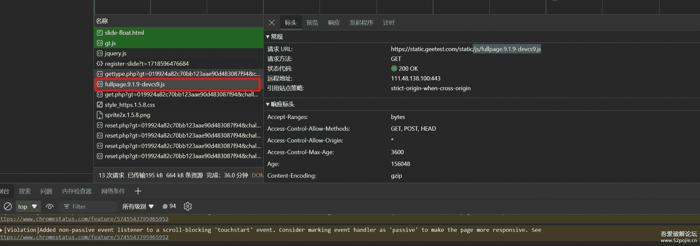
image-20240617123615797.png (429.38 KB, 下载次数: 7)
[href="forum.php?mod=attachment&aid=MjcwNjMyOHxlMGQyNTk1ZXwxNzkzNTcyMDczfDE2ODA4NnwxOTQwNTY2&nothumb=yes" target="_blank"](https://www.52pojie.cn/forum.php?mod=attachment&aid=MjcwNjMyOHxlMGQyNTk1ZXwxNzkzNTcyMDczfDE2ODA4NnwxOTQwNTY2&nothumb=yes)
2024-7-5 14:54 上传
- 该js文件就是极验验证码的核心文件，相关的验证算法、指纹校验模拟等都被包含在该核心文件中。后期逆向时，主要针对就是该文件中相关的js代码。

#### 1.1.4 `get.php`：（有用）

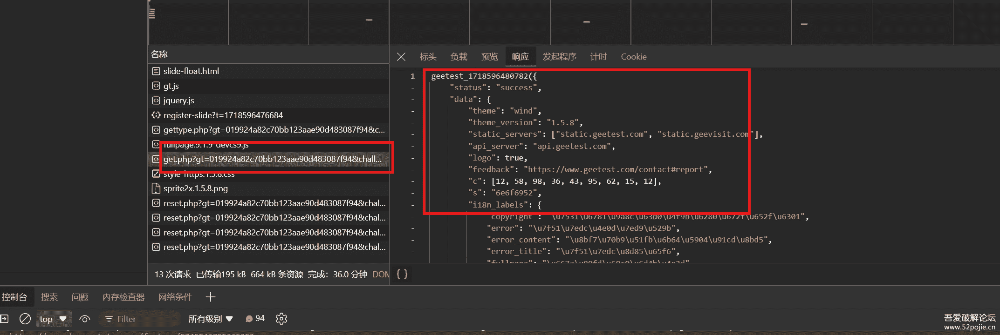
image-20240617123639258.png (447.62 KB, 下载次数: 8)
[href="forum.php?mod=attachment&aid=MjcwNjMyOXw5NThiZmExY3wxNzkzNTcyMDczfDE2ODA4NnwxOTQwNTY2&nothumb=yes" target="_blank"](https://www.52pojie.cn/forum.php?mod=attachment&aid=MjcwNjMyOXw5NThiZmExY3wxNzkzNTcyMDczfDE2ODA4NnwxOTQwNTY2&nothumb=yes)
2024-7-5 14:55 上传

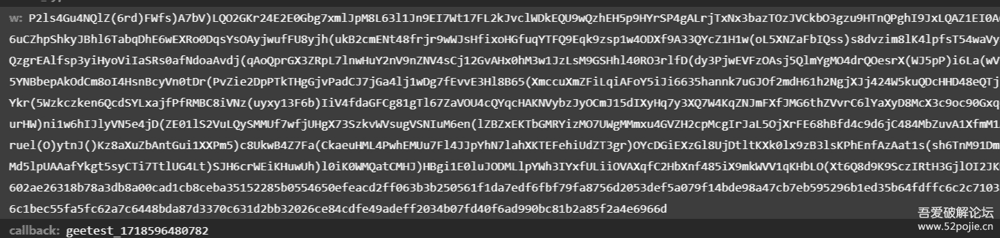
image-20240617123655899.png (191.16 KB, 下载次数: 7)
[href="forum.php?mod=attachment&aid=MjcwNjMzMHxlNTNkODAwN3wxNzkzNTcyMDczfDE2ODA4NnwxOTQwNTY2&nothumb=yes" target="_blank"](https://www.52pojie.cn/forum.php?mod=attachment&aid=MjcwNjMzMHxlNTNkODAwN3wxNzkzNTcyMDczfDE2ODA4NnwxOTQwNTY2&nothumb=yes)
2024-7-5 14:55 上传

- 获取之前注册/申请好的验证码的数据包。其中，请求参数`w`需要进行逆向。

### 1.2 点击验证码后数据包捕获：

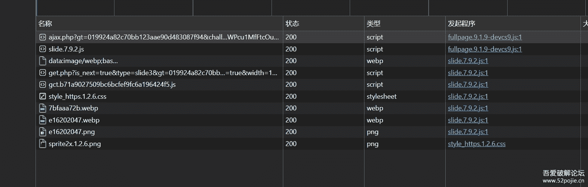
image-20240617123735485.png (230.53 KB, 下载次数: 6)
[href="forum.php?mod=attachment&aid=MjcwNjMzMXxhZjYxZWQ1M3wxNzkzNTcyMDczfDE2ODA4NnwxOTQwNTY2&nothumb=yes" target="_blank"](https://www.52pojie.cn/forum.php?mod=attachment&aid=MjcwNjMzMXxhZjYxZWQ1M3wxNzkzNTcyMDczfDE2ODA4NnwxOTQwNTY2&nothumb=yes)
2024-7-5 14:55 上传

#### 1.2.1 `ajax.php`：（有用）

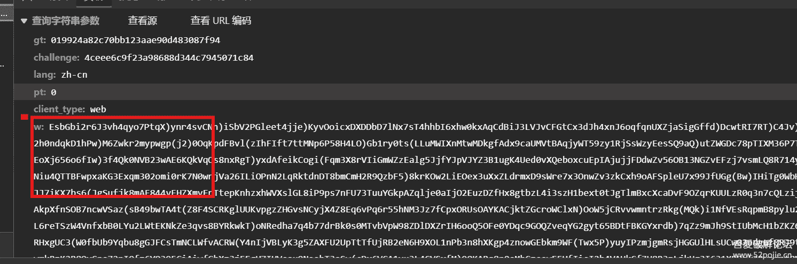
image-20240617123826036.png (184.18 KB, 下载次数: 5)
[href="forum.php?mod=attachment&aid=MjcwNjMzMnxiMWUyZTFjN3wxNzkzNTcyMDczfDE2ODA4NnwxOTQwNTY2&nothumb=yes" target="_blank"](https://www.52pojie.cn/forum.php?mod=attachment&aid=MjcwNjMzMnxiMWUyZTFjN3wxNzkzNTcyMDczfDE2ODA4NnwxOTQwNTY2&nothumb=yes)
2024-7-5 14:55 上传

- ajax请求，用于向极验请求指定类型的验证码，会发现响应数据中有`result:slider`就表示请求滑块类型验证码，然后`status:success`表示请求成功。
- 其中请求参数`w`是需要逆向的。`callback`参数是geetest结合时间戳的形式

#### 1.2.2 `xxx.webp`:

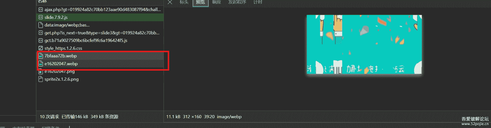
image-20240617123909665.png (254.69 KB, 下载次数: 6)
[href="forum.php?mod=attachment&aid=MjcwNjMzM3wwOGYyNTY4M3wxNzkzNTcyMDczfDE2ODA4NnwxOTQwNTY2&nothumb=yes" target="_blank"](https://www.52pojie.cn/forum.php?mod=attachment&aid=MjcwNjMzM3wwOGYyNTY4M3wxNzkzNTcyMDczfDE2ODA4NnwxOTQwNTY2&nothumb=yes)
2024-7-5 14:55 上传

- 发现是被打乱顺序的验证码图片, 跟`jmcomic`中分割图片类似，可以找它的切割算法，然后用python中`PIL`解决

#### 1.2.3 `get.php`：（有用）

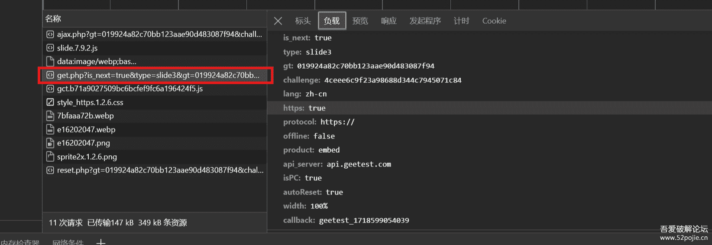
image-20240617124017974.png (228.7 KB, 下载次数: 7)
[href="forum.php?mod=attachment&aid=MjcwNjMzNHwxNzRmMDdiMXwxNzkzNTcyMDczfDE2ODA4NnwxOTQwNTY2&nothumb=yes" target="_blank"](https://www.52pojie.cn/forum.php?mod=attachment&aid=MjcwNjMzNHwxNzRmMDdiMXwxNzkzNTcyMDczfDE2ODA4NnwxOTQwNTY2&nothumb=yes)
2024-7-5 14:56 上传

- 用于加载还原顺序后的滑动验证码的数据包。其中并没有需要逆向的请求请求参数，不过其中的`callback`参数是geetest结合时间戳的形式。

### 1.3 滑动滑块后数据包捕获

#### 1.3.1 `ajax.php`：（有用）

- 滑动状态验证的数据包，验证滑动行为是否合法是否滑动成功。响应数据中就会有`message`和`success`的值表示是否验证成功。如果滑动成功还会出现一个`validate`的键值对，表示滑动验证成功后的标识，后面只要携带该标识进行其他请求发送，即可表示为验证成功后的请求发送行为。
- 请求参数中有一个`w`需要逆向，该`w`就表示用户滑动的轨迹加密后的内容。

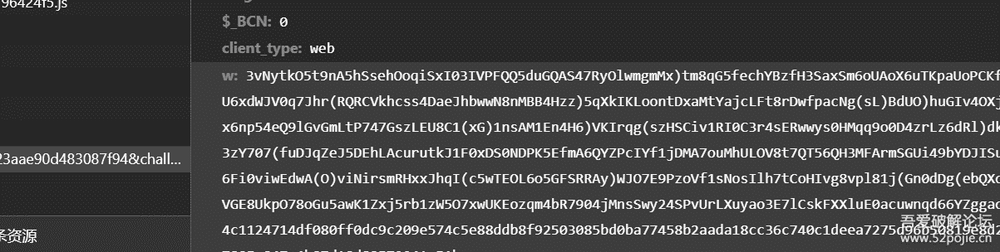
image-20240619163219793.png (116.58 KB, 下载次数: 7)
[href="forum.php?mod=attachment&aid=MjcwNjMzNXwwNGYxNDAzZHwxNzkzNTcyMDczfDE2ODA4NnwxOTQwNTY2&nothumb=yes" target="_blank"](https://www.52pojie.cn/forum.php?mod=attachment&aid=MjcwNjMzNXwwNGYxNDAzZHwxNzkzNTcyMDczfDE2ODA4NnwxOTQwNTY2&nothumb=yes)
2024-7-5 14:56 上传

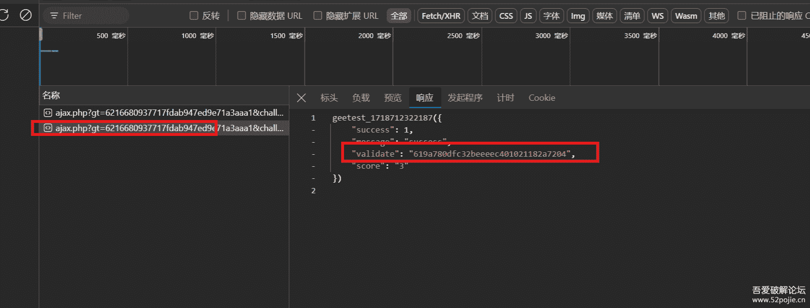
image-20240618200533849.png (179.73 KB, 下载次数: 7)
[href="forum.php?mod=attachment&aid=MjcwNjMzNnwyMDA2MTM1N3wxNzkzNTcyMDczfDE2ODA4NnwxOTQwNTY2&nothumb=yes" target="_blank"](https://www.52pojie.cn/forum.php?mod=attachment&aid=MjcwNjMzNnwyMDA2MTM1N3wxNzkzNTcyMDczfDE2ODA4NnwxOTQwNTY2&nothumb=yes)
2024-7-5 14:56 上传

注意：这里的`challenge`已经发生变化，多了几位，如果不细心根本发现不了，还以为逆向结果不对，非常ex，具体的后面再聊吧

既然分析完了，就开始愉(恶)快(心)的逆向之旅吧~

## 二、第一次逆向W

### 2.1 `register-slide-official`

这个包比较简单，没啥逆向参数，很容易就请求到了结果，先安稳一下你的心情


```python
import requests
import time

session = requests.Session()
t = str(int(time.time() * 1000))

headers = {
    'user-agent': 'Mozilla/5.0 (Windows NT 10.0; Win64; x64) AppleWebKit/537.36 (KHTML, like Gecko) Chrome/126.0.0.0 Safari/537.36 Edg/126.0.0.0',
}

params = {
    't': t,
}

#================register-slide数据包请求===========================
response_text = session.get(
    'https://www.geetest.com/demo/gt/register-slide-official',
    params=params,
    headers=headers,
).json()
gt = response_text['gt']#咱最关键要的是gt和challenge这两个参数
challenge = response_text['challenge']
print(gt,challenge)
```

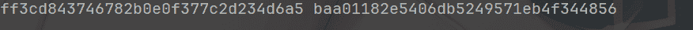

image-20240619165803828.png (24.14 KB, 下载次数: 6)

[href="forum.php?mod=attachment&aid=MjcwNjMzN3w2ZjFjZjdmOXwxNzkzNTcyMDczfDE2ODA4NnwxOTQwNTY2&nothumb=yes" target="_blank"](https://www.52pojie.cn/forum.php?mod=attachment&aid=MjcwNjMzN3w2ZjFjZjdmOXwxNzkzNTcyMDczfDE2ODA4NnwxOTQwNTY2&nothumb=yes)

2024-7-5 14:56 上传

### 2.2 gettype.php

需要携带这两参数，好说

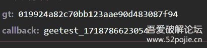

image-20240619170244894.png (11.55 KB, 下载次数: 6)

[href="forum.php?mod=attachment&aid=MjcwNjMzOHw1ZmE3NmUwYnwxNzkzNTcyMDczfDE2ODA4NnwxOTQwNTY2&nothumb=yes" target="_blank"](https://www.52pojie.cn/forum.php?mod=attachment&aid=MjcwNjMzOHw1ZmE3NmUwYnwxNzkzNTcyMDczfDE2ODA4NnwxOTQwNTY2&nothumb=yes)

2024-7-5 14:56 上传

## gettype数据包请求

```python
t = str(int(time.time() * 1000))

url = 'https://api.geetest.com/gettype.php'

params = {
    'gt':gt,
    'callback':"geetest_"+t
}

get_ret = session.get(url=url,headers=headers,params=params).text
```

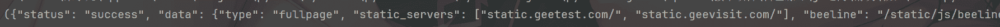

image-20240619170344697.png (53.96 KB, 下载次数: 7)

[href="forum.php?mod=attachment&aid=MjcwNjMzOXwwMzQ5Y2EzZnwxNzkzNTcyMDczfDE2ODA4NnwxOTQwNTY2&nothumb=yes" target="_blank"](https://www.52pojie.cn/forum.php?mod=attachment&aid=MjcwNjMzOXwwMzQ5Y2EzZnwxNzkzNTcyMDczfDE2ODA4NnwxOTQwNTY2&nothumb=yes)

2024-7-5 14:56 上传

### 2.3 fullpage.9.1.9-devcs9.js

这个就是咱核心的`js`文件，本来以为是动态的，结果多刷新几次发现参数都基本上没变，可能是手下留情了，那就不需要进行请求

### 2.4 get.php

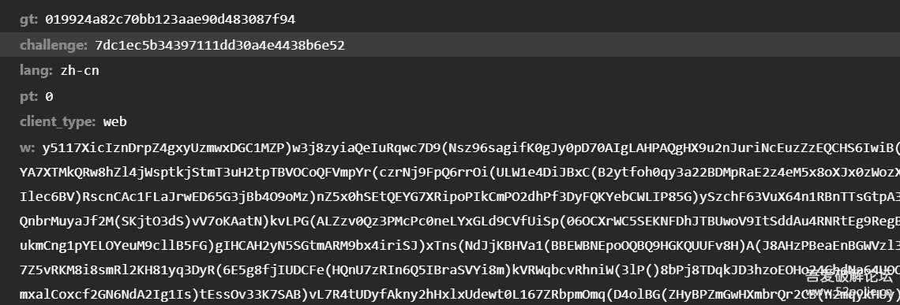

image-20240619170901512.png (75.61 KB, 下载次数: 7)

[href="forum.php?mod=attachment&aid=MjcwNjM0MHw0YWY0ODE0ZXwxNzkzNTcyMDczfDE2ODA4NnwxOTQwNTY2&nothumb=yes" target="_blank"](https://www.52pojie.cn/forum.php?mod=attachment&aid=MjcwNjM0MHw0YWY0ODE0ZXwxNzkzNTcyMDczfDE2ODA4NnwxOTQwNTY2&nothumb=yes)

2024-7-5 14:56 上传

好，这个就是咱第一次的重点要关注的东西了，看到这复杂的载荷，你看看这`w`，多长啊，而且还有恶心的混淆,不说了，考验咱逆向功底的时候到了，八仙过海，各显神通！

#### 2.4.1 寻找加密位置

那么如何寻找加密位置呢？首先想的就是`w`全局搜索，但结果嘛，emmm,不用想，肯定混淆过了

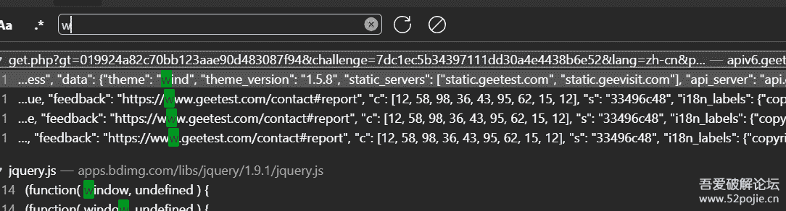

image-20240619171220505.png (56.28 KB, 下载次数: 6)

[href="forum.php?mod=attachment&aid=MjcwNjM0MXxlMjhmYzkxOHwxNzkzNTcyMDczfDE2ODA4NnwxOTQwNTY2&nothumb=yes" target="_blank"](https://www.52pojie.cn/forum.php?mod=attachment&aid=MjcwNjM0MXxlMjhmYzkxOHwxNzkzNTcyMDczfDE2ODA4NnwxOTQwNTY2&nothumb=yes)

2024-7-5 14:56 上传

ps：很多大佬直接搜索定位`"\u0077"` ，这也是最方便的地方，不过为了提高一下自己`js`逆向的水平，我准备换一种方式

搜一下`interceptor`

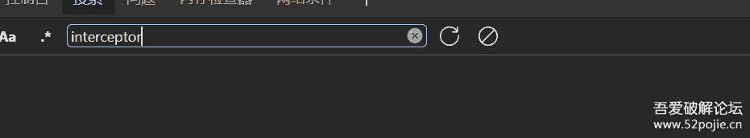

image-20240619171617146.png (13.57 KB, 下载次数: 5)

[href="forum.php?mod=attachment&aid=MjcwNjM0MnxjYjJiYzQ2N3wxNzkzNTcyMDczfDE2ODA4NnwxOTQwNTY2&nothumb=yes" target="_blank"](https://www.52pojie.cn/forum.php?mod=attachment&aid=MjcwNjM0MnxjYjJiYzQ2N3wxNzkzNTcyMDczfDE2ODA4NnwxOTQwNTY2&nothumb=yes)

2024-7-5 14:57 上传

拦截器肯定也是混淆过了

那`hook`能不能`hook`住它加密的位置呢？也就是最后执行`JSON.stringify`的位置，来到最开始的地方打上断点

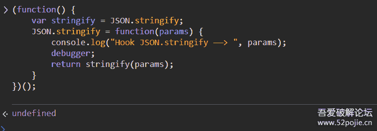

image-20240619171757545.png (24.34 KB, 下载次数: 6)

[href="forum.php?mod=attachment&aid=MjcwNjM0M3wxMjMzYzNmOXwxNzkzNTcyMDczfDE2ODA4NnwxOTQwNTY2&nothumb=yes" target="_blank"](https://www.52pojie.cn/forum.php?mod=attachment&aid=MjcwNjM0M3wxMjMzYzNmOXwxNzkzNTcyMDczfDE2ODA4NnwxOTQwNTY2&nothumb=yes)

2024-7-5 14:57 上传

不行，说明它内部可能又重新给这些函数重写了，或者换了个名字，诶

那试一下内存漫游(`ast-hook-for-js-RE-master`)

这里是志远大佬录制的视频教程，建议观看此视频教程安装：[//www.bilibili.com/video/BV1so4y1o7qr/" target="_blank" rel="noopener noreferrer nofollow"](https://www.bilibili.com/video/BV1so4y1o7qr/:rel="nofollow noopener" href="https)

注意一下启动的是`proxy-server`就行

启动之后直接搜索值就行

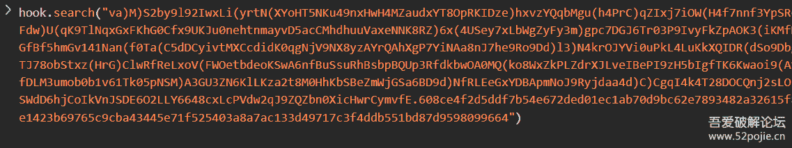

image-20240619173214133.png (56.3 KB, 下载次数: 6)

[href="forum.php?mod=attachment&aid=MjcwNjM0NHxjYjA0NjRjY3wxNzkzNTcyMDczfDE2ODA4NnwxOTQwNTY2&nothumb=yes" target="_blank"](https://www.52pojie.cn/forum.php?mod=attachment&aid=MjcwNjM0NHxjYjA0NjRjY3wxNzkzNTcyMDczfDE2ODA4NnwxOTQwNTY2&nothumb=yes)

2024-7-5 14:57 上传

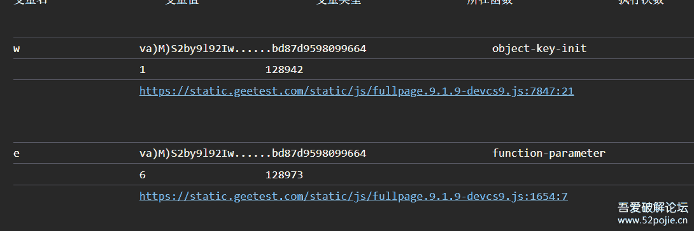

image-20240619173227649.png (30.13 KB, 下载次数: 7)

[href="forum.php?mod=attachment&aid=MjcwNjM0NXw4ODExYzAwZXwxNzkzNTcyMDczfDE2ODA4NnwxOTQwNTY2&nothumb=yes" target="_blank"](https://www.52pojie.cn/forum.php?mod=attachment&aid=MjcwNjM0NXw4ODExYzAwZXwxNzkzNTcyMDczfDE2ODA4NnwxOTQwNTY2&nothumb=yes)

2024-7-5 14:57 上传

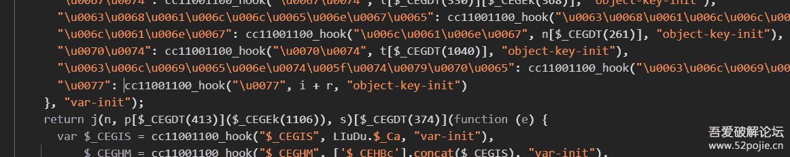

image-20240619173300219.png (65.72 KB, 下载次数: 6)

[href="forum.php?mod=attachment&aid=MjcwNjM0NnwyNjhlNjhjOXwxNzkzNTcyMDczfDE2ODA4NnwxOTQwNTY2&nothumb=yes" target="_blank"](https://www.52pojie.cn/forum.php?mod=attachment&aid=MjcwNjM0NnwyNjhlNjhjOXwxNzkzNTcyMDczfDE2ODA4NnwxOTQwNTY2&nothumb=yes)

2024-7-5 14:57 上传

发现是在这里，记住一些明显的特征，方便以后搜索，`"\u0077"`   `i + r`  `t[$_CEGDT(1040)]`

然后就可以切换回来了,直接全局搜索

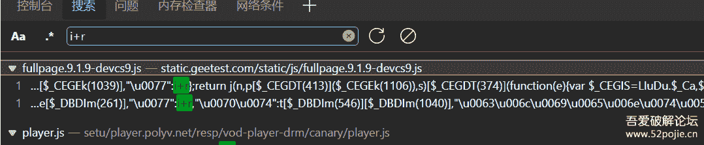

image-20240619173646575.png (37.29 KB, 下载次数: 5)

[href="forum.php?mod=attachment&aid=MjcwNjM0N3w2NGE1ODYyYnwxNzkzNTcyMDczfDE2ODA4NnwxOTQwNTY2&nothumb=yes" target="_blank"](https://www.52pojie.cn/forum.php?mod=attachment&aid=MjcwNjM0N3w2NGE1ODYyYnwxNzkzNTcyMDczfDE2ODA4NnwxOTQwNTY2&nothumb=yes)

2024-7-5 14:57 上传

注意关一下那啥正则表达式之类的东西，然后切换一下关键词搜索，直到找到像这样就一两个结果的舒服

分别进去打上断点，然后刷新看看断到哪了

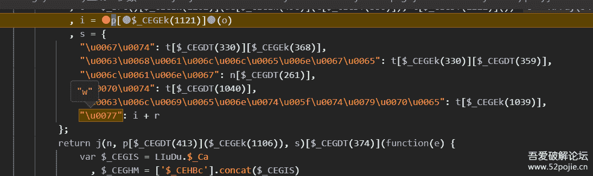

image-20240619173832429.png (60.84 KB, 下载次数: 6)

[href="forum.php?mod=attachment&aid=MjcwNjM0OHxjYjMzNGI3YXwxNzkzNTcyMDczfDE2ODA4NnwxOTQwNTY2&nothumb=yes" target="_blank"](https://www.52pojie.cn/forum.php?mod=attachment&aid=MjcwNjM0OHxjYjMzNGI3YXwxNzkzNTcyMDczfDE2ODA4NnwxOTQwNTY2&nothumb=yes)

2024-7-5 14:57 上传

发现就在这里，芜湖，原来藏在这，混淆太ex了，用用文本替换+AST来解一下混淆先

#### 2.4.2 解混淆

首先，是把所有的字符串还原成人可以看到的吧，比如那些unicode全都给它弄一下,这个简单，网上工具很多，都不用自己写AST代码

这里说一下最常用的吧，就是V神的`v-jstool`, 网上很容易搜索到，就普通解混淆就行

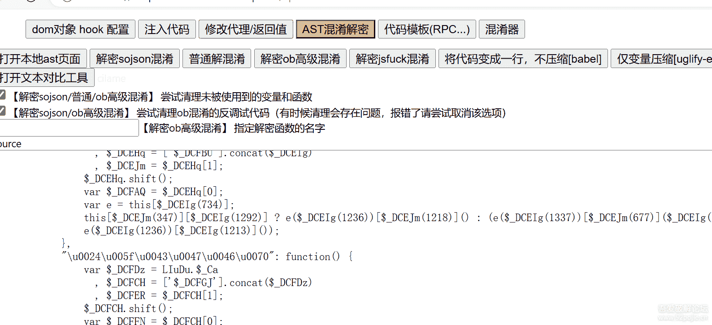

image-20240619174428460.png (181.73 KB, 下载次数: 5)

[href="forum.php?mod=attachment&aid=MjcwNjM0OXw1MGEwODc5N3wxNzkzNTcyMDczfDE2ODA4NnwxOTQwNTY2&nothumb=yes" target="_blank"](https://www.52pojie.cn/forum.php?mod=attachment&aid=MjcwNjM0OXw1MGEwODc5N3wxNzkzNTcyMDczfDE2ODA4NnwxOTQwNTY2&nothumb=yes)

2024-7-5 14:57 上传

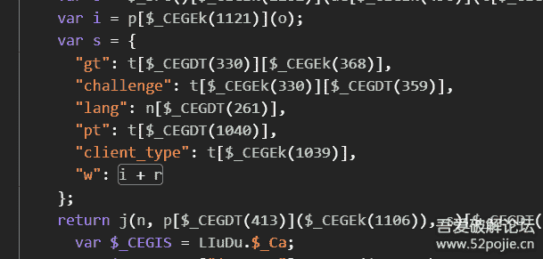

image-20240619174453678.png (38.94 KB, 下载次数: 5)

[href="forum.php?mod=attachment&aid=MjcwNjM1MHw3M2Y4ODZlZXwxNzkzNTcyMDczfDE2ODA4NnwxOTQwNTY2&nothumb=yes" target="_blank"](https://www.52pojie.cn/forum.php?mod=attachment&aid=MjcwNjM1MHw3M2Y4ODZlZXwxNzkzNTcyMDczfDE2ODA4NnwxOTQwNTY2&nothumb=yes)

2024-7-5 14:58 上传

这样看着顺眼点，但是还不够，我要那些`t[xxx]`也还原成字符串，该怎么办呢？ 毕竟大括号里的内容都不一样，有的的`GDT`、`GEK`这类的

提出这个想法的非常好，那就不妨先看看该函数开头，这些值是哪来的

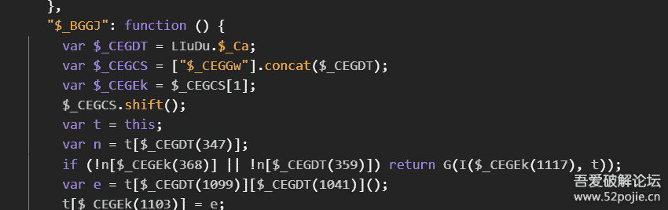

image-20240619174737117.png (38.6 KB, 下载次数: 6)

[href="forum.php?mod=attachment&aid=MjcwNjM1MXxiMWE2OTFhZXwxNzkzNTcyMDczfDE2ODA4NnwxOTQwNTY2&nothumb=yes" target="_blank"](https://www.52pojie.cn/forum.php?mod=attachment&aid=MjcwNjM1MXxiMWE2OTFhZXwxNzkzNTcyMDczfDE2ODA4NnwxOTQwNTY2&nothumb=yes)

2024-7-5 14:58 上传

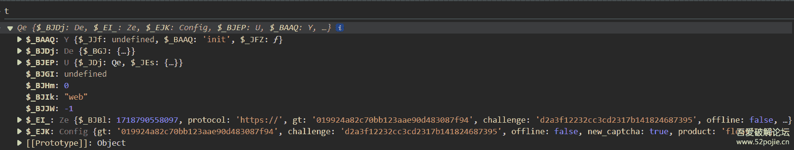

image-20240619175148374.png (56.06 KB, 下载次数: 5)


[href="forum.php?mod=attachment&aid=MjcwNjM1Mnw3MWJiOTliYnwxNzkzNTcyMDczfDE2ODA4NnwxOTQwNTY2&nothumb=yes" target="_blank"](https://www.52pojie.cn/forum.php?mod=attachment&aid=MjcwNjM1Mnw3MWJiOTliYnwxNzkzNTcyMDczfDE2ODA4NnwxOTQwNTY2&nothumb=yes)

2024-7-5 14:58 上传

```
var $_CEGDT = LIuDu.$_Ca;//这个是一个函数
var $_CEGCS = ["$_CEGGw"].concat($_CEGDT); //concat方法用于合并两个或多个数组，$_CEGCS = ["$_CEGGw","$_CEGDT"]
var $_CEGEk = $_CEGCS[1];//取出该数组的第一个值 $_CEGEk = $_CEGDT
$_CEGCS.shift();//删除第一个元素，并返回该元素的值 $_CEGCS = [$_CEGDT]
var t = this;//全局变量,里面一大堆的函数

/**
通过上诉的分析可以知道,$_CEGDT=$_CEGCS=$_CEGEk=LIuDu.$_Ca=LIuDu.$_Ca，用人话说就是这些带$的都是同一个值
可以看到，极验很多函数都有这个操作，这下不得不用AST来干它了
我的思路是把这前面四行删掉，然后让一个变量等于LIuDu.$_Ca这个函数，然后将所有带$的给它统一命名这个变量即可

**/
```

## 去除前面四段无效代码

```
//删除前四行无效代码

//var $_CJDe = LIuDu.$_Ca;

traverse(ast, {

    VariableDeclaration: function (path) {

        if (path.node.declarations.length === 1 && path.node.declarations[0].init) {

            if (path.node.declarations[0].init.computed === false && path.node.declarations[0].id.name !== "bobo") { //注意这里不能删除刚刚赋值的变量

                //删除即可

                path.remove()

            }

        }

    }

})

//var $_CJCW = ["$_CJGo"].concat($_CJDe);

traverse(ast, {

    VariableDeclaration: function (path) {

        if (path.node.declarations.length === 1 && path.node.declarations[0].init) {

            if (path.node.declarations[0].init.callee && path.node.declarations[0].init.callee.computed === false) {

                //删除即可

                //console.log(path.node.declarations[0].init.callee.property.name)

                path.remove()

            }

        }

    }

})

//var $_CJER = $_CJCW[1];

traverse(ast, {

    VariableDeclaration: function (path) {

        if (path.node.declarations.length === 1 && path.node.declarations[0].init) {

            if (path.node.declarations[0].init.computed === true && path.node.declarations[0].init.property.type === "NumericLiteral") {

                //删除即可

                if (path.node.declarations[0].init.property.value === 1) {

                    path.remove()

                }

            }

        }

    }

})

//$_DAHHO.shift();

traverse(ast, {

    ExpressionStatement: function (path) {

        if (path.get("expression.type").node === "CallExpression" && path.get("expression.callee.type").node === "MemberExpression") {

            if (path.get("expression.callee.computed").node === false && path.get("expression.callee.property.name").node === "shift") {

                //删除即可

                //console.log(path.get("expression.callee.property.name").node)

                path.remove()

            }

        }

    }

})
```

## 变量名替换

```
traverse(ast, {
  CallExpression: {
      exit:function (path) {
      if(path.node.arguments.length === 1 && path.node.callee.type === "Identifier"){
          if(path.node.arguments[0].type === "NumericLiteral"){
              path.get("callee").replaceInline(types.memberExpression(types.Identifier("bobo"), types.Identifier("$_DDIBY"), false)) //将函数名替换成bobo
          }
      }
  }
  }
})
```

## 将`LIuDu.$_AD`函数写入内存，同时改写函数名为`bobo`

```
//LIuDu.$_AD写入到内存当中

traverse(ast, {

  ExpressionStatement: function (path) {

      if (path.get("expression.operator").node === "=" && path.get("expression.left.computed").node === false) {

          if (path.node.expression.left.object && path.node.expression.left.property) {

              if (path.node.expression.left.property.name === "$_AD") {

                  //

                  path.get("expression.left").replaceWith(types.Identifier("bobo"))

                  //console.log(path.toString())

                  eval(path.toString())

              }

          }

      }

  }

})
```

```
console.log(bobo)
```

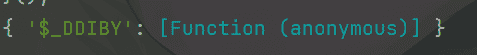

image-20240620222657050.png (14.68 KB, 下载次数: 6)

[href="forum.php?mod=attachment&aid=MjcwNjM1M3wzM2I3NmRmMnwxNzkzNTcyMDczfDE2ODA4NnwxOTQwNTY2&nothumb=yes" target="_blank"](https://www.52pojie.cn/forum.php?mod=attachment&aid=MjcwNjM1M3wzM2I3NmRmMnwxNzkzNTcyMDczfDE2ODA4NnwxOTQwNTY2&nothumb=yes)

2024-7-5 14:58 上传

## 去除控制流平坦化

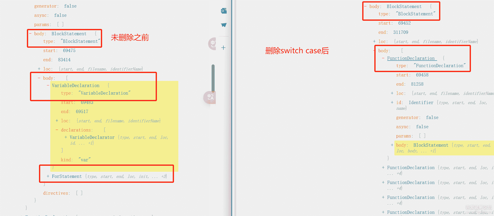

image-20240621154458083.png (201.58 KB, 下载次数: 5)

[href="forum.php?mod=attachment&aid=MjcwNjM1NHw4N2I2NGMwZnwxNzkzNTcyMDczfDE2ODA4NnwxOTQwNTY2&nothumb=yes" target="_blank"](https://www.52pojie.cn/forum.php?mod=attachment&aid=MjcwNjM1NHw4N2I2NGMwZnwxNzkzNTcyMDczfDE2ODA4NnwxOTQwNTY2&nothumb=yes)

2024-7-5 14:58 上传

进过对比之后发现，删除之后`body`会发生变化，原来是`var`和`for`变成一连串的`Fun`

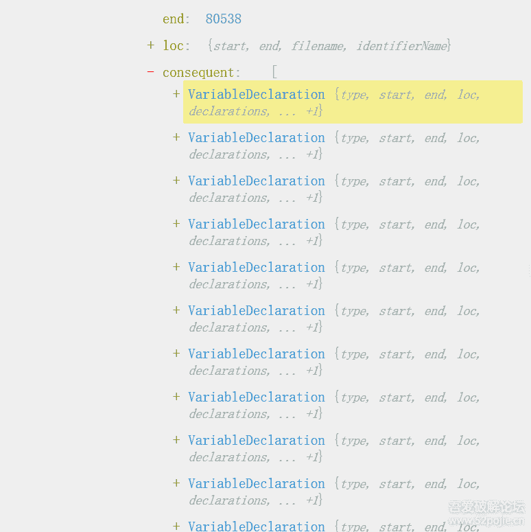

image-20240621155041159.png (119.14 KB, 下载次数: 7)

[href="forum.php?mod=attachment&aid=MjcwNjM1NXw3YjEzNmRmYXwxNzkzNTcyMDczfDE2ODA4NnwxOTQwNTY2&nothumb=yes" target="_blank"](https://www.52pojie.cn/forum.php?mod=attachment&aid=MjcwNjM1NXw3YjEzNmRmYXwxNzkzNTcyMDczfDE2ODA4NnwxOTQwNTY2&nothumb=yes)

2024-7-5 14:58 上传

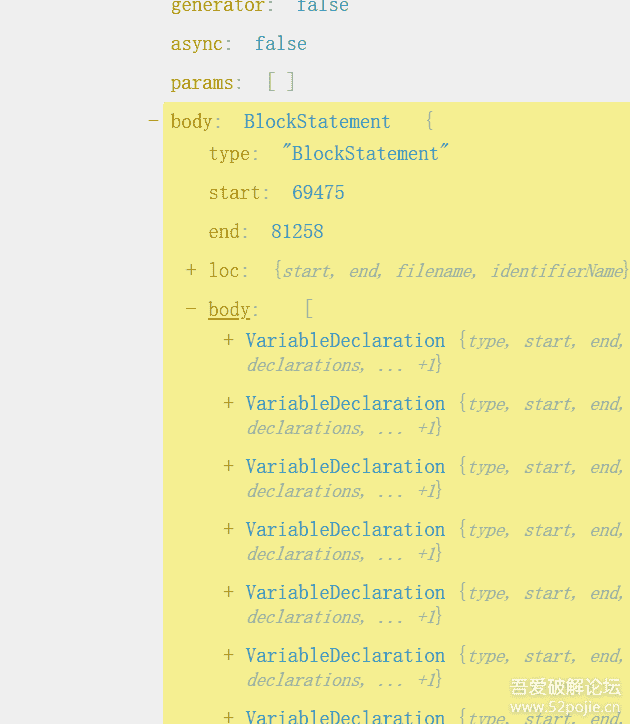

image-20240621155116556.png (92.36 KB, 下载次数: 5)

[href="forum.php?mod=attachment&aid=MjcwNjM1NnxjYzVmMGUxY3wxNzkzNTcyMDczfDE2ODA4NnwxOTQwNTY2&nothumb=yes" target="_blank"](https://www.52pojie.cn/forum.php?mod=attachment&aid=MjcwNjM1NnxjYzVmMGUxY3wxNzkzNTcyMDczfDE2ODA4NnwxOTQwNTY2&nothumb=yes)

2024-7-5 14:58 上传

我们需要做的就是把`consequent`下一系列东西，放到`BlockStatement`下的`body`当中即可

```
/*
var $_DDDCy = LIuDu.$_DV()[12][18];
      for (; $_DDDCy !== LIuDu.$_DV()[8][17];) {
        switch ($_DDDCy) {
          case LIuDu.$_DV()[8][18]:}}

经过观察发现，几乎很多无效的控制流都包括LIuDu.$_DV()，且是从上到下依次执行的，所以咱的思路就是先删除VariableDeclaration
然后再判断ForStatement是不是也包含 LIuDu.$_DV

*/，
traverse(ast, {
      FunctionDeclaration(path) {
          let varDeclaration = null;
          let forLoop = null;
          let switchStatements = [];

          // Traverse the function body to find the specific pattern
          path.traverse({
              //var $_DCGCv = LIuDu.$_DV()[8][18];
              VariableDeclarator(path) {
                  if (path.node.init && path.node.init.type === "MemberExpression" && path.node.init.computed === true &&
                      path.node.init.object.object && path.node.init.object.object.type === "CallExpression"
                  ) {
                      if (path.node.init.object.object.callee.type==="MemberExpression"&&path.node.init.object.object.callee.object && path.node.init.object.object.callee.object.name === 'LIuDu') {
                          varDeclaration = path.parentPath;
                      }
                  }

              },
              //for (; $_DCGCv !== LIuDu.$_DV()[4][16];) {
              ForStatement(path) {
                  if (path.node.test && types.isBinaryExpression(path.node.test) && path.node.test.right.type === "MemberExpression"&&path.node.test.right.object.object) {
                      if (path.node.test.right.object.object.type === "CallExpression"&&path.node.test.right.object.object.callee && path.node.test.right.object.object.callee.object.name === 'LIuDu') {
                          forLoop = path;
                          // path.get("test").remove()
                      }

                  }
              },
              SwitchCase(path) {
                  if (path.parentPath && path.parentPath.parentPath && path.node.consequent) {
                      for(let i = 0; i  0) {
              const newBody = types.blockStatement(switchStatements);
              path.get('body').replaceWith(newBody);
          }
      }
  }
);
```

## 执行`bobo.$_DDIBY`函数

```
//执行bobo函数

traverse(ast, {

  CallExpression: function (path) {

      if (path.node.callee.object && path.node.callee.object.name === "bobo") {

          //console.log(path.toString())

          result = eval(path.toString())

          if (typeof result === "string"){

              path.replaceInline({type:"StringLiteral", value: result})

          }

      }

  }

})


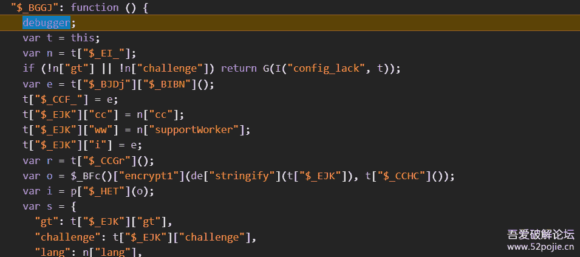

`image-20240620230549418.png` (48.92 KB, 下载次数: 6)

<https://www.52pojie.cn/forum.php?mod=attachment&aid=MjcwNjM1N3xlM2RjYzVlNXwxNzkzNTcyMDczfDE2ODA4NnwxOTQwNTY2&nothumb=yes>

2024-7-5 14:58 上传

这样调试就非常舒服了

### 2.4.3 开始逆向

如果不能断住，可能是找不到 `LIuDu`，可以在函数头上添加 `bobo = LIuDu.$_AD`。

可能有几个 `break` 没删干净，手动删一下就可以。

```
var t = this;
        var n = t["$_EI_"];
        if (!n["gt"] || !n["challenge"]) return G(I("config_lack", t));
        var e = t["$_BJDj"]["$_BIBN"]();
        t["$_CCF_"] = e;
        t["$_EJK"]["cc"] = n["cc"];
        t["$_EJK"]["ww"] = n["supportWorker"];
        t["$_EJK"]["i"] = e;
        var r = t["$_CCGr"]();
        var o = $_BFc()["encrypt1"](de["stringify"](t["$_EJK"]), t["$_CCHC"]());
        var i = p["$_HET"](o);
        var s = {
          "gt": t["$_EJK"]["gt"],
          "challenge": t["$_EJK"]["challenge"],
          "lang": n["lang"],
          "pt": t["$_BJHm"],
          "client_type": t["$_BJIk"],
          "w": i + r
        };
```

我们可以很舒服的看到，`w` 是 `i` 和 `r` 的值拼接形成的。

`r` 是直接调用 `t["$_CCGr"]` 函数。

`i` 是通过执行 `p["$_HET"]` 函数，传进去参数 `o` 得到的，而参数 `o` 则是上面某个加密函数生成的。

而其它的值可以给它还原一下，比如那些 `this` 啥的不好改写。

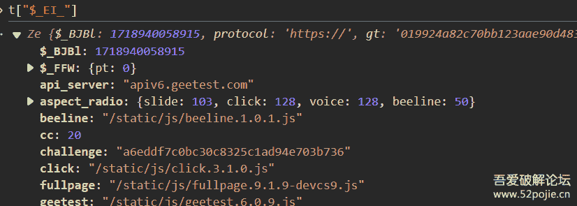

`image-20240621112652490.png` (46.03 KB, 下载次数: 8)

<https://www.52pojie.cn/forum.php?mod=attachment&aid=MjcwNjM1OHw1MDllMDRhMHwxNzkzNTcyMDczfDE2ODA4NnwxOTQwNTY2&nothumb=yes>

2024-7-5 14:58 上传

`var n = t["$EI"];` 这个是一系列大的字典，里面一大堆的值，先全部复制下来，然后看看有啥需要替换的吧。

```
var n = {
    "$_BJBl": 1718940058915, // 时间戳
    "protocol": "https://",
    "gt": "019924a82c70bb123aae90d483087f94", // 这两个是需要返回的，动态的
    "challenge": "a6eddf7c0bc30c8325c1ad94e703b736",
    "offline": false,
    "new_captcha": true,
    "product": "float",
    "width": "300px",
    "https": true,
    "api_server": "apiv6.geetest.com",
    "type": "fullpage",
    "static_servers": [
        "static.geetest.com/",
        "static.geevisit.com/"
    ],
    "beeline": "/static/js/beeline.1.0.1.js",
    "voice": "/static/js/voice.1.2.4.js",
    "click": "/static/js/click.3.1.0.js",
    "fullpage": "/static/js/fullpage.9.1.9-devcs9.js",
    "slide": "/static/js/slide.7.9.2.js",
    "geetest": "/static/js/geetest.6.0.9.js",
    "aspect_radio": {
        "slide": 103,
        "click": 128,
        "voice": 128,
        "beeline": 50
    },
    "cc": 20,
    "supportWorker": true,
    "$_FFW": {
        "pt": 0
    }
};
```

好像除了时间戳和 `gt`、`challenge` 需要变，其它的都是固定的。

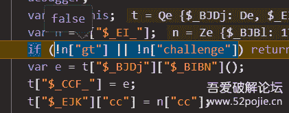

`image-20240621112549286.png` (22.74 KB, 下载次数: 6)

<https://www.52pojie.cn/forum.php?mod=attachment&aid=MjcwNjM1OXxjY2MwZTU0OXwxNzkzNTcyMDczfDE2ODA4NnwxOTQwNTY2&nothumb=yes>

2024-7-5 14:59 上传

这个 `if` 判断返回 `false`，可以直接删掉。

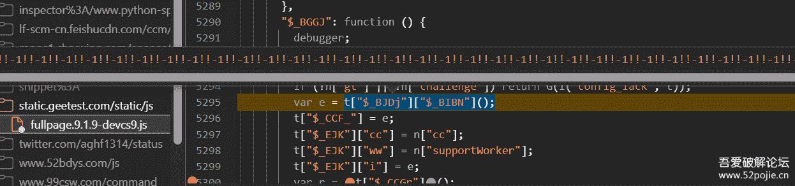

`image-20240621113031751.png` (60.35 KB, 下载次数: 5)

<https://www.52pojie.cn/forum.php?mod=attachment&aid=MjcwNjM2MHxlOTRjMTRkNHwxNzkzNTcyMDczfDE2ODA4NnwxOTQwNTY2&nothumb=yes>

2024-7-5 14:59 上传

下面这个 `e` 值，似乎也是固定的，多试几次发现确实如此，那就直接写死就🆗

下面就是需要咱逆向的东西了

### 2.4.4 `r`值进行逆向

`var r = t["$_CCGr"]`

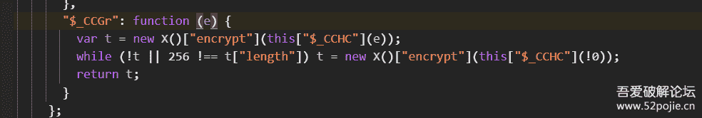

`image-20240621113236990.png` (22.63 KB, 下载次数: 7)

<https://www.52pojie.cn/forum.php?mod=attachment&aid=MjcwNjM2MXw5YTI5NWYxY3wxNzkzNTcyMDczfDE2ODA4NnwxOTQwNTY2&nothumb=yes>

2024-7-5 15:00 上传

进入到 `t["$_CCGr"]` 函数当中，我们知道，外部调用的时候，没有带任何参数，所以 `e=undefined`，先是调用函数，得到一个 `aeskey`，然后执行 `encrypt()` 函数进行 `AES` 加密，返回得到结果。

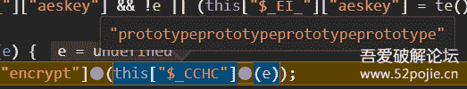

`image-20240621113525476.png` (21.13 KB, 下载次数: 7)

<https://www.52pojie.cn/forum.php?mod=attachment&aid=MjcwNjM2Mnw0NTMyMjUzNnwxNzkzNTcyMDczfDE2ODA4NnwxOTQwNTY2&nothumb=yes>

2024-7-5 15:00 上传

注意：这是第一个坑，如果出现这种情况，说明此时，该网站有缓存之类的，记得清空

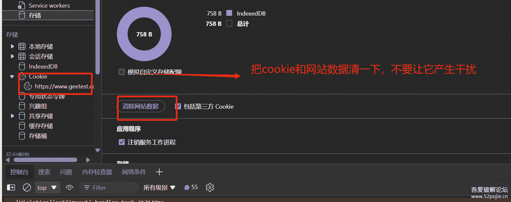

`image-20240621114622091.png` (92.56 KB, 下载次数: 7)

<https://www.52pojie.cn/forum.php?mod=attachment&aid=MjcwNjM2M3w2YzI0MmJjZXwxNzkzNTcyMDczfDE2ODA4NnwxOTQwNTY2&nothumb=yes>

2024-7-5 15:00 上传

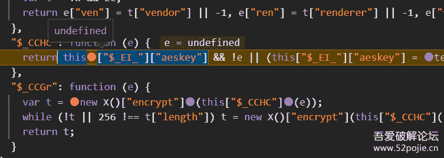

`image-20240621114746653.png` (38.75 KB, 下载次数: 7)

<https://www.52pojie.cn/forum.php?mod=attachment&aid=MjcwNjM2NHxhYzdkZWMyN3wxNzkzNTcyMDczfDE2ODA4NnwxOTQwNTY2&nothumb=yes>

2024-7-5 15:00 上传

这样才对，我们的 `aeskey` 其实是 `te()` 函数返回的，所以可以直接将 `this["$_CCHC"]` 改写为 `te()` 函数即可。

来到 `te()` 函数，发现是四个随机数拼接返回的值，直接扣下来就可以。

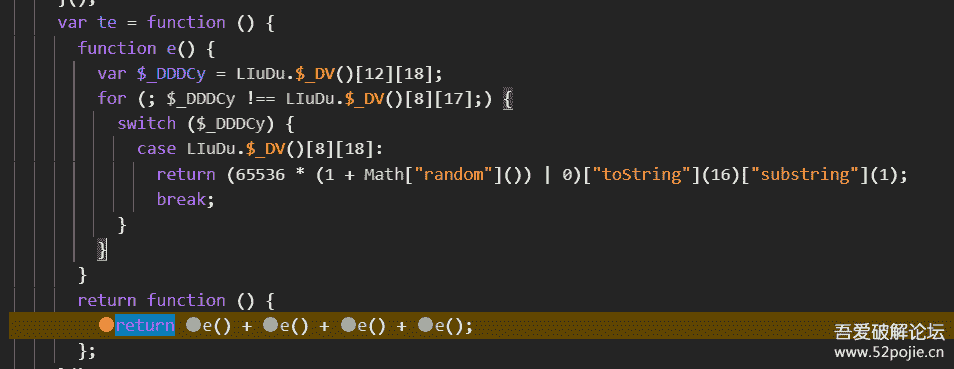

`image-20240621125126701.png` (41.43 KB, 下载次数: 6)

<https://www.52pojie.cn/forum.php?mod=attachment&aid=MjcwNjM2NXxmM2RmNjg1NnwxNzkzNTcyMDczfDE2ODA4NnwxOTQwNTY2&nothumb=yes>

2024-7-5 15:00 上传

```
function e() {
    return (65536 * (1 + Math["random"]()) | 0)["toString"](16)["substring"](1);
}

function te() {
    return e() + e() + e() + e();
};
```

`key` 值搞定后，跟进加密的地方看看，看到熟悉的 `RSA`，可恶，它的 `aeskey` 竟然是迷惑人的，实际上是 `RSA`，差点被骗

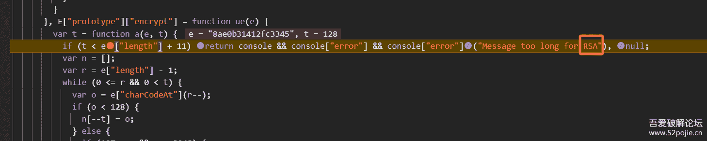

`image-20240621191951256.png` (40.22 KB, 下载次数: 7)

<https://www.52pojie.cn/forum.php?mod=attachment&aid=MjcwNjM2Nnw1MTczM2U1Y3wxNzkzNTcyMDczfDE2ODA4NnwxOTQwNTY2&nothumb=yes>

2024-7-5 15:00 上传

两种方式，一种是直接用 `RSA` 的加密库 `node-jsencrypt`，当然你要改一下它的源码，因为它里面的加密函数没有暴露出来

也就是说要在最后把这个 `module.exports` 改成以下格式才行

```
module.exports = {
    'JSEncrypt':JSEncryptExports.JSEncrypt,
    'RSAKey':JSEncryptExports.RSAKey
};
```

另一种的话就是硬扣 + 稍微一点的补环境 + 删除无效代码，比如那些检测 `MouseEvent` 事件的，之前没删干净的 `LIuDu.$_DV()[0]` 的东西

然后补上 `window` 和 `navigator`，最后调用内部函数

这里也有很多坑，比如说最容易弄错的地方吧

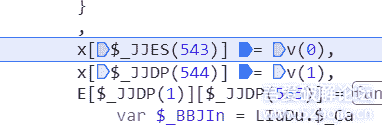

`image-20240622112849808.png` (16.13 KB, 下载次数: 6)

<https://www.52pojie.cn/forum.php?mod=attachment&aid=MjcwNjM2N3xmYjJmMmM2MHwxNzkzNTcyMDczfDE2ODA4NnwxOTQwNTY2&nothumb=yes>

2024-7-5 15:01 上传

就是这里，对应原来的这个地方，可能 `AST` 还原的时候不精准，把 `v(0)` 变成了 `"stringfy"`，`v(1)` 变成了 `"prototype"`，肯定不止这一个地方，记得网站上也改一下

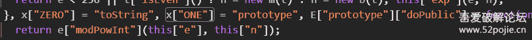

`image-20240622113030029.png` (19.26 KB, 下载次数: 7)

<https://www.52pojie.cn/forum.php?mod=attachment&aid=MjcwNjM2OHw3M2NlMmJlMXwxNzkzNTcyMDczfDE2ODA4NnwxOTQwNTY2&nothumb=yes>

2024-7-5 15:01 上传

诶，找了一上午原来是这个错误，然后差不多弄弄就应该出来了，扣了500多行

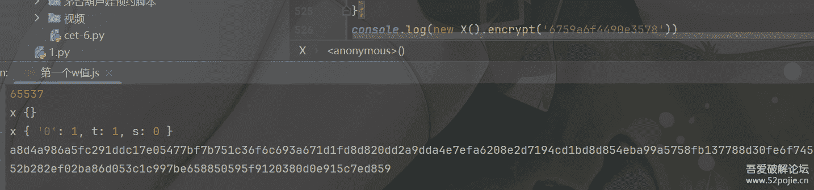

`image-20240622113220884.png` (246.46 KB, 下载次数: 5)


[`href="forum.php?mod=attachment&aid=MjcwNjM2OXw3YTg5ZjZiN3wxNzkzNTcyMDczfDE2ODA4NnwxOTQwNTY2&nothumb=yes" target="_blank"`](https://www.52pojie.cn/forum.php?mod=attachment&aid=MjcwNjM2OXw3YTg5ZjZiN3wxNzkzNTcyMDczfDE2ODA4NnwxOTQwNTY2&nothumb=yes)

2024-7-5 15:01 上传

芜湖！终于把`r`值弄出来了

### 4> 2.4.5 `o`值进行逆向

```
var o = $_BFc()["encrypt1"](de["stringify"](t["$_EJK"]), t["$_CCHC"]());

//参数t["$_EJK"](已知)、t["$_CCHC"](未知)
//函数$_BFc()["encrypt1"](未知)、de["stringify"](这不就是JSON.stringify嘛，还想迷惑我)
```

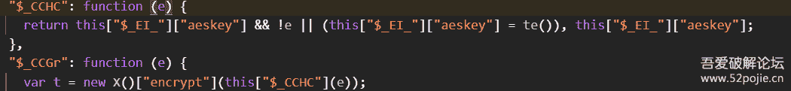

`image-20240622114105981.png` (23.67 KB, 下载次数: 5)

[`href="forum.php?mod=attachment&aid=MjcwNjM3MHw1NjEyMTU0MHwxNzkzNTcyMDczfDE2ODA4NnwxOTQwNTY2&nothumb=yes" target="_blank"`](https://www.52pojie.cn/forum.php?mod=attachment&aid=MjcwNjM3MHw1NjEyMTU0MHwxNzkzNTcyMDczfDE2ODA4NnwxOTQwNTY2&nothumb=yes)

2024-7-5 15:01 上传

进到`t["$_CCHC"]`函数当中，wc，好熟悉，这不就是刚才弄的`te`

先别开心，注意，如果这个时候直接弄`te`的话，后面会出现`decrypt error`，必须保持我们这个时候的`key`和之前`r`值的`key`要保持一致才可以，那么如何才能让`key`一致呢？

很明显，把它生成的值先赋值到全局变量，然后再调用就可以了

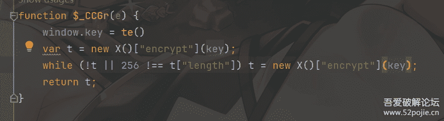

`image-20240629110802871.png` (159.56 KB, 下载次数: 6)

[`href="forum.php?mod=attachment&aid=MjcwNjM3MXxiZjVjNzk3MnwxNzkzNTcyMDczfDE2ODA4NnwxOTQwNTY2&nothumb=yes" target="_blank"`](https://www.52pojie.cn/forum.php?mod=attachment&aid=MjcwNjM3MXxiZjVjNzk3MnwxNzkzNTcyMDczfDE2ODA4NnwxOTQwNTY2&nothumb=yes)

2024-7-5 15:01 上传

我就不信这次的`encrypt`还不是`AES`加密，跟进去看看

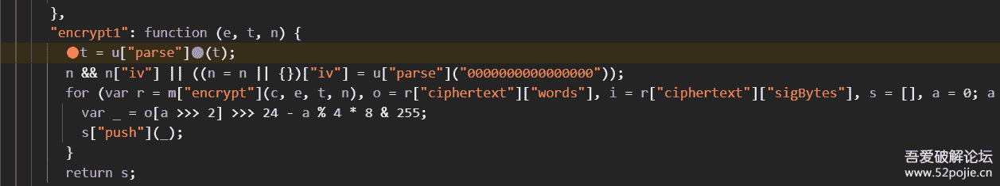

`image-20240622114249326.png` (33.35 KB, 下载次数: 5)

[`href="forum.php?mod=attachment&aid=MjcwNjM3MnwxMjllNGNlZXwxNzkzNTcyMDczfDE2ODA4NnwxOTQwNTY2&nothumb=yes" target="_blank"`](https://www.52pojie.cn/forum.php?mod=attachment&aid=MjcwNjM3MnwxMjllNGNlZXwxNzkzNTcyMDczfDE2ODA4NnwxOTQwNTY2&nothumb=yes)

2024-7-5 15:01 上传

`iv`、`ciphertext`、`words`、`sigBytes`看看，多`nice`，这不就铁是`AES`，实在不放心也可以硬扣，但我要赌一把！

```
function encrypt1(word, key0) {

    var key = CryptoJS.enc.Utf8.parse(key0);  //十六位十六进制数作为密钥

    var iv = CryptoJS.enc.Utf8.parse("0000000000000000");   //十六位十六进制数作为密钥偏移量

    let srcs = CryptoJS.enc.Utf8.parse(word);

    let r = CryptoJS.AES.encrypt(srcs, key, {iv: iv, mode: CryptoJS.mode.CBC, padding: CryptoJS.pad.Pkcs7});

        var o = r['ciphertext']['words'];

    var i = r['ciphertext']['sigBytes'];

    var s = [];

    var a = 0;

    for (; a >> 2] >>> 24 - a % 4 * 8 & 255;

        s['push'](_);

    }

    return s;

}
```

### 4> 2.4.6 `i`值进行逆向

```
var i = p["$_HET"](o);
```

直接进入函数瞅一眼

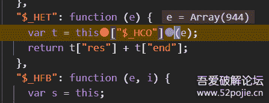

`image-20240622123649623.png` (19.57 KB, 下载次数: 6)

[`href="forum.php?mod=attachment&aid=MjcwNjM3M3w5MDE2MDQ2M3wxNzkzNTcyMDczfDE2ODA4NnwxOTQwNTY2&nothumb=yes" target="_blank"`](https://www.52pojie.cn/forum.php?mod=attachment&aid=MjcwNjM3M3w5MDE2MDQ2M3wxNzkzNTcyMDczfDE2ODA4NnwxOTQwNTY2&nothumb=yes)

2024-7-5 15:01 上传

硬扣吧，也不是啥标准库

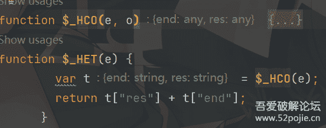

`image-20240622115035485.png` (94.41 KB, 下载次数: 5)

[`href="forum.php?mod=attachment&aid=MjcwNjM3NHwwMTNlZDM3OHwxNzkzNTcyMDczfDE2ODA4NnwxOTQwNTY2&nothumb=yes" target="_blank"`](https://www.52pojie.cn/forum.php?mod=attachment&aid=MjcwNjM3NHwwMTNlZDM3OHwxNzkzNTcyMDczfDE2ODA4NnwxOTQwNTY2&nothumb=yes)

2024-7-5 15:01 上传

然后就是缺啥补啥就行了，注意`this`中的很多函数没有，记得改写，比如`o["$_GGd"]`

```
function $_GJQ(e) {

        var t = "ABCDEFGHIJKLMNOPQRSTUVWXYZabcdefghijklmnopqrstuvwxyz0123456789()";

        return e = t["length"] ? "." : t["charAt"](e);

      }

function $_HBB(e, t) {

        return e >> t & 1;

      }

function $_HCO(e, o) {

        var i = this;

        o || (o = i);

        for (var t = function (e, t) {

            for (var n = 0, r = 24 - 1; 0 
```

### 4> 2.4.7 排除`this`问题

本来以为可以直接运行了，结果报错说`undefined`，不用想就知道，肯定是`this`的问题，现在`this`指向的是`window`


`image-20240622115614061.png` (82.25 KB, 下载次数: 6)

[`href="forum.php?mod=attachment&aid=MjcwNjM3NXxjMTE5NGUxOXwxNzkzNTcyMDczfDE2ODA4NnwxOTQwNTY2&nothumb=yes" target="_blank"`](https://www.52pojie.cn/forum.php?mod=attachment&aid=MjcwNjM3NXxjMTE5NGUxOXwxNzkzNTcyMDczfDE2ODA4NnwxOTQwNTY2&nothumb=yes)

2024-7-5 15:01 上传

所以咱直接在`window`上给它一个`$_EJK`就行了

```
window.$_EJK = {
    "gt": "019924a82c70bb123aae90d483087f94",
    "challenge": "4b538439964403c397e52c4653043893",
    "offline": false,
    "new_captcha": true,
    "product": "float",
    "width": "300px",
    "https": true,
    "api_server": "apiv6.geetest.com",
    "protocol": "https://",
    "type": "fullpage",
    "static_servers": [
        "static.geetest.com/",
        "static.geevisit.com/"
    ],
    "beeline": "/static/js/beeline.1.0.1.js",
    "voice": "/static/js/voice.1.2.4.js",
    "click": "/static/js/click.3.1.0.js",
    "fullpage": "/static/js/fullpage.9.1.9-devcs9.js",
    "slide": "/static/js/slide.7.9.2.js",
    "geetest": "/static/js/geetest.6.0.9.js",
    "aspect_radio": {
        "slide": 103,
        "click": 128,
        "voice": 128,
        "beeline": 50
    },
    "cc": 20,
    "ww": true,
    "i": "-1!!-1!!-1!!-1!!-1!!-1!!-1!!-1!!-1!!-1!!-1!!-1!!-1!!-1!!-1!!-1!!-1!!-1!!-1!!-1!!-1!!-1!!-1!!-1!!-1!!-1!!-1!!-1!!-1!!-1!!-1!!-1!!-1!!-1!!-1!!-1!!-1!!-1!!-1!!-1!!-1!!-1!!-1!!-1!!-1!!-1!!-1!!-1!!-1!!-1!!-1!!-1!!-1!!-1!!-1!!-1!!-1!!-1!!-1!!-1!!-1!!-1!!-1!!-1!!-1!!-1!!-1!!-1!!-1!!-1!!-1!!-1!!-1!!-1"
}
```

```
function get_f_w(time, gt, challenge) {

    var t = this;

    var n = {

        "$_BJBl": time,

        "protocol": "https://",

        "gt": gt,

        "challenge": challenge,

        "offline": false,

        "new_captcha": true,

        "product": "float",

        "width": "300px",

        "https": true,

        "api_server": "apiv6.geetest.com",

        "type": "fullpage",

        "static_servers": [

            "static.geetest.com/",

            "static.geevisit.com/"

        ],

        "beeline": "/static/js/beeline.1.0.1.js",

        "voice": "/static/js/voice.1.2.4.js",

        "click": "/static/js/click.3.1.0.js",

        "fullpage": "/static/js/fullpage.9.1.9-devcs9.js",

        "slide": "/static/js/slide.7.9.2.js",

        "geetest": "/static/js/geetest.6.0.9.js",

        "aspect_radio": {

            "slide": 103,

            "click": 128,

            "voice": 128,

            "beeline": 50

        },

        "cc": 20,

        "supportWorker": true,

        "$_FFW": {

            "pt": 0

        }

    };

    var e = "-1!!-1!!-1!!-1!!-1!!-1!!-1!!-1!!-1!!-1!!-1!!-1!!-1!!-1!!-1!!-1!!-1!!-1!!-1!!-1!!-1!!-1!!-1!!-1!!-1!!-1!!-1!!-1!!-1!!-1!!-1!!-1!!-1!!-1!!-1!!-1!!-1!!-1!!-1!!-1!!-1!!-1!!-1!!-1!!-1!!-1!!-1!!-1!!-1!!-1!!-1!!-1!!-1!!-1!!-1!!-1!!-1!!-1!!-1!!-1!!-1!!-1!!-1!!-1!!-1!!-1!!-1!!-1!!-1!!-1!!-1!!-1!!-1!!-1"

    t["$_CCF_"] = e;

    t["$_EJK"]["cc"] = n["cc"];

    t["$_EJK"]["ww"] = n["supportWorker"];

    t["$_EJK"]["i"] = e;

    var r = $_CCGr();

    var o = encrypt1(JSON["stringify"](t["$_EJK"]), te());

    var i = $_HET(o);

    var s = {

        "gt": gt,

        "challenge": challenge,

        "lang": n["lang"],

        "pt": t["$_BJHm"],

        "client_type": t["$_BJIk"],

        "w": i + r

    };

    return s

}

//console.log(get_f_w(1718940058915, "019924a82c70bb123aae90d483087f94", "a6eddf7c0bc30c8325c1ad94e703b736"))
```


`image-20240629123614980.png` (207.54 KB, 下载次数: 7)

[`href="forum.php?mod=attachment&aid=MjcwNjM3Nnw4M2E0YjcwZnwxNzkzNTcyMDczfDE2ODA4NnwxOTQwNTY2&nothumb=yes" target="_blank"`](https://www.52pojie.cn/forum.php?mod=attachment&aid=MjcwNjM3Nnw4M2E0YjcwZnwxNzkzNTcyMDczfDE2ODA4NnwxOTQwNTY2&nothumb=yes)

2024-7-5 15:02 上传

### 4> 2.4.8 `python`调用

咱废话不多说，直接用`python`调用试试


```
# ================get.php数据包请求===========================
f = open('第一个w值.js', 'r', encoding='utf-8')
first_js = execjs.compile(f.read())
ret_dic = first_js.call('get_f_w',  gt, challenge)
print(ret_dic)
w = ret_dic['w']
print(w)
url = 'https://api.geetest.com/get.php'
params = {
    "gt": gt,
    "challenge": challenge,
    "lang": "zh-cn",
    "pt": "0",
    "client_type": "web",
    "callback": 'geetest_%s' % t,
    'w': w
}
get_ret = session.get(url=url, headers=headers, params=params).text
print(get_ret)
```


image-20240629124240196.png (198.5 KB, 下载次数: 7)

[href="forum.php?mod=attachment&aid=MjcwNjM3N3xiNTYzNTgyZXwxNzkzNTcyMDczfDE2ODA4NnwxOTQwNTY2&nothumb=yes" target="_blank"](https://www.52pojie.cn/forum.php?mod=attachment&aid=MjcwNjM3N3xiNTYzNTgyZXwxNzkzNTcyMDczfDE2ODA4NnwxOTQwNTY2&nothumb=yes)

2024-7-5 15:02 上传

成功！芜湖，过了第一个w

## 三、第二个W逆向

第二个需要逆向的`w`出现在点击了【点击按钮进行验证】后出现的第一个ajax.php数据包中。


image-20240701065801489.png (135.84 KB, 下载次数: 6)

[href="forum.php?mod=attachment&aid=MjcwNjM3OHw1Y2NhNzc0OXwxNzkzNTcyMDczfDE2ODA4NnwxOTQwNTY2&nothumb=yes" target="_blank"](https://www.52pojie.cn/forum.php?mod=attachment&aid=MjcwNjM3OHw1Y2NhNzc0OXwxNzkzNTcyMDczfDE2ODA4NnwxOTQwNTY2&nothumb=yes)

2024-7-5 15:02 上传

### 3.1 ajax.php

#### 3.1.1 找w值

注意，这里如果直接搜索的话，记得换一些关键词多试一下，比如"w、["w 、"w": 之类的
或者用之前讲的内存漫游、跟堆栈都行，这里我就直接搜索吧


image-20240701085730318.png (37.7 KB, 下载次数: 6)

[href="forum.php?mod=attachment&aid=MjcwNjM3OXxhY2Q2NDUwOXwxNzkzNTcyMDczfDE2ODA4NnwxOTQwNTY2&nothumb=yes" target="_blank"](https://www.52pojie.cn/forum.php?mod=attachment&aid=MjcwNjM3OXxhY2Q2NDUwOXwxNzkzNTcyMDczfDE2ODA4NnwxOTQwNTY2&nothumb=yes)

2024-7-5 15:02 上传

位置就是在这里，发现是`$_CEAo`传过来的值，那就再搜索


image-20240701085825933.png (42.59 KB, 下载次数: 6)

[href="forum.php?mod=attachment&aid=MjcwNjM4MHw1ZTVjODQwMXwxNzkzNTcyMDczfDE2ODA4NnwxOTQwNTY2&nothumb=yes" target="_blank"](https://www.52pojie.cn/forum.php?mod=attachment&aid=MjcwNjM4MHw1ZTVjODQwMXwxNzkzNTcyMDczfDE2ODA4NnwxOTQwNTY2&nothumb=yes)

2024-7-5 15:02 上传

发现是这个东西给它赋值的，那就先对它进行改写吧

`i["$_CCHC"]`这个函数可以跟进去看一下，发现其实就是生成`aeskey`的地方，咱之前已经生成过了，那就直接传进来就可以

```
function get_sec_w(gt, challenge, aeskey) {

    var n = {};

    var r = get_r(gt,challenge);

    n["gt"] = gt;

    n["challenge"] = challenge;

    n["lang"] = "zh-cn";

    n["pt"] = 0;

    n["client_type"] = "web";

    n["w"] = p["$_HET"](c["encrypt"](r, aeskey))

    return n

}
```

发现缺少的就是`r`值了，以及`encrypt`函数(之前扣过)

#### 3.1.2 逆向r值

很明显，`r`值是需要我们去进行逆向的，毕竟往上瞅一眼就知道这家伙绝对不是常量

在变量`r`处设置断点，刷新后断点停留

```
r = "{" + i["$_CECC"] + "\"captcha_token\":\"" + n(o["toString"]() + n(n["toString"]()) + n(e["toString"]())) + "\",\"w6nw\":\"fkplx5pf\"}";
```

- 先看如下三个toString，`o['toString']()`、`n['toString']()`和`e['toString']()`是什么？

其中`o`一个自运行函数，`n`是自运行函数里面的一个内置函数定义，`e`是`var t = ["bbOy"]`里的第0个值。

因此`o['toString']()`是将函数`o`的定义转换成字符串，`n['toString']()`是将函数`n`的定义转换成字符串，`e['toString']()`是将参数`e`的值转换成字符串。

注意：在改写`get_r`函数的时候，已经将函数`o`和`n`进行了反混淆，因此这两个函数的实现已经被我们改变了，因此直接基于改变后的`o`和`n`函数进行`toString()`操作得到的函数字符串就和浏览器的`toString()`结果不一样了。


image-20240701090834395.png (43.31 KB, 下载次数: 5)

[href="forum.php?mod=attachment&aid=MjcwNjM4MXwxZmY0ZjRhMHwxNzkzNTcyMDczfDE2ODA4NnwxOTQwNTY2&nothumb=yes" target="_blank"](https://www.52pojie.cn/forum.php?mod=attachment&aid=MjcwNjM4MXwxZmY0ZjRhMHwxNzkzNTcyMDczfDE2ODA4NnwxOTQwNTY2&nothumb=yes)

2024-7-5 15:02 上传

因此，我们就需要换一个没解混淆的浏览器，找一个好用的关键词，然后把`o['toString']()`、`n['toString']()`和`e['toString']()`设置成定值


image-20240701091007458.png (36.98 KB, 下载次数: 7)

[href="forum.php?mod=attachment&aid=MjcwNjM4M3w3NDFmMjQwOHwxNzkzNTcyMDczfDE2ODA4NnwxOTQwNTY2&nothumb=yes" target="_blank"](https://www.52pojie.cn/forum.php?mod=attachment&aid=MjcwNjM4M3w3NDFmMjQwOHwxNzkzNTcyMDczfDE2ODA4NnwxOTQwNTY2&nothumb=yes)

2024-7-5 15:02 上传


image-20240701091232190.png (1.05 MB, 下载次数: 7)

[href="forum.php?mod=attachment&aid=MjcwNjM4NHw1ZmIzYmU3Y3wxNzkzNTcyMDczfDE2ODA4NnwxOTQwNTY2&nothumb=yes" target="_blank"](https://www.52pojie.cn/forum.php?mod=attachment&aid=MjcwNjM4NHw1ZmIzYmU3Y3wxNzkzNTcyMDczfDE2ODA4NnwxOTQwNTY2&nothumb=yes)

2024-7-5 15:02 上传

#### 3.1.3 i["$_CECC"]


image-20240701091549564.png (65.53 KB, 下载次数: 3)

[href="forum.php?mod=attachment&aid=MjcwNjM4NXwxZjQwZDhhM3wxNzkzNTcyMDczfDE2ODA4NnwxOTQwNTY2&nothumb=yes" target="_blank"](https://www.52pojie.cn/forum.php?mod=attachment&aid=MjcwNjM4NXwxZjQwZDhhM3wxNzkzNTcyMDczfDE2ODA4NnwxOTQwNTY2&nothumb=yes)

2024-7-5 15:02 上传

现在未知的就是`i["$_CECC"]`，那么我们就去找找看到底在哪里生成的这个值

还是老方法，直接搜索


image-20240701091636298.png (40.36 KB, 下载次数: 6)

[href="forum.php?mod=attachment&aid=MjcwNjM4Nnw0NjdkYmVlZXwxNzkzNTcyMDczfDE2ODA4NnwxOTQwNTY2&nothumb=yes" target="_blank"](https://www.52pojie.cn/forum.php?mod=attachment&aid=MjcwNjM4Nnw0NjdkYmVlZXwxNzkzNTcyMDczfDE2ODA4NnwxOTQwNTY2&nothumb=yes)

2024-7-5 15:03 上传

```
var i = this;
var e = i["$_CAAS"]["$_BIBN"]();
var t = i["$_CAAS"]["$_BICN"]();
var n = i["$_BJDj"]["$_BICN"]();
var r = i["$_BDHU"]["$_BIBN"]();
var o = i["$_EI_"];
var s = $_Gt() - rt;
i["$_CECC"] = "";
for (var a = [
    ["lang", o["lang"] || "zh-cn"], ["type", "fullpage"], 
    ["tt", function(e, t, n) {
    if (!t || !n)
        return e;
    var r;
    var o = 0;
    var i = e;
    var s = t[0];
    var a = t[2];
    var _ = t[4];
    while (r = n["substr"](o, 2)) {
        o += 2;
        var c = parseInt(r, 16);
        var l = String["fromCharCode"](c);
        var u = (s * c * c + a * c + _) % e["length"];
        i = i["substr"](0, u) + l + i["substr"](u);
    }
    return i;
}(e, o["c"], o["s"]) || -1], 
    ["light", r || -1], ["s", H(p["$_HDn"](t))], 
    ["h", H(p["$_HDn"](n))], ["hh", H(n)], 
    ["hi", H(i["$_CCF_"])], 
    ["vip_order", i["vip_order"] || -1], 
    ["ct", i["ct"] || -1], 
    ["ep", i["$_CEDJ"]() || -1], 
    ["passtime", s || -1], 
    ["rp", H(o["gt"] + o["challenge"] + s)]
], _ = 0; _ 
```

很好，又是一大堆的参数，`e`、`t`、`r`、`s`、`p`、`h`等等，歪日, 没办法，慢慢来吧

- `e`值进行逆向


image-20240701092431064-17197970721123.png (19.83 KB, 下载次数: 6)

[href="forum.php?mod=attachment&aid=MjcwNjM4N3xkYjBjMjc1ZXwxNzkzNTcyMDczfDE2ODA4NnwxOTQwNTY2&nothumb=yes" target="_blank"](https://www.52pojie.cn/forum.php?mod=attachment&aid=MjcwNjM4N3xkYjBjMjc1ZXwxNzkzNTcyMDczfDE2ODA4NnwxOTQwNTY2&nothumb=yes)

2024-7-5 15:03 上传

进入到`e`函数当中，发现`$_BGJ`中的东西赋值给了`e`，然后进过某个不为人知的操作，返回，那先看看这是啥


image-20240701092536383.png (90.81 KB, 下载次数: 6)

[href="forum.php?mod=attachment&aid=MjcwNjM4OHw3NWQ1N2RlN3wxNzkzNTcyMDczfDE2ODA4NnwxOTQwNTY2&nothumb=yes" target="_blank"](https://www.52pojie.cn/forum.php?mod=attachment&aid=MjcwNjM4OHw3NWQ1N2RlN3wxNzkzNTcyMDczfDE2ODA4NnwxOTQwNTY2&nothumb=yes)

2024-7-5 15:03 上传

wc,这不就是鼠标轨迹嘛，数组每一个元素就是一个具体的轨迹坐标和触发该坐标的时间，根据上图会发现，基本上是每几毫秒就会记录一个轨迹坐标。此处需要注意：轨迹点和轨迹点之间一定是连续的，要满足人为使用鼠标连续滑动的行为。

那不就好办了，毕竟每个人移动的鼠标轨迹都不同，你总不可能会搜集所有人的轨迹吧？那不就累死。所以为了让参数短一点，就直接模拟那些手速快的，咋的？你不可能因为我手速比别人快就封我吧


image-20240701093231722.png (67.16 KB, 下载次数: 6)

[href="forum.php?mod=attachment&aid=MjcwNjM4OXw4NmQ5NTFjNHwxNzkzNTcyMDczfDE2ODA4NnwxOTQwNTY2&nothumb=yes" target="_blank"](https://www.52pojie.cn/forum.php?mod=attachment&aid=MjcwNjM4OXw4NmQ5NTFjNHwxNzkzNTcyMDczfDE2ODA4NnwxOTQwNTY2&nothumb=yes)

2024-7-5 15:03 上传

PS：想练习手速的可以试试，这边最高纪录是6个值，还是单身多年的结果


## 入口函数分析

```
function() {
    var e = this["$_BGJ"];//将this['$_BGJ']也就是鼠标轨迹赋值给e
    return this["$_BGJ"] = [],//修改成空，且该值后面没用到，可以直接将其删除
        this["$_HDn"](this["$_BHIQ"](e));
}
//下面就需要搞定参数this["$_BHIQ"](e)和函数this["$_HDn"]
```

### 进入 `this['$_BHIQ']` 函数


`image-20240701155317661.png`（65.24 KB，下载次数：6）

查看 `this[e]` 的值：将滑动轨迹被 `$_BHIQ` 进行处理，处理方式是获取 `e` 中的滑动坐标和每两次滑动时间戳之间的差值。因此，`this[e]` 的值可以直接复制即可。（PS：当然，你想硬扣也可以，锻炼一些 JS 逆向的能力，反正它这东西也不校验，你写死无所谓。）

### 再看看 `this["$_HDn"]` 函数


`image-20240701155603494.png`（46.92 KB，下载次数：7）

发现非常长，你可以选择直接固定返回值，也可以把这个函数扣下来，说不定后面也会用到。

记得把那些没删干净的 `$_DDGIe = LIuDu.$_DV()[4][17]` 去掉，不然报错麻烦。

```
function $_HDn(e) {
    var p = {
        "move": 0,
        "down": 1,
        "up": 2,
        "scroll": 3,
        "focus": 4,
        "blur": 5,
        "unload": 6,
        "unknown": 7
    };

    function h(e, t) {
        for (var n = String(e)["toString"](2), r = "", o = n["length"] + 1; o > 15 != 1;
        }), function (e) {
            return e 
```


`image-20240701155910909.png`（21.45 KB，下载次数：7）

搞定！

### `t` 值逆向


`image-20240701160341458.png`（13.54 KB，下载次数：8）

```
//在console中查看i['$_BJJL']['$_BICE']函数的定义，对其进行反混淆和逆向
function get_t_value() {
    /*
        此处打上断点，在console中查看 this['$_BGC']是一个空数组[]
        而this['$_HDz']就是前面逆向好的$_HDz函数，因此下代码可以改为：
    */
    // return this['$_HDz'](this['$_BGC']);
    return $_HDn([]); //$_HDn之前也扣过了
}
```

### `n` 值逆向


`image-20240701163144932.png`（39.48 KB，下载次数：6）

```
function(e, t) {
    var n = this;
    var r = n["$_BGJ"];
    var o = [];
    return new $_DJs(n["$_BJAQ"]())["$_EBo"](function(e) {
        var t = r[e];
        o["push"](n["$_BIHp"](t) ? n["$_BIDR"] : t);
    }),
        o["join"]("magic data");
}
```


`image-20240701163345085.png`（8.43 KB，下载次数：7）


`image-20240701163557648.png`（1.29 KB，下载次数：6）

`n["$_BIDR"]` 和 `r` 是一个定值，那下面就需要 `$_DJs`、`$_BJAQ`、`$_EBo` 函数。

#### 进入 `BJAQ` 函数内部


`image-20240701165816312.png`（13.32 KB，下载次数：5）


`image-20240701165853821.png`（32.82 KB，下载次数：5）

`BIIQ` 是一个大数组，好像是固定的，那就直接扣。


`image-20240701170015515.png`（22.4 KB，下载次数：7）


`image-20240701170223186.png`（223.13 KB，下载次数：8）

扣成这样就可以了，然后运行一下，看看跟网站的结果是不是一样的。


`image-20240701170317344.png`（405.8 KB，下载次数：5）

### `$_BIHp` 函数

返回一个布尔值。


```
function $_DJs(e) {
    this["$_BAEj"] = e || [];
}
function $_BJAQ() {
    var $_BIIQ = [
        "A",
        "ARTICLE",
        "ASIDE",
        "AUDIO",
        "BASE",
        "BUTTON",
        "CANVAS",
        "CODE",
        "IFRAME",
        "IMG",
        "INPUT",
        "LABEL",
        "LINK",
        "NAV",
        "OBJECT",
        "OL",
        "PICTURE",
        "PRE",
        "SECTION",
        "SELECT",
        "SOURCE",
        "SPAN",
        "STYLE",
        "TABLE",
        "TEXTAREA",
        "VIDEO"
    ];
    var $_BIJu = [
        "DIV",
        "P",
        "UL",
        "LI",
        "SCRIPT"
    ]
    return ["textLength", "HTMLLength", "documentMode"]["concat"]($_BIIQ)["concat"](["screenLeft", "screenTop", "screenAvailLeft", "screenAvailTop", "innerWidth", "innerHeight", "outerWidth", "outerHeight", "browserLanguage", "browserLanguages", "systemLanguage", "devicePixelRatio", "colorDepth", "userAgent", "cookieEnabled", "netEnabled", "screenWidth", "screenHeight", "screenAvailWidth", "screenAvailHeight", "localStorageEnabled", "sessionStorageEnabled", "indexedDBEnabled", "CPUClass", "platform", "doNotTrack", "timezone", "canvas2DFP", "canvas3DFP", "plugins", "maxTouchPoints", "flashEnabled", "javaEnabled", "hardwareConcurrency", "jsFonts", "timestamp", "performanceTiming", "internalip", "mediaDevices"])["concat"]($_BIJu)["concat"](["touchEvent"]);

}

function $_EBo(e) {
    var t = [
        "textLength",
        "HTMLLength",
        "documentMode",
        "A",
        "ARTICLE",
        "ASIDE",
        "AUDIO",
        "BASE",
        "BUTTON",
        "CANVAS",
        "CODE",
        "IFRAME",
        "IMG",
        "INPUT",
        "LABEL",
        "LINK",
        "NAV",
        "OBJECT",
        "OL",
        "PICTURE",
        "PRE",
        "SECTION",
        "SELECT",
        "SOURCE",
        "SPAN",
        "STYLE",
        "TABLE",
        "TEXTAREA",
        "VIDEO",
        "screenLeft",
        "screenTop",
        "screenAvailLeft",
        "screenAvailTop",
        "innerWidth",
        "innerHeight",
        "outerWidth",
        "outerHeight",
        "browserLanguage",
        "browserLanguages",
        "systemLanguage",
        "devicePixelRatio",
        "colorDepth",
        "userAgent",
        "cookieEnabled",
        "netEnabled",
        "screenWidth",
        "screenHeight",
        "screenAvailWidth",
        "screenAvailHeight",
        "localStorageEnabled",
        "sessionStorageEnabled",
        "indexedDBEnabled",
        "CPUClass",
        "platform",
        "doNotTrack",
        "timezone",
        "canvas2DFP",
        "canvas3DFP",
        "plugins",
        "maxTouchPoints",
        "flashEnabled",
        "javaEnabled",
        "hardwareConcurrency",
        "jsFonts",
        "timestamp",
        "performanceTiming",
        "internalip",
        "mediaDevices",
        "DIV",
        "P",
        "UL",
        "LI",
        "SCRIPT",
        "touchEvent"
    ]
    if (t["map"])
        return new $_DJs(t["map"](e));
    for (var n = [], r = 0, o = t["length"]; r 
```


image-20240701171826325.png (139.85 KB, 下载次数: 6)

[href="forum.php?mod=attachment&aid=MjcwNjQwMnxjYmFkZTQ0NnwxNzkzNTcyMDczfDE2ODA4NnwxOTQwNTY2&nothumb=yes" target="_blank"](https://www.52pojie.cn/forum.php?mod=attachment&aid=MjcwNjQwMnxjYmFkZTQ0NnwxNzkzNTcyMDczfDE2ODA4NnwxOTQwNTY2&nothumb=yes)

2024-7-5 15:04 上传

- `r`值进行逆向


image-20240701171902530.png (22.26 KB, 下载次数: 8)

[href="forum.php?mod=attachment&aid=MjcwNjQwM3wwYWE1ZjI0MHwxNzkzNTcyMDczfDE2ODA4NnwxOTQwNTY2&nothumb=yes" target="_blank"](https://www.52pojie.cn/forum.php?mod=attachment&aid=MjcwNjQwM3wwYWE1ZjI0MHwxNzkzNTcyMDczfDE2ODA4NnwxOTQwNTY2&nothumb=yes)

2024-7-5 15:04 上传


image-20240701172621300.png (8.71 KB, 下载次数: 6)

[href="forum.php?mod=attachment&aid=MjcwNjQwNHw1YjI0YTJmNnwxNzkzNTcyMDczfDE2ODA4NnwxOTQwNTY2&nothumb=yes" target="_blank"](https://www.52pojie.cn/forum.php?mod=attachment&aid=MjcwNjQwNHw1YjI0YTJmNnwxNzkzNTcyMDczfDE2ODA4NnwxOTQwNTY2&nothumb=yes)

2024-7-5 15:05 上传

`this["$_BGJ"]`是固定的数组而`y`、`b`、`x`都是`false`，直接改成`false`即可

```
function $_BIBN2() {

    var e = ["DIV_0"] || [];

    return this["$_BGJ"] = [],

        this["$_BGIn"] = 0,

        this["$_BGJK"] = [],

        false,

        e["join"]("|");

}
```

- `o`值是一个固定的字典（当然，可能有像`challenge`是变化的，咱先固定）


image-20240701175026148.png (67.25 KB, 下载次数: 7)

[href="forum.php?mod=attachment&aid=MjcwNjQwNXwyYjkwMzkxYnwxNzkzNTcyMDczfDE2ODA4NnwxOTQwNTY2&nothumb=yes" target="_blank"](https://www.52pojie.cn/forum.php?mod=attachment&aid=MjcwNjQwNXwyYjkwMzkxYnwxNzkzNTcyMDczfDE2ODA4NnwxOTQwNTY2&nothumb=yes)

2024-7-5 15:05 上传

- `s`值进行逆向

`s = $_GI() - rt;`

进入到`_GI`函数内部


image-20240701180300282.png (11.74 KB, 下载次数: 5)

[href="forum.php?mod=attachment&aid=MjcwNjQwNnwyOWVkMDE2OXwxNzkzNTcyMDczfDE2ODA4NnwxOTQwNTY2&nothumb=yes" target="_blank"](https://www.52pojie.cn/forum.php?mod=attachment&aid=MjcwNjQwNnwyOWVkMDE2OXwxNzkzNTcyMDczfDE2ODA4NnwxOTQwNTY2&nothumb=yes)

2024-7-5 15:05 上传


image-20240701180336278.png (15.84 KB, 下载次数: 7)

[href="forum.php?mod=attachment&aid=MjcwNjQwN3xmZjE5MDZkOHwxNzkzNTcyMDczfDE2ODA4NnwxOTQwNTY2&nothumb=yes" target="_blank"](https://www.52pojie.cn/forum.php?mod=attachment&aid=MjcwNjQwN3xmZjE5MDZkOHwxNzkzNTcyMDczfDE2ODA4NnwxOTQwNTY2&nothumb=yes)

2024-7-5 15:05 上传

```
/*
    1、分析s的生成原理。在console中查看$_GI是一个函数，该函数最终返回值是：
    return new Date()['getTime']()表示当前时间戳。
    rt在console中查看是另一个较早之前的时间戳。
    因此s = 当前时间戳 - 较早之前的时间戳，所以s用来表示用户在滑动验证时，某两个行为之间的时间差。
    这个时间差肯定无法再服务器端进行固定校验，因此可以给s赋当下s表示的时间差值或者随机值都行。
*/
```

- `HDn`相关的函数

注意，如果直接搜索

```
function $_HDn(e) {

    var p = {

        "move": 0,

        "down": 1,

        "up": 2,

        "scroll": 3,

        "focus": 4,

        "blur": 5,

        "unload": 6,

        "unknown": 7

    };

    function h(e, t) {

        for (var n = String(e)["toString"](2), r = "", o = n["length"] + 1; o > 15 != 1;

        }), function (e) {

            return e 
```

- 分析`H`函数


image-20240701202225465.png (15.51 KB, 下载次数: 6)

[href="forum.php?mod=attachment&aid=MjcwNjQwOHw2ZTIyMDZkMXwxNzkzNTcyMDczfDE2ODA4NnwxOTQwNTY2&nothumb=yes" target="_blank"](https://www.52pojie.cn/forum.php?mod=attachment&aid=MjcwNjQwOHw2ZTIyMDZkMXwxNzkzNTcyMDczfDE2ODA4NnwxOTQwNTY2&nothumb=yes)

2024-7-5 15:05 上传

这个的话直接扣，然后把那些 `LIuDu.$_DV`删掉


```
  function H(e) {
      function _(e, t) {
          return e >> 32 - t;
      }

      function c(e, t) {
          var n;
          var r;
          var o;
          var i;
          var s;
          return o = 2147483648 & e,
              i = 2147483648 & t,
              s = (1073741823 & e) + (1073741823 & t),
              (n = 1073741824 & e) & (r = 1073741824 & t) ? 2147483648 ^ s ^ o ^ i : n | r ? 1073741824 & s ? 3221225472 ^ s ^ o ^ i : 1073741824 ^ s ^ o ^ i : s ^ o ^ i;
      }

      function t(e, t, n, r, o, i, s) {
          return c(_(e = c(e, c(c(function a(e, t, n) {
              return e & t | ~e & n;
          }(t, n, r), o), s)), i), t);
      }

      function n(e, t, n, r, o, i, s) {
          return c(_(e = c(e, c(c(function a(e, t, n) {
              return e & n | t & ~n;
          }(t, n, r), o), s)), i), t);
      }

      function r(e, t, n, r, o, i, s) {
          return c(_(e = c(e, c(c(function a(e, t, n) {
              return e ^ t ^ n;
          }(t, n, r), o), s)), i), t);
      }

      function o(e, t, n, r, o, i, s) {
          return c(_(e = c(e, c(c(function a(e, t, n) {
              return t ^ (e | ~n);
          }(t, n, r), o), s)), i), t);
      }

      function i(e) {
          var t;
          var n = "";
          var r = "";
          for (t = 0; t >> 8 * t & 255)["toString"](16))["substr"](r["length"] - 2, 2);
          return n;
      }

      var s;
      var a;
      var l;
      var u;
      var p;
      var h;
      var f;
      var d;
      var g;
      var v;
      for (s = function m(e) {
          var t;
          var n = e["length"];
          var r = n + 8;
          var o = 16 * (1 + (r - r % 64) / 64);
          var i = Array(o - 1);
          var s = 0;
          var a = 0;
          while (a >> 29,
              i;
      }(e = function x(e) {
          e = e["replace"](/\r\n/g, "\n");
          for (var t = "", n = 0; n > 6 | 192) : (t += String["fromCharCode"](r >> 12 | 224),
                      t += String["fromCharCode"](r >> 6 & 63 | 128));
                  t += String["fromCharCode"](63 & r | 128);
              }
          }
          return t;
      }(e)),
               f = 1732584193,
               d = 4023233417,
               g = 2562383102,
               v = 271733878,
               a = 0; a >> 32 - t;
      var n;
      var r;
      var o;
      var i;
      var s;
      return o = 2147483648 & e,
          i = 2147483648 & t,
          s = (1073741823 & e) + (1073741823 & t),
          (n = 1073741824 & e) & (r = 1073741824 & t) ? 2147483648 ^ s ^ o ^ i : n | r ? 1073741824 & s ? 3221225472 ^ s ^ o ^ i : 1073741824 ^ s ^ o ^ i : s ^ o ^ i;
      return c(_(e = c(e, c(c(function a(e, t, n) {
          return e & t | ~e & n;
      }(t, n, r), o), s)), i), t);
      return c(_(e = c(e, c(c(function a(e, t, n) {
          return e & n | t & ~n;
      }(t, n, r), o), s)), i), t);
      return c(_(e = c(e, c(c(function a(e, t, n) {
          return e ^ t ^ n;
      }(t, n, r), o), s)), i), t);
      return c(_(e = c(e, c(c(function a(e, t, n) {
          return t ^ (e | ~n);
      }(t, n, r), o), s)), i), t);
      var t;
      var n = "";
      var r = "";
      for (t = 0; t >> 8 * t & 255)["toString"](16))["substr"](r["length"] - 2, 2);
      return n;
  }
```

## 分析 `i[]` 相关变量的值

在该函数执行之前打上断点


`image-20240701203129339.png` (25.06 KB, 下载次数: 7)

[href="forum.php?mod=attachment&aid=MjcwNjQwOXwxZTVlZmIxZXwxNzkzNTcyMDczfDE2ODA4NnwxOTQwNTY2&nothumb=yes" target="_blank"](https://www.52pojie.cn/forum.php?mod=attachment&aid=MjcwNjQwOXwxZTVlZmIxZXwxNzkzNTcyMDczfDE2ODA4NnwxOTQwNTY2&nothumb=yes)

2024-7-5 15:05 上传


`image-20240701203451448.png` (39.3 KB, 下载次数: 8)

[href="forum.php?mod=attachment&aid=MjcwNjQxMHwwMmE5N2VhOXwxNzkzNTcyMDczfDE2ODA4NnwxOTQwNTY2&nothumb=yes" target="_blank"](https://www.52pojie.cn/forum.php?mod=attachment&aid=MjcwNjQxMHwwMmE5N2VhOXwxNzkzNTcyMDczfDE2ODA4NnwxOTQwNTY2&nothumb=yes)

2024-7-5 15:05 上传

```
i['$_CCFB'] == '-1!!-1!!-1!!-1!!-1!!-1!!-1!!-1!!-1!!-1!!-1!!-1!!-1!!-1!!-1!!-1!!-1!!-1!!-1!!-1!!-1!!-1!!-1!!-1!!-1!!-1!!-1!!-1!!-1!!-1!!-1!!-1!!-1!!-1!!-1!!-1!!-1!!-1!!-1!!-1!!-1!!-1!!-1!!-1!!-1!!-1!!-1!!-1!!-1!!-1!!-1!!-1!!-1!!-1!!-1!!-1!!-1!!-1!!-1!!-1!!-1!!-1!!-1!!-1!!-1!!-1!!-1!!-1!!-1!!-1!!-1!!-1!!-1!!-1'
i['vip_order'] == undefined
i['ct'] == undefined
```

```
//i["$_CEDJ"]是一个函数,函数调用后返回的结果是一种显卡设备检测的相关内容，相对可以固定下来
$_CEDJ = {
    "v": "9.1.9-devcs9",
    "te": false,
    "$_BBE": true,
    "ven": "Google Inc. (Intel)",
    "ren": "ANGLE (Intel, Intel(R) Iris(R) Xe Graphics (0x000046A6) Direct3D11 vs_5_0 ps_5_0, D3D11)",
    "fp": null,
    "lp": null,
    "em": {
        "ph": 0,
        "cp": 0,
        "ek": "11",
        "wd": 1,
        "nt": 0,
        "si": 0,
        "sc": 0
    },
    "tm": {
        "a": 1719837041982,
        "b": 1719837042512,
        "c": 1719837042512,
        "d": 0,
        "e": 0,
        "f": 1719837041985,
        "g": 1719837041985,
        "h": 1719837041985,
        "i": 1719837041985,
        "j": 1719837041985,
        "k": 0,
        "l": 1719837041992,
        "m": 1719837042500,
        "n": 1719837042509,
        "o": 1719837042513,
        "p": 1719837042988,
        "q": 1719837042988,
        "r": 1719837043069,
        "s": 1719837043171,
        "t": 1719837043171,
        "u": 1719837043171
    },
    "dnf": "dnf",
    "by": 0
}
```

然后把`de.stringfy`改成`json.stringfy`


`image-20240701205156368.png` (330.13 KB, 下载次数: 4)

[href="forum.php?mod=attachment&aid=MjcwNjQxMXxmMjQzNjAyZXwxNzkzNTcyMDczfDE2ODA4NnwxOTQwNTY2&nothumb=yes" target="_blank"](https://www.52pojie.cn/forum.php?mod=attachment&aid=MjcwNjQxMXxmMjQzNjAyZXwxNzkzNTcyMDczfDE2ODA4NnwxOTQwNTY2&nothumb=yes)

2024-7-5 15:06 上传

大功告成，至此`_$_CECC`逆向结束

这样咱也可以得到`r`值了


`image-20240701205344113.png` (82.24 KB, 下载次数: 6)

[href="forum.php?mod=attachment&aid=MjcwNjQxMnxlMjA2OWIwN3wxNzkzNTcyMDczfDE2ODA4NnwxOTQwNTY2&nothumb=yes" target="_blank"](https://www.52pojie.cn/forum.php?mod=attachment&aid=MjcwNjQxMnxlMjA2OWIwN3wxNzkzNTcyMDczfDE2ODA4NnwxOTQwNTY2&nothumb=yes)

2024-7-5 15:06 上传

### 4> 3.1.4 `c["encrypt"]` 函数


`image-20240701205518117.png` (32.07 KB, 下载次数: 5)

[href="forum.php?mod=attachment&aid=MjcwNjQxM3w0NzkzODViN3wxNzkzNTcyMDczfDE2ODA4NnwxOTQwNTY2&nothumb=yes" target="_blank"](https://www.52pojie.cn/forum.php?mod=attachment&aid=MjcwNjQxM3w0NzkzODViN3wxNzkzNTcyMDczfDE2ODA4NnwxOTQwNTY2&nothumb=yes)

2024-7-5 15:06 上传

又是AES


```javascript
function encrypt(word, key0) {
    var key = CryptoJS.enc.Utf8.parse(key0);  //十六位十六进制数作为密钥
    var iv = CryptoJS.enc.Utf8.parse("0000000000000000");   //十六位十六进制数作为密钥偏移量
    let srcs = CryptoJS.enc.Utf8.parse(word);
    let r = CryptoJS.AES.encrypt(srcs, key, {iv: iv, mode: CryptoJS.mode.CBC, padding: CryptoJS.pad.Pkcs7});
        var o = r['ciphertext']['words'];
    var i = r['ciphertext']['sigBytes'];

    var s = [];
    var a = 0;
    for (; a >> 2] >>> 24 - a % 4 * 8 & 255;
        s['push'](_);
    }
    return s;
}
```

### 3.1.5 p["$_HET"]函数


image-20240701205703004.png (15.36 KB, 下载次数: 6)

[href="forum.php?mod=attachment&aid=MjcwNjQxNHw3NmMwZDA0ZXwxNzkzNTcyMDczfDE2ODA4NnwxOTQwNTY2&nothumb=yes" target="_blank"](https://www.52pojie.cn/forum.php?mod=attachment&aid=MjcwNjQxNHw3NmMwZDA0ZXwxNzkzNTcyMDczfDE2ODA4NnwxOTQwNTY2&nothumb=yes)

2024-7-5 15:06 上传

这个跟之前的扣的一模一样，开心，直接cv大法


image-20240701210519262.png (73.55 KB, 下载次数: 6)

[href="forum.php?mod=attachment&aid=MjcwNjQxNXxmZTk3OWU3NHwxNzkzNTcyMDczfDE2ODA4NnwxOTQwNTY2&nothumb=yes" target="_blank"](https://www.52pojie.cn/forum.php?mod=attachment&aid=MjcwNjQxNXxmZTk3OWU3NHwxNzkzNTcyMDczfDE2ODA4NnwxOTQwNTY2&nothumb=yes)

2024-7-5 15:06 上传

### 3.1.6 简单排除一些错误

就是把那些`CryptoJS`引入呀，然后传入`gt`, `challenge`


image-20240701211523338.png (362.77 KB, 下载次数: 8)

[href="forum.php?mod=attachment&aid=MjcwNjQxNnw3ZjY3ZjBiYXwxNzkzNTcyMDczfDE2ODA4NnwxOTQwNTY2&nothumb=yes" target="_blank"](https://www.52pojie.cn/forum.php?mod=attachment&aid=MjcwNjQxNnw3ZjY3ZjBiYXwxNzkzNTcyMDczfDE2ODA4NnwxOTQwNTY2&nothumb=yes)

2024-7-5 15:06 上传

### 3.1.7 python调用


image-20240701211827187.png (61.85 KB, 下载次数: 7)

[href="forum.php?mod=attachment&aid=MjcwNjQxN3w5ZWNlMDVjZnwxNzkzNTcyMDczfDE2ODA4NnwxOTQwNTY2&nothumb=yes" target="_blank"](https://www.52pojie.cn/forum.php?mod=attachment&aid=MjcwNjQxN3w5ZWNlMDVjZnwxNzkzNTcyMDczfDE2ODA4NnwxOTQwNTY2&nothumb=yes)

2024-7-5 15:06 上传

## ajax.php数据包请求

```python
# ================ajax.php数据包请求===========
first_ajax_url = 'https://api.geevisit.com/ajax.php'
second_f = open('第二个w值.js', 'r', encoding='utf-8')
second_js = execjs.compile(second_f.read())
second_datas = second_js.call('get_sec_w', gt, challenge, aeskey)
params = {
    "gt": gt,
    "challenge": challenge,
    "lang": second_datas['lang'],
    "pt": "0",
    "client_type": "web",
    'w': second_datas["w"],
    'callback': 'geetest_%d' % int(time.time() * 1000)
}
first_ajax_ret = session.get(url=first_ajax_url, params=params, headers=headers).text
print(first_ajax_ret)
```

成功！至此，`get_second_w`函数逆向结束！

### 3.2 get.php数据包请求

该数据包用于加载滑动验证码的数据包。其中并没有需要逆向的请求请求参数，不过返回的响应数据中包含了下次请求需要的一些参数。

此时特别注意：该数据包返回的数据中包含了`challenge`参数，该参数值发生了变化，会在原先`challenge`值后面多了两位变化的字符，需要我们单独将新的`challenge`从该数据包返回的数据中提取出来。


image-20240701212426473.png (3.62 KB, 下载次数: 6)

[href="forum.php?mod=attachment&aid=MjcwNjQxOHw5YjAyMTBlM3wxNzkzNTcyMDczfDE2ODA4NnwxOTQwNTY2&nothumb=yes" target="_blank"](https://www.52pojie.cn/forum.php?mod=attachment&aid=MjcwNjQxOHw5YjAyMTBlM3wxNzkzNTcyMDczfDE2ODA4NnwxOTQwNTY2&nothumb=yes)

2024-7-5 15:06 上传


image-20240701212402695.png (64.76 KB, 下载次数: 6)

[href="forum.php?mod=attachment&aid=MjcwNjQxOXwzYzViNTdlZXwxNzkzNTcyMDczfDE2ODA4NnwxOTQwNTY2&nothumb=yes" target="_blank"](https://www.52pojie.cn/forum.php?mod=attachment&aid=MjcwNjQxOXwzYzViNTdlZXwxNzkzNTcyMDczfDE2ODA4NnwxOTQwNTY2&nothumb=yes)

2024-7-5 15:07 上传

多了两个数字

```python
def jsonp_op(s):
    #用正则匹配进行处理成字典类型
    jsonp_re = re.compile(r"\((?P.*)\)",re.S)
    jsonp_str = jsonp_re.search(s,re.S).group('code')
    return json.loads(jsonp_str)

get_php_url = 'https://api.geevisit.com/get.php'
params = {
    "is_next": "true",
    "type": "slide3",
    "gt": gt,
    "challenge": challenge,
    "lang": "zh-cn",
    "https": "true",
    "protocol": "https://",
    "offline": "false",
    "product": "embed",
    "api_server": "api.geevisit.com",
    "isPC": "true",
    "autoReset": "true",
    "width": "100%",
    "callback": 'geetest_%s'%t
}
get_php_ret = jsonp_op(session.get(get_php_url,headers=headers,params=params).text)
print(get_php_ret)
#注意，此处获取的challenge比之前就得challenge最后随机多了两位
new_challenge = get_php_ret['challenge']
bg_url = get_php_ret['bg']
slice_url = get_php_ret['slice']
#这两个之后会用到
c0 = get_php_ret['c']
s0 = get_php_ret['s']
```


image-20240701213049940.png (29.81 KB, 下载次数: 6)

[href="forum.php?mod=attachment&aid=MjcwNjQyMHw2NWE0NTMyNXwxNzkzNTcyMDczfDE2ODA4NnwxOTQwNTY2&nothumb=yes" target="_blank"](https://www.52pojie.cn/forum.php?mod=attachment&aid=MjcwNjQyMHw2NWE0NTMyNXwxNzkzNTcyMDczfDE2ODA4NnwxOTQwNTY2&nothumb=yes)

2024-7-5 15:07 上传

### 3.3 验证码图片下载与还原


image-20240701214350831.png (111.25 KB, 下载次数: 6)

[href="forum.php?mod=attachment&aid=MjcwNjQyMXxhYzdmY2FhNXwxNzkzNTcyMDczfDE2ODA4NnwxOTQwNTY2&nothumb=yes" target="_blank"](https://www.52pojie.cn/forum.php?mod=attachment&aid=MjcwNjQyMXxhYzdmY2FhNXwxNzkzNTcyMDczfDE2ODA4NnwxOTQwNTY2&nothumb=yes)

2024-7-5 15:07 上传

看看，这图片都被切割的它妈都不认识了，去找找它的切割算法吧

直接在事件监听断点这里找到动画（`Canvas`），然后打上断点

然后刷新，注意：此时如果断住绝对不是我们的图片生成位置，别被绕进去了


image-20240702093411106.png (59.66 KB, 下载次数: 6)

[href="forum.php?mod=attachment&aid=MjcwNjQyMnw0MWIzNGFlYXwxNzkzNTcyMDczfDE2ODA4NnwxOTQwNTY2&nothumb=yes" target="_blank"](https://www.52pojie.cn/forum.php?mod=attachment&aid=MjcwNjQyMnw0MWIzNGFlYXwxNzkzNTcyMDczfDE2ODA4NnwxOTQwNTY2&nothumb=yes)

2024-7-5 15:07 上传

点击验证码后发现断到了这里，注意到了这个很像是某一种算法，简单解一下混淆以及去除无用控制流代码后


image-20240702093954618.png (37.69 KB, 下载次数: 6)

[href="forum.php?mod=attachment&aid=MjcwNjQyM3xlZTJkZWFiOHwxNzkzNTcyMDczfDE2ODA4NnwxOTQwNTY2&nothumb=yes" target="_blank"](https://www.52pojie.cn/forum.php?mod=attachment&aid=MjcwNjQyM3xlZTJkZWFiOHwxNzkzNTcyMDczfDE2ODA4NnwxOTQwNTY2&nothumb=yes)

2024-7-5 15:07 上传

```javascript
/*

    在console中查看i就是一个不显示的canvas标签：

        i ==》 

    ["getContext"]("2d")表示可以绘制2d图像

    i["getContext"]("2d")表示创建了一个空白画布，画布宽高为312和160，可以在该画布上进行2d图像绘制，

        该画布用变量o来表示。

*/

var o = i["getContext"]("2d");

/*

    t就是


        查看src在浏览器中请求后的显示可知：t就表示乱序的背景图。

        t ===》乱序的背景图。

    o["drawImage"](t,0,0)表示即将要在o表示的画布上从起始坐标0,0位置绘制出t这个乱序的背景图。

        因此，画布o现在就是一张不可见的乱序背景图

 */

o["drawImage"](t, 0, 0);

/*

     在console中查看e就是一个显示/可见的canvas标签：

        e ==》

    s = e["getContext"]("2d")：s就表示创建了一个宽高为260和160的可绘制2d图像的空白画布

*/

var s = e["getContext"]("2d");

e["height"] = 160, //r=160

e["width"] = 260;

for (var a = r / 2, _ = 0; _ 
```

将上述核心还原图片代码进行Python改写


image-20240702094059395.png (12.22 KB, 下载次数: 7)

[href="forum.php?mod=attachment&aid=MjcwNjQyNHxhNTQwNmUxZXwxNzkzNTcyMDczfDE2ODA4NnwxOTQwNTY2&nothumb=yes" target="_blank"](https://www.52pojie.cn/forum.php?mod=attachment&aid=MjcwNjQyNHxhNTQwNmUxZXwxNzkzNTcyMDczfDE2ODA4NnwxOTQwNTY2&nothumb=yes)

2024-7-5 15:07 上传


```python
#将3个图片下载到本地
def download_img(name,src):
    img_data = session.get(src,headers=headers).content
    with open(name,'wb') as fp:
        fp.write(img_data)
download_img('bg.jpg',bg_url)
download_img('slice.jpg',slice_url)

def transform_back_bgImg(bgimgPath):
    from PIL import Image #好比是js中的canvas

    old_img = Image.open(bgimgPath) #获取乱序的背景图

    #创建一张空白的新图，用于存放还原后的背景图
    new_img = Image.new('RGB',(260,160)) #参数是颜色通道和尺寸大小

    #还原顺序数组
    Ut = [ 39, 38, 48, 49, 41, 40, 46, 47, 35, 34, 50, 51, 33, 32, 28, 29, 27, 26, 36, 37, 31, 30, 44, 45, 43, 42, 12, 13, 23, 22, 14, 15, 21, 20, 8, 9, 25, 24, 6, 7, 3, 2, 0, 1, 11, 10, 4, 5, 19, 18, 16, 17 ]

    r = 160
    a = r / 2
    for _ in range(52):
        c = Ut[_] % 26 * 12 + 1
        #u = 25
```


image-20240702094400433.png (173.33 KB, 下载次数: 7)

[href="forum.php?mod=attachment&aid=MjcwNjQyNXxkMzk3M2NhNnwxNzkzNTcyMDczfDE2ODA4NnwxOTQwNTY2&nothumb=yes" target="_blank"](https://www.52pojie.cn/forum.php?mod=attachment&aid=MjcwNjQyNXxkMzk3M2NhNnwxNzkzNTcyMDczfDE2ODA4NnwxOTQwNTY2&nothumb=yes)

2024-7-5 15:07 上传

搞定

## 四、最后一个`w`逆向

一切准备就绪，开始拖到滑块！


image-20240702094839236.png (157.53 KB, 下载次数: 7)

[href="forum.php?mod=attachment&aid=MjcwNjQyNnwyOTlkYzk5OHwxNzkzNTcyMDczfDE2ODA4NnwxOTQwNTY2&nothumb=yes" target="_blank"](https://www.52pojie.cn/forum.php?mod=attachment&aid=MjcwNjQyNnwyOTlkYzk5OHwxNzkzNTcyMDczfDE2ODA4NnwxOTQwNTY2&nothumb=yes)

2024-7-5 15:07 上传

### `ajax.php`数据包分析

老规矩，先对`slide.js`进行解混淆操作

```javascript
// https://www.python-spider.com/challenge/new/js

let parse = require("@babel/parser").parse

let generate = require("@babel/generator").default

let traverse = require("@babel/traverse").default

const types = require("@babel/types");

let fs = require("fs")

let js_code = fs.readFileSync("fw.js", "utf-8")

let init_ast = parse(js_code)

let ast = parse(js_code)

//删除前四行无效代码

//var $_CJDe = LIuDu.$_Ca;

traverse(ast, {

    VariableDeclaration: function (path) {

        if (path.node.declarations.length === 1 && path.node.declarations[0].init) {

            if (path.node.declarations[0].init.computed === false) {

                //删除即可

                path.remove()

            }

        }

    }

})

//var $_CJCW = ["$_CJGo"].concat($_CJDe);

traverse(ast, {

    VariableDeclaration: function (path) {

        if (path.node.declarations.length === 1 && path.node.declarations[0].init) {

            if (path.node.declarations[0].init.callee && path.node.declarations[0].init.callee.computed === false) {

                //删除即可

                //console.log(path.node.declarations[0].init.callee.property.name)

                path.remove()

            }

        }

    }

})

//var $_CJER = $_CJCW[1];

traverse(ast, {

    VariableDeclaration: function (path) {

        if (path.node.declarations.length === 1 && path.node.declarations[0].init) {

            if (path.node.declarations[0].init.computed === true && path.node.declarations[0].init.property.type === "NumericLiteral") {

                //删除即可

                if (path.node.declarations[0].init.property.value === 1) {

                    path.remove()

                }

            }

        }

    }

})

//$_DAHHO.shift();

traverse(ast, {

    ExpressionStatement: function (path) {

        if (path.get("expression.type").node === "CallExpression" && path.get("expression.callee.type").node === "MemberExpression") {

            if (path.get("expression.callee.computed").node === false && path.get("expression.callee.property.name").node === "shift") {

                //删除即可

                // console.log(path.toString())

                //console.log(path.get("expression.callee.property.name").node)

                path.remove()

            }

        }

    }

})

//变量名替换

//$_DCEIg(1337)    mwbxQ.$_Cg

traverse(ast, {

    CallExpression: {

        exit: function (path) {

            if (path.node.arguments.length === 1 && path.node.callee.type === "Identifier") {

                if (path.node.arguments[0].type === "NumericLiteral") {

                    path.get("callee").replaceInline(types.memberExpression(types.Identifier("bobo"), types.Identifier("$_DBGGJ"), false)) //将函数名替换成bobo

                }

            }

        }

    }

})

//$_DCFER(296)

//LIuDu.$_AD写入到内存当中

traverse(ast, {

    ExpressionStatement: function (path) {

        if (path.get("expression.operator").node === "=" && path.get("expression.left.computed").node === false) {

            if (path.node.expression.left.object && path.node.expression.left.property) {

                if (path.node.expression.left.property.name === "$_Au") {

                    //

                    path.get("expression.left").replaceWith(types.Identifier("bobo"))

                    //console.log(path.toString())

                    eval(path.toString())

                }

            }

        }

    }

})

// console.log(bobo)

// 去除控制流平坦化

// Traverse the AST and collect variable declarations from switch cases

// Traverse the AST and process functions with the specified conditions

traverse(ast, {

        FunctionDeclaration(path) {

            let varDeclaration = null;

            let forLoop = null;

            let switchStatements = [];

            // Traverse the function body to find the specific pattern

            path.traverse({

                //var $_DCGCv = LIuDu.$_DV()[8][18];

                VariableDeclarator(path) {

                    if (path.node.init && path.node.init.type === "MemberExpression" && path.node.init.computed === true &&

                        path.node.init.object.object && path.node.init.object.object.type === "CallExpression"

                    ) {

                        if (path.node.init.object.object.callee.type === "MemberExpression" && path.node.init.object.object.callee.object && path.node.init.object.object.callee.object.name === 'mwbxQ') {

                            varDeclaration = path.parentPath;

                        }

                    }

                },

                //for (; $_DCGCv !== LIuDu.$_DV()[4][16];) {

                ForStatement(path) {

                    if (path.node.test && types.isBinaryExpression(path.node.test) && path.node.test.right.type === "MemberExpression" && path.node.test.right.object.object) {

                        if (path.node.test.right.object.object.type === "CallExpression" && path.node.test.right.object.object.callee && path.node.test.right.object.object.callee.object.name === 'mwbxQ') {

                            forLoop = path;

                            // path.get("test").remove()

                        }

                    }

                },

                SwitchCase(path) {

                    if (path.parentPath && path.parentPath.parentPath && path.node.consequent) {

                        for (let i = 0; i  0) {

                const newBody = types.blockStatement(switchStatements);

                path.get('body').replaceWith(newBody);

            }

        }

    }

);

//执行bobo函数

traverse(ast, {

    CallExpression: function (path) {

        if (path.node.callee.object && path.node.callee.object.name === "bobo") {

            //console.log(path.toString())

            result = eval(path.toString())

            if (typeof result === "string") {

                path.replaceInline({type: "StringLiteral", value: result})

            }

        }

    }

})

//去除mwbxQ.$_DW()[6][12];

traverse(ast, {

    ExpressionStatement: function (path) {

        if (path.get("expression.type").node === "AssignmentExpression" && path.get("expression.operator").node === "=") {

            if (path.node.expression.right.object && path.node.expression.right.object.type === "MemberExpression") {

                console.log(path.node.expression.right.object.object.callee)
```


```
if (path.node.expression.right.object.object.callee && path.node.expression.right.object.object.callee.property.name === "$_DW") {
    //删除即可
    path.remove()
}
}
}
}
})

let decode_code = generate(ast, {minified: false}).code
fs.writeFileSync("output.js", decode_code)
```

先在函数顶部赋值个`bobo`变量，然后扔到`V-jstools`初步解混淆，最后用`AST`干它

记得文本替换的时候，手动把`bobo`还原成`mwbxQ.$_Au`，不然会报错

接着开启愉快的逆向之旅吧，再坚持一下，希望就在眼前！

## 4.1 寻找`w`值

直接搜索，不跟它墨迹


`image-20240702102721123.png` (48.56 KB, 下载次数: 5)  
[附件](https://www.52pojie.cn/forum.php?mod=attachment&aid=MjcwNjQyN3w3ZDM2MzU2NHwxNzkzNTcyMDczfDE2ODA4NnwxOTQwNTY2&nothumb=yes)  
2024-7-5 15:07 上传

发现就在这里，断点进去，发现断不到，同时报错，出现不了图像


`image-20240702104349271.png` (15.55 KB, 下载次数: 7)  
[附件](https://www.52pojie.cn/forum.php?mod=attachment&aid=MjcwNjQyOHwzM2FlZWM1OHwxNzkzNTcyMDczfDE2ODA4NnwxOTQwNTY2&nothumb=yes)  
2024-7-5 15:08 上传

肯定是缺少了某部分，还是一样的操作，打开另一个没有解混淆的浏览器，然后找到该位置，看看缺少什么


`image-20240702104623925.png` (222.86 KB, 下载次数: 7)  
[附件](https://www.52pojie.cn/forum.php?mod=attachment&aid=MjcwNjQyOXw4NWYyZmYzMHwxNzkzNTcyMDczfDE2ODA4NnwxOTQwNTY2&nothumb=yes)  
2024-7-5 15:08 上传

这样就可以了，然后在`w`位置打上断点


`image-20240702104840064.png` (41.17 KB, 下载次数: 6)  
[附件](https://www.52pojie.cn/forum.php?mod=attachment&aid=MjcwNjQzMHwzNDNkYzcyYXwxNzkzNTcyMDczfDE2ODA4NnwxOTQwNTY2&nothumb=yes)  
2024-7-5 15:08 上传

```
var u = r["$_CCDm"]();
var l = V["encrypt"](gt["stringify"](o), r["$_CCEc"]());
var h = m["$_FEX"](l);
var w = h+u
//上面就是核心代码了，可以看到，无论是函数还是参数，几乎全是需要咱去扣的，咱一个个的去攻破，最简单的就是把gt改成JSON
```

## 4.2 `$_CCDm`函数


`image-20240702105611439.png` (22.82 KB, 下载次数: 6)  
[附件](https://www.52pojie.cn/forum.php?mod=attachment&aid=MjcwNjQzMXw1MWU2YWJmZHwxNzkzNTcyMDczfDE2ODA4NnwxOTQwNTY2&nothumb=yes)  
2024-7-5 15:08 上传

很好，老朋友又见面了，第一个`w`里的加密函数换都不带换的，而咱已经有`aeskey`了，都不需要它生成，直接cv

```
function $_CCDm(aeskey) {
    var t = new X()["encrypt"](aeskey); //X()就是咱之前扣的RSA加密函数，然后把那些环境补一下或者复制过来就行
    while (!t || 256 !== t["length"]) t = new X()["encrypt"](aeskey);
    return t;
}
```

## 4.3 `_CCEc`函数


`image-20240702110324117.png` (14.07 KB, 下载次数: 7)  
[附件](https://www.52pojie.cn/forum.php?mod=attachment&aid=MjcwNjQzMnxkNzlmYzcyZnwxNzkzNTcyMDczfDE2ODA4NnwxOTQwNTY2&nothumb=yes)  
2024-7-5 15:08 上传

这个返回的结果就是咱的`aeskey`，过

## 4.4 参数`o`的获取

往上翻一下发现`o`值里面也有一大堆的函数，其中已知的就是`i["lang"] = "zh-cn"`、`i["challenge"]`


`image-20240702110549839.png` (29.48 KB, 下载次数: 7)  
[附件](https://www.52pojie.cn/forum.php?mod=attachment&aid=MjcwNjQzM3xhYjJlN2UyMnwxNzkzNTcyMDczfDE2ODA4NnwxOTQwNTY2&nothumb=yes)  
2024-7-5 15:08 上传


`image-20240702110917117.png` (1.34 KB, 下载次数: 7)  
[附件](https://www.52pojie.cn/forum.php?mod=attachment&aid=MjcwNjQzNHw5YzAyYzAzZHwxNzkzNTcyMDczfDE2ODA4NnwxOTQwNTY2&nothumb=yes)  
2024-7-5 15:08 上传

`t`、`e`、`n`都是作为参数传进来的，估计跟滑块相关，反正是要传进来的值，不用管

- `t`：水平滑动距离
- `e`：滑动轨迹加密后的结果
- `n`：滑动总耗时

现在就还剩下`H`函数、`imgload`、`$_CCCY`函数这三个对象以及对`e`值处理的加密函数

### 4.4.1 `H`函数


`image-20240702111530699.png` (31.22 KB, 下载次数: 6)  
[附件](https://www.52pojie.cn/forum.php?mod=attachment&aid=MjcwNjQzNXw1NTgwN2ZlY3wxNzkzNTcyMDczfDE2ODA4NnwxOTQwNTY2&nothumb=yes)  
2024-7-5 15:08 上传

```
function H(t, e) {
            for (var n = e["slice"](-2), r = [], i = 0; i 
```

### 4.4.2 `imgload`


`image-20240702111836817.png` (16.03 KB, 下载次数: 5)  
[附件](https://www.52pojie.cn/forum.php?mod=attachment&aid=MjcwNjQzNnw2MDUzZGE2NnwxNzkzNTcyMDczfDE2ODA4NnwxOTQwNTY2&nothumb=yes)  
2024-7-5 15:08 上传

`r`就是`this`，然后在`r`对象中`$_CAGy`是一个固定值，大概表示某个时间差，因此直接把该值写到程序中即可

### 4.4.3 `e`的加密函数


`image-20240702112128742.png` (22.53 KB, 下载次数: 7)  
[附件](https://www.52pojie.cn/forum.php?mod=attachment&aid=MjcwNjQzN3xkMjVjMjNiNnwxNzkzNTcyMDczfDE2ODA4NnwxOTQwNTY2&nothumb=yes)  
2024-7-5 15:09 上传

往上翻一层堆栈，发现参数`e`就是变量`l`，对`l`逆向

```
l = n['$_CICO']['$_BBED'](n['$_CICO']['$_FD_'](), n['$_CJk']['c'], n['$_CJk']['s']);

/*
    其中n['$_CICO']是一个W对象，其中包含了 $_HCb这个轨迹数组 和 一些对象方法。 
    因此l可以改写为如下：
*/

l = $_BBED($_FD_(guiji), c, s)

//其中为函数，后面依次为函数的3个参数，因此需要对这3个参数进行逆向
```

#### `$_FD_`函数逆向


`image-20240702112557985.png` (31.86 KB, 下载次数: 6)  
[附件](https://www.52pojie.cn/forum.php?mod=attachment&aid=MjcwNjQzOHwwYjU0NzM1MXwxNzkzNTcyMDczfDE2ODA4NnwxOTQwNTY2&nothumb=yes)  
2024-7-5 15:09 上传


`image-20240702113005537.png` (55.18 KB, 下载次数: 5)  
[附件](https://www.52pojie.cn/forum.php?mod=attachment&aid=MjcwNjQzOXxjMjhiMzQxM3wxNzkzNTcyMDczfDE2ODA4NnwxOTQwNTY2&nothumb=yes)  
2024-7-5 15:09 上传

```
function $_FD_(guiji) {
    function n(t) {
        var e = "()*,-./0123456789:?@ABCDEFGHIJKLMNOPQRSTUVWXYZ_abcdefghijklmnopqr";
        var n = e["length"];
        var r = "";
        var i = Math["abs"](t);
        var o = parseInt(i / n);
        n 
```

```
function ct(t) {
    this['$_BCAO'] = t || [];
}

ct.prototype = {
    '$_CAE':function(t) {
        //此处的this就是ct
        var e = this['$_BCAO'];
        if (e['map'])
            return new ct(e['map'](t));
        for (var n = [], r = 0, i = e['length']; r 
```

#### `n['$_CJk']['c']`和`n['$_CJk']['s']`


`image-20240702113723028.png` (15.25 KB, 下载次数: 7)  
[附件](https://www.52pojie.cn/forum.php?mod=attachment&aid=MjcwNjQ0MHw2OTEwNTViOXwxNzkzNTcyMDczfDE2ODA4NnwxOTQwNTY2&nothumb=yes)  
2024-7-5 15:09 上传

这两个参数一个是数组一个是数组，到底是哪里来的呢？

回想下，在之前处理点击了验证码后，出现的`get.php`（第二个`get.php`）包，返回的响应数据中就有`c`和`s`这两个变量的值，经过查看和此处的第二个和第三个参数的值一致！


image-20240702113752630.png (13.42 KB, 下载次数: 6)

[href="forum.php?mod=attachment&aid=MjcwNjQ0MXwyNjk5MTA0MXwxNzkzNTcyMDczfDE2ODA4NnwxOTQwNTY2&nothumb=yes" target="_blank"](https://www.52pojie.cn/forum.php?mod=attachment&aid=MjcwNjQ0MXwyNjk5MTA0MXwxNzkzNTcyMDczfDE2ODA4NnwxOTQwNTY2&nothumb=yes)

2024-7-5 15:09 上传

因此，可以在`python`程序将将`c`和`s`这两个值传递给`BBED`函数的第二个和第三个参数即可。

至此`BBED`函数的三个参数就处理完毕了，接下来处理`BBED`函数，然后调用该函数传入三个参数获取`l`的值，那么`e`的值也就获取了。


image-20240702113916626.png (37.49 KB, 下载次数: 6)

[href="forum.php?mod=attachment&aid=MjcwNjQ0MnxhOTZmMWM5OHwxNzkzNTcyMDczfDE2ODA4NnwxOTQwNTY2&nothumb=yes" target="_blank"](https://www.52pojie.cn/forum.php?mod=attachment&aid=MjcwNjQ0MnxhOTZmMWM5OHwxNzkzNTcyMDczfDE2ODA4NnwxOTQwNTY2&nothumb=yes)

2024-7-5 15:09 上传

```
    /*
    注意该函数参数t就是$_FD_(guiji)函数的返回值
    参数e就是get.php数据包中的c
    参数n就是get.php中的s
*/
function $_BBED(t, e, n) {
    if (!e || !n)
        return t;
    var r, i = 0, o = t, s = e[0], a = e[2], _ = e[4];
    while (r = n['substr'](i, 2)) {
        i += 2;
        var c = parseInt(r, 16)
          , u = String['fromCharCode'](c)
          , l = (s * c * c + a * c + _) % t['length'];
        o = o['substr'](0, l) + u + o['substr'](l);
    }
    return o;
}
```

`e`的加密函数搞定！

### 4.4.4 `$_CCCY`函数


image-20240702114658320.png (20.06 KB, 下载次数: 6)

[href="forum.php?mod=attachment&aid=MjcwNjQ0M3w5YmE2OTc2NnwxNzkzNTcyMDczfDE2ODA4NnwxOTQwNTY2&nothumb=yes" target="_blank"](https://www.52pojie.cn/forum.php?mod=attachment&aid=MjcwNjQ0M3w5YmE2OTc2NnwxNzkzNTcyMDczfDE2ODA4NnwxOTQwNTY2&nothumb=yes)

2024-7-5 15:09 上传

`['$_CCCY']()`和第二个`w`中一样，可以先设计为固定值

这样我们上半部分的`o`值弄出来了，下面就是对`o`进行某种处理

### 4.4.5 try-catch代码分析

```
try {

    if (window['_gct']) { //if执行

        //1.创建了一个s对象，对象包含lang和ep两个属性值，两个属性值的来源于对象o

        //对象o是已知的，因此lang和ep两个属性值也是已知的

        var s = {

            'lang': o['lang'],

            'ep': o['ep']

        }

        , a = window['_gct'](s);//2.调用gct函数返回值给了变量a，a中包含了lang和ep

        //3.执行if

        if (a['lang']) {

            //4.该自运行函数返回_,_的值为'h9s9'

            var _ = function d(t) {

                for (var e in t)

                    if ('ep' !== e && 'lang' !== e)

                        return e;

            }(s)

            //5.下面的自运行函数返回值是由random操作生成的，进行断点调式后发现，该自运行函数会返回一个随机数且赋值给了变量c

            , c = function p(t, e, n) {

                for (var r = new t[('gg')][('f')](e, n), i = ['n', 's', 'e', 'es', 'en','w', 'wn', 'ws'], o = i['length'] - 2, s = 0; s 
```

### 4.4.6 X函数


image-20240702171954577.png (115.67 KB, 下载次数: 7)

[href="forum.php?mod=attachment&aid=MjcwNjQ0NHwzNjViMWM5NHwxNzkzNTcyMDczfDE2ODA4NnwxOTQwNTY2&nothumb=yes" target="_blank"](https://www.52pojie.cn/forum.php?mod=attachment&aid=MjcwNjQ0NHwzNjViMWM5NHwxNzkzNTcyMDczfDE2ODA4NnwxOTQwNTY2&nothumb=yes)

2024-7-5 15:09 上传

现在我们还差这个函数


image-20240702172130575.png (34.78 KB, 下载次数: 6)

[href="forum.php?mod=attachment&aid=MjcwNjQ0NXxkMGU3NGNiOHwxNzkzNTcyMDczfDE2ODA4NnwxOTQwNTY2&nothumb=yes" target="_blank"](https://www.52pojie.cn/forum.php?mod=attachment&aid=MjcwNjQ0NXxkMGU3NGNiOHwxNzkzNTcyMDczfDE2ODA4NnwxOTQwNTY2&nothumb=yes)

2024-7-5 15:10 上传

PS:为了避免变量名重复，之前扣`$_CCDm`已经有个叫`X`的函数了，所以咱就让它叫`X1`

这样咱的`o`值也已经出来了，再坚持一下下,胜利就在眼前！

### 4.5 V["encrypt"]函数


image-20240702124424951.png (30.89 KB, 下载次数: 7)

[href="forum.php?mod=attachment&aid=MjcwNjQ0Nnw3NmQyOGRlM3wxNzkzNTcyMDczfDE2ODA4NnwxOTQwNTY2&nothumb=yes" target="_blank"](https://www.52pojie.cn/forum.php?mod=attachment&aid=MjcwNjQ0Nnw3NmQyOGRlM3wxNzkzNTcyMDczfDE2ODA4NnwxOTQwNTY2&nothumb=yes)

2024-7-5 15:10 上传

太棒了，又是老朋友，直接扣

```
function encrypt1(word, key0) {
    var key = CryptoJS.enc.Utf8.parse(key0);  //十六位十六进制数作为密钥
    var iv = CryptoJS.enc.Utf8.parse("0000000000000000");   //十六位十六进制数作为密钥偏移量
    let srcs = CryptoJS.enc.Utf8.parse(word);
    let r = CryptoJS.AES.encrypt(srcs, key, {iv: iv, mode: CryptoJS.mode.CBC, padding: CryptoJS.pad.Pkcs7});
        var o = r['ciphertext']['words'];
    var i = r['ciphertext']['sigBytes'];

    var s = [];
    var a = 0;
    for (; a >> 2] >>> 24 - a % 4 * 8 & 255;
        s['push'](_);
    }
    return s;
}
```

### 4.6 `$_FEX`函数


image-20240702124643287.png (18.63 KB, 下载次数: 7)

[href="forum.php?mod=attachment&aid=MjcwNjQ0N3xkMDcxNDRiOXwxNzkzNTcyMDczfDE2ODA4NnwxOTQwNTY2&nothumb=yes" target="_blank"](https://www.52pojie.cn/forum.php?mod=attachment&aid=MjcwNjQ0N3xkMDcxNDRiOXwxNzkzNTcyMDczfDE2ODA4NnwxOTQwNTY2&nothumb=yes)

2024-7-5 15:10 上传

芜湖，起飞，又是这个res、end

```
function $_GJQ(e) {

        var t = "ABCDEFGHIJKLMNOPQRSTUVWXYZabcdefghijklmnopqrstuvwxyz0123456789()";

        return e = t["length"] ? "." : t["charAt"](e);

      }

function $_HBB(e, t) {

        return e >> t & 1;

      }

function $_HCO(e, o) {

        var i = this;

        o || (o = i);

        for (var t = function (e, t) {

            for (var n = 0, r = 24 - 1; 0 
```

### 4.7 最后一个变量`i`的处理

```
var r = this;
var i = r["$_CJk"];

i["offline"] && (o["x"] = t);

//发现在get_third_w函数中，只有3处用到了变量i，且都是获取i中的lang、gt和challenge属性的值
//且lang是固定的zh-cn，gt和challenge可以通过get_third_w函数参数传递过来。

//因此可以将上面代码删除，修改为如下：
var i = {
    'lang':'zh-cn',
    'gt':gt,
    'challenge':challenge
};

//get_third_w函数中额外添加gt和challenge两个参数
```

```
function get_third_w(aeskey, challenge, gt, t, n, c0, s0, guiji) {

    var i = {

        'lang': 'zh-cn',

        'gt': gt,

        'challenge': challenge

    };

    var $_CCCY = {

        "v": "7.9.2",

        "$_BIE": false,

        "me": true,

        "tm": {

            "a": 1719890639247,

            "b": 1719890639454,

            "c": 1719890639454,

            "d": 0,

            "e": 0,

            "f": 1719890639253,

            "g": 1719890639257,

            "h": 1719890639257,

            "i": 1719890639257,

            "j": 1719890639348,

            "k": 1719890639308,

            "l": 1719890639348,

            "m": 1719890639432,

            "n": 1719890639451,

            "o": 1719890639456,

            "p": 1719890639613,

            "q": 1719890639613,

            "r": 1719890639614,

            "s": 1719890640465,

            "t": 1719890640465,

            "u": 1719890640481

        },

        "td": -1

    }

    var o = {

        "lang": "zh-cn",

        "userresponse": H(t, challenge),

        "passtime": n,

        "imgload": 98,

        "aa": enc_e(c0, s0, guiji),

        "ep": $_CCCY

    };

    o['h9s9'] = "1816378497"

    i["offline"] && (o["x"] = t);

    o["rp"] = X1(i["gt"] + i["challenge"]["slice"](0, 32) + o["passtime"]);

    var u = $_CCDm(aeskey);

    var l = encrypt1(JSON["stringify"](o), aeskey);

    var h = $_HET(l);

    var w = h + u

    return w

}
```

似乎出值了，用python试一下


image-20240702173435256.png (89.56 KB, 下载次数: 6)

[href="forum.php?mod=attachment&aid=MjcwNjQ0OHw4MjVjNTEzYXwxNzkzNTcyMDczfDE2ODA4NnwxOTQwNTY2&nothumb=yes" target="_blank"](https://www.52pojie.cn/forum.php?mod=attachment&aid=MjcwNjQ0OHw4MjVjNTEzYXwxNzkzNTcyMDczfDE2ODA4NnwxOTQwNTY2&nothumb=yes)

2024-7-5 15:10 上传

## 五、轨迹模拟

下面是在网上找的大佬的轨迹代码，自己太菜了不会写QAQ


### 获取滑动距离

```python
#获取滑动距离
def get_distance():
    import cv2
    #读取两张验证码图片
    bg = cv2.imread('new_bg_img.jpg')
    slice = cv2.imread('slice.jpg')
    #灰度化处理
    bg = cv2.cvtColor(bg,cv2.COLOR_BGR2GRAY)
    slice = cv2.cvtColor(slice,cv2.COLOR_BGR2GRAY)
    #图片边缘处理
    bg_can = cv2.Canny(bg,255,255)
    slice = cv2.Canny(slice,255,255)
    #匹配图像相似度
    r = cv2.matchTemplate(bg_can,slice,cv2.TM_CCOEFF_NORMED)
    #获取匹配度最好的结果
    minValue,MaxValue,minLoc,maxLoc = cv2.minMaxLoc(r)

    #测试滑动效果
    # x = maxLoc[0]
    # y = maxLoc[1]
    # bg = cv2.rectangle(bg,(x,y),(x+40,y+40),(255,255,255))
    # cv2.imshow('xxx',bg)
    # cv2.waitKey(0)
    # cv2.destroyAllWindows()

    return maxLoc[0] #返回匹配度最好的滑动距离结果
distance = get_distance()

#进行滑动轨迹的生成（算法）
def __ease_out_expo(sep):
    if sep == 1:
        return 1
    else:
        return 1 - pow(2, -10 * sep)
def get_slide_track(distance):
    import random
    '''
    根据滑动距离生成滑动轨迹
    :param distance:需要滑动的距离
    :return 滑动轨迹:[[x,y,t],...]
        x:已滑动的横向距离
        y:已滑动的纵向距离，除起点外，均为0
        t:一次滑动消耗的时间，单位:毫秒
    '''
    if not isinstance(distance, int) or distance
```

## 2> 六、python调用w

有了轨迹和耗时`n`，下面就是见证奇迹的时候了

```python
finall_f = open('第三个w值.js', 'r', encoding='utf-8')

finall_js = execjs.compile(finall_f.read())

print(distance,n,aeskey)

finall_w = finall_js.call('get_third_w', aeskey, new_challenge, gt, distance, n, c0, s0, guiji)#记得传入new_challenge,不然就会是fail

print(finall_w)

params = {
    "gt": gt,
    "challenge": new_challenge,
    "lang": "zh-cn",
    "$_BCN": "0",
    "client_type": "web",
    "w": finall_w,
    "callback": f"geetest_{t}"
}

response = session.get(url, headers=headers, params=params)

print(response.text)
```


image-20240703145530625.png (259.32 KB, 下载次数: 7)

[href="forum.php?mod=attachment&aid=MjcwNjQ0OXwwNjUyZDFkOXwxNzkzNTcyMDczfDE2ODA4NnwxOTQwNTY2&nothumb=yes" target="_blank"](https://www.52pojie.cn/forum.php?mod=attachment&aid=MjcwNjQ0OXwwNjUyZDFkOXwxNzkzNTcyMDczfDE2ODA4NnwxOTQwNTY2&nothumb=yes)

2024-7-5 15:10 上传

芜湖！成功！

## 2> 再来一点废话

不知道是改了多少次，吾爱这编辑器改图片真的累呀，传的时候还不按照顺序，得一个个慢慢去传然后放进来，日，这比扣代码还难受，那么多图片，用了几个小时，下次还是尽量用文字表诉吧{:301_972:}

感谢K哥爬虫等大佬的文章，自己去逆向就很累，还要写成文章分享，真的是为爱发电呀，感谢大佬们，希望自己也能成为大佬，那些rs、Akamai、5s一定搞出来！！！
