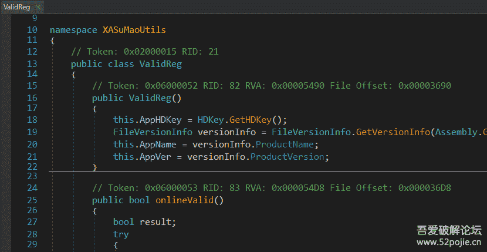
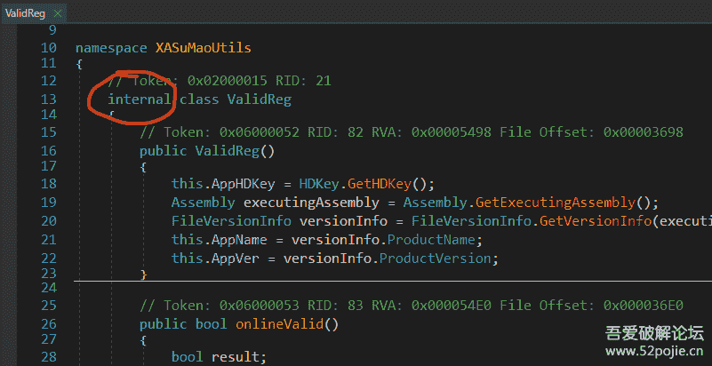
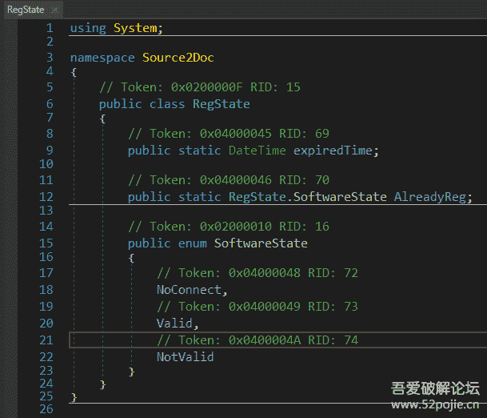
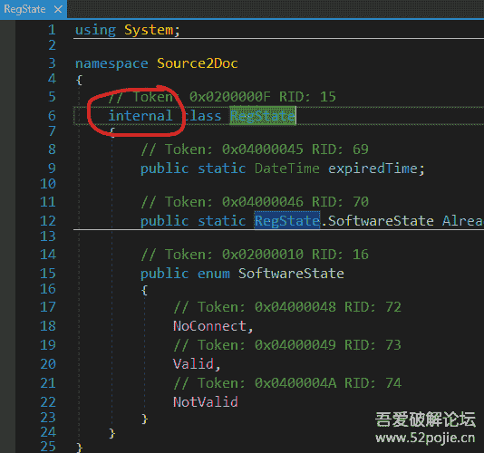
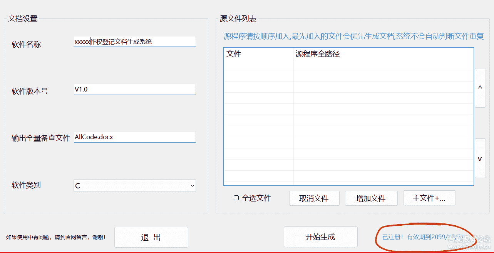
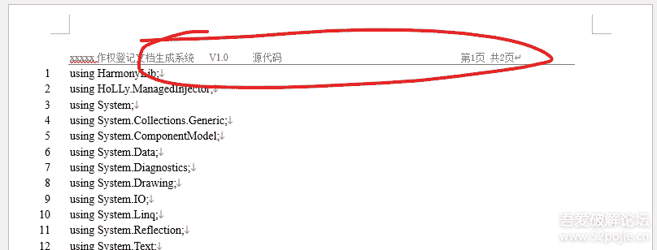

# [.NET逆向] 某源代码转WORD工具hook破解

- 原帖: https://www.52pojie.cn/forum.php?mod=viewthread&tid=1941002
- 抓取时间: 2026-11-01T22:27:51

原贴在这里

某源代码转WORD工具免注册分析

https://www.52pojie.cn/forum.php?mod=viewthread&tid=1938766&extra=page%3D1%26filter%3Dauthor%26orderby%3Ddateline&page=1

2024/07/05

1楼更新了代码，可以直接hook原来的exe

## Hook 概述

这里使用`Lib.Harmony`进行hook，以下内容是在后续hook的。

根据原贴的分析，需要hook三处：一个方法和两个静态字段
1. `XASuMaoUtils.ValidReg.onlineValid()`，这里要hook后返回true
2. `Source2Doc.RegState.expiredTime`，设置为2099/12/31
3. `Source2Doc.RegState.AlreadyReg`，设置为1（即枚举值 `SoftwareState.Valid`，值为1）

注意：这里有访问修饰符的问题，为了验证能hook成功，我用`dnspy`先把访问修饰符先给改成了public

左边是我修正过的，右边是原来的，暂时还没找到hook internal class的方法






## 具体hook方法

### 1. 创建hook方法的类库工程，一个dll

代码：
```csharp
namespace Source2DocInject
{
        public class HookS2D
        {
                public static int Inject(string str)
                {
                        MessageBox.Show("Inject Start");
                        var harmony = new Harmony("a.b.c");
                        harmony.PatchAll();
                        MessageBox.Show("Inject Ok");
                        return 0;
                }
        }

        [HarmonyPatch(typeof(XASuMaoUtils.ValidReg), "onlineValid")]
        public class MyHookClass
        {

                [HarmonyPrefix]
                private static bool Prefix(ref bool __result)
                {
                        // onlineValid() method return ture;
                        __result = true;
//特别说明：以下两行代码花了我5天的业余时间才hook成，

                        PatchStaticField(typeof(Source2Doc.RegState), "expiredTime", Convert.ToDateTime("2099/12/31"));
                        PatchStaticField(typeof(Source2Doc.RegState), "AlreadyReg", 1);
                        return false;
                }

                public static void PatchStaticField(Type classType, string fieldName, object newValue)
                {
                        FieldInfo fieldInfo = classType.GetField(fieldName, BindingFlags.Static | BindingFlags.NonPublic | BindingFlags.Public);
                        if (fieldInfo != null)
                        {
                                fieldInfo.SetValue(null, newValue); // 设置新值
                        }
                        else
                        {
                                throw new ArgumentException("Field not found", fieldName);
                        }
                }
        }
}
```

### 2. 创建loader工程，用于启动原始exe以及注入hook dll到exe的进程中

工程通过`nuget`安装 `HoLLy.ManagedInjector`，用于.net进程注入
```csharp
Process process = new Process();

                        process.StartInfo.FileName = "Source2Doc.exe";  // 可执行文件的路径

                        process.StartInfo.WorkingDirectory = @"."; // 可选，设置工作目录

                        process.Start();

                        Thread.Sleep(2000);

                        string pathFile = Path.Combine(AppDomain.CurrentDomain.BaseDirectory, "Source2DocInject.dll");

                        var p = new InjectableProcess(Convert.ToUInt32(process.Id));

                        p.Inject(pathFile, "Source2DocInject.HookS2D", "Inject");
```

最后上个成功能图，Hook成功后要等一会就能看到效果



