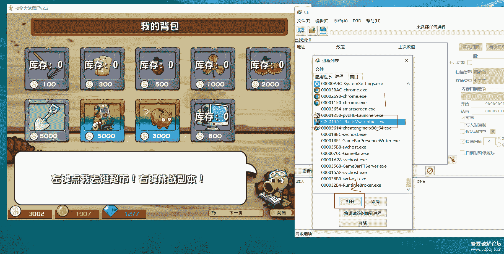
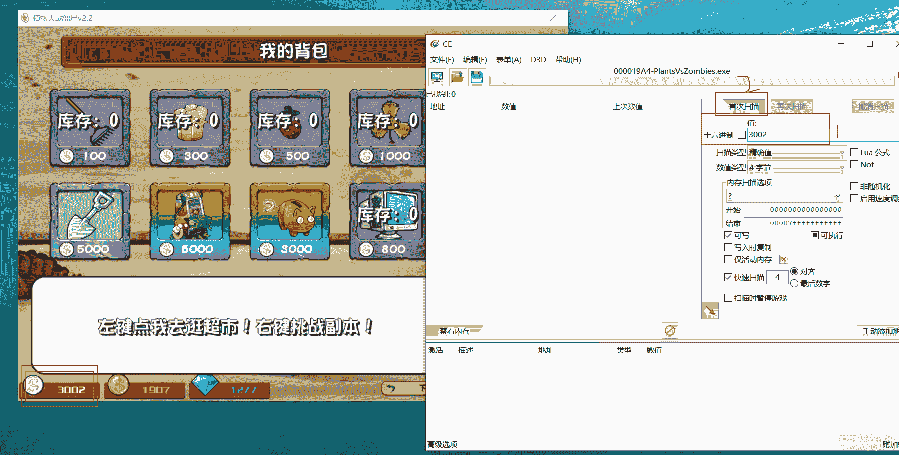
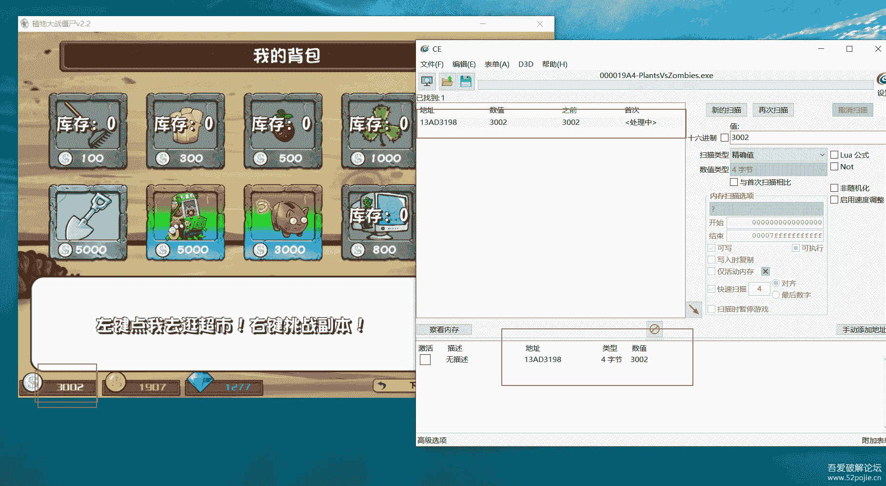
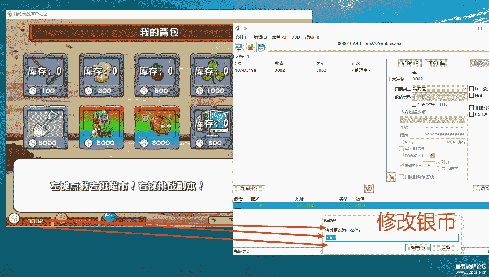

# [分享] 用ce修改植物大战僵尸杂交版银币

- 原帖: https://www.52pojie.cn/forum.php?mod=viewthread&tid=1942125
- 抓取时间: 2026-11-01T22:27:46

最近有个很火的植物大战僵尸杂交版，还有人不会用ce修改。也不是很难 4个图片教会你，大佬绕路

这里我统一回复一下大家对于二次筛选疑问 第一次找到地址可能有很多个地址，我们需要在筛选一下，就要改变游戏里面的币值不管是增加或者减少要让他变动，然后拿到游戏变动的值在ce里面再次搜索 就可以筛选出准确地址了

第二次再次搜索其实也可以不用 把所有地址都拉下去依次改变后面值就会找到准确地址了，哈哈哈，这是以前第一次学习ce用的笨办法，还有人需要游戏和修改器和ce工具 我玩ce的时候就已经写了这个游戏修改器软件作为学习和研究使用，不能分享出来哦，如果你需要可以去某度搜索，如果你还是搜索不到，很简单 某宝去搜 几分钱游戏修改器啥都给你弄好， 最后就是ce工具了 论坛里面就有搜一下一堆 我这个ce也是在论坛里面找的

第一步打开游戏 用ce打开图中进程

`1.png` (789.43 KB, 下载次数: 4) | [附件链接](https://www.52pojie.cn/forum.php?mod=attachment&aid=MjcwNjkyMXwwYzY4OTk4M3wxNzkzNTcyMDY0fDE2ODA4NnwxOTQyMTI1&nothumb=yes) | 2024-7-8 21:10 上传

第二步 输入你原始银币 点首次搜索

`2.png` (668.03 KB, 下载次数: 3) | [附件链接](https://www.52pojie.cn/forum.php?mod=attachment&aid=MjcwNjkyMnxjMjhkYTZiNXwxNzkzNTcyMDY0fDE2ODA4NnwxOTQyMTI1&nothumb=yes) | 2024-7-8 21:11 上传

第三步 找到这个地址 把地址拖下来

`3.png` (722.83 KB, 下载次数: 4) | [附件链接](https://www.52pojie.cn/forum.php?mod=attachment&aid=MjcwNjkyM3xjMmY3ZmU5OHwxNzkzNTcyMDY0fDE2ODA4NnwxOTQyMTI1&nothumb=yes) | 2024-7-8 21:11 上传

第四步 双击直接修改下面数值即可

`4.png` (732.95 KB, 下载次数: 2) | [附件链接](https://www.52pojie.cn/forum.php?mod=attachment&aid=MjcwNjkyNHwzNWEzY2FhMnwxNzkzNTcyMDY0fDE2ODA4NnwxOTQyMTI1&nothumb=yes) | 2024-7-8 21:11 上传

金币 钻石 都和这个方法一样 不一样的是首次搜索可能会有很多地址 我们改变游戏里面的值 然后再次搜索游戏被改变的值即可准确找到地址
