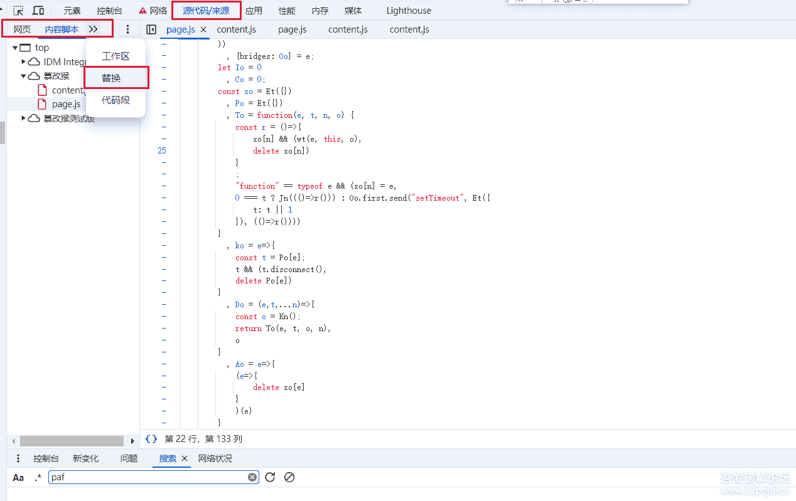

# [Web逆向] 扫雷小逆向

- 原帖: https://www.52pojie.cn/forum.php?mod=viewthread&tid=1942604
- 抓取时间: 2026-11-01T22:27:40

## 前言

之前c语言写过一个简易的扫雷，玩上了这个，一直玩不过关，纯算有点累，后面又想学什么扫雷公式，懒得背。就想着逆向一下吧。

图片有点不会弄，对着文本看吧，不难。

游戏链接：https://www.minesweeper.cn/

图片要倒着看。

## 操作步骤

1. 首先找到`canvas`的`id`然后搜索。
2. 找到这边，`paf.onmousedown`。
3. 卡断点，找这边入手，然后就是分析，逻辑，主要代码。

## 关键函数分析

卡断点发现：`S98()` 函数就是鼠标右键触发的函数。

断点找到`o0o()`函数，就是相当于点击显示该方块的函数，那我们就在显示之前判断是否是雷，是的话就直接`return`不进行下面的判断。后面改进了，是雷的话可以自己插旗。

然后先在`o0o()`函数中`console`出`d31`数组，因为我发现大多数的函数都在判断/获取`d31`数组的值，然后也找到了一个`start()`函数调用了`_123()`函数，就是布盘，确定了`d31`就是扫雷盘的二维数组。打印出来，每一项就是每一行，一行有几个格子每一项就有几项数据`[0,0,1,0]` --- 通过几次点击之类的打印，发现：

- 第一个数字，0：未揭开，1：已揭开，2：标记
- 第二个数字：0：不是雷，1：雷
- 第三个数字：九宫格内雷的数量
- 第四个不清楚，够用了不去猜

## 修改代码

最后在`o0o()`函数最上面添加这代码就完成了。

先判断点的是否是雷，是的话，在数组内把状态改成标记，然后再把旗子插上去就完成了。

不可能点到雷，点到了自动标记，再也不用心惊胆战辣！！！也可以装逼用，框框点就完了，别人没算完你就框框点鼠标给雷标出来了。

```
if(d31[j][h][1]){
d31[j][h][0]=2
ctx.drawImage(gfs[1], h * 25, j * 25);
return ;
}
```



`image.png` (57.5 KB, 下载次数: 0)

[href="forum.php?mod=attachment&aid=MjcwNzMwM3wxMjg4OGQ2NnwxNzkzNTcyMDU3fDE2ODA4NnwxOTQyNjA0&nothumb=yes" target="_blank"](https://www.52pojie.cn/forum.php?mod=attachment&aid=MjcwNzMwM3wxMjg4OGQ2NnwxNzkzNTcyMDU3fDE2ODA4NnwxOTQyNjA0&nothumb=yes)

## 替换运行

`f12`，然后选替换，搜函数名加代码然后保存刷新页面就行了。

2024-7-10 11:40 上传
