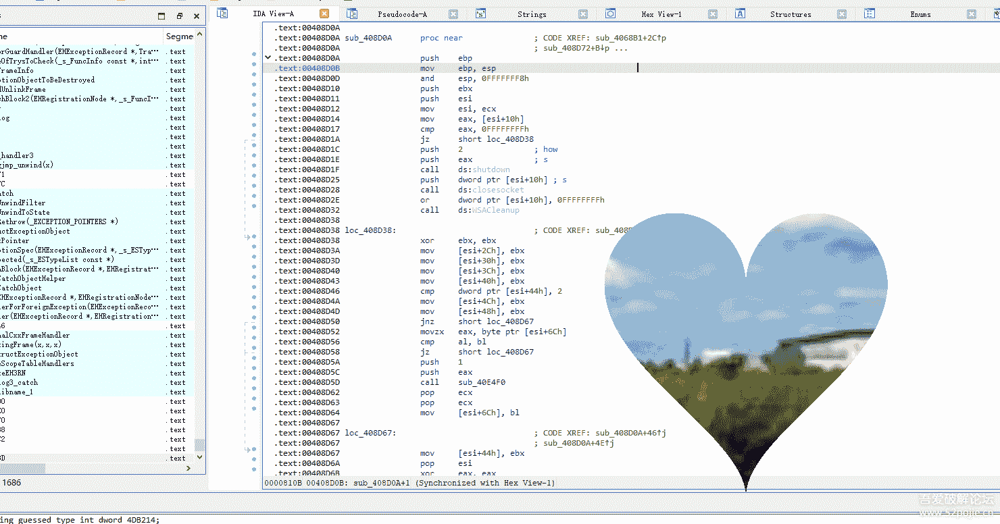
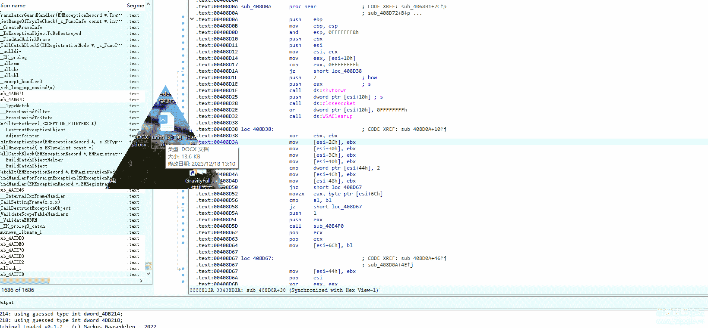
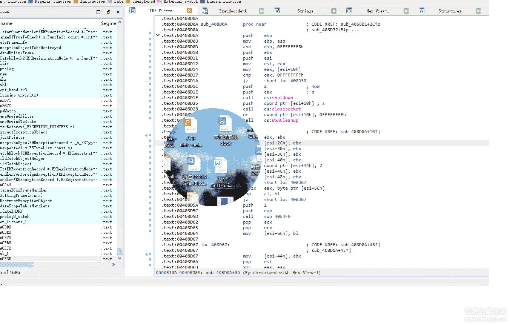

# [原创] 另类的《窗口洞洞波》及其技术要点

- 原帖: https://www.52pojie.cn/forum.php?mod=viewthread&tid=1942872
- 抓取时间: 2026-11-01T22:27:35

今天发现了一个很有意思的软件《`窗口洞洞波0.2.exe`》，创意很好。一直在想他是如何实现的。经过大量的搜索才发现，实现此功能并不是现在才有的，几年前就有了，不是采用C++,C#等语言，而是采用`ahk`脚本来实现此功能，并且用`Ahk2Exe`编译为`exe`.

自己试了一下果然可以变出更好玩的图形来。比如心形，三角形，圆形。供大家赏玩。

`000.png` (204.08 KB, 下载次数: 1)

[href="forum.php?mod=attachment&aid=MjcwNzUzMnxiOWEzMGRmYnwxNzkzNTcyMDUzfDE2ODA4NnwxOTQyODcy&nothumb=yes" target="_blank"](https://www.52pojie.cn/forum.php?mod=attachment&aid=MjcwNzUzMnxiOWEzMGRmYnwxNzkzNTcyMDUzfDE2ODA4NnwxOTQyODcy&nothumb=yes)

2024-7-11 00:00 上传

`001.png` (161.26 KB, 下载次数: 0)

[href="forum.php?mod=attachment&aid=MjcwNzUzM3w2OTA2NTM5Y3wxNzkzNTcyMDUzfDE2ODA4NnwxOTQyODcy&nothumb=yes" target="_blank"](https://www.52pojie.cn/forum.php?mod=attachment&aid=MjcwNzUzM3w2OTA2NTM5Y3wxNzkzNTcyMDUzfDE2ODA4NnwxOTQyODcy&nothumb=yes)

2024-7-11 00:00 上传

`002.png` (174.8 KB, 下载次数: 2)

[href="forum.php?mod=attachment&aid=MjcwNzUzNHw1Y2M3MDhlM3wxNzkzNTcyMDUzfDE2ODA4NnwxOTQyODcy&nothumb=yes" target="_blank"](https://www.52pojie.cn/forum.php?mod=attachment&aid=MjcwNzUzNHw1Y2M3MDhlM3wxNzkzNTcyMDUzfDE2ODA4NnwxOTQyODcy&nothumb=yes)

2024-7-11 00:00 上传

虽然没有窗口洞洞波的二次穿透能力，但是实际上却实现了类似的功能。

按下如下软件启用后没有界面，在后台运行，按下`F1`键进行穿透和不穿透的切换，按下`ESC`退出软件。鼠标滚轮控制洞穿图形的大小。

`winhole`, `trianglehole`, `hearthole`分别实现了圆形，三角形和心形的穿透图案。

欢迎赏玩。

压缩包密码 52pojie

[href="forum.php?mod=attachment&aid=MjcwNzUzNXxhYzNjZTlhOHwxNzkzNTcyMDUzfDE2ODA4NnwxOTQyODcy" target="_blank"](https://www.52pojie.cn/forum.php?mod=attachment&aid=MjcwNzUzNXxhYzNjZTlhOHwxNzkzNTcyMDUzfDE2ODA4NnwxOTQyODcy)

(1.4 MB, 下载次数: 177)

2024-7-11 00:04 上传

点击文件名下载附件

下载积分: 吾爱币 -1 CB
