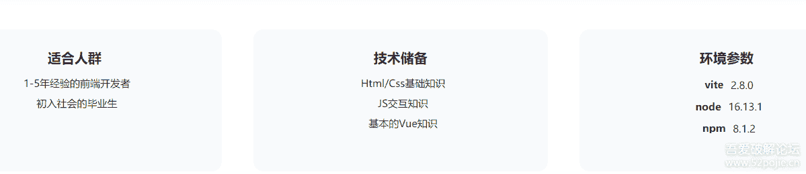
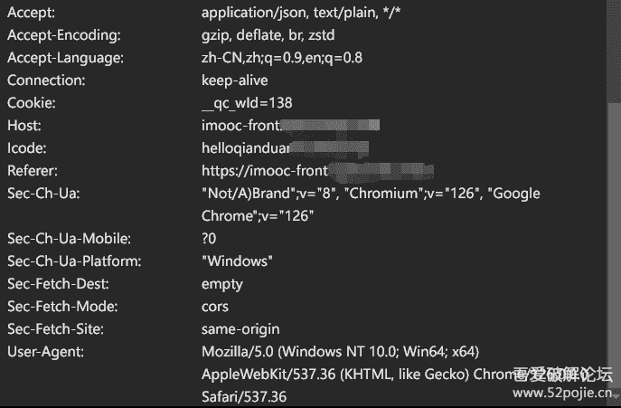
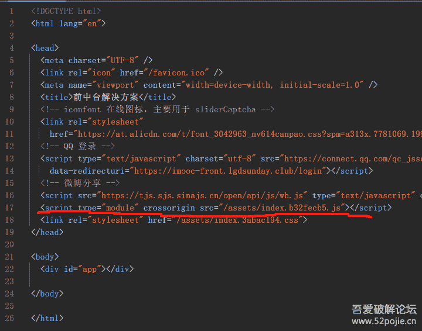
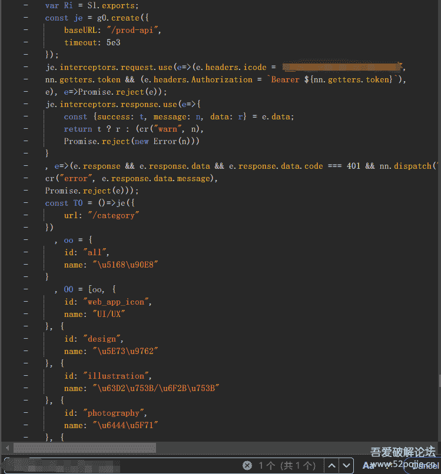
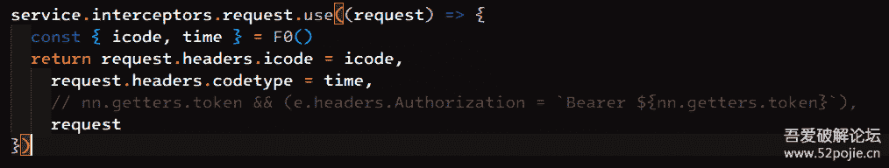
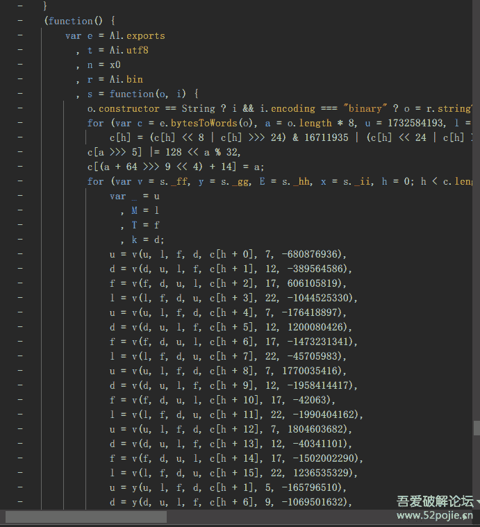
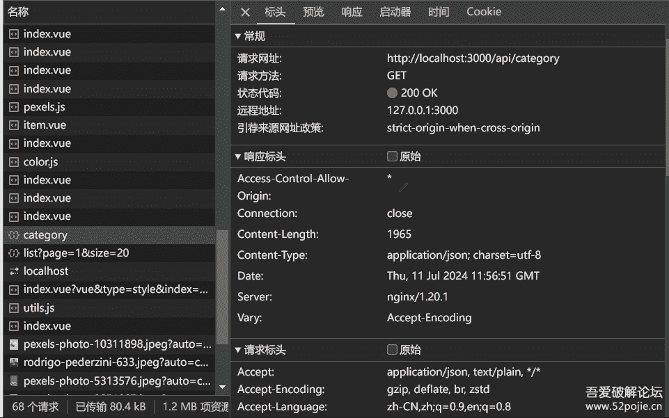
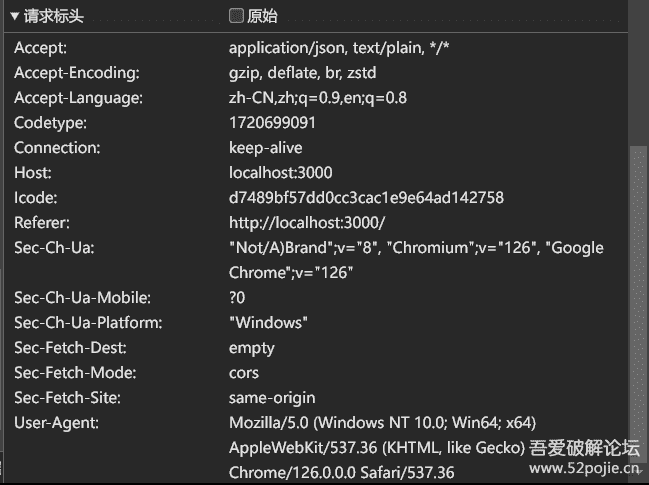
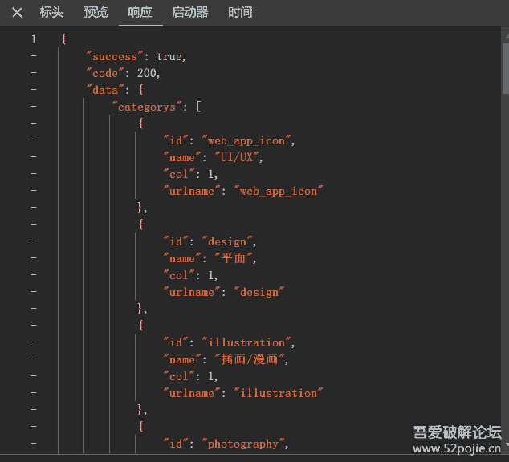

# [Web逆向] 如何解决一些前端教程的接口问题(以某课的前端课程为例，对接口分析并运用于项目)

- 原帖: https://www.52pojie.cn/forum.php?mod=viewthread&tid=1943156
- 抓取时间: 2026-11-01T22:27:33

省流：一点拙见。一些前端教程，如需后端接口有几种情况出现。如果你的资源来自非官方，接口对于你来说可能是个非常头疼的问题。

## 1. 授课方提供
一般以下的几种场景。

### a. 往请求头加东西，比如`id`或者`secret`，`token`
评价：这种方案相对较多，因为基于中间件的请求头校验相对比较简单，无非就是请求的时候查询缓存的信息是否合法，比如加密过后的数据，通过解密`token`是否为合法`ID`。

### b. 通过`sdk`配置`config`，鉴权之后再给你提供服务
评价：这种一般来说不太可能，除非他的接口并发量很大，需要一个网关校验，没有见到过。

### c. 其他的常规鉴权手段，比如`OAuth`, `OAuth2.0`
评价：这种几乎更少。

## 2. 公共接口+公共服务进行组装
评价：比如，一些天气接口，申请就能使用。

## 3. 全栈体系课
评价：各种从0到1系列，基本上国外你弄不到的服务找国内平替就行。

## 4. mock接口
评价：没有办法的办法。

那么这次以某课的打造前台+中台的课程接口为例，来复盘当时的思路。这个课程也出了相对一段时间，我在之前在刚看到课程的示例网站，花了半个小时不到就找到了固定的方法。

## 1. 看看课程使用的前端技术栈



image.png (34.75 KB, 下载次数: 0)

课程详情描述的技术栈

2024-7-11 18:46 上传

省流：`Vue.js`+`Vite`+`axios`

## 2. 查看官网，打开调试工具。(基操)

为了防止被追责，一些隐私的东西我会打码，如有需要可以自己去搜索该课程。

其中一个接口展示：

```bash
GET: /prod-api/pexels/list?page=1&size=20&categoryId=&searchText=
```



image.png (57.35 KB, 下载次数: 0)

其中一个`list`

2024-7-11 19:01 上传

省流：里面有个`Icode`不是常规的请求头，把他的值复制到`index.js`中查看。

## 3. 基于`index.js`的代码，依靠`Vite`的打包思路，`Axios`在项目中的一些配置方案，来分析加密手段。

首先，我们已经能拿到`Icode`的值，我们找到`script module`的主入口。



image.png (79.13 KB, 下载次数: 0)

主入口

2024-7-11 19:14 上传

搜索关键字。



image.png (77.39 KB, 下载次数: 0)

根据`Icode`关键字搜索

2024-7-11 19:13 上传

我们根据前端开发的经验，我们推测这个是`axios`的拦截器配置。

## 4. 创建一个`Vite`的前端项目去验证一手。

```bash
pnpm create vite test-frontend --tempate vue && cd test-frontend && pnpm install axios
```

结论：好像这一个版本，他其实已经删掉了加密的部分，直接使用就行了，我给大家展示之前的还有加密的部分。

这个地方他是一个动态获取时间，以及根据常量经过`md5`加密，然后赋值给`header`的`Icode`和`time`中，通过`axios`的`interceptor`来配置。

```javascript
function F0() {
  const e = parseInt(Date.now() / 1e3),
    t = e + 'LGD_Sunday-1991-12-30'
  return {
    icode: md5(t),
    time: e
  }
}
```



image.png (45.43 KB, 下载次数: 0)

旧版的代码

2024-7-11 19:55 上传

如何判断是`md5`？根据打包中的内容，分析出他运用了这一段代码，可以把一些关键词丢到GitHub中去搜索。



image.png (94.8 KB, 下载次数: 1)

`md`在打包中的

2024-7-11 20:00 上传

我们可以把代码中的版权部分代码，丢到GitHub中搜索，就可以找到他的加密方案。

```javascript
/*!
 * Determine if an object is a Buffer
 *
 * @AuThor   Feross Aboukhadijeh 
 * @license  MIT
 */
```

开发时候的请求接口，完全没有问题。（状态码，请求头，响应体）



image.png (105.13 KB, 下载次数: 0)

项目运行时候的请求接口

2024-7-11 19:57 上传



image.png (63.21 KB, 下载次数: 1)

请求头内容

2024-7-11 19:58 上传



image.png (37.99 KB, 下载次数: 0)

响应体

2024-7-11 19:59 上传

基于`Vite`的`plugin`配置，进行模拟接口。

大致思路，我们可以去找到云谦手写过的一个`toy-vite`，去了解大概的`vite`原理。

就是通过浏览器的`module`特性，根据路由去拿到文件内容，相对应的进行编译再返回。

所以，本质上`vite`开发环境就是启动一个服务，基于`connect`中间件的。

所以，我们可以通过基于`connect`的中间件，去配置`json`，来模拟开发环境的接口。

具体的细节，可以查看`vite`的文档，或者社区优秀的实现。

总结：其实看下来没什么内容，我在复盘的时候发现这个东西两三年过去了，接口已经改了，其实写教程已经没啥意义了，就当是给大伙图个乐啥的。
