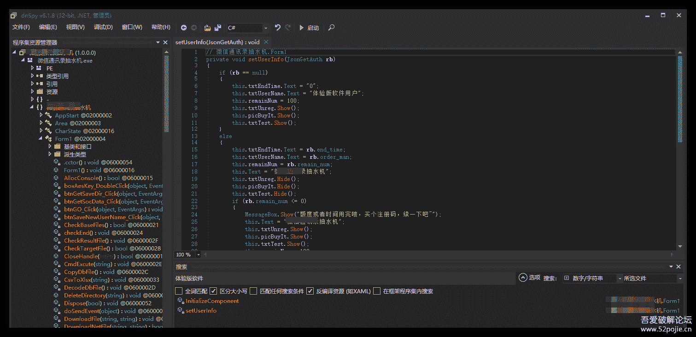
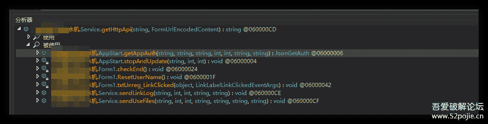

# [.NET逆向] 本版块 某微信通讯录工具的简单修改 的重点补充

- 原帖: https://www.52pojie.cn/forum.php?mod=viewthread&tid=1943215
- 抓取时间: 2026-11-01T22:27:31
原帖地址:
[https://www.52pojie.cn/thread-1942446-1-1.html](https://www.52pojie.cn/thread-1942446-1-1.html)

## 前言

之所以发这篇帖子进行补充主要原因是:
1. 对相关授权信息修改节点的深入探讨
2. 对初入逆向和日常使用软件的个人隐私注意事项

## 所需工具

如果遇到链接打不开的情况可论坛内搜索软件名,会 有新版下载

### 1. 查壳工具

作用: 判断软件编译的语言而进行针对性的工具选择

推荐:
[https://github.com/horsicq/DIE-engine/releases](https://github.com/horsicq/DIE-engine/releases)
[https://down.52pojie.cn/Tools/PEtools/ExeinfoPe.zip](https://down.52pojie.cn/Tools/PEtools/ExeinfoPe.zip)

### 2. 脱壳工具

作用: 还原经过加壳软件混淆的代码

[https://down.52pojie.cn/Tools/NET/NETReactorSlayer_v6.4.zip](https://down.52pojie.cn/Tools/NET/NETReactorSlayer_v6.4.zip)

这个软件是有针对性的,不是所有的壳都适用(本软件仅适合`NET Reactor`和部分代码混淆壳)

### 3. 查看/修改代码工具

[https://down.52pojie.cn/Tools/NET/dnSpy.zip](https://down.52pojie.cn/Tools/NET/dnSpy.zip)

## 软件地址

已使用BASE64加密(原帖中也有地址)

```
aHR0cHM6Ly9kb2MucWlueXVhbnlhbmcuY29tLz9nPURvYyZtPUFydGljbGUmYT1pbmRleCZpZD0z
```

### 解除试用相关限制

#### 查壳, 脱壳, 检查

内容省略.(如操作遇到问题请查看我以前发过的帖子,里面有保姆级的使用方法图文说明)

#### 定位目标代码

使用`dnspy`打开脱壳后的文件,搜索关键字



sshot-1.png (130.24 KB, 下载次数: 1)

[https://www.52pojie.cn/forum.php?mod=attachment&aid=MjcwNzc4OXwxNjI3NmZhZHwxNzkzNTcyMDQ4fDE2ODA4NnwxOTQzMjE1&nothumb=yes](https://www.52pojie.cn/forum.php?mod=attachment&aid=MjcwNzc4OXwxNjI3NmZhZHwxNzkzNTcyMDQ4fDE2ODA4NnwxOTQzMjE1&nothumb=yes)

2024-7-12 03:35 上传

根据软件界面提示的文字,定位到目标方法,在`Form1`类下

```
private void setUserInfo(JsonGetAuth rb)
{
        if (rb == null)
        {
                this.txtEndTime.Text = "0";
                this.txtUserName.Text = "体验版软件用户";
                this.remainNum = 100;
                this.txtUnreg.Show();
                this.picBuyIt.Show();
                this.txtTest.Show();
        }
        else
        {
                this.txtEndTime.Text = rb.end_time;
                this.txtUserName.Text = rb.order_man;
                this.remainNum = rb.remain_num;
                this.Text = "某信通讯录***";
                this.txtUnreg.Hide();
                this.picBuyIt.Hide();
                this.txtTest.Hide();
                if (rb.remain_num 
```

首先我们注意看这个方法传入了一个`JsonGetAuth`

在他的上面鼠标右键选择 在新窗口中打开

先查看这个实例化类的所有参数类型

```
internal class JsonGetAuth
{
        public JsonGetAuth()
        {
        }

        public string creat_time { get; set; }

        public string end_time { get; set; }

        public string order_man { get; set; }

        public int remain_num { get; set; }

        public int use_num { get; set; }
}
```

然后我们根据上面的所有代码来判断每个参数的作用和参考值

使用查找功能定位代码被使用的位置

1. `creat_time`属性
并未使用

2. `end_time`属性
通过代码 `this.txtEndTime.Text = rb.end_time;`
并对`txtEndTime`进行全局分析可知这个是到期日止,并且并未对这个到期日期进行判断.(功能为 只显示信息)

3. `order_man`
通过代码 `this.txtUserName.Text = rb.order_man;`
并对`txtUserName`进行全局分析可知这个是用户名(功能为只显示信息)

4. `remain_num`
通过代码 `if (rb.remain_num`

5. `use_num`
未体现功能

#### 深入分析参数

重点关注`remain_num`和`use_num`,因为这两个是`int`数值类型,肯定和试用次数有关系

##### remain_num

这个值是哪里来的?和试用限制有什么关系?

`this.remainNum = rb.remain_num;`

我们就查看`this.remainNum`

在`private void ReadContact()`方法中

```
if (this.remainNum != 100 || num 
```

和`private void checkEnd()`方法中

```
this.txtDoing.Text = "导出完成，点击这里，再导一次";
this.txtDoing.Click += this.tryOneMoreTime;
if (this.remainNum == 100)
{
        MessageBox.Show("试用结束，请你检阅导出效果\r\n如果使用效果满足你的需求，可以点击链接购买个注册码哦~");
        this.txtProcess.Text = "";
}
else
{
        MessageBox.Show("全部导出完成~谢谢使用~\r\n更多有意思的小工具，在右下角网管官方软件里有哦~");
        this.txtProcess.Text = "";
}
```

通过这两个方法内全部代码的上下文分析可知
这个数据是可导出的数据条目数量

##### use_num

在`private void checkEnd()`方法中

```
int num = this.doneNum;
FormUrlEncodedContent content = new FormUrlEncodedContent(new Dictionary
{
        {
                "soft_key",
                this.appKey
        },
        {
                "soft_id",
                this.appId.ToString()
        },
        {
                "soft_ver",
                this.appVer.ToString()
        },
        {
                "soft_name",
                this.appName
        },
        {
                "pc_name",
                environmentVariable
        },
        {
                "token",
                this.appToken
        },
        {
                "use_num",
                num.ToString()
        }
});
this.service.getHttpApi(urlString, content);
```

这个数据是`this.doneNum;`来的

我们查找这个`this.doneNum`

在`private void ReadContact()`方法中


```
for (int k = 0; k ", "").Replace(",", "，");
                                        string text2 = string.Concat(new string[]
                                        {
                                                this.boxSaveDir.Text,
                                                "\\头像\\",
                                                array[k],
                                                "-",
                                                array3[k],
                                                ".jpg"
                                        });
                                        if (array8.Length == 0 || !this.checkNeedHeadImg.Checked)
                                        {
                                                text2 = "";
                                        }
                                        else
                                        {
                                                this.DownloadFile(text2, array8[k]);
                                        }
                                        if (array[k].Contains("chatroom"))
                                        {
                                                text2 = "";
                                        }
                                        text = string.Concat(new string[]
                                        {
                                                text,
                                                "\"",
                                                array[k],
                                                "\",\"",
                                                array2[k],
                                                "\",\"",
                                                array3[k],
                                                "\",\"",
                                                array4[k],
                                                "\",\"",
                                                array5[k],
                                                "\",\"",
                                                array6[k],
                                                "\",\"",
                                                array14[k],
                                                "\",\"",
                                                array9[k],
                                                "\",\"",
                                                array11[k],
                                                "\",\"",
                                                array12[k],
                                                "\",\"",
                                                array13[k],
                                                "\",\"",
                                                array15[k],
                                                "\",\"",
                                                array10[k],
                                                "\",\"",
                                                array7[k],
                                                "\",\"",
                                                text2,
                                                "\"\r\n"
                                        });
                                        this.txtProcess.Text = (k + 1).ToString() + "/" + num.ToString();
                                        if (this.checkNeedHeadImg.Checked)
                                        {
                                                Console.WriteLine("下载头像：" + array8[k]);
                                        }
                                        if (this.checkNeedHeadImg.Checked)
                                        {
                                                Console.WriteLine("保存路径：" + text2);
                                        }
                                }
                                this.txtDoing.Text = "通讯录读取完成";
                        }
```

通过方法内上下文代码可知这个是已读取的条目数量,每读取一条就加上1

## 小总结

通过以上所有代码和上下文关系可知

1. 关键需要修改参数是 `remain_num`, 只有它决定了可以导出条目的数量
2. 其余参数不影响软件使用

## 寻找试用验证数据的判定区域和来源

只修改这个参数的来源值就OK了,真的是这样吗?

我们继续分析那个注册框的注册码

## 寻找输入注册码窗口

全局搜索"输入注册码"

在 `InitializeComponent()` 方法内

重点:这个是Winform窗口程序界面加载的方法,软件界面启动的时候绘制图形界面用的

```
        this.txtReg.Text = "输入注册码";

        this.txtReg.LinkClicked += this.txtReg_LinkClicked;
```

鼠标右键点击 `txtReg_LinkClicked`,选择在新窗口中打开

```
private void txtReg_LinkClicked(object sender, LinkLabelLinkClickedEventArgs e)
{
        GetRegCode getRegCode = new GetRegCode();
        getRegCode.Show();
}
```

点击 `GetRegCode`,我们就跳转到了注册窗口的窗体程序

```
                public GetRegCode()

                {

                        this.InitializeComponent();

                        Service service = new Service();

                        this.nowKey = service.readKey();

                        this.txtReg.Text = this.nowKey;

                }

                private void btnReg_Click(object sender, EventArgs e)

                {

                        try

                        {

                                this.reg.GetRegistryKey(this.appName).SetValue("RegCode", this.txtReg.Text.Trim());

                                MessageBox.Show("注册码已保存");

                        }

                        catch

                        {

                                MessageBox.Show("注册码保存不成功，原因未知\r\n如果有必要，请点击软件右下角【需要帮助】联系网管");

                        }

                        Process.Start(Process.GetCurrentProcess().MainModule.FileName);

                        Thread.Sleep(200);

                        Environment.Exit(0);

                }
```

通过对其中调用的方法和参数综合分析(代码太多就不粘贴了,懂C#的一看就知道是读写注册表的操作)

1. 注册码没有任何格式限制
2. 只是单纯的写入和读取注册表的值

## 重点来了!!!!!!

## 软件是如何获取软件状态和使用次数的呢?

## 我们从软件的入口点进行分析切入

在代码的空白位置鼠标右键选择,转到入口点

`Application.Run(new Form1());`

然后我们点 `Form1`

```
public Form1()
{
        this.InitializeComponent();
        this.startIni();
        Control.CheckForIllegalCrossThreadCalls = false;
}
```

第一行忽略,像我上面说的,界面初始化的方法,没必要看

重点是

```
this.startIni();
```

鼠标点进去看看

```
private void startIni()
{
        this.boxNewUserName.Hide();//新用户名
        this.btnSaveNewUserName.Hide();//保存新用户名按钮
        this.boxAesKey.Hide();//Ase对称加解密秘钥
        this.txtDoing.Hide();//已完成文本框
        this.txtWechatVer.Hide();//某信版本
        this.txtVer.Text = "Ver." + this.appVer.ToString();//当前软件版本
        string urlString = this.url + this.getAct;//拼接网址
        AppStart appStart = new AppStart();
        appStart.init(urlString, this.appId, this.appVer);
        Thread thread = new Thread(new ThreadStart(this.TestDNS));
        thread.Start();
        this.method_0();
        this.getIniKey();
        JsonGetAuth appAuth = appStart.getAppAuth(this.url, this.getAuth, this.appKey, this.appId, this.appVer, this.appName, this.appToken);
        this.setUserInfo(appAuth);
        try
        {
                this.boxSocData.Text = this.reg.GetRegistryKey(this.appName).GetValue("boxSocData").ToString();//主界面数据文件夹设置目录
                this.boxSaveDir.Text = this.reg.GetRegistryKey(this.appName).GetValue("boxSaveDir").ToString();//主界面导出目录
        }
        catch
        {
        }
        try
        {
                if (this.reg.GetRegistryKey(this.appName).GetValue("IKnow_v6").ToString() == "0")
                {
                        throw new Exception();
                }
        }
        catch
        {
                this.tips.Show();
        }
}
```

还挺热闹,软件启动就干了这么多额外的事,一点点的分析

## 逐条分析 `startIni()` 代码

- `string urlString = this.url + this.getAct;`

拼接字符串,根据这两个字段的常量拼接出来的字符串是

"[//softauth.xxxxxxx.com/public/index.php/index/AppAuth/getAct" target="_blank" rel="noopener noreferrer nofollow"](https://softauth.xxxxxxx.com/public/index.php/index/AppAuth/getAct:rel="nofollow noopener" href="https)"

(已经脱敏处理)

- `appStart.init(urlString, this.appId, this.appVer);`

跟进代码综合分析是检测软件更新的,而且可以通过服务器配置直接停用软件

- `Thread thread = new Thread(new ThreadStart(this.TestDNS));`

```
private void TestDNS()
            {
```


# 软件逆向分析

## 防本地劫持

```csharp
try
{
    IPAddress[] hostAddresses = Dns.GetHostAddresses(this.authUrl);
    foreach (IPAddress ipaddress in hostAddresses)
    {
        if (ipaddress.ToString().StartsWith("127."))
        {
            this.sendResult("发现疑似盗版，解析IP地址：" + ipaddress.ToString());
            Thread.Sleep(1000);
            Environment.Exit(0);
        }
    }
}
catch
{
}
```

呵呵,防本地劫持的,如果你在本机伪造他的返回数据那么直接认定是盗版,并退出程序,看来作者对WEB逆向劫持颇有见解啊!

各位抓包大神抓狂了没有?

## `method_0()`

```csharp
private void method_0()
{
    string text = this.appPath + "\\data.db";
    if (!File.Exists(text))
    {
        try
        {
            this.DownloadNetFile(this.testDataFileUrl, text);
        }
        catch
        {
            return;
        }
    }
    try
    {
        SQLiteHelper sqliteHelper = new SQLiteHelper(text);
        sqliteHelper.CloseConnection();
    }
    catch
    {
        this.sendResult("CPP2010程序运行检测到没装");
        this.installCPP2010();
    }
}
```

代码综合分析是下载数据库的,里面应该是一些解析参数之类的东西(没深入分析这个db文件,因为不在本文讨论范围)

## `this.getIniKey();`

```csharp
private void getIniKey()
{
    Service service = new Service();
    this.appKey = service.readCheckKey();
}
```

这个就是从注册表里面读取注册码的,请记住这个`this.appKey`

## 重点数据

```csharp
JsonGetAuth appAuth = appStart.getAppAuth(this.url, this.getAuth, this.appKey, this.appId, this.appVer, this.appName, this.appToken);
this.setUserInfo(appAuth);
```

传递了好多参数,调用的方法在`AppStart`类

其中

- `this.url` 数据请求地址(常量)
- `this.getAuth` 网址附加的POST请求参数(web逆向的别笑话我,我都web请求参数不太懂,这个名词是我按照理解起的)(常量)
- `this.appKey` 注册码(注册时输入的注册码,注册表来源)
- `this.appId` 软件ID(应该是用于服务器判断软件类型的)(常量)
- `this.appVer` 软件版本(常量)
- `this.appName` 软件名称(常量)
- `this.appToken` 软件标识符(常量)

```csharp
public JsonGetAuth getAppAuth(string url, string getAuth, string softKey, int softId, int softVer, string softName, string token)
{
    string environmentVariable = Environment.GetEnvironmentVariable("computername");
    string text = url + getAuth;
    FormUrlEncodedContent content = new FormUrlEncodedContent(new Dictionary
    {
        {
            "soft_key",
            softKey
        },
        {
            "soft_id",
            softId.ToString()
        },
        {
            "soft_ver",
            softVer.ToString()
        },
        {
            "soft_name",
            softName
        },
        {
            "pc_name",
            environmentVariable
        },
        {
            "token",
            token
        }
    });
    Service service = new Service();
    string httpApi = service.getHttpApi(text, content);
    if ((httpApi.Length != 0 || !(softKey == "00000000000000000000000000000000")) && (httpApi.Length != 0 || !(softKey != "00000000000000000000000000000000")) && !JsonSplit.IsJson(httpApi))
    {
        MessageBox.Show("不好意思，程序出了点问题，要挂了~！");
        Environment.Exit(0);
    }
    return JsonConvert.DeserializeObject(httpApi);
}
```

### 通过以上代码可知：

该软件将软件本身的信息,注册码,电脑本机用户名ID发送给服务器

通过服务器返回的数据进行反序列化来获取注册码对应的用户注册数据

服务器可以通过电脑本机用户名来判断注册码是否给其他电脑使用

### 现阶段的思考

单纯的修改试用次数数据是不行的,因为每次打开软件,软件都会向服务器发送相关数据,服务器后台可以查看是谁使用了盗版软件,而且还有一个问题,服务器是怎么统计已使用条目数量的?

### 再次深入的分析服务器上传数据

重点关注一下上面的传参方法代码

```csharp
Service service = new Service();
string httpApi = service.getHttpApi(text, content);
```

我们进入`getHttpApi(text)`方法

在`Service`类下面的

```csharp
public string getHttpApi(string urlString, FormUrlEncodedContent content)
{
    ServicePointManager.SecurityProtocol = (SecurityProtocolType.Ssl3 | SecurityProtocolType.Tls | SecurityProtocolType.Tls11 | SecurityProtocolType.Tls12);
    ServicePointManager.ServerCertificateValidationCallback = ((object sender, X509Certificate certificate, X509Chain chain, SslPolicyErrors sslPolicyErrors) => true);
    HttpClient httpClient = new HttpClient();
    HttpResponseMessage result = httpClient.PostAsync(urlString, content).Result;
    return result.Content.ReadAsStringAsync().Result;
}
```

把鼠标放到`HttpClient`上面,我们可以看到命名空间

`System.Net.Http;`

这个是.NET自带的Http通信标准库,

我们使用查找引用功能来看看这个方法被多少代码调用过



`sshot-2.png` (45.42 KB, 下载次数: 2)

[附件下载](https://www.52pojie.cn/forum.php?mod=attachment&aid=MjcwNzc5MHxlNWFlYzIyMnwxNzkzNTcyMDQ4fDE2ODA4NnwxOTQzMjE1&nothumb=yes)

2024-7-12 03:39 上传

这样我们通过每个方法代码的查看就知道软件和服务器都进行了哪些交互了.

## 抡起大锤 八十 八十 八十

我们要想做的神不知鬼不觉,那么首先就要解决服务器数据验证的问题,既然是逆向,肯定是不能让软件开发者察觉我们的存在

### 把`getHttpApi`方法代码清空？

这样做行不行呢?

不可以!因为这个方法有返回值,是字符串,软件升级,获取用户数据,需要返回值.

### 1. 拦截请求数据,并伪造返回数据

在`AppStart`类的`getAppAuth`方法中

右键,选择编辑方法

改写代码为

```csharp
public JsonGetAuth getAppAuth(string url, string getAuth, string softKey, int softId, int softVer, string softName, string token)
{
    return new JsonGetAuth
    {
        creat_time = string.Empty,
        end_time = string.Empty,
        order_man = "52pojie",
        remain_num = int.MaxValue,
        use_num = 0
    };
}
```

当然也可以在另一个地方更改,那就是调用这个方法的地方

在`Form1`类的`startIni`方法中

将

```csharp
JsonGetAuth appAuth = appStart.getAppAuth(this.url, this.getAuth, this.appKey, this.appId, this.appVer, this.appName, this.appToken);
this.setUserInfo(appAuth);
```

改成

```csharp
JsonGetAuth appAuth = new JsonGetAuth();
appAuth.creat_time = string.Empty;
appAuth.end_time = string.Empty;
appAuth.order_man = "52pojie";
appAuth.remain_num = int.MaxValue;
appAuth.use_num = 0;
this.setUserInfo(appAuth);
```

目的:确保软件解除试用限制

### 2. 去除软件更新(可选)

在`AppStart`类的`stopAndUpdate`方法中

清空所有代码

```csharp
private void stopAndUpdate(string urlString, int appId, int appVer)
{
}
```

目的:屏蔽软件被禁用的风险

### 3. 在`Form1`类的`checkEnd`方法中

删掉部分代码,只保留

```csharp
private void checkEnd()
{
    while (this.t1End != 1)
    {
        Thread.Sleep(500);
    }
    this.txtDoing.Text = "导出完成，点击这里，再导一次";
    this.txtDoing.Click += this.tryOneMoreTime;
    MessageBox.Show("全部导出完成~谢谢使用~\r\n更多有意思的小工具，在右下角网管官方软件里有哦~");
    this.txtProcess.Text = "";
    this.sendResult("结束");
}
```

目的:屏蔽向服务器上传导出条目数据,防止服务器记录数据

### 4. 在`Form1`类的`RenewUserName`方法中

删掉全部代码,或者仅保留

```csharp
private void RenewUserName()
{
    MessageBox.Show("你这操作就不怕软件作者拿锤子给你开背吗?，温馨提示");
}
```

### 5. 在`Form1`类的`ResetUserName`方法中

删掉全部代码,或者仅保留

```csharp
private void ResetUserName()
{
    MessageBox.Show("你这操作就不怕软件作者拿锤子给你开背吗?，温馨提示");
}
```

### 6. 在`Service`类的`sendLinkLog`方法中

删掉全部代码

```csharp
public void sendLinkLog(string apiUrl, int soft_id, int soft_ver, string urlString, string appToken)
{
}
```

### 7. 在`Service`类的`sendUseFiles`方法中

删掉全部代码


```
public void sendUseFiles(string apiUrl, int appId, int appVer, string appKey, string filesNameRecord, string filesLengthRecord, string appToken)
{
}
```

### 8. 保存修改

在dnspy的文件菜单,选择保存模块,在打开的对话框里面确定就OK了

### 给软件开发者的建议

- 无论多么强的壳,终究有被破解的那一天

- 既然软件里面需要db数据库需求,那么为什么不把关键数据放到服务器上去验证请求并返回数据呢?既然是某信的工具,那这个电脑肯定是可以连接外网的,离线的考虑属实是有点多余.

- 如果有盈利那么我还是建议去申请数字证书,检测到非法篡改就禁止运行,或者在服务器返回数据时对软件自身的指纹进行验证,不通过就不启动(前提是壳够强)

4.把程序代码中调用第三方程序相关的参数和提取数据的正则表达式改为鉴权成功后返回数据进行数据的后处理.

### 给各位使用此类软件的用户提个醒

某信这类数据都属于个人隐私数据,我相信大部分人都会备注成亲人昵称,单位+姓名.

你想一下,如果这些数据被某些不怀好意的人通过软件收集起来,有头像,有ID,有姓名,有TEL号码,如果别人伪造你的信息代替你进行恶意操作,那么是一件很可怕的事.所以大家在使用此类软件的时候一定要仔细甄别,小心再小心.

### 最后唠叨几句

如果大家对本文介绍的工具不太会使用,请点击我的头像,查看我曾经发过的所有帖子,里面有相关工具的保姆级使用方法.

祝各位吾友在吾爱 天天有收获,技术如芝麻开花 节节高.

完结.

(从软件分析到编辑帖子历时6小时)
