# [分享] 记录- 植物大战僵尸杂交版修改过程。

原帖: https://www.52pojie.cn/forum.php?mod=viewthread&tid=1944132

抓取时间: 2026-11-01T22:27:25

最近无聊，好久没玩过CE修改器了，月初还是上个月这植物大战僵尸杂交版爆火，想想十多年前学习游戏修改的时候很多都用植物大战僵尸做教程，说明什么，说明修改简单，哈哈，老年人了找点自信，练练手。

自己做了几个小功能吧：自动拾取、种植无CD、植物0元购、植物攻速加倍、还有论坛看到的叠加种植。可能和论坛里有补分重叠，但是没关系，帖子我尽量多记录修改过程，一些错误过程和重复的过程就省略介绍了。希望能给新人们学到点思路吧，毕竟修改游戏最重要的就是找到想要修改的数据。你最好是有修改基础，如果你真的什么都不会的话，那你可能真的看不懂。

## 一、自动拾取

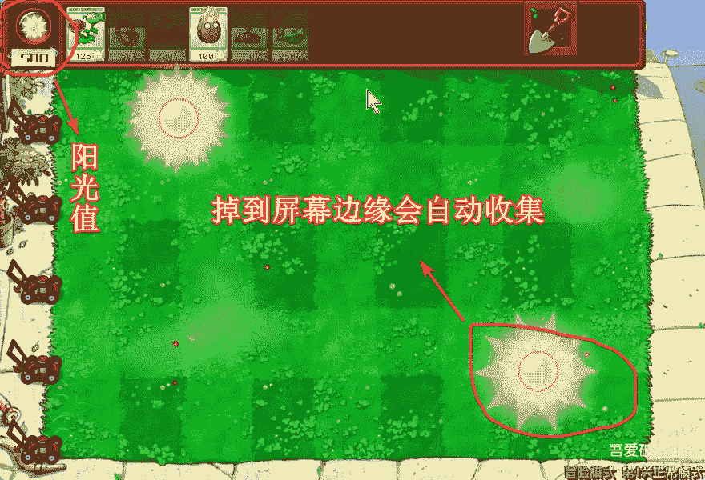

1.1.png (929.01 KB, 下载次数: 1)

[href="forum.php?mod=attachment&aid=MjcwODMxMHxlOTU5NGU4NnwxNzkzNTcyMDQyfDE2ODA4NnwxOTQ0MTMy&nothumb=yes" target="_blank"](https://www.52pojie.cn/forum.php?mod=attachment&aid=MjcwODMxMHxlOTU5NGU4NnwxNzkzNTcyMDQyfDE2ODA4NnwxOTQ0MTMy&nothumb=yes)

2024-7-15 10:38 上传

开局发现这个阳光需要自己点击，但是不点击的话，掉到屏幕边缘的时候会自动拾取，这里就给了我们漏洞钻，让自动拾取阳光变成了可行性。要怎么实现，第一想到的肯定是修改阳光坐标吧。

思考：如上图，一个屏幕内不会只存在一个阳光，我们点击收集阳光的时候，肯定会告诉系统，我们点击是哪个阳光，而这个阳光里面通常又会包含一些信息，坐标、+xxx阳光值之类的。那么我们就要找到阳光的地址

找阳光地址，这里又有两个思路：

第一、用模糊搜索，找到阳光的游戏坐标。

第二、阳光和左上角的阳光值息息相关，在拾取阳光增加阳光值之前，肯定会获取阳光里面的信息。我们也可以从这里获取到阳光地址。

我这里是选择了第二种方式，先从左上角阳光值开始吧。

找阳光值我相信你们都会，我就省略了。。。


1.2.png (41.73 KB, 下载次数: 1)

[href="forum.php?mod=attachment&aid=MjcwODMxMXxjNjM4YjY5ZXwxNzkzNTcyMDQyfDE2ODA4NnwxOTQ0MTMy&nothumb=yes" target="_blank"](https://www.52pojie.cn/forum.php?mod=attachment&aid=MjcwODMxMXxjNjM4YjY5ZXwxNzkzNTcyMDQyfDE2ODA4NnwxOTQ0MTMy&nothumb=yes)

2024-7-15 10:38 上传

找到后添加到下方列表（如上图），右键选择 找出是什么改写了这个地址，回到游戏更新一下阳光值。

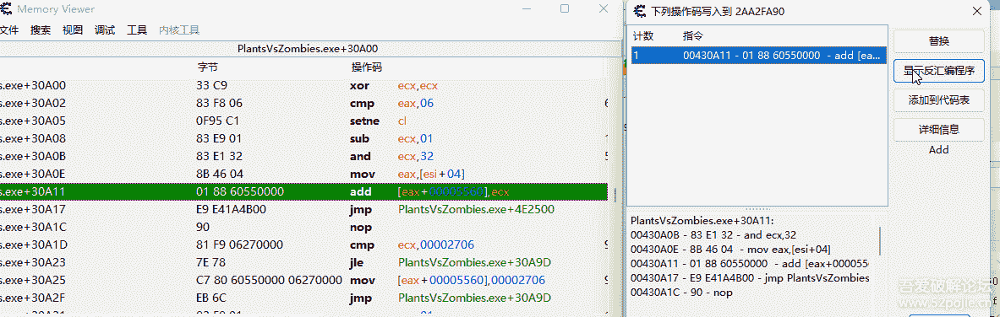

1.3.png (70.16 KB, 下载次数: 2)

[href="forum.php?mod=attachment&aid=MjcwODMxMnxlYTA0ZTBkZHwxNzkzNTcyMDQyfDE2ODA4NnwxOTQ0MTMy&nothumb=yes" target="_blank"](https://www.52pojie.cn/forum.php?mod=attachment&aid=MjcwODMxMnxlYTA0ZTBkZHwxNzkzNTcyMDQyfDE2ODA4NnwxOTQ0MTMy&nothumb=yes)

2024-7-15 10:38 上传

得到了1条代码，这是阳光值更新后所得到的代码，是修改阳光的代码，和我们需求无关。PASS。

点击显示反汇编程序，在左边内存窗口选定当前代码，按F5变成绿色，下断点。回到游戏继续更新阳光值。

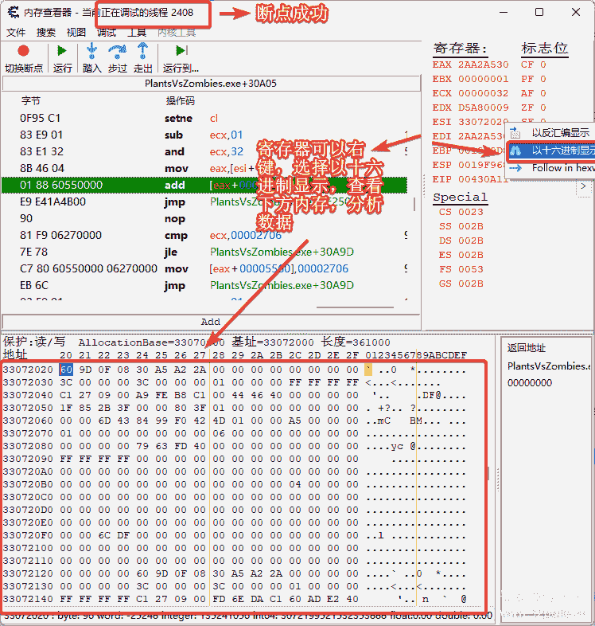

1.4.png (128.8 KB, 下载次数: 2)

[href="forum.php?mod=attachment&aid=MjcwODMxM3xhNDhlMzg0N3wxNzkzNTcyMDQyfDE2ODA4NnwxOTQ0MTMy&nothumb=yes" target="_blank"](https://www.52pojie.cn/forum.php?mod=attachment&aid=MjcwODMxM3xhNDhlMzg0N3wxNzkzNTcyMDQyfDE2ODA4NnwxOTQ0MTMy&nothumb=yes)

2024-7-15 10:39 上传

如上图，这里我觉得 `ESI` 33072020这个地址挺可疑，我们让游戏正常运行，查看这个地址的一些变化。汇编窗口选中代码F5，取消断点，F9让游戏正常运行。游戏正常运行状态如下图

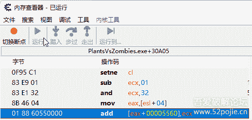

1.5.png (26.98 KB, 下载次数: 2)

[href="forum.php?mod=attachment&aid=MjcwODMxNHxiM2M2MjRlY3wxNzkzNTcyMDQyfDE2ODA4NnwxOTQ0MTMy&nothumb=yes" target="_blank"](https://www.52pojie.cn/forum.php?mod=attachment&aid=MjcwODMxNHxiM2M2MjRlY3wxNzkzNTcyMDQyfDE2ODA4NnwxOTQ0MTMy&nothumb=yes)

2024-7-15 10:39 上传

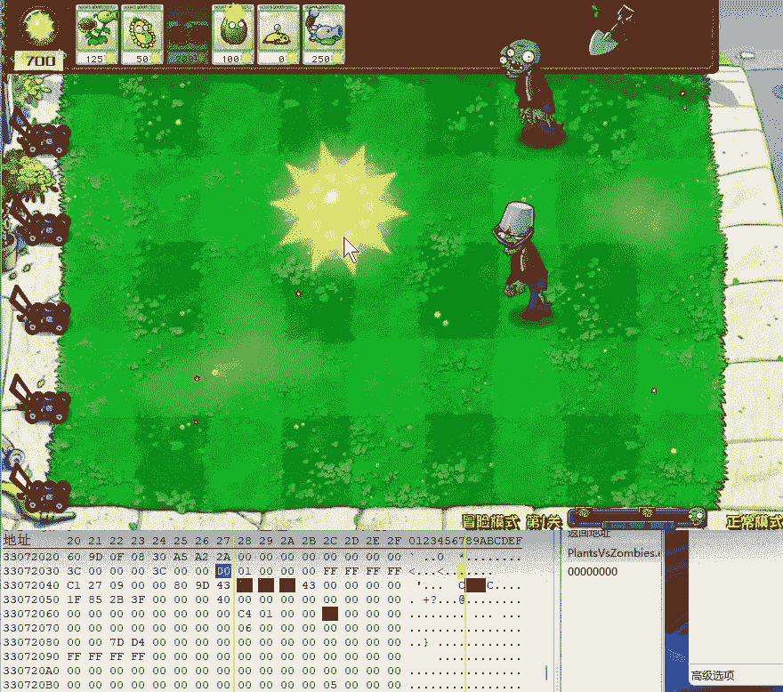

1.6.gif (2.58 MB, 下载次数: 2)

[href="forum.php?mod=attachment&aid=MjcwODMxNXw2YjBmNjkyMXwxNzkzNTcyMDQyfDE2ODA4NnwxOTQ0MTMy&nothumb=yes" target="_blank"](https://www.52pojie.cn/forum.php?mod=attachment&aid=MjcwODMxNXw2YjBmNjkyMXwxNzkzNTcyMDQyfDE2ODA4NnwxOTQ0MTMy&nothumb=yes)

2024-7-15 10:39 上传

从上面动图可以看到，新阳光在地址33072070的值是0，但是当我们点击阳光时变成了1，所以猜测这个地址值=1时，可以阳光为拾取状态。我们可以等下一个新阳光，手动把33072070的值改为1，看阳光是否会变成拾取状态哈。

这里我测试试过了哈，猜测是正确的，过程我就省略了。为了节省文章不要太长。

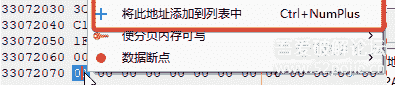

1.7.png (14.94 KB, 下载次数: 1)

[href="forum.php?mod=attachment&aid=MjcwODMxNnw3ODFmZjg0MHwxNzkzNTcyMDQyfDE2ODA4NnwxOTQ0MTMy&nothumb=yes" target="_blank"](https://www.52pojie.cn/forum.php?mod=attachment&aid=MjcwODMxNnw3ODFmZjg0MHwxNzkzNTcyMDQyfDE2ODA4NnwxOTQ0MTMy&nothumb=yes)

2024-7-15 10:39 上传

既然找到了我们想要修改的数据，那就写入我们要实现的代码了。选中33072070 的值，右键选中 将地址添加到列表中，如上图

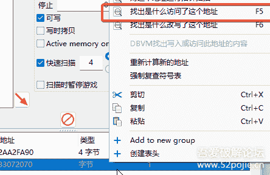

1.8.png (33.74 KB, 下载次数: 1)

[href="forum.php?mod=attachment&aid=MjcwODMxN3xjMDI1Y2VlNnwxNzkzNTcyMDQyfDE2ODA4NnwxOTQ0MTMy&nothumb=yes" target="_blank"](https://www.52pojie.cn/forum.php?mod=attachment&aid=MjcwODMxN3xjMDI1Y2VlNnwxNzkzNTcyMDQyfDE2ODA4NnwxOTQ0MTMy&nothumb=yes)

2024-7-15 10:39 上传

右键选择 找出是什么访问了这个地址


1.9.png (16.21 KB, 下载次数: 1)

[href="forum.php?mod=attachment&aid=MjcwODMxOHwzMGE0YjEzYXwxNzkzNTcyMDQyfDE2ODA4NnwxOTQ0MTMy&nothumb=yes" target="_blank"](https://www.52pojie.cn/forum.php?mod=attachment&aid=MjcwODMxOHwzMGE0YjEzYXwxNzkzNTcyMDQyfDE2ODA4NnwxOTQ0MTMy&nothumb=yes)

2024-7-15 10:39 上传

两条代码，都在判断33072070这个地址的值是否为0，那么我们在这之前给33072070这个地址写入1就可以了。

这里插一句话，`eax`是阳光地址。`eax + 50`（偏移）= 33072070 得来的，如下图

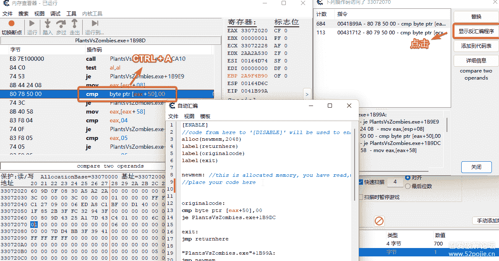

1.10.png (151.91 KB, 下载次数: 2)

[href="forum.php?mod=attachment&aid=MjcwODMxOXwyNWVmOGY3OXwxNzkzNTcyMDQyfDE2ODA4NnwxOTQ0MTMy&nothumb=yes" target="_blank"](https://www.52pojie.cn/forum.php?mod=attachment&aid=MjcwODMxOXwyNWVmOGY3OXwxNzkzNTcyMDQyfDE2ODA4NnwxOTQ0MTMy&nothumb=yes)

2024-7-15 10:39 上传

使用CE的脚本代码为：

```asm
[ENABLE]
//code from here to '[DISABLE]' will be used to enable the cheat
alloc(newmem,2048)
label(returnhere)
label(originalcode)
label(exit)
newmem: //this is allocated memory, you have read,write,execute access//place your code here
cmp [eax+58],6 //这里是我发现，通关后新卡片[eax+50]值 = 1 并不会自动拾取，而且会变成无法点击BUG，所以加了个判断。这里[eax+58]的值代表的是某一种道具。
ja originalcode
mov [eax+50],1originalcode:
cmp byte ptr [eax+50],00
je PlantsVsZombies.exe+1B9DCexit:
jmp returnhere"PlantsVsZombies.exe"+1B99A:
jmp newmem
nop
returnhere:[DISABLE]
//code from here till the end of the code will be used to disable the cheat
dealloc(newmem)
"PlantsVsZombies.exe"+1B99A:
db 80 78 50 00 74 3C
//cmp byte ptr [eax+50],00
//je PlantsVsZombies.exe+1B9DC
```

## 二、种植无CD


2.1.png (138.24 KB, 下载次数: 3)

[href="forum.php?mod=attachment&aid=MjcwODM1N3wwNDExZmZiZnwxNzkzNTcyMDQyfDE2ODA4NnwxOTQ0MTMy&nothumb=yes" target="_blank"](https://www.52pojie.cn/forum.php?mod=attachment&aid=MjcwODM1N3wwNDExZmZiZnwxNzkzNTcyMDQyfDE2ODA4NnwxOTQ0MTMy&nothumb=yes)

2024-7-15 15:46 上传

如上图，在植物图鉴我们可以看到植物的详细信息，现在我们想做的功能是，种下植物后，无需等待时间，继续种下同一种植物。

思考：假设图中冷却速度3000，换算成冷却时间30秒，那么，在我们种下这个植物后，肯定有一个冷却时间计时器，它可能是从 0s - 30s。也可能是从 30s - 0s 。这个我们是未知的。

所以，我先从种下植物后，才开始搜索数据，扫描类型选择：未知的初始值，首次扫描。如下图


2.2.png (87.84 KB, 下载次数: 3)

[href="forum.php?mod=attachment&aid=MjcwODM1OHwyZDYzMDllOHwxNzkzNTcyMDQyfDE2ODA4NnwxOTQ0MTMy&nothumb=yes" target="_blank"](https://www.52pojie.cn/forum.php?mod=attachment&aid=MjcwODM1OHwyZDYzMDllOHwxNzkzNTcyMDQyfDE2ODA4NnwxOTQ0MTMy&nothumb=yes)

2024-7-15 15:46 上传

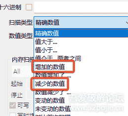

2.3.png (19.5 KB, 下载次数: 3)

[href="forum.php?mod=attachment&aid=MjcwODM1OXwwNGM5MTIxNHwxNzkzNTcyMDQyfDE2ODA4NnwxOTQ0MTMy&nothumb=yes" target="_blank"](https://www.52pojie.cn/forum.php?mod=attachment&aid=MjcwODM1OXwwNGM5MTIxNHwxNzkzNTcyMDQyfDE2ODA4NnwxOTQ0MTMy&nothumb=yes)

2024-7-15 15:46 上传

回到游戏，让冷却时间的计时器跑一下，再回到CE，这时候我们有两条路走，这个计时器要么是增加的数值，要么就是减少的数值，如果增加的找不到，那我们就回头重复一遍找减少的。这里这个冷却计时器是增加的。

这个重复搜索数值的过程我就省略了。。。

找到数据后添加到列表，如下图操作

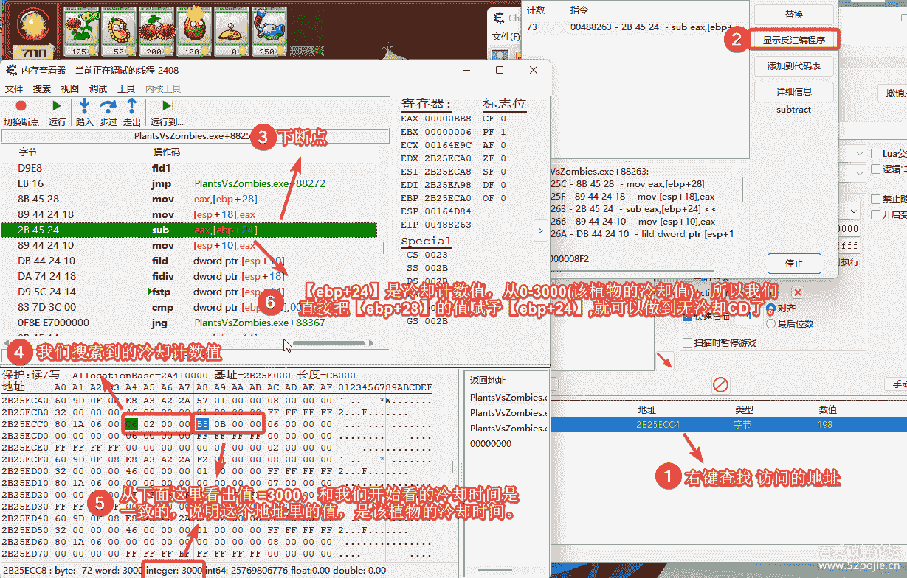

2.4.png (319.62 KB, 下载次数: 3)

[href="forum.php?mod=attachment&aid=MjcwODM2MHw1MTNjYWViMnwxNzkzNTcyMDQyfDE2ODA4NnwxOTQ0MTMy&nothumb=yes" target="_blank"](https://www.52pojie.cn/forum.php?mod=attachment&aid=MjcwODM2MHw1MTNjYWViMnwxNzkzNTcyMDQyfDE2ODA4NnwxOTQ0MTMy&nothumb=yes)

2024-7-15 15:46 上传

最后的CE脚本：

```asm
[ENABLE]
//code from here to '[DISABLE]' will be used to enable the cheat
alloc(newmem,2048)
label(returnhere)
label(originalcode)
label(exit)
newmem: //this is allocated memory, you have read,write,execute access
//place your code here
originalcode:
mov [ebp+24],eax
mov [esp+10],eax
exit:
jmp returnhere
"PlantsVsZombies.exe"+88263:
jmp newmem
```


```
nop 2
returnhere:
[DISABLE]
//code from here till the end of the code will be used to disable the cheat
dealloc(newmem)
"PlantsVsZombies.exe"+88263:
db 2B 45 24 89 44 24 10
//sub eax,[ebp+24]
//mov [esp+10],eax
```

## 三、植物0元购

既然是0元购，那就不需要阳光值啦，找到阳光值，锁定为0吧。


`3.1.png` (51.08 KB, 下载次数: 4)

[forum.php?mod=attachment&aid=MjcwODQzM3xjZTJiZWJhY3wxNzkzNTcyMDQyfDE2ODA4NnwxOTQ0MTMy&nothumb=yes](https://www.52pojie.cn/forum.php?mod=attachment&aid=MjcwODQzM3xjZTJiZWJhY3wxNzkzNTcyMDQyfDE2ODA4NnwxOTQ0MTMy&nothumb=yes)

2024-7-15 20:35 上传

思考：当我们有足够的阳光，图标是亮的，不够的话就是暗的。那说明，有个地方一直在窥视我们的阳光值，并与植物的花费在做比较，判断我们是否拥有足够的阳光值。

那就从刚刚找到的阳光值下手，右键查找是什么访问了这个地址，

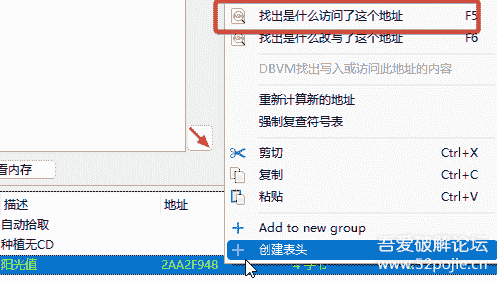

`3.2.png` (30.28 KB, 下载次数: 3)

[forum.php?mod=attachment&aid=MjcwODQzNHxlZGYwYTNmN3wxNzkzNTcyMDQyfDE2ODA4NnwxOTQ0MTMy&nothumb=yes](https://www.52pojie.cn/forum.php?mod=attachment&aid=MjcwODQzNHxlZGYwYTNmN3wxNzkzNTcyMDQyfDE2ODA4NnwxOTQ0MTMy&nothumb=yes)

2024-7-15 20:35 上传

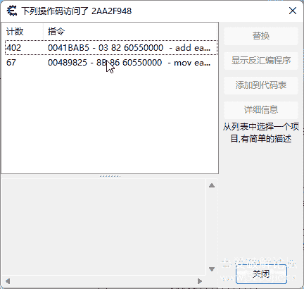

`3.3.png` (23.82 KB, 下载次数: 3)

[forum.php?mod=attachment&aid=MjcwODQzNXw5MGE4Y2IxNnwxNzkzNTcyMDQyfDE2ODA4NnwxOTQ0MTMy&nothumb=yes](https://www.52pojie.cn/forum.php?mod=attachment&aid=MjcwODQzNXw5MGE4Y2IxNnwxNzkzNTcyMDQyfDE2ODA4NnwxOTQ0MTMy&nothumb=yes)

2024-7-15 20:35 上传

找到了两条代码，下断点，看看寄存器有什么变化。如果寄存器的值看着像地址，就右键选择以十六进制显示，在内存数据里看看有没有熟悉的数据。

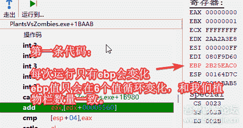

`3.4.png` (60.05 KB, 下载次数: 3)

[forum.php?mod=attachment&aid=MjcwODQzNnxmYzY5MjExZHwxNzkzNTcyMDQyfDE2ODA4NnwxOTQ0MTMy&nothumb=yes](https://www.52pojie.cn/forum.php?mod=attachment&aid=MjcwODQzNnxmYzY5MjExZHwxNzkzNTcyMDQyfDE2ODA4NnwxOTQ0MTMy&nothumb=yes)

2024-7-15 20:35 上传

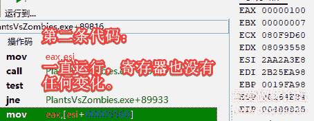

`3.5.png` (40.22 KB, 下载次数: 3)

[forum.php?mod=attachment&aid=MjcwODQ0NnwwYzQyYjYxNnwxNzkzNTcyMDQyfDE2ODA4NnwxOTQ0MTMy&nothumb=yes](https://www.52pojie.cn/forum.php?mod=attachment&aid=MjcwODQ0NnwwYzQyYjYxNnwxNzkzNTcyMDQyfDE2ODA4NnwxOTQ0MTMy&nothumb=yes)

2024-7-15 20:37 上传

两条代码都没有在寄存器或者地址里找到想要的数据，但是在第一条代码里还是得到了一些信息，而第二条代码可以直接pass掉了。回到第一条代码，下断点，把目光放在右下，如下图

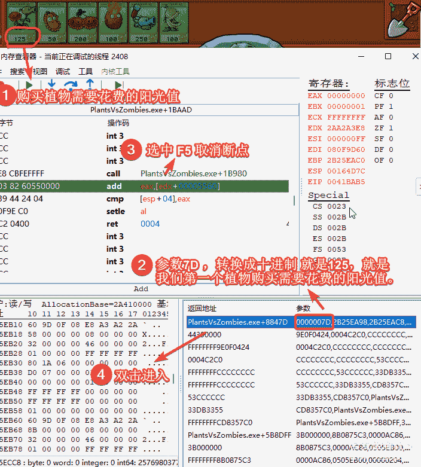

`3.6.png` (180.94 KB, 下载次数: 4)

[forum.php?mod=attachment&aid=MjcwODQzOHwwNTE3MDg2YnwxNzkzNTcyMDQyfDE2ODA4NnwxOTQ0MTMy&nothumb=yes](https://www.52pojie.cn/forum.php?mod=attachment&aid=MjcwODQzOHwwNTE3MDg2YnwxNzkzNTcyMDQyfDE2ODA4NnwxOTQ0MTMy&nothumb=yes)

2024-7-15 20:35 上传

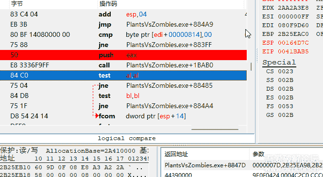

`3.7.png` (48.78 KB, 下载次数: 5)

[forum.php?mod=attachment&aid=MjcwODQzOXxiZDVjMDBmZXwxNzkzNTcyMDQyfDE2ODA4NnwxOTQ0MTMy&nothumb=yes](https://www.52pojie.cn/forum.php?mod=attachment&aid=MjcwODQzOXxiZDVjMDBmZXwxNzkzNTcyMDQyfDE2ODA4NnwxOTQ0MTMy&nothumb=yes)

2024-7-15 20:35 上传

双击进入后，我们会来到 `test al,al` 这行代码，我们在上面 `call` 前面下一个断点

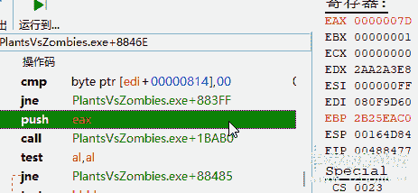

`3.8.png` (26.48 KB, 下载次数: 5)

[forum.php?mod=attachment&aid=MjcwODQ0MHwzMWI0ZjAyNnwxNzkzNTcyMDQyfDE2ODA4NnwxOTQ0MTMy&nothumb=yes](https://www.52pojie.cn/forum.php?mod=attachment&aid=MjcwODQ0MHwzMWI0ZjAyNnwxNzkzNTcyMDQyfDE2ODA4NnwxOTQ0MTMy&nothumb=yes)

2024-7-15 20:35 上传

如上图，代码停在这里时，我们可以从寄存器发现，已经拿到植物购买需要的花费阳光值，我们可以尝试在这里写段代码让 `eax = 0`，看看能不能购买。


`3.9.png` (65.06 KB, 下载次数: 3)

[forum.php?mod=attachment&aid=MjcwODQ0MXw2MTMwNjkwYnwxNzkzNTcyMDQyfDE2ODA4NnwxOTQ0MTMy&nothumb=yes](https://www.52pojie.cn/forum.php?mod=attachment&aid=MjcwODQ0MXw2MTMwNjkwYnwxNzkzNTcyMDQyfDE2ODA4NnwxOTQ0MTMy&nothumb=yes)

2024-7-15 20:35 上传

这是让 `eax = 0` 的结果，图标虽然亮了起来，但还是无法购买。OK，既然找到了想要的数据，就说明步骤没错，现在，需要在更早的时候去处理 `"7D"` 这个数据，第一时间闪过的就是源头，对，就是 `"7D"` 第一次出现的地方。

`PlantsVsZombies.exe+88478 - call PlantsVsZombies.exe+1BAB0`：这是我们当前的地址，我们在汇编代码窗口一直往上滑，在每个 `call` 前面都下断点，看看寄存器有没有看到 `"7D"` 值，有的话就继续往上找 `call`，直到那个 `call` 在被运行前，寄存器是不存在 `"7D"` 为止。

直到找到 `PlantsVsZombies.exe+883B4 - call PlantsVsZombies.exe+1DAE0`：这个 `call` 运行前并没有我们需要的 `"7D"`，那这个 `call` 就是获取我们植物购买需要的花费阳光值 `"7D"`。就在这里下断点，使用 `F7` 跟进这个 `call`，跟进以后在 `PlantsVsZombies.exe+1DAE4 - call PlantsVsZombies.exe+67B00`，这个 `call` 能拿到 `"7D"`，那就继续 `F7` 一步一步跟进。我们不需要看代码做了什么，只需要盯着寄存器看到 `"7D"` 的出现即可。

直到运行到这行代码：`PlantsVsZombies.exe+4A3C13 - mov eax,[eax*4+PlantsVsZombies.exe+3A2010]`：我们需要的 `"7D"` 终于第一次闪亮登场。

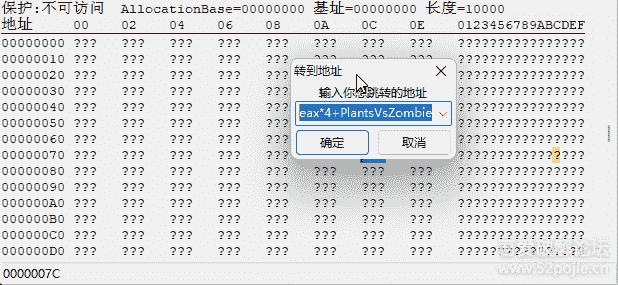

`3.11.png` (43.57 KB, 下载次数: 3)

[forum.php?mod=attachment&aid=MjcwODQ0M3w3YTEyNGExZnwxNzkzNTcyMDQyfDE2ODA4NnwxOTQ0MTMy&nothumb=yes](https://www.52pojie.cn/forum.php?mod=attachment&aid=MjcwODQ0M3w3YTEyNGExZnwxNzkzNTcyMDQyfDE2ODA4NnwxOTQ0MTMy&nothumb=yes)

2024-7-15 20:36 上传

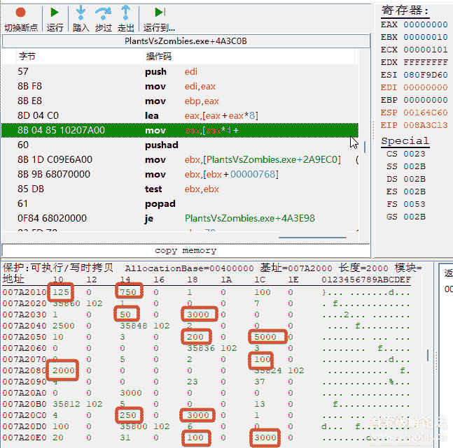

`3.12.png` (73.53 KB, 下载次数: 3)

[forum.php?mod=attachment&aid=MjcwODQ0NHwwOWE1ZjVkZXwxNzkzNTcyMDQyfDE2ODA4NnwxOTQ0MTMy&nothumb=yes](https://www.52pojie.cn/forum.php?mod=attachment&aid=MjcwODQ0NHwwOWE1ZjVkZXwxNzkzNTcyMDQyfDE2ODA4NnwxOTQ0MTMy&nothumb=yes)

2024-7-15 20:36 上传

在内存区域跟进这个 `PlantsVsZombies.exe+3A2010` 地址看看。绿油油一片，还有一些很让人熟悉的数据，这里就是存放植物花费和冷却时间的基地址。

为了随用随关，我们就尽量不改这一块地址里面的值了。从汇编代码看，直接给 `eax` 赋予 `0`，就可以做到0元购了。


`3.13.png` (104.84 KB, 下载次数: 3)

[forum.php?mod=attachment&aid=MjcwODQ0NXw3ZWMyY2NjYnwxNzkzNTcyMDQyfDE2ODA4NnwxOTQ0MTMy&nothumb=yes](https://www.52pojie.cn/forum.php?mod=attachment&aid=MjcwODQ0NXw3ZWMyY2NjYnwxNzkzNTcyMDQyfDE2ODA4NnwxOTQ0MTMy&nothumb=yes)

2024-7-15 20:36 上传

### 最后CE脚本


```
[ENABLE]
//code from here to '[DISABLE]' will be used to enable the cheat
alloc(newmem,2048)
label(returnhere)
label(originalcode)
label(exit)

newmem: //this is allocated memory, you have read,write,execute access
//place your code here

originalcode:
mov eax,0

exit:
jmp returnhere

"PlantsVsZombies.exe"+4A3C13:
jmp newmem
nop 2
returnhere:

[DISABLE]
//code from here till the end of the code will be used to disable the cheat
dealloc(newmem)
"PlantsVsZombies.exe"+4A3C13:
db 8B 04 85 10 20 7A 00
//mov eax,[eax*4+PlantsVsZombies.exe+3A2010]
```

## 四、植物攻速翻倍

玩的时候觉得植物的植物攻击速度有一点点慢，在植物图鉴里可以看到详细信息。


1.png (33.43 KB, 下载次数: 2)

[href="forum.php?mod=attachment&aid=MjcwOTIwOHw2MzY3OWExYXwxNzkzNTcyMDQyfDE2ODA4NnwxOTQ0MTMy&nothumb=yes" target="_blank"](https://www.52pojie.cn/forum.php?mod=attachment&aid=MjcwOTIwOHw2MzY3OWExYXwxNzkzNTcyMDQyfDE2ODA4NnwxOTQ0MTMy&nothumb=yes)

2024-7-17 19:40 上传


2.png (33.73 KB, 下载次数: 1)

[href="forum.php?mod=attachment&aid=MjcwOTIwOXw3NjRjYzlkNnwxNzkzNTcyMDQyfDE2ODA4NnwxOTQ0MTMy&nothumb=yes" target="_blank"](https://www.52pojie.cn/forum.php?mod=attachment&aid=MjcwOTIwOXw3NjRjYzlkNnwxNzkzNTcyMDQyfDE2ODA4NnwxOTQ0MTMy&nothumb=yes)

2024-7-17 19:40 上传


3.png (27.87 KB, 下载次数: 1)

[href="forum.php?mod=attachment&aid=MjcwOTIxMHxjMmNkZDY3OXwxNzkzNTcyMDQyfDE2ODA4NnwxOTQ0MTMy&nothumb=yes" target="_blank"](https://www.52pojie.cn/forum.php?mod=attachment&aid=MjcwOTIxMHxjMmNkZDY3OXwxNzkzNTcyMDQyfDE2ODA4NnwxOTQ0MTMy&nothumb=yes)

2024-7-17 19:40 上传


4.png (154.19 KB, 下载次数: 1)

[href="forum.php?mod=attachment&aid=MjcwOTIxMXxjMDdhMDUzNHwxNzkzNTcyMDQyfDE2ODA4NnwxOTQ0MTMy&nothumb=yes" target="_blank"](https://www.52pojie.cn/forum.php?mod=attachment&aid=MjcwOTIxMXxjMDdhMDUzNHwxNzkzNTcyMDQyfDE2ODA4NnwxOTQ0MTMy&nothumb=yes)

2024-7-17 19:40 上传

如上图，以豌豆向日葵为例，攻击间隔1秒一次，把植物和新的子弹距离作参照物。
从之前种植CD的知识，这游戏数据是很明文的，冷却速度3000 = 30/s，那这里的攻击间隔就是1秒 = 100 。那么当一个子弹被发射时，发射子弹的计数器就两种状态，1、从0 到 100；2、从100到 0。
OK，我觉得说得很明白了，搜索过程就省略了。。。


5.png (16.33 KB, 下载次数: 1)

[href="forum.php?mod=attachment&aid=MjcwOTIxMnw2OWJkNjIwY3wxNzkzNTcyMDQyfDE2ODA4NnwxOTQ0MTMy&nothumb=yes" target="_blank"](https://www.52pojie.cn/forum.php?mod=attachment&aid=MjcwOTIxMnw2OWJkNjIwY3wxNzkzNTcyMDQyfDE2ODA4NnwxOTQ0MTMy&nothumb=yes)

2024-7-17 19:40 上传

这里还因为知道要找的数据在 0--100之中，可以在扫描类型选择在两者之间的值，最大数值肯定不能变的，最小数值你有信心可以填更接近最大值的，可以更快的找到数据。
找到数据后添加到列表，右键查找 是什么改写了这个地址

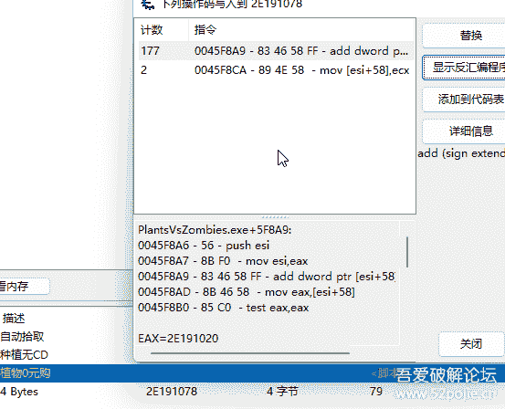

6.png (42.01 KB, 下载次数: 2)

[href="forum.php?mod=attachment&aid=MjcwOTIxM3wwOTEyNzliM3wxNzkzNTcyMDQyfDE2ODA4NnwxOTQ0MTMy&nothumb=yes" target="_blank"](https://www.52pojie.cn/forum.php?mod=attachment&aid=MjcwOTIxM3wwOTEyNzliM3wxNzkzNTcyMDQyfDE2ODA4NnwxOTQ0MTMy&nothumb=yes)

2024-7-17 19:40 上传

两条代码，看第一条是什么 `PlantsVsZombies.exe+5F8A9` - `add dword ptr [esi+58],-01`：这条代码是时间一直在减 `-01`，那我们把 `-01`改成`-02`、`03`以此类推就可以实现攻速翻倍了。如下图结果：


7.png (212.11 KB, 下载次数: 2)

[href="forum.php?mod=attachment&aid=MjcwOTIxNHxkNDgxNjY2NHwxNzkzNTcyMDQyfDE2ODA4NnwxOTQ0MTMy&nothumb=yes" target="_blank"](https://www.52pojie.cn/forum.php?mod=attachment&aid=MjcwOTIxNHxkNDgxNjY2NHwxNzkzNTcyMDQyfDE2ODA4NnwxOTQ0MTMy&nothumb=yes)

2024-7-17 19:40 上传

，能看出子弹之间的距离缩小了。

CE脚本代码：

```
[ENABLE]

//code from here to '[DISABLE]' will be used to enable the cheat

alloc(newmem,2048)

label(returnhere)

label(originalcode)

label(exit)

newmem: //this is allocated memory, you have read,write,execute access

//place your code here

originalcode:

add dword ptr [esi+58],-02

mov eax,[esi+58]

exit:

jmp returnhere

"PlantsVsZombies.exe"+5F8A9:

jmp newmem

nop 2

returnhere:

[DISABLE]

//code from here till the end of the code will be used to disable the cheat

dealloc(newmem)

"PlantsVsZombies.exe"+5F8A9:

db 83 46 58 FF 8B 46 58

//add dword ptr [esi+58],-01

//mov eax,[esi+58]
```

## 五、叠加种植

这是在论坛里看到功能，既然是学习技术，不能模仿，也要思考别人是如何实现的。
思考：在种植物的时候，肯定会有代码在判断当前位置能不能种下植物，而这代码只会在种植物的时候才执行。

祭出工具：代码过滤器

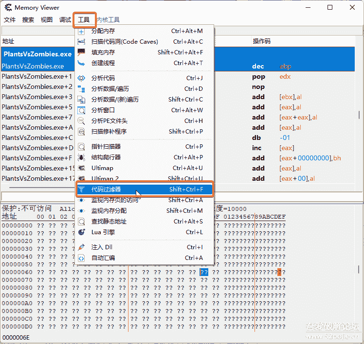

1.png (92.28 KB, 下载次数: 1)

[href="forum.php?mod=attachment&aid=MjcwOTIxNXxhNDFkODM0NHwxNzkzNTcyMDQyfDE2ODA4NnwxOTQ0MTMy&nothumb=yes" target="_blank"](https://www.52pojie.cn/forum.php?mod=attachment&aid=MjcwOTIxNXxhNDFkODM0NHwxNzkzNTcyMDQyfDE2ODA4NnwxOTQ0MTMy&nothumb=yes)

2024-7-17 19:46 上传

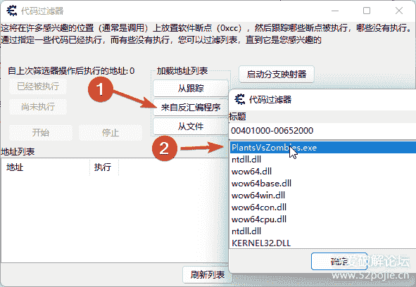

2.png (51.65 KB, 下载次数: 1)

[href="forum.php?mod=attachment&aid=MjcwOTIxNnxkYmEyMWQyMHwxNzkzNTcyMDQyfDE2ODA4NnwxOTQ0MTMy&nothumb=yes" target="_blank"](https://www.52pojie.cn/forum.php?mod=attachment&aid=MjcwOTIxNnxkYmEyMWQyMHwxNzkzNTcyMDQyfDE2ODA4NnwxOTQ0MTMy&nothumb=yes)

2024-7-17 19:46 上传

选择来自反汇编程序，选中游戏进程。稍等一下。

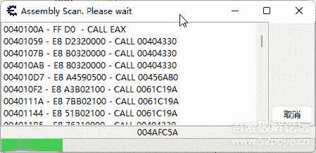

3.png (19.08 KB, 下载次数: 1)

[href="forum.php?mod=attachment&aid=MjcwOTIxN3xhYWVhNjRmMHwxNzkzNTcyMDQyfDE2ODA4NnwxOTQ0MTMy&nothumb=yes" target="_blank"](https://www.52pojie.cn/forum.php?mod=attachment&aid=MjcwOTIxN3xhYWVhNjRmMHwxNzkzNTcyMDQyfDE2ODA4NnwxOTQ0MTMy&nothumb=yes)

2024-7-17 19:46 上传

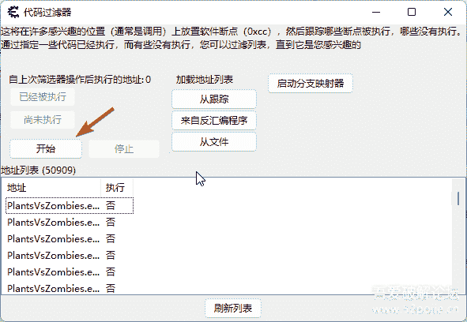

4.png (41.43 KB, 下载次数: 2)

[href="forum.php?mod=attachment&aid=MjcwOTIxOHxmNmQ5MDFmOHwxNzkzNTcyMDQyfDE2ODA4NnwxOTQ0MTMy&nothumb=yes" target="_blank"](https://www.52pojie.cn/forum.php?mod=attachment&aid=MjcwOTIxOHxmNmQ5MDFmOHwxNzkzNTcyMDQyfDE2ODA4NnwxOTQ0MTMy&nothumb=yes)

2024-7-17 19:46 上传

等待扫描完成后，可以点击开始监听代码了。

回到游戏，不要种植物，我们干什么都行，先把无用的代码给过滤掉。


5.png (296.89 KB, 下载次数: 2)

[href="forum.php?mod=attachment&aid=MjcwOTIxOXxlYjIzNmY2ZHwxNzkzNTcyMDQyfDE2ODA4NnwxOTQ0MTMy&nothumb=yes" target="_blank"](https://www.52pojie.cn/forum.php?mod=attachment&aid=MjcwOTIxOXxlYjIzNmY2ZHwxNzkzNTcyMDQyfDE2ODA4NnwxOTQ0MTMy&nothumb=yes)

2024-7-17 19:46 上传

没有种植物，所以选择过滤掉未执行的。


6.png (50.52 KB, 下载次数: 1)

[href="forum.php?mod=attachment&aid=MjcwOTIyMHw1NmI0OTRjN3wxNzkzNTcyMDQyfDE2ODA4NnwxOTQ0MTMy&nothumb=yes" target="_blank"](https://www.52pojie.cn/forum.php?mod=attachment&aid=MjcwOTIyMHw1NmI0OTRjN3wxNzkzNTcyMDQyfDE2ODA4NnwxOTQ0MTMy&nothumb=yes)

2024-7-17 19:46 上传

这里因为筛选数据不怎么会动了，开始种植物了，选择已执行。
重复过程省略了。。。过程就和搜索数值一样，记得要叠加种植（种植失败）也选择已执行。
种下植物（数值被改变）→ 代码已执行
未种植物（数值未改变）→ 代码未执行


7.png (17.25 KB, 下载次数: 1)

[href="forum.php?mod=attachment&aid=MjcwOTIyMXw5ODk2OGUxNnwxNzkzNTcyMDQyfDE2ODA4NnwxOTQ0MTMy&nothumb=yes" target="_blank"](https://www.52pojie.cn/forum.php?mod=attachment&aid=MjcwOTIyMXw5ODk2OGUxNnwxNzkzNTcyMDQyfDE2ODA4NnwxOTQ0MTMy&nothumb=yes)

2024-7-17 19:47 上传

最后不出意外的话就就没有意外，剩下5个地址，种植成功和叠加种植失败都会执行这5条代码。从地址来看这几行代码间隔不远，双击第一个地址下断点，因为代码只有种植时才会运行，分别种植成功一次，叠加种植失败一次，看看过程中有什么不一样，几条代码都是call，直接F8步过就好了。

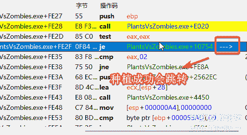

8.png (45.04 KB, 下载次数: 2)

[href="forum.php?mod=attachment&aid=MjcwOTIyMnw3ZTcwNTkxYnwxNzkzNTcyMDQyfDE2ODA4NnwxOTQ0MTMy&nothumb=yes" target="_blank"](https://www.52pojie.cn/forum.php?mod=attachment&aid=MjcwOTIyMnw3ZTcwNTkxYnwxNzkzNTcyMDQyfDE2ODA4NnwxOTQ0MTMy&nothumb=yes)

2024-7-17 19:47 上传

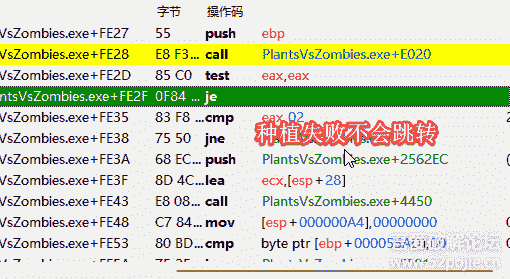

9.png (43.31 KB, 下载次数: 1)


[href="forum.php?mod=attachment&aid=MjcwOTIyM3wwNDEzZTBmOXwxNzkzNTcyMDQyfDE2ODA4NnwxOTQ0MTMy&nothumb=yes" target="_blank"](https://www.52pojie.cn/forum.php?mod=attachment&aid=MjcwOTIyM3wwNDEzZTBmOXwxNzkzNTcyMDQyfDE2ODA4NnwxOTQ0MTMy&nothumb=yes)

2024-7-17 19:47 上传

把`PlantsVsZombies.exe+FE2F` - `je PlantsVsZombies.exe+10754`：`je`改成`jmp`必定跳转，就能实现植物的叠加种植了。


`10.png` (45.91 KB, 下载次数: 1)

[href="forum.php?mod=attachment&aid=MjcwOTIyNHxlODllM2Q4OXwxNzkzNTcyMDQyfDE2ODA4NnwxOTQ0MTMy&nothumb=yes" target="_blank"](https://www.52pojie.cn/forum.php?mod=attachment&aid=MjcwOTIyNHxlODllM2Q4OXwxNzkzNTcyMDQyfDE2ODA4NnwxOTQ0MTMy&nothumb=yes)

2024-7-17 19:47 上传

### CE脚本代码

[Asm] 纯文本查看 复制代码

```
CE脚本代码：
[ENABLE]
//code from here to '[DISABLE]' will be used to enable the cheat
alloc(newmem,2048)
label(returnhere)
label(originalcode)
label(exit)

newmem: //this is allocated memory, you have read,write,execute access
//place your code here

originalcode:
jmp PlantsVsZombies.exe+10754

exit:
jmp returnhere

"PlantsVsZombies.exe"+FE2F:
jmp newmem
nop
returnhere:

 
[DISABLE]
//code from here till the end of the code will be used to disable the cheat
dealloc(newmem)
"PlantsVsZombies.exe"+FE2F:
db 0F 84 1F 09 00 00
//je PlantsVsZombies.exe+10754

```
