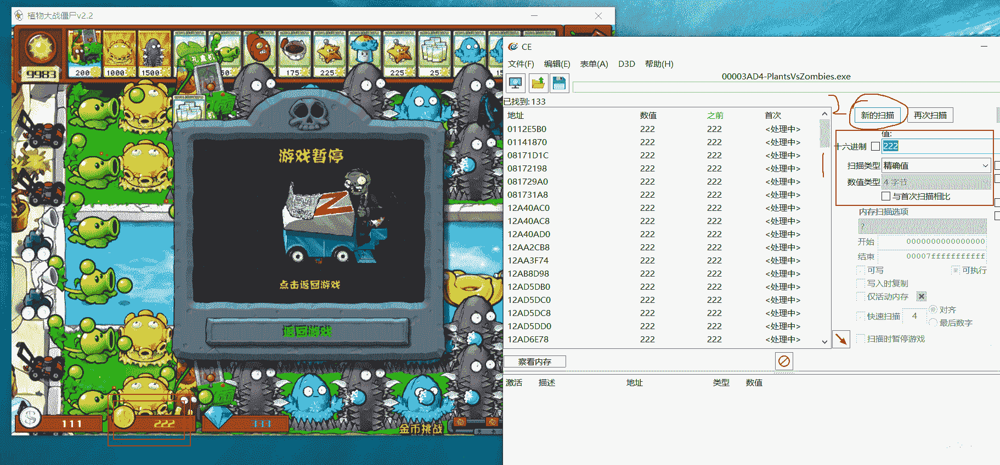
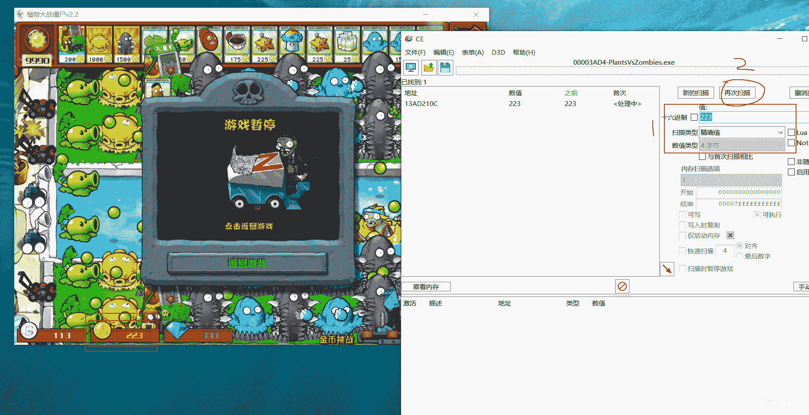

# [分享] `ce`修改植物大战僵尸杂交版金币

- 原帖: https://www.52pojie.cn/forum.php?mod=viewthread&tid=1944261
- 抓取时间: 2026-11-01T22:27:22

我上一篇文章写了如何修改银币依次类推金币不是轻轻松松吗？很多小白反馈说不详细，可能我有些细节没在意，这篇文章零基础跟着我做都会

## 第一步 打开植物大战僵尸杂交版进程 如下图步骤点击即可

`1.png` (1.44 MB, 下载次数: 5)
2024-7-15 16:40 上传

## 第二步 首次搜索 初始值 就是 你游戏里面现在的金币是多少

`2.png` (1.18 MB, 下载次数: 5)
2024-7-15 16:40 上传

## 第三步 回到游戏里面 等金币改变 然后 回到`ce`里面 再次搜索 改变的金币数

`3.png` (1.21 MB, 下载次数: 6)
2024-7-15 16:40 上传

## 第四步 我们就找到了 金币地址了 拖拽下去双击点击修改数值即可 这里可能有些人还有一堆地址 我们只需重复第三步骤即可

`4.png` (1.28 MB, 下载次数: 5)
2024-7-15 16:40 上传

`ce`工具下载贴：https://www.52pojie.cn/forum.php?mod=viewthread&tid=1573180&highlight=Cheat%2BEngine

看完这贴可以尝试去修改植物cd无冷却 https://www.52pojie.cn/thread-1943365-1-1.html
