# [原创] 杂交版植物卡片数据修改 (`CE` + `HxD`)

- 原帖: [https://www.52pojie.cn/forum.php?mod=viewthread&tid=1944538](https://www.52pojie.cn/forum.php?mod=viewthread&tid=1944538)
- 抓取时间: 2026-11-01T22:27:17

`图1.png` (430.33 KB, 下载次数: 6) | [附件](https://www.52pojie.cn/forum.php?mod=attachment&aid=MjcwODU3MXw5ZjExNGI4NXwxNzkzNTcyMDM1fDE2ODA4NnwxOTQ0NTM4&nothumb=yes) | 2024-7-16 13:21 上传

## `CE`修改

首先运行游戏加载`CE`

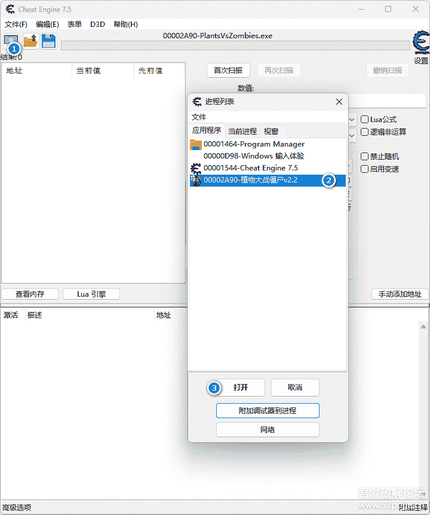

`图2.png` (68.67 KB, 下载次数: 6) | [附件](https://www.52pojie.cn/forum.php?mod=attachment&aid=MjcwODU3MnxjNDU3NDgyMXwxNzkzNTcyMDM1fDE2ODA4NnwxOTQ0NTM4&nothumb=yes) | 2024-7-16 13:22 上传

根据以往的经验我们尝试使用`CE`的`群组`功能来搜索, 更改`数值类型`为`群组`

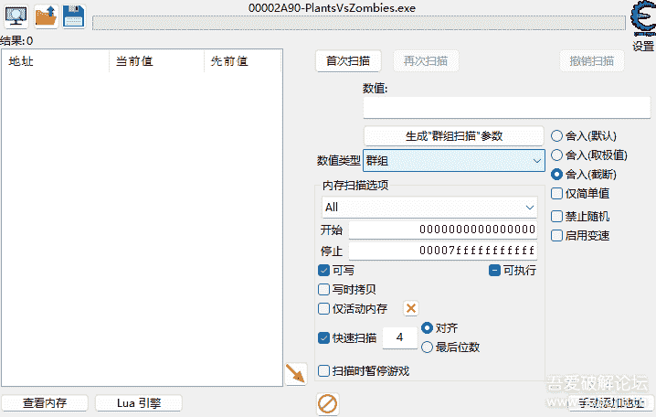

`图3.png` (45.13 KB, 下载次数: 5) | [附件](https://www.52pojie.cn/forum.php?mod=attachment&aid=MjcwODU3M3xmM2RkYjM0OXwxNzkzNTcyMDM1fDE2ODA4NnwxOTQ0NTM4&nothumb=yes) | 2024-7-16 13:22 上传

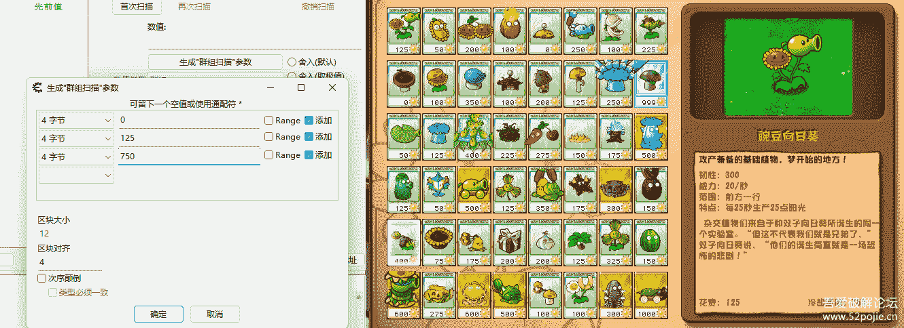

`图4.png` (431.76 KB, 下载次数: 5) | [附件](https://www.52pojie.cn/forum.php?mod=attachment&aid=MjcwODU3NHw5MDRmZjdjZHwxNzkzNTcyMDM1fDE2ODA4NnwxOTQ0NTM4&nothumb=yes) | 2024-7-16 13:22 上传

记得勾选`写时拷贝`, 可能你的`CE`不是这个名称, 记住打开就好

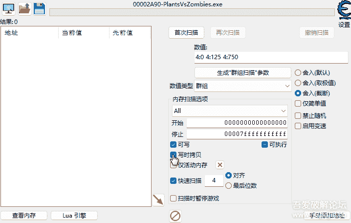

`图5.png` (47.08 KB, 下载次数: 5) | [附件](https://www.52pojie.cn/forum.php?mod=attachment&aid=MjcwODU3NXxhNWMxYjU2OHwxNzkzNTcyMDM1fDE2ODA4NnwxOTQ0NTM4&nothumb=yes) | 2024-7-16 13:22 上传

运气不错, 搜到两个地址, 还是绿色的

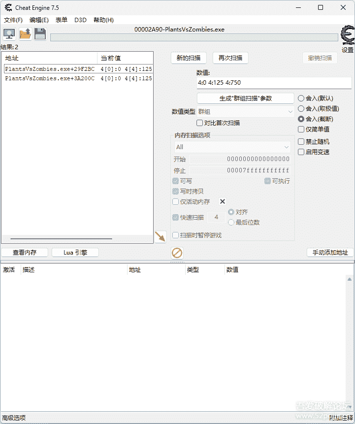

`图6.png` (62.3 KB, 下载次数: 5) | [附件](https://www.52pojie.cn/forum.php?mod=attachment&aid=MjcwODU3NnwwMzA3NWMxN3wxNzkzNTcyMDM1fDE2ODA4NnwxOTQ0NTM4&nothumb=yes) | 2024-7-16 13:22 上传

右键第一条地址, 浏览相关内存区域

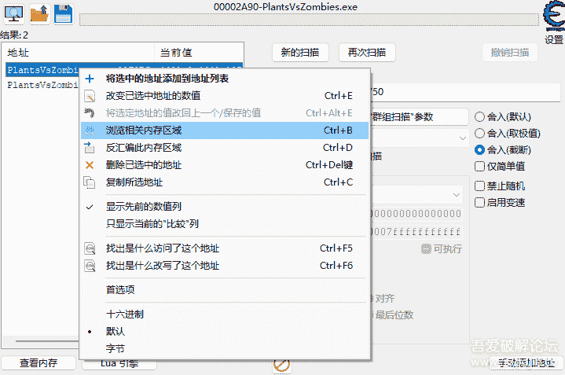

`图7.png` (63.13 KB, 下载次数: 6) | [附件](https://www.52pojie.cn/forum.php?mod=attachment&aid=MjcwODU3N3w0OGM3ODUwNnwxNzkzNTcyMDM1fDE2ODA4NnwxOTQ0NTM4&nothumb=yes) | 2024-7-16 13:22 上传

更改`显示类型`为`4字节10进制`

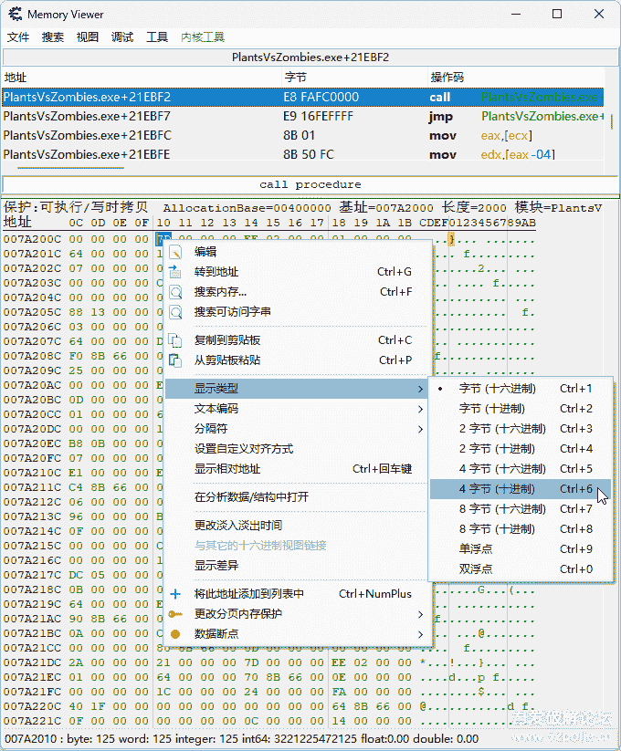

`图8.png` (114.68 KB, 下载次数: 4) | [附件](https://www.52pojie.cn/forum.php?mod=attachment&aid=MjcwODU4Mnw1MzVmYWU1ZHwxNzkzNTcyMDM1fDE2ODA4NnwxOTQ0NTM4&nothumb=yes) | 2024-7-16 13:23 上传

双击修改为50, 发现并没有生效, 放弃这条

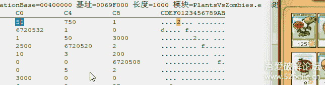

`图9.png` (40.5 KB, 下载次数: 5) | [附件](https://www.52pojie.cn/forum.php?mod=attachment&aid=MjcwODU3OXw2YjQxMDQ2MnwxNzkzNTcyMDM1fDE2ODA4NnwxOTQ0NTM4&nothumb=yes) | 2024-7-16 13:23 上传

尝试下一个地址, 这次我们按快捷键`Ctrl+B`

`图10.png` (12.41 KB, 下载次数: 7) | [附件](https://www.52pojie.cn/forum.php?mod=attachment&aid=MjcwODU4MHxkN2U4MTFmNHwxNzkzNTcyMDM1fDE2ODA4NnwxOTQ0NTM4&nothumb=yes) | 2024-7-16 13:23 上传

双击修改为50, 成功了

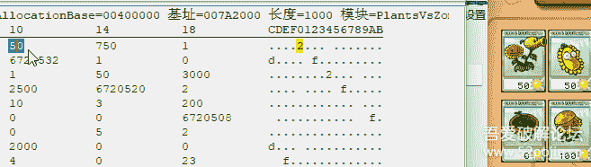

`图11.png` (50.11 KB, 下载次数: 6) | [附件](https://www.52pojie.cn/forum.php?mod=attachment&aid=MjcwODU4MXwyMzIyYjFiNnwxNzkzNTcyMDM1fDE2ODA4NnwxOTQ0NTM4&nothumb=yes) | 2024-7-16 13:23 上传

由于是绿色的, 所以我们可以直接添加地址保存, 方便下次进游戏使用

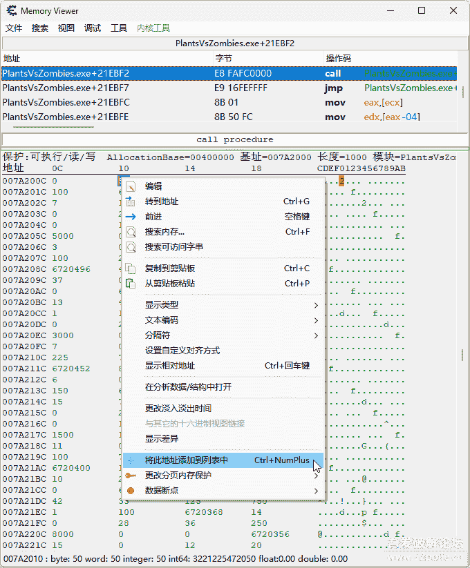

`图12.png` (99.98 KB, 下载次数: 6) | [附件](https://www.52pojie.cn/forum.php?mod=attachment&aid=MjcwODU4MnwwZWU0ZmU1MHwxNzkzNTcyMDM1fDE2ODA4NnwxOTQ0NTM4&nothumb=yes) | 2024-7-16 13:23 上传

`图13.png` (15.96 KB, 下载次数: 6) | [附件](https://www.52pojie.cn/forum.php?mod=attachment&aid=MjcwODU4M3xkZmY1MWU0ZHwxNzkzNTcyMDM1fDE2ODA4NnwxOTQ0NTM4&nothumb=yes) | 2024-7-16 13:23 上传

通过观察, 阳光豆的数据就在后面的位置, 注意左下角的地址

我们用阳光豆的地址减去豌豆向日葵的地址, `007A2034 - 007A2010 = 24`, 这里要使用16进制的计算器

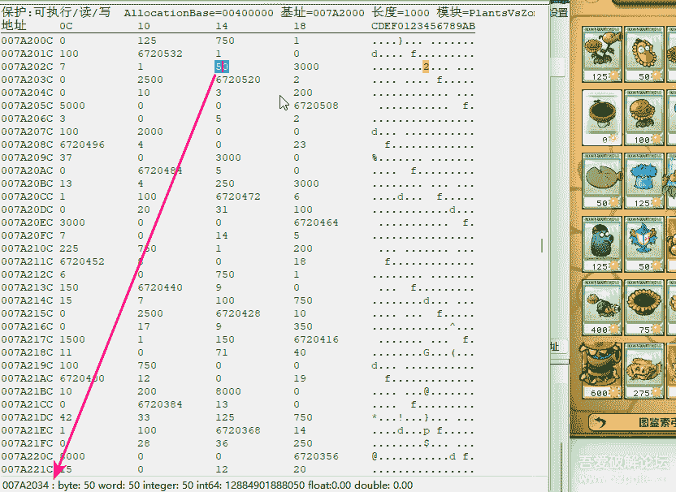

`图14.png` (191.36 KB, 下载次数: 5) | [附件](https://www.52pojie.cn/forum.php?mod=attachment&aid=MjcwODU4NHw2OGQ2YzM1YnwxNzkzNTcyMDM1fDE2ODA4NnwxOTQ0NTM4&nothumb=yes) | 2024-7-16 13:23 上传

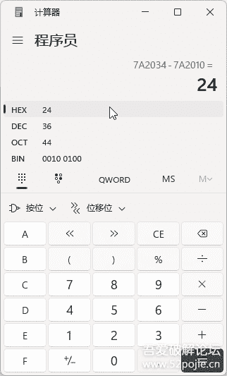

`图15.png` (34.46 KB, 下载次数: 6) | [附件](https://www.52pojie.cn/forum.php?mod=attachment&aid=MjcwODU4NXw5NGMwZWRlYXwxNzkzNTcyMDM1fDE2ODA4NnwxOTQ0NTM4&nothumb=yes) | 2024-7-16 13:24 上传

先添加一下豌豆向日葵冷却的地址

`图16.png` (17.57 KB, 下载次数: 4) | [附件](https://www.52pojie.cn/forum.php?mod=attachment&aid=MjcwODU4Nnw1NDk3ZmM0ZHwxNzkzNTcyMDM1fDE2ODA4NnwxOTQ0NTM4&nothumb=yes) | 2024-7-16 13:24 上传

继续添加阳光豆的地址

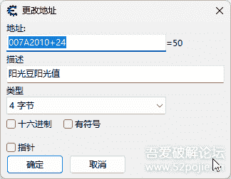

`图17.png` (17.15 KB, 下载次数: 5) | [附件](https://www.52pojie.cn/forum.php?mod=attachment&aid=MjcwODU4N3xjZTE0OWIxN3wxNzkzNTcyMDM1fDE2ODA4NnwxOTQ0NTM4&nothumb=yes) | 2024-7-16 13:24 上传

再添加阳光豆冷却的地址

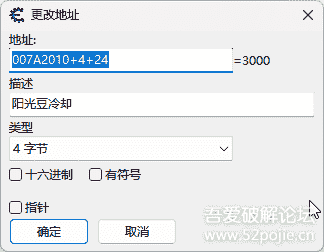

`图18.png` (17.48 KB, 下载次数: 5) | [附件](https://www.52pojie.cn/forum.php?mod=attachment&aid=MjcwODU4OHwwMThkYzU1ZHwxNzkzNTcyMDM1fDE2ODA4NnwxOTQ0NTM4&nothumb=yes) | 2024-7-16 13:24 上传

后面的数据我们换一种方法, 按住`Ctrl`键, 同时选中阳光值和冷却这两条数据

`图19.png` (16.23 KB, 下载次数: 5) | [附件](https://www.52pojie.cn/forum.php?mod=attachment&aid=MjcwODU4OXxlYjBiZDZhMXwxNzkzNTcyMDM1fDE2ODA4NnwxOTQ0NTM4&nothumb=yes) | 2024-7-16 13:24 上传

先按`Ctrl+C`, 再按`Ctrl+V`, 在`校正地址`填入`24`

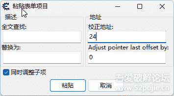

`图20.png` (16.82 KB, 下载次数: 6) | [附件](https://www.52pojie.cn/forum.php?mod=attachment&aid=MjcwODU5MHw5YWU3ZGJhNnwxNzkzNTcyMDM1fDE2ODA4NnwxOTQ0NTM4&nothumb=yes) | 2024-7-16 13:24 上传

就得到了后面的植物数据地址

`图21.png` (413.95 KB, 下载次数: 4)
[href="forum.php?mod=attachment&aid=MjcwODU5MXw5YjYxYWM0MXwxNzkzNTcyMDM1fDE2ODA4NnwxOTQ0NTM4&nothumb=yes" target="_blank"](https://www.52pojie.cn/forum.php?mod=attachment&aid=MjcwODU5MXw5YjYxYWM0MXwxNzkzNTcyMDM1fDE2ODA4NnwxOTQ0NTM4&nothumb=yes)
2024-7-16 13:25 上传

## 游戏原文件修改

用`HxD`打开游戏原文件, 搜索"字节序列"
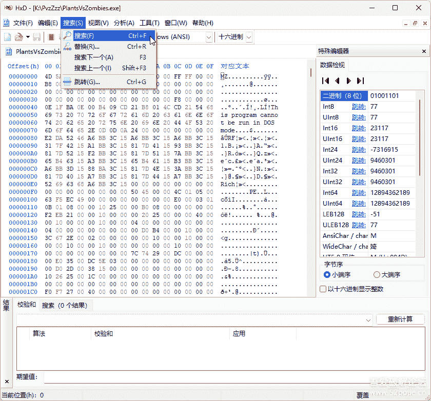
`图22.png` (113.61 KB, 下载次数: 7)
[href="forum.php?mod=attachment&aid=MjcwODU5MnxhMjc5Y2JmZHwxNzkzNTcyMDM1fDE2ODA4NnwxOTQ0NTM4&nothumb=yes" target="_blank"](https://www.52pojie.cn/forum.php?mod=attachment&aid=MjcwODU5MnxhMjc5Y2JmZHwxNzkzNTcyMDM1fDE2ODA4NnwxOTQ0NTM4&nothumb=yes)
2024-7-16 13:25 上传
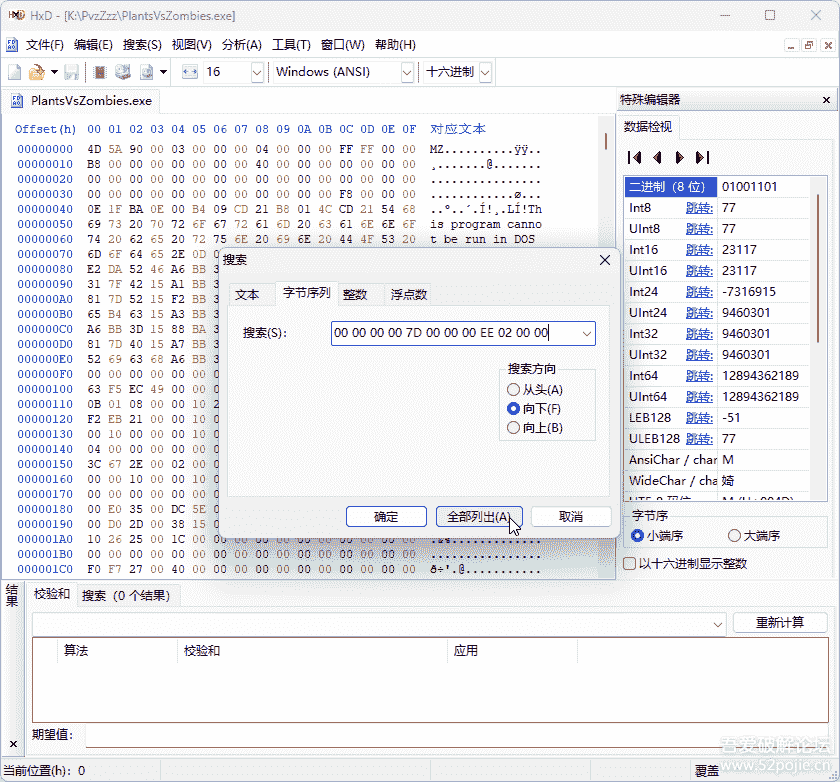
`图23.png` (134.57 KB, 下载次数: 6)
[href="forum.php?mod=attachment&aid=MjcwODU5M3xkMWZkMGFiY3wxNzkzNTcyMDM1fDE2ODA4NnwxOTQ0NTM4&nothumb=yes" target="_blank"](https://www.52pojie.cn/forum.php?mod=attachment&aid=MjcwODU5M3xkMWZkMGFiY3wxNzkzNTcyMDM1fDE2ODA4NnwxOTQ0NTM4&nothumb=yes)
2024-7-16 13:25 上传
更改显示宽度为12, 这样就看得更加清楚了
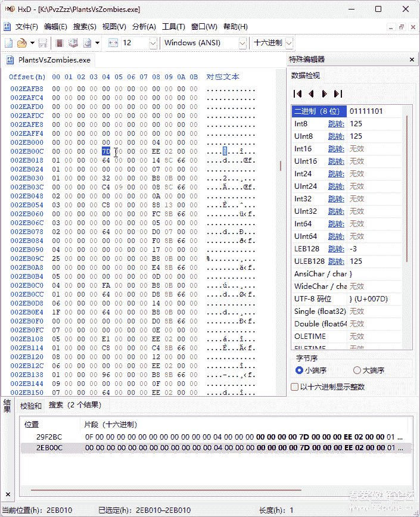
`图24.png` (114.04 KB, 下载次数: 5)
[href="forum.php?mod=attachment&aid=MjcwODU5NHxiM2MxMGZiYnwxNzkzNTcyMDM1fDE2ODA4NnwxOTQ0NTM4&nothumb=yes" target="_blank"](https://www.52pojie.cn/forum.php?mod=attachment&aid=MjcwODU5NHxiM2MxMGZiYnwxNzkzNTcyMDM1fDE2ODA4NnwxOTQ0NTM4&nothumb=yes)
2024-7-16 13:25 上传
我把前三个植物卡片的数据做了修改, 保存
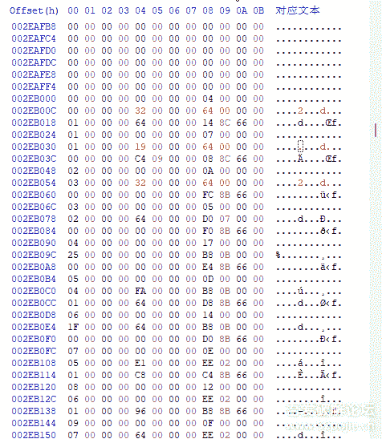
`图25.png` (33.72 KB, 下载次数: 5)
[href="forum.php?mod=attachment&aid=MjcwODU5NXwyMDE5MjNhMHwxNzkzNTcyMDM1fDE2ODA4NnwxOTQ0NTM4&nothumb=yes" target="_blank"](https://www.52pojie.cn/forum.php?mod=attachment&aid=MjcwODU5NXwyMDE5MjNhMHwxNzkzNTcyMDM1fDE2ODA4NnwxOTQ0NTM4&nothumb=yes)
2024-7-16 13:25 上传
进游戏测试, 已生效

`图26.png` (433.28 KB, 下载次数: 5)
[href="forum.php?mod=attachment&aid=MjcwODU5NnxmYmFkMzNmOHwxNzkzNTcyMDM1fDE2ODA4NnwxOTQ0NTM4&nothumb=yes" target="_blank"](https://www.52pojie.cn/forum.php?mod=attachment&aid=MjcwODU5NnxmYmFkMzNmOHwxNzkzNTcyMDM1fDE2ODA4NnwxOTQ0NTM4&nothumb=yes)
2024-7-16 13:26 上传
完毕
