# [原创] 杂交版金卡修改 ( `CE` + `x64dbg` )

- 原帖: https://www.52pojie.cn/forum.php?mod=viewthread&tid=1945678
- 抓取时间: 2026-11-01T22:27:13

今天我们来尝试修改一下金卡, 让它的价格不要递增

启动`CE`, 先搜索`300`

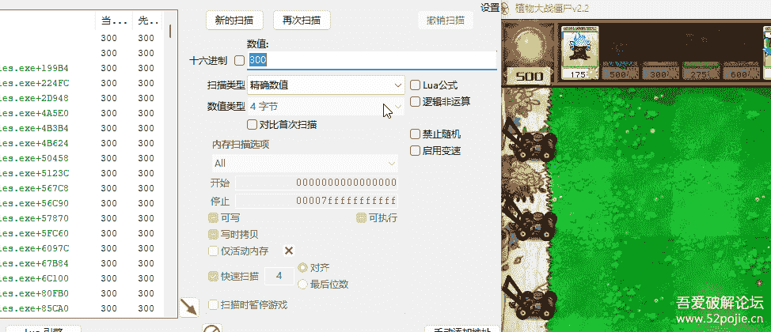
图1.png (324.96 KB, 下载次数: 2)

买一次, 再搜索`400`, 居然没数据, 这难不倒我

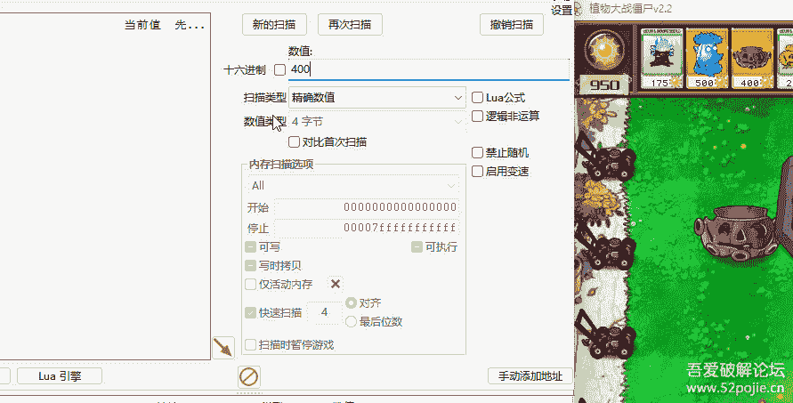
图2.png (259.89 KB, 下载次数: 2)

切换数据类型, 再来

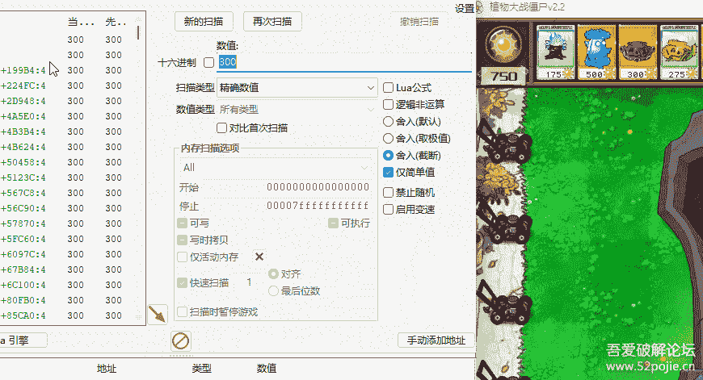
图3.png (315.15 KB, 下载次数: 1)

还是没有

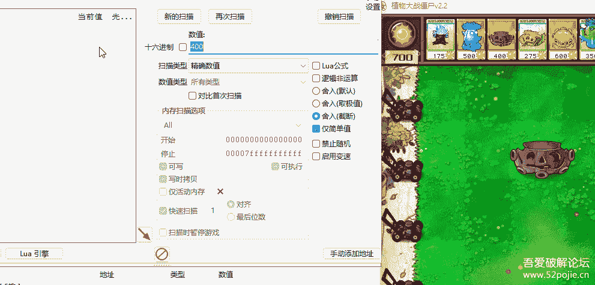
图4.png (365.24 KB, 下载次数: 1)

规律还是很明显, 每次购买后就会增加`100`

图5.png (446.82 KB, 下载次数: 1)

我们换个工具来搞它, `x64dbg`启动

先附加游戏进程

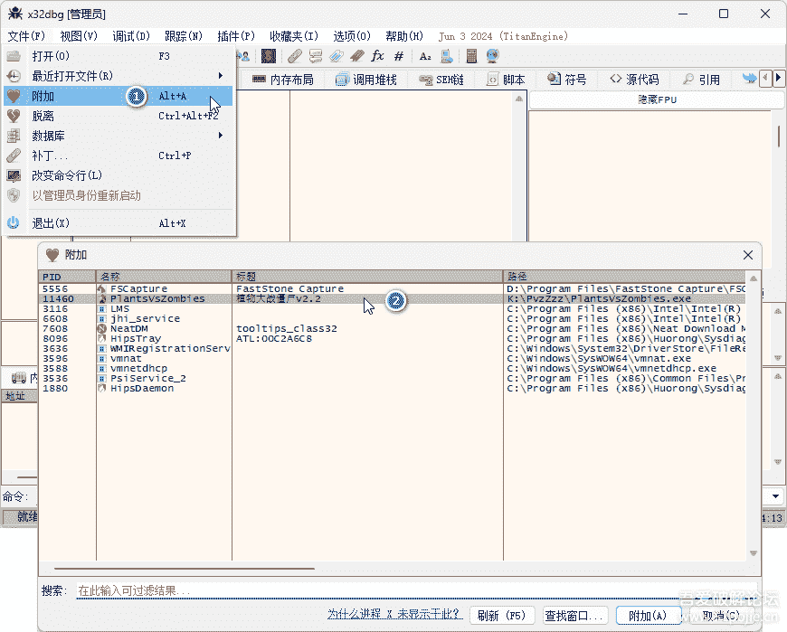
图6.png (80.24 KB, 下载次数: 2)

点击"符号"页面, 双击左边的`PlantsVsZombies.exe`模块

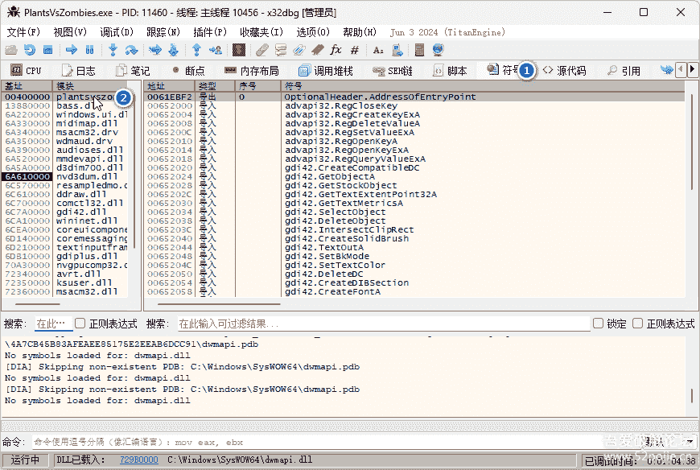
图7.png (114.22 KB, 下载次数: 1)

双击跳转到了`CPU`页面, 在当前区域搜索

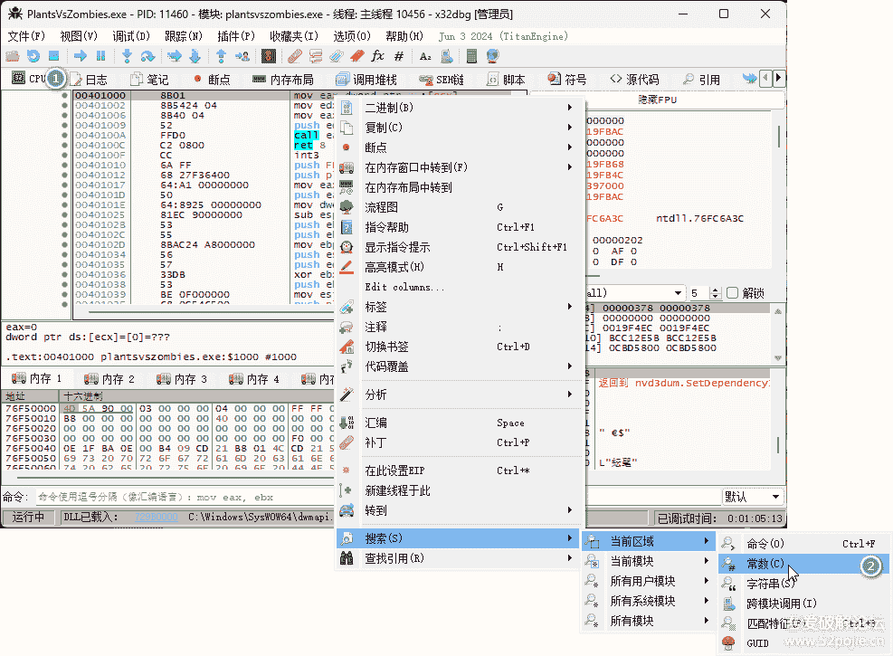
图8.png (133.67 KB, 下载次数: 2)

搜索`64`, 为什么是`64`呢, `100`的十六进制就是`64`, 每次的增幅是`100`, 所以这个`64`很关键

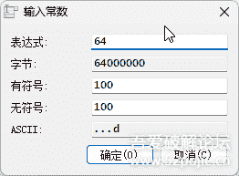
图9.png (12.42 KB, 下载次数: 3)

不错, 搜出来2500多条, 稍微多了一点

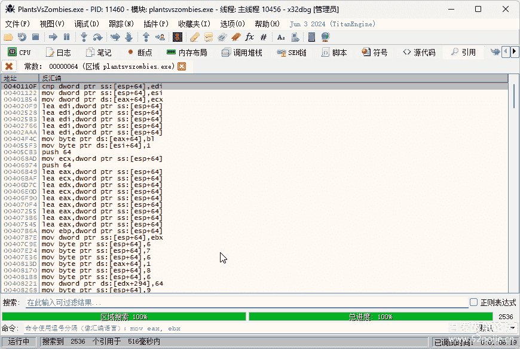
图10.png (97.96 KB, 下载次数: 1)

我们来精简一下, 在下方的搜索栏输入`64$`, 意思就是保留以64结尾的, 记得勾选"正则表达式"

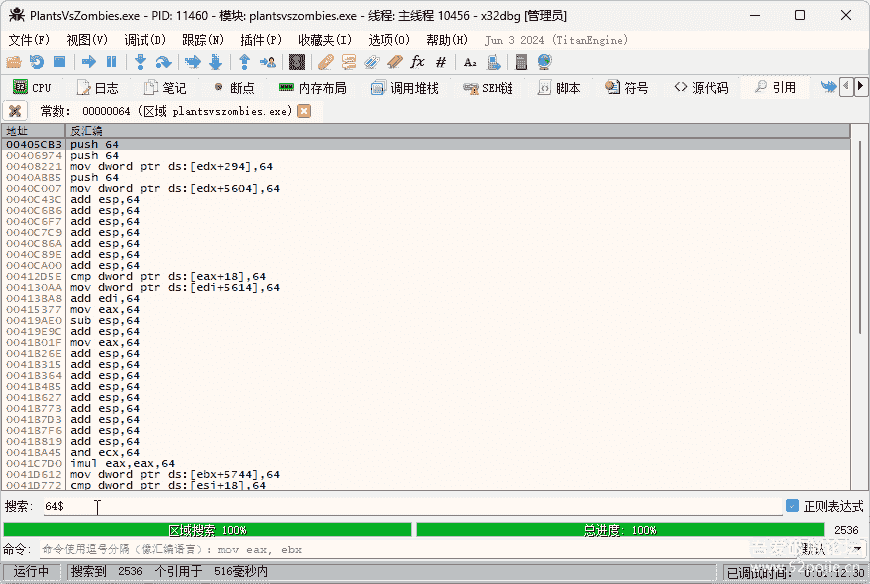
图11.png (85.97 KB, 下载次数: 2)

这下就很少了, 现在对它们设置断点, 游戏一般会变成卡死的状态, 不要慌, 继续往下看

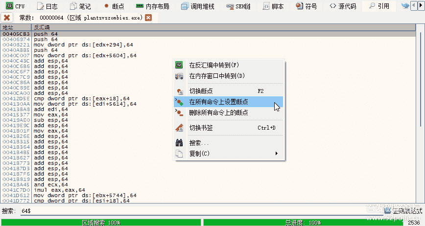
图12.png (74.82 KB, 下载次数: 1)

先来到"断点"页面, 按`F9`让游戏跑起来, 又卡死了

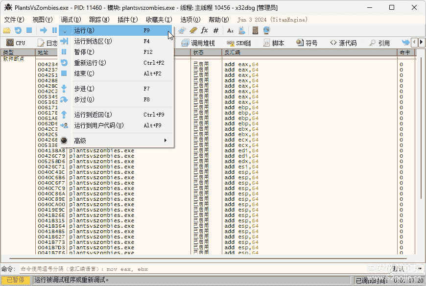
图13.png (116.07 KB, 下载次数: 1)

单击一下"断点"页面的"命中"列, 选中前面的地址, 按空格键把断点禁用

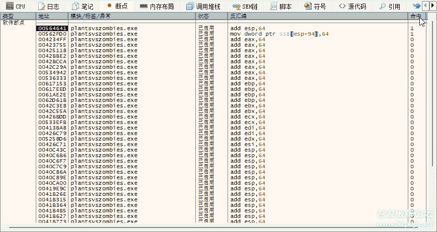
图14.png (104.56 KB, 下载次数: 2)

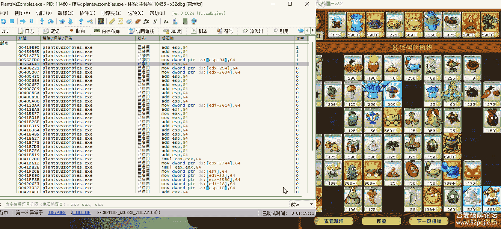
图15.png (528.13 KB, 下载次数: 2)

然后重复操作, 让游戏能够正常的运行起来

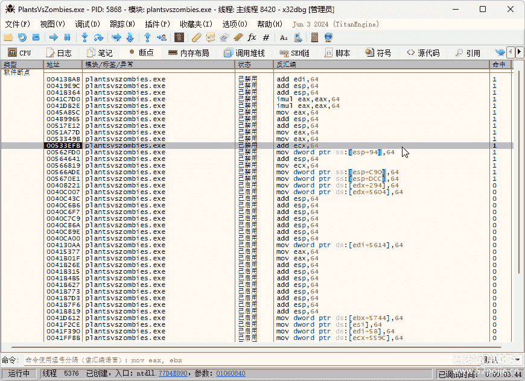
图16.png (144.71 KB, 下载次数: 2)

回游戏我买了一张金卡植物, 发现没被断下来

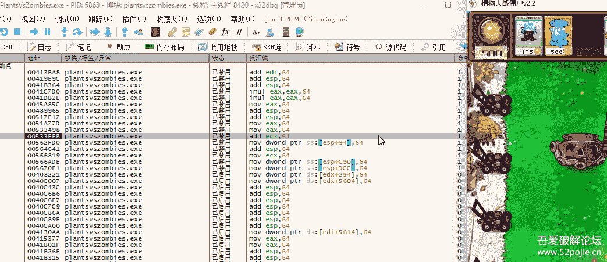
图17.png (354.28 KB, 下载次数: 2)

那么下面的断点可以暂时放弃掉

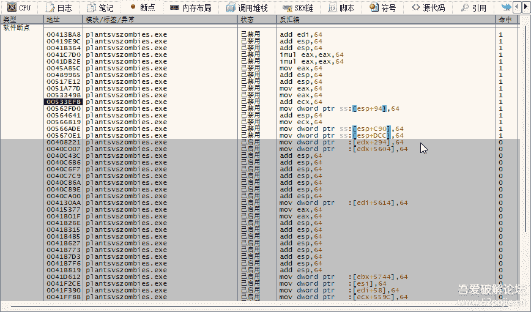
图18.png (124.63 KB, 下载次数: 1)

我就先从两个`imul`的命令开始尝试, 双击, 会切换到`CPU`页面, 按空格键修改汇编命令, 我改成了0

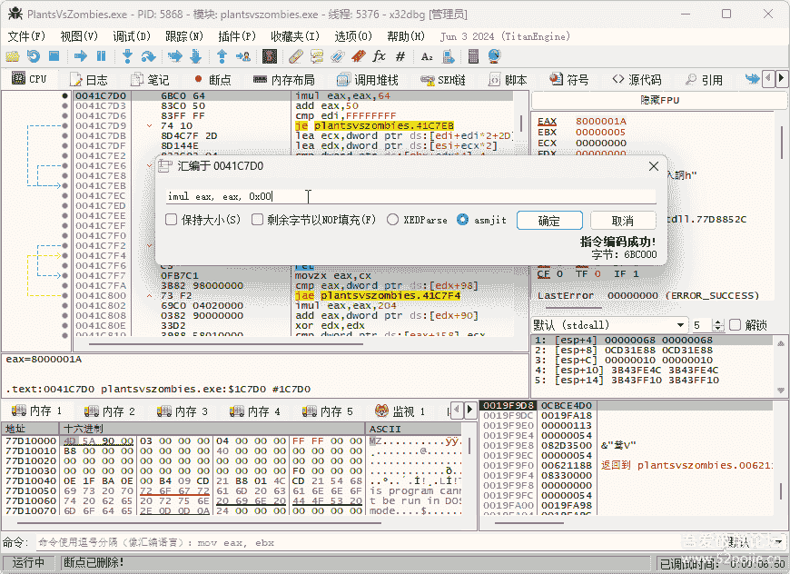
图19.png (143.42 KB, 下载次数: 1)

结果发生了不得了的事情, 僵尸都跑到一路去了, 这个命令不是我们要的, 还原它

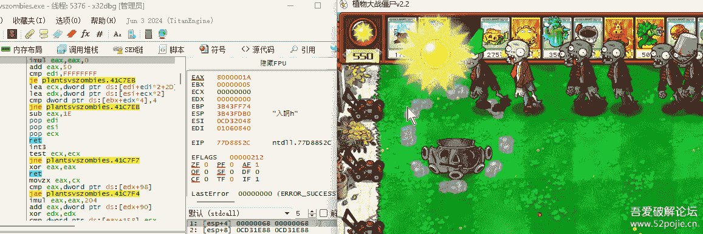
图20.png (518.68 KB, 下载次数: 2)

[href="forum.php?mod=attachment&aid=MjcwOTY2NXwxZjIxYjdmM3wxNzkzNTcyMDMwfDE2ODA4NnwxOTQ1Njc4&nothumb=yes" target="_blank"](https://www.52pojie.cn/forum.php?mod=attachment&aid=MjcwOTY2NXwxZjIxYjdmM3wxNzkzNTcyMDMwfDE2ODA4NnwxOTQ1Njc4&nothumb=yes)

2024-7-19 20:30 上传

继续尝试第二个`imul`的命令, 同样改成0, 运气真好, 已经生效了

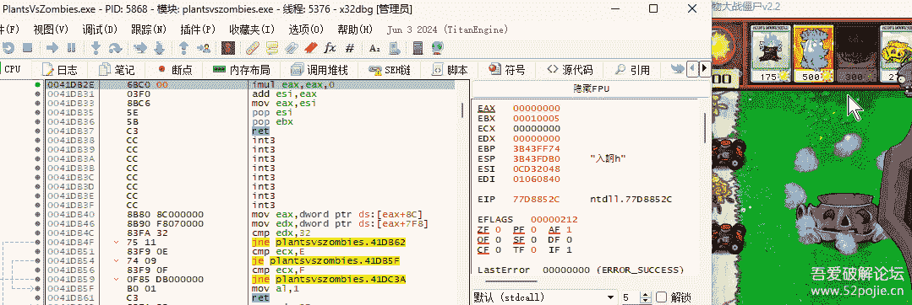

图21.png (253.64 KB, 下载次数: 2)

[href="forum.php?mod=attachment&aid=MjcwOTY2NnxhZDcxMWRhMnwxNzkzNTcyMDMwfDE2ODA4NnwxOTQ1Njc4&nothumb=yes" target="_blank"](https://www.52pojie.cn/forum.php?mod=attachment&aid=MjcwOTY2NnxhZDcxMWRhMnwxNzkzNTcyMDMwfDE2ODA4NnwxOTQ1Njc4&nothumb=yes)

2024-7-19 20:30 上传

我们把这条命令的地址保存一下

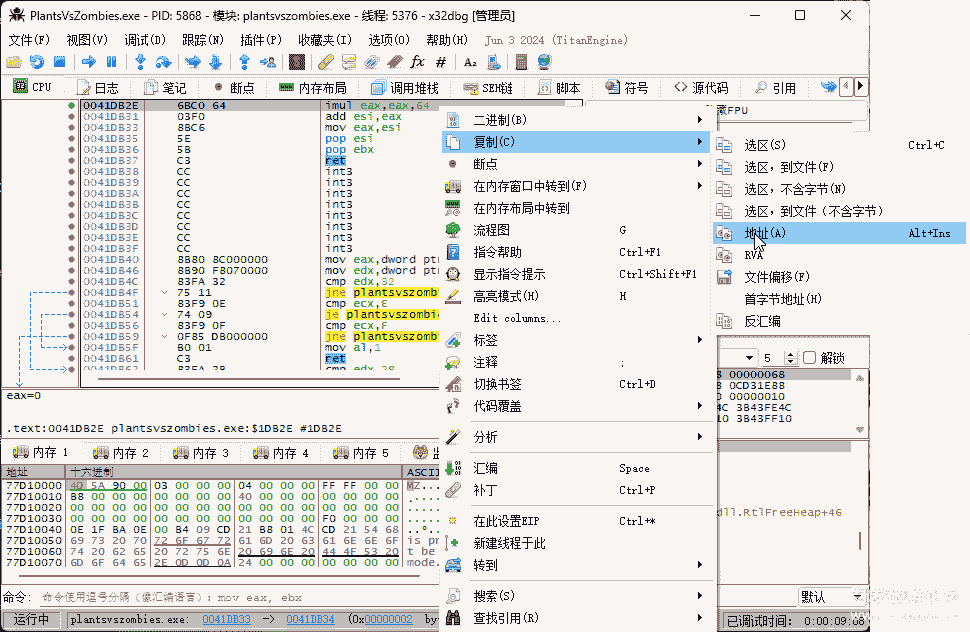

图22.png (128.43 KB, 下载次数: 1)

[href="forum.php?mod=attachment&aid=MjcwOTY2N3wwMGRkMjlmMXwxNzkzNTcyMDMwfDE2ODA4NnwxOTQ1Njc4&nothumb=yes" target="_blank"](https://www.52pojie.cn/forum.php?mod=attachment&aid=MjcwOTY2N3wwMGRkMjlmMXwxNzkzNTcyMDMwfDE2ODA4NnwxOTQ1Njc4&nothumb=yes)

2024-7-19 20:30 上传

接下来, 我们去`CE`完成后续操作, `x64dbg`再见

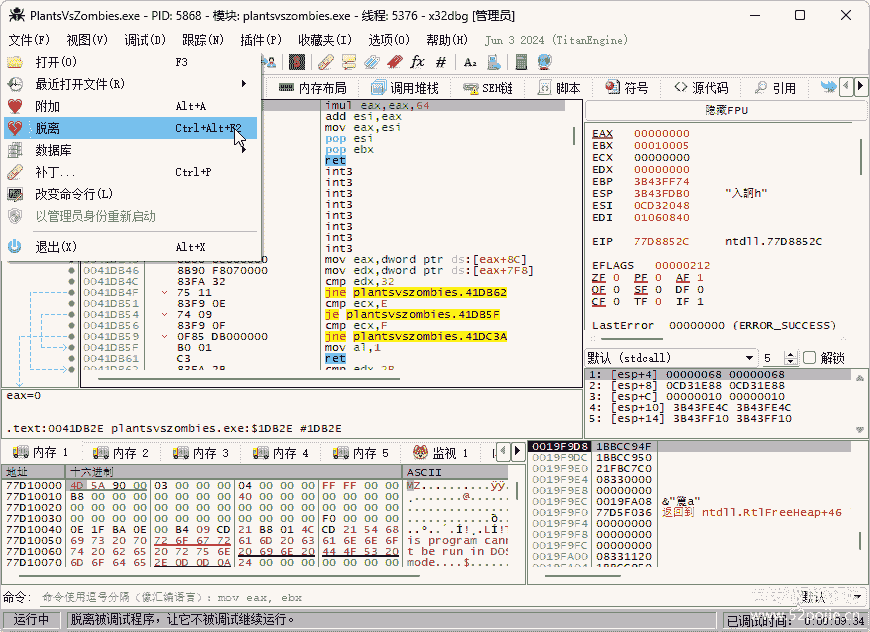

图23.png (116.3 KB, 下载次数: 1)

[href="forum.php?mod=attachment&aid=MjcwOTY2OHxiZmQ5YzU2NHwxNzkzNTcyMDMwfDE2ODA4NnwxOTQ1Njc4&nothumb=yes" target="_blank"](https://www.52pojie.cn/forum.php?mod=attachment&aid=MjcwOTY2OHxiZmQ5YzU2NHwxNzkzNTcyMDMwfDE2ODA4NnwxOTQ1Njc4&nothumb=yes)

2024-7-19 20:30 上传

启动`CE`, 加载游戏进程, 打开内存

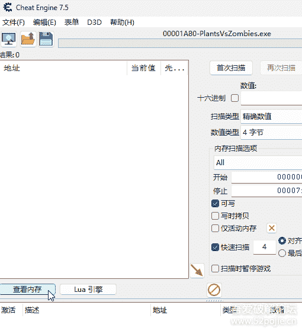

图24.png (38.89 KB, 下载次数: 2)

[href="forum.php?mod=attachment&aid=MjcwOTY2OXw3YTYxOTY5ZXwxNzkzNTcyMDMwfDE2ODA4NnwxOTQ1Njc4&nothumb=yes" target="_blank"](https://www.52pojie.cn/forum.php?mod=attachment&aid=MjcwOTY2OXw3YTYxOTY5ZXwxNzkzNTcyMDMwfDE2ODA4NnwxOTQ1Njc4&nothumb=yes)

2024-7-19 20:30 上传

转到刚才保存的地址`0041DB2E`

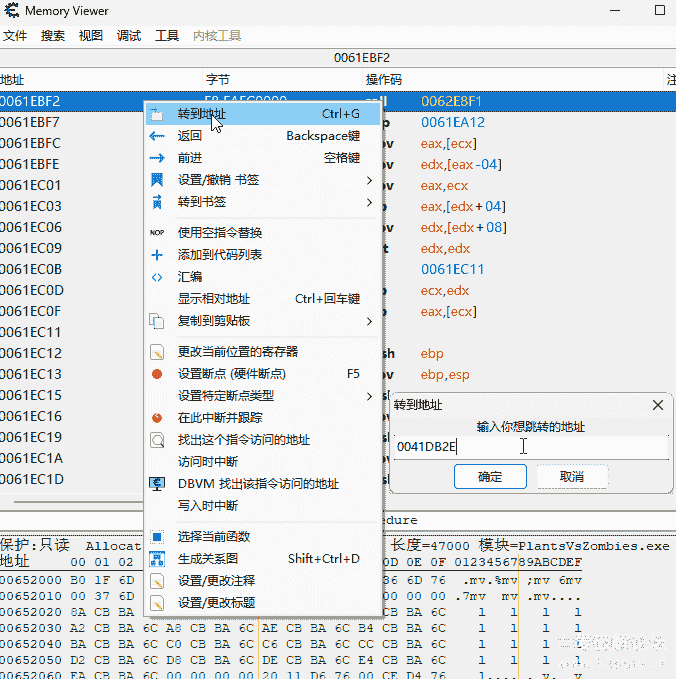

图25.png (92.18 KB, 下载次数: 2)

[href="forum.php?mod=attachment&aid=MjcwOTY3MHw3MWMwNmQxZHwxNzkzNTcyMDMwfDE2ODA4NnwxOTQ1Njc4&nothumb=yes" target="_blank"](https://www.52pojie.cn/forum.php?mod=attachment&aid=MjcwOTY3MHw3MWMwNmQxZHwxNzkzNTcyMDMwfDE2ODA4NnwxOTQ1Njc4&nothumb=yes)

2024-7-19 20:31 上传

进入自动汇编

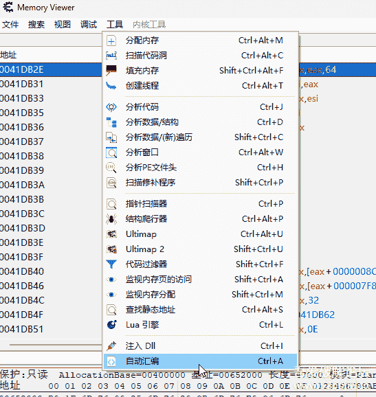

图26.png (76.56 KB, 下载次数: 1)

[href="forum.php?mod=attachment&aid=MjcwOTY3MXw3NzE1NGUyYXwxNzkzNTcyMDMwfDE2ODA4NnwxOTQ1Njc4&nothumb=yes" target="_blank"](https://www.52pojie.cn/forum.php?mod=attachment&aid=MjcwOTY3MXw3NzE1NGUyYXwxNzkzNTcyMDMwfDE2ODA4NnwxOTQ1Njc4&nothumb=yes)

2024-7-19 20:31 上传

先添加一个`CT`框架

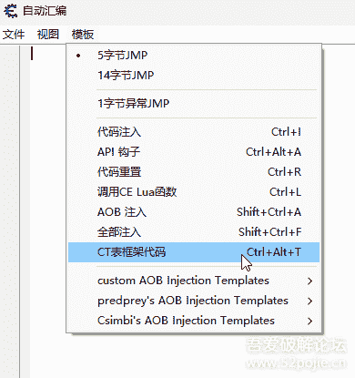

图27.png (24.82 KB, 下载次数: 1)

[href="forum.php?mod=attachment&aid=MjcwOTY3MnxlNzk5Y2NkNnwxNzkzNTcyMDMwfDE2ODA4NnwxOTQ1Njc4&nothumb=yes" target="_blank"](https://www.52pojie.cn/forum.php?mod=attachment&aid=MjcwOTY3MnxlNzk5Y2NkNnwxNzkzNTcyMDMwfDE2ODA4NnwxOTQ1Njc4&nothumb=yes)

2024-7-19 20:31 上传

选中目标命令行, 按`Ctrl+C`, 把地址和操作码复制一下

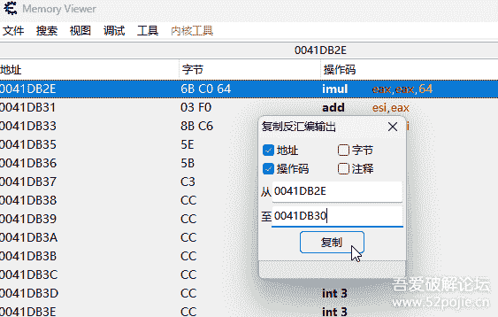

图28.png (39.95 KB, 下载次数: 3)

[href="forum.php?mod=attachment&aid=MjcwOTY3M3xmNDVlNWY4NnwxNzkzNTcyMDMwfDE2ODA4NnwxOTQ1Njc4&nothumb=yes" target="_blank"](https://www.52pojie.cn/forum.php?mod=attachment&aid=MjcwOTY3M3xmNDVlNWY4NnwxNzkzNTcyMDMwfDE2ODA4NnwxOTQ1Njc4&nothumb=yes)

2024-7-19 20:31 上传

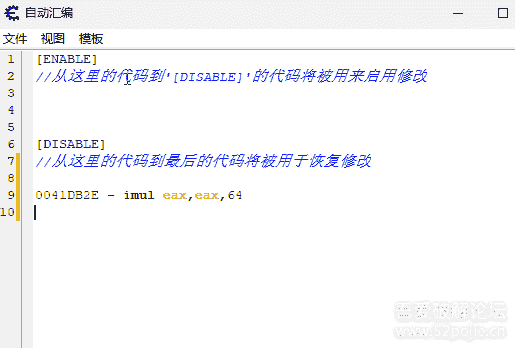

图29.png (21.21 KB, 下载次数: 0)

[href="forum.php?mod=attachment&aid=MjcwOTY3NHw1MjAxMjU0Y3wxNzkzNTcyMDMwfDE2ODA4NnwxOTQ1Njc4&nothumb=yes" target="_blank"](https://www.52pojie.cn/forum.php?mod=attachment&aid=MjcwOTY3NHw1MjAxMjU0Y3wxNzkzNTcyMDMwfDE2ODA4NnwxOTQ1Njc4&nothumb=yes)

2024-7-19 20:31 上传

修改完毕, 保存`CT`表

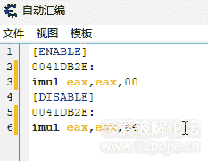

图30.png (13.64 KB, 下载次数: 2)

[href="forum.php?mod=attachment&aid=MjcwOTY3NXxiOGI4NDM4N3wxNzkzNTcyMDMwfDE2ODA4NnwxOTQ1Njc4&nothumb=yes" target="_blank"](https://www.52pojie.cn/forum.php?mod=attachment&aid=MjcwOTY3NXxiOGI4NDM4N3wxNzkzNTcyMDMwfDE2ODA4NnwxOTQ1Njc4&nothumb=yes)

2024-7-19 20:31 上传

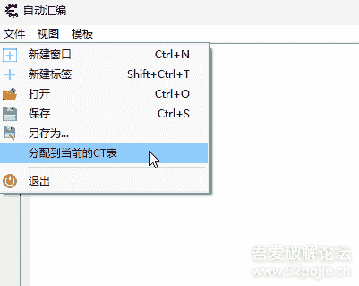

图31.png (19.52 KB, 下载次数: 1)

[href="forum.php?mod=attachment&aid=MjcwOTY3Nnw3ZTVlMjZmY3wxNzkzNTcyMDMwfDE2ODA4NnwxOTQ1Njc4&nothumb=yes" target="_blank"](https://www.52pojie.cn/forum.php?mod=attachment&aid=MjcwOTY3Nnw3ZTVlMjZmY3wxNzkzNTcyMDMwfDE2ODA4NnwxOTQ1Njc4&nothumb=yes)

2024-7-19 20:32 上传

测试一下, 正常生效

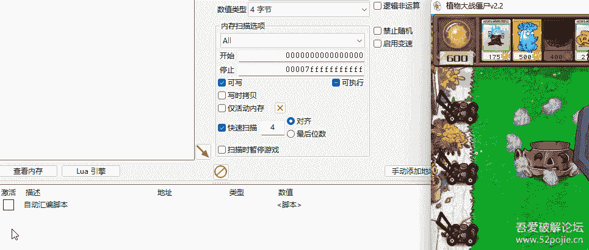

图32.png (249.19 KB, 下载次数: 2)

[href="forum.php?mod=attachment&aid=MjcwOTY3N3xmMjkzODJkM3wxNzkzNTcyMDMwfDE2ODA4NnwxOTQ1Njc4&nothumb=yes" target="_blank"](https://www.52pojie.cn/forum.php?mod=attachment&aid=MjcwOTY3N3xmMjkzODJkM3wxNzkzNTcyMDMwfDE2ODA4NnwxOTQ1Njc4&nothumb=yes)

2024-7-19 20:32 上传

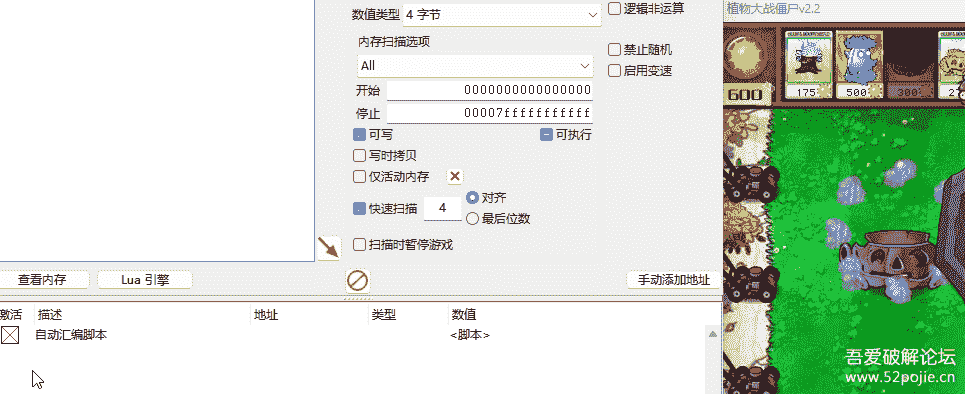

图33.png (222.11 KB, 下载次数: 1)

[href="forum.php?mod=attachment&aid=MjcwOTY3OHwyNDMxMDY3ZnwxNzkzNTcyMDMwfDE2ODA4NnwxOTQ1Njc4&nothumb=yes" target="_blank"](https://www.52pojie.cn/forum.php?mod=attachment&aid=MjcwOTY3OHwyNDMxMDY3ZnwxNzkzNTcyMDMwfDE2ODA4NnwxOTQ1Njc4&nothumb=yes)

2024-7-19 20:32 上传

完毕
