# [分享] 手把手教你怎么修改——《英雄无敌》1——魔法学习系统

- 原帖: https://www.52pojie.cn/forum.php?mod=viewthread&tid=1947643
- 抓取时间: 2026-11-01T22:27:02

## 零、本贴相关资源

1 （千禧版）游戏光盘镜像下载（请注意仅供研究使用）：https://www.123pan.com/s/7jpKVv-3EjCh.html
2 游戏的HD补丁：https://www.123pan.com/s/7jpKVv-PkjCh.html
3 游戏的CD音效资源（注意：配合2HD资源使用）：https://www.123pan.com/s/7jpKVv-XkjCh.html
4 修改后的程序：https://www.123pan.com/s/7jpKVv-YkjCh.html
5 更多的地图资源：https://www.123pan.com/s/7jpKVv-GkjCh.html

### 说明：

大家安装了上面1中的资源后，再将2的HD补丁解压后目录里的所有内容复制到游戏的安装目录里，这样在Win11、10和7都可以玩该游戏

将上面3的压缩包下载后，解压里面内容到游戏目录，这样就可以在游戏中选择CD音效了（具体做法见后面的截图）

上面4中的程序，是在我在本坛分享的：https://www.52pojie.cn/thread-1946484-1-1.html 免CD基础上修改的

上面5中的地图，是我下载了很多网络上由fans制作的地图并经过精选的

### CD音效选择方法：

随便选择一个地图后，游戏界面中选择系统设置，如图所示：

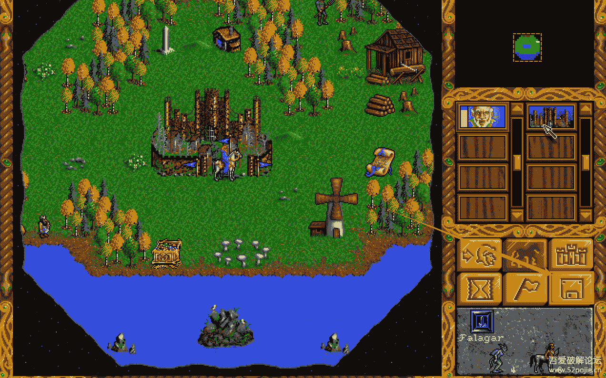

0.png (1.2 MB, 下载次数: 3)

[href="forum.php?mod=attachment&aid=MjcxMTUyNXw5ZDUwNzczMXwxNzkzNTcyMDE5fDE2ODA4NnwxOTQ3NjQz&nothumb=yes" target="_blank"](https://www.52pojie.cn/forum.php?mod=attachment&aid=MjcxMTUyNXw5ZDUwNzczMXwxNzkzNTcyMDE5fDE2ODA4NnwxOTQ3NjQz&nothumb=yes)

2024-7-25 07:13 上传

选择音效为CD

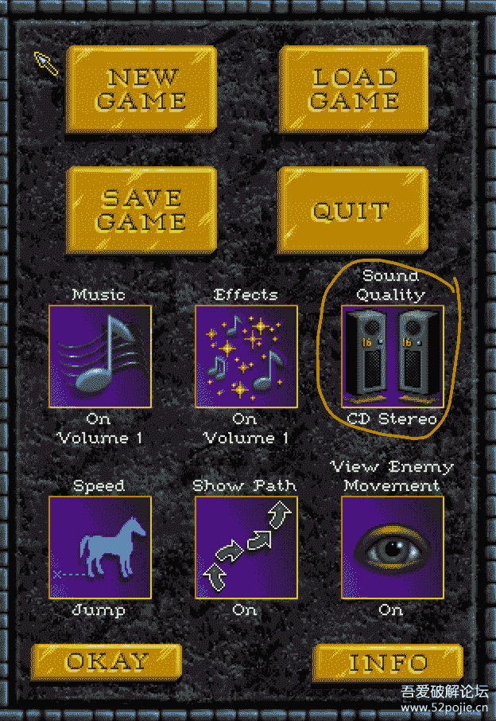

0-1.png (424.75 KB, 下载次数: 2)

[href="forum.php?mod=attachment&aid=MjcxMTUyNnwxMDM5NGE5OHwxNzkzNTcyMDE5fDE2ODA4NnwxOTQ3NjQz&nothumb=yes" target="_blank"](https://www.52pojie.cn/forum.php?mod=attachment&aid=MjcxMTUyNnwxMDM5NGE5OHwxNzkzNTcyMDE5fDE2ODA4NnwxOTQ3NjQz&nothumb=yes)

2024-7-25 07:14 上传

## 一、前言

喜欢《英雄无敌》1的朋友一定觉得其魔法的学习很恼人！每次只能记忆魔法“知识点”次，使用完这些次数后，学会的魔法就会从魔法书中消失。如果还想学习某个魔法，还得再次访问具有该魔法的魔法公会或者野外地图上的神龛。而在《英雄无敌》的后续开发中，这种学习魔法的方式被开发者摒弃！改用学习过的魔法永远存在魔法书中，但使用需要魔法点足够！而魔法点数在具有魔法公会的城堡英雄休息一晚或者访问了野外的魔法井后，魔法点数充满。

本文的目的就是要修改《英雄无敌》1，使得英雄学习的过的魔法不会从魔法书中消失，当该魔法的使用次数用完后，该魔法从魔法书中暂时隐去，当英雄访问任何具有魔法公会的城堡或者野外的神龛后，所有以前所学魔法将重新满血出现在魔法书中！

在动手修改之前，由于《英雄无敌》1是一个很古老的游戏了，很多玩家对其都有研究，把已经被人研究的成果拿来用，将会大大节省修改的时间的同时也会极大地提高修改的成功率！这些知识主要有如下一些：

（1）《英雄无敌》1的全部魔法有29个，分成2类（即打开魔法书时，有一把剑的魔法页，代表战斗类魔法combat spell；有一个英雄骑马的魔法页，代表冒险（探索地图）类魔法adventure spell。），它们在程序中是分别存放的。其中战斗类魔法共19个，代码从00到12（十六进制），放在程序中的前19个位置；而冒险类魔法10个，代码从13到1C，放在程序中的后面10个位置。即，如果一个英雄没有学到战斗类魔法，而只学到一个冒险类魔法，那么这个魔法是存放在魔法位置的第20位（前面19个位置是战斗类魔法的，但现在还没有学到，所以都是空的）。程序中魔法的存放次序是这样的：先每个位置存放所学的魔法代码，没有学到的用`FF`表示，共29个位置；紧接着的29个位置是对应魔法还有的施放次数，当施放次数为0时，这个魔法就从魔法书中消失。

下面给出魔法的具体代码：

### Combat

[C++] 纯文本查看 复制代码
```
00 - Fireball
01 - Lightning bolt
02 - Teleport
03 - Cure
04 - Resurrect
05 - Haste
06 - Slow
07 - Blind
08 - Bless
09 - Protection
0A - Curse
0B - Turn undead
0C - Anti-Magic
0D - Dispel Magic
0E - Berzerker
0F - Armageddon
10 - Storm
11 - Meteor Shower
12 - Paralyze
```

### Adventure

[C++] 纯文本查看 复制代码
```
13 - View Mines
14 - View Resources
15 - View Artifacts
16 - View Towns
17 - View Heroes
18 - View All
19 - Identify Hero
1A - Summon Boat
1B - Dimension Door
1C - Town gate
```

（2）每个英雄的全部参数，程序中是以英雄的代号作为起始位置的，代码由2个字节组成，例如：`14 00`，就代表是第20号英雄，她就是女巫族的Carlawn。紧接着英雄代号后面就是英雄的名称，总共17个字节长度。接着是这个英雄的简称（还是英雄的名称）。而英雄的例如四维属性、等级、经验点、以及学过的魔法、身上带有的宝物等等都以该英雄的起始位置的位置偏移量来表述的，例如：`+66`（十六进制），就是英雄所学的第一个战斗类魔法位置，如果这个位置上是`0F`的话，说明打开魔法书的战斗类魔法，第一个位置上是一个“末日审判”（Armageddon），在`+83`位置，就是“末日审判”这个魔法可以施放的次数。还有像英雄的四维中的知识点（knowledge）就是在`+33`位置（这些等会都要用到，所以这里特别提出来）。

好，有了上述一些英雄无敌1的知识就足够了，当然你要学会修改，那自然要懂得一点汇编知识，要会一点https://www.52pojie.cn/thread-350397-1-1.html 的使用，要知道`CE`的简单操作，所以，我们将要使用的工具包括：`OllyDBG`、`CE`、`notepad`（笔记本之类作记录）、还有windows自带的计算器（选择程序员模式，主要用于跳转命令中地址计算）。

## 二、用CE找到英雄学习魔法和使用魔法的子程序

先打开游戏，看看是什么英雄

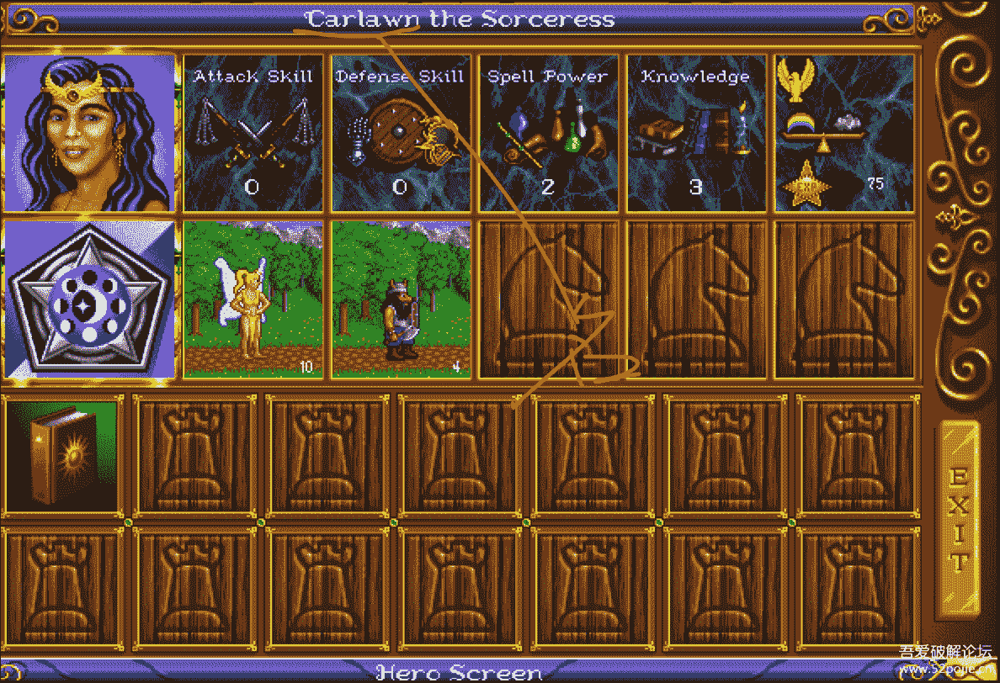

1.png (935.19 KB, 下载次数: 3)

[href="forum.php?mod=attachment&aid=MjcxMTUyN3wzMzViZGIwNXwxNzkzNTcyMDE5fDE2ODA4NnwxOTQ3NjQz&nothumb=yes" target="_blank"](https://www.52pojie.cn/forum.php?mod=attachment&aid=MjcxMTUyN3wzMzViZGIwNXwxNzkzNTcyMDE5fDE2ODA4NnwxOTQ3NjQz&nothumb=yes)

2024-7-25 07:23 上传

再打开ce，加载游戏

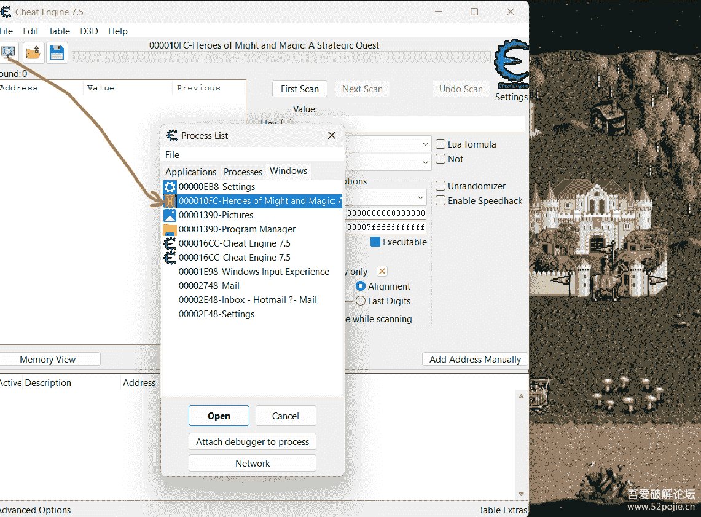

2.png (528.05 KB, 下载次数: 2)

[href="forum.php?mod=attachment&aid=MjcxMTUyOXxiOWZlMDFlYXwxNzkzNTcyMDE5fDE2ODA4NnwxOTQ3NjQz&nothumb=yes" target="_blank"](https://www.52pojie.cn/forum.php?mod=attachment&aid=MjcxMTUyOXxiOWZlMDFlYXwxNzkzNTcyMDE5fDE2ODA4NnwxOTQ3NjQz&nothumb=yes)

2024-7-25 07:24 上传

点击ce中的内存观察（memory view），点击搜索，在搜索框里填上要搜索的英雄名称

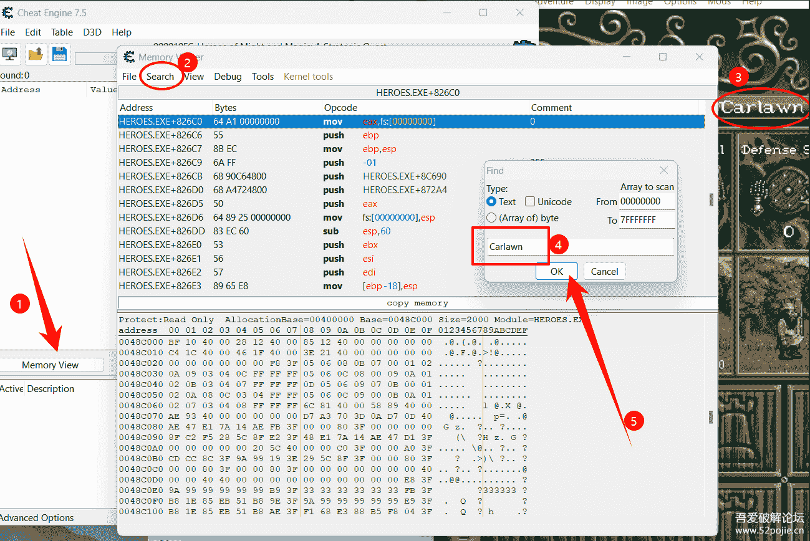

3.png (360.48 KB, 下载次数: 2)

[href="forum.php?mod=attachment&aid=MjcxMTUzMHw3Y2NmNzVlM3wxNzkzNTcyMDE5fDE2ODA4NnwxOTQ3NjQz&nothumb=yes" target="_blank"](https://www.52pojie.cn/forum.php?mod=attachment&aid=MjcxMTUzMHw3Y2NmNzVlM3wxNzkzNTcyMDE5fDE2ODA4NnwxOTQ3NjQz&nothumb=yes)

2024-7-25 07:24 上传

搜到后（一开始搜到不是所要位置，这时将鼠标点击一下搜到的名称下面一点位置，再搜索）

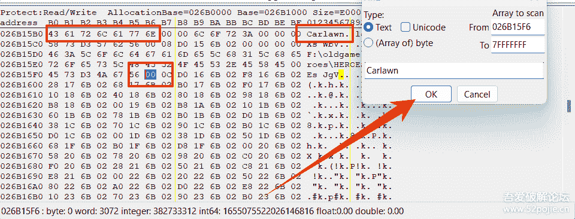

4.png (71.15 KB, 下载次数: 3)

[href="forum.php?mod=attachment&aid=MjcxMTUzMXw5ZDliOGUzNHwxNzkzNTcyMDE5fDE2ODA4NnwxOTQ3NjQz&nothumb=yes" target="_blank"](https://www.52pojie.cn/forum.php?mod=attachment&aid=MjcxMTUzMXw5ZDliOGUzNHwxNzkzNTcyMDE5fDE2ODA4NnwxOTQ3NjQz&nothumb=yes)

2024-7-25 07:25 上传

这样进行三到四次后，会出现下面这样的（就是英雄名称是2个，接着下面大约6行的地方开始有很多`FF`和`00`）：

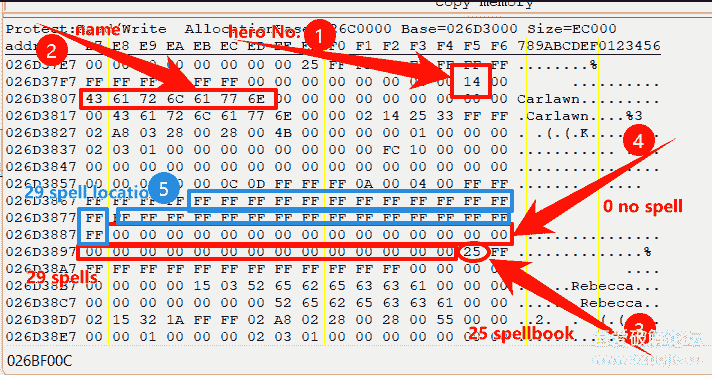

5.png (67.83 KB, 下载次数: 3)

[href="forum.php?mod=attachment&aid=MjcxMTUzMnwwMjBlMDg1NnwxNzkzNTcyMDE5fDE2ODA4NnwxOTQ3NjQz&nothumb=yes" target="_blank"](https://www.52pojie.cn/forum.php?mod=attachment&aid=MjcxMTUzMnwwMjBlMDg1NnwxNzkzNTcyMDE5fDE2ODA4NnwxOTQ3NjQz&nothumb=yes)

2024-7-25 07:26 上传

上面这个就是这个英雄的内存数据所在位置了。上面图中，我都标出了，其中红框中的`00`，就是所有魔法都没有；蓝框中全是`FF`说明没有一个魔法代码放在魔法书中。（数数看：从图中14的位置到蓝框的第一个`FF`，是不是`66`（这是十六进制，十进制就是102）个字节（每个XX为一个字节）？到一串`FF`后面的第一个`00`处，是不是`83`（131）个字节？再看看+33的位置是不是03？这个正是女巫英雄的知识点（四维是0，0，2，3）。

这时，在第一个`FF`处，点击鼠标右键，选择将该地址放到列表中（如下图）

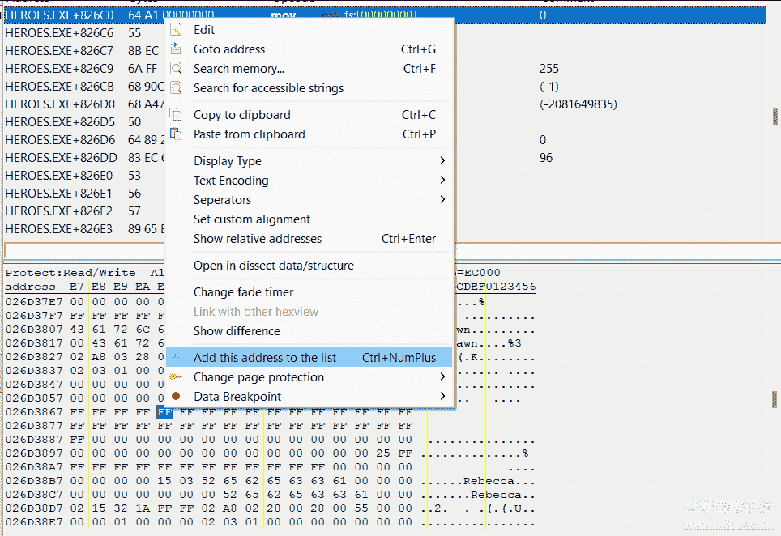

6.png (82.32 KB, 下载次数: 2)

[href="forum.php?mod=attachment&aid=MjcxMTUzM3wyZjM3ODc2OXwxNzkzNTcyMDE5fDE2ODA4NnwxOTQ3NjQz&nothumb=yes" target="_blank"](https://www.52pojie.cn/forum.php?mod=attachment&aid=MjcxMTUzM3wyZjM3ODc2OXwxNzkzNTcyMDE5fDE2ODA4NnwxOTQ3NjQz&nothumb=yes)

2024-7-25 07:26 上传

接着把后面第一个`00`位置也右键将地址添加到列表里

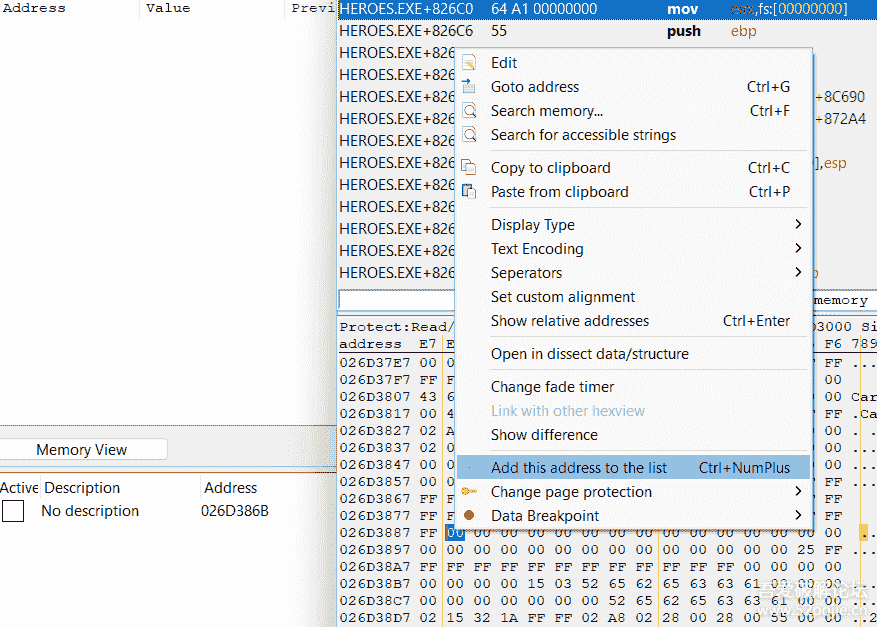

7.png (128.89 KB, 下载次数: 3)

[href="forum.php?mod=attachment&aid=MjcxMTUzNnxhYTE4ZTI4MnwxNzkzNTcyMDE5fDE2ODA4NnwxOTQ3NjQz&nothumb=yes" target="_blank"](https://www.52pojie.cn/forum.php?mod=attachment&aid=MjcxMTUzNnxhYTE4ZTI4MnwxNzkzNTcyMDE5fDE2ODA4NnwxOTQ3NjQz&nothumb=yes)

2024-7-25 07:31 上传

这时可以关掉内存观察框了，在下面地址列表里将鼠标放在第一个地址上右键，选择看看什么访问了这个地址，（第一次会）出现对话框选择是

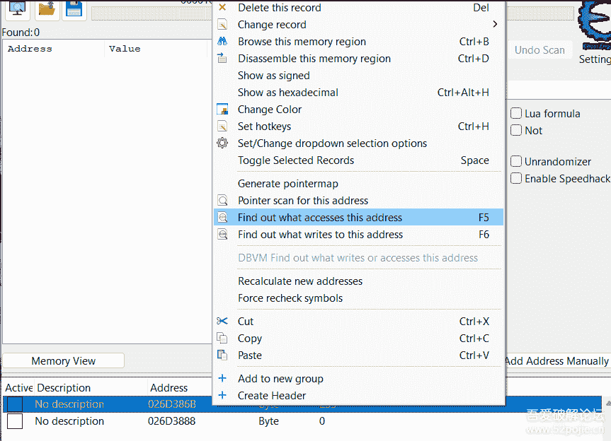

8.png (91.97 KB, 下载次数: 2)

[href="forum.php?mod=attachment&aid=MjcxMTUzN3w5NDY0MTA5ZnwxNzkzNTcyMDE5fDE2ODA4NnwxOTQ3NjQz&nothumb=yes" target="_blank"](https://www.52pojie.cn/forum.php?mod=attachment&aid=MjcxMTUzN3w5NDY0MTA5ZnwxNzkzNTcyMDE5fDE2ODA4NnwxOTQ3NjQz&nothumb=yes)

2024-7-25 07:32 上传

再依次选择看看什么对这个地址写了东西（将列表中的2个地址都这样做）。

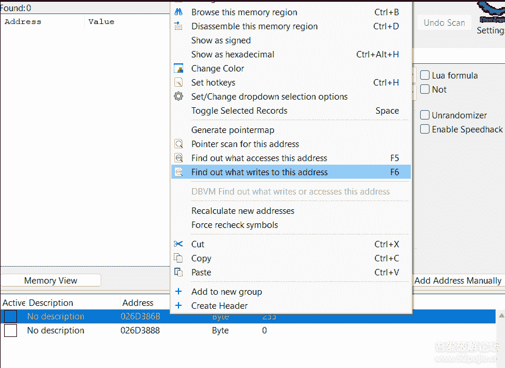

9.png (80.76 KB, 下载次数: 2)

[href="forum.php?mod=attachment&aid=MjcxMTUzOHw1N2JkNDQ5N3wxNzkzNTcyMDE5fDE2ODA4NnwxOTQ3NjQz&nothumb=yes" target="_blank"](https://www.52pojie.cn/forum.php?mod=attachment&aid=MjcxMTUzOHw1N2JkNDQ5N3wxNzkzNTcyMDE5fDE2ODA4NnwxOTQ3NjQz&nothumb=yes)

2024-7-25 07:33 上传

再进入游戏，在城堡里把魔法公会建立起来


10.png (1.08 MB, 下载次数: 2)

[href="forum.php?mod=attachment&aid=MjcxMTUzOXxjYjBmZDI2NXwxNzkzNTcyMDE5fDE2ODA4NnwxOTQ3NjQz&nothumb=yes" target="_blank"](https://www.52pojie.cn/forum.php?mod=attachment&aid=MjcxMTUzOXxjYjBmZDI2NXwxNzkzNTcyMDE5fDE2ODA4NnwxOTQ3NjQz&nothumb=yes)

2024-7-25 07:34 上传

再让英雄出城堡，随便找个野外兵打一架，首先就去使用魔法

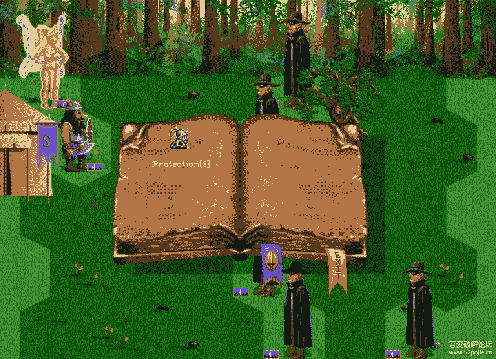

11.png (1.45 MB, 下载次数: 3)


[forum.php?mod=attachment&aid=MjcxMTU0MXwyOGJiZjNjZHwxNzkzNTcyMDE5fDE2ODA4NnwxOTQ3NjQz&nothumb=yes](https://www.52pojie.cn/forum.php?mod=attachment&aid=MjcxMTU0MXwyOGJiZjNjZHwxNzkzNTcyMDE5fDE2ODA4NnwxOTQ3NjQz&nothumb=yes)

2024-7-25 07:35 上传

再回到 ce 看看什么访问了，什么写了。对于每一个都可以看看`more infomation`，其中就能看到下图的（`dec`，`83`）这样关键信息（`dec` 代表数字减少 1，`83` 正好是我们要关注的魔法施放次数的位置，把这个画面截图，等一会要找这个地址，它就是魔法使用的子程序）：

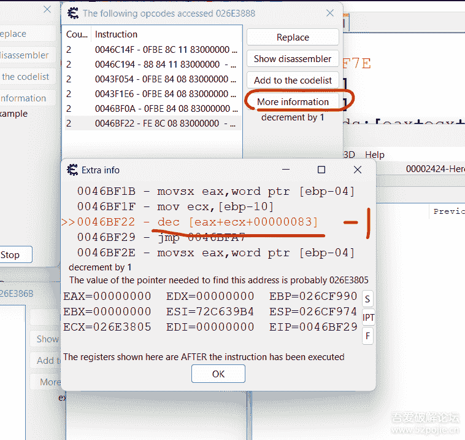

`12.png` (92.16 KB, 下载次数: 2)

[forum.php?mod=attachment&aid=MjcxMTU0MnxmMWY2MzdkZXwxNzkzNTcyMDE5fDE2ODA4NnwxOTQ3NjQz&nothumb=yes](https://www.52pojie.cn/forum.php?mod=attachment&aid=MjcxMTU0MnxmMWY2MzdkZXwxNzkzNTcyMDE5fDE2ODA4NnwxOTQ3NjQz&nothumb=yes)

2024-7-25 07:36 上传

再看看什么写了这个地址的内容，这里不像什么访问了这个地址那样有很多内容，而只有一条，点击更多信息，显示有`mov`、`66`、`83`这样的关键信息，这正是我们要找的向魔法书中写魔法的子程序，也就是英雄学会魔法的子程序，也留下截图以记住这个地址，等会要用到（如下图）。

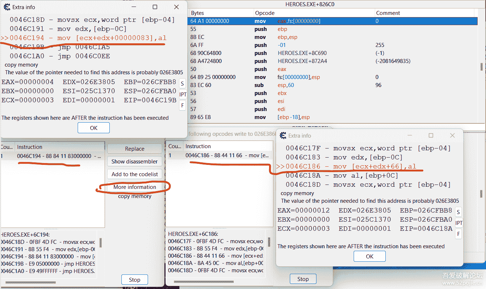

`13.png` (170.77 KB, 下载次数: 2)

[forum.php?mod=attachment&aid=MjcxMTU0NHwzZDU3ZTdhZHwxNzkzNTcyMDE5fDE2ODA4NnwxOTQ3NjQz&nothumb=yes](https://www.52pojie.cn/forum.php?mod=attachment&aid=MjcxMTU0NHwzZDU3ZTdhZHwxNzkzNTcyMDE5fDE2ODA4NnwxOTQ3NjQz&nothumb=yes)

2024-7-25 07:36 上传

## 三、用OllDBG把关键子程序复制出来

关了游戏，用OllyDBG打开《英雄无敌》1的主程序（一般就是`heroes.exe`），在反汇编区用鼠标右键选择`goto`，在对话框中填上刚刚截图的使用魔法的子程序地址，如下图：

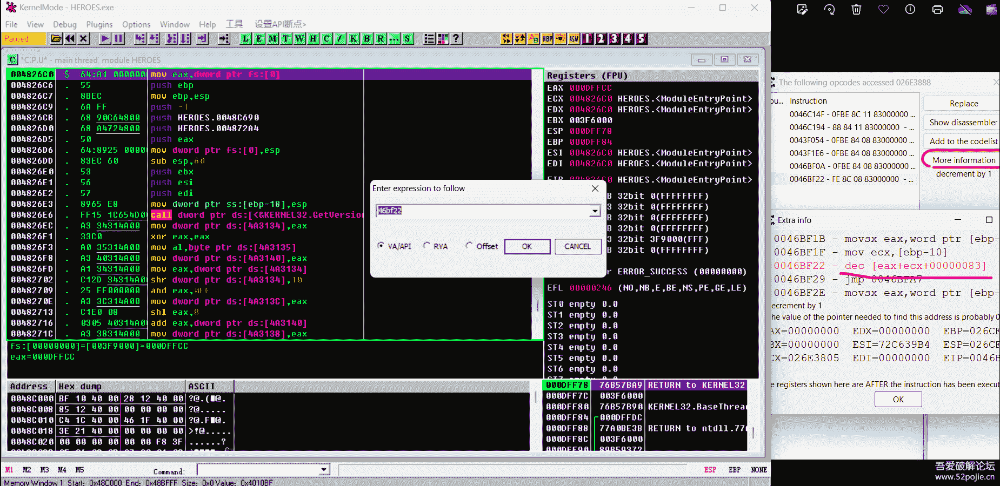

`14.png` (323.21 KB, 下载次数: 2)

[forum.php?mod=attachment&aid=MjcxMTU0NXxjZDU5MzcxOXwxNzkzNTcyMDE5fDE2ODA4NnwxOTQ3NjQz&nothumb=yes](https://www.52pojie.cn/forum.php?mod=attachment&aid=MjcxMTU0NXxjZDU5MzcxOXwxNzkzNTcyMDE5fDE2ODA4NnwxOTQ3NjQz&nothumb=yes)

2024-7-25 07:37 上传

点击确定后来到这个地址，将鼠标向上移动找到子程序的开始位置，如图：

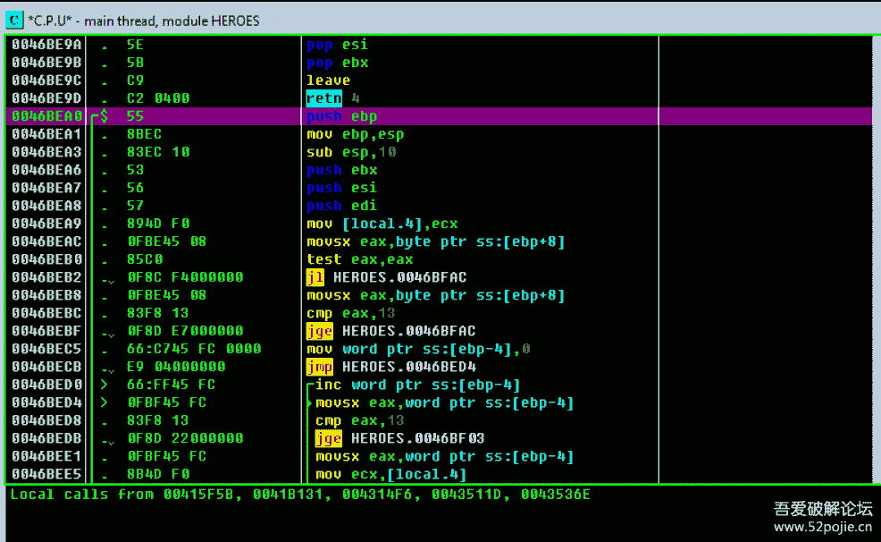

`15.png` (95.09 KB, 下载次数: 2)

[forum.php?mod=attachment&aid=MjcxMTU0OHxmOWY3YTY3MHwxNzkzNTcyMDE5fDE2ODA4NnwxOTQ3NjQz&nothumb=yes](https://www.52pojie.cn/forum.php?mod=attachment&aid=MjcxMTU0OHxmOWY3YTY3MHwxNzkzNTcyMDE5fDE2ODA4NnwxOTQ3NjQz&nothumb=yes)

2024-7-25 07:38 上传

选中第一行，再把鼠标向下移动到这个子程序的结尾，按住`shift`键，鼠标点击结尾，让这个子程序全部选中，再在鼠标右键选择复制到剪贴板。如图：

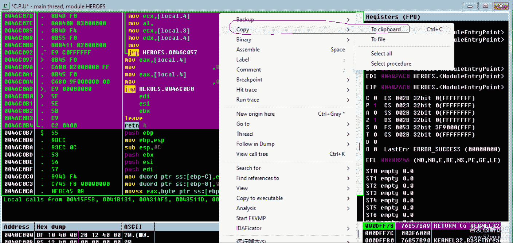

`16.png` (271.66 KB, 下载次数: 2)

[forum.php?mod=attachment&aid=MjcxMTU1MHwwN2UxYWRmMXwxNzkzNTcyMDE5fDE2ODA4NnwxOTQ3NjQz&nothumb=yes](https://www.52pojie.cn/forum.php?mod=attachment&aid=MjcxMTU1MHwwN2UxYWRmMXwxNzkzNTcyMDE5fDE2ODA4NnwxOTQ3NjQz&nothumb=yes)

2024-7-25 07:39 上传

再用`notepad`建立一个新文件，把刚刚复制的内容贴到上面，如图：

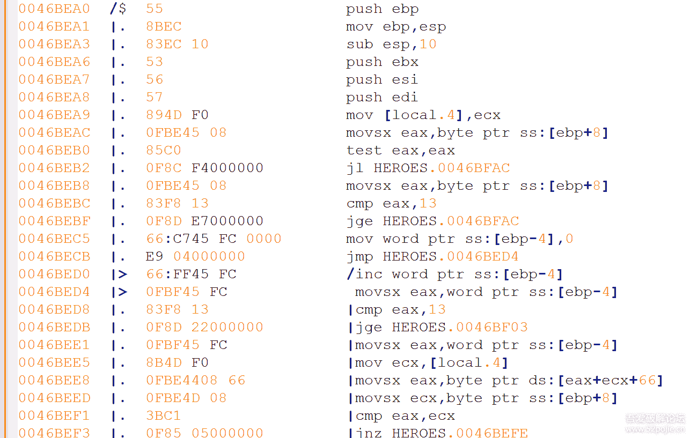

`17.png` (150.96 KB, 下载次数: 3)

[forum.php?mod=attachment&aid=MjcxMTU1MXw4MTQ3YmFlZHwxNzkzNTcyMDE5fDE2ODA4NnwxOTQ3NjQz&nothumb=yes](https://www.52pojie.cn/forum.php?mod=attachment&aid=MjcxMTU1MXw4MTQ3YmFlZHwxNzkzNTcyMDE5fDE2ODA4NnwxOTQ3NjQz&nothumb=yes)

2024-7-25 07:39 上传

同样地再对什么写了这个地址的子程序相同操作：

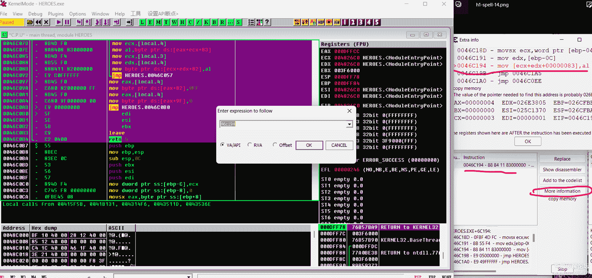

`18.png` (456.53 KB, 下载次数: 3)

[forum.php?mod=attachment&aid=MjcxMTU1Mnw4ZjlmMmJiNHwxNzkzNTcyMDE5fDE2ODA4NnwxOTQ3NjQz&nothumb=yes](https://www.52pojie.cn/forum.php?mod=attachment&aid=MjcxMTU1Mnw4ZjlmMmJiNHwxNzkzNTcyMDE5fDE2ODA4NnwxOTQ3NjQz&nothumb=yes)

2024-7-25 07:40 上传

把这个子程序也复制到`notepad`中：

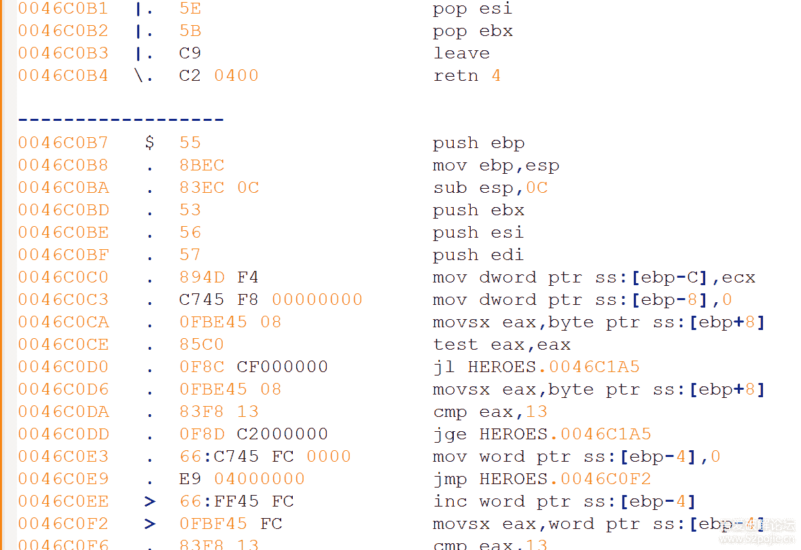

`19.png` (131.1 KB, 下载次数: 2)

[forum.php?mod=attachment&aid=MjcxMTU1M3wxZGYwNWE3OXwxNzkzNTcyMDE5fDE2ODA4NnwxOTQ3NjQz&nothumb=yes](https://www.52pojie.cn/forum.php?mod=attachment&aid=MjcxMTU1M3wxZGYwNWE3OXwxNzkzNTcyMDE5fDE2ODA4NnwxOTQ3NjQz&nothumb=yes)

2024-7-25 07:40 上传

太好了，原来这两个子程序是连在一起的。下面我们要读懂这个子程序，只有读懂了它才好修改它，不是吗？

## 四、分析代码，搞懂程序的原理

下面是刚刚复制下来的使用魔法子程序的代码：

[Asm] 纯文本查看 复制代码


```
0046BEA0  /$  55                    push ebp
0046BEA1  |.  8BEC                  mov ebp,esp
0046BEA3  |.  83EC 10               sub esp,10
0046BEA6  |.  53                    push ebx
0046BEA7  |.  56                    push esi
0046BEA8  |.  57                    push edi
0046BEA9  |.  894D F0               mov [local.4],ecx        ;  66:FF45 FC            /inc word ptr ss:[ebp-4] ;  0FBF45 FC              movsx eax,word ptr ss:[ebp-4]
0046BED8  |.  83F8 13               |cmp eax,13 ;^ E9 CDFFFFFF           \jmp HEROES.0046BED0        ;  0FBF45 FC             movsx eax,word ptr ss:[ebp-4]        ;  0FBF45 FC             movsx eax,word ptr ss:[ebp-4]
0046BF32  |.  8B4D F0               mov ecx,[local.4]
0046BF35  |.  C64408 66 FF          mov byte ptr ds:[eax+ecx+66],0FF        ;  FF45 F8               /inc [local.2]        ;  837D F8 13             cmp [local.2],13
0046BF5D  |.  0F8D 33000000         |jge HEROES.0046BF96
0046BF63  |.  8B45 F8               |mov eax,[local.2]
0046BF66  |.  8B4D F0               |mov ecx,[local.4]
0046BF69  |.  8A4408 66             |mov al,byte ptr ds:[eax+ecx+66]
0046BF6D  |.  8B4D F8               |mov ecx,[local.2]
0046BF70  |.  8B55 F0               |mov edx,[local.4]
0046BF73  |.  884411 65             |mov byte ptr ds:[ecx+edx+65],al
0046BF77  |.  8B45 F8               |mov eax,[local.2]
0046BF7A  |.  8B4D F0               |mov ecx,[local.4]
0046BF7D  |.  8A8408 83000000       |mov al,byte ptr ds:[eax+ecx+83]
0046BF84  |.  8B4D F8               |mov ecx,[local.2]
0046BF87  |.  8B55 F0               |mov edx,[local.4]
0046BF8A  |.  888411 82000000       |mov byte ptr ds:[ecx+edx+82],al
0046BF91  |.^ E9 C0FFFFFF           \jmp HEROES.0046BF56
0046BF96  |>  8B45 F0               mov eax,[local.4]
0046BF99  |.  C640 78 FF            mov byte ptr ds:[eax+78],0FF        ;  E9 FF000000           jmp HEROES.0046C0AB
0046BFAC  |>  0FBE45 08             movsx eax,byte ptr ss:[ebp+8]
0046BFB0  |.  83F8 13               cmp eax,13
0046BFB3  |.  0F8C F2000000         jl HEROES.0046C0AB
0046BFB9  |.  0FBE45 08             movsx eax,byte ptr ss:[ebp+8]
0046BFBD  |.  83F8 1D               cmp eax,1D
0046BFC0  |.  0F8D E5000000         jge HEROES.0046C0AB
0046BFC6  |.  66:C745 FC 1300       mov word ptr ss:[ebp-4],13
0046BFCC  |.  E9 04000000           jmp HEROES.0046BFD5
0046BFD1  |>  66:FF45 FC            /inc word ptr ss:[ebp-4]        ;  0FBF45 FC              movsx eax,word ptr ss:[ebp-4]
0046BFD9  |.  83F8 1D               |cmp eax,1D
0046BFDC  |.  0F8D 22000000         |jge HEROES.0046C004
0046BFE2  |.  0FBF45 FC             |movsx eax,word ptr ss:[ebp-4]
0046BFE6  |.  8B4D F0               |mov ecx,[local.4]
0046BFE9  |.  0FBE4408 66           |movsx eax,byte ptr ds:[eax+ecx+66]
0046BFEE  |.  0FBE4D 08             |movsx ecx,byte ptr ss:[ebp+8]
0046BFF2  |.  3BC1                  |cmp eax,ecx
0046BFF4  |.  0F85 05000000         |jnz HEROES.0046BFFF
0046BFFA  |.  E9 05000000           |jmp HEROES.0046C004
0046BFFF  |>^ E9 CDFFFFFF           \jmp HEROES.0046BFD1
0046C004  |>  0FBF45 FC             movsx eax,word ptr ss:[ebp-4]
0046C008  |.  8B4D F0               mov ecx,[local.4]
0046C00B  |.  0FBE8408 83000000     movsx eax,byte ptr ds:[eax+ecx+83]
0046C013  |.  83F8 01               cmp eax,1
0046C016  |.  0F8E 13000000         jle HEROES.0046C02F
0046C01C  |.  0FBF45 FC             movsx eax,word ptr ss:[ebp-4]
0046C020  |.  8B4D F0               mov ecx,[local.4]
0046C023  |.  FE8C08 83000000       dec byte ptr ds:[eax+ecx+83]
0046C02A  |.  E9 7C000000           jmp HEROES.0046C0AB
0046C02F  |>  0FBF45 FC             movsx eax,word ptr ss:[ebp-4]
0046C033  |.  8B4D F0               mov ecx,[local.4]
0046C036  |.  C64408 66 FF          mov byte ptr ds:[eax+ecx+66],0FF
0046C03B  |.  0FBF45 FC             movsx eax,word ptr ss:[ebp-4]
0046C03F  |.  8B4D F0               mov ecx,[local.4]
0046C042  |.  C68408 83000000 00    mov byte ptr ds:[eax+ecx+83],0
0046C04A  |.  0FBF45 FC             movsx eax,word ptr ss:[ebp-4]
0046C04E  |.  40                    inc eax
0046C04F  |.  8945 F4               mov [local.3],eax
0046C052  |.  E9 03000000           jmp HEROES.0046C05A
0046C057  |>  FF45 F4               /inc [local.3]
0046C05A  |>  837D F4 1D             cmp [local.3],1D
0046C05E  |.  0F8D 33000000         |jge HEROES.0046C097
0046C064  |.  8B45 F4               |mov eax,[local.3]
0046C067  |.  8B4D F0               |mov ecx,[local.4]
0046C06A  |.  8A4408 66             |mov al,byte ptr ds:[eax+ecx+66]
0046C06E  |.  8B4D F4               |mov ecx,[local.3]
0046C071  |.  8B55 F0               |mov edx,[local.4]
0046C074  |.  884411 65             |mov byte ptr ds:[ecx+edx+65],al
0046C078  |.  8B45 F4               |mov eax,[local.3]
0046C07B  |.  8B4D F0               |mov ecx,[local.4]
0046C07E  |.  8A8408 83000000       |mov al,byte ptr ds:[eax+ecx+83]
0046C085  |.  8B4D F4               |mov ecx,[local.3]
0046C088  |.  8B55 F0               |mov edx,[local.4]
0046C08B  |.  888411 82000000       |mov byte ptr ds:[ecx+edx+82],al
0046C092  |.^ E9 C0FFFFFF           \jmp HEROES.0046C057
0046C097  |>  8B45 F0               mov eax,[local.4]
0046C09A  |.  C680 82000000 FF      mov byte ptr ds:[eax+82],0FF
0046C0A1  |.  8B45 F0               mov eax,[local.4]
0046C0A4  |.  C680 9F000000 00      mov byte ptr ds:[eax+9F],0
0046C0AB  |>  E9 00000000           jmp HEROES.0046C0B0
0046C0B0  |>  5F                    pop edi
0046C0B1  |.  5E                    pop esi
0046C0B2  |.  5B                    pop ebx
0046C0B3  |.  C9                    leave
0046C0B4  \.  C2 0400               retn 4
```

至此，我们清楚了魔法使用子程序的程序原理流程：

1. 首先根据使用的魔法代码，判断是战斗魔法还是冒险魔法，对这2类魔法分别处理，处理方式完全相同
2. 其次，拿使用的魔法代码去比对魔法书中每个位置的魔法代码，如果一样，就找到了正在使用的魔法在魔法书中位置了
3. 根据这个位置，再看对应的使用次数是否小于等于1。是的话，要再处理；不是的话就简单啦，把使用次数减1即可
4. 下面都是使用次数小于等于1的情况：先把这个魔法代码改成FF，使用次数改成0
5. 然后把魔法书中在使用魔法后面的所有魔法都前移一位，使用次数也一样前移一位
6. 最后把魔法书中最后位置的魔法代码设成FF，最后位置的使用次数设成0

至此，我们完全清楚了魔法在魔法书中消失的原因，下面就是怎么修改的问题了。首先，我们的目的是使用完次数后这个魔法不能再使用，但在访问公会或者神龛之后，这个魔法还会出现。因此，这个魔法要求要做到2点：一是在魔法书中不出现；二是魔法还在魔法书中，只是使用次数没有了而看不见。

## 五、使用魔法子程序的代码修改

在搞懂了魔法使用的子程序代码流程后，下面就是代码修改了，也就是重新设计这个子程序！设计程序的流程不是很难的活，但要思想清晰、每种可能的情况都要考虑到。

我们先来分析一下可能会出现的情况，当然要先清楚目标是什么！

目标：魔法在使用完后，从魔法书中暂时消失，在英雄访问公会或者神龛（这是魔法写入子程序的任务）后再现。

实现方式：使用完的魔法代码保留，将其次数改写成0，而将其在魔法书中的位置移到魔法书中现有魔法的最后位置。

可能遇到的情况：

1. 魔法书中只有一个魔法，自然它就是魔法书中的最后位置，因此，使用完，只要将其次数改成0，位置无须移动。
2. 魔法书中最后一个魔法，同（1）。
3. 在魔法书中的第13（十六进制）或者1D位置，自然也不需移动位置，但判断条件不同于（1）和（2）
4. 一般要移动的情况。

流程（本来要画图的，但我很久就不用word之类的了，就用文字描述了）：

1. 将使用的魔法代码与13比较，根据大于等于13或者小于13来判断是战斗还是冒险魔法
2. 战斗类，循环起始值设0，冒险类，循环起始值设13
3. 循环查找使用魔法在魔法书中位置：
    （a）首先看位置是否已经超过最大位置了，若是，跳出循环
    （b）比对使用魔法代码与查找位置的魔法代码，不一致，位置加1继续查找；一致则循环结束
4. 找到位置后，查看使用魔法的次数是否小于等于1。若不是，将使用次数减1，跳到子程序结束处；若是，则下面继续
5. 把使用完的魔法次数改成0
6. 检查位置是否是最后，若是，跳到子程序结束处；若不是，则下面继续
7. 循环：将后一位的魔法和次数都前移一位。每次循环都要判断：后面还有没有魔法以及是否是最后位置2种情况
8. 循环中首先判断后面的位置是否是最后位置了，若是，跳出循环，处理最后位置情况
9. 循环中再判断后面的位置是否已经没有魔法了，即代码是否是FF，若是，跳出循环，处理最后一步
10. 最后一步：把使用的魔法代码存入该位置，把对应的次数改成0

根据上述流程，利用OllyDBG将魔法使用子程序修改成下面样子即可（如果大家已经看懂上面原程序代码的分析，下面修改后的代码就很容易理解了）：

```
0046BEA0  /$  55                   push ebp
0046BEA1  |.  8BEC                 mov ebp,esp
0046BEA3  |.  83EC 10              sub esp,10
0046BEA6  |.  53                   push ebx
0046BEA7  |.  56                   push esi
0046BEA8  |.  57                   push edi
0046BEA9  |.  894D F0              mov [local.4],ecx
0046BEAC  |.  0FBE45 08            movsx eax,byte ptr ss:[ebp+8]
0046BEB0  |.  3C 13                cmp al,13
0046BEB2  |.  0F8D 0B000000        jge HEROES.0046BEC3
0046BEB8  |.  66:C745 FC 0000      mov word ptr ss:[ebp-4],0
0046BEBE  |.  E9 0F000000          jmp HEROES.0046BED2
0046BEC3  |>  66:C745 FC 1300      mov word ptr ss:[ebp-4],13
0046BEC9  |.  E9 04000000          jmp HEROES.0046BED2
0046BECE  |>  66:FF45 FC           /inc word ptr ss:[ebp-4]
0046BED2  |>  0FBF45 FC             movsx eax,word ptr ss:[ebp-4]
0046BED6  |.  3C 1D                |cmp al,1D
```


```asm
0046BED8  |.  0F8D B5000000        |jge HEROES.0046BF93
0046BEDE  |.  8B4D F0              |mov ecx,[local.4]
0046BEE1  |.  0FBE4408 66          |movsx eax,byte ptr ds:[eax+ecx+66]
0046BEE6  |.  0FBE4D 08            |movsx ecx,byte ptr ss:[ebp+8]
0046BEEA  |.  3AC1                 |cmp al,cl
0046BEEC  |.^ 0F85 DCFFFFFF        \jnz HEROES.0046BECE
0046BEF2  |.  0FBF45 FC            movsx eax,word ptr ss:[ebp-4]
0046BEF6  |.  8B4D F0              mov ecx,[local.4]
0046BEF9  |.  8A8408 83000000      mov al,byte ptr ds:[eax+ecx+83]
0046BF00  |.  3C 01                cmp al,1
0046BF02  |.  0F8E 13000000        jle HEROES.0046BF1B
0046BF08  |.  0FBF45 FC            movsx eax,word ptr ss:[ebp-4]
0046BF0C  |.  8B4D F0              mov ecx,[local.4]
0046BF0F  |.  FE8C08 83000000      dec byte ptr ds:[eax+ecx+83]
0046BF16  |.  E9 8E000000          jmp HEROES.0046BFA9
0046BF1B  |>  0FBF45 FC            movsx eax,word ptr ss:[ebp-4]
0046BF1F  |.  8B4D F0              mov ecx,[local.4]
0046BF22  |.  C68408 83000000 00   mov byte ptr ds:[eax+ecx+83],0
0046BF2A  |.  0FBF45 FC            movsx eax,word ptr ss:[ebp-4]
0046BF2E  |.  3C 12                cmp al,12
0046BF30  |.  0F84 73000000        je HEROES.0046BFA9
0046BF36  |.  3C 1C                cmp al,1C
0046BF38  |.  0F84 6B000000        je HEROES.0046BFA9
0046BF3E  |.  8945 F8              mov [local.2],eax
0046BF41  |>  FF45 F8              /inc [local.2]
0046BF44  |.  837D F8 12           |cmp [local.2],12
0046BF48  |.  0F84 45000000        |je HEROES.0046BF93
0046BF4E  |.  837D F8 1C           |cmp [local.2],1C
0046BF52  |.  0F84 3B000000        |je HEROES.0046BF93
0046BF58  |.  8B45 F8              |mov eax,[local.2]
0046BF5B  |.  8B4D F0              |mov ecx,[local.4]
0046BF5E  |.  8A4408 66            |mov al,byte ptr ds:[eax+ecx+66]
0046BF62  |.  3C FF                |cmp al,0FF
0046BF64  |.  0F84 29000000        |je HEROES.0046BF93
0046BF6A  |.  8B4D F8              |mov ecx,[local.2]
0046BF6D  |.  8B55 F0              |mov edx,[local.4]
0046BF70  |.  884411 65            |mov byte ptr ds:[ecx+edx+65],al
0046BF74  |.  8B45 F8              |mov eax,[local.2]
0046BF77  |.  8B4D F0              |mov ecx,[local.4]
0046BF7A  |.  8A8408 83000000      |mov al,byte ptr ds:[eax+ecx+83]
0046BF81  |.  8B4D F8              |mov ecx,[local.2]
0046BF84  |.  8B55 F0              |mov edx,[local.4]
0046BF87  |.  888411 82000000      |mov byte ptr ds:[ecx+edx+82],al
0046BF8E  |.^ E9 AEFFFFFF          \jmp HEROES.0046BF41
0046BF93  |>  0FBE45 08            movsx eax,byte ptr ss:[ebp+8]
0046BF97  |.  8B4D F8              mov ecx,[local.2]
0046BF9A  |.  8B55 F0              mov edx,[local.4]
0046BF9D  |.  884411 65            mov byte ptr ds:[ecx+edx+65],al
0046BFA1  |.  C68411 82000000 00   mov byte ptr ds:[ecx+edx+82],0
0046BFA9  |>  5F                   pop edi
0046BFAA  |.  5E                   pop esi
0046BFAB  |.  5B                   pop ebx
0046BFAC  |.  C9                   leave
0046BFAD  \.  C2 0400              retn 4
```

这个子程序比原有的小了很多，所以下面留下很大一片空白处，正好用作写入魔法子程序的代码插入之处。

## 六、写入魔法子程序的代码修改

先阅读写入魔法的子程序，关键是找到写入的魔法次数（`knowledge`）数据存储在哪里。而整个子程序都不用修改，只要在程序的最后把魔法书中的所有魔法的次数都改成最大（`knowledge`）值即可。从下面的代码可以看出，`esp+C`里存放正是`knowledge`值。

```asm
0046C266   .  8A45 0C               mov al,byte ptr ss:[ebp+C]        ;
```

好了，我们只要在该子程序的最后插入一段循环即可，但是后面没有空间了，所以要先把程序跳转出去，刚好上面修改的程序节省了不少空间，这时正好拿来写这个循环。修改如下：

先把这个程序的结尾

```asm
0046C293   >  5F                    pop edi
0046C294   .  5E                    pop esi
0046C295   .  5B                    pop ebx
0046C296   .  C9                    leave
0046C297   .  C2 0C00               retn 0C
```

改成跳转（跳到`0046C068`即可，多余的字节用`nop`填充。怎么知道要跳到这里？要先把需要添加的循环代码在`notepad`上先写出来，再计算一下就知道啦。看下面代码，就知道从`0046C068`开始就足够了）：

```asm
0046C293   >^\E9 D0FDFFFF             jmp HEROES.0046C068
0046C298      90                      nop
0046C299      90                      nop
```

然后在上面地址处添加下面一段循环代码即可，这段循环代码很简单就不再仔细说明了。

```asm
0046C068   > /50                    push eax        ; |66:FF45 FC            inc word ptr ss:[ebp-4]
0046C078   > |0FBF45 FC             movsx eax,word ptr ss:[ebp-4]
0046C07C   . |3C 1D                 cmp al,1D
0046C07E   . |0F8D 2A000000         jge HEROES.0046C0AE
0046C084   . |0FBF45 FC             movsx eax,word ptr ss:[ebp-4]
0046C088   . |8B4D F4               mov ecx,dword ptr ss:[ebp-C]
0046C08B   . |0FBE4408 66           movsx eax,byte ptr ds:[eax+ecx+66]
0046C090   . |3C FF                 cmp al,0FF
0046C092   .^|0F84 DCFFFFFF         je HEROES.0046C074
0046C098   . |8A45 0C               mov al,byte ptr ss:[ebp+C]
0046C09B   . |0FBF4D FC             movsx ecx,word ptr ss:[ebp-4]
0046C09F   . |8B55 F4               mov edx,dword ptr ss:[ebp-C]
0046C0A2   . |888411 83000000       mov byte ptr ds:[ecx+edx+83],al        ; |58                    pop eax
0046C0AF   . |5F                    pop edi
0046C0B0   . |5E                    pop esi
0046C0B1   . |5B                    pop ebx
0046C0B2   . |C9                    leave
0046C0B3   . |C2 0C00               retn 0C
0046C0B6     |90                    nop
```

改完后，让`OllDBG`保存修改，再运行修改了《英雄无敌》1游戏，魔法就永远记住了。当英雄使用完某个魔法后，该魔法会从魔法书中消失，但是，在英雄访问了某个城堡或者野外的神龛（里面已经建立魔法塔（公会），该塔中无论有没有以前英雄用过的魔法，也无论神龛中的是什么魔法），英雄的魔法书中以前学过的魔法都会再次出现并充满使用次数。
