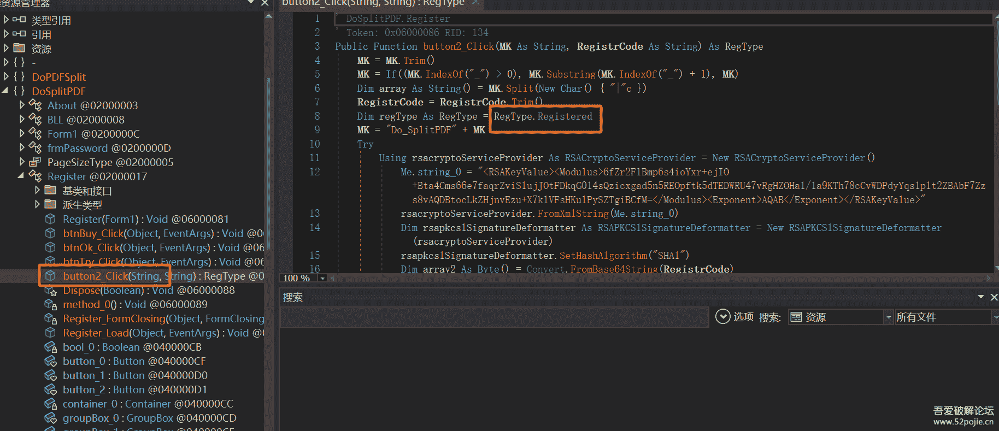
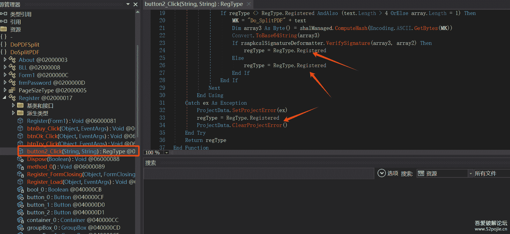
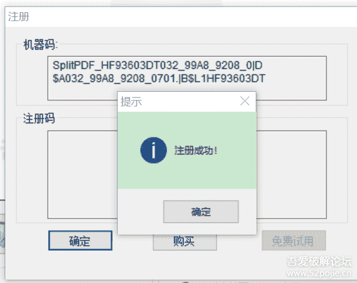
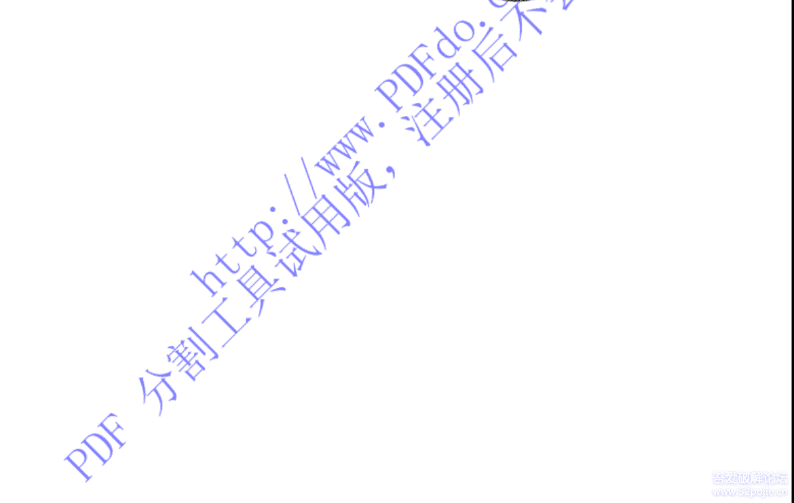

# [.NET逆向] .Net程序的第一次尝试，不完全破解版。

- 原帖：<https://www.52pojie.cn/forum.php?mod=viewthread&tid=1947714>
- 抓取时间：2026-11-01T22:27:00

本人不是学计算机的，以前觉得.Net程序觉得很神秘，无从下手。最近看到论坛有几篇.Net程序的教程（某微信通讯录工具的简单修改、某排8X软件），深受启发，在此谢谢zybn的热心回复。

正好手头有一个PDF分割软件，30天试用期，用`Exeinfo PE`测了一下，是.Net程序。按照教程用`Dnspy`加载，乱七八糟，看不懂，估计有混淆。祭出`.Net Reactor Slayer v6.4.0`，反混淆，再次打开，瞬间清爽很多。

奇怪的是我用搜索查找注册码，无法找到任何信息。凭着代码命名，找到到一些关键点，奈何小白基础差，算法部分看不懂，就简单粗暴的，直接暴力破解。判断部分`unregister`都改为`register`。

`1.png` (296.55 KB, 下载次数: 2)

<https://www.52pojie.cn/forum.php?mod=attachment&aid=MjcxMTU3M3wwYWZlM2ExMnwxNzkzNTcyMDE4fDE2ODA4NnwxOTQ3NzE0&nothumb=yes>

2024-7-25 09:47 上传

`2.png` (262.03 KB, 下载次数: 2)

<https://www.52pojie.cn/forum.php?mod=attachment&aid=MjcxMTU3NHwxMWFlNjUyM3wxNzkzNTcyMDE4fDE2ODA4NnwxOTQ3NzE0&nothumb=yes>

2024-7-25 09:50 上传

另外购买按钮部分代码清除，这样就不会跳转网站了。最后保存修改，运行

`3.png` (75.35 KB, 下载次数: 2)

<https://www.52pojie.cn/forum.php?mod=attachment&aid=MjcxMTU3NXw4YzA5Yzg5MXwxNzkzNTcyMDE4fDE2ODA4NnwxOTQ3NzE0&nothumb=yes>

2024-7-25 09:55 上传

`4.png` (100.74 KB, 下载次数: 3)

<https://www.52pojie.cn/forum.php?mod=attachment&aid=MjcxMTU4NHxkMjkyYjdlMnwxNzkzNTcyMDE4fDE2ODA4NnwxOTQ3NzE0&nothumb=yes>

2024-7-25 09:58 上传

30次后可以正常使用，但有2点遗憾，一是每次运行这个注册窗口会弹出，二是分割的文件有试用版水印，希望向各位大佬学习。
