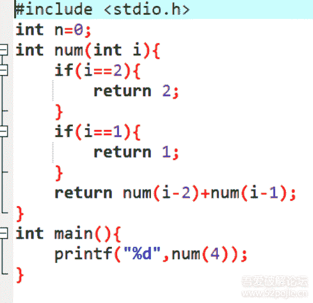
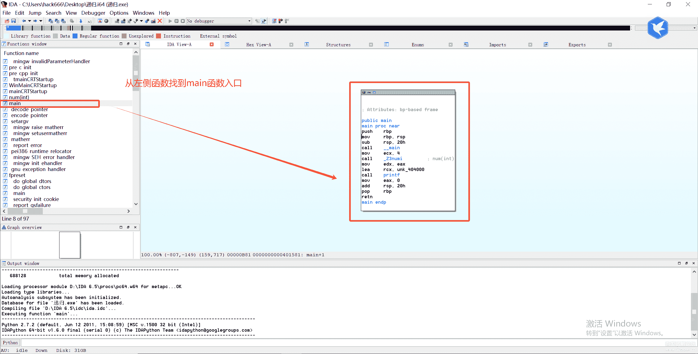
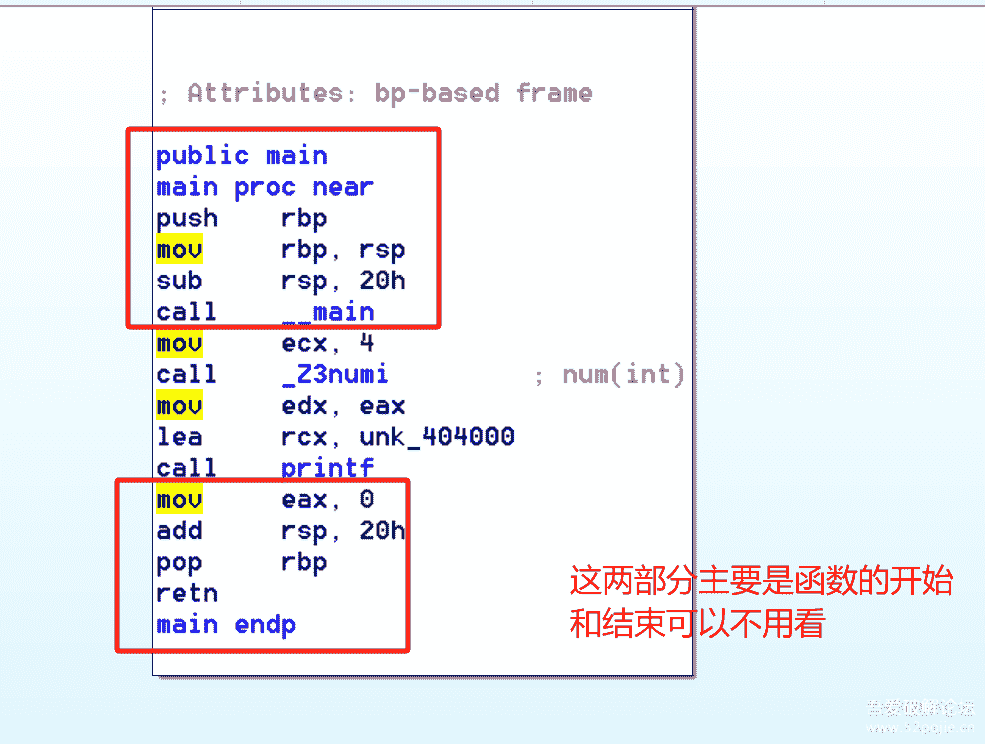
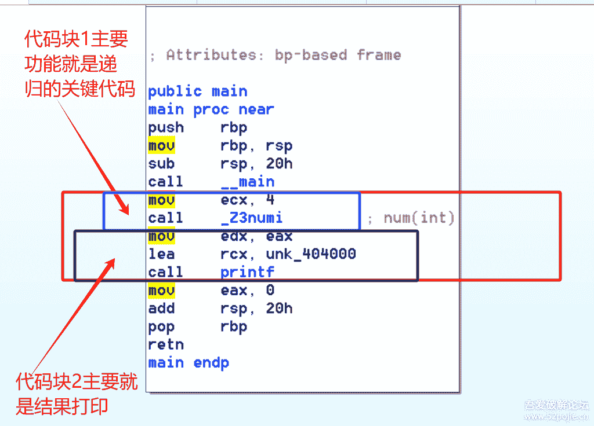
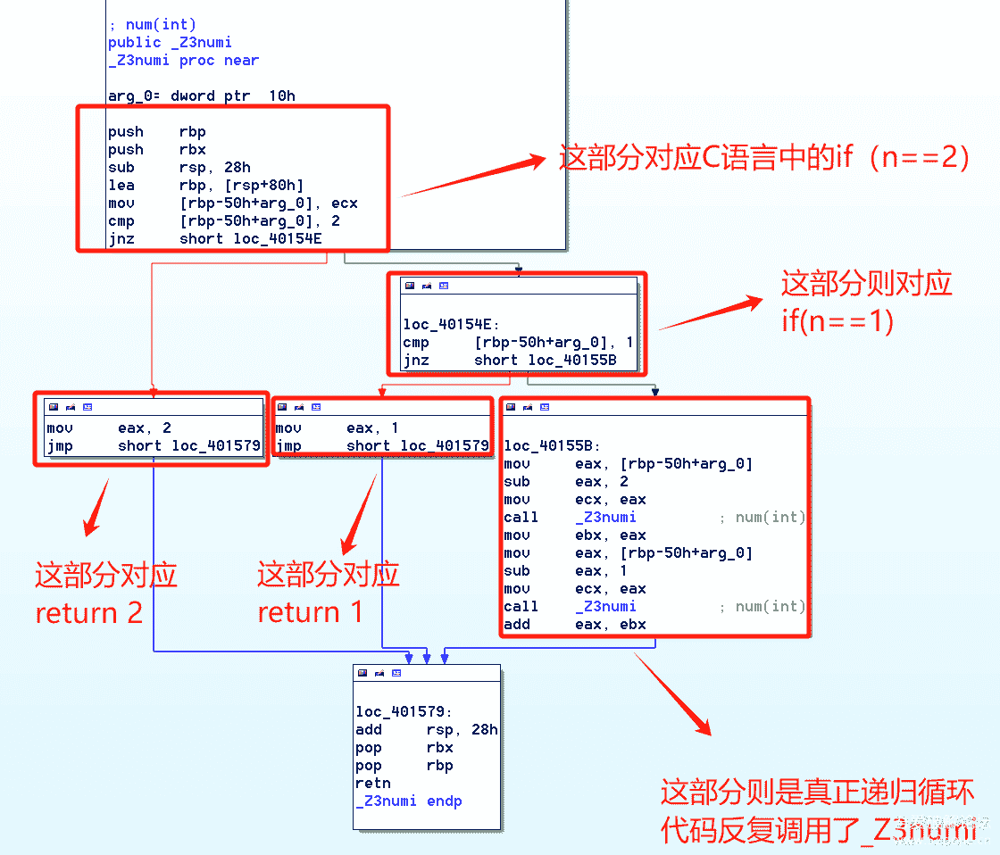

# [原创] ida逆向分析简单递归
- 原帖: https://www.52pojie.cn/forum.php?mod=viewthread&tid=1948201
- 抓取时间: 2026-11-01T22:26:59

## 先看源代码

屏幕截图 2024-07-26 111811.png (62.96 KB, 下载次数: 1)
[href="forum.php?mod=attachment&aid=MjcxMzAzMHxhNWJkZDRiY3wxNzkzNTcyMDE2fDE2ODA4NnwxOTQ4MjAx&nothumb=yes" target="_blank"](https://www.52pojie.cn/forum.php?mod=attachment&aid=MjcxMzAzMHxhNWJkZDRiY3wxNzkzNTcyMDE2fDE2ODA4NnwxOTQ4MjAx&nothumb=yes)
2024-7-29 18:25 上传

## 然后编译生成 exe 并导入 ida

6b603cff882ddaed3b0ebfb5472280f.png (175.12 KB, 下载次数: 1)
[href="forum.php?mod=attachment&aid=MjcxMzAyNXxlNTgwYmM3YnwxNzkzNTcyMDE2fDE2ODA4NnwxOTQ4MjAx&nothumb=yes" target="_blank"](https://www.52pojie.cn/forum.php?mod=attachment&aid=MjcxMzAyNXxlNTgwYmM3YnwxNzkzNTcyMDE2fDE2ODA4NnwxOTQ4MjAx&nothumb=yes)
2024-7-29 18:24 上传

## 从左侧的函数栏找到 main 函数
从左侧的函数栏就可以直接找到`main`函数（程序的入口函数）

175ed501fcde4c204f1a0672b38d022.png (88.15 KB, 下载次数: 2)
[href="forum.php?mod=attachment&aid=MjcxMzAyN3wyNjFkMThiMXwxNzkzNTcyMDE2fDE2ODA4NnwxOTQ4MjAx&nothumb=yes" target="_blank"](https://www.52pojie.cn/forum.php?mod=attachment&aid=MjcxMzAyN3wyNjFkMThiMXwxNzkzNTcyMDE2fDE2ODA4NnwxOTQ4MjAx&nothumb=yes)
2024-7-29 18:24 上传

## 忽略的代码块
这里可以直接忽略这两个代码块。因为这两块代码代表的是`main`函数和函数出口，有兴趣的同学可以单独分析一下。

b2c830b49b909d1b96a14947756c5ad.png (103.76 KB, 下载次数: 3)
[href="forum.php?mod=attachment&aid=MjcxMzAyOXxlN2QyNDk5YnwxNzkzNTcyMDE2fDE2ODA4NnwxOTQ4MjAx&nothumb=yes" target="_blank"](https://www.52pojie.cn/forum.php?mod=attachment&aid=MjcxMzAyOXxlN2QyNDk5YnwxNzkzNTcyMDE2fDE2ODA4NnwxOTQ4MjAx&nothumb=yes)
2024-7-29 18:25 上传

## 递归函数与结果打印
剩下的就可以分为两块代码
一个是递归循环一个是结果打印这个`ida`很人性化的解析出来了`num(int)`这个函数

## 进入递归函数分析
下面首先进入递归函数中进行分析

6c16d04c5c21f0c9b70fe5487be5b24.png (76.68 KB, 下载次数: 1)
[href="forum.php?mod=attachment&aid=MjcxMzAyNnxkOWMwZTUzYXwxNzkzNTcyMDE2fDE2ODA4NnwxOTQ4MjAx&nothumb=yes" target="_blank"](https://www.52pojie.cn/forum.php?mod=attachment&aid=MjcxMzAyNnxkOWMwZTUzYXwxNzkzNTcyMDE2fDE2ODA4NnwxOTQ4MjAx&nothumb=yes)
2024-7-29 18:24 上传

## 递归函数主要逻辑
这个就是递归函数主要逻辑（可以看到`ida`对于源代码的还原性还是非常高的）

## 细致化分析
```
public _Z3numi
_Z3numi proc near
arg_0= dword ptr 10h
push rbp
push rbx
sub rsp, 28h
lea rbp, [rsp+80h]
mov [rbp-50h+arg_0], ecx
cmp [rbp-50h+arg_0], 2
jnz short loc_40154E
mov eax, [rbp-50h+arg_0]
sub eax, 2
mov ecx, eax
call _Z3numi
mov ebx, eax
mov eax, [rbp-50h+arg_0]
sub eax, 1
mov ecx, eax
call _Z3numi
add eax, ebx
```
这个声明将 `_Z3numi` 函数标记为公共符号，使其可以在其他模块中被引用。

`_Z3numi proc near` 是 `_Z3numi` 函数的开始标记，`proc near` 表示这是一个“近”函数，即函数调用不跨越 64 KB 边界。

`arg_0= dword ptr 10h` 是函数的一个局部变量声明，表示 `arg_0` 是一个 `DWORD` 类型（4 字节）的局部变量，偏移量是 16（`0x10`）。

`push rbp` 将当前基指针 `rbp` 的值压入栈中，以保存调用函数之前的栈帧基址。

`push rbx` 将 `rbx` 寄存器的值压入栈中，以保存调用函数之前的 `rbx` 的值。`rbx` 通常用作通用寄存器，在函数调用中需要保留其值。

`sub rsp, 28h` 将栈指针 `rsp` 向下移动 40 字节（`0x28`），为局部变量分配空间。此操作相当于在栈上预留了 40 字节的空间。

`lea rbp, [rsp+80h]` 将 `rsp + 128` 字节（`0x80`）的地址加载到 `rbp`。这设置了新的栈帧基址。注意 `0x80` 可能是用于设置栈帧基址的调整。

`mov [rbp-50h+arg_0], ecx` 将 `ecx` 寄存器中的值存储到 `[rbp - 80h + 10h]` 的内存位置。计算后的地址是 `[rbp - 0x50 + arg_0]`。这里的 `arg_0` 是偏移量 `0x10`，所以实际的地址是 `[rbp - 0x50 + 0x10]`。这意味着 `ecx` 的值被存储在栈上基于 `rbp` 的计算位置。

`cmp [rbp-50h+arg_0], 2` 比较 `[rbp - 0x50 + arg_0]`（即 `ecx` 存储的地方）的值与 2。`arg_0` 的偏移量已经考虑在内，所以实际比较的是 `[rbp - 0x50 + 0x10]` 的值与 2。

`jnz short loc_40154E` 如果比较结果不等于零（即 `[rbp - 0x50 + arg_0]` 的值不等于 2），则跳转到 `loc_40154E` 标签处的代码

`mov eax, [rbp-50h+arg_0]` 从 `[rbp - 0x50 + arg_0]` 内存位置（局部变量或函数参数）加载值到 `eax` 寄存器中。`arg_0` 偏移量已经计算在内，所以实际地址是 `rbp - 0x50 + 0x10`。

`sub eax, 2` 将 `eax` 寄存器中的值减去 2。这个操作的结果会在后续的计算中使用。

`mov ecx, eax` 将刚刚计算后的 `eax` 值（`[rbp - 0x50 + arg_0] - 2`）移动到 `ecx` 寄存器中。

`call _Z3numi` 调用 `_Z3numi` 函数（即 `num(int)`）。在调用约定下，`ecx` 寄存器的值作为参数传递给函数，函数执行后返回值会存储在 `eax` 中。

`mov ebx, eax` 将 `_Z3numi` 函数返回的值（存储在 `eax` 中）移动到 `ebx` 寄存器中。这表示 `ebx` 保存了 `num(int)` 函数调用的结果。

`mov eax, [rbp-50h+arg_0]` 重新从 `[rbp - 0x50 + arg_0]` 内存位置加载原始值到 `eax` 寄存器中。这是为了进行另一组计算。

`sub eax, 1` 将 `eax` 中的值减去 1。

`mov ecx, eax` 将刚刚计算后的 `eax` 值（`[rbp - 0x50 + arg_0] - 1`）移动到 `ecx` 寄存器中。

`call _Z3numi` 再次调用 `_Z3numi` 函数，这次是用 `ecx` 中的新值作为参数，函数返回的结果会存储在 `eax` 中。

`add eax, ebx` 将 `eax`（第二次 `_Z3numi` 函数调用的结果）与 `ebx`（第一次 `_Z3numi` 函数调用的结果）相加，并将结果存储回 `eax` 中。

这个就是对于递归的细致化分析其中为什么会调用两次 `call` 呢因为源代码中 `return num(i-2)+num(i-1);` 调用了两次 `num` 函数。

这个就是分析的过程了

感谢各位观众老爷的提醒，由于首次使用这个平台还有一些不熟练恳请原谅，如果有什么错误的地方还请各位大佬指正。
