# [Web逆向] 手把手分析虾m视频真实地址

- 原帖: https://www.52pojie.cn/forum.php?mod=viewthread&tid=1948446
- 抓取时间: 2026-11-01T22:26:57

### 声明

本文内容为小白入门实战教程，大神请忽视；本文仅供学习交流，请勿用于商业和非法用途，否则由此产生的一切后果均与作者无关；若有侵权，请联系立即删除！

### 接口地址

aHR0cHM6Ly9qeC54bWZsdi5jb20vP3VybD1odHRwczovL3YucXEuY29tL3gvY292ZXIvbXpjMDAyMDB1OHZmemN6Lmh0bWw=

### 实战开始

浏览器打开开发者模式，输入网站请求

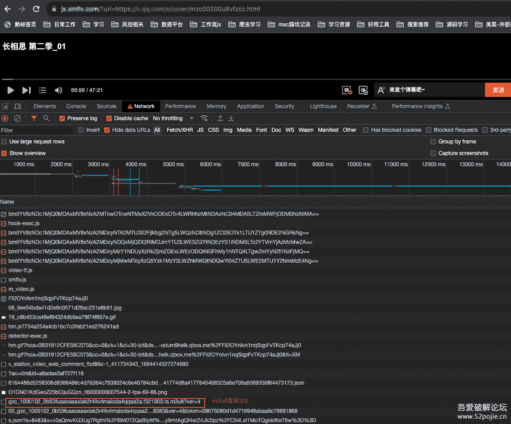

直接就请求完成了，没有复杂的无限`debugger`；省了很多事情；

观察 `url` 请求

上面的请求不多，都点点看看，注意请求的参数与响应体

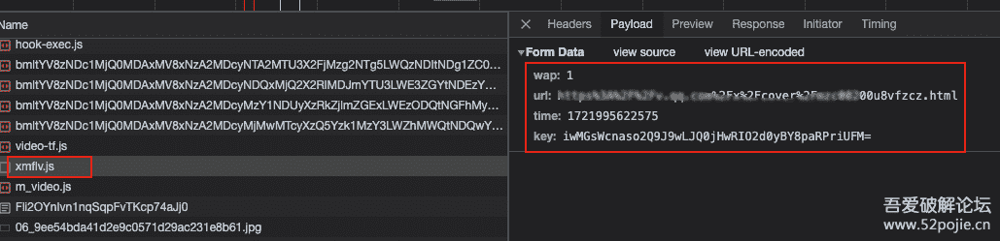

细心的同学会发现，这个`xmflv.js`的请求很诡异，居然是个post请求，响应体是个图片，图片还是裂图，这里边绝逼有鬼，看看这个请求结果到底是什么。

#### 分析怀疑的请求

这个请求提供两种方式

- 将图片下载本地，然后以文本打开该文件

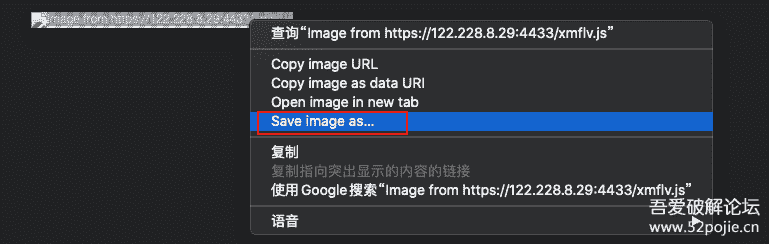

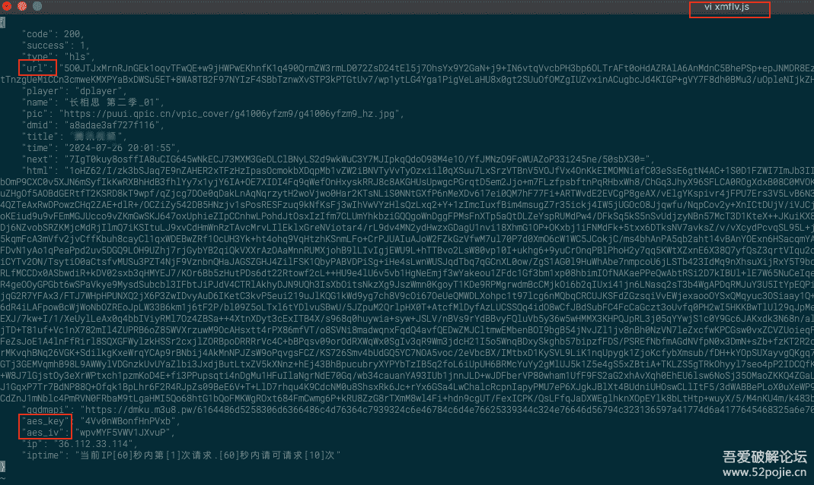

- 复杂请求的`url`，在控制台查看请求响应结果

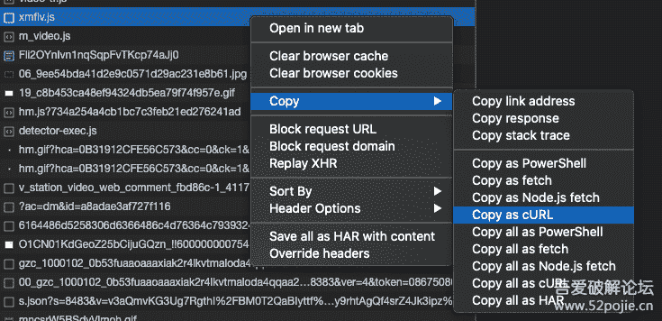

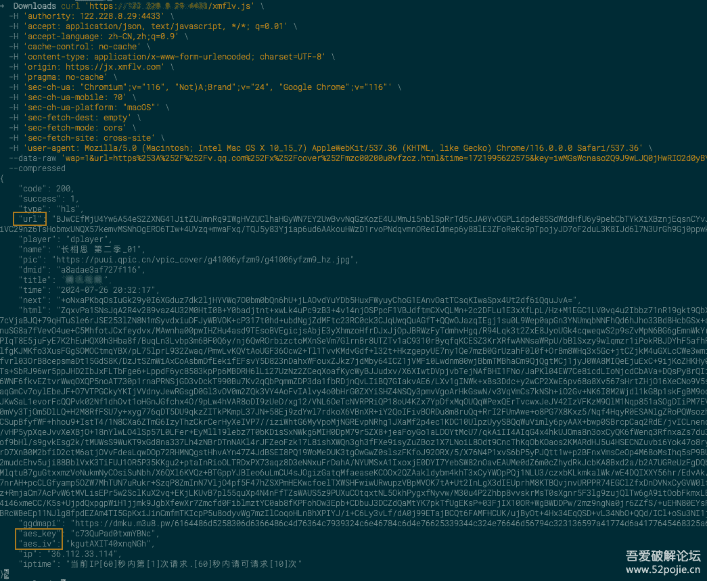

可以发现，加密结果和加密方式 `key` `iv`都出现了，解密看看结果，正是最终的直链地址(这里就不贴图了)

#### 分析算法

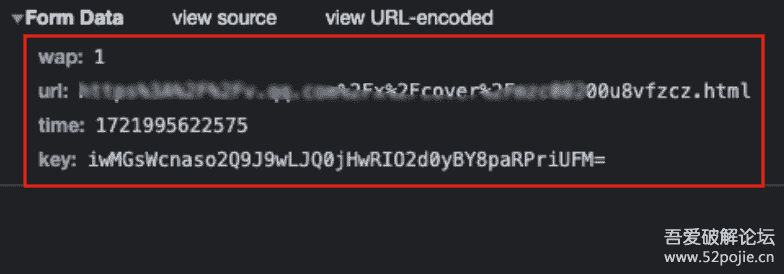

现在目标很明确了，就是获取上述接口的4个请求参数

`wap`：是固定的 1

`url`：是需要解析的官网地址`url`

`time`：一眼就看出是时间戳

就剩下 `key` 参数了，接下来要进行断点跟踪了，这里提供两种方式

- 关键字搜索

尝试 `key:`、`"key":`、`'key':`进行全局搜索，最终发现 `'key':` 能跟到目标代码处

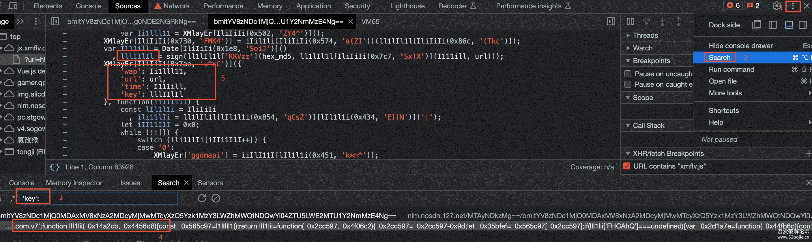

- XHR接口断点

我们知道请求的`url`，可以添加`url`断点,再重新请求

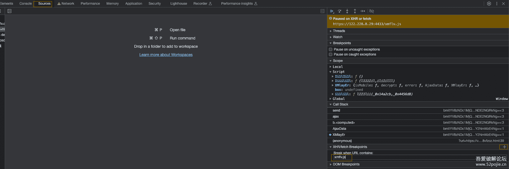

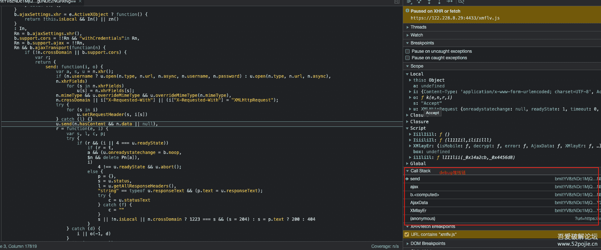

点击请求的上游调用栈，很快就找到了请求参数生成地方

`key` 的生成算法是：

```
sign(ll1lIl1l['KKVzz'](hex_md5, ll1lIl1l[IliIiIi(0x7c7, 'Sx)X')](I111ill, url)))
```

算法混淆比较简单，我们在`console`打印每一步参数与`function`

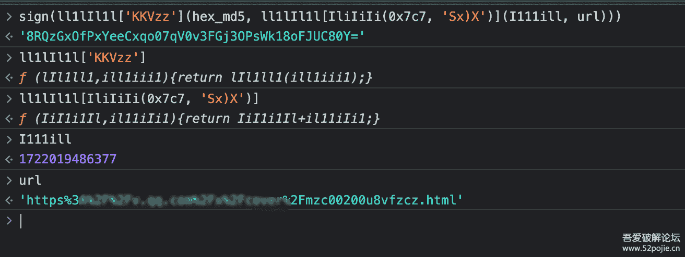

转换下 `key = sign(hex_md5(time + url))`

在追踪`sign`跟`hex_md5`方法

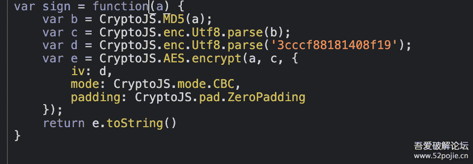

`sign`是标准AES CBC加密

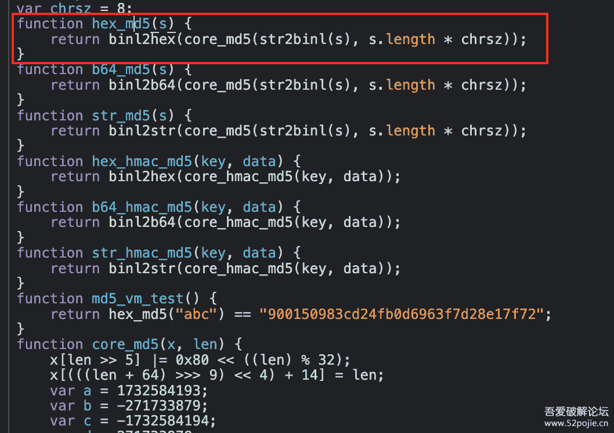

好复杂，根据方法名，盲猜是MD5后再hash，随便找个参数验证一下

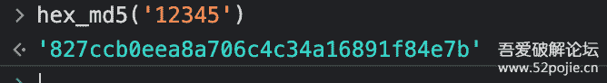

晕，直接就是MD5呀，分析结束。

#### 全局关键字搜索

通常在上面第2步分析`url`没有头绪时，可以直接全局搜索关键字，最常用关键字：`decrypt`

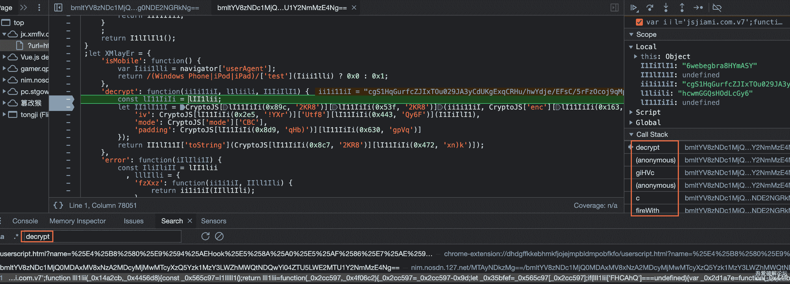

再跟踪调用栈，也找到目标解密代码处

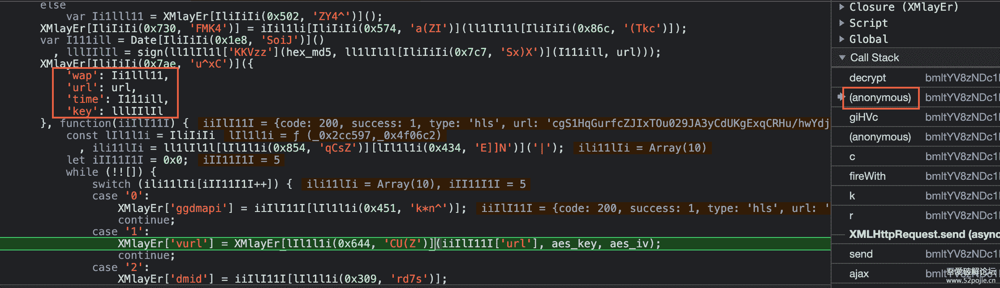
