# [原创] 2023年腾讯游戏安全竞赛PC端初赛复现

- 原帖: https://www.52pojie.cn/forum.php?mod=viewthread&tid=1948904
- 抓取时间: 2026-11-01T22:26:55

## 2023年腾讯游戏安全竞赛PC端初赛复现

### 题目简介

题目描述:
小红是一个PC客户端安全爱好者。有一天她发现一台机器上有一个未知的程序名为`contest.exe`，这个程序会在当前同个目录下的"`contest.txt`"目录里每秒重复写入一次密文的信息。她想了解这个程序究竟写入了什么，并试试能否反过来控制这个程序按自己的意图工作。

评分标准:
（1）在64位Windows10系统上运行`contest.exe`, 找到明文的信息，作为答案提交（1分）。
（2）编写程序，运行时修改尽量少的`contest.exe`内存，让`contest.exe`由写入密文信息变为写入明文信息成功。（满分2分）。
（3）编写程序，运行时修改尽量少的`contest.exe`内存，让`contest.exe`往入自行指定的不同的文件里写入明文信息成功。（满分3分）。
（4）文档编写，详细描述（1）-（3）解题过程，详述提供的解题程序的演示方法。做到清晰易懂，操作可以复现结果。（满2分）。
（5）提供（2）和（3）解题演示所用的源代码。要求编码工整风格优雅（1分）、注释详尽（1分）。

解题要求:
（1）编写代码，通过注入任何`dll`或者`shellcode`或者跨进程修改内存的方式来`patch` `contest.exe`的内存，但`shellcode`不能调用任何系统API。
（2）不得删改`contest.exe`的文件本身。不得使用任何文件和磁盘相关手段（比如同名文件、设置文件权限占坑等方式）阻止或者破坏`contest.exe`的执行。
（3）此题编程中不可使用内核驱动程序。
（4）必须使用64位Win10系统解题。

### 分析程序

`DIE`查壳发现是带了`VMP`的,发现可以拖到`x64dbg`里调试,因为运行的时候每秒都会向文件中写入字符串信息,所以可以猜测用到了哪些函数
- `Sleep`函数
- `fwrite`,`fopen`,`createFile`等文件操作函数

观察符号列表,找到`contest.exe`模块的导入函数

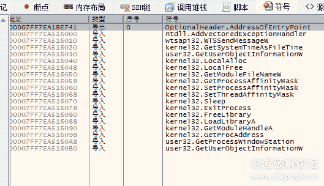
image-20240728193537191.png (33.79 KB, 下载次数: 1)
[href="forum.php?mod=attachment&aid=MjcxMjc0MnxjOTY2MTBlZXwxNzkzNTcyMDEyfDE2ODA4NnwxOTQ4OTA0&nothumb=yes" target="_blank"](https://www.52pojie.cn/forum.php?mod=attachment&aid=MjcxMjc0MnxjOTY2MTBlZXwxNzkzNTcyMDEyfDE2ODA4NnwxOTQ4OTA0&nothumb=yes)
2024-7-28 21:27 上传

只找到了`Sleep`函数,猜测其他函数是通过`LoadLibraryA`来间接使用,先在`Sleep`函数下断

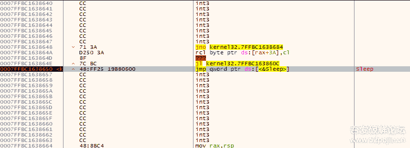
image-20240728193855818.png (47.56 KB, 下载次数: 1)
[href="forum.php?mod=attachment&aid=MjcxMjc0M3xmNzA4NzE5MXwxNzkzNTcyMDEyfDE2ODA4NnwxOTQ4OTA0&nothumb=yes" target="_blank"](https://www.52pojie.cn/forum.php?mod=attachment&aid=MjcxMjc0M3xmNzA4NzE5MXwxNzkzNTcyMDEyfDE2ODA4NnwxOTQ4OTA0&nothumb=yes)
2024-7-28 21:28 上传

确实断下来了,栈回溯找到父函数

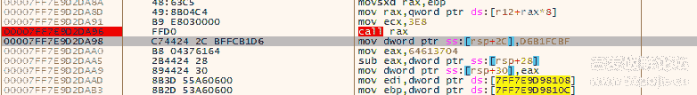
image-20240728195907208.png (36.05 KB, 下载次数: 0)
[href="forum.php?mod=attachment&aid=MjcxMjc0NHwyOTA0MzEwZHwxNzkzNTcyMDEyfDE2ODA4NnwxOTQ4OTA0&nothumb=yes" target="_blank"](https://www.52pojie.cn/forum.php?mod=attachment&aid=MjcxMjc0NHwyOTA0MzEwZHwxNzkzNTcyMDEyfDE2ODA4NnwxOTQ4OTA0&nothumb=yes)
2024-7-28 21:28 上传

在这个函数里调用了`Sleep`函数,现在就需要判断这个函数是不是直接存在于死循环体
因为按照猜测程序应该是有一个死循环体,然后在其中调用了`Sleep`函数,但是可能有多层函数调用需要多次栈回溯
就像这样的代码模型:

```
void run()
{
        while(1)
    {
        fopen(````);

        fwrite(````);
        fclose(```);

        A();

    }

}

void A()

{

    Sleep(```);
}
```

这里通过运行到返回发现程序不停止,说明这个函数已经直接存在于死循环体,那么其他关键文件操作函数也应该存在于这个函数的附近,
对附近所有`Call`指令下断,清空`txt`文件,根据回显发现在这两个`call`之间实现了文件写入

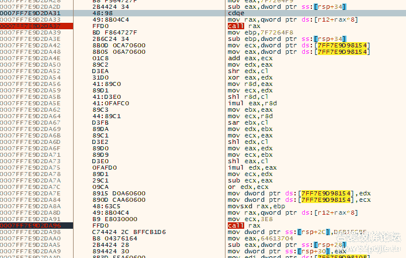
image-20240728201053902.png (60.38 KB, 下载次数: 0)
[href="forum.php?mod=attachment&aid=MjcxMjc0NXwyZjNlNjNhN3wxNzkzNTcyMDEyfDE2ODA4NnwxOTQ4OTA0&nothumb=yes" target="_blank"](https://www.52pojie.cn/forum.php?mod=attachment&aid=MjcxMjc0NXwyZjNlNjNhN3wxNzkzNTcyMDEyfDE2ODA4NnwxOTQ4OTA0&nothumb=yes)
2024-7-28 21:28 上传

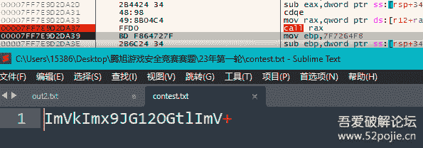
image-20240728201140512.png (38.36 KB, 下载次数: 0)
[href="forum.php?mod=attachment&aid=MjcxMjc0NnxkNjAxNDJmMHwxNzkzNTcyMDEyfDE2ODA4NnwxOTQ4OTA0&nothumb=yes" target="_blank"](https://www.52pojie.cn/forum.php?mod=attachment&aid=MjcxMjc0NnxkNjAxNDJmMHwxNzkzNTcyMDEyfDE2ODA4NnwxOTQ4OTA0&nothumb=yes)
2024-7-28 21:29 上传

继续调试发现了是在`00007FF7E9D2DA37`这个函数内实现了文件内容写入,但是不是每次调用这个函数都会向文件写入,而是每两次调用写入一次文件,暂时不知道为什么,步进分析该函数

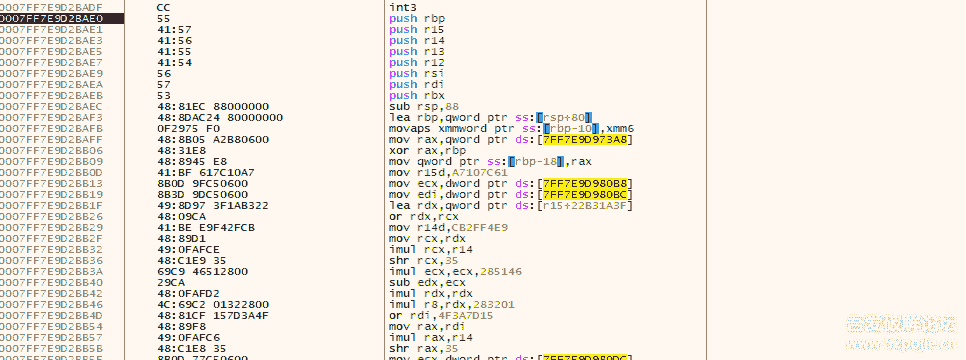
image-20240728201458641.png (80.9 KB, 下载次数: 0)
[href="forum.php?mod=attachment&aid=MjcxMjc0N3xhYWE4MTg4ZnwxNzkzNTcyMDEyfDE2ODA4NnwxOTQ4OTA0&nothumb=yes" target="_blank"](https://www.52pojie.cn/forum.php?mod=attachment&aid=MjcxMjc0N3xhYWE4MTg4ZnwxNzkzNTcyMDEyfDE2ODA4NnwxOTQ4OTA0&nothumb=yes)
2024-7-28 21:29 上传

到了`00007FF7E9D2BCB0`这个函数,继续对这个函数内所有`call`指令下断点分析争取找到具体文件操作函数
下完断点,总共有十多个`call`指令,依次运行分析

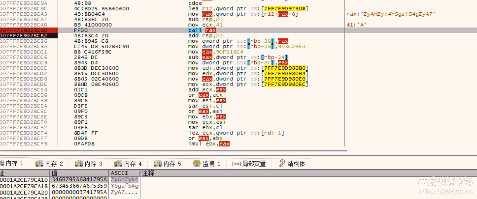
image-20240728201851319.png (88.94 KB, 下载次数: 1)
[href="forum.php?mod=attachment&aid=MjcxMjc0OHwzNWE4NjBhZXwxNzkzNTcyMDEyfDE2ODA4NnwxOTQ4OTA0&nothumb=yes" target="_blank"](https://www.52pojie.cn/forum.php?mod=attachment&aid=MjcxMjc0OHwzNWE4NjBhZXwxNzkzNTcyMDEyfDE2ODA4NnwxOTQ4OTA0&nothumb=yes)
2024-7-28 21:29 上传

第一个`call`指令运行完的返回值是一个字符串`ZyAhZyk4YSgzfS4gZyA7`,猜测是明文或者某个加解密的密钥,继续运行分析

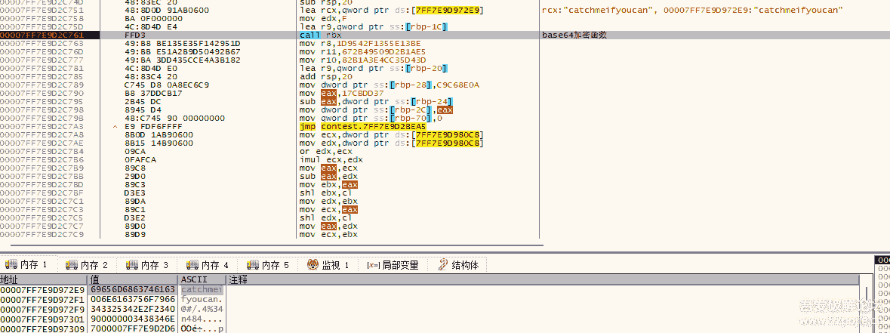
image-20240728202015211.png (100.24 KB, 下载次数: 0)
[href="forum.php?mod=attachment&aid=MjcxMjc0OXwzODI0NjJjOXwxNzkzNTcyMDEyfDE2ODA4NnwxOTQ4OTA0&nothumb=yes" target="_blank"](https://www.52pojie.cn/forum.php?mod=attachment&aid=MjcxMjc0OXwzODI0NjJjOXwxNzkzNTcyMDEyfDE2ODA4NnwxOTQ4OTA0&nothumb=yes)
2024-7-28 21:29 上传

第二个`call`指令的函数传参的第一个参数`rcx`也是一个字符串`catchmeifyoucan`,emm,这个很明显应该就是明文了,步进函数分析这个`rbx`函数是个什么东西

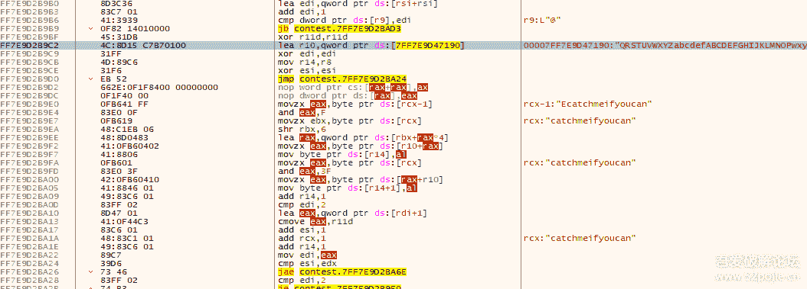
image-20240728202205235.png (95.08 KB, 下载次数: 1)
[href="forum.php?mod=attachment&aid=MjcxMjc1MHxjOTY2NDEzNHwxNzkzNTcyMDEyfDE2ODA4NnwxOTQ4OTA0&nothumb=yes" target="_blank"](https://www.52pojie.cn/forum.php?mod=attachment&aid=MjcxMjc1MHxjOTY2NDEzNHwxNzkzNTcyMDEyfDE2ODA4NnwxOTQ4OTA0&nothumb=yes)
2024-7-28 21:29 上传

找到了一个疑似`base64`加密的表`QRSTUVWXYZabcdefABCDEFGHIJKLMNOPwxyz0123456789+/ghijklmnopqrstuv`,试着将明文和这个表进行一个`base64`变表加密

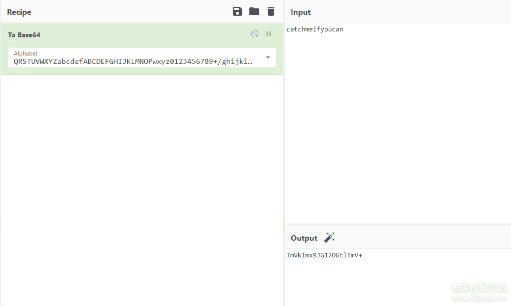
image-20240728202356206.png (22.81 KB, 下载次数: 1)
[href="forum.php?mod=attachment&aid=MjcxMjc1MXw0NGNjMmNjNHwxNzkzNTcyMDEyfDE2ODA4NnwxOTQ4OTA0&nothumb=yes" target="_blank"](https://www.52pojie.cn/forum.php?mod=attachment&aid=MjcxMjc1MXw0NGNjMmNjNHwxNzkzNTcyMDEyfDE2ODA4NnwxOTQ4OTA0&nothumb=yes)
2024-7-28 21:30 上传

`cyberchef`跑一下一下发现确实是密文,那明文就确定了,就是`catchmeifyoucan`,继续分析

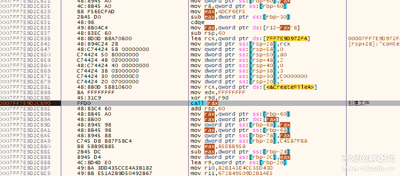
image-20240728202702213.png (102.78 KB, 下载次数: 2)
[href="forum.php?mod=attachment&aid=MjcxMjc1MnwzNTZiZTliNHwxNzkzNTcyMDEyfDE2ODA4NnwxOTQ4OTA0&nothumb=yes" target="_blank"](https://www.52pojie.cn/forum.php?mod=attachment&aid=MjcxMjc1MnwzNTZiZTliNHwxNzkzNTcyMDEyfDE2ODA4NnwxOTQ4OTA0&nothumb=yes)
2024-7-28 21:30 上传

第四个`call`函数的第一个传参`RCX`是`CreateFileA`地址,那就应该是创建文件了,题目要求向不同的文件里写入明文信息,那么只要确定文件名所在的参数位置就可以了,观察传参

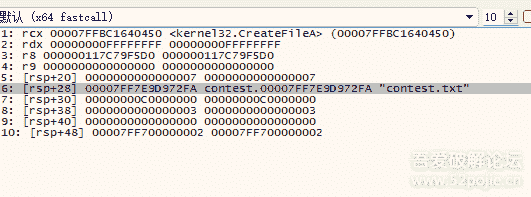
image-20240728202941236.png (17.26 KB, 下载次数: 1)
[href="forum.php?mod=attachment&aid=MjcxMjc1M3wzYjk3ZWY3OHwxNzkzNTcyMDEyfDE2ODA4NnwxOTQ4OTA0&nothumb=yes" target="_blank"](https://www.52pojie.cn/forum.php?mod=attachment&aid=MjcxMjc1M3wzYjk3ZWY3OHwxNzkzNTcyMDEyfDE2ODA4NnwxOTQ4OTA0&nothumb=yes)
2024-7-28 21:30 上传

第6个参数是`contest.txt`,应该就是文件名地址了,继续分析

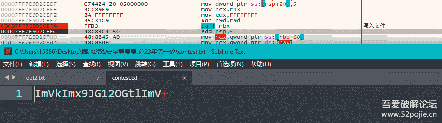
image-20240728203143148.png (45.13 KB, 下载次数: 1)
[href="forum.php?mod=attachment&aid=MjcxMjc1NHwzZWVjY2VlMnwxNzkzNTcyMDEyfDE2ODA4NnwxOTQ4OTA0&nothumb=yes" target="_blank"](https://www.52pojie.cn/forum.php?mod=attachment&aid=MjcxMjc1NHwzZWVjY2VlMnwxNzkzNTcyMDEyfDE2ODA4NnwxOTQ4OTA0&nothumb=yes)
2024-7-28 21:30 上传

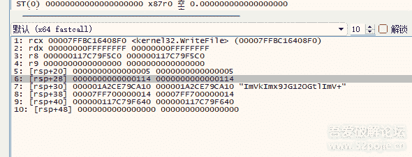
image-20240728203523583.png (19.95 KB, 下载次数: 1)
[href="forum.php?mod=attachment&aid=MjcxMjc1NXw1M2RkZWI2NHwxNzkzNTcyMDEyfDE2ODA4NnwxOTQ4OTA0&nothumb=yes" target="_blank"](https://www.52pojie.cn/forum.php?mod=attachment&aid=MjcxMjc1NXw1M2RkZWI2NHwxNzkzNTcyMDEyfDE2ODA4NnwxOTQ4OTA0&nothumb=yes)
2024-7-28 21:30 上传

第七个`call`指令运行完文件就被写入了,然后`rcx`也是`WriteFileA`函数地址,所以这里面应该就是一个写入文件,第七个参数是写入字符串内容,根据搜索找到`WriteFileA`函数定义

```
BOOL WriteFile(
    HANDLE hFile,          // 需要写入数据的文件句柄
    LPCVOID lpBuffer,      // 指向要写入的数据缓冲区的指针
    DWORD nNumberOfBytesToWrite, // 要写入的字节数
    LPDWORD lpNumberOfBytesWritten, // 用于接收实际写入的字节数
    LPOVERLAPPED lpOverlapped // 指向OVERLAPPED结构的指针，用于异步操作
);
```

根据传参顺序和写入的字节数是`DWORD`类型推断第八个参数的低四字节可能是要写入的字节数,这里对应`0x14`

有了这些我们就可以初步编写代码,思路就是尝试`hook`创建文件和写入文件的两个`call`,传入需要的参数即可


这里最开始是想通过`VirtualProtect`函数和写入`ShellCode`来实现`hook`，但是在调试的时候发现了报错。

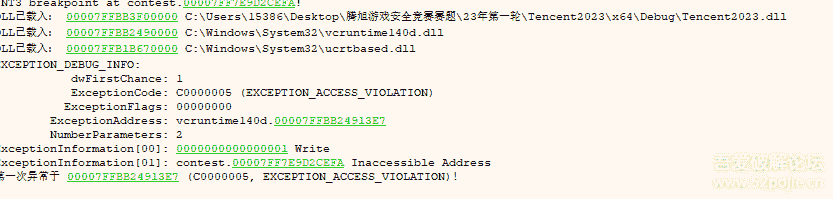

`image-20240728204525969.png` (35.51 KB, 下载次数: 0)

[下载附件](https://www.52pojie.cn/forum.php?mod=attachment&aid=MjcxMjc1Nnw0ZmQ3ODEzMHwxNzkzNTcyMDEyfDE2ODA4NnwxOTQ4OTA0&nothumb=yes)

2024-7-28 21:30 上传

显示没有写入的权限，那只能先加载`dll`进去调试一番。

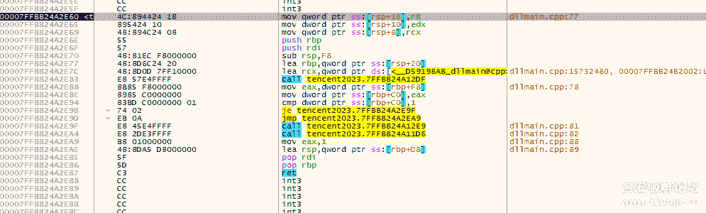

`image-20240728205314971.png` (71.57 KB, 下载次数: 0)

[下载附件](https://www.52pojie.cn/forum.php?mod=attachment&aid=MjcxMjc1N3w5OGU3NmRkYnwxNzkzNTcyMDEyfDE2ODA4NnwxOTQ4OTA0&nothumb=yes)

2024-7-28 21:30 上传

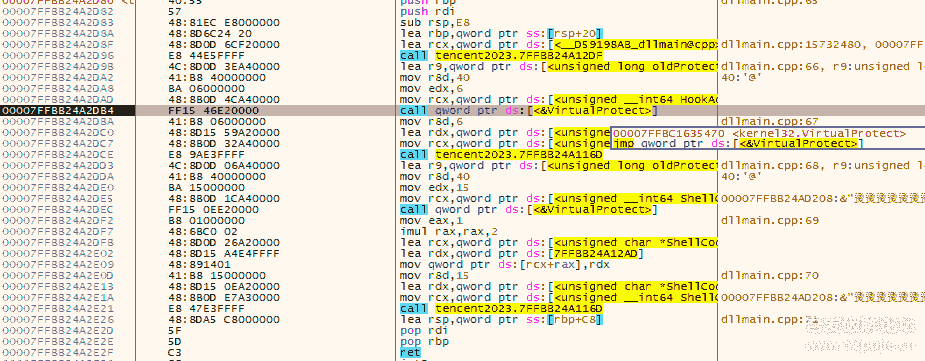

`image-20240728205359287.png` (105.9 KB, 下载次数: 1)

[下载附件](https://www.52pojie.cn/forum.php?mod=attachment&aid=MjcxMjc1OHxkNzJjNGRhMXwxNzkzNTcyMDEyfDE2ODA4NnwxOTQ4OTA0&nothumb=yes)

2024-7-28 21:31 上传

根据调试结果发现，在`virtualProtect`时返回了`NULL`，步进分析。

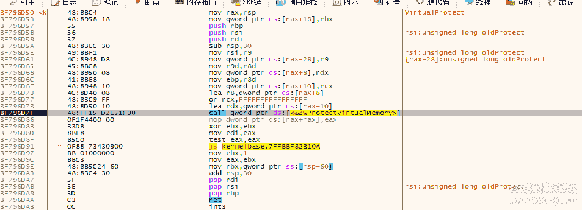

`image-20240728205602337.png` (78.2 KB, 下载次数: 0)

[下载附件](https://www.52pojie.cn/forum.php?mod=attachment&aid=MjcxMjc1OXw5NDQ2NTAzY3wxNzkzNTcyMDEyfDE2ODA4NnwxOTQ4OTA0&nothumb=yes)

2024-7-28 21:31 上传

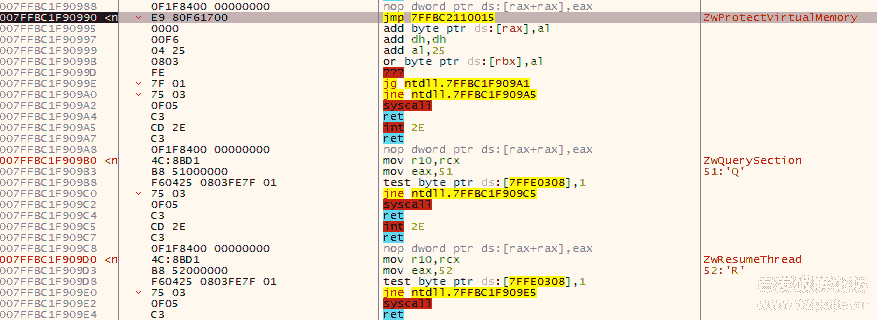

`image-20240728205621763.png` (62.35 KB, 下载次数: 0)

[下载附件](https://www.52pojie.cn/forum.php?mod=attachment&aid=MjcxMjc2MHwxOWM1ZTIzN3wxNzkzNTcyMDEyfDE2ODA4NnwxOTQ4OTA0&nothumb=yes)

2024-7-28 21:31 上传

到这发现了一个奇怪的`jmp`指令，和附近的其他函数形成鲜明对比，猜测作者在这动了手脚，`hook`了`ZwProtectVirtualMemory`函数，根据附近汇编代码取消钩子后运行，成功跑出结果。

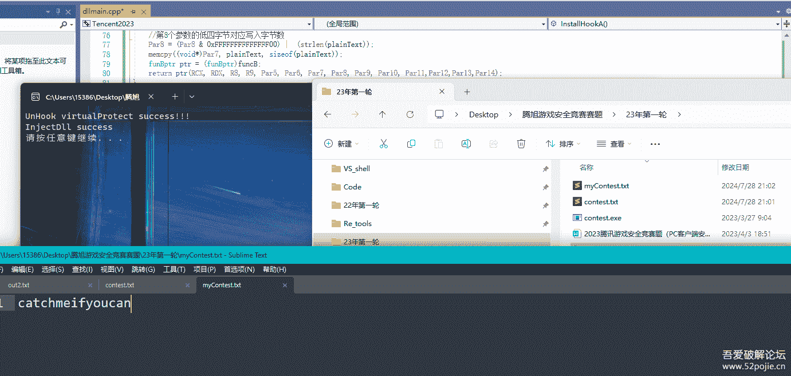

`image-20240728210222057.png` (280.3 KB, 下载次数: 1)

[下载附件](https://www.52pojie.cn/forum.php?mod=attachment&aid=MjcxMjc2MXwyOGNjMDBiZXwxNzkzNTcyMDEyfDE2ODA4NnwxOTQ4OTA0&nothumb=yes)

2024-7-28 21:31 上传

### 代码实现

可以通过注入器`UnHook` `ZwProtectVirtualMemory`函数，然后再进行注入。

注入器代码：

```
#include 
#include 
#include 
#include 
wchar_t dllPath[] = L"C:\\Users\\15386\\Desktop\\腾旭游戏安全竞赛赛题\\23年第一轮\\wp\\Tencent2023.dll";
wchar_t exeName[] = L"contest.exe";
DWORD64 UnHookAddr = 0x00007FFBC1F90990; // ZwProtectVirtualMemory地址
BYTE UnHookShellCode[] = {
0x4C, 0x8B, 0xD1, 0xB8, 0x50, 0x00, 0x00, 0x00, 0xF6, 0x04, 0x25, 0x08, 0x03, 0xFE, 0x7F, 0x01,
 0x75, 0x03, 0x0F, 0x05, 0xC3, 0xCD, 0x2E, 0xC3
};
/* Unhook还原ZwProtectVirtualMemory
00007FFBC1F90990 
```

dll代码：

```
// dllmain.cpp : 定义 DLL 应用程序的入口点。

#include "pch.h"

DWORD64 HookAddrA = (DWORD64)GetModuleHandleA("contest.exe") + 0xCB90; //创建文件处,call rax,add rsp,3C

DWORD64 funcA = (DWORD64)GetModuleHandleA("contest.exe") + 0xD6A0; // call rax的rax对应地址,需要hook的函数

DWORD64 ShellCodeAddrA = (DWORD64)GetModuleHandleA("contest.exe") + 0x26B16;

BYTE HookShellCodeA[] = { 0xE9,0x81,0x9F,0x01,0x00,0x90 };

/* call rax 段代码

00007FF7E9D2CB8D   | 45:31C9                              | xor r9d,r9d                                   |

00007FF7E9D2CB90   | E9 819F0100                          | jmp contest.7FF7E9D46B16                      | 创建文件

00007FF7E9D2CB95   | 90                                   | nop                                           |

00007FF7E9D2CB96   | 48:8B45 A0                           | mov rax,qword ptr ss:[rbp-60]                 |

*/

BYTE ShellCodeA[] = {

0x48, 0xBE, 0x00, 0x00, 0x00, 0x00, 0x00, 0x00, 0x00, 0x00, 0xFF, 0xD6, 0x48, 0x83, 0xC4, 0x60,

 0xE9, 0x6B, 0x60, 0xFE, 0xFF

};

/* shellCodeA

00007FF7E9D46B16   | 48:BE 13117A9FFB7F0000               | mov rsi,tencent2023.7FFB9F7A1113              |

00007FF7E9D46B20   | FFD6                                 | call rsi                                      |

00007FF7E9D46B22   | 48:83C4 60                           | add rsp,60                                    |

00007FF7E9D46B26   | E9 6B60FEFF                          | jmp contest.7FF7E9D2CB96                      |

00007FF7E9D46B2B   | CC                                   | int3                                          |

*/

typedef void (*funAptr)(

DWORD64 RCX, DWORD64 RDX, DWORD64 R8, DWORD64 R9,

DWORD64 Par5, DWORD64 Par6, DWORD64 Par7, DWORD64 Par8,

DWORD64 Par9, DWORD64 Par10, DWORD64 Par11);

DWORD64 HookAddrB = (DWORD64)GetModuleHandleA("contest.exe") + 0xCEFA;

DWORD64 ShellCodeAddrB = (DWORD64)GetModuleHandleA("contest.exe") + 0x26BC0;

BYTE HookShellCodeB[] = {0xE9, 0xC1, 0x9C, 0x01, 0x00, 0x90};

/*call rax 段代码

00007FF7E9D2CEF7   | 45:31C9                              | xor r9d,r9d                                   |

00007FF7E9D2CEFA   | E9 C19C0100                          | jmp contest.7FF7E9D46BC0                      | 写入文件

00007FF7E9D2CEFF   | 90                                   | nop                                           |

00007FF7E9D2CF00   | 48:8B45 A0                           | mov rax,qword ptr ss:[rbp-60]                 |

*/

BYTE ShellCodeB[] = {

0x48, 0xB8, 0x00, 0x00, 0x00, 0x00, 0x00, 0x00, 0x00, 0x00, 0xFF, 0xD0, 0x48, 0x83, 0xC4, 0x50,

 0xE9, 0x2B, 0x63, 0xFE, 0xFF

};

/* shellCodeB

00007FF7E9D46BC0   | 48:B8 AD127A9FFB7F0000               | mov rax,tencent2023.7FFB9F7A12AD              |

00007FF7E9D46BCA   | FFD0                                 | call rax                                      |

00007FF7E9D46BCC   | 48:83C4 50                           | add rsp,50                                    |

00007FF7E9D46BD0   | E9 2B63FEFF                          | jmp contest.7FF7E9D2CF00                      |

00007FF7E9D46BD5   | CC                                   | int3                                          |

*/

DWORD64 funcB = (DWORD64)GetModuleHandleA("contest.exe") + 0xD6A0; // call rax的rax对应地址,需要hook的函数

typedef void (*funBptr)(

    DWORD64 RCX, DWORD64 RDX, DWORD64 R8, DWORD64 R9,

    DWORD64 Par5, DWORD64 Par6, DWORD64 Par7, DWORD64 Par8,

    DWORD64 Par9, DWORD64 Par10,DWORD64 Par11, DWORD64 Par12,

    DWORD64 Par13, DWORD64 Par14);

DWORD oldProtect = 0;

char plainText[] = "catchmeifyoucan";

char fileName[] = "myContest.txt";

void __fastcall HookFuncA(

    DWORD64 RCX,DWORD64 RDX,DWORD64 R8,DWORD64 R9,

    DWORD64 Par5,DWORD64 Par6,DWORD64 Par7,DWORD64 Par8,

    DWORD64 Par9,DWORD64 Par10,DWORD64 Par11)

{

    //第6个参数对应文件名地址

    memcpy((void*)Par6, fileName, sizeof(fileName)); 

    funAptr ptr = (funAptr)funcA;

    return ptr(RCX, RDX, R8, R9, Par5, Par6, Par7, Par8, Par9, Par10, Par11);

}

void __fastcall HookFuncB(

    DWORD64 RCX, DWORD64 RDX, DWORD64 R8, DWORD64 R9,

    DWORD64 Par5, DWORD64 Par6, DWORD64 Par7, DWORD64 Par8,

    DWORD64 Par9, DWORD64 Par10, DWORD64 Par11,DWORD64 Par12,

    DWORD64 Par13,DWORD64 Par14)

{

    //第7个参数对应明文地址

    //第8个参数的低四字节对应写入字节数

    Par8 = (Par8 & 0xFFFFFFFFFFFFFF00) |  (strlen(plainText));

    memcpy((void*)Par7, plainText, sizeof(plainText));

    funBptr ptr = (funBptr)funcB;

    return ptr(RCX, RDX, R8, R9, Par5, Par6, Par7, Par8, Par9, Par10, Par11,Par12,Par13,Par14);

}

void InstallHookA()

{

    VirtualProtect((LPVOID)HookAddrA, sizeof(HookShellCodeA), PAGE_EXECUTE_READWRITE, &oldProtect);

    memcpy((void*)HookAddrA, HookShellCodeA, sizeof(HookShellCodeA));

    VirtualProtect((LPVOID)ShellCodeAddrA, sizeof(ShellCodeA), PAGE_EXECUTE_READWRITE, &oldProtect);

    *(DWORD64*)&ShellCodeA[2] = (DWORD64)HookFuncA;
```


```
memcpy((void*)ShellCodeAddrA, ShellCodeA, sizeof(ShellCodeA));

}

void InstallHookB()

{

    VirtualProtect((LPVOID)HookAddrB, sizeof(HookShellCodeB), PAGE_EXECUTE_READWRITE, &oldProtect);

    memcpy((void*)HookAddrB, HookShellCodeB, sizeof(HookShellCodeB));

    VirtualProtect((LPVOID)ShellCodeAddrB, sizeof(ShellCodeB), PAGE_EXECUTE_READWRITE, &oldProtect);

    *(DWORD64*)&ShellCodeB[2] = (DWORD64)HookFuncB;

    memcpy((void*)ShellCodeAddrB, ShellCodeB, sizeof(ShellCodeB));

}

BOOL APIENTRY DllMain( HMODULE hModule,

                       DWORD  ul_reason_for_call,

                       LPVOID lpReserved

                     )

{

    switch (ul_reason_for_call)

    {

    case DLL_PROCESS_ATTACH:

        InstallHookB();

        InstallHookA();

    case DLL_THREAD_ATTACH:

    case DLL_THREAD_DETACH:

    case DLL_PROCESS_DETACH:

        break;

    }

    return TRUE;

}
```
