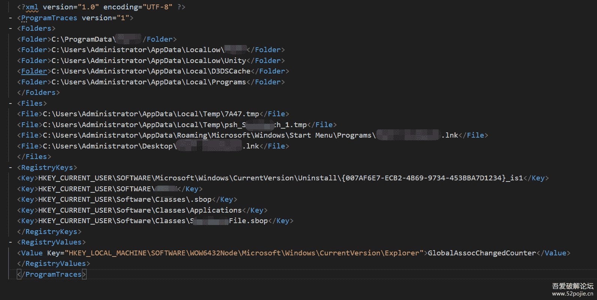
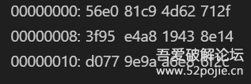
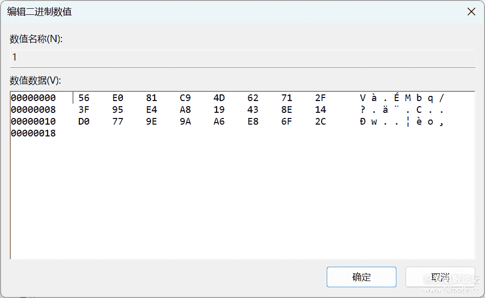
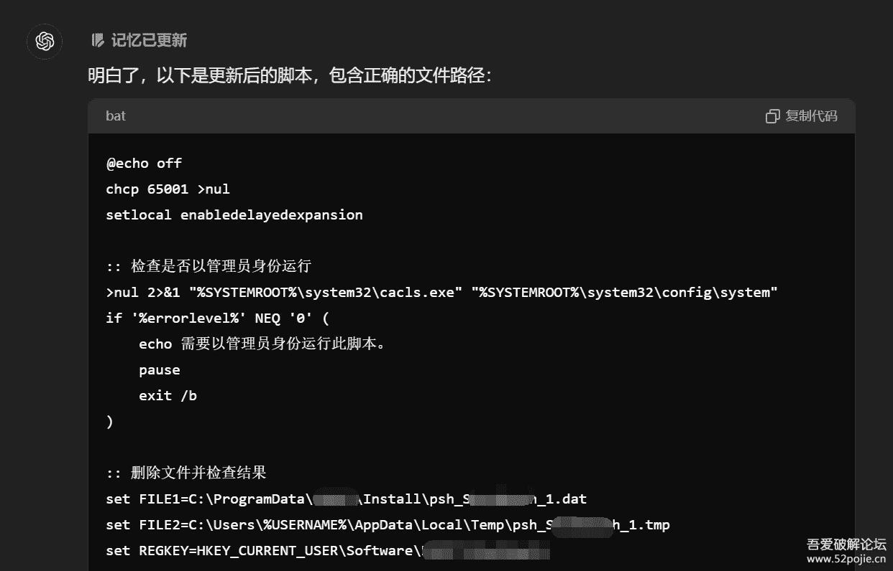

# [分享] 记录一个极其绕路的试用重置方案

- 原帖: https://www.52pojie.cn/forum.php?mod=viewthread&tid=1948924
- 抓取时间: 2026-11-01T22:26:53

首先安装，看到软件是用 unity 的，毕竟目录下连 `unityPlayer.dll` 都出来了

`B_GPJ_Y~]GOMVAPXD]T@SUB.png` (16.34 KB, 下载次数: 3)
[href="forum.php?mod=attachment&aid=MjcxMjc2OXxjNDBhNWZmN3wxNzkzNTcyMDEwfDE2ODA4NnwxOTQ4OTI0&nothumb=yes" target="_blank"](https://www.52pojie.cn/forum.php?mod=attachment&aid=MjcxMjc2OXxjNDBhNWZmN3wxNzkzNTcyMDEwfDE2ODA4NnwxOTQ4OTI0&nothumb=yes)
2024-7-28 22:39 上传

本来说之前 B 站看 `dnspy` 操作好像都比 `ida` 简单多了，所以打算试一下，结果发现这软件用了 `il2cpp`，虽然可能对大佬来说只是难度增加了一点，但是对我这种非专业人来说就是灾难。
在尝试了好几天后放弃了从软件内部进行 hack 的操作（说句不好听的学习的时间成本都大于这软件正版价格了）
回过头来把目光转向到了如何重置试用上

首先重新解压一个新的[//www.52pojie.cn/thread-661779-1-1.html" target="_blank" class="relatedlink"](https://www.52pojie.cn/thread-661779-1-1.html:href="https)，主要目的是为了有一个完全没安装过软件的环境，然后使用 `geek` 进行跟踪安装

`MLZ{1YHUYGL74EF7V4QPRJC.png` (193.23 KB, 下载次数: 3)
[href="forum.php?mod=attachment&aid=MjcxMjc3MXxmYTYxM2FhMnwxNzkzNTcyMDEwfDE2ODA4NnwxOTQ4OTI0&nothumb=yes" target="_blank"](https://www.52pojie.cn/forum.php?mod=attachment&aid=MjcxMjc3MXxmYTYxM2FhMnwxNzkzNTcyMDEwfDE2ODA4NnwxOTQ4OTI0&nothumb=yes)
2024-7-28 22:48 上传

这样就获取到了软件安装后都写入了什么注册表和什么文件

————————————————————————

然后我就开始了.......
非常暴力的方案.....

卸载后看什么文件有保留，每次卸载后用 `geek` 清理的时候不会全部清理而是清理部分
最后通过了快 10 次的卸载重装，最后终于把目标锁定到了两个文件和一个注册表上

两个文件是同样的数据，但是如果只删除其中一个它会被复原成原来的字节，数据如下
如果有看得懂的大佬能解析一下就更好了？

`$M8UL}]0%(JO4D%MJPMG~DK.png` (19.04 KB, 下载次数: 2)
[href="forum.php?mod=attachment&aid=MjcxMjc3MnwzODBlOWUyYnwxNzkzNTcyMDEwfDE2ODA4NnwxOTQ4OTI0&nothumb=yes" target="_blank"](https://www.52pojie.cn/forum.php?mod=attachment&aid=MjcxMjc3MnwzODBlOWUyYnwxNzkzNTcyMDEwfDE2ODA4NnwxOTQ4OTI0&nothumb=yes)
2024-7-28 22:52 上传

另一份是注册表，也是这个二进制，等于说他有三份备份？

`NQ6QU@{%)4NTO4MBYX3G.png` (29.08 KB, 下载次数: 3)
[href="forum.php?mod=attachment&aid=MjcxMjc3M3w2ZWZhNmZkYnwxNzkzNTcyMDEwfDE2ODA4NnwxOTQ4OTI0&nothumb=yes" target="_blank"](https://www.52pojie.cn/forum.php?mod=attachment&aid=MjcxMjc3M3w2ZWZhNmZkYnwxNzkzNTcyMDEwfDE2ODA4NnwxOTQ4OTI0&nothumb=yes)
2024-7-28 22:55 上传

直接将这些数据全部删除！
再次重启软件，则这些数据会因为找不到而被软件重新生成一次，就变相达到了重置注册的目的

既然目的达成了就别管理由是什么了，直接找朋友来帮我写个清理这些数据的 `bat`，软件试用期本身就足足有 30 天，所以来一个 `bat` 其实就差不多够用了

`IJK}R0P}JZQJ4VM)$VPYF_R.png` (107.22 KB, 下载次数: 3)
[href="forum.php?mod=attachment&aid=MjcxMjc4MnxkMWVmMzFkYXwxNzkzNTcyMDEwfDE2ODA4NnwxOTQ4OTI0&nothumb=yes" target="_blank"](https://www.52pojie.cn/forum.php?mod=attachment&aid=MjcxMjc4MnxkMWVmMzFkYXwxNzkzNTcyMDEwfDE2ODA4NnwxOTQ4OTI0&nothumb=yes)
2024-7-28 23:02 上传

方法很低级，但完成目的就行了
